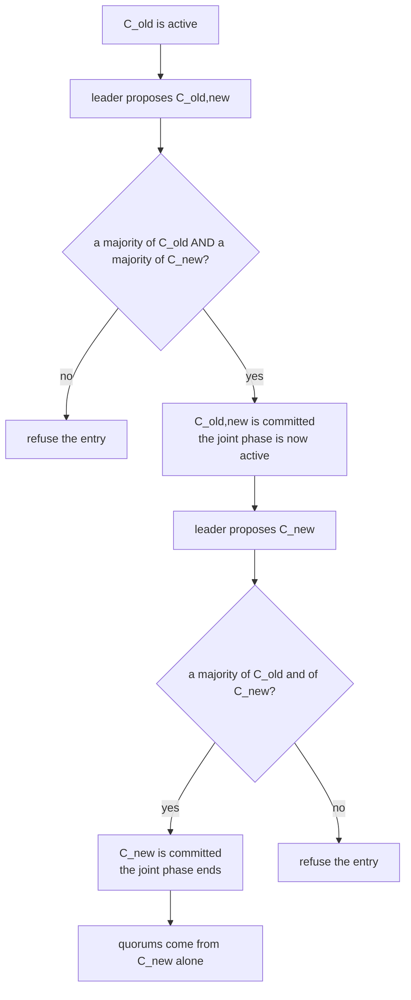
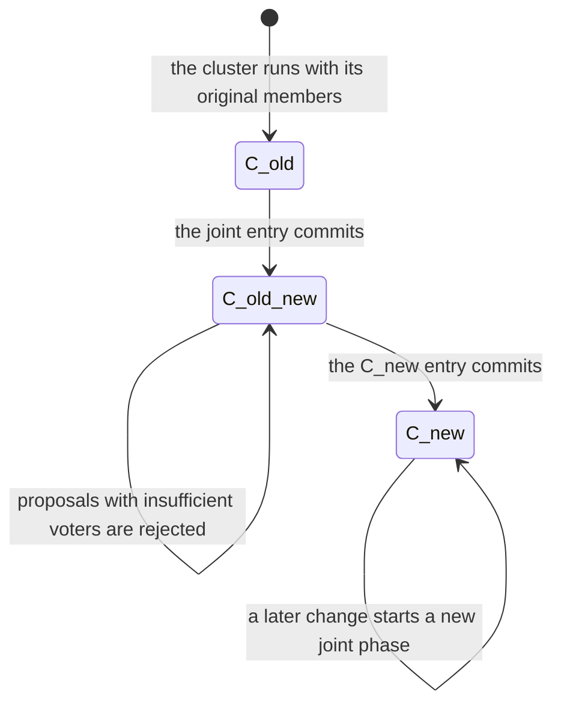
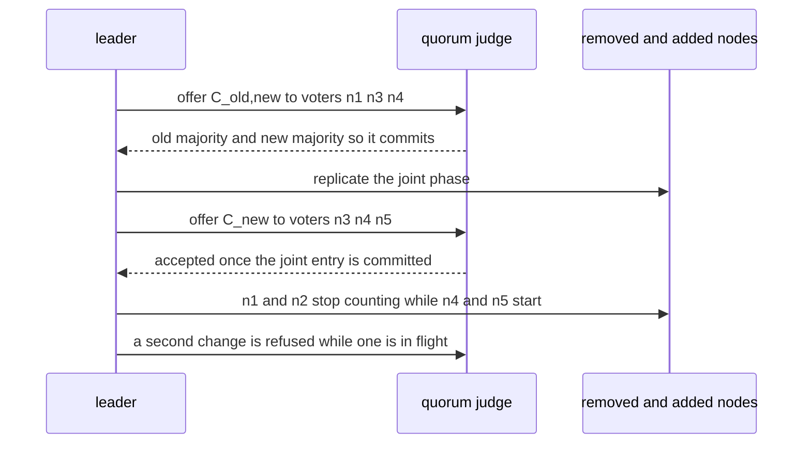

# 629 — Implement dynamic reconfiguration in Raft (joint consensus).

> **Tier:** Expert · **CTCI chapter:** Ch 9 — System Design and Scalability
> **Task spec:** [629-implement-dynamic-reconfiguration-in-raft-joint-consensus.md](../../../tasks/expert/629-implement-dynamic-reconfiguration-in-raft-joint-consensus.md)
> **Solutions:** [Python](../../../solutions/python/expert/629-implement-dynamic-reconfiguration-in-raft-joint-consensus/solution.py) ·
> [Java](../../../solutions/java/expert/629-implement-dynamic-reconfiguration-in-raft-joint-consensus/Solution.java) ·
> [JavaScript](../../../solutions/javascript/expert/629-implement-dynamic-reconfiguration-in-raft-joint-consensus/solution.js) ·
> [C#](../../../solutions/csharp/expert/629-implement-dynamic-reconfiguration-in-raft-joint-consensus/Solution.cs)

## 1. Problem restatement

Change the membership of a Raft cluster **while it is running**, using **joint consensus**: the leader first
replicates a joint configuration `C_old,new` whose quorum is "a majority of `C_old` **and** a majority of
`C_new`", and only after that entry commits does it replicate the plain `C_new` configuration. Once `C_new`
alone is committed, quorums are computed from `C_new` only and the removed nodes are irrelevant.

- **Input:** an old configuration, a new configuration, and a sequence of protocol events (propose a change,
  commit a configuration entry with an explicit acknowledgement set, hold an election).
- **Output:** the phase (`C_old`, `C_old,new`, `C_new`), the committed configuration entries, the rejected
  attempts, and the quorum mathematics: how many joint quorums exist, the size floor of a quorum, and the
  floor when the configurations are disjoint.
- **Judged rules:** a quorum is a majority of every *active* configuration; an election needs such a quorum
  and, during the transition, a candidate that belongs to `C_new`; a second reconfiguration cannot start while
  one is in flight.

**Modelling contract.** This is a deterministic *model*, not a message-level consensus run — that is what
[628](../../../tasks/expert/628-implement-distributed-consensus-simulation-with-network-partitio.md) is for.
A `Configuration` object holds the active phase and judges voter sets, so every quorum argument can be checked
**exhaustively** rather than argued informally: the solutions enumerate all `2^n` subsets of the voters (small
configurations, two to five voters) and verify intersection properties by brute force. Configuration entries
are driven through the same rule with explicit acknowledgement sets — no timers, no network, no proposal
queue. The documented simplifications are exactly these: exhaustive enumeration instead of sampling, and
acknowledgement sets handed to `commit` instead of real replication.

Concrete expected results (all asserted):

- For two 3-node configurations: **10** joint quorums exist, the smallest joint quorum has **3** voters, and
  if the two configurations are **disjoint** the smallest joint quorum needs **4**. Two configuration entries
  are committed — first the joint one, then `C_new`.
- Any two quorums of one configuration intersect; any joint quorum intersects any other joint quorum, any
  quorum of `C_old` and any quorum of `C_new`; consequently every joint quorum intersects every quorum of the
  *final* `C_new` — the property that makes the transition safe.
- A single-configuration majority is **not** enough during the joint phase: a concrete counterexample (an
  `C_old` majority that is disjoint from a `C_new` majority) is exhibited and rejected.
- The `C_new` entry cannot be committed before the joint entry, a removed node's acknowledgement stops
  counting once `C_new` is in effect, and a second reconfiguration is rejected until the first one finishes.
- Liveness: nothing whatsoever can commit while only the overlap node is reachable.

## 2. Intuition

The naive way to change membership is to swap the configuration and carry on. That breaks immediately when the
old and new sets can each form a majority without the other: nodes that still believe the old configuration is
in force can elect a leader in one half while nodes that believe the new one is in force elect another leader
in the other half. Two leaders, two logs, no agreement.

The fix is an intermediate configuration whose quorum rule makes that impossible. During
`C_old,new` a decision needs a majority of `C_old` **and** a majority of `C_new`, so any two joint quorums
overlap twice over — and, crucially, any joint quorum also overlaps any quorum of `C_new` alone. That last
property is what makes the *second* step safe: whoever completes the transition has already agreed with the
joint quorum that started it. Membership therefore moves one node at a time, because the joint rule costs
`maj(C_old) + maj(C_new) − |C_old ∩ C_new|` voters at a minimum, and the two sets must overlap.



The second half of the design is what *not* to allow. A `C_new` entry offered before the joint entry is
refused by phase, a stale joint entry offered after the transition is refused too, and a second change cannot
start while the first is in flight — otherwise two overlapping transitions could each claim to be current and
the intersection argument would no longer cover the pair.

## 3. Algorithm

1. `Configuration(old, new)` starts in phase `C_old`; `active_configs()` returns the configuration(s) whose
   majorities must all be satisfied: `C_old` in the old phase, both in the joint phase, `C_new` afterwards.
2. `is_quorum(voters)` requires a majority of *every* active configuration. The size floor is
   `maj(C_old) + maj(C_new) − |C_old ∩ C_new|` in the joint phase, and `maj(config)` otherwise.
3. `join`-able quorums are enumerated as all subsets of the union that satisfy `is_majority` for both
   configurations — the exhaustive sweep that proves the intersection properties for small clusters.
4. `start_change(new_config)` records a pending change and refuses a second one while it is in flight.
5. `commit(entry, voters)` first checks the *phase* the entry belongs to (a joint entry only in the old
   phase, a `C_new` entry only in the joint phase) and then the quorum rule; on success it appends the entry
   to the log and moves the phase — `C_old,new` → the joint phase, `C_new` → the new phase and no pending
   change.
6. `elect(candidate, voters)` requires a quorum of the active configuration *and*, during the transition, a
   candidate that is a member of `C_new`, because a leader the change is about to remove could not finish it.
7. `outsiders(voters)` is the safeguard that a removed node's acknowledgement stops counting: only voters of
   the active configurations are counted at all.

```text
procedure commit(entry, voters)
    expected_phase ← { "C_old,new": C_old, "C_new": C_old,new }
    if entry is a configuration entry and phase is not expected_phase[entry] then
        rejected.append((phase, entry, voters))
        return false
    if is_quorum(voters) is false then
        rejected.append((phase, entry, voters))
        return false
    entries.append((phase, entry))
    if entry = "C_old,new" then phase ← C_old,new
    if entry = "C_new" then phase ← C_new, pending_change ← none
    return true

function is_quorum(voters)
    for each config in active_configs() do
        intersection ← voters ∩ config
        if size(intersection) < majority_size(config) then return false
    return true

function quorum_size_floor()
    if phase = C_old,new then
        return majority_size(C_old) + majority_size(C_new) - size(C_old ∩ C_new)
    return majority_size(active_configs()[0])

function elect(candidate, voters)
    config ← C_old if phase = C_old else C_new        // the transitional leader must be a C_new member
    return candidate is in config and candidate is in voters and is_quorum(voters)

function joint_quorums(old, new)
    return [voters for voters in all_subsets(old ∪ new)
            if is_majority(old, voters) and is_majority(new, voters)]
```



## 4. Worked example

Old configuration `{n1, n2, n3}` and new configuration `{n3, n4, n5}`, so the sets overlap in `n3` and every
majority has size 2 of 3.

| Quantity | Value | Reason |
| --- | --- | --- |
| `maj(C_old)` | 2 | `3 // 2 + 1` |
| `maj(C_new)` | 2 | `3 // 2 + 1` |
| joint quorums | **10** | the subsets of `{n1 … n5}` with at least two of the old and two of the new members |
| smallest joint quorum | **3** | `{n1, n3, n4}`, `{n1, n3, n5}`, `{n2, n3, n4}`, `{n2, n3, n5}` — one other old node, the overlap node, one other new node |
| smallest joint quorum when disjoint | **4** | `maj + maj − 0`, e.g. `{n1, n2, n4, n5}` if `n3` were replaced entirely |

The ten joint quorums split into three size classes: four of size 3 (the overlap node plus one other member
from each side — `{n1, n3, n4}`, `{n1, n3, n5}`, `{n2, n3, n4}`, `{n2, n3, n5}`), five of size 4 (one side
fully represented and a bare majority of the other, with or without the overlap node, including the
disjoint-style `{n1, n2, n4, n5}`), and one of size 5 (the whole union). Every one of them contains either
the overlap node or two members of each side, which is precisely why their pairwise intersections are
non-empty.

| Event | Voters offered | Verdict | Phase after |
| --- | --- | --- | --- |
| Propose `C_old,new` | — | pending change recorded | `C_old` |
| Commit `C_old,new` | `{n1, n2}` (an old majority only) | **refused** — `n2` and `n1` alone do not form a new majority | `C_old` |
| Commit `C_old,new` | `{n1, n3, n4}` | accepted (old majority ✓, new majority ✓) | `C_old,new` |
| Commit `C_new` | `{n4, n5}` (a new majority only) | **refused** — the old majority is missing | `C_old,new` |
| Commit `C_new` | `{n3, n4, n5}` | accepted | `C_new` |
| Commit `C_new` again | any | refused — the entry belongs to an earlier phase, and `C_new` is already in effect | `C_new` |
| Propose another change while one is in flight | — | refused (`pending_change` is not `None`) | unchanged |



The liveness check is the mirror image: with only the overlap node `n3` reachable, *no* quorum exists in either
phase — a joint quorum needs a majority of each side, and a single node cannot supply two — so nothing
commits and the cluster simply waits, which is the intended liveness limit of the protocol rather than a bug.

## 5. Complexity

With `o = |C_old|`, `n = |C_new|` and `u = |C_old ∪ C_new|`.

| Quantity | Best | Average | Worst | Why the bound holds |
| --- | --- | --- | --- | --- |
| `is_quorum` | O(o) | O(o + n) | O(o + n) | one intersection and one majority test per active configuration |
| `active_configs` | O(1) | O(1) | O(1) | it depends only on the phase |
| `quorum_size_floor` | O(1) | O(1) | O(o + n) | integer arithmetic plus one set intersection |
| `commit` | O(1) | O(o + n) | O(o + n) | a phase check plus `is_quorum` |
| `elect` | O(1) | O(o + n) | O(o + n) | membership test plus `is_quorum` |
| Exhaustive quorum enumeration | O(2^u) | O(2^u · (o + n)) | O(2^u · (o + n)) | every subset of the union is tested against both configurations; the checks keep `u ≤ 5` |
| Configuration entries per change | 2 | 2 | 2 | one joint entry and one `C_new` entry, and the measured run commits exactly 2 |
| Message cost of a change | 2 replication rounds | — | — | inherited from the consensus layer: two rounds of `AppendEntries`, one per configuration entry → [628 — distributed consensus simulation](../../../tasks/expert/628-implement-distributed-consensus-simulation-with-network-partitio.md) |
| Space | O(u) | O(u) | O(u) | the two voter sets, the log of configuration entries and the rejected attempts |

The comparison is with the single-step alternative: replacing `C_old` by `C_new` directly is cheaper by one
round trip and unsafe whenever the two sets are disjoint, which the checks demonstrate with a counterexample.
Joint consensus pays one extra round and, during it, a larger quorum — the floor rises from 2 to 3 for the
overlapping 3+3 example and to 4 for disjoint sets — in exchange for the intersection guarantee that makes the
transition linearizable. That is also why membership moves one node at a time: the larger the change, the
longer the cluster runs with an inflated quorum requirement.

## 6. Pitfalls and edge cases

- **A single-configuration majority is not a quorum during the joint phase.** The counterexample is an old
  majority and a new majority that share nothing: accepting either would allow two leaders to commit the same
  index differently.
- **The `C_new` entry must not be committed before the joint entry.** The phase check enforces it before the
  quorum is even considered, and the checks assert the refusal.
- **A stale configuration entry must be refused too.** A joint entry offered after the transition is in the
  wrong phase; committing it would revert the effective quorum rule.
- **The transitional leader must be a member of `C_new`.** A leader that the change is about to remove cannot
  finish the change, so `elect` requires membership in `C_new` whenever the phase is not `C_old`.
- **The joint quorum's minimum size is `maj(old) + maj(new) − |overlap|`.** With overlapping 3-node sets that
  is 3; with disjoint sets the two configurations have **no** common quorum vote, and the smallest joint
  quorum needs 4 — which is why the transition normally adds nodes before removing them.
- **One change at a time.** A second `start_change` while `pending_change` is set is rejected; concurrent
  transitions would have to reason about three configuration sets at once, and the intersection argument no
  longer covers all the pairs.
- **A removed node's acknowledgement stops counting.** Only voters of the active configurations count, so
  `n1`'s `ACK` on a `C_new` entry is ignored rather than treated as an extra vote.
- **Election and entry quorums are the same rule.** Both call `is_quorum`, so a configuration change cannot
  create a window in which one of them is judged by the old rule and the other by the new one.
- **Liveness is not preserved by safety.** With only the overlap node reachable nothing commits: a joint
  quorum needs a majority of each side, so the cluster waits for connectivity. That is the availability price
  of the guarantee, and the checks assert the stall rather than pretending it away.
- **Exhaustive enumeration is part of the contract.** The intersection properties are verified over *all*
  subsets for small configurations (two to five voters) instead of being sampled, which is exactly what a
  deterministic quorum model can afford.
- **Unicode and node identity.** Node ids are opaque strings compared by value; there is no notion of an
  address or a partially ordered node name, so the model needs no encoding rules.

## 7. Variants and follow-ups

- The message-level protocol this model abstracts: elections, replication and partitions
  → [628 — distributed consensus simulation with network partitions](../../../tasks/expert/628-implement-distributed-consensus-simulation-with-network-partitio.md).
- Discovering that a member has failed at all, which is what triggers a reconfiguration in practice
  → [631 — gossip protocol for membership and failure detection](../../../tasks/expert/631-implement-gossip-protocol-for-membership-and-failure-detection.md).
- The alternative way to make a multi-node change atomic, with a coordinator that can block
  → [627 — transactional key-value store with two-phase commit simulation](../../../tasks/expert/627-implement-transactional-key-value-store-with-two-phase-commit-si.md).
- Ordering the writes of the members that are *not* part of the consensus group
  → [630 — causal consistency protocol simulation](../../../tasks/expert/630-implement-causal-consistency-protocol-simulation-vector-clocks.md).
- Repairing the state of a member that joined late, without shipping the whole log
  → [632 — anti-entropy Merkle tree reconciliation demo](../../../tasks/expert/632-implement-anti-entropy-merkle-tree-reconciliation-demo.md).
- Reading a consistent snapshot across a group whose membership just changed
  → [617 — consistent snapshot across shards simulation](../../../tasks/expert/617-implement-consistent-snapshot-across-shards-simulation.md).

## 8. Check yourself

<details><summary>Show answer</summary>
**Why is swapping the configuration in one step unsafe?** Because the old and new sets may have disjoint
majorities: nodes still on `C_old` can elect one leader while nodes already on `C_new` elect another, and
neither quorum intersects the other, so both can commit conflicting entries at the same index.
</details>

<details><summary>Show answer</summary>
**What exactly does the joint configuration guarantee?** Every decision needs a majority of `C_old` *and* a
majority of `C_new`, so any two decisions during the transition share voters — and any joint quorum also
intersects any quorum of the final `C_new`, which is what makes the second step safe.
</details>

<details><summary>Show answer</summary>
**Why does the smallest joint quorum need three voters in the `{n1, n2, n3}` / `{n3, n4, n5}` example, and four
when the sets are disjoint?** A quorum needs a majority of each side: with one shared node, one other old node
plus the overlap plus one other new node suffices (3). With no shared node, two old and two new are needed
independently (4).
</details>

<details><summary>Show answer</summary>
**A new configuration is offered while the joint entry is still uncommitted. What happens?** It is refused by
the phase check: a `C_new` entry is only meaningful in the joint phase. Committing it early would put the
cluster on the new quorum rule while entries decided under the joint rule were still in flight.
</details>

<details><summary>Show answer</summary>
**Only the overlap node `n3` is reachable. What can the cluster do?** Nothing: a joint quorum needs a majority
of each side, and one node cannot be a majority of two 3-node sets. The cluster stays unavailable until more
nodes return — safety is preserved by refusing to make progress without a quorum.
</details>
