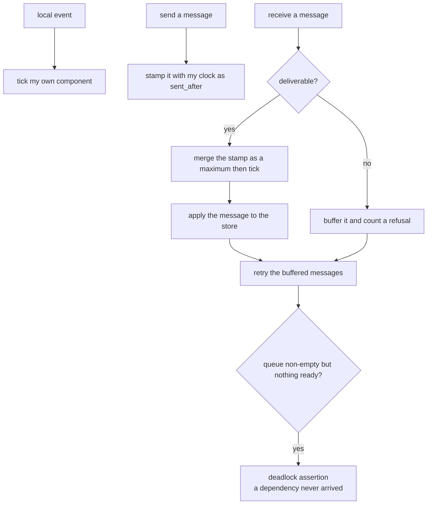
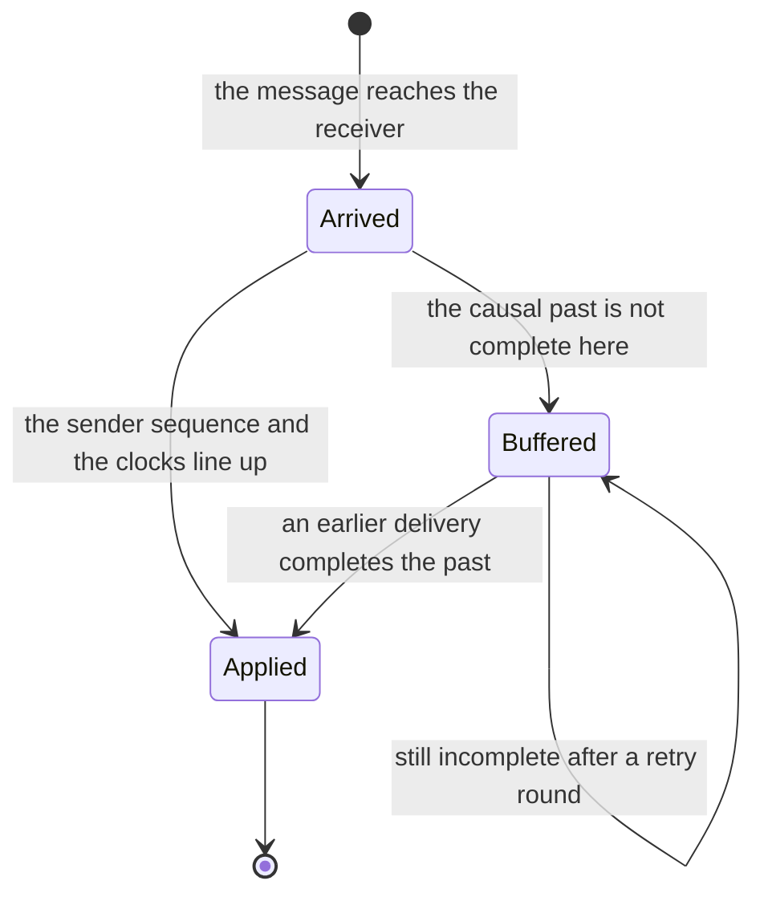
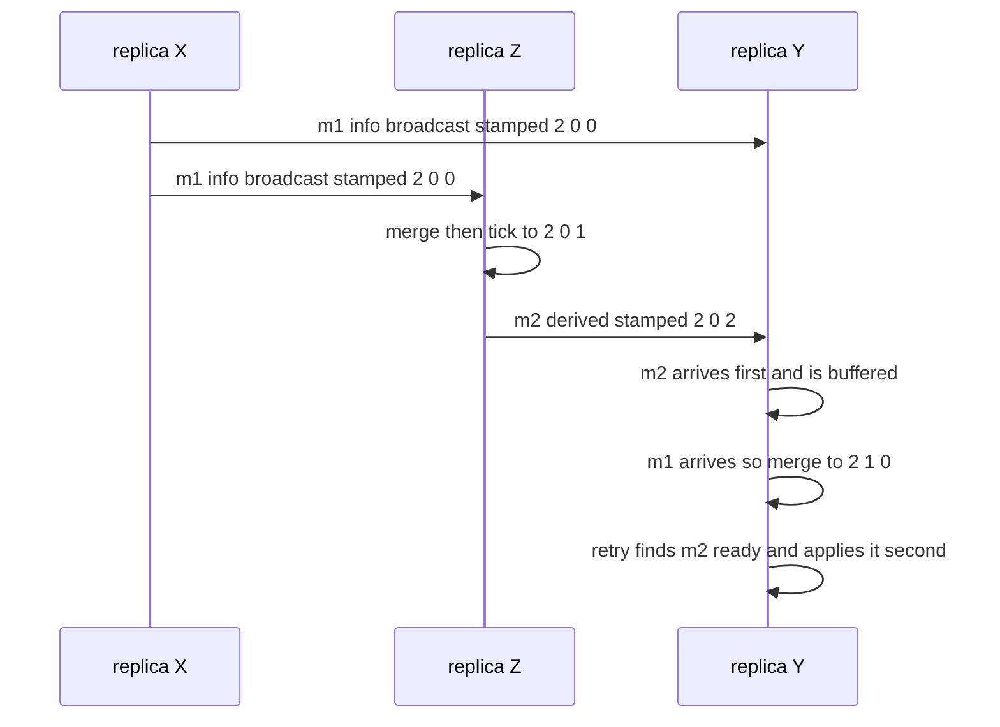

# 630 — Implement causal consistency protocol simulation (vector clocks).

> **Tier:** Expert · **CTCI chapter:** Ch 9 — System Design and Scalability
> **Task spec:** [630-implement-causal-consistency-protocol-simulation-vector-clocks.md](../../../tasks/expert/630-implement-causal-consistency-protocol-simulation-vector-clocks.md)
> **Solutions:** [Python](../../../solutions/python/expert/630-implement-causal-consistency-protocol-simulation-vector-clocks/solution.py) ·
> [Java](../../../solutions/java/expert/630-implement-causal-consistency-protocol-simulation-vector-clocks/Solution.java) ·
> [JavaScript](../../../solutions/javascript/expert/630-implement-causal-consistency-protocol-simulation-vector-clocks/solution.js) ·
> [C#](../../../solutions/csharp/expert/630-implement-causal-consistency-protocol-simulation-vector-clocks/Solution.cs)

## 1. Problem restatement

Simulate a **causal consistency protocol** built on **vector clocks**: a replica may apply an update only
after every update in its causal past has been applied, so no replica ever observes an effect without its
cause.

- **Input:** `n` replicas, per-replica event programs, and an explicit delivery schedule that can deliberately
  reorder messages (early delivery, late delivery, an adversarial order).
- **Output:** the delivery order, the buffered refusals, and the verdicts: the vector-clock comparison agrees
  with an independent happens-before oracle, the merge algebra behaves, the buffer never delivers a message
  whose causal predecessors are missing but eventually delivers everything, and reads are monotone with
  read-your-writes.
- **Clock operations:** a local event ticks a replica's own component; a send stamps the message with the
  sender's clock (`sent_after`); a receive merges the stamp component-wise (a maximum) and then ticks.

**Modelling contract.** There is no network and no clock — the documented simplification: messages are created
and delivered by an explicit deterministic schedule with programmable delivery delays, driven by a fixed-seed
LCG, which is what lets the checks produce genuine concurrency. Causality is verified against an **independent
oracle**: a transitive closure of the happens-before graph built from program order and send→receive edges,
so the clocks are compared with reachability rather than with each other. The "store" is one key per replica
applied through the same buffer, which is where read-your-writes and monotonic reads are checked. A `naive`
mode that delivers immediately is the control that shows what the buffer prevents.

Concrete expected results (all asserted):

- A run with **77** events delivers **32** messages with **79** buffered refusals, and contains **2974**
  ordered pairs of concurrent events — so the buffer is genuinely exercised and the run is not secretly
  sequential.
- The vector-clock comparison agrees with the happens-before closure on **every** ordered pair of events,
  including the concurrent case, and the merge is idempotent, commutative and monotone (a merged clock
  dominates both inputs).
- The naive mode records **30** violations — deliveries that were not causally ready — while the buffered
  mode records none, which is the control that gives the protocol its meaning.
- Sends always precede their receives in the delivery order, concurrent events still end up in *some* total
  delivery order (causality does not require a unique one), a message is buffered exactly as often as its
  dependency is missing, and a stall with every queued message unready raises a deadlock assertion rather than
  hanging.

## 2. Intuition

A total order is expensive: it either needs a leader or a consensus round, and it forces replicas to agree even
on updates that have nothing to do with each other. Causal consistency keeps only the order that actually
matters — if update `A` could have influenced update `B` (because some replica saw `A` before producing `B`),
then every replica must apply `A` before `B`; if not, any order is fine.

Vector clocks make "could have influenced" decidable with an element-wise comparison:

| Comparison | Meaning |
| --- | --- |
| `a < b` | all components of `a` are `≤` those of `b`, with at least one strictly smaller: `a` happened before `b` |
| `a > b` | the mirror image: `b` happened before `a` |
| `a == b` | the same causal knowledge |
| incomparable | the two events are **concurrent** — neither can have influenced the other |

The clock of an event counts *how many events of each replica* precede it, so it is a compact encoding of the
event's entire causal history. That gives the delivery rule: before handing a message to the application, the
receiver checks that everything the sender already knew about has itself been delivered. Since a replica can
only learn about another replica's events through messages, the receiver's own clock is exactly the summary of
what it has applied — and the sender's clock is the summary of what must have been applied.



The second half of the work is proving the mechanism rather than trusting it: the simulation compares the
vector-clock verdict on every pair with a graph closure computed independently, and it runs a naive
"deliver immediately" replica on the same schedule to show that 30 deliveries were not causally ready. Without
that control, "the buffer works" would be an assertion about code that might never buffer anything.

## 3. Algorithm

1. Each replica holds a vector clock (one counter per replica), a delivered-message count per sender, and a
   buffer of messages it cannot yet deliver.
2. A local event ticks the replica's own component. A send stamps the message with the sender's current clock
   (its `sent_after`) and a per-pair sequence number. A receive merges the stamp component-wise and then ticks
   the receiver's own component.
3. `ready(message)` — the delivery rule — has two parts:
   - the per-sender sequence must be exactly the next one this receiver expects
     (`pair_seq == delivered_pairs[sender] + 1`), so one sender's messages never overtake each other;
   - for every replica the *sender* had already heard from, the receiver's clock must have caught up
     (`sent_after[node] ≤ receiver.clock[node]`), skipping the sender's own component, which counts events
     the receiver can only learn through this very message.
4. `attempt(message)`: when `ready` fails, increment the refusal counter and either buffer the message (the
   causal mode) or deliver it anyway and record a violation (the naive control).
5. When a message is delivered, the receiver merges its stamp, the message moves to the delivered list and is
   dropped from the buffer, and the run then retries every buffered message — a delivery can unblock others.
6. The driver repeats: pick the next scheduled message, fill the buffer as needed, and if the queue is
   non-empty while nothing is ready the run raises an assertion instead of deadlocking silently.
7. Verification: every received message's send precedes it in the delivery order; the delivery order exists
   for concurrent events too (causality gives a partial, not a total, order); read-your-writes and monotonic
   reads hold on the single-key store; and the clocks are compared against the graph closure for every pair.

```text
procedure local_event(replica)
    replica.clock[replica] ← replica.clock[replica] + 1
    record the event with a copy of replica.clock

procedure send(sender, receiver, payload)
    local_event(sender)
    pair_sequence ← sender.per_pair_count[receiver] + 1
    message ← Message(sender, receiver, payload, clock = copy of sender.clock,
                      pair_seq = pair_sequence, sent_after = copy of sender.clock)
    queue.append(message)

function ready(message)
    receiver ← nodes[message.receiver]
    if message.pair_seq != receiver.delivered_pairs.get(message.sender, 0) + 1 then
        return false
    for each node in message.sent_after.nodes() do
        if node is not message.sender
           and message.sent_after[node] > receiver.clock[node] then
            return false
    return true

procedure attempt(message)
    receiver ← nodes[message.receiver]
    if ready(message) is false then
        buffered_refusals ← buffered_refusals + 1
        if naive is false then return false
        violations.append((message, ready(message)))    // the verdict at delivery time
    receiver.merge(message.sent_after)                  // component-wise maximum
    receiver.tick_own()
    delivered.append(message)
    queue.remove(message)
    return true

procedure drain()
    repeat until no progress
        for each message in queue do
            if attempt(message) then progress ← true
        if queue is not empty and nothing was ready then
            raise "causal delivery deadlocked - a dependency never arrived"
```



## 4. Worked example

Three replicas `X`, `Y`, `Z`; clocks written in the order `(X, Y, Z)`.

| Event | Replica | Clock after | Note |
| --- | --- | --- | --- |
| `e1` | `X` | `(1, 0, 0)` | a local event |
| `m1` = broadcast "info" | `X` | `(2, 0, 0)` | stamped `sent_after = (2, 0, 0)` for both `Y` and `Z` |
| `e2` | `Z` | `(2, 0, 1)` | `Z` receives `m1`: merge `(2, 0, 0)` then tick its own component |
| `m2` = "derived" to `Y` | `Z` | `(2, 0, 2)` | stamped `sent_after = (2, 0, 2)` — it names `m1` as its causal past |
| — | `Y` | `(0, 0, 0)` | `m2` arrives **before** `m1` |

`Y` tries to deliver `m2` first. `ready(m2)` fails: `sent_after[X] = 2` but `Y`'s own clock has `X = 0`, so the
update `m2` depends on has not been applied at `Y`. The message is buffered and the refusal counter rises.
When `m1` arrives it is deliverable (its `sent_after` is `(2, 0, 0)`, and the only non-sender component is
`Z = 0`, already satisfied), so `Y` merges to `(2, 1, 0)`. The retry round then finds `m2` ready — `Y`'s `X`
component is now 2 — and delivers it, merging `(2, 0, 2)` with `(2, 1, 0)` to `(2, 1, 2)` and then ticking to
`(2, 2, 2)`. Order: `m1` then `m2`, exactly the causal order, achieved by buffering rather than by a global
clock.



The scale of the mixed run makes the same point quantitatively: **77** events, **32** delivered messages and
**79** buffered refusals, with **2974** ordered pairs of concurrent events. The refusal count being larger than
the message count is normal — a message can be refused several times, once per retry round, until its causal
past finally arrives. Running the identical schedule in naive mode delivers messages as they come and records
**30** violations, which is exactly the number of deliveries whose causal past was incomplete.

## 5. Complexity

With `n` replicas, `e` events and `m` messages, and a clock of `n` counters.

| Operation | Best | Average | Worst | Why the bound holds |
| --- | --- | --- | --- | --- |
| Local event / tick | O(1) | O(1) | O(1) | one counter increment plus copying `n` counters when the event is recorded |
| `send` | O(1) | O(n) | O(n) | stamping copies the sender's `n`-component clock |
| Receive / merge | O(n) | O(n) | O(n) | a component-wise maximum over `n` counters, then a tick |
| `ready` check | O(1) | O(n) | O(n) | the per-pair sequence check plus one comparison per replica the sender had heard from |
| Delivery attempt, buffered | O(n) | O(n) | O(n) | the same `ready` check; the message stays in the buffer |
| Delivery round | O(1) | O(m · n) | O(m² · n) | a round retries the whole buffer, and a delivery can unblock others; the deadlock guard ends the loop when nothing is ready |
| Whole run | O(e) | O(e + m · n) | O(m² · n) | measured: 77 events, 32 messages, 79 refusals |
| Clock comparison | O(1) | O(n) | O(n) | element-wise `≤` over `n` components decides before / after / concurrent |
| Oracle comparison (checks) | O(e) | O(e² · n) | O(e² · n) | the happens-before closure is compared with the clocks for every ordered pair: `77 × 76` pairs in the measured run |
| Space | O(n) | O(n · e) | O(n · e) plus the buffer | one `n`-counter clock per event, and the undeliverable messages |

The alternatives: a *total* order (a leader or a consensus round per update) is more expensive but makes reads
trivially consistent → [628 — distributed consensus simulation](../../../tasks/expert/628-implement-distributed-consensus-simulation-with-network-partitio.md);
last-writer-wins with physical timestamps is cheaper than a vector clock but cannot express "concurrent";
and a snapshot-based read needs no clocks at all but stops the world for the cut
→ [617 — consistent snapshot across shards simulation](../../../tasks/expert/617-implement-consistent-snapshot-across-shards-simulation.md).
Vector clocks cost `O(n)` per event, which is why real systems sometimes replace them with version vectors per
pair or with interval tree clocks when the replica set changes dynamically —
[629 — joint consensus](../../../tasks/expert/629-implement-dynamic-reconfiguration-in-raft-joint-consensus.md)
is the consensus-side view of that same membership problem.

## 6. Pitfalls and edge cases

- **The sender's own component must be skipped in the readiness check.** It counts events the receiver can only
  learn through this message, so requiring the receiver to have caught up there would make every message
  undeliverable.
- **Per-sender ordering is part of the rule, not an optimisation.** "The past has arrived" is not enough if a
  *later* message from the same sender is applied before an earlier one; `pair_seq` enforces that.
- **Buffer, do not drop and do not deliver.** Delivering an unready message produces the 30 violations the
  naive control records; dropping it loses the update forever.
- **Retry after every delivery.** One delivery can unblock a message that waited several rounds, which is why
  a round walks the entire buffer and why the deadlock guard exists.
- **The deadlock guard is a correctness check.** If the queue is non-empty and nothing is ready, a dependency
  can never arrive; failing loudly is better than hanging, and it catches schedule-building mistakes.
- **Concurrent events are not ordered by causality.** The delivery order still puts them in some sequence — a
  partial order admits many linear extensions — and the checks only require that comparable pairs keep their
  order.
- **The merge must be idempotent, commutative and monotone.** Redelivering a message or receiving two stamps
  in either order must give the same clock; a merge that is not a component-wise maximum breaks the
  comparison.
- **Read-your-writes and monotonic reads.** A client must see its own update and must never see a value older
  than one it already read; both are checked on the single-key store that the buffer applies to.
- **No physical clock anywhere.** Timestamps would reintroduce exactly the problem vector clocks solve, so the
  protocol uses only causal information — the schedule's delays are simulation artefacts, not clock reads.
- **Oracles must be independent.** The happens-before graph is built from program order and send→receive edges
  and closed transitively; comparing the clocks with each other would prove nothing.
- **Unicode and payload identity.** Payloads are opaque values; the protocol reasons about message identity and
  pair sequence numbers, so encoding is irrelevant.

## 7. Variants and follow-ups

- The happens-before relation this protocol delivers in, with monitors and spawn/join edges and its own
  closure-versus-clocks proof → [619 — formal model for happens-before and verify](../../../tasks/expert/619-implement-formal-model-for-happens-before-and-verify.md).
- Replacing causal order with a single agreed order when the application needs it
  → [628 — distributed consensus simulation with network partitions](../../../tasks/expert/628-implement-distributed-consensus-simulation-with-network-partitio.md).
- Membership that changes while the clocks are in use, which is when a fixed vector size stops being enough
  → [629 — dynamic reconfiguration in Raft (joint consensus)](../../../tasks/expert/629-implement-dynamic-reconfiguration-in-raft-joint-consensus.md).
- Exchanging causal metadata instead of a total order, to find which summaries disagree
  → [631 — gossip protocol for membership and failure detection](../../../tasks/expert/631-implement-gossip-protocol-for-membership-and-failure-detection.md).
- Repairing a replica whose causal history is incomplete, by comparing digests rather than replaying everything
  → [632 — anti-entropy Merkle tree reconciliation demo](../../../tasks/expert/632-implement-anti-entropy-merkle-tree-reconciliation-demo.md).
- Reading a *consistent* cut of several shards, which is the stronger guarantee the causal protocol trades away
  → [617 — consistent snapshot across shards simulation](../../../tasks/expert/617-implement-consistent-snapshot-across-shards-simulation.md).

## 8. Check yourself

<details><summary>Show answer</summary>
**Two events have clocks `(2, 0, 1)` and `(1, 0, 2)`. What is their relationship?** Neither is `≤` the other
component-wise, so they are concurrent: neither could have influenced the other, and any replica may apply
them in either order.
</details>

<details><summary>Show answer</summary>
**Why is a message stamped with the sender's clock enough to know its entire causal past?** Because the sender's
clock counts how many events of every replica causally precede the send — including everything it learned
through earlier messages — so the stamp is a compact summary of the whole past, no matter how indirect.
</details>

<details><summary>Show answer</summary>
**The measured run counts 79 buffered refusals for 32 messages. How can the refusals outnumber the messages?**
A refused message stays in the buffer and is retried on later rounds, so it is counted once per refusal until
its causal past arrives. The counter measures retry pressure, not distinct messages.
</details>

<details><summary>Show answer</summary>
**Why does the readiness check skip the sender's own clock component?** That component counts events of the
sender, which the receiver can only learn from this very message. Requiring the receiver to have caught up
there would make the message permanently undeliverable.
</details>

<details><summary>Show answer</summary>
**What does the naive control prove?** Delivering without waiting records 30 violations on the same schedule —
deliveries whose causal past was incomplete. Since the buffered run records none, the buffer is doing real work
rather than restating a schedule that happened to be ordered already.
</details>
