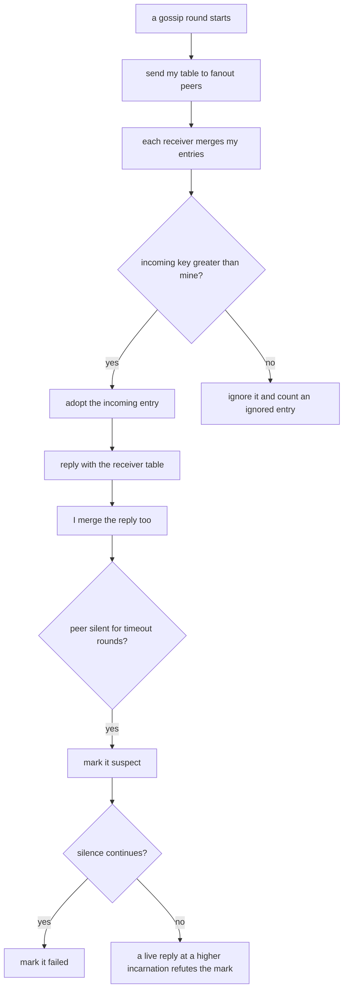
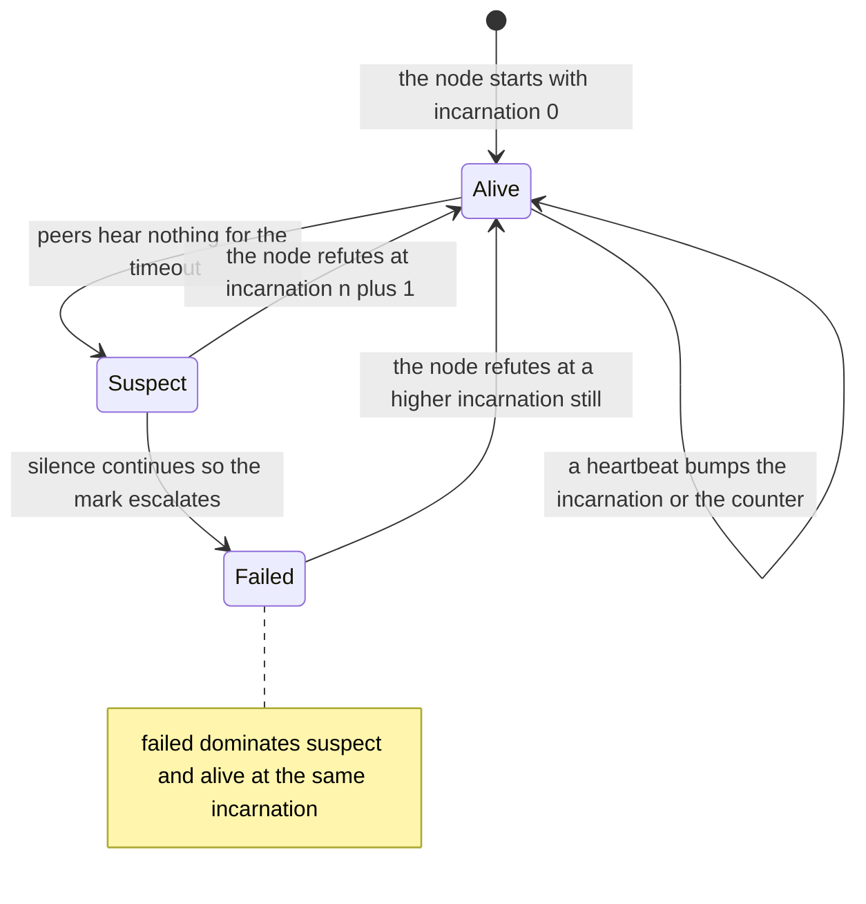
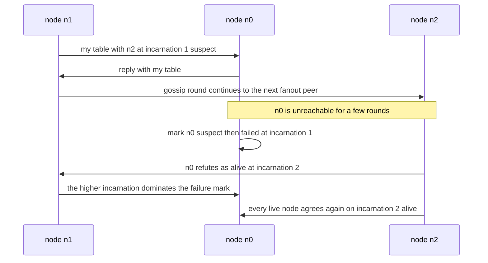

# 631 — Implement gossip protocol for membership and failure detection.

> **Tier:** Expert · **CTCI chapter:** Ch 9 — System Design and Scalability
> **Task spec:** [631-implement-gossip-protocol-for-membership-and-failure-detection.md](../../../tasks/expert/631-implement-gossip-protocol-for-membership-and-failure-detection.md)
> **Solutions:** [Python](../../../solutions/python/expert/631-implement-gossip-protocol-for-membership-and-failure-detection/solution.py) ·
> [Java](../../../solutions/java/expert/631-implement-gossip-protocol-for-membership-and-failure-detection/Solution.java) ·
> [JavaScript](../../../solutions/javascript/expert/631-implement-gossip-protocol-for-membership-and-failure-detection/solution.js) ·
> [C#](../../../solutions/csharp/expert/631-implement-gossip-protocol-for-membership-and-failure-detection/Solution.cs)

## 1. Problem restatement

Implement **SWIM-style gossip** for membership and failure detection: every node periodically sends its whole
membership table to a few peers, each entry carries an **incarnation number**, and the cluster converges on
one verdict about every member — without a leader and without a central registry.

- **Input:** a set of nodes, a fanout, a gossip round budget, timeouts, and scenarios that partition the
  network, stop a node, let a node rejoin and add a late joiner.
- **Output:** each node's view — a map from member to `(incarnation, status, heartbeat)` with status
  `alive | suspect | failed` — plus the counters: rounds to agreement, refutations, message count.
- **Merge rule (monotone least upper bound):** an entry is overwritten only by one with a greater key
  `(incarnation, status rank, heartbeat)`, where `failed` outranks `suspect` outranks `alive` at the same
  incarnation. A view can therefore never roll back, and only a *higher incarnation* can clear a suspicion.
- **Failure detection:** silence for `timeout` rounds marks a peer `suspect`; more silence marks it `failed`.

**Modelling contract.** No sockets and no wall clock: the solutions document the deterministic stand-ins —
peers are picked by a seeded LCG instead of randomness, delivery is immediate within a round (so one round is
one network delay), the round counter drives the timeouts instead of a clock, and connectivity rather than
latency drives detection. The JavaScript solution states the escalation as suspect after `failureTicks` rounds
and dead after twice as many. What is verified are the real properties: agreement, bounded convergence,
monotonicity, exclusion of crashed and partitioned nodes, refutation of false suspicion, and reproducibility
of the whole run from the seed.

Concrete expected results (all asserted):

- Views converge **from scratch**: the 16-node convergence run reports `rounds-to-agree = 2`, **1152** messages
  over 6 rounds, all 16 nodes alive, and no refutation needed (`refutations = 0`).
- A permanently stopped node is declared dead by every live node within a bounded number of rounds
  (the JavaScript solution states the bound as `2 · failureTicks + 2` rounds).
- A partition produces a convergent verdict *per side*, and **no view ever loses a member**: the member set is
  never dropped, only marked.
- After healing, a node marked dead **bumps its incarnation** and is alive everywhere again, with an
  incarnation strictly higher than the mark it refuted, and the refutation happens exactly once.
- Merging is idempotent and never lets a lower incarnation — or a less severe status at the same incarnation —
  overwrite a newer rumour; no view ever contains a name that was never a member.
- Hand-checked merge ordering: `alive < suspect < failed < alive at a higher incarnation`, plus a stale-digest
  negative check that a rollback does not happen.

## 2. Intuition

A central failure detector is a single point of failure for the thing that is supposed to detect failures.
Gossip inverts the design: every node periodically ships its whole table to a few random peers, and because
each round multiplies the reach by the fanout, information spreads in `O(log n)` rounds without anyone being
in charge.

The subtlety is *how to disagree safely*. Rumours about a node's state travel independently, so a node can
briefly be believed `failed` by some peers and `alive` by others; and a crashed node cannot object to a false
suspicion, while a live-but-slow node must be able to. SWIM solves both with an **incarnation number** and a
monotone ordering:

- a higher incarnation always wins, whatever the status;
- at equal incarnation the more pessimistic status wins (`failed` > `suspect` > `alive`), so suspicion spreads
  and cannot be undone by re-sending an old `alive`;
- a node that is alive and wrongly suspected **refutes** by bumping its own incarnation and republishing
  `alive` at `n + 1`, which dominates the rumour by arithmetic rather than by argument.



Because the merge is a least upper bound, *convergence is monotonicity*: no node's view can be rolled back by
a stale or lower-incarnation message, and once two nodes have seen the same maximal entries they necessarily
agree. That is why the protocol can be verified by checking each node's signature — the `(incarnation, status)`
pair per member — rather than by tracking every message.

## 3. Algorithm

1. Each node starts with a view containing itself as `(incarnation 0, alive, heartbeat 0)`, plus per-peer
   bookkeeping of the last round in which it heard from that peer.
2. `gossip_round()`: every live node picks `fanout` reachable peers with the seeded generator, sends its whole
   table, and receives each peer's table back in the same round (push-pull), so one round spreads a change by
   `2 · fanout` per node.
3. `merge(digest)`: for every incoming entry, apply `set(node, incarnation, status, heartbeat)`.
4. `set` compares keys: `(incarnation, RANK[status], heartbeat)`. An incoming key that is not strictly greater
   is **ignored** and counted; otherwise it replaces the entry. This is where "no rollback" comes from.
5. Timeouts: a node that has not heard from a peer for `timeout` rounds marks it `suspect` at the node's own
   incarnation; continued silence escalates the mark to `failed`. Because the rank makes `failed` dominate
   `suspect` and `alive` at the same incarnation, the escalation travels like any other rumour.
6. Refutation: a live node whose view says it is `suspect` or `failed` bumps its own incarnation and
   republishes itself as `alive`; the higher incarnation dominates the mark everywhere it spreads, and the
   counter records exactly one refutation per false suspicion.
7. Verification: agreement on the signature of every live node, bounded convergence, monotonicity of every
   view, exclusion of failed or partitioned nodes, refutation after healing, message-count bounds and
   reproducibility from the seed.

```text
procedure gossip_round(cluster)
    cluster.round ← cluster.round + 1
    for each live node in cluster do
        peers ← pick fanout reachable peers with the seeded generator
        for each peer in peers do
            messages ← messages + 1
            peer.view.merge(node.view.snapshot())
            messages ← messages + 1
            node.view.merge(peer.view.snapshot())
        for each other node do
            if reachable(node, other) then last_heard[node][other] ← cluster.round
        for each other node do
            silence ← cluster.round - last_heard[node][other]
            if silence >= timeout then
                if node.view.status(other) = alive then
                    node.view.set(other, incarnation(other), suspect, heartbeat(other))
                else if silence >= timeout + suspect_timeout and status(other) = suspect then
                    node.view.set(other, incarnation(other), failed, heartbeat(other))

procedure merge(digest)
    for each (node, entry) in digest do
        incarnation, status, heartbeat ← entry
        set(node, incarnation, status, heartbeat)

function set(node, incarnation, status, heartbeat)
    candidate ← (incarnation, RANK[status], heartbeat)
    current ← entries[node]                          // absent means no entry yet
    if current is present and key(candidate) <= key(current) then
        ignored ← ignored + 1
        return false
    entries[node] ← candidate
    return true

procedure refute(node)
    incarnations[node] ← incarnations[node] + 1
    set(node, incarnations[node], alive, heartbeats[node] + 1)
    refutations ← refutations + 1
```



## 4. Worked example

Four nodes `n0…n3`, fanout 2, and a merge table where a stale message about `n2` arrives after a newer one.

| Incoming entry for `n2` | Merge key `(incarnation, rank, heartbeat)` | Current entry | Result |
| --- | --- | --- | --- |
| `(1, alive, 4)` | `(1, 1, 4)` | `(0, alive, 3)` → `(0, 1, 3)` | adopted, view advances |
| `(1, suspect, 4)` | `(1, 2, 4)` | `(1, alive, 4)` → `(1, 1, 4)` | adopted — suspicion spreads at the same incarnation |
| `(1, alive, 9)` | `(1, 1, 9)` | `(1, suspect, 4)` → `(1, 2, 4)` | **ignored** — a fresh heartbeat cannot erase a suspicion without a new incarnation |
| `(1, failed, 5)` | `(1, 3, 5)` | `(1, suspect, 4)` → `(1, 2, 4)` | adopted — the failure escalates the mark |
| `(2, alive, 10)` | `(2, 1, 10)` | `(1, failed, 5)` → `(1, 3, 5)` | adopted — the refutation wins on incarnation alone |

The fourth row is the mechanism that makes failure detection safe; the fifth is what makes it recoverable. A
node that is alive and sees itself marked at incarnation 1 bumps to incarnation 2 and shouts "alive at 2",
which dominates the `failed` entry everywhere the rumour had reached. The checks assert that the refutation
happens **exactly once** and that the surviving incarnation is strictly greater than the mark it refuted.



The convergence run makes the spread concrete: 16 nodes reach agreement (`rounds-to-agree = 2`) with **1152**
messages over 6 rounds and all 16 members alive, and no refutation is needed because nothing was falsely
suspected. Partition scenarios behave differently by design: each side converges **internally** on a verdict
about the other side, yet no view ever *loses* a member — the entry is marked, never deleted — so healing can
refute the false verdict rather than having to re-learn that the node exists at all.

## 5. Complexity

With `n` nodes, `F` the fanout, `R` rounds and `S` the size of a membership table.

| Quantity | Best | Average | Worst | Why the bound holds |
| --- | --- | --- | --- | --- |
| One gossip round | O(n · F) messages | O(n · F) | O(n · F) | every live node exchanges push-pull tables with `F` peers; the measured 16-node, 6-round run sends 1152 messages |
| Merge cost per round | O(n · S) | O(n · F · S) | O(n · F · S) | each received table has `S` entries compared against the local key |
| `set` / `entry_key` | O(1) | O(1) | O(1) | a tuple comparison of `(incarnation, rank, heartbeat)` |
| Convergence | O(1) round | O(log_F n + timeouts) rounds | O(n) rounds without reachability | a change multiplies its reach by the fanout each round; the measured run agrees in **2** rounds |
| Detecting a stopped node | timeout rounds | timeout + suspect_timeout | `2 · failureTicks + 2` rounds (the documented bound) | the timers are round counters, so detection is bounded rather than best-effort |
| Refutation | O(1) | O(1) | O(rounds) to spread | one incarnation bump, then ordinary gossip carries it |
| Space per node | O(S) | O(S) | O(S) | the membership table, one entry per member, plus the per-peer last-heard bookkeeping |
| Agreement check (harness) | O(n · S) | O(n · S) | O(n · S) | comparing every node's signature — `(incarnation, status)` per member — against the others |

The comparison that motivates the design: a central detector is `O(1)` to query and a single point of failure;
a broadcast-based detector is `O(n)` messages per round and needs a leader-like hub; gossip is `O(n · F)` per
round with no hub, and its convergence is logarithmic in the cluster size. The price is that a verdict is
*eventually* consistent — during a partition the two sides hold different opinions, which is exactly why the
checks verify per-side convergence plus the no-member-loss property rather than a single global verdict.

## 6. Pitfalls and edge cases

- **A lower incarnation must never overwrite a higher one.** That single rule is what makes the merge a least
  upper bound and every view monotone; the stale-digest negative check exists to catch a regression here.
- **A fresh heartbeat cannot clear a suspicion.** At the same incarnation `alive` ranks below `suspect`, so a
  re-sent old state is ignored; only a bump of the incarnation refutes a mark.
- **Refute by arithmetic, not by argument.** The refutation is "I am alive at incarnation `n + 1`", which
  dominates the rumour everywhere; special-casing "trust me" would require the very central authority gossip
  is trying to avoid.
- **Never delete an entry when marking.** Dropping a member the moment it looks dead loses the ability to
  refute, and it breaks the "no view ever loses a member" invariant the checks assert.
- **Escalation is ranked, not boolean.** `alive → suspect → failed` travels through the same merge path, so a
  suspicion can be spread by nodes that never contacted the suspect.
- **Detection is connectivity-driven here.** A node marks a peer after `timeout` rounds without contact; a
  latency-based detector would need round-trip measurements that this simulation deliberately omits.
- **A partition produces *two* correct-looking verdicts.** Each side converges internally on marking the other
  side; that is not a bug, and the checks verify per-side convergence plus healing refutation instead of a
  global verdict that cannot exist while the network is split.
- **A late joiner is not instantly known.** It reaches every live node within a bounded number of rounds
  (measured: 2), because its own view starts with just itself and spreads like any other rumour.
- **Message-count bounds are part of the contract.** `n · F` per round and the two-round agreement are
  asserted, so a "converged" run cannot be converged by accident of a fanout that happens to be `n`.
- **Seeded determinism.** Peer selection uses a seeded generator, so the same seed replays identically; a
  random selection would make the round counts unreproducible.
- **Boundaries.** A single-node cluster agrees with itself immediately, and a two-node cluster needs both
  sides to hear each other — the checks include both cases.
- **Unicode and member identity.** Member names are opaque strings compared by value; nothing in the protocol
  depends on ordering or encoding, so no normalization rule is needed.

## 7. Variants and follow-ups

- Repairing the *data* the membership verdicts point at, once divergence is confirmed
  → [632 — anti-entropy Merkle tree reconciliation demo](../../../tasks/expert/632-implement-anti-entropy-merkle-tree-reconciliation-demo.md).
- Changing the member set under a consensus protocol, where the verdicts of this detector trigger a
  reconfiguration → [629 — dynamic reconfiguration in Raft (joint consensus)](../../../tasks/expert/629-implement-dynamic-reconfiguration-in-raft-joint-consensus.md).
- The consensus layer that turns a detected failure into an elected replacement
  → [628 — distributed consensus simulation with network partitions](../../../tasks/expert/628-implement-distributed-consensus-simulation-with-network-partitio.md).
- Carrying causal metadata instead of a status table, so replicas can order what they learned
  → [630 — causal consistency protocol simulation (vector clocks)](../../../tasks/expert/630-implement-causal-consistency-protocol-simulation-vector-clocks.md).
- The commit protocol whose coordinator this detector would try to replace when it fails
  → [627 — transactional key-value store with two-phase commit simulation](../../../tasks/expert/627-implement-transactional-key-value-store-with-two-phase-commit-si.md).
- Membership discovered by hash rather than by hearsay, which is how a sharded store routes keys
  → [622 — non-blocking hash table with split-ordered lists](../../../tasks/expert/622-implement-non-blocking-hash-table-split-ordered-lists.md).

## 8. Check yourself

<details><summary>Show answer</summary>
**Why is the incarnation number needed at all — why not just send `alive` and `failed`?** Because a node that
has been wrongly marked failed must be able to undo the mark, and it cannot do that with a status that is
ranked below the mark. A higher incarnation dominates regardless of status, so the refutation is a total-order
decision instead of a negotiation.
</details>

<details><summary>Show answer</summary>
**A node receives an entry `(1, alive, 9)` for a peer its table holds as `(1, suspect, 4)`. Does it update?**
No. At the same incarnation `suspect` outranks `alive`, and the incoming key is not greater, so the entry is
ignored and counted. Otherwise any stale heartbeat could erase a live suspicion.
</details>

<details><summary>Show answer</summary>
**What does "no view ever loses a member" mean, and why does it matter?** A failed or partitioned node is
marked, never removed from the table. Keeping the entry is what allows a healed node to refute the verdict; a
deleted entry would have to be rediscovered as if the node were joining for the first time.
</details>

<details><summary>Show answer</summary>
**The convergence run reports 1152 messages over 6 rounds for 16 nodes. Is that consistent with gossip being
cheap?** Yes: the cost is `n · F` per round with a small fanout and a logarithmic number of rounds to agree
(measured: 2 rounds for agreement). A central detector would be cheaper per query but would be a single point
of failure, and a broadcast detector would need `n` messages per update.
</details>

<details><summary>Show answer</summary>
**During a partition each side marks the other as failed. Is one of them wrong?** From each side's local
knowledge the verdict is correct — nobody can reach the other side. The protocol's guarantee is that each side
converges internally, and that healing refutes the false marks by incarnation rather than leaving a split
cluster with two permanent opinions.
</details>
