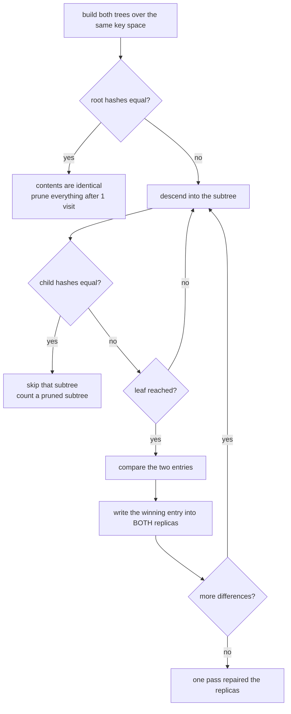
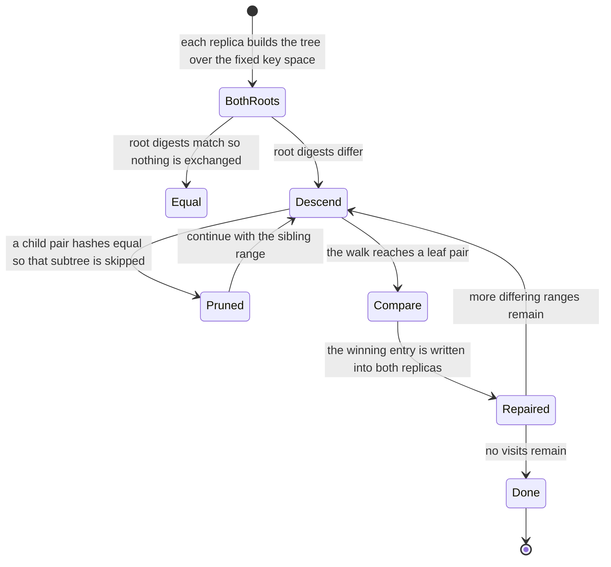
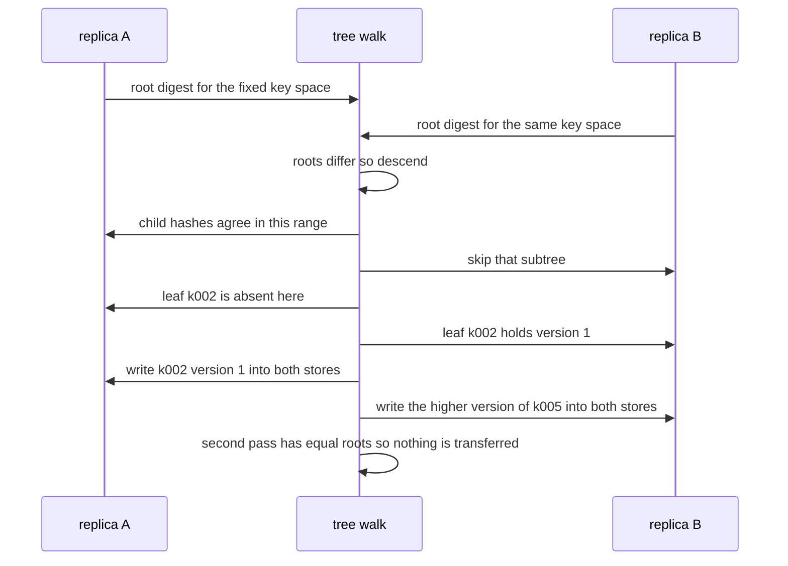

# 632 — Implement anti-entropy Merkle tree reconciliation demo.

> **Tier:** Expert · **CTCI chapter:** Ch 9 — System Design and Scalability
> **Task spec:** [632-implement-anti-entropy-merkle-tree-reconciliation-demo.md](../../../tasks/expert/632-implement-anti-entropy-merkle-tree-reconciliation-demo.md)
> **Solutions:** [Python](../../../solutions/python/expert/632-implement-anti-entropy-merkle-tree-reconciliation-demo/solution.py) ·
> [Java](../../../solutions/java/expert/632-implement-anti-entropy-merkle-tree-reconciliation-demo/Solution.java) ·
> [JavaScript](../../../solutions/javascript/expert/632-implement-anti-entropy-merkle-tree-reconciliation-demo/solution.js) ·
> [C#](../../../solutions/csharp/expert/632-implement-anti-entropy-merkle-tree-reconciliation-demo/Solution.cs)

## 1. Problem restatement

Reconcile two replicas of the same key space **without shipping their contents**: each replica hashes its keys
into a **Merkle tree** whose shape depends only on the key space, the two replicas walk the trees together
pruning every subtree whose hashes agree, and only the entries inside the surviving leaves are exchanged.

- **Input:** two replicas holding `(version, value)` entries over a fixed key space (`2^8` keys,
  `k000…k255` in the Python solution), and the tree shape (`bits = 8`).
- **Output:** a plan with the number of **visited** tree nodes, the **transferred** keys, the number of
  **skipped subtrees**, and the repaired stores — plus the verdicts: equal roots mean identical contents,
  differing contents always produce differing roots, and one pass converges the replicas.
- **Hashing rules:** a leaf hashes either `key:absent` (no entry), or `key:version:value` — with `~` for a
  tombstone — and an internal node hashes its two children's digests. Every change therefore alters exactly
  the path from that leaf to the root, and nothing else.

**Modelling contract.** This is a *demo*, per the task title, and the solutions say what that means: there is
no network and no I/O — `compare()`/`reconcile()` returns the entries each side must send and repairs both
stores in process. The Python solution uses a fixed `2^8` key space with one key per leaf, hashed with SHA-256
over a canonical string (so the digests are stable across runs and processes); the JavaScript solution orders
keys by their FNV-1a hash and uses leaf blocks, with a documented **non-cryptographic** mixer — it verifies
structural convergence and pruning, not collision resistance. The tree shape depends on the key space (and
leaf size), never on the data, which is the property that lets two independently built trees line up node by
node.

Concrete expected results (all asserted):

- **Equal roots ⇒ identical contents** (checked against the maps on every run) and differing contents always
  produce differing roots; construction is insertion-order independent and deterministic.
- With equal roots the walk visits exactly **1** node — the root — and transfers nothing.
- With a handful of differences the walk visits **93** of the tree's nodes and transfers one entry per
  genuinely differing key, whereas a naive comparison would move all **256** entries.
- One pass converges the replicas, a second pass transfers nothing (idempotent); deletions propagate because
  a delete is a tombstone with a version; empty and single-key stores work; and a corrupted leaf is repaired.

## 2. Intuition

The naive reconciliation asks "which keys differ?" by sending keys, versions or digests until the two sides
agree — `O(n)` data for a handful of differences. The Merkle tree turns that into a search: if two subtrees
have the same hash, their contents are *identical*, so the whole subtree can be pruned without inspecting it.

Two design choices make the pruning effective:

1. **The shape is fixed by the key space, not by the data.** Both replicas cut the same range with the same
   split rule, so node *i* of one tree covers exactly the same keys as node *i* of the other. A tree shaped by
   the entries it happens to hold would have to be compared structurally, and that comparison costs as much as
   the data.
2. **A leaf hashes the entry itself** — including the `absent` case and a tombstone for deletions. That makes
   the hash sensitive to every kind of change: a new value, an added key and a deleted key each move exactly
   one path up to the root, so a mismatch localizes the difference.

The walk then descends only where hashes disagree, which makes the cost proportional to the *divergence*, not
to the data set — `O(k log n)` hashes and `k` entry transfers for `k` differences.



The second half is the conflict rule, because reconciliation has to decide *which* copy wins: the higher
version wins; at the same version a live value beats a tombstone (a delete must not be resurrected by a stale
copy), and otherwise the greater value string wins. It is deterministic, so both replicas compute the same
winner locally and neither needs to be told which side it was on.

## 3. Algorithm

1. Fix the key space and the split rule: a node covering `[lo, hi)` splits at `mid = (lo + hi) // 2`; a leaf
   covers a single key (or a block of keys in the JavaScript variant, whose keys are ordered by hash).
2. `build_tree(store)` hashes each leaf as `absent` or `key:version:value` (tombstones included) and each
   internal node as the hash of its children's digests. The shape depends only on `bits`, so two replicas'
   trees are node-for-node comparable.
3. `reconcile(first, second)` walks both trees with the same indices:
   - increment the visited count; if the two digests are equal, count a pruned subtree and return — nothing
     in that range can differ;
   - otherwise descend into the children, or, at a leaf, compare the two entries;
   - `merge_entries` picks the winner (higher version; then a live value over a tombstone; then the greater
     value string) and the winner is written into **both** stores, so a single pass converges them.
4. A delete is a `set` with a tombstone: the entry stays in the store with a version so that a stale copy can
   never resurrect the key, and the tree hashes it like any other change.
5. Verification: root equality against the maps, change sensitivity per kind (value change, add, delete),
   exact transfer and visit counts for one and several differences, convergence plus idempotence on a second
   pass, the empty and single-key boundaries, corrupted-leaf repair, and run-to-run determinism.

```text
procedure walk(left, right, plan)
    plan.visited ← plan.visited + 1
    if left.digest = right.digest then
        plan.skipped_subtrees ← plan.skipped_subtrees + 1
        return                                  // equal hashes mean equal contents
    if left.is_leaf() then
        winner ← merge_entries(left.entry, right.entry)
        if winner differs from left.entry or right.entry then
            plan.transfers.append(left.key)
            write winner into both replicas
        return
    walk(left.left, right.left, plan)
    walk(left.right, right.right, plan)

function merge_entries(left, right)
    if left is none then return right
    if right is none then return left
    if left.version != right.version then return the one with the greater version
    if one of them is a tombstone then return the live entry
    return the entry with the greater value string

procedure reconcile(first, second)
    walk(first.root, second.root, plan)
    return plan

function entry_digest(key, entry)
    if entry is none then return hash(key + ":absent")
    version, value ← entry
    return hash(key + ":" + version + ":" + (value or "~"))
```



## 4. Worked example

A tiny key space with `bits = 3`, so eight leaves covering `k000…k007`. Replica `A` holds
`k001 = (1, "alpha")` and `k005 = (2, "gamma")`; replica `B` holds the same two entries but with `k005`
changed to `(3, "gamma")` and an extra key `k002 = (1, "beta")`.

| Node (range) | `A` digest kind | `B` digest kind | Equal? | Action |
| --- | --- | --- | --- | --- |
| `[0, 8)` root | hash of children | hash of children | no | descend |
| `[0, 4)` | hash of children | hash of children | **no** (`k002`, `k005` are outside it) | descend |
| `[0, 2)` | hash of children | hash of children | no (`k001` is present in both, `k002` only in `B`) | descend |
| `[0, 1)` = `k000` | `absent` | `absent` | yes | prune (1 skipped subtree) |
| `[1, 2)` = `k001` | `1:alpha` | `1:alpha` | yes | prune |
| `[2, 4)` | hash of children | hash of children | no (`k002` differs) | descend |
| `[2, 3)` = `k002` | `absent` | `1:beta` | no | **leaf transfer**: `k002` written into `A` |
| `[3, 4)` = `k003` | `absent` | `absent` | yes | prune |
| `[4, 8)` | hash of children | hash of children | no (`k005`) | descend |
| `[4, 6)` | hash of children | hash of children | no | descend |
| `[4, 5)` = `k004` | `absent` | `absent` | yes | prune |
| `[5, 6)` = `k005` | `2:gamma` | `3:gamma` | no | **leaf transfer**: version 3 wins, written into `A` |
| `[6, 8)` | hash of children | hash of children | yes | prune (2 skipped subtrees at once) |

The walk visits 15 nodes instead of all 15 in this artificial case only because the tree is tiny; the point
scales: with the measured `2^8` key space and a handful of differences the run visits **93** nodes and
transfers one entry per differing key, while the naive comparison would ship **256** entries. With equal roots
the walk stops after **1** visit, and a second pass over the repaired replicas transfers nothing at all.



Deletions use the same machinery: `remove` writes a tombstone `(version, None)`, which changes that leaf's
digest, so the next pass sees the mismatch, transfers one entry, and the tombstone propagates into the other
replica instead of the deleted key coming back. A corrupted leaf — one whose stored entry no longer matches
its content hash — is repaired by the same leaf-level comparison, and the run checks that the stores are
identical afterwards.

## 5. Complexity

With `n = 2^bits` leaves, `k` differing keys and `h = bits` the tree height.

| Operation | Best | Average | Worst | Why the bound holds |
| --- | --- | --- | --- | --- |
| `build_tree` | O(n) | O(n) | O(n) | one digest per leaf and per internal node — `2n − 1` hashes for `n` leaves |
| Reconciliation with equal roots | O(1) | O(1) | O(1) | the root digests match, so the walk stops after **1** visit and transfers nothing |
| Reconciliation with `k` differing keys | O(log n) | O(k log n) | O(n) | every difference forces at most `h` node visits and one leaf transfer; a difference in every leaf degenerates to a full walk |
| Visits in the measured run | 1 (equal roots) | **93** nodes | `2n − 1 = 511` nodes | with a handful of differences only the paths to those leaves are opened |
| Transfers | 0 | `k` | `n` | one entry per genuinely differing key, and only for the keys that survive the pruning |
| Repair cost per difference | O(1) | O(1) | O(1) | writing the winner into both stores is a map update |
| Second pass (idempotence) | O(1) | O(1) | O(1) | the stores are identical afterwards, so the roots match again |
| Space | O(n) | O(n) | O(n) | `2n − 1` nodes with one digest each; a production system stores the tree or rebuilds it incrementally |
| Naive comparison for reference | O(n) | O(n) | O(n) | sending every entry costs **256** entries for the same key space, whatever the divergence |

The trade-off is explicit: the tree costs `O(n)` hashes to build and `O(n)` memory, in exchange for a repair
cost proportional to the divergence instead of the data. Building the entire tree per change would dominate —
the Python solution rebuilds it for clarity, while a real deployment updates the `h` nodes on the affected
path, which is `O(h)` per write. The JavaScript solution's documented caveat matters here: its mixer is
non-cryptographic and its keys are hash-ordered, so it demonstrates the structure and the pruning but not
collision resistance, whereas the Python solution hashes canonical strings with SHA-256 for stable digests.

## 6. Pitfalls and edge cases

- **The shape must depend on the key space only.** If the tree were shaped by the entries each replica
  happens to hold, node `i` of one tree would not correspond to node `i` of the other, and the whole comparison
  would collapse into sending the data.
- **A leaf must hash absence and tombstones.** Otherwise a deleted key looks like a key that was never
  present, and the delete never propagates.
- **The conflict rule must be deterministic and total.** "Higher version wins, then a live value over a
  tombstone, then the greater value" gives both replicas the same winner without negotiation; a rule with
  unmatched cases would leave an unpredictable residue.
- **One pass must repair both sides.** Only sending the missing entries one way leaves the other replica
  diverged, and the second pass would have to run in the opposite direction.
- **Equal hashes must be trusted — and the trust must be checkable.** The checks verify "equal roots imply
  identical contents" against the maps on every run; without that, a hashing bug would look like convergence.
- **Collision resistance is out of scope for the demo.** The JavaScript mixer is a deterministic hash of
  child digests, deliberately not cryptographic; that is fine for pruning structure and wrong as a security
  argument.
- **Corrupted leaves are still caught.** A leaf whose entry no longer matches its recorded digest is found by
  the same leaf-level comparison, which is why the walk always validates at the leaf and never stops at an
  internal node it believes.
- **Empty and single-key stores.** An empty store is all `absent` leaves and still has a well-defined root,
  and a store with one key produces one non-`absent` leaf; both are asserted.
- **Determinism.** SHA-256 over a canonical string gives digests stable across runs and processes, which is
  what makes the "differs ⇒ differing roots" claim testable; a random or process-local hash would not.
- **The visit counter is the efficiency claim.** Reporting `visited` and `skipped_subtrees` is what turns
  "pruning works" into a measurement (93 visits for a handful of differences, 1 for identical replicas,
  256 entries for the naive alternative).
- **Unicode in keys and values** is handled by the canonical string encoding before hashing, so the digest
  does not depend on the language's default encoding.

## 7. Variants and follow-ups

- Detecting *liveness* rather than divergence, which is what decides when a repair is worth starting
  → [631 — gossip protocol for membership and failure detection](../../../tasks/expert/631-implement-gossip-protocol-for-membership-and-failure-detection.md).
- Ordering the writes that the reconciliation transfers, so a replica never applies an effect before its cause
  → [630 — causal consistency protocol simulation (vector clocks)](../../../tasks/expert/630-implement-causal-consistency-protocol-simulation-vector-clocks.md).
- The alternative repair strategy: an agreed log that replays missing entries instead of comparing state
  → [628 — distributed consensus simulation with network partitions](../../../tasks/expert/628-implement-distributed-consensus-simulation-with-network-partitio.md).
- Snapshotting a whole sharded store, where each shard's digest plays the role of a subtree hash
  → [617 — consistent snapshot across shards simulation](../../../tasks/expert/617-implement-consistent-snapshot-across-shards-simulation.md).
- Making the transferred entries transactional, so a partially applied repair can be undone
  → [627 — transactional key-value store with two-phase commit simulation](../../../tasks/expert/627-implement-transactional-key-value-store-with-two-phase-commit-si.md).
- Reusing the same hash-ordered layout as the storage layer of a non-blocking table
  → [622 — non-blocking hash table with split-ordered lists](../../../tasks/expert/622-implement-non-blocking-hash-table-split-ordered-lists.md).

## 8. Check yourself

<details><summary>Show answer</summary>
**Why must the tree's shape be independent of the data?** Because reconciliation compares the two trees node
by node: only if node `i` covers the same keys on both sides does a hash comparison mean anything. A
data-dependent shape would make the two trees structurally incomparable.
</details>

<details><summary>Show answer</summary>
**Two replicas have different roots. Does that mean many keys differ?** No: one changed value already changes
the root, because the change alters every node on that leaf's path. The walk localizes the difference by
descending, which is why a handful of differences costs about `k log n` hashes rather than `n`.
</details>

<details><summary>Show answer</summary>
**How is a deletion reconciled?** `remove` writes a tombstone `(version, None)`, so the leaf's digest changes
and the mismatch is detected like any other difference. The tombstone version then beats the live entry it
replaces, which prevents the deleted key from being resurrected by a stale copy.
</details>

<details><summary>Show answer</summary>
**Why does the measured walk visit 93 nodes instead of 1 or 511?** The identical subtrees are pruned by their
equal hashes, and only the paths down to the differing leaves are opened. So the visited count sits between
the trivial case (equal roots ⇒ 1 visit) and the worst case (a difference in every leaf ⇒ the whole tree).
</details>

<details><summary>Show answer</summary>
**What does a second reconciliation pass transfer, and why?** Nothing. The first pass wrote the winning entry
into *both* stores, so the trees are identical and the roots match — idempotence is the check that the repair
really converged rather than only copying in one direction.
</details>
