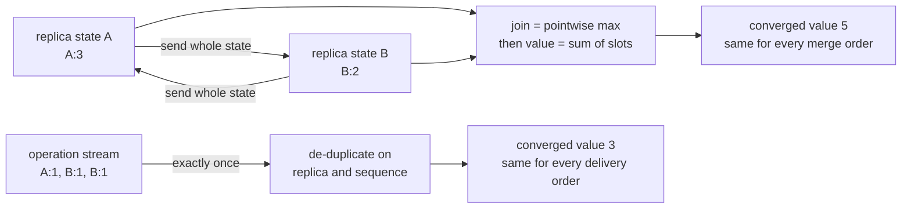
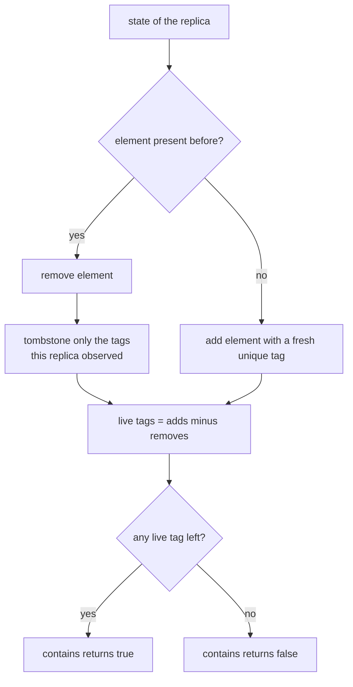
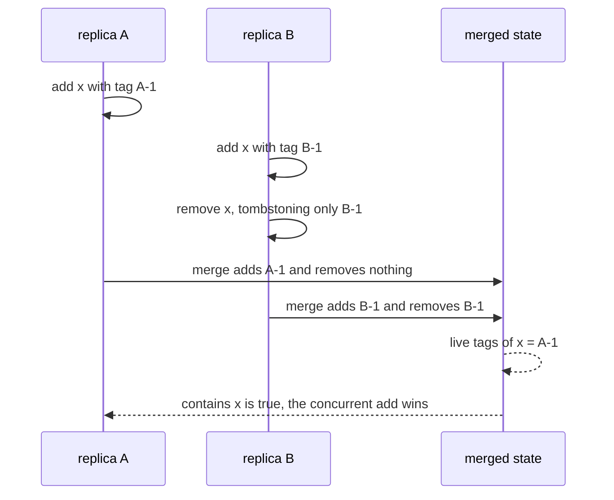

# 633 — Implement CRDT counter and set examples (operation-based and state-based).

> **Tier:** Expert · **CTCI chapter:** Ch 9 — System Design and Scalability
> **Task spec:** [633-implement-crdt-counter-and-set-examples-operation-based-and-stat.md](../../../tasks/expert/633-implement-crdt-counter-and-set-examples-operation-based-and-stat.md)
> **Solutions:** [Python](../../../solutions/python/expert/633-implement-crdt-counter-and-set-examples-operation-based-and-stat/solution.py) ·
> [Java](../../../solutions/java/expert/633-implement-crdt-counter-and-set-examples-operation-based-and-stat/Solution.java) ·
> [JavaScript](../../../solutions/javascript/expert/633-implement-crdt-counter-and-set-examples-operation-based-and-stat/solution.js) ·
> [C#](../../../solutions/csharp/expert/633-implement-crdt-counter-and-set-examples-operation-based-and-stat/Solution.cs)

## 1. Problem restatement

Implement the classic **conflict-free replicated data types** in both of their flavours and prove the
algebra that makes them converge:

| Type | Flavour | State | Join (merge) | Visible value |
| --- | --- | --- | --- | --- |
| `GCounter` | state-based | one count per replica | pointwise **max** | `sum(counts)` |
| `PNCounter` | state-based | two grow-only counters | merge both halves | `positive - negative` |
| `OpCounter` | operation-based | per-replica totals + applied id set | de-duplicate `(replica, sequence)` | `sum(per_replica)` |
| `GSet` | state-based | element set | **union** | membership |
| `TwoPSet` | state-based | `added` + `removed` sets | union both | `in added and not in removed` |
| `ORSet` | both | element → add **tags**, element → removed tags | union both | any live tag remains |

Input: a set of replica states or a stream of operations. Output: the converged value / membership, and
the concurrency behaviour of each type. Concrete results asserted by the checks:

- G-Counter: replicas `A:3`, `B:2`, `C:5` merge to `value() == 10`; merging a **stale** state
  (`{"A": 1}`) into `A:3` leaves the value at `3`; an empty counter is `0` with signature `()`; every
  merge order of the three replicas reaches byte-identical state.
- PN-Counter: `left = +5, -2 → 3`, `right = +1, -3 → -2`, merged `== 1` in either direction, with
  `positive == [("A",5),("B",1)]` and `negative == [("A",2),("B",3)]`.
- OpCounter: three operations from `A` (amount 1) plus two from `B` (amount 2) give `7` under
  reordering, under rotation and under duplicate delivery; the duplicated run counts
  `duplicates == 5` and ends at per-replica `[("A",3),("B",4)]`.
- 2P-Set: `add x`, `add y`, `remove x`, then `add x` → `x` is **still absent** and the signature is
  `(("x","y"), ("x",))`; merging that tombstone into a replica that still holds `x` deletes it there.
- OR-Set: `A` adds tag `A-1`, `B` adds `B-1` and removes `x` → the merged state still contains `x`
  with `live_tags("x") == {"A-1"}`; a *sequential* remove does delete `x`, and a fresh tag `A-2`
  resurrects it; all 6 merge orders of three replicas produce one signature.
- Both flavours on the same history `[(A,1),(B,4),(A,2),(C,7)]` give `14` and identical per-replica
  breakdowns.

Money quote from the Python run: `crdt: g-counter states=5 g-set states=5 or-set states=8
op-based-duplicates=5 converged-or-set=['x', 'y']`.

## 2. Intuition

The naive idea is a **last-writer-wins register per replica**: keep the value plus a timestamp and let
the newer write overwrite the older one. It is cheap and it converges, but it silently loses data:
when two replicas increment concurrently, one of the two increments is discarded. The Java solution
keeps exactly that bug as a **negative control** — an LWW merge applied to a PN-Counter provably loses
a concurrent increment, and the checker catches it. That is the point of a CRDT: the merge must not be
allowed to throw information away.

The fix is to choose a merge that is a **least upper bound** of a join-semilattice, so that it is

1. **commutative** — `merge(a, b) == merge(b, a)`,
2. **associative** — grouping does not matter,
3. **idempotent** — `merge(a, a) == a`.

Then any replica that has seen the same set of updates ends in the same state, whatever the order and
however often messages are re-delivered — no coordination, no consensus round. Two monotone joins do
all the work here: **pointwise max** for counters (an update can only ever raise a slot, so a stale
message can never undo a newer one) and **set union** for sets.

Removal is the hard part, because a set union alone cannot express "take this element away". Two
answers appear in the solutions:

- **2P-Set** — keep a second grow-only set of tombstones. Presence is `added - removed`; since the
  tombstone set only grows, **remove wins forever** and a re-add of the same element is a no-op.
- **OR-Set (observed-remove)** — every add is a *unique tag*, and a remove tombstones only the tags the
  remover had actually **observed** (`remove(x)` returns the tag set it cancelled). A concurrent add
  carries a tag the remover never saw, so the element survives — **add wins** — and this without any
  timestamp comparison.

The operation-based flavour ships the operations instead of the state. It does not need the lattice, it
needs **exactly-once delivery**: the `OpCounter` de-duplicates on `(replica, sequence)`, which makes
rejected re-deliveries countable and lets reordered + duplicated streams still total `7`. The
solutions state explicitly what is *not* modelled — no network, no vector clocks, no causal-order
buffering (that machinery is task 630) — but the algebra itself is checked exhaustively.



## 3. Algorithm

**State-based (CvRDT).** Each type implements the same three moves:

1. `merge(other)` — fold the incoming state into `self` with the type's join: max per replica slot for
   the counters, set union for `GSet`, union of `added` *and* `removed` for `TwoPSet`, union of the tag
   maps for `ORSet`. Merging never deletes: counters only rise, sets only grow.
2. `value()` / `contains(element)` — read the join result: `sum(slots)` for the counters,
   `element in added and element not in removed` for the 2P-Set,
   `adds[element] - removes[element] != {}` for the OR-Set.
3. `signature()` — a canonical, sorted, hashable dump of the whole state. All convergence checks
   compare signatures, not values, so two states that agree numerically but differ in tombstones are
   still caught.

**Operation-based (CmRDT).** A replica generates `(replica, sequence, amount)` and applies the very
same tuple locally; delivery calls `apply(operation)` which

1. rejects an operation whose `(replica, sequence)` pair is already in `applied` (incrementing
   `duplicates`),
2. otherwise records the id and adds `amount` to `per_replica[replica]`.

```text
procedure g_counter_merge(counter, other)
    for replica, count in other.counts do
        if count > counter.counts[replica] then
            counter.counts[replica] = count          // pointwise max, never a decrement
        end
    end

procedure pn_counter_decrement(counter, replica, amount)
    g_counter_increment(counter.negative, replica, amount)   // the state stays monotone

procedure op_counter_apply(counter, operation)
    replica, sequence, amount = operation
    if (replica, sequence) in counter.applied then
        counter.duplicates = counter.duplicates + 1
        return false
    end
    counter.applied = counter.applied union {(replica, sequence)}
    counter.per_replica[replica] = counter.per_replica[replica] + amount
    return true

procedure or_set_remove(set, element)
    observed = set.adds[element]                     // the tags this replica has seen
    set.removes[element] = set.removes[element] union observed
    return observed

function or_set_contains(set, element)
    return size(set.adds[element] - set.removes[element]) > 0
```

The canonical check harness is worth naming, because every type reuses it: `lattice_laws(states)` runs
idempotence, commutativity and associativity over **all triples** of a generated state list, and the
convergence checks replay `merge` in all permutations.



## 4. Worked example

**(a) G-Counter convergence.** Replicas hold `A:3`, `B:2`, `C:5`; a fourth (stale) state holds `A:1`.

| Step | `merge` into | counts after | `value()` |
| --- | --- | --- | --- |
| start | empty counter | `{}` | 0 |
| 1 | `A:3` | `{A: 3}` | 3 |
| 2 | `B:2` | `{A: 3, B: 2}` | 5 |
| 3 | `C:5` | `{A: 3, B: 2, C: 5}` | 10 |
| 4 | stale `{A: 1}` | `{A: 3, B: 2, C: 5}` | 10 |
| 5 | `A:3` merged with itself | `{A: 3, B: 2, C: 5}` | 10 |

Step 4 is the whole point: `A:3` already dominates `A:1`, so the stale state is absorbed instead of
rolling the counter back. The checker re-runs steps 1–3 in all six orders and asserts the six
signatures collapse to a single one.

**(b) Operation-based counter under hostile delivery.** Five operations exist:
`(A,1,1), (A,2,1), (A,3,1), (B,1,2), (B,2,2)` — three of size 1, two of size 2, so the true total is
`3 * 1 + 2 * 2 = 7`.

| Delivery order | `value()` | `duplicates` | per-replica view |
| --- | --- | --- | --- |
| as generated | 7 | 0 | `[("A",3), ("B",4)]` |
| reversed | 7 | 0 | `[("A",3), ("B",4)]` |
| rotated by two | 7 | 0 | `[("A",3), ("B",4)]` |
| delivered twice | 7 | 5 | `[("A",3), ("B",4)]` |

**(c) OR-Set concurrent add / remove.**



The symmetric case is the *sequential* one: a single replica that adds `x` with `A-1` and then removes
`x` cancels exactly that tag, so `contains(x)` is `false` while `adds["x"]` still holds `A-1` (the tag
is tombstoned, never erased). Adding again with the new tag `A-2` makes the element live again — the
2P-Set cannot do that, because its tombstone is not tied to any particular add.

## 5. Complexity

With `r` replicas (slots), `e` elements and `t` the tags of one element:

| Operation | Time | Space | Why |
| --- | --- | --- | --- |
| `GCounter.merge` / `PNCounter.merge` | O(r) | O(r) | one dictionary probe per slot of the incoming state; the join keeps the *maximum* set of slots |
| `GCounter.value` | O(r) | O(1) | sum over the slots |
| `ORSet.merge` | O(e · t) | O(e · t) | union of both tag maps; the state only grows |
| `ORSet.add` / `remove` | O(1) / O(t) | O(1) / O(t) | a remove copies the observed tag set into the tombstone map |
| `ORSet.contains` | O(t) | O(1) | set difference on the element's tags |
| `OpCounter.apply` | O(1) | O(#operations) | hash insertion of the operation id plus one counter update |
| `lattice_laws(states)` | O(n³) merges | O(state) | every triple of the `n` generated states, plus the 24 permutations of the three-replica convergence runs |

The alternative is the LWW register: `merge` is O(1) instead of O(r), but it is not a join of a
semilattice in any useful sense — it is a *total order* on writes, and the Java negative control shows a
concurrent increment disappearing. The other structural difference is space: tombstones and tags are
never garbage-collected here, so the 2P-Set pays O(elements ever removed) and the OR-Set pays
O(adds ever performed) forever. The solutions say so explicitly; compaction would need a causal
stability oracle (every replica has seen the tombstone) before a tombstone may be dropped.

## 6. Pitfalls and edge cases

- **Grow-only means grow-only.** `GCounter.increment` asserts `amount >= 0` and a decrement must go
  through `PNCounter.decrement`, i.e. into the *negative* counter, so both underlying states stay
  monotone. A counter with a mutable total is not a CRDT.
- **Empty state.** An empty counter has `value() == 0` and signature `()`; merging anything into it
  learns that state, and merging a counter with *itself* changes nothing (idempotence) — both are
  asserted.
- **Stale states must not lower a value** — checked for every pair of generated counter states, not
  just the chosen example.
- **A PN-Counter value can be negative** (`-2` in the checks) even though both halves are grow-only,
  and the merged `3 + (-2)` is `1` regardless of merge direction.
- **Re-add after a remove is a no-op in the 2P-Set** and is *not* a bug: the tombstone set cannot
  shrink. Replicas that never saw the remove still hold the element until they merge the tombstone.
- **Tie resolution is tag-based, not timestamp-based.** In the OR-Set, `add x` and `remove x` of the
  same element at once resolves to present (add-wins) because the remover only cancelled tags it
  observed; the 2P-Set resolves the same situation to absent (remove-wins). Neither compares clocks.
- **Tag uniqueness is the load-bearing assumption.** The demo uses deterministic `replica:counter`
  strings; a tag collision between two replicas would make a concurrent add vanish silently.
- **Duplicate delivery is expected, not exceptional** for the operation-based counter: re-delivering
  all five operations leaves the value at `7` and counts all `5` re-deliveries as duplicates.
- **No causal buffering.** The op-based side applies operations in any order because the counter's
  operations commute; a type whose operations need causal order would have to buffer (task 630).
- **Whole-state exchange is expensive.** Merging ships the full tag/tombstone maps; in production the
  deltas are shipped (or reconciled with a Merkle tree, task 632) instead.

## 7. Variants and follow-ups

- **Sequences instead of counters.** An RGA / Logoot list needs stable element identifiers rather than
  tags on a single key — see
  [634-implement-crdt-sequence-rga-logoot-basics-for-collaborative-edit.md](../../../tasks/expert/634-implement-crdt-sequence-rga-logoot-basics-for-collaborative-edit.md).
- **Causal delivery for operation-based CRDTs.** Replace the exactly-once assumption with vector clocks
  and a causal-order buffer — see
  [630-implement-causal-consistency-protocol-simulation-vector-clocks.md](../../../tasks/expert/630-implement-causal-consistency-protocol-simulation-vector-clocks.md).
- **Cheaper state exchange.** Instead of shipping the whole state, exchange fingerprints and repair the
  differences — see
  [632-implement-anti-entropy-merkle-tree-reconciliation-demo.md](../../../tasks/expert/632-implement-anti-entropy-merkle-tree-reconciliation-demo.md).
- **Where the timestamps go instead.** Physical/hybrid clocks ordering events for the register-style
  types — see
  [636-implement-hybrid-logical-clocks-and-test-ordering-in-distributed.md](../../../tasks/expert/636-implement-hybrid-logical-clocks-and-test-ordering-in-distributed.md).
- **Efficiency of the canonical state dump** matters as soon as states get large: sorting a
  `signature()` is O(state log state) and dominates the permutation sweeps.

## 8. Check yourself

<details><summary>Show answer 1 — Why is `max` the right join for a grow-only counter?</summary>

Because the per-replica count is monotone: a replica's own sequence never decreases, so an incoming
slot that is smaller than the local one is simply *older*. Taking the maximum therefore keeps every
increment exactly once, is commutative, associative and idempotent, and makes a stale message a no-op
(the `A:3` vs `A:1` step). A sum-based merge would double-count re-delivered states.
</details>

<details><summary>Show answer 2 — What exactly is lost by a last-writer-wins merge?</summary>

One of two concurrent increments. LWW keeps a single slot ordered by timestamp, so the loser's update
is overwritten and never reappears; the Java checker demos that directly as a negative control. A CRDT
merge is forbidden from doing this because it must be an upper bound of *both* states.
</details>

<details><summary>Show answer 3 — Concurrent `add x` and `remove x`: which type does what?</summary>

2P-Set: absent — the tombstone set is monotone, so remove wins forever, and even a later `add x` cannot
resurrect the element. OR-Set: present — the remover cancelled only the tags it had observed, so the
concurrent add's `A-1` tag survives and `live_tags("x") == {"A-1"}`. A *sequential* remove in the
OR-Set does delete `x`, and a brand-new tag resurrects it.
</details>

<details><summary>Show answer 4 — Why does the state-based and the operation-based counter agree?</summary>

Both compute the same per-replica totals: the state version keeps `max` per slot and sums the slots,
the operation version adds each `amount` once per `(replica, sequence)` and sums the slots. For the
history `[(A,1),(B,4),(A,2),(C,7)]` both give `14` with identical signatures — the op-based one just
needs exactly-once delivery to get there.
</details>

<details><summary>Show answer 5 — What has to be true before a tombstone may be deleted?</summary>

That no replica can still produce an add that should lose to it — i.e. causal stability: every replica
has seen and applied the tombstone (and in the OR-Set, that its tags are older than the oldest live
operation). Until then both sets grow without bound, which is the documented space cost of these types.
</details>
