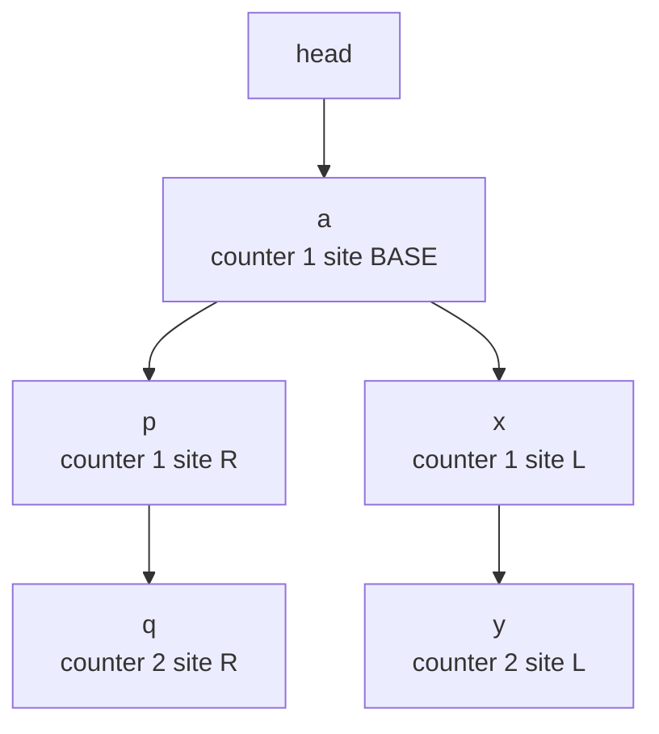
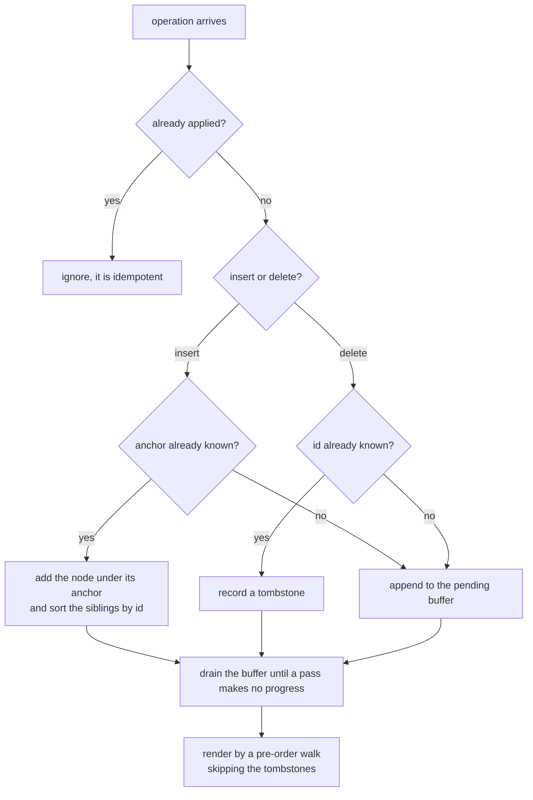
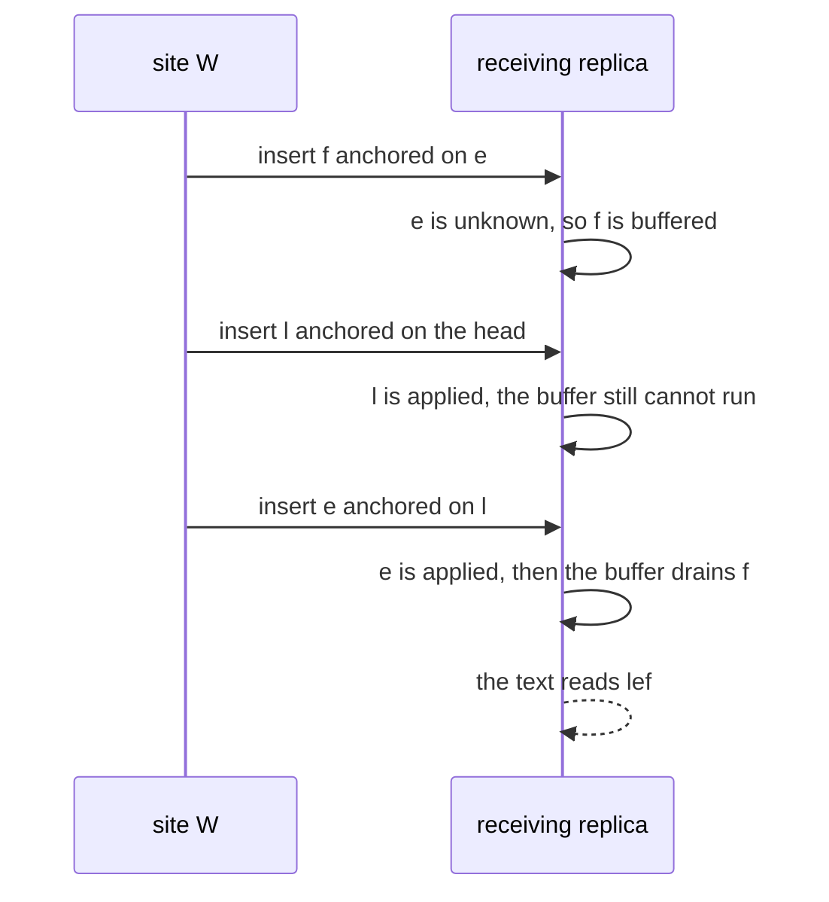

# 634 — Implement CRDT sequence (RGA / Logoot) basics for collaborative editing.

> **Tier:** Expert · **CTCI chapter:** Ch 9 — System Design and Scalability
> **Task spec:** [634-implement-crdt-sequence-rga-logoot-basics-for-collaborative-edit.md](../../../tasks/expert/634-implement-crdt-sequence-rga-logoot-basics-for-collaborative-edit.md)
> **Solutions:** [Python](../../../solutions/python/expert/634-implement-crdt-sequence-rga-logoot-basics-for-collaborative-edit/solution.py) ·
> [Java](../../../solutions/java/expert/634-implement-crdt-sequence-rga-logoot-basics-for-collaborative-edit/Solution.java) ·
> [JavaScript](../../../solutions/javascript/expert/634-implement-crdt-sequence-rga-logoot-basics-for-collaborative-edit/solution.js) ·
> [C#](../../../solutions/csharp/expert/634-implement-crdt-sequence-rga-logoot-basics-for-collaborative-edit/Solution.cs)

## 1. Problem restatement

Make a **text sequence** a CRDT, so that concurrent editing converges without a server arbitrating.
Two classic designs are implemented side by side:

| Structure | Identity of a character | Insertion operation | Document order |
| --- | --- | --- | --- |
| **RGA** (Replicated Growable Array) | `(counter, site)` — globally unique | `("insert", id, anchor, char)` where `anchor` is the id it was typed *after* | pre-order walk of the insertion tree, siblings ordered by a deterministic key on the id |
| **Logoot** | `position` — a list of `(digit, site)` pairs | `("insert", position, char)` where the position is minted **strictly between** two neighbours | the positions in ascending (lexicographic) order |

Both also implement `("delete", id_or_position)`; deletions are **tombstones**, because a later insert
may still reference the deleted character. An operation whose anchor (RGA) or position dependency
(Logoot) has not arrived yet is **buffered** and replayed by `drain()`. Concrete results asserted by
the checks:

- RGA `"lo"` then an insert of `"X"` anchored on `"l"` renders `"lXo"` with `"X"` at index 1.
- Out-of-order delivery: applying `"f"` (anchor `"e"` missing) returns `false` and buffers it; applying
  `"l"` succeeds; `drain()` returns `0` because `"e"` is still missing; applying `"e"` makes `drain()`
  return `1` and the text becomes `"lef"`, exactly as in-order and reversed delivery do.
- Concurrent typing: both sites append two characters after the same anchor `"a"`; the five-operation
  script has **120** delivery orders, all rendering `"apqxy"` with `"xp"` and `"px"` never appearing.
- Deleting the `"a"` id removes exactly one character, deleting it again changes nothing, and a `delete`
  delivered before its `insert` is buffered and then drained into an empty document.
- Logoot: appending `"hello"` yields strictly increasing positions whose length stays `<= 2`; `bmz`
  becomes `bcmz` after an insert between `b` and `m`; 60 LCG-driven inserts into random gaps keep every
  position strictly between its neighbours and end with 64 unique positions, and the four-operation
  script `insert a`, `insert c`, `insert b between a and c`, `delete c` has **24** delivery orders that
  all render `"ab"` while a duplicate delivery leaves three positions.

The Python run prints exactly:
`rga: converged='apqxy' delivery-orders=120 logoot: letters=64 max-position-length=3`.

## 2. Intuition

A plain list index is not a CRDT: "insert at index 3" means different things on two replicas that have
seen different characters, so index-based edits diverge (this is the classic *interleaving / intention
preservation* problem that operational transform solves with a server-side transform, task 635).

**RGA's insight** is to stop naming positions and start naming *neighbours*. Every character gets a
unique id, and an insert records the id of the character it was typed after. The document is then not a
list but a **tree**, rooted at a virtual head: replicas holding the same characters build the same tree
whatever order the operations arrived in, and the visible text is a fixed traversal (pre-order) of that
tree, so it is a pure function of the operation set. The classic pitfall is *sibling order*: after two
replicas type concurrently at the same anchor the anchor has two children, and "append to the end of the
child list" is arrival-order dependent. The solutions therefore sort siblings by a deterministic key on
the id — Python, Java and JavaScript all key on `(counter, site)`, with Python taking the **descending**
direction, which puts the newest child first and produces `"apqxy"` in the trace below.

Deletion cannot unlink a node, because a concurrent insert may name it as its anchor; the node stays in
the tree as a **tombstone** and is skipped when rendering. An insert whose anchor has not arrived cannot
be placed yet either — it is buffered and retried, which is the causal-delivery requirement made explicit.

**Logoot's insight** is the opposite: keep the list, but make the *positions* dense and globally unique.
A position is a list of `(digit, site)` pairs compared lexicographically (with a missing tail treated as
the minimum); inserting between two neighbours synthesises a position strictly between their lists by
splitting the first digit range that has a gap and appending a site-tagged digit. Nothing has to be
relabelled, no anchors are needed, and the document is the positions in sorted order — the price is
that positions grow when inserts keep landing in the same gap.



The picture is the converged state of the trace in section 4. `p` and `x` are siblings under the same
anchor `a`; the deterministic sibling key puts `(1, R)` before `(1, L)`, so the walk emits
`a p q x y` and the two runs stay contiguous. The C# header is careful about the scope of that
promise: *plain* RGA has no general non-interleaving / intention-preservation guarantee — the
contiguity here is a property of run-shaped edits, which is why later algorithms exist.

## 3. Algorithm

**RGA.**

1. `_new_id()` — bump the local counter and return `(counter, site)`. Ids are unique across sites
   because they carry the site.
2. `apply(operation)` — an already-applied operation returns `true` (idempotent). An insert whose anchor
   is neither `HEAD` nor a known id is pushed to `pending` and returns `false`; a delete of an unknown id
   is buffered too. Otherwise the node joins `anchors[anchor]`, the sibling list is re-sorted with the
   deterministic id key, or the tombstone is recorded.
3. `drain()` — replay the buffer until a full pass makes no progress, returning how many operations were
   applied; the loop matters because applying one buffered insert can unblock another (`l → e → f`).
4. `text()` — iterative pre-order walk with an explicit stack: pop `(anchor, index)`, push the anchor
   again with `index + 1` so the next sibling is visited later, then descend into the child; deleted ids
   emit nothing.
5. `delete(id)` — record the id in the tombstone set; the node stays reachable as an anchor forever.

**Logoot.**

1. `generate(left, right)` — if `right` is open (end of document), copy `left` and step its last digit by
   one, appending a middle digit `BASE // 2` if that digit would overflow. Otherwise walk the digit
   ranges from index 0: `low` is the left digit at that index (or 0), `high` the right one (or `BASE`);
   the first gap wider than one gets the midpoint digit and the position is returned. If the gap is
   tight, copy the left digit and move to the next index — the new position is then an extension of
   `left`, strictly below `right`.
2. `insert_between(left, right, char)` — mint the position, build the operation, apply it. `left` is the
   virtual `START` sentinel `((0, "\x00"),)` at the beginning of the document, `right` is `None` at the end.
3. `apply(operation)` — keyed by position, so `setdefault` makes duplicate delivery idempotent; a delete
   only adds to the tombstone set.
4. `text()` / `order()` — the positions in ascending order with the tombstones filtered out.
5. `compare_positions` is the total order: the first differing `(digit, site)` pair decides, and a proper
   prefix sorts before the longer list.
```text
procedure rga_apply(document, operation)
    if operation in document.applied then
        return true                                  // duplicate delivery
    if operation.kind = "insert" then
        if operation.anchor is not HEAD and operation.anchor is unknown then
            document.pending.append(operation)
            return false                             // the anchor has not arrived
        document.values[operation.id] = operation.character
        siblings = document.anchors[operation.anchor]
        siblings.append(operation.id)
        sort siblings by descending (counter, site)
    else
        if operation.id is unknown then
            document.pending.append(operation)
            return false
        document.deleted.add(operation.id)
    document.applied.add(operation)
    return true

procedure rga_drain(document)
    applied = 0
    repeat
        progress = false
        for operation in a snapshot of document.pending do
            if rga_apply(document, operation) then
                applied = applied + 1
                progress = true
        end
    until not progress
    return applied

procedure logoot_generate(left, right)
    if right is open then
        digits = copy of left
        if last digit of digits plus one is below BASE then
            replace the last digit with (digit + 1, site)
        else
            append (BASE div 2, site)
        return digits
    digits = empty
    index = 0
    while true do
        low = left[index].digit if index is inside left else 0
        high = right[index].digit if index is inside right else BASE
        if high - low > 1 then
            append ((low + high) div 2, site)
            return digits
        append left[index]
        index = index + 1
```



## 4. Worked example

**(a) A local insert lands between its neighbours.** Start from `"lo"` typed on site `A`, so the tree
holds `(1, A) → "l"` and `(2, A) → "o"` chained under `HEAD`.

| Step | Operation | Tree change | Rendered text |
| --- | --- | --- | --- |
| 1 | `insert(HEAD, "l")` | `HEAD` children `[(1, A)]` | `"l"` |
| 2 | `insert((1, A), "o")` | `(1, A)` children `[(2, A)]` | `"lo"` |
| 3 | `insert((1, A), "X")` → id `(3, A)` | `(1, A)` children `[(3, A), (2, A)]` | `"lXo"` |

The counter keeps growing, so the newest child sorts first and `"X"` is emitted before `"o"`.

**(b) Out-of-order delivery uses the buffer.** Site `W` types `"l"`, then `"e"` after `"l"`, then `"f"`
after `"e"`. A fresh replica receives the three operations shuffled:

| Arrival | `apply` result | `pending` | `drain()` returns | Text after the call |
| --- | --- | --- | --- | --- |
| `("insert", (3, W), (2, W), "f")` | `false` (anchor `(2, W)` unknown) | 1 | — | `""` |
| `("insert", (1, W), HEAD, "l")` | `true` | 1 | 0 | `"l"` |
| `("insert", (2, W), (1, W), "e")` | `true` | 1 | 1 | `"lef"` |

The third row is the interesting one: applying `"e"` makes the buffered `"f"` applicable, `drain` applies
it, and the document renders `"lef"` — exactly what in-order and reversed delivery produce.

**(c) Two concurrent runs, 120 delivery orders.** Both sites hold `"a"` (id `(1, BASE)`) and type two
characters each, anchored on `"a"`.

| Site | Operations | Local text |
| --- | --- | --- |
| `L` | `(1, L) "x"` after `a`, `(2, L) "y"` after `(1, L)` | `"axy"` |
| `R` | `(1, R) "p"` after `a`, `(2, R) "q"` after `(1, R)` | `"apq"` |

Siblings of `a` are `[(1, R), (1, L)]` after the descending sort, so the merged document is `"apqxy"`
— two contiguous runs. All `5! = 120` delivery permutations of the script render that same text, and
the checker asserts that neither `"xp"` nor `"px"` ever occurs.



**(d) Logoot mints a position strictly between two neighbours.** The document `bmz` holds
`b = ((0, "\x00"), (128, "B"))`, `m = ((1, "B"),)`, `z = ((2, "B"),)`. Inserting `"c"` between `b` and
`m` runs the generator:

| Index | `left` digit | `right` digit | Gap | Action |
| --- | --- | --- | --- | --- |
| 0 | 0 | 1 | 1 | gap is tight, copy the left digit `(0, "\x00")` |
| 1 | 128 | none → `BASE` = 256 | 128 | append the midpoint `(192, "B")` and return |

The new position `((0, "\x00"), (192, "B"))` satisfies `b < c < m`, so the document becomes `"bcmz"`.
Appending at the end is cheaper: `left` is copied and its last digit stepped by one, and the checker
verifies that the five positions of `"hello"` never need more than two digits. 60 LCG-chosen inserts
into random gaps end with 64 distinct positions and `max-position-length == 3` (the value printed by
the Python run). A four-operation Logoot script (`a`, `c`, `b` between them, then `delete c`) has 24
permutations and every one of them renders `"ab"`.

## 5. Complexity

With `n` characters in the document, `m` buffered operations and `d` the length of a Logoot position:

| Operation | Time | Space | Why |
| --- | --- | --- | --- |
| RGA `insert` / `delete` (local) | O(siblings) | O(1) | one id minted, one sibling list re-sorted |
| RGA `apply` | O(1) amortised | O(1) | set lookups plus one list append, unless it buffers |
| RGA `drain` | O(m²) worst case | O(m) | a full pass per unblocked operation; the chain `l → e → f` needs one pass per link |
| RGA `text()` | O(n) | O(n) | iterative pre-order walk with an explicit stack (no recursion) |
| Logoot `generate` | O(d) | O(d) | one step per digit index, stopping at the first wide gap |
| Logoot `insert_between` | O(d) | O(d) | generate plus one dict insert |
| Logoot `text()` / `order()` | O(n log n) | O(n) | sorting the positions; the walk is a plain sort, no tree |
| Logoot position length | O(log n) expected for appends | O(d) | appending steps the last digit; only repeated inserts into the *same* gap lengthen the position |

The alternatives:

| Approach | Order | Rationale |
| --- | --- | --- |
| List index + OT against a server (task 635) | O(n) transform per operation | converges, but needs a central order or a transform against concurrent history |
| RGA tree + deterministic sibling order (this task) | O(siblings) per insert | converges with no server, no position relabelling |
| Naive RGA that appends a new child after its origin | O(1) per insert | **diverges**: the Java negative control shows the concurrent-insert case ending in an interleaved mess |

Both structures keep tombstones and buffered operations forever here; there is no garbage collection.

## 6. Pitfalls and edge cases

- **Sibling order must be deterministic.** Appending a new child "at the end" makes the result depend
  on arrival order; the Java solution keeps exactly that broken variant as a negative control. Sorting
  by id is what makes the order a function of the operation set (ordering *direction* is free, as long
  as every replica agrees — Python sorts descending, Java/JavaScript/C# ascending by `(counter, site)`).
- **Buffered operations must not be applied twice.** `drain` snapshots the buffer (because `apply` may
  re-buffer an operation) and stops only when a whole pass makes no progress; otherwise `"f"` could be
  applied twice or dropped.- **Idempotence is per operation, not per id.** The `applied` set makes re-delivering the whole script a
  no-op, and `setdefault`-style writes make duplicate Logoot inserts harmless.
- **Deletes need tombstones.** Removing the node would break later inserts that name it as an anchor;
  the checks delete a character, deliver the script twice and assert the text is unchanged. A delete
  that arrives before its insert goes to the buffer, and the drain afterwards leaves the document empty.
- **Empty document.** An empty RGA renders `""` and had nothing to drain; an empty Logoot document has
  no positions. A single character is inserted and deleted back to `""`.
- **The `START` sentinel is not a real position.** `compare_positions(START, START) == 0` and
  `START < ((1, "A"),)`, so everything can be inserted before the first character.
- **Logoot can exhaust a gap.** The Python generator falls back to extending the position; the Java
  header is strict about it and reports an exhausted gap as an explicit failure rather than returning a
  wrong order.
- **Identifier collision is fatal.** Two sites must never mint the same id; the `(counter, site)` pair
  guarantees it, a bare counter does not.
- **This is not OT.** There is no transform and no intention preservation for arbitrary concurrent
  edits: the C# header says plain RGA can interleave concurrent runs in general.

## 7. Variants and follow-ups

- **Transform-based collaboration.** When a server does own the order, operational transform replaces
  the tree with transform functions — see
  [635-implement-operational-transform-simplified-for-collaborative-tex.md](../../../tasks/expert/635-implement-operational-transform-simplified-for-collaborative-tex.md).
- **Causal delivery for the buffer.** The `pending` queue is a hand-made causal buffer; the general
  version tracks vector clocks — see
  [630-implement-causal-consistency-protocol-simulation-vector-clocks.md](../../../tasks/expert/630-implement-causal-consistency-protocol-simulation-vector-clocks.md).
- **Timestamps for the id ordering.** Replacing the `(counter, site)` tie-break with a hybrid logical
  clock keeps the same tree shape while matching wall-clock intuition — see
  [636-implement-hybrid-logical-clocks-and-test-ordering-in-distributed.md](../../../tasks/expert/636-implement-hybrid-logical-clocks-and-test-ordering-in-distributed.md).
- **Counter-style CRDTs.** When the value is a number rather than a sequence, the tag/merge algebra of
  [633-implement-crdt-counter-and-set-examples-operation-based-and-stat.md](../../../tasks/expert/633-implement-crdt-counter-and-set-examples-operation-based-and-stat.md)
  is far cheaper than a tree.

## 8. Check yourself

<details><summary>Show answer 1 — Why does RGA store the <em>id</em> of the previous character instead of an index?</summary>

Because an index is position-dependent: two replicas that have seen different characters disagree about
what "index 3" means, so the same edit produces different documents. An id is stable, so "after
character (2, A)" names the same place everywhere and the tree is identical on every replica.
</details>

<details><summary>Show answer 2 — What goes wrong if siblings are appended in arrival order?</summary>

The traversal order becomes arrival-order dependent, so two replicas that received the same operations
in different orders render different texts — the Java negative control demonstrates exactly this
divergence for concurrent inserts at one origin. Sorting siblings by a deterministic key on the id
fixes it.
</details>

<details><summary>Show answer 3 — Why can a deletion never simply remove the node?</summary>

A concurrent insert may name the deleted character as its anchor; the node must stay in the tree to be
walkable, so it becomes a tombstone that is skipped when rendering. In the checks a delete delivered
before its insert is buffered, then removes the character once the insert arrives.
</details>

<details><summary>Show answer 4 — When is buffering needed and how does `drain` terminate?</summary>

Whenever an insert's anchor (or a delete's id) is unknown. `drain` replays the buffer while a pass makes
progress, and each pass removes whatever it applied, so it terminates.
</details>
