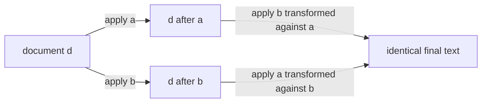
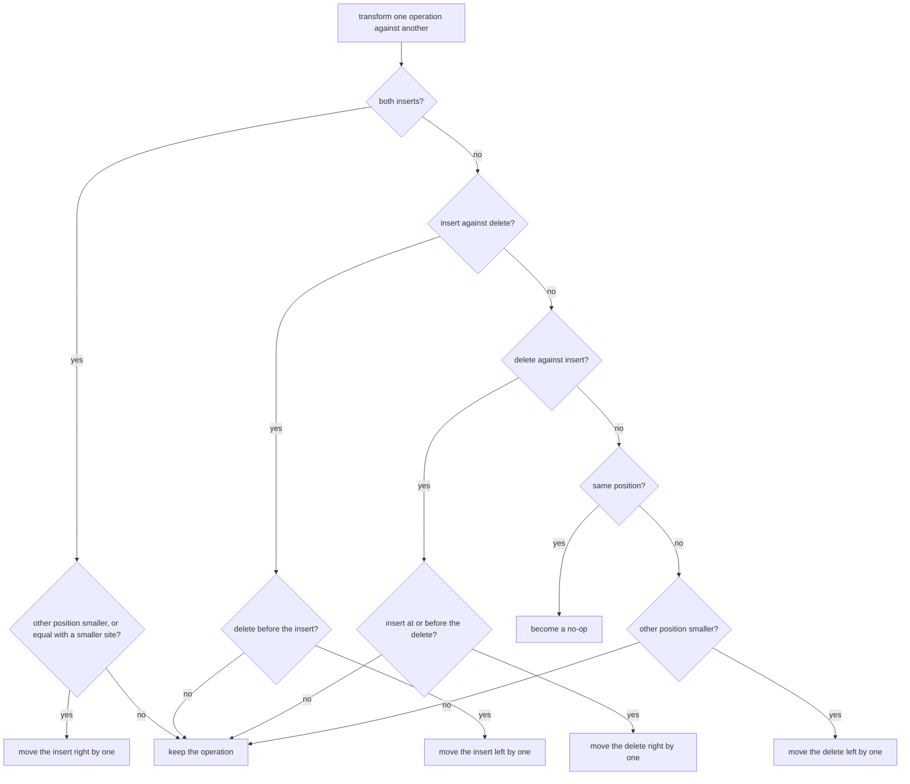
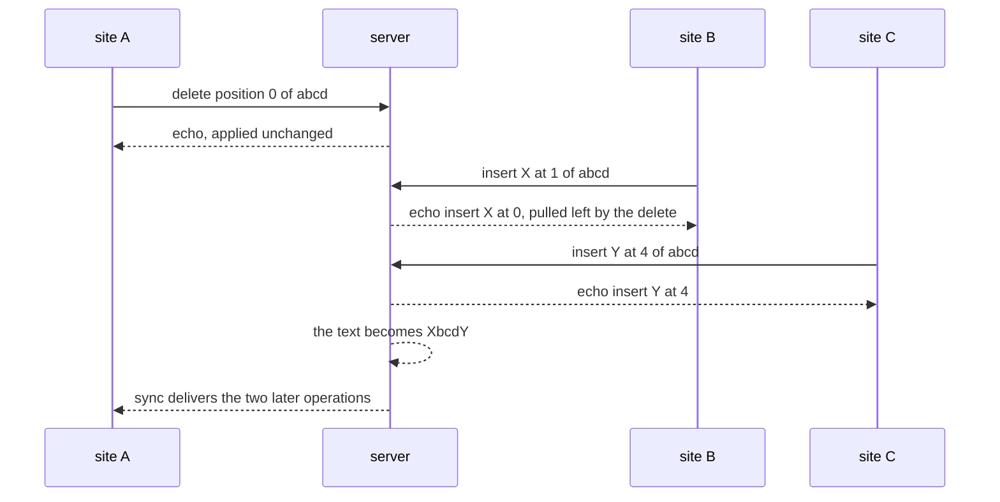

# 635 — Implement operational transform simplified for collaborative text editing.

> **Tier:** Expert · **CTCI chapter:** Ch 9 — System Design and Scalability
> **Task spec:** [635-implement-operational-transform-simplified-for-collaborative-tex.md](../../../tasks/expert/635-implement-operational-transform-simplified-for-collaborative-tex.md)
> **Solutions:** [Python](../../../solutions/python/expert/635-implement-operational-transform-simplified-for-collaborative-tex/solution.py) ·
> [Java](../../../solutions/java/expert/635-implement-operational-transform-simplified-for-collaborative-tex/Solution.java) ·
> [JavaScript](../../../solutions/javascript/expert/635-implement-operational-transform-simplified-for-collaborative-tex/solution.js) ·
> [C#](../../../solutions/csharp/expert/635-implement-operational-transform-simplified-for-collaborative-tex/Solution.cs)

## 1. Problem restatement

Implement the core of **operational transformation** for a text document. An operation is one of

| Operation | Meaning | Encoding in the Python solution |
| --- | --- | --- |
| `insert(position, character, site)` | put one character at an index the author saw | `("insert", position, character, site)` |
| `delete(position, site)` | remove the character at that index | `("delete", position, None, site)` |
| no-op | an operation that has nothing left to do | `("noop", 0, None, None)` |

The deliverable is a `transform(operation, other)` that rewrites an operation into the form it must
have **after** `other` has already been applied, plus a transformation against a whole history
(`transform_against`), a serializing central server and a small client, and a checker that falsifies the
transform the hard way. The property to satisfy is **TP1** (inclusion):

```text
apply(apply(doc, a), transform(b, a)) == apply(apply(doc, b), transform(a, b))
```

Concrete results asserted by the checks:

- `apply` boundaries: `""` + `insert(0, "x")` → `"x"`; `"abc"` + `insert(0, "x")` → `"xabc"`;
  `insert(3, "x")` → `"abcx"`; `insert(99, "x")` clamps to `"abcx"`; `"abc"` + `delete(1)` → `"ac"`;
  `delete(5)` leaves `"abc"`; a no-op leaves the text alone.
- Exhaustive TP1 sweep over **every** document of length 0–3 over the alphabet `ab` and every valid
  operation of sites `A` and `B` (characters `xy`): **2044** operation pairs, all satisfying TP1, of
  which **98** are same-position insert/insert pairs where the site tie-break decides — and there both
  concurrent inserts survive (`len(result) == len(doc) + 2`).
- Hand-checked transforms: `transform(insert(2, "x", "A"), insert(0, "y", "B"))` → `insert(3, "x", "A")`;
  `transform(insert(0, "x", "A"), insert(2, "y", "B"))` → unchanged; `transform(insert(1, "x", "A"),
  delete(0, "B"))` → `insert(0, "x", "A")`; `transform(delete(2, "A"), insert(1, "y", "B"))` →
  `delete(3, "A")`; `transform(delete(1, "A"), insert(5, "y", "B"))` → unchanged;
  `transform(delete(2, "A"), delete(1, "B"))` → `delete(1, "A")`; and a no-op stays a no-op however it
  is transformed further.
- Three-site session on `"abcd"`: `A` deletes position 0, `B` (which still sees `"abcd"`) inserts `X` at
  1, `C` appends `Y` at 4. The server's text becomes `"XbcdY"`, `B`'s echo is `insert(0, "X", "B")`
  (pulled left by `A`'s delete), `C`'s echo is `insert(4, "Y", "C")`, three operations applied, three
  received, and every client converges on the server text.
- `"ab"` with two deletes of position 0: the second echo is a **no-op** and the document stays `"b"`.
- Seeded six-round session (seed `20250`, three sites): converged; the applied history holds exactly one
  entry per client edit; the length equals `5 + inserts - deletes`; every character of the final text
  is either original or was inserted once; and the same seed reproduces the identical history.

The Python run prints `ot: tp1-pairs=2044 tie-break-pairs=98 seeded-session='ffeeclflhdfeb' applied=18`.

## 2. Intuition

The naive idea is to ship the operations and let everybody apply them — which is exactly what fails.
Two sites type at *their* notion of position 3, and after one of the edits has landed, "3" means
something else; the same edit applied in a different order produces a different text (that is the
divergence an index-based edit invites).

Operational transformation keeps the small operations but **rewrites them for the order they end up
in**: an operation created against document `d` must be adjusted for every concurrent operation that
was applied before it. The correctness condition is TP1 above — the two orders must commute to the same
document, which is drawn as a commuting square:



The four rules fall straight out of how a *position* maps through the other operation:

- **insert vs insert.** An insert shifts every position at or after its own index to the right. So a
  later insert must move right by one; an earlier insert does not move. Equal positions are the
  interesting case: both sites honestly believe they are first, so the tie is broken by **site id** —
  the greater id yields and moves right. Without that rule the two orders disagree, and the Java
  solution keeps that broken version as a negative control.
- **insert vs delete.** If the delete was before the insert, the insert slides left by one; otherwise it
  stands. An insert *inside* a concurrently deleted range is dropped and the delete widened to cover it
  (the "null operation" convention the Java and JavaScript headers call out) — otherwise the two orders
  would apply it in one order and lose it in the other.
- **delete vs insert.** Symmetrically, a delete moves right when the insert happened at or before it.
- **delete vs delete.** Each delete is pulled back by the characters the other removed before it, and
  deleting the *same* character twice leaves the second one with nothing to do — it becomes a no-op.

Because a single pair is rarely the whole story, the transform is applied to a whole **history**:
`transform_against(operation, others)` folds `transform` over the concurrent operations in the order
the server applied them. The server serializes everything, and a client that does not apply its own
edits optimistically simply replays the operations it missed and then the transformed echo, so its text
is always a matching prefix of the server history. The JavaScript variant instead follows the
Jupiter/AETHER model (client keeps the acknowledged `base` plus its outstanding operations and renders
`base + outstanding`), which is the same idea with the local echo kept.

## 3. Algorithm

1. `apply_op(text, operation)` — an insert clamps its position into `[0, len]` and splices one character;
   a delete removes one character in range and does nothing past the end; a no-op returns the text.
2. `transform(operation, other)` — the rule table below; returns `operation` itself when nothing shifts,
   the position-adjusted copy when it does, and `NOOP` for the delete/delete collision.
3. `transform_against(operation, others)` — `result ← operation`, then `result ← transform(result, other)`
   for each concurrent operation in server order.
4. `Server.receive(site, operation, known)` — takes the tail of the history the client had not seen
   (`applied[known:]`), transforms against it, applies the result unless it is a no-op, and appends the
   transformed operation to the history.
5. `Client.edit(...)` — sends the operation stamped with the site's view, replays the operations that
   landed in between, then applies the transformed echo, so the client text tracks the history exactly.
6. `Client.sync()` — replays everything applied since the last look; `Session.converged()` compares the
   synced texts of all clients with the server text.

```text
procedure transform(operation, other)
    if operation is a no-op or other is a no-op then
        return operation
    if operation.kind = insert and other.kind = insert then
        if other.position < operation.position then
            return insert(operation.position + 1, operation.character, operation.site)
        if other.position = operation.position and operation.site > other.site then
            return insert(operation.position + 1, operation.character, operation.site)
        return operation
    if operation.kind = insert and other.kind = delete then
        if other.position < operation.position then
            return insert(operation.position - 1, operation.character, operation.site)
        return operation
    if operation.kind = delete and other.kind = insert then
        if other.position <= operation.position then
            return delete(operation.position + 1, operation.site)
        return operation
    if other.position < operation.position then
        return delete(operation.position - 1, operation.site)
    if other.position = operation.position then
        return NOOP                     // that character is already gone
    return operation

procedure transform_against(operation, others)
    result = operation
    for other in others do
        result = transform(result, other)
    return result

procedure server_receive(server, site, operation, known)
    concurrent = server.applied[known : end]        // what the client had not seen
    transformed = transform_against(operation, concurrent)
    server.received = server.received + 1
    if transformed is not a no-op then
        server.text = apply_op(server.text, transformed)
    server.applied.append(transformed)
    return transformed
```



## 4. Worked example

**(a) The three-site session on `"abcd"`.** All three clients start from the same text; `known` is how
much of the history each one has seen.

| Order | Edit (as the site saw it) | Transformed against | Echo the server returns | Server text |
| --- | --- | --- | --- | --- |
| 1 | `A`: `delete(0)` | nothing (`known == 0`) | `delete(0, "A")` | `"bcd"` |
| 2 | `B`: `insert(1, "X")` on `"abcd"` | `delete(0, "A")` (`other.position < position`) | `insert(0, "X", "B")` | `"Xbcd"` |
| 3 | `C`: `insert(4, "Y")` on `"abcd"` | `delete(0, "A")` then `insert(0, "X", "B")` | `insert(4, "Y", "C")` | `"XbcdY"` |

`B` wanted the character after `a`; since `a` is gone, the insert slides left into position 0. `C`
appended at the end, and the two shifts before it cancel out (a delete removes one character, an insert
adds one). The checker asserts the server text `"XbcdY"`, that `first_echo == first_op`, that
`second_echo == insert(0, "X", "B")`, that `third_echo == insert(4, "Y", "C")`, that the history and the
received count are both `3`, and that every client's text equals the server's.



**(b) Delete/delete collision.** Document `"ab"`, two sites each delete position 0:

| Order | Edit | Transformed against | Echo | Server text |
| --- | --- | --- | --- | --- |
| 1 | `A`: `delete(0)` | nothing | `delete(0, "A")` | `"b"` |
| 2 | `B`: `delete(0)` (on `"ab"`) | `delete(0, "A")` — same position | `NOOP` | `"b"` |

The no-op is still appended to the history (two applied entries), it simply does not touch the text. A
no-op is also stable: transforming it further keeps it a no-op — the check
`transform(transform(delete(1, "A"), delete(1, "B")), insert(0, "z", "C")) ==
transform(delete(1, "A"), delete(1, "B"))` asserts exactly that.

**(c) The exhaustive sweep and the tie-break.** The checker enumerates documents `""`, `"a"`, `"b"`,
`"aa"`, … `"bbb"` (length ≤ 3 over `ab`) and, for each, every insert of `x`/`y` and every delete by
sites `A` and `B`:

| Measure | Value |
| --- | --- |
| Operation pairs checked | 2044 |
| Same-position insert/insert pairs (tie-break) | 98 |
| TP1 violations | 0 |
| Length after both concurrent inserts | `len(doc) + 2` |

**(d) The seeded session.** `seeded_runs(seed=20250, rounds=6)` starts from `"hello"` with sites `A`,
`B`, `C`; each round a site either deletes a random character or inserts one whose letter is derived
from the round index and the generator. The run ends with `applied == 18` (one entry per client edit),
the text `"ffeeclflhdfeb"`, the length identity `5 + inserts - deletes`, no character appearing more
often than the original plus its inserts, and an identical history for a second run with the same seed.

## 5. Complexity

With `h` operations in the history a client has missed, `n` the document length and `k` the number of
operations:

| Operation | Time | Space | Why |
| --- | --- | --- | --- |
| `apply_op` | O(n) | O(n) | the demo rebuilds the string slice; a real editor uses a rope or a piece table |
| `transform` (one pair) | O(1) | O(1) | a constant number of position comparisons |
| `transform_against` | O(h) | O(1) extra | one `transform` per concurrent operation, in server order |
| `Server.receive` | O(h + n) | O(h) | fold over the missed tail plus one apply |
| `Client.edit` / `sync` | O(h + n) | O(h) | replay the missed operations, then the echo |
| Exhaustive TP1 sweep | O(#docs · #ops²) | O(1) extra | 2044 pairs here; the cost is the point — a transform table is only trustworthy when it is falsified everywhere |

Alternatives:

| Approach | Convergence | Needs a server? | Cost |
| --- | --- | --- | --- |
| Transform pairs + serializing server (this task) | TP1 on the operation pair, TP2 if operations must be composed | yes for ordering | O(h) per operation against the missed tail |
| OT with operation composition (TP2) and optimistic local echo | TP1 + TP2 | optional (Jupiter/AETHER, as in the JavaScript variant) | O(h) transform plus history bookkeeping |
| Sequence CRDT (RGA / Logoot, task 634) | by construction, any order | no | O(siblings) or O(position length) per insert, plus tombstones |
| Locking a region before editing | no concurrency at all | yes | blocking latency |

## 6. Pitfalls and edge cases

- **The tie-break is not optional.** Two inserts at the same position must be ordered identically on
  every replica; the Java solution's negative control drops the site comparison and TP1 fails on a
  scripted concurrent insert. The Python check counts 98 tie-break pairs and verifies both characters
  survive.
- **A no-op must stay a no-op.** Transforming a dropped or collided operation again must not resurrect
  it, or one site would delete a character another already deleted.
- **An insert inside a concurrently deleted range** is dropped and the delete grows to cover it; keep
  the insert instead and the two orders disagree (documented in the Java and JavaScript headers).
- **Position clamping.** `insert(99, "x")` appends and `delete(5)` does nothing, so operations that
  were valid on a longer document stay harmless on a shorter one; deleting past the end of an *empty*
  document is explicitly checked.
- **Transform order matters.** `transform_against` must fold over the concurrent operations **in server
  order**; transforming against an unordered set is not equivalent.
- **No composition (TP2).** The solutions do not compose operations, because the central server
  serializes every single edit; a system where a client batches edits needs TP2 as well.
- **Local echo policy changes the client code, not the algebra.** Python applies no local echo and
  replays the echo; JavaScript keeps `base + outstanding`. Both render the same final text.
- **Duplicate delivery** is ignored by sequence number in the JavaScript client; the Python client tracks
  `known` as a history index.
- **Determinism.** The seeded session is reproducible from its seed — the checker reruns it and compares
  both the text and the full applied history.
- **Unicode.** Operations are per character; a grapheme made of several code points would need the same
  transform applied per code point, which these single-character operations sidestep.
- **TP1 is checked, not assumed.** No measurement in this tutorial comes from anywhere but the checks:
  2044 pairs, 98 tie-break pairs, 18 applied operations in the seeded run.

## 7. Variants and follow-ups

- **Server-free sequences.** Replace transform-and-serialize with identifier-based structures that
  converge on their own — see
  [634-implement-crdt-sequence-rga-logoot-basics-for-collaborative-edit.md](../../../tasks/expert/634-implement-crdt-sequence-rga-logoot-basics-for-collaborative-edit.md).
- **Causal delivery for the concurrent tail.** `known` is a hand-made prefix counter; the general form
  is a vector clock — see
  [630-implement-causal-consistency-protocol-simulation-vector-clocks.md](../../../tasks/expert/630-implement-causal-consistency-protocol-simulation-vector-clocks.md).
- **Timestamps in the tie-break.** Replacing the site comparison with a hybrid logical clock produces
  the same convergence with a wall-clock-flavoured order — see
  [636-implement-hybrid-logical-clocks-and-test-ordering-in-distributed.md](../../../tasks/expert/636-implement-hybrid-logical-clocks-and-test-ordering-in-distributed.md).
- **Monotone merges instead of transforms.** When the data type is a counter or a set rather than a
  sequence, the tag algebra of
  [633-implement-crdt-counter-and-set-examples-operation-based-and-stat.md](../../../tasks/expert/633-implement-crdt-counter-and-set-examples-operation-based-and-stat.md)
  is simpler than any transform table.

## 8. Check yourself

<details><summary>Show answer 1 — Why is the site id needed in the insert/insert transform?</summary>

Because when both inserts claim the same position, neither is "before" the other, so the rule needs a
tie-break that every replica computes identically. Comparing site ids gives that total order; without
it the two replicas each consider their own insert first and TP1 fails (the Java negative control).
</details>

<details><summary>Show answer 2 — What is TP1 and why is it checked exhaustively?</summary>

TP1 (inclusion) says that for concurrent `a` and `b` there exist transformed `a'`, `b'` with
`apply(apply(doc, a), b') == apply(apply(doc, b), a')`. A transform table is a set of case rules, and a
single missed case breaks convergence only for one position combination — so the check enumerates every
document of length ≤ 3 over `ab` and every valid operation pair (2044 of them, 98 of them tie-breaks).
</details>

<details><summary>Show answer 3 — Why does a second delete of the same character become a no-op?</summary>

The character is already gone, so applying the delete again would remove a different (innocent)
character. `transform` detects the same position and returns `NOOP`; the server still records the entry
in its history so the histories of all replicas stay aligned, but the text is untouched.
</details>

<details><summary>Show answer 4 — How does the client stay equal to the server's text without a local echo?</summary>

It replays, in server order, the operations that were applied while its own edit was in flight and then
applies the transformed echo of its own edit. Its text is therefore the prefix of the server history it
has acknowledged, and a final `sync()` catches up on anything still outstanding.
</details>
