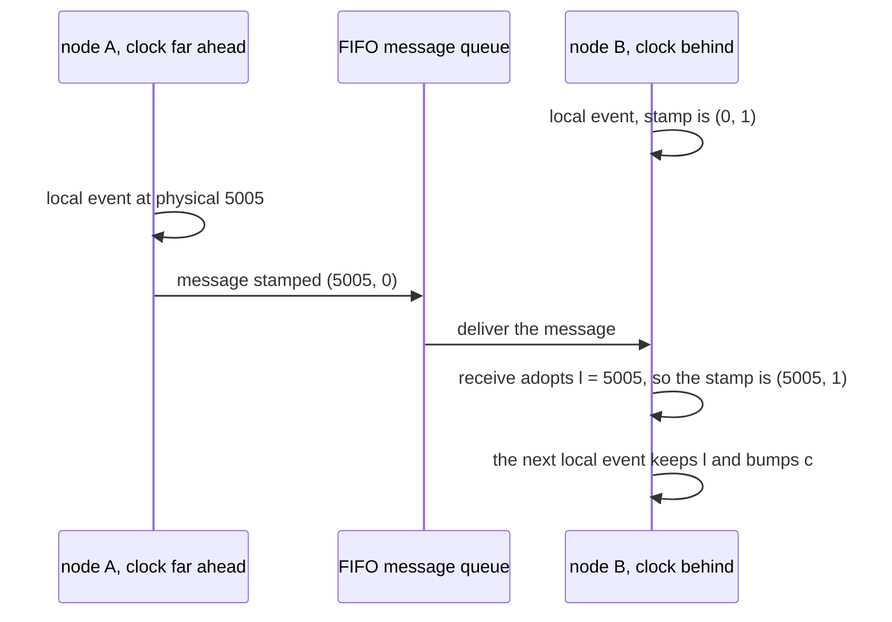
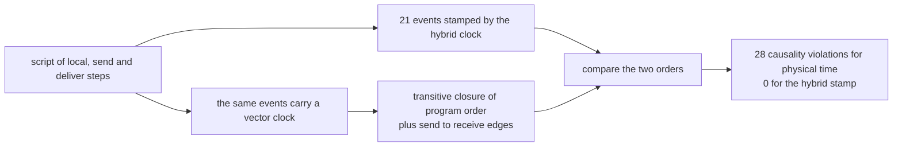

# 636 — Implement hybrid logical clocks and test ordering in distributed events.

> **Tier:** Expert · **CTCI chapter:** Ch 9 — System Design and Scalability
> **Task spec:** [636-implement-hybrid-logical-clocks-and-test-ordering-in-distributed.md](../../../tasks/expert/636-implement-hybrid-logical-clocks-and-test-ordering-in-distributed.md)
> **Solutions:** [Python](../../../solutions/python/expert/636-implement-hybrid-logical-clocks-and-test-ordering-in-distributed/solution.py) ·
> [Java](../../../solutions/java/expert/636-implement-hybrid-logical-clocks-and-test-ordering-in-distributed/Solution.java) ·
> [JavaScript](../../../solutions/javascript/expert/636-implement-hybrid-logical-clocks-and-test-ordering-in-distributed/solution.js) ·
> [C#](../../../solutions/csharp/expert/636-implement-hybrid-logical-clocks-and-test-ordering-in-distributed/Solution.cs)

## 1. Problem restatement

Implement a **hybrid logical clock**: every event is stamped with a pair `(l, c)` where `l` is a
physical-time component and `c` a logical counter, such that

1. a node's stamps are **strictly increasing** even if its physical clock stands still or jumps
   backwards,
2. **causality is respected**: if `e1` happened before `e2` then `stamp(e1) < stamp(e2)`,
3. `l` stays close to real physical time (no receiver is dragged into the future by a message).

The interface in the Python solution:

| Member | Meaning |
| --- | --- |
| `HLC.local(physical_time)` | stamp a local event (a send is a local event that also transmits the stamp) |
| `HLC.receive(physical_time, remote)` | stamp a receive of `(lm, cm)`, taking the maximum of the three values and choosing `c` from which one won |
| `stamp()` | the current `(l, c)` |
| `VectorClock` | the ground-truth oracle: `increment`, `join`, `lt` |
| `Cluster.run(script)` | deterministic schedule of local / send / deliver steps over an in-memory FIFO |
| `hb_closure(events, messages)` | independent oracle: transitive closure of program order plus send → receive |
| `wire_format` / `parse_wire` | fixed-width text so a byte comparison follows the `(l, c)` order |

Concrete results asserted by the checks:

- Clock rules: a fresh clock reads `(0, 0)`; `local(10)` → `(10, 0)`, then `(10, 1)`, `(10, 2)`;
  `local(12)` → `(12, 0)`; a **stale** `local(11)` on a clock at `(12, 2)` gives `(12, 1)` — the
  physical clock cannot drag the stamp backwards. Receives: `receive(30, (40, 7))` → `(40, 8)`;
  `receive(41, (40, 7))` → `(41, 0)`; `receive(41, (41, 7))` → `(41, 8)`; `receive(50, (100, 0))` on a
  clock whose `l` is already `100` → `(100, 1)`.
- Wire format: `(1234567890, 123)` and the five other boundary stamps round-trip, and sorting the
  fixed-width text equals sorting the tuples.
- Skewed cluster `{"A": 1000, "B": 0, "C": 500}` running a 21-event, 4-message script: per-node stamps
  strictly increase, every event's `l` equals **exactly** the maximum physical time in its causal past,
  every happened-before pair is stamp-ordered, the stamp order is a linear extension of
  happened-before, and no node repeats an `(l, c)`.
- Negative control: ordering the same run by physical time alone violates causality in **28** pairs,
  while the hybrid clock violates it in **0**.
- Skew propagation: when `A`'s physical clock starts far ahead of `B`'s, `B`'s stamp after receiving becomes exactly
  the sender's `l` with the next counter, its next local event keeps that `l` and bumps `c` further, and
  `B`'s own physical time stays *below* `l` — the clock is ahead of the local wall clock without
  inventing future time.
- Same-millisecond burst: five local events at physical time 7 read `(7, 0)`, `(7, 1)`, …, `(7, 4)`.
- Boundaries: a single event on a single node is `(physical, 0)`; two nodes starting at 0 may stamp
  concurrent events with the *same* `(0, 1)`, and the message that follows breaks the tie; a node with
  no events keeps `(0, 0)`.

The Python run prints
`hlc: events=21 messages=4 naive-order-violations=28 hlc-order-violations=0 max-l=1010`.

## 2. Intuition

Wall-clock timestamps are convenient but wrong: clocks drift, NTP steps them backwards, and two nodes
stamping "the same millisecond" tell you nothing about which event caused which. A **Lamport clock**
fixes causality but throws away physical meaning — its numbers grow with event count, not with time, so
you cannot compare a timestamp with `now`, expire data, or read a log meaningfully. A **vector clock**
gives exact concurrency detection but its size grows with the number of nodes.

HLC takes the middle road: keep one physical component `l` that tracks the largest physical time the
node has *heard of* (its own clock or any message), and add a counter `c` that only matters when `l`
cannot advance. Two rules produce everything:

- **local event at physical time `pt`:** `l' = max(l, pt)`; if `l` did not change, `c' = c + 1`,
  otherwise `c' = 0`. So a standstill millisecond produces `(7, 0), (7, 1), (7, 2), …` and a clock that
  jumps *backwards* simply leaves `l` where it was and bumps `c`.
- **receive of `(lm, cm)` at physical time `pt`:** `l' = max(l, lm, pt)`, and `c'` is taken from
  whichever of the three values won — `max(c, cm) + 1` if both logical parts won, `c + 1` if the local
  `l` won, `cm + 1` if the remote `l` won, `0` if `pt` won. That is what makes a receive sort strictly
  after the send it is caused by.

Comparing `(l, c, node)` then gives a **strict total order** that extends happened-before; concurrent
events get an arbitrary but deterministic order (ties on `(l, c)` are broken by the node id, and the
C# solution also packs the triple into one 64-bit value for storage).

```mermaid
flowchart TD
    E["an event happens at physical time pt"] --> K{"local or receive?"}
    K -- "local" --> L1["l' = max of l and pt"]
    L1 --> L2{"did l change?"}
    L2 -- "yes" --> L3["c' = 0"]
    L2 -- "no" --> L4["c' = c + 1, the millisecond is not over yet"]
    K -- "receive of lm and cm" --> R1["l' = max of l, lm and pt"]
    R1 --> R2{"which input produced l'?"}
    R2 -- "l and lm" --> R3["c' = max of c and cm, plus one"]
    R2 -- "only l" --> R4["c' = c + 1"]
    R2 -- "only lm" --> R5["c' = cm + 1"]
    R2 -- "only pt" --> R6["c' = 0"]
```



The consequences are exactly the three properties in section 1: monotonicity (the pair never decreases,
and it strictly increases on every event), causality (a receive is built to dominate both inputs), and
boundedness (the remote `l` is adopted but never *extended*, so the clock can be ahead of the local
wall clock only by the physical skew it has already seen — it never invents future time). The Java
solution also pins the operational limits: a maximum drift bound of 60 000 time units, and a counter
ceiling of 65535 after which the overflow is carried into `l` instead of wrapping.

## 3. Algorithm

1. `HLC.local(pt)` — remember `previous = l`; set `l = max(l, pt)`; set `c = c + 1` if `l == previous`
   else `0`; return `(l, c)`.
2. `HLC.receive(pt, (lm, cm))` — `last = l`; `l = max(last, lm, pt)`; then pick `c` by which inputs
   achieved the maximum (four cases, above).
3. `Node.local_event(label)` / `Node.send(target, label)` — bump the node's own vector-clock component,
   stamp with `local`, record the event; a send also snapshots the vector and enqueues the message.
4. `Node.receive(message)` — **join** the message's vector clock, increment the own component, stamp with
   `receive(advance(), message.clock)`, and record the event.
5. `Cluster.run(script)` — walk the script (`local`, `send`, `deliver`); `deliver` drains the FIFO queue,
   so message order is deterministic.
6. The **oracle**: `hb_closure` builds the transitive closure of per-node program order plus
   send → receive edges; `VectorClock.lt` is compared against that closure, which validates the oracle
   itself before it is used to judge the HLC.

```text
procedure hlc_local(clock, physical_time)
    previous = clock.l
    clock.l = max(clock.l, physical_time)
    if clock.l = previous then
        clock.c = clock.c + 1
    else
        clock.c = 0
    return (clock.l, clock.c)

procedure hlc_receive(clock, physical_time, remote)
    lm, cm = remote
    last = clock.l
    clock.l = max(last, lm, physical_time)
    if clock.l = last and clock.l = lm then
        clock.c = max(clock.c, cm) + 1
    else if clock.l = last then
        clock.c = clock.c + 1
    else if clock.l = lm then
        clock.c = cm + 1
    else
        clock.c = 0
    return (clock.l, clock.c)

function compare(first, second)
    if first.l differs from second.l then
        return the smaller l first
    if first.c differs from second.c then
        return the smaller c first
    return the smaller node id first
```



## 4. Worked example

**(a) The update rules, one call at a time.** Clock `A`, starting at `(0, 0)`:

| Call | `l` before | `c` before | New stamp | Why |
| --- | --- | --- | --- | --- |
| `local(10)` | 0 | 0 | `(10, 0)` | `l` advanced, so `c` resets |
| `local(10)` | 10 | 0 | `(10, 1)` | same millisecond, counter bumped |
| `local(10)` | 10 | 1 | `(10, 2)` | and again |
| `local(12)` | 10 | 2 | `(12, 0)` | `l` advanced |
| `local(11)` | 12 | 0 | `(12, 1)` | the stale physical time cannot pull `l` back |
| `receive(30, (40, 7))` | 12 | 1 | `(40, 8)` | the remote `l` won, so `cm + 1` |
| `receive(41, (40, 7))` | 40 | 8 | `(41, 0)` | the physical time won, so `c` resets |
| `receive(41, (41, 7))` | 41 | 0 | `(41, 8)` | both logical parts won, so `max(c, cm) + 1` |

**(b) The skewed cluster.** `{"A": 1000, "B": 0, "C": 500}`, script `build_script()`: each node does
three local events, then `A` sends to `B`, `B` to `C`, `C` to `B`; then a local `after` on all three,
`B` replies to `A`, and `A` does a final `post` — 21 events and 4 messages.



| Check | Result |
| --- | --- |
| Per-node stamps strictly increasing | holds for all 21 events |
| `l` equals the maximum physical time in the causal past | holds for every event (checked against the vector-clock oracle) |
| Happened-before implies a smaller stamp | holds for all pairs |
| Stamp order is a linear extension of happened-before | 0 inversions |
| A node stamping the same `(l, c)` twice | never (per-node stamps are unique) |
| Physical-time ordering violating causality | **28** pairs |
| Hybrid-clock ordering violating causality | **0** pairs |
| Largest `l` in the run | 1010 |

**(c) Skew propagation, in detail.** `A`'s physical clock starts 5000 ticks ahead of `B`'s, and every
send advances the sender's physical clock by one step (5 ticks):

| Step | Stamp | Observation |
| --- | --- | --- |
| `B` local `b0` | `(0, 1)` | `B` starts at physical 0 and its first event takes the counter |
| `A` sends to `B` at physical 5005 | sender stamp `(5005, 0)` | the send is a local event on `A` |
| `B` receives | `(5005, 1)` | exactly the sender's `l` with the next counter |
| `B` local `b1` | `(5005, 2)` | the adopted `l` persists, the counter keeps it strictly increasing |

`B`'s own physical time is still far below 5005, so `l` is ahead of `B`'s wall clock — but only because
`B` has *seen* 5005, which is what the drift bound is for (the Java solution declares `MAX_DRIFT`).

**(d) Two nodes and one stamp.** With `X` and `Y` both starting at 0, `X`'s first event and `Y`'s first
event are concurrent and both read `(0, 1)`. Sorting `(l, c, node)` still orders them deterministically,
and the message `X → Y` afterwards stamps `(0, 2)`, strictly greater than both. A same-millisecond
burst on one node gives `(7, 0)` through `(7, 4)`, and the wire form `0000000000000007:00000004` sorts
exactly like the tuple.

## 5. Complexity

With `n` events, `m` messages and `N` nodes:

| Operation | Time | Space | Why |
| --- | --- | --- | --- |
| `local` / `receive` | O(1) | O(1) | a constant number of comparisons and one counter update |
| `compare` of two stamps | O(1) | O(1) | `(l, c, node)` — three scalars, independent of the cluster size |
| `Node.send` / `Node.receive` | O(N) | O(N) | the vector clock is joined (that is the oracle's cost, not the HLC's) |
| `Cluster.run(script)` | O(n + m) | O(n + m) | one record per event, one FIFO entry per message |
| `hb_closure` | O(n²) worst case | O(n²) | transitive closure from each event over the successor graph (fine for 21 events, not for a real log) |
| Oracle comparison loop | O(n²) | O(1) extra | every pair of events is compared against the closure |

Alternatives, and why HLC wins for this use case:

| Clock | Causality | Physical meaning | Size | Concurrency detection |
| --- | --- | --- | --- | --- |
| Physical time alone | no — 28 causality violations in this run | yes | O(1) | no |
| Lamport clock | yes | no — counts events, not time | O(1) | no |
| Vector clock | yes, exact | no | O(N) per stamp | yes |
| HLC (this task) | yes | yes: `l` is the largest physical time seen in the causal past | O(1) | no (concurrent events may share a stamp) |

## 6. Pitfalls and edge cases

- **A backwards physical clock must not move `l`.** `local(pt)` uses `max(l, pt)`, so a stale `pt` only
  bumps `c`; the check `local(11)` on a clock at `(12, 0)` producing `(12, 1)` pins that down.
- **The counter resets only when `l` advances.** Reusing `c = 0` on every local event would break
  strict monotonicity inside a millisecond: the burst check expects `(7, 0)` … `(7, 4)`.
- **A receive must dominate both inputs.** Copying the remote stamp verbatim, or using `c + 1` when the
  remote `l` won, would let a receive sort before its own send; the four-way case selection is load
  bearing, and causality is then verified pair-wise over the whole run.
- **Counter overflow must carry into `l`**, not wrap: the Java solution declares `C_MAX = 65535` and
  counts overflow bumps so `l` advances instead of the pair repeating.
- **Skew is detectable but not forbidden.** `l - pt` grows when a node has seen a clock from the future;
  the Java variant compares that offset against `MAX_DRIFT = 60 000` and flags the stamp, while the
  ordering stays monotone.
- **Concurrent events may share a stamp.** Two nodes at the same physical millisecond can both read
  `(0, 1)`; the total order then falls back to the node id, and HLC does **not** claim to detect
  concurrency (a vector clock does).
- **A node with no events keeps `(0, 0)`** and a node with a single event reads `(physical, 0)`.
- **Determinism matters for the test.** The same script and the same starts reproduce identical stamps
  *and* identical vector clocks; that is checked by running the cluster twice.
- **Wire format width.** The `16-digit : 8-digit` text form is what makes a lexicographic byte compare
  equal a numeric compare; a shorter width silently breaks ordering above the width.
- **Nothing here uses a real clock.** Physical time is a deterministic integer advanced by a fixed step
  per simulated event (the Python `Node.advance` uses `step = 5`), so no measurement depends on the
  machine running the checks.

## 7. Variants and follow-ups

- **Exact concurrency detection.** A vector clock answers "concurrent / before", which HLC does not —
  the same oracle structure appears in
  [630-implement-causal-consistency-protocol-simulation-vector-clocks.md](../../../tasks/expert/630-implement-causal-consistency-protocol-simulation-vector-clocks.md).
- **Where the stamp is consumed.** Versioned indexes and multi-version stores order writes by a
  timestamp of exactly this shape — see
  [614-implement-persistent-b-tree-for-versioned-db-index.md](../../../tasks/expert/614-implement-persistent-b-tree-for-versioned-db-index.md).
- **HLC as the tie-break of a CRDT.** Replacing the site-id comparison with an HLC stamp keeps
  convergence and adds a wall-clock-flavoured order — see
  [635-implement-operational-transform-simplified-for-collaborative-tex.md](../../../tasks/expert/635-implement-operational-transform-simplified-for-collaborative-tex.md).
- **Snapshot and linearizability reasoning.** Once events carry HLC stamps, they can be ordered for
  consistency checks — see
  [618-implement-linearizability-checker-for-concurrent-histories.md](../../../tasks/expert/618-implement-linearizability-checker-for-concurrent-histories.md).
- **Bounded drift in clustered systems.** If you need a global notion of "now", the timestamp plus a
  quorum is the next question
  ([660-implement-quorum-consensus-read-write-latency-optimization-trade.md](../../../tasks/expert/660-implement-quorum-consensus-read-write-latency-optimization-trade.md)).

## 8. Check yourself

<details><summary>Show answer 1 — Why does a local event bump the counter instead of resetting it?</summary>

Because several events can happen inside the same physical millisecond: resetting `c` to 0 would make
the second event's stamp equal the first, so the pair would not strictly increase and the "linear
extension of happened-before" property would fail. Bumping `c` keeps the same `l` while staying
strictly greater, which is exactly the `(7, 0)` … `(7, 4)` burst in the checks.
</details>

<details><summary>Show answer 2 — What does a receive do when the remote logical part wins?</summary>

`l' = max(l, lm, pt)`; if only the remote `l` won, `c' = cm + 1`, which makes the receive sort strictly
after the send. If both logical parts share the maximum, `c' = max(c, cm) + 1`; if only the local `l`
won, `c' = c + 1`; if only the physical time won, `c' = 0`.
</details>

<details><summary>Show answer 3 — Why does the negative control matter?</summary>

It shows the property is not vacuous: on the skewed cluster, ordering the 21 events by physical time
inverts causality in 28 pairs, while the hybrid stamp inverts none. Without that measurement, "HLC
preserves causality" would be a claim with nothing to compare against.
</details>

<details><summary>Show answer 4 — Does HLC detect concurrent events?</summary>

No. Two nodes can stamp concurrent events with the same `(l, c)` — the checks show both `X` and `Y`
reading `(0, 1)` — so the order only becomes total once the node id is added, and concurrency itself
needs a vector clock. What HLC buys is a *causally consistent* order that still looks like physical
time.
</details>
