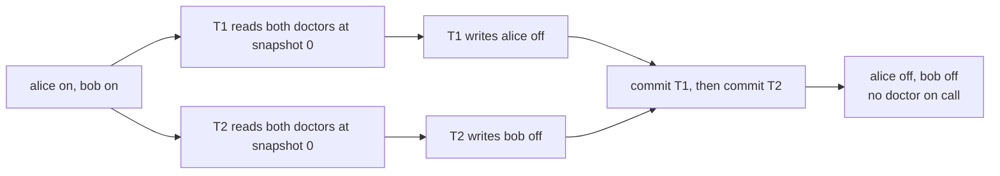
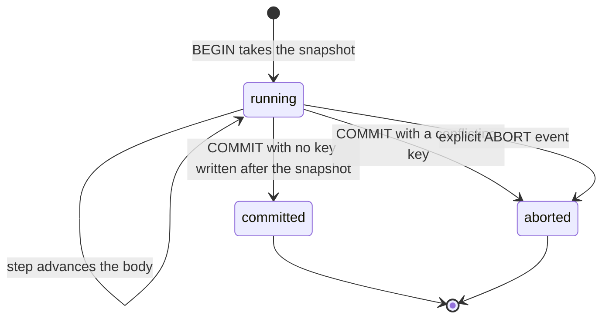
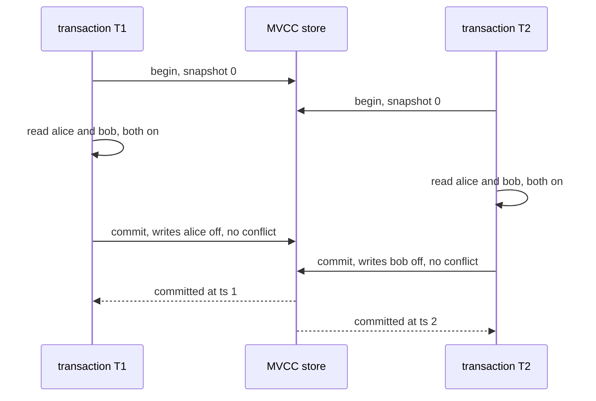

# 637 — Implement SNAPSHOT isolation anomalies demonstrator (write skew).

> **Tier:** Expert · **CTCI chapter:** Ch 14 — Databases
> **Task spec:** [637-implement-snapshot-isolation-anomalies-demonstrator-write-skew.md](../../../tasks/expert/637-implement-snapshot-isolation-anomalies-demonstrator-write-skew.md)
> **Solutions:** [Python](../../../solutions/python/expert/637-implement-snapshot-isolation-anomalies-demonstrator-write-skew/solution.py) ·
> [Java](../../../solutions/java/expert/637-implement-snapshot-isolation-anomalies-demonstrator-write-skew/Solution.java) ·
> [JavaScript](../../../solutions/javascript/expert/637-implement-snapshot-isolation-anomalies-demonstrator-write-skew/solution.js) ·
> [C#](../../../solutions/csharp/expert/637-implement-snapshot-isolation-anomalies-demonstrator-write-skew/Solution.cs)

## 1. Problem restatement

Build a **deterministic multi-version (MVCC) store** that implements snapshot isolation (SI) with
first-committer-wins validation, drive it with an **explicit interleaving schedule**, and use it to
demonstrate the write-skew anomaly — *and* to prove that the resulting history is not serializable.

| Component | Responsibility |
| --- | --- |
| `MVCCStore` | `history[key]` is a list of `(commit_ts, value)` in commit order; `read_at(snapshot, key)` returns the newest version with `commit_ts <= snapshot`; `install(writes)` bumps the clock **once** and appends one version per written key |
| `Tx` | `snapshot` is `store.clock` when the transaction is created; `read` prefers its own buffered writes and otherwise resolves through `read_at(snapshot, …)`; `write` buffers; `commit` aborts on any key whose `latest_ts > snapshot` |
| `run_schedule` | a list of `("step" / "commit" / "abort", name)` events, with transactions instantiated lazily at their first event |
| oracles | `run_serially` replays the *same* bodies one at a time on a plain key/value state; `is_serializable` searches every permutation of the committed names |

Concrete results asserted by the checks:

- **Write skew (the doctors).** Initial state `{"alice": "on", "bob": "on"}`; each transaction reads both
  doctors and goes off call when it sees two on call. Schedule `step T1, step T2, step T1, step T2,
  commit T1, commit T2` → **both commit**, both snapshots are `0`, the outcome is
  `{"alice": "off", "bob": "off"}`, so **zero** doctors remain on call while the invariant wants at
  least one. Each key ends with exactly two versions (the seed plus one commit), each stamped with its
  own transaction's commit timestamp, and the two commit timestamps differ.
- **Non-serializable.** `is_serializable` runs both permutations of the same two bodies: every serial
  order ends with exactly **one** doctor on call, so the SI outcome matches no serial order.
- **Lost update prevented.** Counter at `0`, both transactions read-then-increment: `U1` commits, `U2`
  is **aborted** with `conflicts == ["counter"]`, the visible counter is `1` (not `2`), and the aborted
  transaction installed no version (two versions total: seed plus `U1`). The same bodies run serially
  give `2`; a non-overlapping schedule commits both and the late transaction sees snapshot `1`.
- **Repeatable read.** With `counter = 5`, a reader reading twice while a writer commits in between
  observes `[5, 5]`; the reader's snapshot is `0`, the writer's commit timestamp is `1`, and a later
  transaction reading at the current clock sees `6`.

The Python run prints exactly one line:
`[637] write skew: committed both, invariant broken, non-serializable; lost update aborted; repeatable read holds`.

## 2. Intuition

Snapshot isolation is attractive because it removes almost all friction: every transaction reads a
stable version of the database as of its own start, so reads never block and never see a half-applied
transaction, and writes are validated at commit time with a single rule — **first-committer-wins**: if
some key you wrote was committed by somebody else after your snapshot, you abort. No read ever blocks,
and no read-write conflict is ever a reason to abort.

That last clause is exactly where the leak is. SI's validation only looks at **write-write** conflicts
on the *same key*. Two transactions that read the same rows but write **disjoint** keys have no
write-write conflict, so both commit — yet each decision was made on a state the other has just
invalidated. The doctors scheduling constraint is the canonical example: "at least one doctor stays on
call" is a predicate over *two* rows, not a property of any single row, and neither transaction writes
the row the other reads.



The write-skew history is not serializable, and the demonstrator *proves* that instead of asserting it:
the same two transaction bodies are replayed one at a time by `run_serially`, and no serial order
reproduces the concurrent outcome (both of them instead leave exactly one doctor on call). The
JavaScript variant checks the same claim from the other side, building the multiversion serialization
graph and showing it cycles — a wr edge for the first commit, an rw anti-dependency (including
phantoms) from each reader to the other's write, and a ww edge — while every serial history stays
acyclic, with a brute-force oracle cross-checking that a topological order really is a valid serial
order.

Two supporting behaviours make the engine honest: **repeatable reads** come for free because a read
resolves through a fixed snapshot, and **lost updates** are prevented by the same first-committer-wins
rule, which is the one anomaly SI genuinely does handle.

## 3. Algorithm

1. `seed_store(initial)` — every key starts with one version at `commit_ts = 0`, so a snapshot of `0`
   sees the initial state.
2. `Tx.__init__` — record `snapshot = store.clock`. Nothing else about the store is captured, so a
   transaction created later automatically gets a later snapshot (that is why the two `doctor` bodies
   can be interleaved or serial without any special casing).
3. `Tx.read(key)` — return the buffered write if there is one (read-your-own-writes); otherwise scan the
   key's version chain and keep the last version with `commit_ts <= snapshot`. The read is recorded in
   `tx.reads` for later inspection.
4. `Tx.write(key, value)` — buffer into the transaction's private map; nothing is visible yet.
5. `Tx.commit()` — collect `conflicts = [key for key in writes if store.latest_ts(key) > snapshot]`.
   Non-empty → `status = "aborted"` and no version is installed. Empty → `install`, which increments the
   clock once and appends one version per key, all sharing that single commit timestamp.
6. `run_schedule(store, bodies, schedule)` — walk the events; a `step` advances that transaction's
   generator, a `commit` first asserts the body is exhausted and then validates, an `abort` marks the
   transaction aborted. The trace records whether each event did anything.
7. Verification — `run_serially` for the serial oracle, `is_serializable` for the no-serial-order proof,
   and direct inspection of version chains, snapshots and conflict lists.

```text
procedure tx_read(tx, key)
    if key is in tx.writes then
        value = tx.writes[key]                    // read-your-own-writes
    else
        value = nothing
        for commit_ts, version_value in tx.store.history[key] do
            if commit_ts <= tx.snapshot then
                value = version_value             // the newest version inside the snapshot
    tx.reads[key] = value
    return value

procedure tx_commit(tx)
    conflicts = empty
    for key in tx.writes do
        if tx.store.latest_ts(key) > tx.snapshot then
            conflicts.append(key)                 // first-committer-wins: somebody wrote after us
    if conflicts is not empty then
        tx.status = aborted
        return false
    tx.store.clock = tx.store.clock + 1
    for key in sorted(tx.writes) do
        tx.store.history[key].append((tx.store.clock, tx.writes[key]))
    tx.commit_ts = tx.store.clock
    tx.status = committed
    return true

procedure run_schedule(store, bodies, schedule)
    for kind, name in schedule do
        create the transaction and its generator on first sight   // snapshot = store.clock now
        if kind = step then advance the generator
        if kind = commit then assert the body is exhausted, then tx_commit
        if kind = abort then mark the transaction aborted
```



## 4. Worked example

**(a) The doctors, two interleaved transactions.** Initial `{"alice": "on", "bob": "on"}`, schedule
`step T1, step T2, step T1, step T2, commit T1, commit T2`. Both bodies read `alice` and `bob` and
write only their own name.

| Event | T1 | T2 | Store state (latest committed) |
| --- | --- | --- | --- |
| begin `T1` | snapshot 0 | — | `alice on, bob on` |
| `step T1` | reads `on, on`, writes `alice = off` buffered | — | unchanged |
| begin `T2` | snapshot 0 | snapshot 0 | unchanged |
| `step T2` | — | reads `on, on`, writes `bob = off` buffered | unchanged |
| `step T1` / `step T2` | body done | body done | unchanged |
| `commit T1` | conflicts `[]` → commit ts 1 | — | `alice off, bob on` |
| `commit T2` | — | conflicts `[]` → commit ts 2 | `alice off, bob off` |

`T2`'s write is `bob`, `T1` never touched `bob`, so there is no write-write conflict; the invariant
`at least one doctor on call` is broken and neither transaction saw anything wrong.

**(b) Why that outcome is not serializable.** Replaying the same bodies one at a time:

| Serial order | Final state | Doctors on call |
| --- | --- | --- |
| `T1` then `T2` | `alice off, bob on` | 1 |
| `T2` then `T1` | `alice on, bob off` | 1 |
| concurrent (SI) | `alice off, bob off` | **0** |

Neither permutation matches the concurrent outcome, which is exactly the checker's assertion: the SI
history has no equivalent serial execution.

**(c) The lost update, in contrast.** `counter = 0`, `U1` and `U2` both read-then-increment, with the
interleaving `step U1, step U2, step U1, step U2, commit U1, commit U2`:

| Event | `U1` | `U2` | Visible counter | `U2` conflicts |
| --- | --- | --- | --- | --- |
| `step U1`, `step U2` | read 0, buffer `counter = 1` | read 0, buffer `counter = 1` | 0 | — |
| `commit U1` | committed at ts 1 | — | 1 | — |
| `commit U2` | — | aborted | 1 | `["counter"]` |

Here a write-write conflict *does* exist on the same key, so first-committer-wins aborts `U2`; only two
versions exist (the seed and `U1`), and a serial run of the same bodies would yield `2`. SI is not
serializable in general, but it is not silly: the anomaly it misses is the cross-row one.



**(d) Repeatable read and the stale-versus-late contrast.** With `counter = 5` and the schedule
`step R, step W, commit W, step R, commit R`, the reader observes `[5, 5]` — the commit of `W` at
timestamp 1 is invisible to a transaction whose snapshot is 0 — while `read_at(store.clock, "counter")`
on a *later* transaction returns `6`. Version chains show it plainly: `counter` has two entries,
`(0, 5)` and `(1, 6)`.

## 5. Complexity

With `k` keys, `v` versions per key, `n` events in a schedule and `t` committed transactions:

| Operation | Time | Space | Why |
| --- | --- | --- | --- |
| `read_at` | O(v) | O(1) | a linear scan of the version chain keeping the newest version at or below the snapshot |
| `latest_ts` | O(1) | O(1) | the chain is in commit order, so its last entry is the newest |
| `Tx.write` | O(1) | O(k) | a private buffered map |
| `Tx.commit` | O(k log k) | O(k) | one `latest_ts` probe per written key plus a sorted install |
| `install` | O(k) | O(k) | one new version per key at a single timestamp |
| `run_schedule` | O(n · (v + k)) | O(k · v) | each event is one read, one write or one validation |
| `is_serializable` | O(t! · t) | O(k) | every permutation of the committed transactions is replayed by `run_serially` |

Alternatives and their trade-offs:

| Mechanism | Read-write conflicts | Write skew | Blocking |
| --- | --- | --- | --- |
| Snapshot isolation (this task) | never abort | **possible** | readers never block; writers abort on write-write conflicts |
| Serializable snapshot isolation (task 638) | abort on a dangerous read-write dependency | prevented | readers may abort when tracked as a pivot |
| Two-phase locking (task 639) | abort on lock conflict / deadlock | prevented | readers block writers |
| Optimistic concurrency control (task 640) | abort at validation | prevented only if reads are validated too | no blocking, more aborts |

The cost of these checks is dominated by the brute-force oracle: the honest way to show "no serial
order matches" is to try them all, which is why the demos use two or three transactions.

## 6. Pitfalls and edge cases

- **First-committer-wins compares against the snapshot, not against "now".** `latest_ts(key) > snapshot`
  is the whole rule; using the current clock would abort on every later unrelated commit.
- **A commit installs one timestamp for all rows.** `install` bumps the clock exactly once, so every row
  of a transaction becomes visible atomically — the checks assert one version per written key, stamped
  with that transaction's `commit_ts`, and that the two transactions' timestamps differ.
- **Read-your-own-writes.** A transaction that writes and then reads a key must see its buffer, not the
  snapshot; otherwise the doctors' second read would not observe its own decision.
- **Aborted transactions leave no trace.** `U2` installs nothing, so the counter has two versions, not
  three, and no dirty data is ever visible.
- **Snapshots must be taken at BEGIN.** `run_schedule` creates each transaction lazily at its first
  event, so a schedule that starts one transaction after another has committed really does give it the
  later snapshot (`U2.snapshot == 1`, and the counter reads `2`).
- **A commit may not truncate the body.** `run_schedule` advances the generator and raises if the body
  still has work pending — otherwise a schedule could hide a forgotten step and fake convergence.
- **Disjoint writers commit — that is the point.** SI only rejects write-write conflicts, so two
  transactions writing different keys both commit even though their reads became stale.
- **The invariant must be a predicate over rows.** "At least one doctor on call" cannot be observed by
  any single row, which is exactly why SI's per-key validation misses it. The C# header notes that
  conflicts are detected per key only, with no predicate reads.
- **Phantoms.** A real store also has to think about `rw` anti-dependencies on ranges; the JavaScript
  variant includes phantom edges in its serialization graph, the simplified Python engine works on keys.
- **Aborted transactions are never retried.** The demos stop at the abort; a real client would loop, and
  the retry is where a system usually turns a write skew into a serial failure.
- **Versions are never collected.** There is no garbage collection, so a long-running demo grows the
  chains; the seeded store plus one commit per key is the only reason the numbers here stay small.

## 7. Variants and follow-ups

- **Cancel write skew with read validation.** Serializable snapshot isolation adds dependency tracking
  and aborts a pivot transaction — see
  [638-implement-serializable-snapshot-isolation-tester.md](../../../tasks/expert/638-implement-serializable-snapshot-isolation-tester.md).
- **Prevent it by locking.** Two-phase locking blocks the second reader/writer instead of validating at
  commit — see
  [639-implement-two-phase-locking-simulator-with-deadlock-detection.md](../../../tasks/expert/639-implement-two-phase-locking-simulator-with-deadlock-detection.md).
- **Prevent it optimistically.** Validate the read set during the validation phase instead of only the
  write set — see
  [640-implement-optimistic-concurrency-control-simulation-with-validat.md](../../../tasks/expert/640-implement-optimistic-concurrency-control-simulation-with-validat.md).
- **Ordering the commits themselves.** Assigning commit timestamps from a hybrid logical clock keeps the
  order physical-time flavoured — see
  [636-implement-hybrid-logical-clocks-and-test-ordering-in-distributed.md](../../../tasks/expert/636-implement-hybrid-logical-clocks-and-test-ordering-in-distributed.md).
- **Snapshot captures of the whole system.** When the "snapshot" must span machines, the capture
  protocol becomes the problem
  ([616-implement-distributed-snapshot-algorithm-chandy-lamport.md](../../../tasks/expert/616-implement-distributed-snapshot-algorithm-chandy-lamport.md)).

## 8. Check yourself

<details><summary>Show answer 1 — Why does snapshot isolation let both doctors go off call?</summary>

Because validation only rejects write-write conflicts on the same key. `T1` writes `alice`, `T2` writes
`bob`, so no key was written twice and both commits succeed. The invariant depends on the pair of rows,
which no per-key validation observes.
</details>

<details><summary>Show answer 2 — How is "not serializable" proven rather than asserted?</summary>

`run_serially` replays the very same transaction bodies one at a time on a plain state, and
`is_serializable` tries every permutation of the committed names (here both orders). Both serial orders
keep one doctor on call, so none of them can produce `alice off, bob off` — the concurrent outcome has
no serial equivalent.
</details>

<details><summary>Show answer 3 — Why is the lost update aborted while the doctors are not?</summary>

Both `U1` and `U2` write the *same* key `counter`, so the second committer sees `latest_ts("counter") >
snapshot` and aborts with `conflicts == ["counter"]`. The doctors write disjoint keys, so nothing
triggers first-committer-wins.
</details>

<details><summary>Show answer 4 — What makes the reader's two reads identical?</summary>

Both reads resolve through the snapshot taken at BEGIN: `read_at(snapshot, key)` only considers versions
with `commit_ts <= snapshot`, so the writer's commit at timestamp 1 is invisible to a reader whose
snapshot is 0 — hence `[5, 5]` while a transaction starting later sees `6`.
</details>
