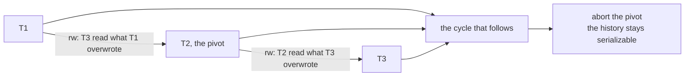
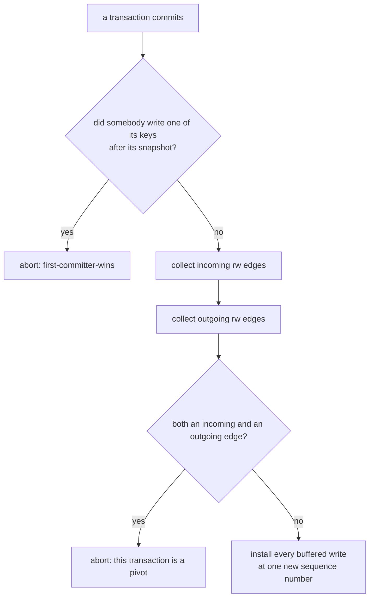
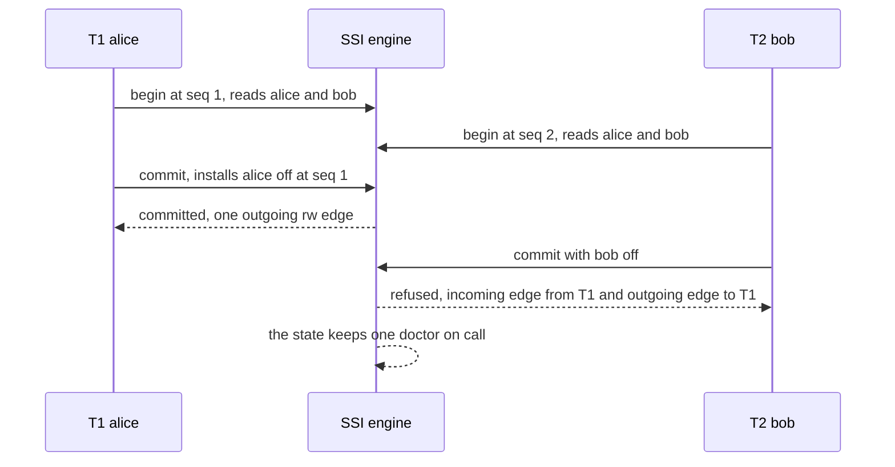

# 638 — Implement serializable snapshot isolation tester.

> **Tier:** Expert · **CTCI chapter:** Ch 14 — Databases
> **Task spec:** [638-implement-serializable-snapshot-isolation-tester.md](../../../tasks/expert/638-implement-serializable-snapshot-isolation-tester.md)
> **Solutions:** [Python](../../../solutions/python/expert/638-implement-serializable-snapshot-isolation-tester/solution.py) ·
> [Java](../../../solutions/java/expert/638-implement-serializable-snapshot-isolation-tester/Solution.java) ·
> [JavaScript](../../../solutions/javascript/expert/638-implement-serializable-snapshot-isolation-tester/solution.js) ·
> [C#](../../../solutions/csharp/expert/638-implement-serializable-snapshot-isolation-tester/Solution.cs)

## 1. Problem restatement

Take the snapshot-isolation MVCC store from task 637 and add the **SSI check** that turns it into a
serializable engine, then test the claim both ways: the same schedules run once under plain SI and once
under SSI, and an independent brute-force oracle decides which histories are actually serializable.

| Component | Responsibility |
| --- | --- |
| `SsiTransaction` | `start_seq` (both the start and the snapshot), recorded `reads`, buffered `writes`, `status`, `commit_seq` |
| `SsiEngine.read` | resolves through `start_seq`, with read-your-own-writes, and records the key in the read set |
| `SsiEngine.commit(tx, ssi)` | first-committer-wins, then (if `ssi`) the dangerous-structure test |
| `incoming_rw(tj)` | transactions `ti` that **committed after** `tj`'s snapshot and wrote something `tj` read |
| `outgoing_rw(tj)` | transactions still concurrent with `tj` that read something `tj` is writing |
| `run(bodies, schedule, ssi)` | explicit `step` / `commit` / `abort` events; a transaction is created at its first event, which fixes its snapshot |
| oracles | `serial_run` replays the same bodies one at a time; `is_serializable` tries every permutation |

The structure SSI must prevent is `T1 --rw--> T2 --rw--> T3`, where `Tx --rw--> Ty` means "`Ty` read a
key that `Tx` overwrote, and `Tx` committed after `Ty`'s snapshot". Two consecutive antidependencies
make a cycle possible, so the committing transaction that closes such a structure is aborted.

Concrete results asserted by the checks:

- **Doctors, under plain SI:** both transactions commit and the state becomes
  `{"alice": "off", "bob": "off"}` — invariant broken, the history the plain engine accepts is the
  non-serializable one from task 637.
- **Doctors, under SSI:** `T1` commits, `T2` is **aborted**, `engine.aborts == ["T2"]`, the detected
  structure is `("T1", "T2", "T1")`, the recorded `rw` edges are `[("T1", "T2"), ("T2", "T1")]`, the
  surviving state is `{"alice": "off", "bob": "on"}` (one doctor on call), that state equals
  `serial_run(bodies, ["T1"], initial)`, and `is_serializable` agrees. `bob`'s version chain is still
  `[(0, "on")]` — the aborted transaction installed nothing and never received a commit sequence number.
  A second run aborts the same transaction with the same structure: SSI is deterministic.
- **Symmetric read-write cycle:** `W1` reads `a` and writes `b`, `W2` reads `b` and writes `a` → `W1`
  commits, `W2` aborts, the state is `{"a": 0, "b": 1}` and the victim's buffered writes are discarded.
- **No false alarms:** disjoint writers `D1` (`a → x`) and `D2` (`b → y`) commit with **zero** aborts and
  no dangerous structure; a fully serial chain `S1 → S2 → S3` commits everything with **no** `rw` edges
  at all (a reader that saw the previous commit has no antidependency); a read-only transaction `RO`
  commits while `R1` and `R2` commit too, with edges `[("R1", "RO"), ("R2", "RO")]` pointing *away* from
  the writers — a read-only transaction can only be the target, never the source, so it is never the
  victim.

The Python run prints
`[638] SSI: 1 abort on write skew; 0 aborts on disjoint, serial and read-only schedules`.

## 2. Intuition

Plain snapshot isolation validates only write-write conflicts, and task 637 showed the consequence: two
transactions that read the same rows but write *disjoint* keys both commit, and the history has no
serial equivalent. To get serializability, the engine must also look at **read-write antidependencies**:
`T ->rw U` means `T` read a version that `U` later replaced. Such an edge is the footprint of a read
that a reordering would have to undo.

SSI's theorem says you do not need to track every dependency: a non-serializable snapshot history can
only be built around a **dangerous structure** of two consecutive `rw` edges,



so the runtime check is cheap: when a transaction commits, build the `rw` edges and refuse the commit if
the committing transaction has **both** an incoming and an outgoing `rw` edge. Read-only transactions can
never have an outgoing edge (they write nothing), which is why they are never chosen as the victim — the
checks assert exactly that.

The three solutions differ in how strict the guard is, and the headers are explicit about it:

- the Python engine tests the structure **through the committing transaction only**, evaluating edges at
  commit time;
- the JavaScript engine tentatively installs the versions and recomputes the `rw` edges over the whole
  live set, refusing a pivot — the *conservative* form of Cahill's rule, because textbook SSI only
  refuses a pivot whose outgoing end committed first, so the stricter guard aborts a few transactions
  needlessly (the reported pivots make that visible);
- the C# engine drops the "must be concurrent with the pivot" qualifier for a conservative superset: it
  may abort needlessly but can never miss a dangerous structure.

Why the edges are visible at commit time: a reader that will point at the committing transaction must
have begun before its commit (otherwise its snapshot already contains the new version), so it is live
while the commit runs and its recorded read set is in memory. The Java tester drives the same workload
type through both engines over hundreds of generated interleavings and checks, with an independent
brute-force oracle, that SSI never accepts a non-serializable history while plain SI does.

## 3. Algorithm

1. **Start.** Every schedule event bumps the engine clock; a transaction seen for the first time is
   created with `start_seq` = that clock, which is also its snapshot.
2. **Read.** Return a buffered write if there is one; otherwise scan `versions[key]` and keep the newest
   entry with `seq <= start_seq`. Record the key in `tx.reads` (this read set is what makes the SSI check
   possible at all).
3. **Write.** Buffer into `tx.writes`; nothing is visible.
4. **First-committer-wins.** `stale = [key for key in writes if versions[key][-1][0] > start_seq]`;
   non-empty → abort (the plain SI rule, identical in both modes).
5. **SSI check** (`ssi=True` only). Compute `incoming` and `outgoing` antidependencies for the
   committing transaction, record the edges `(ti → tx)` and `(tx → tk)`, and if **both** lists are
   non-empty: record `dangerous = (incoming[0], tx, outgoing[0])` and abort.
6. **Install.** Bump the clock, set `tx.commit_seq`, and append one version per written key at that
   sequence number.
7. **Check.** The brute-force oracle replays the committed bodies in every permutation; the surviving
   state must match one of those serial runs, and `bob`'s untouched version chain proves the abort left
   nothing behind.

```text
procedure incoming_rw(engine, tj)
    out = empty
    for ti in engine.txns do
        if ti is not tj and ti.commit_seq is not none then
            if ti.commit_seq > tj.start_seq and ti.writes.keys intersects tj.reads then
                out.append(ti)
    return out

procedure outgoing_rw(engine, tj)
    out = empty
    for tk in engine.txns do
        if tk is not tj then
            concurrent = tk.commit_seq is none or tk.commit_seq > tj.start_seq
            if concurrent and tj.writes.keys intersects tk.reads then
                out.append(tk)
    return out

procedure ssi_commit(engine, tx)
    stale = keys of tx.writes whose newest version was installed after tx.start_seq
    if stale is not empty then
        tx.status = aborted                              // first-committer-wins
        return false
    incoming = incoming_rw(engine, tx)
    outgoing = outgoing_rw(engine, tx)
    for ti in incoming do record the edge (ti, tx)
    for tk in outgoing do record the edge (tx, tk)
    if incoming is not empty and outgoing is not empty then
        engine.dangerous.append((incoming[0], tx, outgoing[0]))
        tx.status = aborted                              // the pivot of T1 ->rw tx ->rw Tk
        return false
    engine.seq = engine.seq + 1
    tx.commit_seq = engine.seq
    for key in sorted(tx.writes) do
        engine.versions[key].append((engine.seq, tx.writes[key]))
    tx.status = committed
    return true
```



## 4. Worked example

**(a) The same doctors schedule under both engines.** Initial `{"alice": "on", "bob": "on"}`, schedule
`step T1, step T2, step T1, step T2, commit T1, commit T2`; both transactions read both keys and write
only their own.

| Event | Plain SI | SSI |
| --- | --- | --- |
| `step T1` | reads `on, on`, buffers `alice = off` | same |
| `step T2` | reads `on, on`, buffers `bob = off` | same |
| `commit T1` | no stale key → commits at seq 1 | no stale key, incoming = none, outgoing = `T2` → commits at seq 1 |
| `commit T2` | no stale key → commits at seq 2 | incoming = `T1` (`T1` wrote `alice`, which `T2` read, after `T2`'s snapshot), outgoing = `T1` → **pivot → abort** |
| Final state | `alice off, bob off` — invariant broken | `alice off, bob on` — invariant holds |

The structure recorded under SSI is `("T1", "T2", "T1")`, and the `rw` edges are `("T1", "T2")` and
`("T2", "T1")` — a cycle of length two, detected as two consecutive antidependencies through the
committing pivot `T2`.



**(b) A symmetric read-write cycle.** `W1` reads `a` and writes `b`, `W2` reads `b` and writes `a`; both
start from `{"a": 0, "b": 0}`:

| Event | `W1` | `W2` | State |
| --- | --- | --- | --- |
| start | seq 1, reads `a = 0` | seq 2, reads `b = 0` | `a 0, b 0` |
| step | buffers `b = 1` | buffers `a = 1` | `a 0, b 0` |
| `commit W1` | incoming none, outgoing `W2` → commits at seq 3 | — | `a 0, b 1` |
| `commit W2` | — | incoming `W1`, outgoing `W1` → aborts | `a 0, b 1` (victim's write dropped) |

**(c) The no-false-alarm schedules.** SSI must not turn into "abort everything":

| Schedule | Aborts | Dangerous structures | `rw` edges |
| --- | --- | --- | --- |
| Disjoint writers `D1: a → x`, `D2: b → y` | 0 | none | — |
| Serial chain `S1 → S2 → S3` (each reader saw the previous commit) | 0 | none | `[]` |
| Read-only `RO` plus writers `R1`, `R2` | 0 | none | `[("R1","RO"), ("R2","RO")]` |

The serial chain is the instructive one: `S2` reads `y`, which `S1` committed **before** `S2`'s snapshot,
so no antidependency exists — `rw` edges require the write to be *invisible* to the reader. And `RO`'s
edges all point into it, never out, because it writes nothing.

**(d) Determinism.** Running the doctors schedule twice yields the same statuses, the same
`aborts == ["T2"]` and the same `dangerous == [("T1", "T2", "T1")]`; nothing in the engine depends on
iteration order of the transaction list beyond `incoming[0]` and `outgoing[0]`, which are stable for a
fixed schedule.

## 5. Complexity

With `t` transactions, `k` keys, `v` versions per key and `n` schedule events:

| Operation | Time | Space | Why |
| --- | --- | --- | --- |
| `read` | O(v) | O(k) | version scan plus one read-set insertion |
| `incoming_rw` / `outgoing_rw` | O(t · k) | O(1) | every other transaction is compared on the intersection of a write set and a read set |
| `commit` (both modes) | O(k log k + t · k) | O(k) | first-committer-wins probes plus two antidependency scans and the install |
| `run` | O(n · (v + k + t · k)) | O(t · k + k · v) | each event is one step, one read or one commit |
| `is_serializable` | O(t! · t) | O(k) | every permutation of the committed transactions is replayed serially |
| Graph bookkeeping | O(#edges) | O(#edges) | edges are stored once, deduplicated by an explicit membership test |

Trade-offs against the neighbouring mechanisms:

| Mechanism | Read-write conflicts | Blocking | False aborts |
| --- | --- | --- | --- |
| Plain SI (task 637) | ignored | none | none — but it accepts write skew |
| SSI (this task) | one dangerous structure tracked at commit | none | the conservative guards abort a few extra transactions |
| Two-phase locking (task 639) | locks held to commit, deadlocks possible | readers block writers | none, but latency |
| OCC with read validation (task 640) | validated at commit | none | read-set changes abort the whole transaction |

## 6. Pitfalls and edge cases

- **An `rw` edge needs *invisibility*.** `ti.commit_seq > tj.start_seq` is the condition that makes the
  version invisible to the reader; a reader that already saw the commit produces no edge, which is why
  the serial chain records `[]`.
- **Both directions are required.** Aborting every transaction that reads something concurrent writers
  touch would be a lock, not SSI; only the pivot of two consecutive edges is refused.
- **Read-only transactions are never victims.** They cannot have an outgoing edge, and the checks
  confirm `RO` commits with edges pointing into it.
- **First-committer-wins still runs first.** Write-write conflicts abort before the SSI check, with the
  conflicting key preserved; SSI is an *additional* rule, not a replacement.
- **An aborted transaction must leave nothing.** `bob`'s chain stays `[(0, "on")]` and no `commit_seq` is
  assigned, so no reader can ever see a version from a rejected commit.
- **Edges are evaluated at commit time, which is why they are visible.** Any reader that will point at
  the committing transaction must have started before it, so it is still live with its read set in
  memory; the conservative variants rely on this to recompute the graph.
- **The guards are conservative, and that is documented.** The JavaScript header states the textbook
  rule aborts fewer transactions, and the C# header states it may produce false positives that plain SSI
  would accept — correctness is preserved either way, and the reported pivots expose the difference.
- **Determinism is part of the contract.** The same schedule must produce the same victims; the check
  reruns the doctors schedule and compares statuses, aborts and structures.
- **No predicate locks.** Without SIREAD range locks, SSI cannot detect read-write conflicts on ranges
  (phantoms); the engines work per key and the JavaScript variant names the phantom edge explicitly in
  its graph discussion.
- **No garbage collection, no retries.** Version chains grow with every commit and an aborted
  transaction is simply dropped; a real client would retry it, and the retry is where a write skew turns
  into a serial failure.
- **Where the numbers come from.** Every figure in this tutorial (`1 abort`, `0 aborts` on the other
  schedules, the edge lists, the version chains) is printed or asserted by the solution's checks.

## 7. Variants and follow-ups

- **The engine without the guard.** Plain SI, the anomaly and the first-committer-wins rule are the
  starting point — see
  [637-implement-snapshot-isolation-anomalies-demonstrator-write-skew.md](../../../tasks/expert/637-implement-snapshot-isolation-anomalies-demonstrator-write-skew.md).
- **Preventing the anomaly with locks instead of aborts.** Two-phase locking serializes the same
  schedule at the cost of blocking and deadlock detection — see
  [639-implement-two-phase-locking-simulator-with-deadlock-detection.md](../../../tasks/expert/639-implement-two-phase-locking-simulator-with-deadlock-detection.md).
- **Preventing it by validating reads.** Optimistic concurrency control moves the check to a validation
  phase over the read set — see
  [640-implement-optimistic-concurrency-control-simulation-with-validat.md](../../../tasks/expert/640-implement-optimistic-concurrency-control-simulation-with-validat.md).
- **Judging histories after the fact.** The brute-force "is there a serial order?" oracle is the same
  question a linearizability checker asks about concurrent histories
  ([618-implement-linearizability-checker-for-concurrent-histories.md](../../../tasks/expert/618-implement-linearizability-checker-for-concurrent-histories.md)).
- **Timestamps for the commit order.** Sequence numbers here are engine-local; a cluster needs a
  hybrid-logical-clock style stamp
  ([636-implement-hybrid-logical-clocks-and-test-ordering-in-distributed.md](../../../tasks/expert/636-implement-hybrid-logical-clocks-and-test-ordering-in-distributed.md)).

## 8. Check yourself

<details><summary>Show answer 1 — What exactly is an <code>rw</code> antidependency?</summary>

`T ->rw U` exists when `T` read a key that `U` overwrote with a version `T` never saw — i.e. `U`
committed after `T`'s snapshot. It is the dependency a serial order would have to reverse, and it is the
only edge SSI tracks.
</details>

<details><summary>Show answer 2 — Why does aborting the pivot make the history serializable?</summary>

A non-serializable snapshot history must contain a cycle, and SSI's theorem shows a cycle implies a
dangerous structure of two consecutive `rw` edges. Removing one of the three transactions — the pivot
with both an incoming and an outgoing edge — breaks the structure, so the surviving history has no such
cycle and is equivalent to a serial execution (verified here by brute force).
</details>

<details><summary>Show answer 3 — Why is the serial chain free of `rw` edges?</summary>

Because `S2` reads `y` only after `S1` committed `y`, so `S1`'s version was visible at `S2`'s snapshot.
An `rw` edge requires the write to be invisible to the reader (`commit_seq > start_seq`), and here it is
not. Likewise, disjoint writers share no keys at all.
</details>

<details><summary>Show answer 4 — Why do the solutions call their guard conservative?</summary>

Textbook SSI only refuses the pivot when the outgoing end committed first, so it aborts fewer
transactions; the JavaScript and C# engines also refuse structures the stricter conditions would allow,
trading a few extra aborts for a simpler check that can never miss a dangerous structure. The checks
report the detected pivots, so the extra aborts are visible rather than hidden.
</details>
