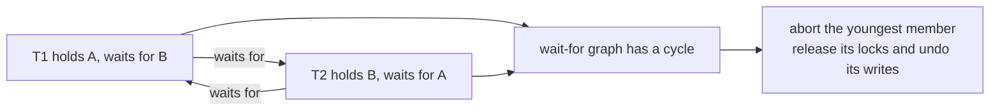
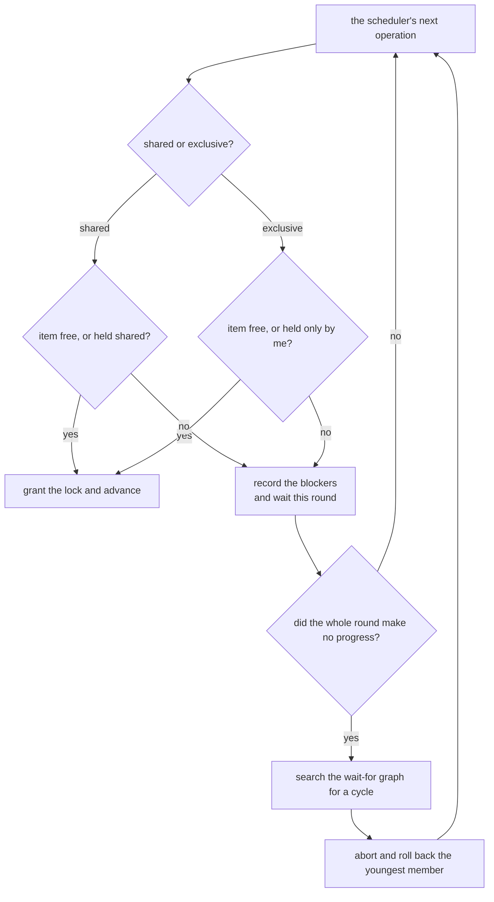
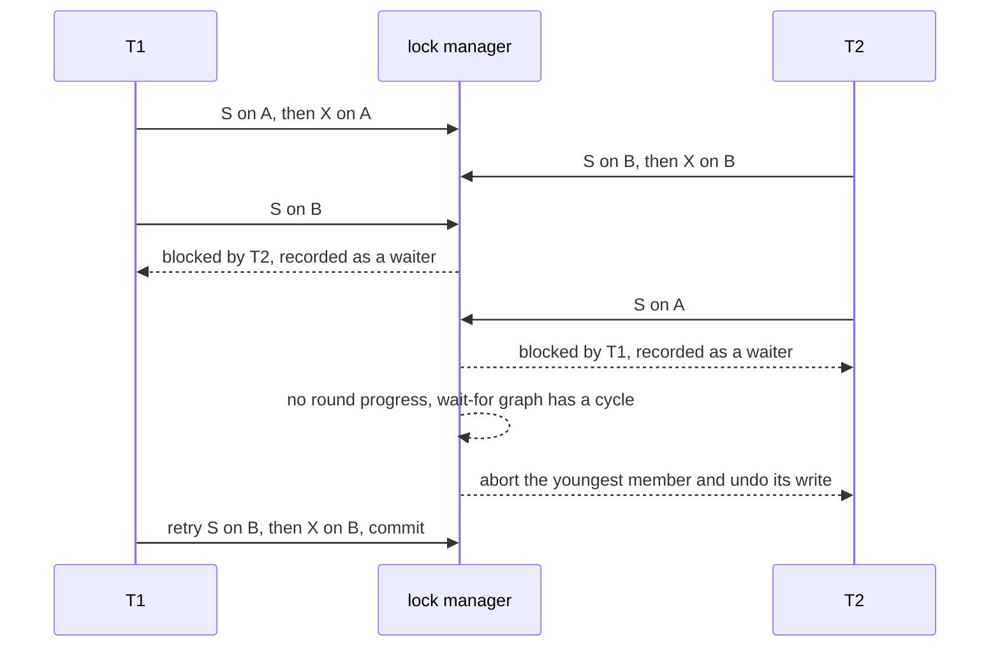

# 639 — Implement two-phase locking simulator with deadlock detection.

> **Tier:** Expert · **CTCI chapter:** Ch 14 — Databases
> **Task spec:** [639-implement-two-phase-locking-simulator-with-deadlock-detection.md](../../../tasks/expert/639-implement-two-phase-locking-simulator-with-deadlock-detection.md)
> **Solutions:** [Python](../../../solutions/python/expert/639-implement-two-phase-locking-simulator-with-deadlock-detection/solution.py) ·
> [Java](../../../solutions/java/expert/639-implement-two-phase-locking-simulator-with-deadlock-detection/Solution.java) ·
> [JavaScript](../../../solutions/javascript/expert/639-implement-two-phase-locking-simulator-with-deadlock-detection/solution.js) ·
> [C#](../../../solutions/csharp/expert/639-implement-two-phase-locking-simulator-with-deadlock-detection/Solution.cs)

## 1. Problem restatement

Build a deterministic **two-phase locking** simulator: a lock manager with shared/exclusive modes, a
round-robin scheduler that runs one operation per transaction per round, and a **wait-for graph cycle
search** that resolves deadlocks by aborting a victim and rolling it back.

| Component | Responsibility |
| --- | --- |
| `LockTable` | per-item `mode` (`S` or `X`), the set of `holders`, and for every waiting transaction the set of transactions blocking it |
| `LockTable.request(name, item, mode)` | grant when the item is free, when the requester is the only holder (which covers the `S → X` upgrade), or when the request is `S` and the item is held `S`; otherwise record the blockers and wait |
| `release_all(name)` | release every lock of a transaction (only ever called at commit or abort, because the protocol is **strict**) |
| `TwoPhaseTransaction` | plan (script of `("S", item)` / `("X", item, value_spec)`), cursor, locks acquired, undo log, blocked rounds, commit round |
| `find_cycle(graph)` | deterministic DFS over sorted nodes, returning the first wait-for cycle |
| `two_phase_ok(trace)` | a trace is 2PL iff no lock is acquired after the first release |
| `run_2pl(plans, initial)` | the rounds, the history, the detected deadlocks, the aborted names and the final state |
| `run_serially(plans, order, initial)` | the oracle: only the `X` operations touch the data |

Concrete results asserted by the checks:

- **Compatibility matrix, exercised directly:** two shared locks on `x` are granted
  (`snapshot == {"x": ["A", "B"]}`); an exclusive request by `C` is refused and records
  `waits["C"] == {"A", "B"}`; `A` takes `X` on a free `y`; then both `S` and `X` requests for `y` by `B`
  are refused; `release_all("A") == ["x", "y"]`, after which `B` can take `X` on `y`.
- **Cycle search:** `{"A": {"B"}, "B": {"A"}}` → `["A", "B"]`; a three-node cycle → `["A", "B", "C"]`; a
  chain → `None`; an empty graph → `None`; with two disjoint cycles the first in sorted order wins.
- **2PL validation:** growing-then-shrinking traces and traces without releases are accepted, while
  `acquire, release, acquire` is a violation.
- **The classic two-transaction deadlock:** `T1` locks `A` then `B`, `T2` locks `B` then `A`, both
  incrementing at `10` and `20`. Exactly **one** deadlock is detected, the cycle is `("T1", "T2")`, the
  victim is the youngest (`"T2"`), `T1` commits, the final state is `{"A": 11, "B": 21}` which equals
  `run_serially(plans, ["T1"], initial)` — the victim's write to `B` was rolled back (the history still
  contains `("write", "T2", "B", 21, 1)`, so it really had written before being aborted) — and strict 2PL
  never lets two writers hold `A` at once.
- **No false positives or dirty reads:** two shared readers of `A` produce zero deadlocks, zero aborts
  and zero blocked rounds while both hold the lock simultaneously (two concurrent holders); a reader
  blocked by a writer waits at least two rounds, its read is ordered *after* the write, and it observes
  the committed value `7`.
- Every trace produced by the simulator passes `two_phase_ok`, and every committed transaction released
  its locks.

The Python run prints
`[639] 2PL: deadlock cycle ('T1', 'T2') detected, victim 'T2', 6 rounds`.

## 2. Intuition

Two-phase locking makes a schedule serializable with a single rule: a transaction acquires locks while
it grows and releases them only during a shrinking phase, and the simulator here is **strict** — every
lock is held until commit or abort. Strictness is what makes rollback trivial and the commit order the
serial order, but it also makes the second problem unavoidable: two transactions can each hold what the
other wants, and no amount of waiting will help.

The naive fix is a timeout, but a timeout cannot tell a deadlock from a slow disk. The correct tool is
the **wait-for graph**: an edge `T -> U` exists when `T` is waiting for a lock that `U` holds (or for a
queued request ahead of it in a FIFO queue). A deadlock is then *defined* as a cycle in that graph, and
detecting it is a cycle search:



Two design choices carry the rest of the simulator:

- **Where the progress check happens.** The scheduler runs one operation per active transaction per
  round. Deadlock detection only runs when a *whole round makes no progress* — otherwise a transaction
  that is simply waiting for a running writer would be inspected while nobody is stuck. When no round
  makes progress, every live transaction is blocked, so the graph built from the recorded blockers is the
  complete picture.
- **Which victim to pick.** The Python, JavaScript and C# engines abort the **youngest** (latest
  registered, highest id) member of the cycle; that choice is deterministic, which keeps the whole
  simulation reproducible (`6 rounds`, victim `"T2"`), and it is the convention real engines use to avoid
  aborting long-running work. The C# solution additionally drains the wait queues after the abort so the
  survivors can move.

The negative control in the Java header is worth noting: the same schedule run with lock enforcement
switched off loses updates and is not serializable, so the checks demonstrate that the locks are doing
the work rather than decorating a run that would have been fine anyway.

## 3. Algorithm

1. **Round.** For each active transaction in plan order, read its next operation: `("S", item)` needs a
   shared lock, `("X", item, value_spec)` needs an exclusive lock and also writes.
2. **Request.** `LockTable.request` grants immediately when the item has no holders, when the requester is
   the only holder (an `S → X` upgrade), or when the request is `S` and the item is held `S`. Otherwise
   the holders are added to `waits[name]` and the transaction stays put (`blocked_rounds += 1`).
3. **Write.** On a granted `X`, resolve the value spec (a literal, or `("add", ref, delta)` which reads
   the current value), push `(item, previous, existed)` onto the transaction's **undo log**, store the new
   value and append to the history.
4. **Commit or abort.** A transaction with an exhausted plan releases all its locks and commits, which
   records its round in `commit_round` and appends `("commit", name, round)`.
5. **Stall check.** If a full round made no progress and transactions are still running, build the graph
   from `waits`, run `find_cycle`. No cycle → stop (the remaining transactions are waiting for something
   that will never happen in this script). Cycle → append it to `deadlocks`, pick
   `victim = max(cycle, key = age)`, `rollback` the undo log in reverse, release the locks, mark aborted
   and record the abort in the history.
6. **Verify.** The final state must equal `run_serially(plans, surviving_order, initial)`, every trace
   must satisfy `two_phase_ok`, and the per-round snapshots must never show two writers on one item.

```text
procedure request(table, name, item, mode)
    holders = table.holders_of(item)
    if holders is empty or holders = {name} then
        take the lock for name on item with mode       // free item, or the S to X upgrade
        return true
    if mode = S and table.mode[item] = S then
        take the lock for name on item                  // shared and shared are compatible
        return true
    table.waits[name] = table.waits[name] union (holders - {name})
    return false                                        // the transaction waits this round

procedure resolve_deadlock(table, txs)
    cycle = find_cycle(table.waits)                     // deterministic DFS over sorted nodes
    if cycle is none then
        return none
    victim = the member of cycle with the largest age    // the youngest transaction
    rollback(txs[victim])                                // undo log, in reverse order
    release_all(table, victim)
    txs[victim].status = aborted
    return (cycle, victim)

procedure run_2pl(plans, initial)
    repeat for at most max_rounds do
        table.waits = empty
        progressed = false
        for name in plan order do
            if the transaction is running then execute its next operation
        if every transaction finished then break
        if not progressed then
            (cycle, victim) = resolve_deadlock(table, txs)
            if cycle is none then break
```



## 4. Worked example

**(a) The classic two-transaction deadlock.** Plans `T1 = S(A), X(A, A+1), S(B), X(B, B+1)` and
`T2 = S(B), X(B, B+1), S(A), X(A, A+1)` over `{"A": 10, "B": 20}`; the scheduler runs one operation per
transaction per round.

| Round | `T1` | `T2` | Lock table | Progress |
| --- | --- | --- | --- | --- |
| 0 | `S(A)` granted, `X(A)` granted (`A = 11`) | `S(B)` granted, `X(B)` granted (`B = 21`) | `A: T1`, `B: T2` | yes |
| 1 | `S(B)` **blocked** by `T2`, records blocker `T2` | `S(A)` **blocked** by `T1`, records blocker `T1` | unchanged | **no** |
| 2 | — | — | cycle search: `T1 -> T2 -> T1` | deadlock |
| 2 (resolve) | survivor | `T2` aborted: undo restores `B = 20`, locks released | `A: T1` | yes |
| 3–5 | `S(B)` granted, `X(B)` granted (`B = 21`), plan done → commit, release | — | empty | yes |

Final state `{"A": 11, "B": 21}` — exactly the serial execution of `T1` alone, which is the oracle's
assertion. The victim's history entry `("write", "T2", "B", 21, 1)` is still there, proving the rollback
undid a real write. The whole run takes the `6` rounds reported by the check, and the per-round lock
snapshots never show two holders of `A` in exclusive mode.



**(b) Compatible readers never deadlock.** `R1 = S(A)` and `R2 = S(A)`:

| Measure | Value |
| --- | --- |
| Deadlocks / aborts | `[]` / `[]` |
| Maximum concurrent holders of `A` | 2 |
| Blocked rounds for `R1` and `R2` | 0 |

Shared locks are compatible, so the two transactions hold the same item at the same time — the opposite
of the exclusive case, where the snapshot check asserts a maximum of one writer per item.

**(c) Waiting is not deadlocking.** `W = X(A, 7), X(B, 1)` and `R = S(A)` over `{"A": 1, "B": 2}`:

| Check | Result |
| --- | --- |
| Deadlocks / aborts | `[]` / `[]` |
| `R`'s blocked rounds | at least 2 (it waited while `W` held `A`) |
| History order | the last `write` by `W` appears before the `read` by `R` |
| Value `R` observed | `7` — the committed value, no dirty read |
| `W`'s applied writes | `[("A", 7), ("B", 1)]` |

A single blocking wait does not produce a cycle, so the detector stays quiet; `R` simply runs later and
reads the committed value. That is the pair of checks that keeps the deadlock detector honest in both
directions.

## 5. Complexity

With `t` transactions, `m` items, `k` operations in the largest plan and `r` rounds until completion:

| Operation | Time | Space | Why |
| --- | --- | --- | --- |
| `request` | O(#holders) | O(1) | compares the requester against the holder set of one item |
| `release_all` | O(m) | O(m) | scans the item table for the releasing transaction |
| `find_cycle` | O(t + #edges) | O(t) | one deterministic DFS over sorted nodes, pruning already-visited starts |
| `run_2pl` | O(r · (t + k + m)) | O(t · (k + m)) | one operation per transaction per round, plus a cycle search only on a stalled round |
| `rollback` | O(#writes) | O(#writes) | the undo log is replayed in reverse |
| `run_serially` (oracle) | O(t · k) | O(m) | replays only the `X` operations in serial order |

Comparison with the neighbouring concurrency-control mechanisms:

| Mechanism | Blocking | Deadlocks | Aborts |
| --- | --- | --- | --- |
| Strict 2PL (this task) | readers and writers block | yes — cycle search required | only the deadlock victims |
| Plain SI (task 637) | none | impossible | write-write conflicts only, and it accepts write skew |
| SSI (task 638) | none | impossible | pivots of the dangerous structure, plus extra conservative aborts |
| OCC validation (task 640) | none | impossible | every transaction whose read set changed |

## 6. Pitfalls and edge cases

- **Strictness is not optional here.** Releasing a lock before commit breaks the correspondence between
  commit order and serial order (and makes rollback of a committed write impossible); the checks assert
  every committed transaction released its locks and that `two_phase_ok` holds on every trace.
- **The `S → X` upgrade must be granted in place.** If it queued behind other requesters, a transaction
  could be blocked by a requester it already outranks — the request rule explicitly allows the sole
  holder to upgrade.
- **Detect only on a stalled round.** Running the cycle search every round would report a "deadlock"
  whenever a transaction is merely waiting for an active writer; the writer/reader example shows a wait
  of two or more rounds with zero detections.
- **A chain is not a cycle.** `find_cycle({"A": {"B"}, "B": set()}) is None` is checked explicitly, and
  an empty graph returns `None` so the scheduler can stop cleanly.
- **Victim choice must be deterministic.** `max(cycle, key = age)` (the youngest / highest id) picks the
  same victim on every run, which is what makes `6 rounds` and `victim "T2"` reproducible.
- **Rollback must undo writes, not just locks.** The undo log stores the pre-image and whether the key
  existed, so the aborted transaction's `B = 21` disappears; without it the final state would not match
  the serial oracle.
- **Lock granularity is the whole item**, with no escalation, no timeouts and no intent modes; the
  JavaScript solution additionally enforces FIFO service with no barging and reports two-phase
  violations instead of running them.
- **Only one cycle per stall.** Resolving a stall aborts one victim; a second, disjoint cycle is found in
  a later stalled round — a real engine usually picks the cheapest transaction to abort instead.
- **Bounded restarts vs no restarts.** The Java variant restarts an aborted transaction as a fresh
  attempt (every transaction commits after a bounded number of restarts); the Python, JavaScript and C#
  demos leave the victim aborted so the oracle comparison stays simple. An aborted transaction that
  wrote before the abort is exactly why the undo log matters.
- **Dirty reads are prevented by the locks, not by buffering.** The blocked reader observes `7` only
  after the writer committed, which is asserted through the history order rather than assumed.

## 7. Variants and follow-ups

- **Detecting the anomaly instead of preventing it.** Plain snapshot isolation, write skew and the
  first-committer-wins rule are the non-blocking baseline — see
  [637-implement-snapshot-isolation-anomalies-demonstrator-write-skew.md](../../../tasks/expert/637-implement-snapshot-isolation-anomalies-demonstrator-write-skew.md).
- **Serializability without blocking.** SSI replaces the locks with commit-time antidependency tracking —
  see
  [638-implement-serializable-snapshot-isolation-tester.md](../../../tasks/expert/638-implement-serializable-snapshot-isolation-tester.md).
- **Validating instead of locking.** Optimistic concurrency control keeps the read set and checks it in a
  validation phase — see
  [640-implement-optimistic-concurrency-control-simulation-with-validat.md](../../../tasks/expert/640-implement-optimistic-concurrency-control-simulation-with-validat.md).
- **Distributed locking and commit protocols.** When the locks live on several nodes, the commit path
  becomes the problem
  ([627-implement-transactional-key-value-store-with-two-phase-commit-si.md](../../../tasks/expert/627-implement-transactional-key-value-store-with-two-phase-commit-si.md)).
- **Ordering the aborts.** A cluster needs a deterministic victim order independent of local ids — a
  hybrid logical clock gives one
  ([636-implement-hybrid-logical-clocks-and-test-ordering-in-distributed.md](../../../tasks/expert/636-implement-hybrid-logical-clocks-and-test-ordering-in-distributed.md)).

## 8. Check yourself

<details><summary>Show answer 1 — Why is a cycle in the wait-for graph exactly a deadlock?</summary>

Every blocked transaction is waiting for a lock held (or queued) by the next one, and locks are only
released at commit or abort. If the edges form a cycle, each transaction in it waits for a transaction
that waits — directly or transitively — for itself, so no member can ever make progress without external
intervention. A chain, by contrast, ends at a transaction that can still run.
</details>

<details><summary>Show answer 2 — Why does the detector only run when a whole round makes no progress?</summary>

Waiting is normal: a reader waits while a writer holds the lock. A deadlock requires that *nobody* can
move, so the check is postponed until a full round advances nothing. That is also why the writer/reader
example reports zero deadlocks and two or more blocked rounds.
</details>

<details><summary>Show answer 3 — Why does strict 2PL make the commit order a serial order?</summary>

Because no lock is released before commit or abort, two committed transactions can never have
interleaved their conflicting operations: all the locks of the earlier committer were still held while
the later one ran, so the later transaction could not have touched a conflicting item before the first
finished. The checks confirm the outcome equals the serial replay of the surviving transactions.
</details>

<details><summary>Show answer 4 — What has to happen to the victim besides releasing its locks?</summary>

Its buffered or already-written changes must be undone: the simulator replays the undo log in reverse,
restoring the pre-image (or removing a key it created). Otherwise the final state would contain a write
from a transaction that never committed, and it would no longer match the serial oracle.
</details>
