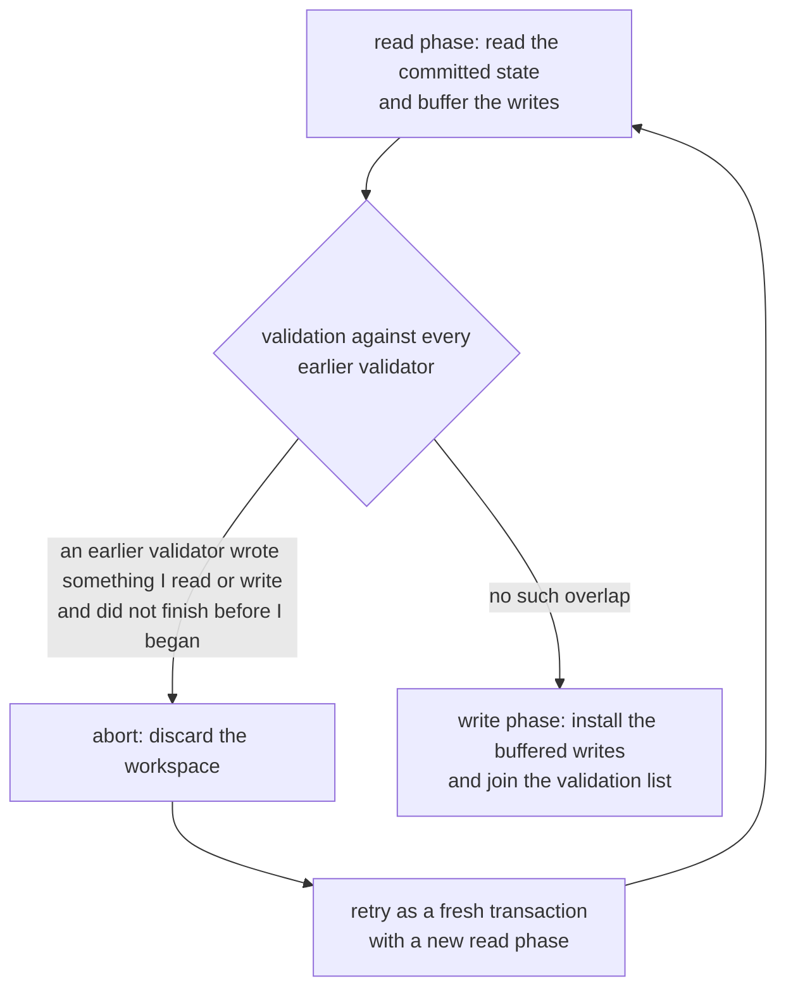
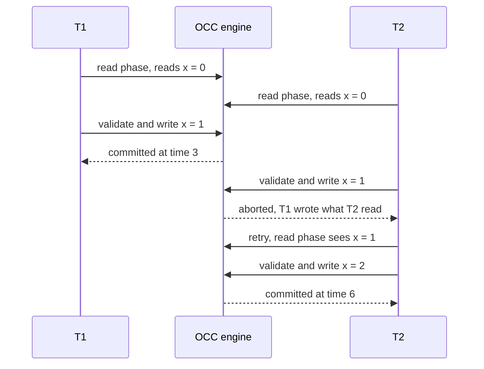
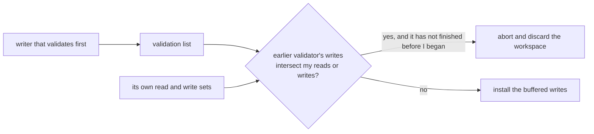

# 640 — Implement optimistic concurrency control simulation with validation phase.

> **Tier:** Expert · **CTCI chapter:** Ch 14 — Databases
> **Task spec:** [640-implement-optimistic-concurrency-control-simulation-with-validat.md](../../../tasks/expert/640-implement-optimistic-concurrency-control-simulation-with-validat.md)
> **Solutions:** [Python](../../../solutions/python/expert/640-implement-optimistic-concurrency-control-simulation-with-validat/solution.py) ·
> [Java](../../../solutions/java/expert/640-implement-optimistic-concurrency-control-simulation-with-validat/Solution.java) ·
> [JavaScript](../../../solutions/javascript/expert/640-implement-optimistic-concurrency-control-simulation-with-validat/solution.js) ·
> [C#](../../../solutions/csharp/expert/640-implement-optimistic-concurrency-control-simulation-with-validat/Solution.cs)

## 1. Problem restatement

Implement **Kung-Robinson optimistic concurrency control** with its three canonical phases over a
deterministic schedule, and show that validation order *is* the equivalent serial order.

| Phase | What the simulator does |
| --- | --- |
| read | run the transaction body up to its first `yield`: reads come from the currently committed state (plus the transaction's own buffered writes) and are recorded in the read set; writes are buffered |
| validate | compare the read set **and** the buffered write set against every transaction that already validated: a conflict exists when an earlier validator's write set intersects `reads ∪ writes` and did not finish before this transaction began reading |
| write | install the buffered writes atomically under a fresh timestamp and append the transaction to the validation list |

| Component | Responsibility |
| --- | --- |
| `OccTransaction` | `start` (read phase began), `read_end`, `end` (validation time), `reads`, `writes`, `status`, `conflict_with` |
| `OccEngine.reader(tx)` / `writer(tx)` | the closures handed to a body; the reader prefers `tx.writes`, records `tx.reads` |
| `OccEngine.validate(tj)` | the backward validation rule |
| `OccEngine.run(bodies, schedule)` | `("read", name)` / `("validate", name)` events; `time` advances on every event, so validation order is commit order |
| `serial_run(bodies, order, initial)` | oracle: the surviving bodies replayed one at a time |

Concrete results asserted by the checks:

- **Lost update:** three incrementers on `x = 0`, schedule `read T1, read T2, validate T1, validate T2,
  read T3, validate T3`. `T2` is **aborted** with `conflict_with == ["T1"]`, `T1` and `T3` commit, the
  validation order is `["T1", "T3"]`, the final state is `{"x": 2}` (not `1`), `T1.writes == {"x": 1}`
  and `T3.writes == {"x": 2}` because the retry read the first writer's result, and `T1.end <= T3.start`.
  The trace is exactly
  `[("read","T1",1), ("read","T2",2), ("commit","T1",3), ("abort","T2",4), ("read","T3",5), ("commit","T3",6)]`.
- **Write skew:** the two doctors have **disjoint write sets** (`not (A.writes & B.writes)`) yet
  `A.writes & B.reads` is non-empty — the read-write conflict OCC *does* detect. `B` is aborted, `A`
  commits, the state is `{"alice": "off", "bob": "on"}`, exactly one doctor stays on call, and it equals
  `serial_run(bodies, ["A"], initial)`.
- **Disjoint transactions:** `D1` (`a → x`) and `D2` (`b → y`) produce zero aborts, both validate, and
  the state is `{"a": 0, "b": 0, "x": 1, "y": 2}`.
- **Non-overlapping serial transactions:** `S1` then `S2` on the same row produce zero aborts, `x = 2`,
  `S1.end <= S2.start`, and validation timestamps are strictly increasing.
- **Read-only transaction:** `RO` reads `z`, never writes, and commits (`RO.writes == {}`) even though a
  writer committed in between; the writer's row `k` becomes `5`.
- Bookkeeping: for every scenario `len(validated) + len(aborts)` equals the number of transactions, so
  each one either validated or was rejected.

The Python run prints
`[640] OCC: 1 commit / 1 abort on write skew; lost update prevented; validation order is the serial order`.

## 2. Intuition

Locking is pessimistic: it pays latency up front because a conflict *might* happen. OCC bets the other
way — let every transaction read and compute freely into a private workspace, and check afterwards
whether the assumption "nobody changed what I read" still holds. If it does, the writes are installed;
if it does not, the transaction is thrown away and retried. No reader ever blocks, and read-only
workloads never abort (in the C# variant that is stated as "a static read-only workload never aborts").

The correctness argument is what makes the validation rule interesting. Because validation happens
**one transaction at a time** and a transaction only installs its writes after it validates, the
validation sequence itself is a serial order. To be valid, transaction `Tj` must not have observed
anything that a transaction `Ti` which validated **before** it — and did not finish before `Tj` began
reading — changed:



Two variants of the rule appear in the solutions, and the difference is instructive:

- **backward validation** (Python, Java, C# — Kung-Robinson): compare against the transactions that
  already committed (or, in the C# version, against stored per-key version numbers). The Python rule is
  deliberately **stricter** than the paper's condition (b): it may abort a read-only transaction that
  overlaps a concurrent writer, so it never aborts *fewer* transactions than the textbook rule.
- **forward validation** (JavaScript): compare against the transactions that are still active, and let
  the **younger** of the two back off.

The C# header also keeps the classic negative control: if validation and writing are *not* atomic, two
conflicting transactions can both commit and lose an update. That is why the write phase shares a latch
with validation.

Note what OCC still cannot do: the classic write-skew schedule. The two doctors write different rows, so
there is no write-write overlap at all — the conflict is only visible because `A` *read* a row that `B`
wrote, and OCC validates the read set, which is exactly why it rejects `B` where snapshot isolation
would commit both (tasks 637 and 638).

## 3. Algorithm

1. **Event.** Every schedule event increments `time`. A transaction seen for the first time is created
   with `start = time`, which is what later decides "did this earlier validator finish before I began?".
2. **Read phase.** `next(generator)` runs the body to its first `yield`; `read(key)` returns
   `tx.writes.get(key, data.get(key))` and records the observed value in `tx.reads`; `write(key, value)`
   buffers into `tx.writes`. Then `read_end = time`.
3. **Validation.** For each `ti` in `validated`: skip `ti` when `ti.end <= tj.start` (it was completely
   done before `tj` began reading); otherwise if `ti.writes` intersects `tj.reads ∪ tj.writes`, record
   `ti.name` in `tj.conflict_with`.
4. **Write phase.** If `conflict_with` is empty: drain the rest of the body (the body's remaining work is
   its own write phase), install the buffered writes in sorted key order, set `end = time`, mark
   `committed`, and append to `validated` — the validation order.
5. **Abort.** Otherwise mark `aborted`, append the name to `aborts`, and install nothing: the workspace
   is discarded, so the state stays byte-identical.
6. **Verify.** The final state must equal `serial_run(bodies, [tx.name for tx in validated], initial)`.

```text
procedure validate(engine, tj)
    for ti in engine.validated do
        if ti.end <= tj.start then
            continue                       // ti finished before tj began reading
        if ti.writes.keys intersects (tj.reads.keys union tj.writes.keys) then
            tj.conflict_with.append(ti.name)
    return tj.conflict_with is empty

procedure run_event(engine, kind, name)
    engine.time = engine.time + 1
    create the transaction with start = engine.time on first sight
    if kind = read then
        advance the body to its first yield
        tx.read_end = engine.time
    if kind = validate then
        if validate(engine, tx) then
            drain the rest of the body
            for key in sorted(tx.writes) do
                engine.data[key] = tx.writes[key]
            tx.end = engine.time
            tx.status = committed
            engine.validated.append(tx)    // validation order is the commit order
        else
            tx.status = aborted
            engine.aborts.append(tx.name)  // nothing is installed
```



## 4. Worked example

**(a) Lost update, with a retry that is scheduled as a new transaction.** Initial `{"x": 0}`, bodies
`increment_body` (read `x`, `yield`, write `x + 1`):

| Time | Event | `T1` | `T2` | `T3` | Committed state |
| --- | --- | --- | --- | --- | --- |
| 1 | `read T1` | reads 0, buffers 1 | — | — | `x 0` |
| 2 | `read T2` | — | reads 0, buffers 1 | — | `x 0` |
| 3 | `validate T1` | valid → commits, `end = 3` | — | — | `x 1` |
| 4 | `validate T2` | — | conflict with `T1` → abort | — | `x 1` |
| 5 | `read T3` | — | — | reads 1, buffers 2 | `x 1` |
| 6 | `validate T3` | — | — | valid → commits, `end = 6` | `x 2` |

`T2`'s failure is attributed to `T1` (`conflict_with == ["T1"]`), and `T1.end (3) <= T3.start (5)`, so
the retry is not even examined against `T1` — it read the state that already contains `T1`'s increment.
Without validation the same schedule would end at `x = 1` and lose an update.

**(b) Write skew, rejected because OCC validates reads.** Initial `{"alice": "on", "bob": "on"}`:

| Time | Event | `A` (alice) | `B` (bob) | State |
| --- | --- | --- | --- | --- |
| 1 | `read A` | reads `on, on`, buffers `alice = off` | — | `alice on, bob on` |
| 2 | `read B` | — | reads `on, on`, buffers `bob = off` | unchanged |
| 3 | `validate A` | valid (nothing validated before it) → commits, `end = 3` | — | `alice off, bob on` |
| 4 | `validate B` | — | `A.writes ∩ B.reads = {alice}` → abort | `alice off, bob on` |

The two write sets are disjoint, so a write-write-only rule (snapshot isolation) would commit both; the
read-set clause is what saves the invariant, and the surviving state equals the serial execution of `A`.



**(c) Zero false aborts.** Three schedules must run clean:

| Schedule | Aborts | State | Why |
| --- | --- | --- | --- |
| Disjoint `D1: a → x`, `D2: b → y` | 0 | `{"a": 0, "b": 0, "x": 1, "y": 2}` | read and write sets do not intersect at all |
| Serial `S1` then `S2` on `x` | 0 | `{"x": 2}` | `S1.end <= S2.start`, so `S1` is skipped by the rule |
| Read-only `RO` plus writer `W` | 0 | `k = 5`, `RO.writes == {}` | `RO` writes nothing, so the writer's writes cannot intersect its write set, and they do not intersect its read set |

**(d) Timestamps are the serial order.** In the serial scenario both `end` values are recorded and
checked to be strictly increasing; in every scenario `len(validated) + len(aborts)` equals the number of
transactions, so the trace is a complete classification of the run and the surviving order can be handed
to the oracle as-is.

## 5. Complexity

With `t` transactions, `k` keys, `r` reads per transaction and `a` aborted-and-retried attempts:

| Operation | Time | Space | Why |
| --- | --- | --- | --- |
| `read` | O(1) | O(r) | a dictionary lookup plus read-set insertion |
| `write` | O(1) | O(#writes) | buffered only |
| `validate` | O(t · (r + #writes)) | O(1) extra | one set-intersection test per earlier validator |
| write phase | O(#writes log #writes) | O(#writes) | sorted install |
| `run` | O(#events · t · (r + w)) | O(t · (r + w)) | each validate event scans the validation list |
| whole workload with retries | multiplies by the attempt count | — | a retry re-runs the read phase against the newer state |

Where OCC sits among the neighbours:

| Mechanism | Blocking | Conflict detection | Read-write conflicts | Costs |
| --- | --- | --- | --- | --- |
| Two-phase locking (task 639) | yes | wait-for graph cycles | prevented by blocking | latency, deadlocks |
| Snapshot isolation (task 637) | no | write-write only | **accepted** → write skew | anomalies |
| SSI (task 638) | no | dangerous structures | refused at commit | extra conservative aborts |
| OCC (this task) | no | read/write set intersection at validation | refused | wasted work when contention is high |

The Java header notes the deliberate simplification that makes the cost model visible: the write values
are a fixed arithmetic expression of the read values, and there is no preemption between validation and
writing, so a "wasted" transaction is exactly one that reached validation and was refused.

## 6. Pitfalls and edge cases

- **Validation and writing must be atomic.** If another transaction validates in between, both can pass
  and an update is lost; the C# solution latches the two phases together and keeps a non-atomic variant
  as a negative control.
- **Reads must see the committed state, not a snapshot.** Classic OCC reads the live database, which is
  precisely why validation is needed; a snapshot read would turn OCC into (non-serializable) snapshot
  isolation.
- **The read set is as important as the write set.** The write-skew scenario has disjoint write sets and
  is still rejected because `A.writes ∩ B.reads ≠ ∅`.
- **"Finished before I began" is a real exemption.** `ti.end <= tj.start` skips the comparison, which is
  why the serial schedule and the retry produce no false aborts; dropping that clause would abort
  everything.
- **The rule is conservative.** The Python docstring says it is stricter than the paper's condition (b):
  it may abort a read-only transaction overlapping a concurrent writer, and it never aborts fewer
  transactions than the textbook rule.
- **An aborted transaction installs nothing.** The workspace is discarded, so the committed state stays
  byte-identical — a partially applied write set is impossible by construction.
- **Retries are just new transactions.** The demo schedules `T3` after `T1` finished; the JavaScript
  variant retries in place with an attempt counter and reports starvation after `maxAttempts`, so a run
  always terminates instead of spinning.
- **Read-your-own-writes.** `read` prefers `tx.writes`, so a body that writes and re-reads a key sees its
  own buffered value rather than the stale committed one.
- **High contention aborts more.** The Java checks compare a contended workload with a quiet one on the
  same generator; OCC's cost is proportional to conflicts, which is why it is used where conflicts are
  rare.
- **Blind writes need a version check.** A transaction that writes a key it never read has no read-set
  evidence; the C# variant compares stored version numbers so two blind writers cannot clobber each
  other.
- **No preemption window.** Marking a transaction invalid mid-flight (an OCC refinement) is not modelled
  beyond the JavaScript forward variant, which invalidates the younger active transaction instead.

## 7. Variants and follow-ups

- **The anomaly OCC exists to avoid.** Snapshot isolation validates only write-write conflicts and lets
  the write skew through — see
  [637-implement-snapshot-isolation-anomalies-demonstrator-write-skew.md](../../../tasks/expert/637-implement-snapshot-isolation-anomalies-demonstrator-write-skew.md).
- **Serializability without discarding the work.** SSI aborts only the pivot of a dangerous structure —
  see
  [638-implement-serializable-snapshot-isolation-tester.md](../../../tasks/expert/638-implement-serializable-snapshot-isolation-tester.md).
- **The pessimistic alternative.** Locking prevents the same conflicts by blocking instead of retrying —
  see
  [639-implement-two-phase-locking-simulator-with-deadlock-detection.md](../../../tasks/expert/639-implement-two-phase-locking-simulator-with-deadlock-detection.md).
- **Hardware support.** The same read-set/write-set idea appears as a transactional-memory design
  ([615-implement-transactional-memory-simulator-basics.md](../../../tasks/expert/615-implement-transactional-memory-simulator-basics.md)).
- **Cheap conflict filters.** Filtering concurrent transactions with a probabilistic structure before
  validation is the same trade-off as a bloom filter in a join
  ([649-implement-bloom-join-filter-application-and-benchmarking.md](../../../tasks/expert/649-implement-bloom-join-filter-application-and-benchmarking.md)).

## 8. Check yourself

<details><summary>Show answer 1 — Why is the validation order the serial order?</summary>

Only the transaction being validated can install writes, and it installs them after the check. So when
`Tj` validates, every earlier validator's effects are already in the database, and `Tj` has been proven
not to depend on anything they changed that it had seen. Replaying the bodies in validation order
therefore produces the same state — the checks compare against `serial_run(bodies, validated_order)`.
</details>

<details><summary>Show answer 2 — Why is <code>ti.end &lt;= tj.start</code> exempt?</summary>

If the earlier validator finished before `Tj` began reading, then `Tj`'s reads already saw its effects,
so there is nothing stale to invalidate. Without that clause every overlapping pair would abort and the
serial scenario would fail its "zero false aborts" check.
</details>

<details><summary>Show answer 3 — Why does OCC reject the write skew that snapshot isolation accepts?</summary>

Because the two doctors write *different* rows, so a write-write check finds nothing; but `A` read the
row `B` wrote, and OCC validates the **read** set as well, so `B`'s validation sees `A.writes ∩ B.reads`
and aborts.
</details>

<details><summary>Show answer 4 — What breaks if validation and the write phase are not atomic?</summary>

Two conflicting transactions can both pass validation before either installs its writes, and the second
install silently overwrites the first — the lost update returns. The C# solution demonstrates exactly
that by running a non-atomic variant, and fixes it by latching validation and writing together.
</details>
