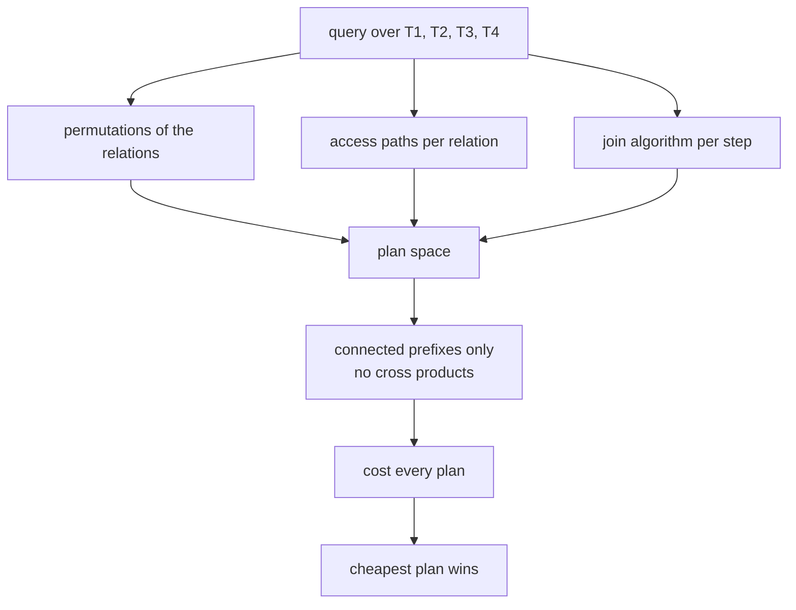
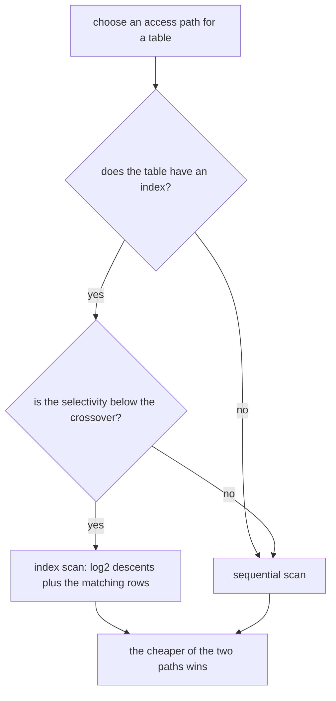
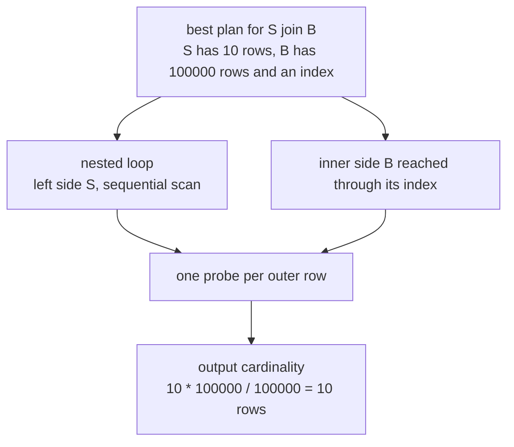

# 641 — Implement advanced query planner cost model stub and plan enumeration.

> **Tier:** Expert · **CTCI chapter:** Ch 14 — Databases
> **Task spec:** [641-implement-advanced-query-planner-cost-model-stub-and-plan-enumer.md](../../../tasks/expert/641-implement-advanced-query-planner-cost-model-stub-and-plan-enumer.md)
> **Solutions:** [Python](../../../solutions/python/expert/641-implement-advanced-query-planner-cost-model-stub-and-plan-enumer/solution.py) ·
> [Java](../../../solutions/java/expert/641-implement-advanced-query-planner-cost-model-stub-and-plan-enumer/Solution.java) ·
> [JavaScript](../../../solutions/javascript/expert/641-implement-advanced-query-planner-cost-model-stub-and-plan-enumer/solution.js) ·
> [C#](../../../solutions/csharp/expert/641-implement-advanced-query-planner-cost-model-stub-and-plan-enumer/Solution.cs)

## 1. Problem restatement

Build the *planning* half of a System-R style query optimiser: a **documented cost-model stub** plus an
**enumerator** that produces every plan in the space and returns the cheapest one. The stub is honest
about its simplifications — one selectivity triple per table (uniform distributions), unitless CPU
constants, no buffer pool, no parallelism, no calibration.

| Piece | Definition in the Python solution |
| --- | --- |
| statistics | `stat(rows, ndv, has_index, selectivity)`; rows after the pushed-down filter are `max(1, round(rows * selectivity))` |
| constants | `C_TUPLE = 1.0`, `C_INDEX = 4.0`, `C_HASH_PROBE = 0.5`, `C_SORT_TUPLE = 2.0` |
| sequential scan | `rows * C_TUPLE` |
| index scan | `(log2(rows) + 1) * C_INDEX + estimated_rows * C_TUPLE` |
| nested loop | `left * C_TUPLE + left * per_probe`, where `per_probe` is an index descent when the inner side is index-scanned and a full re-read of the inner side otherwise |
| hash join | `(left + right) * C_TUPLE + output_rows * C_HASH_PROBE` |
| sort-merge | `(left + right) * C_TUPLE + (left * log2(max(left, 2)) + right * log2(max(right, 2))) * C_SORT_TUPLE` |
| join cardinality | `left_rows * right_rows / max(ndv_left, ndv_right)` |
| enumeration | every permutation × every access path × every join algorithm at every step, keeping only **connected** prefixes (no accidental cross products) |

Concrete results asserted by the checks:

- **Enumeration sizes are exactly the product of the spaces:** a star (`C` joined to `A` and `B`) gives
  `4 · 2³ · 3² = 288` plans; a two-table query gives `2 · 2 · 3 = 12`; the four-table chain gives
  `8 · 2⁴ · 3³ = 3456` plans; the three-table path (no indexes) gives `4 · 3² = 36`. None of the
  enumerations contains a duplicate, every plan is connected, and `choose_best` returns a plan whose cost
  equals the minimum over the whole list — reproducibly.
- **The cost of a plan is the sum of its terms:** a hand-built `hash_join(seq T1, seq T2)` plan costs
  exactly the two scan costs plus the join formula (checked to within `1e-9`).
- **The access-path crossover has a closed form:** index access is chosen iff
  `sel < 1 - (log2(rows) + 1) * C_INDEX / rows`; the check walks selectivities `0.01 … 1.0` and confirms
  the choice matches the formula every time, with 5 % selectivity using the index and 99 % scanning the
  table; a table without an index can only be sequentially scanned.
- **Filters only help.** Giving `T3` a 25 % filter lowers the best cost below the unfiltered best cost
  and makes the planner reach `T3` through its index.
- **Algorithm consequences.** For a tiny outer (10 rows) and a large indexed inner (100 000 rows) the
  index nested loop beats the hash join, while the hash join beats a nested loop that has no index to
  probe. At equal sizes (1000/1000) sort-merge loses to a hash join, and for tiny inputs (5/5) sort-merge
  is the worst of the three.
- **The planner picks what the model implies:** for `S` (10 rows) joined with a 100 000-row indexed `B`
  it chooses a **nested loop** with `S` sequentially scanned and `B` reached through its index; removing
  `B`'s index switches the choice to a **hash join**.
- **The cardinality estimate is exact on uniform data.** Two relations of 8 and 12 rows with `ndv = 4`
  produce `24` rows both by estimate and by actually executing the plan, and a three-way join of 4, 8 and
  12 rows estimates and produces `24` rows.

The Python run prints
`[641] planner: 3456 plans enumerated for the 4-table chain, best cost 5693.2`.

## 2. Intuition

A query planner faces two separable problems: **how good is a plan** (the cost model) and **which plans
are worth looking at** (the enumeration). The interesting engineering is in the second, so the
solutions deliberately keep the first one a transparent stub: textbook formulas with named constants, no
measured I/O calibration, no histograms beyond a single selectivity number.

Three ideas make the enumeration tractable and explain every check:

1. **Left-deep enumeration is a product of independent choices.** A plan is a permutation of the
   relations, an access path per relation, and a join algorithm per join step. The enumeration count is
   therefore exactly `orders × access_paths × algorithms` — `8 × 2⁴ × 3³ = 3456` for the chain, `288` for
   the star, `12` for two tables. Getting those numbers right is how you know nothing was silently
   skipped or duplicated.
2. **Only connected prefixes count.** If the next relation has no join predicate with the relations
   already joined, the step would be a cross product; the enumerator breaks out of that permutation
   instead of building it, and the checks re-verify connectivity on every plan in the space.
3. **Cost is additive in the child costs.** `evaluate` computes a plan's cost as `left.cost + right.cost
   + join term`, and a join's output cardinality depends only on the *subset* of relations and the fixed
   leaf selectivities. That is precisely Selinger's precondition for "keep the cheapest plan per
   relation subset", and the JavaScript check turns it into a measurement: the dynamic-programming
   planner and a full bushy enumeration over every tree shape and method assignment must return the same
   best cost (the check also reports how many partial merges the DP evaluated instead of materialising
   every complete plan). The Java variant records the additional structural fact that the bushy space
   provably contains tree shapes left-deep enumeration cannot build, while for this symmetric cost model
   the two optima agree.



## 3. Algorithm

1. **Statistics.** `stat(rows, ndv, has_index, selectivity)` — everything the optimiser knows about a
   base relation. `estimated_rows` applies the pushed-down filter and rounds up to at least one row.
2. **Scan cost.** `scan_choice(s)` returns the cheaper of `seq_scan_cost` and, when an index exists,
   `index_scan_cost`; `index_selectivity_threshold(rows)` is the closed form of the crossover, obtained
   by solving `seq = index` for the selectivity.
3. **Join cost.** `join_cost(alg, left_rows, right_rows, out_rows, right_indexed)` — the three formulas
   above; the nested loop's per-probe term is an index descent when the inner side is index-scanned, and
   a full re-read of the inner relation otherwise.
4. **Evaluation.** `evaluate(plan, catalog, memo)` recurses over the plan tree: a scan returns
   `(cost, estimated_rows, ndv)`; a join returns `(left.cost + right.cost + join term, out_rows,
   max(ndv))`, with the special case that an index nested loop does not pay the inner scan cost (each
   probe pays its own descent). Results are memoised, because different plans share subtrees.
5. **Enumeration.** `enumerate_plans(tables, catalog, edges)` iterates permutations, access-path
   combinations and algorithm combinations, extending a left-deep plan one relation at a time and
   discarding a permutation as soon as the next relation is not connected to the joined set.
6. **Selection.** `choose_best` scores every plan against one shared memo and keeps the minimum.
7. **Verification.** The checks count the space, re-derive a hand-built plan's cost, walk the selectivity
   sweep, compare filter/no-filter optima, probe the algorithm consequences, and finally compare the
   estimated cardinality of the chosen plan with the row count of actually executing it (`execute`
   materialises the join, which is why the uniform test data uses keys cycling over a small domain).

```text
procedure evaluate(plan, catalog, memo)
    if plan is already in memo then
        return memo[plan]
    if plan is a scan of table with access then
        cost = index_scan_cost(catalog[table]) if access = index else seq_scan_cost(catalog[table])
        result = (cost, estimated_rows(catalog[table]), catalog[table].ndv)
    else
        (left_cost, left_rows, left_ndv) = evaluate(plan.left, catalog, memo)
        (right_cost, right_rows, right_ndv) = evaluate(plan.right, catalog, memo)
        out_rows = left_rows * right_rows / max(left_ndv, right_ndv)
        indexed = plan.right is a scan with access = index
        join_term = join_cost(plan.algorithm, left_rows, right_rows, out_rows, indexed)
        if plan.algorithm = nested_loop and indexed then
            total = left_cost + join_term              // every probe pays its own index descent
        else
            total = left_cost + right_cost + join_term
        result = (total, out_rows, max(left_ndv, right_ndv))
    memo[plan] = result
    return result

procedure enumerate_plans(tables, catalog, edges)
    plans = empty
    for perm in permutations of tables do
        for accesses in the access-path combinations of perm do
            for algorithms in the algorithm combinations of length (len(perm) - 1) do
                plan = scan of perm[0] with accesses[0]
                joined = {perm[0]}
                for index = 1 to len(perm) - 1 do
                    if perm[index] is not connected to joined by an edge then
                        break                            // a cross product: discard this permutation
                    plan = join(algorithms[index - 1], plan, scan of perm[index])
                    joined.add(perm[index])
                if every relation was joined then
                    plans.append(plan)
    return plans
```



## 4. Worked example

**(a) The four-table chain and its space.** Catalog: `T1` 1000 rows (ndv 1000, indexed), `T2` 500 rows
(ndv 1000, indexed), `T3` 2000 rows (ndv 1000, indexed), `T4` 50 rows (ndv 1000, indexed); edges
`T1–T2–T3–T4`. Of the `4! = 24` permutations only `8` are connected (each table must be adjacent to the
already-joined set), so the space is:

| Factor | Count |
| --- | --- |
| Connected orders | 8 |
| Access paths (`seq` / `index` per table) | `2⁴ = 16` |
| Join algorithms (`nested_loop`, `hash_join`, `sort_merge`) per join step | `3³ = 27` |
| Total plans | `8 · 16 · 27 = 3456` |
| Duplicates | 0 (checked) |
| Minimum-cost plan | reported by the run: best cost `5693.2` |

**(b) The star and the two-table cases.** `C` joined with `A` and `B`, all indexed, gives
`4 · 2³ · 3² = 288` plans (four connected orders: `C` first, then either order of `A`/`B`). With two
tables `S` and `B` the space is `2 · 2 · 3 = 12` — small enough to see every candidate:

| Plan candidate | Cost |
| --- | --- |
| `nested_loop(seq S, index B)` | the cheapest: the inner index descent is paid per probe, and only 10 outer rows are probed |
| `hash_join(seq S, index B)` | pays both scans plus one probe per output row, so it loses on a tiny outer |
| `nested_loop(seq S, seq B)` | re-reads the 100 000-row inner once per outer row — the check asserts this is worse than the hash join |

That is why the checks assert `collect_algs(best_indexed) == ["nested_loop"]` with
`{"S": "seq", "B": "index"}`, and that dropping `B`'s index flips the winner to `hash_join`.



**(c) The crossover, the filter and the cardinality.** Three consequences pinned by hand-checkable
numbers:

| Check | Observation |
| --- | --- |
| Selectivity sweep on 1000 rows | index access is chosen exactly for `sel < 1 - (log2(1000) + 1) · 4 / 1000`; 5 % uses the index, 99 % scans the table, a table without an index always scans |
| 25 % filter on `T3` of the chain | the best cost is strictly lower than the unfiltered best cost, and the best plan now reaches `T3` through its index — pushing the filter down is what makes the index usable at all |
| Uniform 8-row × 12-row join, `ndv = 4` | estimate `8 · 12 / 4 = 24` equals the 24 rows the plan really produces |
| Uniform 4/8/12-row three-way join | the chosen plan's estimate equals the 24 rows produced by executing it |

The filter case is the classic pushdown argument: the *same* selectivity applied at the scan instead of
above the join is strictly cheaper, because the join then sees fewer rows. The Java variant measures the
same effect in page reads — pushdown "more than halves the plan cost", and an index on the selective
column is "an order of magnitude cheaper than the sequential scan of that relation".

**(d) A pinned example from the C# variant.** Its cost model counts page reads, and its checks pin the
formulas against hand-computed numbers: 1000 rows of 100 pages with a 50-distinct key give selectivity
`0.02`, 20 matching rows and an index scan cost of **exactly `17.2`**; the enumeration count is exactly
`|paths(A)| · |paths(B)| · methods · orders`; and a selective predicate prefers the index while a
non-selective one prefers the sequential scan — the same crossover the Python sweep checks.

## 5. Complexity

With `n` relations, `a` access paths per relation, `k` join algorithms and `t` plan nodes:

| Operation | Time | Space | Why |
| --- | --- | --- | --- |
| `scan_choice` | O(1) | O(1) | two closed-form costs and a comparison |
| `join_cost` | O(1) | O(1) | arithmetic on row counts, no data access |
| `evaluate` | O(t) per plan, O(shared subtrees) overall with the memo | O(#distinct subplans) | recursion over the plan tree; the memo collapses the shared prefixes |
| `enumerate_plans` | O(n! · aⁿ · k^(n-1)) plans | O(#plans) | the product of the three independent choices, minus the permutations that disconnect |
| `choose_best` | O(#plans · t) | O(#plans) | one memoised evaluation per plan |
| `execute` (oracle only) | O(#output rows + #rows scanned) | O(#output rows) | the test materialises the join to compare cardinality |

The space grows fast enough to be the real story: `3456` plans for four relations with two access paths
and three algorithms, and the count multiplies by `n·a·k` for every relation added, which is why a real
planner prunes.

| Approach | Plan space | Cost of planning | Guarantee |
| --- | --- | --- | --- |
| Exhaustive left-deep (this stub) | `n! · aⁿ · k^(n-1)`, connected only | the whole space | optimal within the space (verified) |
| Dynamic programming, cheapest plan per subset (Selinger) | keeps one plan per subset | O(3ⁿ) subsets | same optimum here, because cost is additive in the child costs and the output cardinality depends only on the subset (the JavaScript check compares both) |
| Bushy trees | every unordered binary tree over the relations | larger than left-deep | never worse — equal for this symmetric model, and strictly richer in tree shapes (the Java check records both facts) |
| Greedy / heuristic ordering | linear extensions only | O(n²) | no optimality, but usable at large `n` |

## 6. Pitfalls and edge cases

- **Counting the space is part of the test.** `288`, `12`, `3456`, `36` are asserted exactly, with a
  duplicate check; a silently dropped access path or algorithm combination would show up there.
- **Connectivity must be enforced while extending, not afterwards.** The enumerator `break`s out of a
  permutation as soon as the next relation has no join edge with the joined set, so no cross product can
  appear; `is_connected` re-checks every surviving plan.
- **The nested-loop special case matters.** When the inner side is an index scan, the inner scan cost is
  replaced by per-probe index descents (`total = left_cost + join_term`); adding both would make the
  index nested loop look more expensive than it is and hide the `S`/`B` result.
- **Cardinality needs the propagated `ndv`.** A join's selectivity uses `max(ndv_left, ndv_right)` and
  the result propagates that maximum upward; using the output row count as the `ndv` would make chained
  joins collapse to nonsense.
- **The estimate is exact only on uniform data.** The test data cycles keys over a small domain, which is
  what makes `24 == 24` verifiable; the JavaScript header states plainly that histogram bounds are only
  bounds and that conjunctive predicates multiply even when the columns are correlated.
- **Pushdown can only lower the cost** — asserted as `filtered_cost < best_cost`; a filter applied above
  the join would see the unfiltered row count and lose the index access.
- **An index can be the wrong choice.** Its cost includes one descent per probe
  (`(log2(rows) + 1) * C_INDEX`) plus the matching rows, so at 99 % selectivity a sequential scan wins;
  the sweep checks the crossover in both directions.
- **Sort-merge is never free.** It pays logarithmic sort terms on both inputs, which is why it loses to a
  hash join at equal sizes and is the worst of the three for tiny inputs.
- **Zero rows are clamped.** `estimated_rows` returns at least 1, so a highly selective predicate cannot
  make a plan free, and the checks assert every enumerated plan has a finite non-negative cost.
- **Invalid input is rejected, not guessed.** The JavaScript variant refuses disconnected join graphs,
  unknown relations or columns, and unknown join methods.
- **Statistics can be wrong in the real world.** The stub documents that there are no histograms per
  column, no correlation between conjunctive predicates and no buffer-pool effects, so a real planner
  can be misled by exactly the estimates this one takes at face value.

## 7. Variants and follow-ups

- **Choosing join orders by dynamic programming.** The classic Selinger enumeration keeps the cheapest
  plan per relation subset instead of every prefix — see
  [643-implement-multi-way-join-ordering-via-dynamic-programming-seling.md](../../../tasks/expert/643-implement-multi-way-join-ordering-via-dynamic-programming-seling.md).
- **The operators this planner prices.** The join algorithms themselves are the subject of
  [642-implement-join-algorithms-nested-loop-hash-join-sort-merge-join.md](../../../tasks/expert/642-implement-join-algorithms-nested-loop-hash-join-sort-merge-join.md).
- **Spending the budget on fewer plans.** A cost-based view selection problem is the same trade-off with
  a different objective — see
  [656-implement-cost-based-materialized-view-selection-sketch.md](../../../tasks/expert/656-implement-cost-based-materialized-view-selection-sketch.md).
- **Making predicates cheaper.** Bloom filters cut the rows a plan must probe, which changes the
  constants this stub fixes
  ([649-implement-bloom-join-filter-application-and-benchmarking.md](../../../tasks/expert/649-implement-bloom-join-filter-application-and-benchmarking.md)).
- **Rewriting before planning.** A cheaper plan is often the result of a cheaper query
  ([655-implement-query-rewriter-for-simple-view-unfolding.md](../../../tasks/expert/655-implement-query-rewriter-for-simple-view-unfolding.md)).

## 8. Check yourself

<details><summary>Show answer 1 — Why is the enumeration count a product of three independent choices?</summary>

A left-deep plan is determined by the order of the relations, the access path chosen for each of them and
the join algorithm used at each step, and those choices are independent: `orders × access_paths ×
algorithms`. For the four-table chain that is `8 · 2⁴ · 3³ = 3456` (only 8 of the 24 permutations are
connected), and the checks assert the exact number plus an absence of duplicates.
</details>

<details><summary>Show answer 2 — What makes the classic "cheapest plan per subset" pruning safe here?</summary>

A plan's cost is `left.cost + right.cost + join term`, and both the join term and the output cardinality
depend only on the relation *subset* (leaf selectivities are fixed and each predicate is applied once).
So extending a subset with another relation needs only the subset's cheapest cost and row estimate —
which is why the dynamic-programming planner and the exhaustive bushy enumeration return the same best
cost in the JavaScript check.
</details>

<details><summary>Show answer 3 — When is an index scan chosen, and why is a pushed-down filter what makes it good?</summary>

An index scan costs `(log2(rows) + 1) * C_INDEX + rows_out * C_TUPLE`, so it wins exactly below the
selectivity where that equals `rows * C_TUPLE` — the closed form the sweep verifies. Pushing a filter
down reduces `rows_out` *before* the scan, which both lowers the index cost and (as the chain example
shows) can flip the best plan to use the index; applying the same filter above the join would not.
</details>

<details><summary>Show answer 4 — Why does the planner choose a nested loop for the tiny-outer case?</summary>

Because with only 10 outer rows there are 10 probes, and with an index on the inner side each probe costs
one descent instead of a full re-read of 100 000 rows. The hash join has to build and scan the large
side regardless, so for a tiny outer the index nested loop wins — and the check also confirms that
without the index the hash join takes over.
</details>
