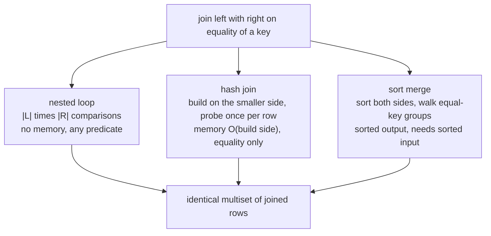
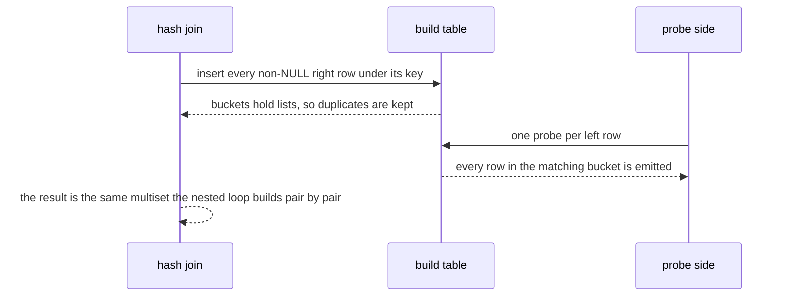
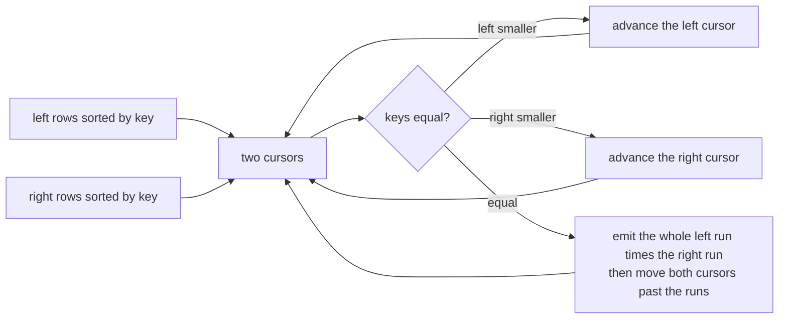

# 642 — Implement join algorithms: nested-loop, hash join, sort-merge join.

> **Tier:** Expert · **CTCI chapter:** Ch 14 — Databases
> **Task spec:** [642-implement-join-algorithms-nested-loop-hash-join-sort-merge-join.md](../../../tasks/expert/642-implement-join-algorithms-nested-loop-hash-join-sort-merge-join.md)
> **Solutions:** [Python](../../../solutions/python/expert/642-implement-join-algorithms-nested-loop-hash-join-sort-merge-join/solution.py) ·
> [Java](../../../solutions/java/expert/642-implement-join-algorithms-nested-loop-hash-join-sort-merge-join/Solution.java) ·
> [JavaScript](../../../solutions/javascript/expert/642-implement-join-algorithms-nested-loop-hash-join-sort-merge-join/solution.js) ·
> [C#](../../../solutions/csharp/expert/642-implement-join-algorithms-nested-loop-hash-join-sort-merge-join/Solution.cs)

## 1. Problem restatement

Implement the three physical **equality join** operators over in-memory relations, each returning both
its rows and its **work counters**, so that "this join is cheaper" can be asserted as a comparison count
instead of a timing.

| Algorithm | Strategy | Memory | Input order | Reported counters |
| --- | --- | --- | --- | --- |
| `nested_loop_join` | for every left row, scan the whole right side | O(1) | anything | `comparisons` = \|L\| · \|R\|, `probes` |
| `hash_join` | build a chained table on the right side, probe once per left row | O(\|R\|) | anything | `build` (inserts, NULL keys skipped), `probes` = \|L\|, `comparisons` = build + probes |
| `sort_merge_join` | merge two inputs already sorted by the key, expanding each equal-key group into its full cross product | O(1) beyond the inputs | **sorted** (enforced) | `comparisons` for the group walk, O(\|L\| + \|R\|) |

All three follow SQL **NULL** semantics — a NULL key matches nothing, not even another NULL — and **bag**
semantics: duplicate keys multiply, nothing is deduplicated.

Concrete results asserted by the checks:

- **Hand anchors:** `[(1, "a"), (2, "b")]` joined with `[(2, "x"), (3, "y")]` on column 0 gives exactly
  `[(2, "b", 2, "x")]` from all three algorithms.
- **Twenty random trials** (30 left rows, 25 right rows, key domain 6, NULLs sprinkled in): the three
  algorithms agree as **multisets**, their row counts all equal an independent multiplicity oracle
  `Σ_key count(left, key) · count(right, key)`, and the joined rows are unique because the payloads are.
- **Instrumentation on 40 × 60 rows:** nested loop `comparisons == 2400`; hash join `build == 60`,
  `probes == 40`, `comparisons == 100` (linear); merge join at most `2 · (40 + 60) + 2 = 202`
  comparisons and far below the nested loop's.
- **NULL handling:** joining `[(1, NULL), (2, 3)]` with `[(9, NULL), (8, 3)]` yields exactly
  `[(2, 3, 8, 3)]` for every algorithm, and the hash join's `build == 1` — the NULL right key is never
  hashed.
- **Boundaries:** an empty left side, an empty right side or two empty sides give `[]` for every
  algorithm; all-equal keys give the full `4 × 5 = 20` cross product; disjoint keys give `[]` while the
  hash join still does its linear work (`build == 1`, `probes == 1`); a self-join of 12 rows with keys
  `i % 3` produces exactly `Σ c²` rows (the sum of squared multiplicities).
- **The sorted precondition is enforced:** `is_presorted` detects an unsorted relation and
  `sort_merge_join` raises rather than returning a wrong answer.
- **Scale:** 300 × 400 rows with 50 distinct keys → nested loop `120000` comparisons, hash join `700`
  (`|L| + |R|`), merge join `750`, and the check asserts the merge join needs two orders of magnitude
  fewer comparisons than the nested loop.

The Python run prints
`[642] joins: 300x400 rows, nested 120000 / hash 700 / merge 750 comparisons`.

## 2. Intuition

The relational answer to "join these two tables" is unique; the cost of getting it is not. The three
classic algorithms are three different answers to *where the matching work happens*:

- **Nested loop** does the work at comparison time: every pair of rows is examined. It needs no memory
  and no sort order, and it is the only one of the three that can evaluate an arbitrary predicate (the
  Java solution uses that to run a theta join such as `|left.key - right.key| <= 1`), but its work is
  `|L| · |R|` — `120000` comparisons on the 300 × 400 example.
- **Hash join** moves the work to a build phase: index the right side by key once, then probe it once
  per left row. Work becomes `|R| + |L|` — `700` on the same input. The price is memory proportional to
  the build side (hence "build on the smaller input") and the loss of arbitrary predicates: only
  equality works, because hashing needs a hashable key.
- **Sort-merge join** moves the work into sorting: if both inputs are ordered by the key, two cursors
  walk them once, and every equal-key group is expanded into its cross product. Its merging work is
  `|L| + |R|` and its output is sorted, which is why it is the natural choice when the inputs already
  come from index scans.



Duplicates are where naive implementations break. A hash table that stores one row per key loses matches;
the hash join therefore maps a key to a **list** of rows and appends every probe hit. The merge join
advances two group cursors and emits the full `left_run × right_run` block for each equal key, which is
the same multiplicity as the nested loop's pair-by-pair scan. NULL is the other trap: SQL compares NULL
as *unknown*, never true, so a NULL key must match nothing — the hash join does not even insert it into
the build side, and the merge join filters NULL groups out of both inputs.

The JavaScript and C# solutions add a fourth operator, **block nested loop**, which is the memory/IO
middle ground: re-scan the inner relation once per *block* of outer rows instead of once per row, so the
page traffic follows the classic `|R| + ceil(|R| / b) · |S|` formula, and a bigger block never increases
the traffic.

## 3. Algorithm

1. `keys_match(left_key, right_key)` — SQL equality: both sides non-NULL and equal. Every algorithm routes
   its comparisons through it, so the NULL rule cannot be forgotten in one place only.
2. `sort_relation(rows, key_index)` — sort ascending by key with NULLs last; `is_presorted` is the same
   comparison, and `sort_merge_join` asserts it, because an unsorted input silently produces wrong
   groups.
3. `nested_loop_join(left, right, lk, rk)` — double loop, counting one comparison per pair and appending
   `l + r` (the concatenation) on a match.
4. `hash_join(left, right, lk, rk)` — build: for each right row with a non-NULL key, append it to
   `buckets[key]`; probe: one probe per left row, and for each stored right row in the bucket append the
   concatenation. NULL left keys are skipped without a lookup.
5. `sort_merge_join(left, right, lk, rk)` — drop NULL rows from both sides, then two cursors: if the left
   key is smaller, advance `i`; if larger, advance `j`; if equal, extend `i2` past the left run and `j2`
   past the right run and emit every pair `(i..i2) × (j..j2)`, then continue from `i2`/`j2`. Group
   cursors never move backwards, which is what makes the walk linear.
6. `expected_pair_count(left, right, lk, rk)` — the independent oracle: multiplicities multiply per key,
   so the result size is `Σ_key count_left(key) · count_right(key)`.
7. `run_all(...)` — sort copies for the merge join, then run all three and return rows plus statistics for
   comparison.

```text
procedure hash_join(left, right, left_key, right_key)
    buckets = empty map
    inserts = 0
    for r in right do
        if r[right_key] is not NULL then
            buckets[r[right_key]].append(r)          // a list, so duplicates survive
            inserts = inserts + 1
    rows = empty
    probes = 0
    for l in left do
        probes = probes + 1
        if l[left_key] is not NULL then
            for r in buckets[l[left_key]] do
                rows.append(l concatenated with r)
    return (rows, {build: inserts, probes: probes, comparisons: inserts + probes})

procedure sort_merge_join(left, right, left_key, right_key)
    assert left and right are sorted by their join key with NULLs last
    lrows = rows of left whose key is not NULL
    rrows = rows of right whose key is not NULL
    rows = empty
    i = 0
    j = 0
    while i < length(lrows) and j < length(rrows) do
        if lrows[i].key < rrows[j].key then
            i = i + 1
        else if lrows[i].key > rrows[j].key then
            j = j + 1
        else
            i2 = first index past the run of lrows equal to the key at i
            j2 = first index past the run of rrows equal to the key at j
            for a from i to i2 - 1 do
                for b from j to j2 - 1 do
                    rows.append(lrows[a] concatenated with rrows[b])   // the full cross product
            i = i2
            j = j2
    return (rows, {comparisons: the number of cursor steps})
```



## 4. Worked example

**(a) Instrumented run on 40 × 60 rows.** Left 40 rows, right 60 rows, keys drawn from 5 values:

| Algorithm | Counter | Value | Why |
| --- | --- | --- | --- |
| nested loop | `comparisons` | `2400` | every pair of rows is compared: `40 · 60` |
| hash join | `build` / `probes` | `60` / `40` | one insert per right row, one probe per left row |
| hash join | `comparisons` | `100` | `|R| + |L|`, independent of the key distribution |
| sort merge | `comparisons` | `≤ 202` | `2 · (|L| + |R|) + 2` bound, and far below `2400` |

All three return the same multiset, and its size equals the oracle
`Σ_key count_left(key) · count_right(key)`.

**(b) Duplicate-heavy and degenerate inputs.** The checks pick cases that break careless
implementations:

| Input | Expected result | What it proves |
| --- | --- | --- |
| All keys equal (4 left, 5 right) | `20` rows from every algorithm | duplicates multiply; nothing is deduplicated |
| Self-join of 12 rows with keys `i % 3` | `Σ c²` rows | the multiplicity oracle holds for a self-join |
| No matching keys at all | `[]`, but hash join still `build 1`, `probe 1` | linear work is done regardless of the match rate |
| Empty left, empty right, or both | `[]` everywhere | no boundary special-casing hides a bug |
| NULL keys on both sides | only the non-NULL pair survives | SQL semantics: NULL never equals NULL |

**(c) The sorted precondition is real.** `is_presorted([(1, 3), (2, 1)], 1)` is `False` and calling
`sort_merge_join` with it raises instead of returning a partial answer. That is why `run_all` sorts
copies for the merge join while handing the *unsorted* relations to the nested loop and the hash join —
which is also the practical rule: sort-merge is worth it when the sort is free (index scans) or when the
output order is needed anyway.

**(d) Scale, and the crossover.** On 300 × 400 rows with 50 distinct keys:

| Algorithm | Comparisons | Note |
| --- | --- | --- |
| nested loop | `120000` | `300 · 400`, every pair |
| hash join | `700` | `|L| + |R|` builds and probes |
| merge join | `750` | linear group walk, plus the sorts that `run_all` performs outside the counter |

The check asserts `merge_comparisons * 100 < nested_comparisons`, i.e. two orders of magnitude — the
quantitative version of "the nested loop is the correctness reference, not the production choice".



## 5. Complexity

With `|L|` and `|R|` rows, `g` distinct join keys, and blocks of `b` outer rows (block nested loop):

| Algorithm | Time | Space | Comparisons on 300 × 400 |
| --- | --- | --- | --- |
| Nested loop | O(\|L\| · \|R\|) | O(1) | `120000` |
| Block nested loop | O(\|L\| · \|R\| / b) pair checks, page traffic `\|R\| + ceil(\|R\|/b) · \|S\|` | O(b) buffer | not measured in the Python variant; the C# variant checks the formula and that a bigger block never increases traffic |
| Hash join | O(\|L\| + \|R\|) expected, O(\|L\| · \|R\|) if every key collides | O(\|R\|) build side | `700` |
| Sort merge | O(\|L\| log \|L\| + \|R\| log \|R\|) including the sorts, O(\|L\| + \|R\|) for the merge itself | O(1) beyond the inputs | `750` for the merge walk |
| Output | O(result size) | O(result size) | result size = `Σ_key c_L · c_R` |

Choosing between them:

| Situation | Best choice | Reason |
| --- | --- | --- |
| No memory, arbitrary predicate | nested loop | the only algorithm that can evaluate a theta predicate; O(1) space |
| Both inputs large and unsorted, equality predicate | hash join | linear work, no sort |
| Inputs already sorted (index scans) or sorted output wanted | sort merge | the sort is free, and the output order comes out for nothing |
| Small memory budget | block nested loop | one inner re-scan per block instead of per row |
| Tiny build side | hash join with the small side as the build | build cost is proportional to the build side |

## 6. Pitfalls and edge cases

- **Duplicates must survive.** The build side maps a key to a *list*; storing one row per key silently
  loses matches. The all-equal-keys case (4 × 5 = 20 rows) and the self-join (`Σ c²`) exist to catch it.
- **NULL never matches NULL.** Every comparison goes through `keys_match`, the hash join does not insert
  NULL keys at all (`build == 1` in the NULL test), and the merge join strips NULL rows from both inputs.
- **Sort-merge requires sorted input and says so.** Returning a wrong (but plausible-looking) answer on
  unsorted input would be the worst failure mode, so the precondition is asserted and `is_presorted`
  detects violations.
- **Left-major versus sorted output.** The nested loop emits rows in left-major order, the merge join in
  key order (the Java header records both); the checks compare multisets, precisely so that an
  ordering difference is not mistaken for a correctness bug.
- **Comparisons are the metric, not wall time.** `hash join beats nested loop` is asserted as a counter
  comparison on identical input; no check depends on machine speed.
- **The merge join's counters bound its work.** `comparisons <= 2 · (|L| + |R|) + 2` is asserted together
  with "far less than the nested loop", so a quadratic regression in the cursor logic would be caught.
- **Empty inputs are the cheapest bug.** An empty left side, an empty right side or two empty sides must
  all yield `[]`; the hash join still pays for its build and probes.
- **Hash collisions and skew.** The expected linear cost assumes a good hash and no key skew; worst case
  every key collides and the hash join degrades to `|L| · |R|`, which is why the C# header keeps the
  chained-table structure and the "no dedup" invariant explicit.
- **Block size changes the constant, not the answer.** Block nested loop with block size 1, 4 or larger
  than the input all agree on the result (JavaScript check), while the page formula changes.
- **No spilling.** The hash join's build side must fit in memory here; grace/hybrid partitioning for a
  build side larger than memory is explicitly out of scope.
- **The oracle is independent.** Multiplying per-key multiplicities does not reuse any of the three
  algorithms, so agreement means three implementations plus an oracle, not one implementation checked
  against itself.

## 7. Variants and follow-ups

- **Letting the planner choose.** The same three algorithms appear as costed alternatives inside a plan
  space, with a crossover between the index nested loop and the hash join — see
  [641-implement-advanced-query-planner-cost-model-stub-and-plan-enumer.md](../../../tasks/expert/641-implement-advanced-query-planner-cost-model-stub-and-plan-enumer.md).
- **Choosing the join order for many relations.** Once a join has more than two inputs, the order (and
  the intermediate cardinalities) dominate the choice of algorithm — see
  [643-implement-multi-way-join-ordering-via-dynamic-programming-seling.md](../../../tasks/expert/643-implement-multi-way-join-ordering-via-dynamic-programming-seling.md).
- **Probing with fewer rows.** Building a Bloom filter from the smaller side and filtering the larger one
  before the join cuts the probe count — see
  [649-implement-bloom-join-filter-application-and-benchmarking.md](../../../tasks/expert/649-implement-bloom-join-filter-application-and-benchmarking.md).
- **Pipelining the operators.** How the joined rows flow upward without materialising every intermediate
  result is the execution engine's problem
  ([644-implement-query-execution-engine-operator-pipelining-simulation.md](../../../tasks/expert/644-implement-query-execution-engine-operator-pipelining-simulation.md)).
- **Shuffling the inputs across machines.** A distributed join makes the build/probe split a network
  question
  ([657-implement-distributed-join-shuffle-simulation-in-map-reduce.md](../../../tasks/expert/657-implement-distributed-join-shuffle-simulation-in-map-reduce.md)).

## 8. Check yourself

<details><summary>Show answer 1 — Why does the hash join store a list per key?</summary>

Because joins are bag operations: if three right rows share a key and two left rows share it, the result
contains six rows. A table mapping a key to a single row would emit one, so the build side maps keys to
lists and every probe hit is appended. The all-equal-keys case (4 × 5 = 20) and the self-join (`Σ c²`)
check exactly this.
</details>

<details><summary>Show answer 2 — Why is NULL special in all three algorithms?</summary>

SQL treats `NULL = NULL` as *unknown*, not true, so a NULL join key matches nothing. The comparison
helper enforces it, the hash join never inserts a NULL key (the check reads `build == 1` when one of two
right rows is NULL), and the merge join drops NULL rows from both inputs before merging.
</details>

<details><summary>Show answer 3 — When is sort-merge the right choice even though it sorts?</summary>

When the sort is already paid for — both inputs arrive in key order from index scans — or when the output
is expected in key order anyway. Then the merge itself is a single linear walk with group expansion, and
the checks show it needs two orders of magnitude fewer comparisons than the nested loop at 300 × 400.
</details>

<details><summary>Show answer 4 — What work does the block nested loop save, and what does the block size change?</summary>

It re-scans the inner relation once per block of outer rows instead of once per row, so the page traffic
becomes `|R| + ceil(|R| / b) · |S|`. A bigger block lowers the traffic but never changes the computed
result — the JavaScript checks compare block sizes 1, 4 and larger-than-input on the same data and get
the same rows.
</details>
