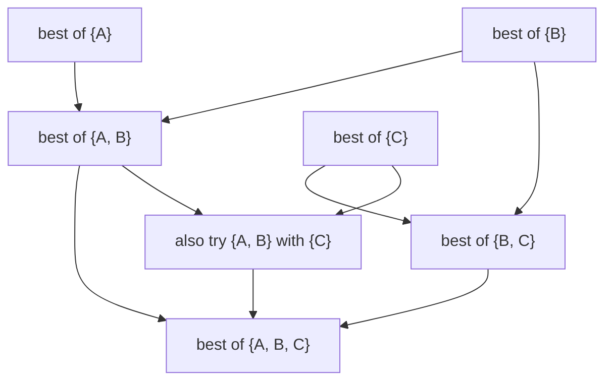
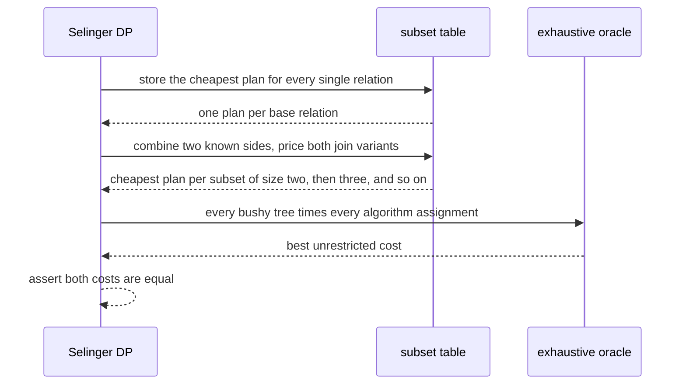
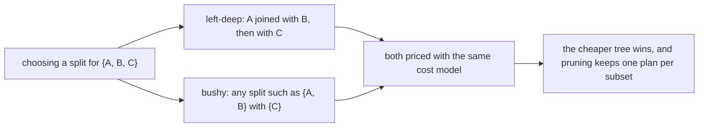

# 643 — Implement multi-way join ordering via dynamic programming (Selinger-style).

> **Tier:** Expert · **CTCI chapter:** Ch 14 — Databases
> **Task spec:** [643-implement-multi-way-join-ordering-via-dynamic-programming-seling.md](../../../tasks/expert/643-implement-multi-way-join-ordering-via-dynamic-programming-seling.md)
> **Solutions:** [Python](../../../solutions/python/expert/643-implement-multi-way-join-ordering-via-dynamic-programming-seling/solution.py) ·
> [Java](../../../solutions/java/expert/643-implement-multi-way-join-ordering-via-dynamic-programming-seling/Solution.java) ·
> [JavaScript](../../../solutions/javascript/expert/643-implement-multi-way-join-ordering-via-dynamic-programming-seling/solution.js) ·
> [C#](../../../solutions/csharp/expert/643-implement-multi-way-join-ordering-via-dynamic-programming-seling/Solution.cs)

## 1. Problem restatement

Implement **Selinger's dynamic program** over subsets of joined relations: `best[S]` is the cheapest
physical plan that joins exactly the relation set `S`, and it is built by splitting `S` into two
non-empty halves and combining their best plans.

| Element | Definition |
| --- | --- |
| relation size | an effective cardinality per relation (local selections already applied) |
| predicate selectivity | one constant per join predicate |
| cross selectivity | product of the selectivities of all predicates **crossing** the two sides of a split |
| output cardinality | `rows(left) · rows(right) · cross_selectivity` — a function of the *subset*, not of the order |
| cost (Python/JS stub) | a scan is free; `hash_join = (l + r) · C_TUPLE + out · C_TUPLE`; `nested_loop = l · r · C_TUPLE + out · C_TUPLE` |
| plan shapes | **bushy** (any split of a subset) and **left-deep** (one side is always a base relation) |

Concrete results asserted by the checks:

- **The tree counts are right:** `enumerate_trees` produces `15` unordered join trees for four tables and
  `105` for five, so the exhaustive yardstick really covers the whole bushy space.
- **The DP equals exhaustive enumeration.** For every generated query over 4 and 5 relations (eight
  random queries per shape, including one with an extra non-chain predicate) the DP's cost equals the
  best cost of an exhaustive enumeration over the **connected** plan space, to within `1e-9`; and the
  *unrestricted* exhaustive optimum is never cheaper than the DP's, so pruning cross products "never
  loses money".
- **Cardinality follows the formula.** `A: 1000`, `B: 2`, `C: 1000` with selectivities `0.1` on `A–B`
  and `B–C` estimates the whole join at `1000 · 2 · 1000 · 0.1 · 0.1 = 20000` rows.
- **Shape matters.** The two-row table must be joined first: the chosen plan is strictly cheaper than a
  hand-built "big-big first" plan (`(A ⋈ C) ⋈ B`), and the plan is verified to be connected.
- **Accounting.** The DP considers a bounded number of splits while the exhaustive enumerator
  materialises every plan: at six relations the run reports **70 splits (532 pruned) versus 30240
  enumerated plans**, and the check asserts `splits · 20 < plans`.
- **Determinism and validity.** Repeating the DP on the same input returns the identical plan, the chosen
  plan is connected whenever the query graph is connected, and the DP's plan space is never left.
- **The plan really computes the join.** Executing the DP's plan and the exhaustive planner's plan over
  small relations (key domain 2, two rows per table) reproduces the same rows as a Cartesian-product
  oracle, compared canonically.
- **Algorithm choice follows the cost model.** With `X: 1`, `Y: 2`, `Z: 100000` and selectivity `0.5`, the
  plan uses `nested_loop` (the intermediate is 1 × 2 rows, so a re-scan is cheap); with `X: 10`, `Y: 10`,
  `Z: 1000` it uses `hash_join` instead.

The Python run prints
`[643] Selinger DP == exhaustive enumeration; 70 splits (532 pruned) vs 30240 plans at 6 tables`.

## 2. Intuition

A join of `n` relations has a huge number of orderings; enumerating them all is hopeless by six tables
(`30240` candidate plans in the run above). Selinger's observation is the **principle of optimality**: if
the cheapest plan that joins a set `S` contains a sub-plan joining `A ⊂ S`, then that sub-plan must
itself be the cheapest plan for `A` — otherwise swapping in the cheaper one would produce a cheaper plan
for `S`.

That makes the search **per subset** rather than per permutation: for each subset keep one best plan, and
build larger subsets by splitting them into two halves whose best plans are already known.



Two conditions make this correct and useful, and the checks verify both:

1. **A subset's cardinality depends only on the subset.** The output rows of a split are
   `rows(L) · rows(R) · Π selectivities of predicates crossing the split`, and the predicates that cross
   are determined by the two sets — not by the order in which the relations were joined. So the cost of
   extending a subset depends on the sub-plan only through its cost, which is exactly what licenses
   keeping a single plan per subset (the C# header states the independence formula and calls it "the same
   invariant checked against a keep-every-plan variant and against exhaustive enumeration").
2. **Cross products can be pruned.** A split whose two sides share no predicate would build a Cartesian
   product; real planners avoid that, so the DP skips such splits. The checks confirm the pruned optimum
   equals the best **connected** plan and never beats the unrestricted optimum — nothing cheaper is lost.
   The Java variant goes further and keeps a `CROSS_PENALTY` multiplier so a *disconnected* query can
   still be planned when it must be.

Two search shapes appear in the solutions: the **bushy** DP, which may combine any two subsets (so
`(A ⋈ B) ⋈ (C ⋈ D)` is reachable), and the original **left-deep** shape, where one input of every join is a
base relation (as in the C# variant and in the greedy yardstick the JavaScript variant uses to show that
a heuristic loses on a hand-built trap query). Bushy trees are never worse — and for these symmetric cost
models they often agree, which is why the Java header records that comparison explicitly.

## 3. Algorithm

1. **Base cases.** `info[{name}] = (("scan", name), 0.0, rows(name))` — a scan is free in the stub cost
   model, and its cardinality is the relation's effective size.
2. **Enumerate subsets by size.** For `size = 2 … n`, for every combination of that size, consider every
   **proper subset** `left_set` of the combination as one side and `right_set = table_set - left_set` as
   the other.
3. **Prune.** Skip the split when either side has no plan (a disconnected side) or when no predicate
   crosses the split (that would be a cross product); count both as pruned.
4. **Price.** `out_rows = rows(left) · rows(right) · cross_selectivity(left, right)`; for each algorithm in
   `("hash_join", "nested_loop")` compute `left_cost + right_cost + join_variant_cost(...)` and keep the
   cheapest, remembering the winning plan tree.
5. **Store.** `info[table_set] = best`, so the subset's plan is available to every later superset.
6. **Answer.** The plan stored for the full relation set, with its cost, estimated cardinality, and the
   `splits` / `pruned` counters.
7. **Verify.** Compare against `brute_force_best` (every bushy tree × every algorithm assignment) and
   `connected_brute_force_best` (the same, restricted to connected trees), then execute the plan and
   compare with a Cartesian-product oracle.

```text
procedure selinger_dp(tables, sizes, selectivities)
    info = empty
    for name in tables do
        info[{name}] = (scan(name), 0.0, sizes[name])
    splits = 0
    pruned = 0
    for size = 2 to count(tables) do
        for table_set in combinations of tables with that size do
            best = none
            for left_set in proper subsets of table_set do
                right_set = table_set - left_set
                if info[left_set] is none or info[right_set] is none then
                    pruned = pruned + 1
                    continue
                if no predicate crosses between left_set and right_set then
                    pruned = pruned + 1                  // would be a cross product
                    continue
                splits = splits + 1
                (left_plan, left_cost, left_rows) = info[left_set]
                (right_plan, right_cost, right_rows) = info[right_set]
                out_rows = left_rows * right_rows * cross_selectivity(left_set, right_set)
                for algorithm in (hash_join, nested_loop) do
                    cost = left_cost + right_cost
                           + join_variant_cost(algorithm, left_rows, right_rows, out_rows)
                    if cost is the cheapest so far then
                        best = (join(algorithm, left_plan, right_plan), cost, out_rows)
            info[table_set] = best
    return info[all tables], splits, pruned

procedure join_variant_cost(algorithm, left_rows, right_rows, out_rows)
    if algorithm = hash_join then
        return (left_rows + right_rows) * C_TUPLE + out_rows * C_TUPLE
    return left_rows * right_rows * C_TUPLE + out_rows * C_TUPLE
```



## 4. Worked example

**(a) The asymmetric three-relation query.** `A: 1000`, `B: 2`, `C: 1000`, selectivity `0.1` on `A–B` and
`B–C`. The subset table fills bottom-up:

| Subset | Best plan | Cost basis | Rows |
| --- | --- | --- | --- |
| `{B}` | scan `B` | free | 2 |
| `{A}` / `{C}` | scan | free | 1000 each |
| `{A, B}` | join | `rows(A) · rows(B) · 0.1` | 200 |
| `{B, C}` | join | `rows(B) · rows(C) · 0.1` | 200 |
| `{A, B, C}` | `({A, B}) ⋈ {C}` or `{A} ⋈ ({B, C})` | cheapest of the two splits | `2000 · 0.1 = 20000` |

The check pins the final cardinality at `20000` — the same number whether you split as `(A ⋈ B) ⋈ C` or
`A ⋈ (B ⋈ C)`, which is the whole point of the canonical product. The chosen plan is strictly cheaper
than the hand-built "join the two 1000-row tables first" plan `(A ⋈ C) ⋈ B`, and the DP prunes the
`A ⋈ C` split because no predicate crosses it.

**(b) Splits versus plans.** The pruning counters from the run:

| Query | DP splits | DP pruned | Exhaustive plans |
| --- | --- | --- | --- |
| 3 relations (`A`, `B`, `C`) | at most the exhaustive count, and pruned > 0 | > 0 | small |
| 6 relations (seed 98765) | `70` | `532` | `30240` |

At six relations the DP evaluates `70` splits against `30240` enumerated plans — the check asserts
`splits · 20 < plans` — and still returns the exact optimum, because every candidate it *kept* was the
cheapest plan of its subset. The unordered-tree counts (15 for four relations, 105 for five) are the
yardstick that says the oracle is really exhaustive.

**(c) Execution agrees.** With four relations, key domain 2 and two rows per table, the DP's plan and the
exhaustive planner's plan both produce the same number of rows as the Cartesian-product oracle, and the
canonical comparison (payloads sorted per relation) matches row for row. So the DP is not only
cost-optimal within its model, it is a plan that computes the right relation.



**(d) The algorithm choice is not hard-coded.** The stub cost model prices a nested loop as
`left_rows · right_rows` plus output rows and a hash join as `left_rows + right_rows` plus output rows, so
the DP picks whichever is cheaper at each node:

| Query | Intermediate | Chosen method | Why |
| --- | --- | --- | --- |
| `X: 1`, `Y: 2`, `Z: 100000`, sels `0.5` | `1 × 2` | `nested_loop` on the outermost step | re-scanning a 1-row or 2-row side is cheaper than building a hash table |
| `X: 10`, `Y: 10`, `Z: 1000`, sels `0.5` | `10 × 10` | `hash_join` | the quadratic nested-loop term already costs more than building |

## 5. Complexity

With `n` relations and `2ⁿ` subsets:

| Piece | Time | Space | Why |
| --- | --- | --- | --- |
| Number of subsets | `2ⁿ − 1` states | O(2ⁿ) | every non-empty subset needs a plan (the Java check asserts exactly this count) |
| Splits evaluated | `Σ over subsets S of (2^(|S|−1) − 1)`, minus pruned splits | O(2ⁿ) | each subset is split into all of its unordered halves (the Java check asserts exactly this count) |
| Cost of one split | O(#algorithms) | O(1) | two lookups plus arithmetic; predicate products come from `cross_selectivity` |
| Total DP | O(3ⁿ) | O(2ⁿ) | the classic Selinger bound |
| Exhaustive bushy enumeration | 15 trees for `n = 4`, 105 for `n = 5`, `30240` plans at `n = 6` | O(#plans) | every unordered tree × every algorithm assignment |
| Greedy heuristic | O(n²) | O(n) | no optimality guarantee — the JavaScript variant shows it losing on a trap query |

Why the DP wins in practice: `3ⁿ` grows, but far slower than the number of *plans*, and the ratio is what
the counters measure (`70` splits against `30240` plans at six relations).

| Approach | Search space | Guarantee |
| --- | --- | --- |
| Bushy DP (this task, Python/JavaScript/Java) | one best plan per subset, any split | optimal within the model, verified against exhaustive enumeration |
| Left-deep DP (this task, C#) | one best plan per subset, base relation on one side | optimal within the smaller left-deep space |
| Exhaustive enumeration | all trees × all method assignments | optimal, unusable beyond small `n` |
| Greedy / heuristic order | one order built step by step | fast, but the JavaScript trap query shows it can be beaten |

## 6. Pitfalls and edge cases

- **The principle of optimality needs the canonical cardinality.** If a subset's row estimate depended on
  the join order, keeping one plan per subset would be an approximation; it is a pure product over the
  subset, which is what makes the equality with exhaustive enumeration hold to `1e-9`.
- **Pruning must be provably safe.** The checks assert `unrestricted_best <= DP_cost` and
  `DP_cost == connected_best`: skipping cross-product splits can only raise the cost, and the pruned
  space still contains the best connected plan.
- **Base scans are free in the stub cost model**, so the DP optimises the join tree; a real planner pays
  for scans and access paths, which is where task 641's access-path crossover comes from.
- **One plan per subset is not enough for interesting orders.** Real Selinger implementations keep
  several plans per subset when a sort order can be reused downstream; this stub documents that it does
  not.
- **Determinism.** Ties are broken by iteration order, and the check re-runs the DP to confirm the same
  plan comes out; a planner whose output flapped between equal-cost plans would be untestable.
- **Input order must not matter.** The Java variant asserts the whole DP result is invariant under a
  permutation of the relation list, and that a bad input order costs strictly more than the DP's answer —
  the planner must not simply follow the query text.
- **Disconnected queries still plan.** With no predicate crossing a split the stub cannot connect the
  graph at all; the Java variant keeps a `CROSS_PENALTY` multiplier so a cross product can be priced
  rather than silently dropped.
- **Invalid inputs are rejected.** Duplicate relations, unknown methods, empty relations and malformed
  query graphs are refused by the JavaScript variant instead of producing a plan.
- **Two-row tables dominate the choice.** The asymmetric example exists because join ordering only
  matters when cardinalities differ: joining the two large tables first is strictly more expensive.
- **Method choice is per node.** `walk_algs` inspects the plan tree, and the checks assert the outer
  step is a nested loop for the 1-row intermediate while a 10 × 10 intermediate is hashed.
- **The plan must execute to the right relation.** Cost optimality is not correctness: the checks run the
  plan against a Cartesian-product oracle and compare candidate plans canonically.

## 7. Variants and follow-ups

- **Where the cardinalities come from.** The DP consumes effective cardinalities and selectivities; the
  statistics and access-path costing side is
  [641-implement-advanced-query-planner-cost-model-stub-and-plan-enumer.md](../../../tasks/expert/641-implement-advanced-query-planner-cost-model-stub-and-plan-enumer.md).
- **The join operators being priced.** Nested loop, hash join and sort-merge with their measured counter
  behaviour — see
  [642-implement-join-algorithms-nested-loop-hash-join-sort-merge-join.md](../../../tasks/expert/642-implement-join-algorithms-nested-loop-hash-join-sort-merge-join.md).
- **Executing the chosen plan.** The operator tree the planner emits is what the execution engine
  pipelines — see
  [644-implement-query-execution-engine-operator-pipelining-simulation.md](../../../tasks/expert/644-implement-query-execution-engine-operator-pipelining-simulation.md).
- **Cutting the input to the join.** Bloom filters reduce the rows the DP's cardinalities assume
  ([649-implement-bloom-join-filter-application-and-benchmarking.md](../../../tasks/expert/649-implement-bloom-join-filter-application-and-benchmarking.md)).
- **Planning in a distributed setting.** When relations live on different machines, the DP also has to
  choose where each join runs and what is shipped
  ([657-implement-distributed-join-shuffle-simulation-in-map-reduce.md](../../../tasks/expert/657-implement-distributed-join-shuffle-simulation-in-map-reduce.md)).

## 8. Check yourself

<details><summary>Show answer 1 — What makes keeping one plan per subset correct?</summary>

The principle of optimality plus the canonical cardinality: the rows produced by a split are
`rows(L) · rows(R) · Π crossing selectivities`, a function of the two subsets only. So the cost of
extending a plan depends on the sub-plan solely through its cost, and any cheaper sub-plan would give a
cheaper superset plan. The checks confirm it by matching the DP against exhaustive enumeration to
`1e-9`.
</details>

<details><summary>Show answer 2 — Why does the DP prune cross-product splits, and is that safe?</summary>

A split with no predicate crossing it produces a Cartesian product, which real planners avoid because the
intermediate explodes. Skipping it can only remove *candidates with products in them*, so it can never
make the answer cheaper than the true optimum — asserted as
`unrestricted_best <= DP_cost` together with `DP_cost == connected_best`.
</details>

<details><summary>Show answer 3 — Why is joining the two big tables first a bad plan in the example?</summary>

Because the intermediate cardinality is what the cost model charges for: `A ⋈ C` on 1000-row relations
(when no predicate connects them, or a weak one does) produces a huge intermediate that every later step
must process. Joining `B` (2 rows) first keeps every intermediate small — the check asserts the chosen
plan is strictly cheaper than `(A ⋈ C) ⋈ B`.
</details>

<details><summary>Show answer 4 — How much work does the DP save, and how is that measured?</summary>

The DP evaluates `70` splits for the six-relation query while exhaustive enumeration materialises `30240`
candidate plans — the check asserts `splits · 20 < plans` — and both return the same optimal cost. The
counters (`splits`, `pruned`) are produced by the DP itself, and the tree counts (15 for four relations,
105 for five) confirm the oracle really walks the whole bushy space.
</details>
