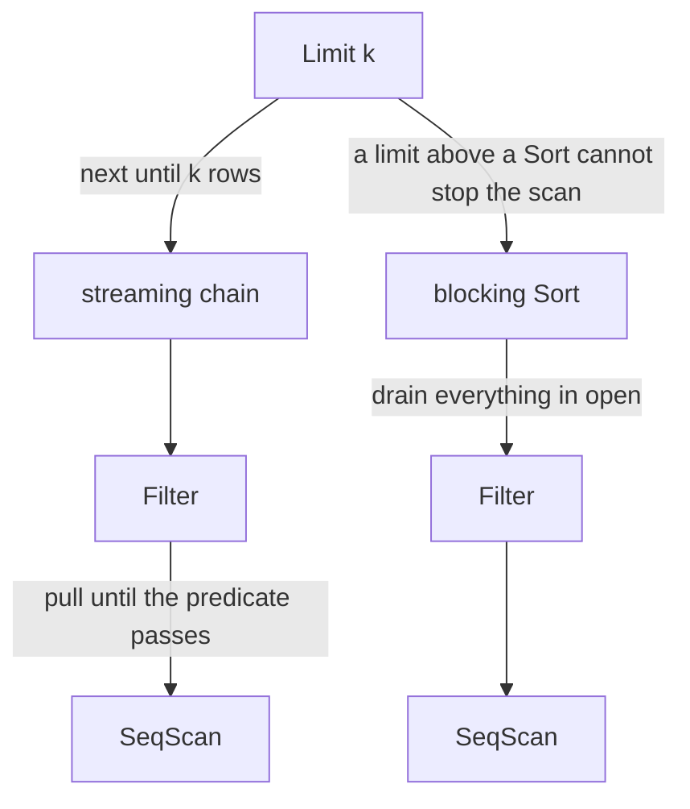
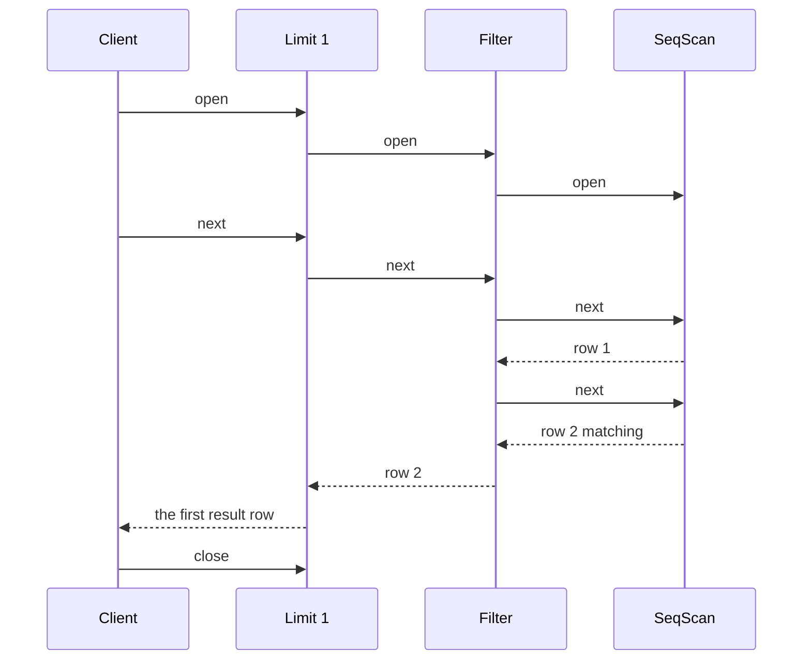
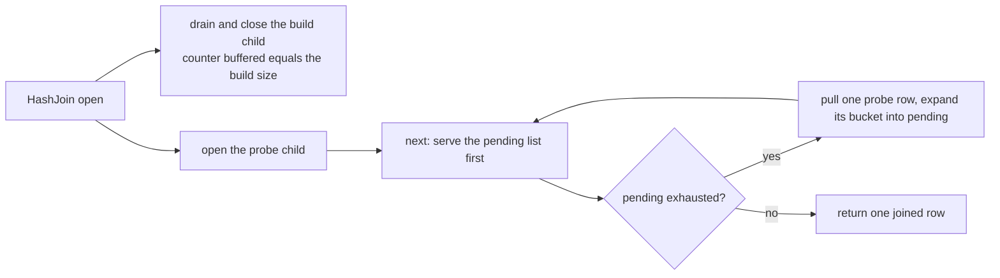

# 644 — Implement query execution engine operator pipelining simulation.

> **Tier:** Expert · **CTCI chapter:** Ch 14 — Databases
> **Task spec:** [644-implement-query-execution-engine-operator-pipelining-simulation.md](../../../tasks/expert/644-implement-query-execution-engine-operator-pipelining-simulation.md)
> **Solutions:** [Python](../../../solutions/python/expert/644-implement-query-execution-engine-operator-pipelining-simulation/solution.py) ·
> [Java](../../../solutions/java/expert/644-implement-query-execution-engine-operator-pipelining-simulation/Solution.java) ·
> [JavaScript](../../../solutions/javascript/expert/644-implement-query-execution-engine-operator-pipelining-simulation/solution.js) ·
> [C#](../../../solutions/csharp/expert/644-implement-query-execution-engine-operator-pipelining-simulation/Solution.cs)

## 1. Problem restatement

Build a **Volcano/iterator-model** execution engine: every operator implements `open()` / `next()` /
`close()`, a parent **pulls** one tuple at a time from its children, and every operator counts its work so
that "this plan pipelines" becomes a measurable statement rather than a gesture.

| Operator | Behaviour | Classification |
| --- | --- | --- |
| `SeqScan` | streams a stored table, one tuple per `next()`; `open()` resets the position, so it can be re-opened | streaming |
| `Filter` | pulls child tuples until the predicate passes, so one `next()` may consume several input tuples | streaming |
| `Project` | transforms the tuple, one input per output | streaming |
| `Limit` | stops after `k` tuples and never pulls again; an exhausted limit returns `None` without touching its child | streaming |
| `Sort` | drains the whole child **in `open()`**, sorts, and only then emits | **blocking** |
| `HashJoin` | drains (and closes) the build child in `open()`, then probes the other child lazily from a pending list | hybrid |
| `NestedLoopJoin` (Java/C#/JS) | re-opens the inner child once per outer tuple | streaming, with re-scans |

Counters: `next_calls`, `rows_out`, `buffered` (the peak tuples an operator holds), and for a scan
`rows_read`.

Concrete results asserted by the checks:

- **Early termination works.** `Limit(Filter(SeqScan(200 rows), even), 1)` returns the first even row
  after reading **2** of the 200 source rows (`scan.rows_read == 2`, `next_calls == 2`), and the filter
  forwarded exactly one row with two calls. With a 10 000-row table the same query returns the same first
  row after reading the **same 2 rows** — time-to-first-row is independent of the input size.
- **`Limit 0` never touches the scan** (`rows_read == 0`), and a limit larger than the input returns
  exactly the naive filter's rows while the scan reads all 200 rows and satisfies the volcano invariant
  `next_calls == rows_out + 1` for a drained scan.
- **Sort really blocks.** `Limit(Sort(Filter(SeqScan(200 rows), even), key), 3)` returns the three
  smallest rows in key order, but the scan read **all 200** rows first, the sort buffered all 100 matching
  rows, and the sort itself was pulled exactly 3 times.
- **The hash join is a hybrid.** After `open()` the build side has read all 60 of its rows and the probe
  side has read **0**; after one `next()` the probe side has read exactly **2** rows (the rows needed for
  the first surviving match), and the join's output equals the nested-loop oracle row for row. A `Limit`
  above the join stops the probe scan early.
- **Streaming versus materialising is visible in memory.** The peak `buffered` value is `0` for
  `Limit(Project(Filter(Scan)))` and equals the whole intermediate (100 matching rows) for the same query
  with a `Sort` in the middle.
- **Empty input, projection and determinism.** An empty scan yields no rows and exactly one
  end-of-stream call; projection passes pipelined rows through unchanged; re-running the same plan
  returns the same rows with the same counters.

The Python run prints
`[644] pipelining: LIMIT 1 pulled 2 of 200 rows; Sort drained 200 rows before emitting`.

## 2. Intuition

A **materialised** engine computes each intermediate result completely and hands the next operator a
list. A **pipelined** engine hands one tuple up at a time: the parent says "give me a row", the child
computes exactly as much as it needs, and intermediate results are never stored. The difference is not an
implementation detail — it decides whether `SELECT … LIMIT 1` reads two rows or a million.

The mechanics are a single rule: `next()` returns one tuple or `None` at end of stream, and every
operator implements it by pulling from its children. `Limit` shows the payoff, because it can simply stop
asking; `Filter` shows the subtlety, because it may pull many input tuples to produce one output tuple;
and `Sort` shows the price, because sorting cannot emit anything before it has seen everything.



That split — streaming versus blocking — is what the counters measure. A blocking operator's `open()`
consumes its entire child before the first output row, so a `Limit` above it cannot save anything; the
`buffered` counter makes the difference a number (0 versus the full intermediate). A hash join is the
interesting middle case: the **build** side is blocking (it must be drained to build the table, and it
really is read to completion during `open()`), while the **probe** side streams, so the first joined row
appears after only a handful of probes.

Two more guarantees come out of the iterator protocol itself. Re-opening is what makes the nested-loop
join possible — its inner side is re-opened once per outer tuple, and a `Limit` above the join cuts both
the re-scans and the pulls. And correctness is *protocol* correctness: `next()` before `open()`, a double
`open()`, a double `close()` or a `next()` after `close()` are errors, and `close()` must reach every
child exactly once — the JavaScript variant asserts all of that, and every solution closes each opened
operator.

## 3. Algorithm

1. **`open()`** — a leaf (scan) resets its cursor; a parent opens its children (or, for `Sort`/`HashJoin`,
   drains the blocking child right here); `Limit` resets its emitted counter.
2. **`next()`** — the operator pulls from its child until it can produce one tuple: `Filter` loops,
   `Project` maps one row, `Limit` returns `None` once it has emitted `k` rows *without* pulling again,
   `Sort` reads from its materialised buffer, `HashJoin` first serves its `pending` list and only then
   pulls the next probe row.
3. **`close()`** — propagate to children; a blocking operator has already closed its child.
4. **Counters** — incremented in `next()`/`open()` so the checks can assert work, not just results.
5. **Drain helper** — `drain(plan)` opens, pulls until `None`, closes, and returns the rows, which is how
   the checks compare a pipelined plan with a naive evaluator.
6. **Verify** — a pipelined plan's rows must equal a naive materialised evaluation, and the counters must
   show the pipelining claims: early termination at the `Limit`, full drain under a `Sort`, lazy probes
   in the join, peak buffering 0 for streaming plans.

```text
procedure limit_next(operator)
    if operator.emitted >= operator.count then
        return none                       // the exhausted limit never touches its child
    operator.next_calls = operator.next_calls + 1
    row = operator.child.next()
    if row is none then
        return none
    operator.emitted = operator.emitted + 1
    operator.rows_out = operator.rows_out + 1
    return row

procedure sort_open(operator)
    operator.child.open()
    operator.materialized = empty
    while true do
        row = operator.child.next()
        if row is none then break
        operator.materialized.append(row)
    operator.buffered = length(operator.materialized)   // the blocking cost, recorded
    operator.child.close()
    sort operator.materialized by the key column
    operator.position = 0

procedure hash_join_open(operator)
    operator.build_child.open()
    while true do
        row = operator.build_child.next()
        if row is none then break
        operator.buckets[row[operator.build_key]].append(row)   // the build side is blocking
    operator.buffered = the number of build rows
    operator.build_child.close()
    operator.probe_child.open()                          // the probe side streams
    operator.pending = empty
    operator.pending_index = 0
```



## 4. Worked example

**(a) `LIMIT 1` over a streaming pipeline.** Table of 200 rows, predicate "third column is even", the
first matching row is row 2:

| Call | Effect | `scan.rows_read` | Filter calls | Sort-equivalent state |
| --- | --- | --- | --- | --- |
| `open()` | cursors reset | 0 | 0 | — |
| first `next()` | scan row 1 (odd, filtered out), scan row 2 (even, emitted) | 2 | 2 | no buffering |
| second `next()` | the limit is exhausted → `None`, no child call | 2 | 2 | — |

The same query on a **10 000-row** table reads the same 2 rows, and `Limit(…, 0)` reads none at all. Over
a fully drained scan the volcano invariant holds: `next_calls == rows_out + 1`, the extra call being the
end-of-stream probe.

**(b) The same query under a blocking `Sort`.** `Limit(Sort(Filter(Scan(200), even), col2), 3)`:

| Measure | Value | Meaning |
| --- | --- | --- |
| `scan.rows_read` | `200` | the sort drained the entire input before emitting anything |
| `sort.buffered` | `100` | the whole matching intermediate is materialised |
| `sort.next_calls` | `3` | the limit only pulled what it needed *after* the blocking step |
| rows returned | the 3 smallest by the sort key | correct, but at the price of a full scan |

Peak buffering then separates the two plans cleanly: a streaming plan's maximum `buffered` is `0`, the
sorting plan's is the whole intermediate (100).

**(c) A hash join: eager build, lazy probe.** Build side 60 rows, probe side 150 rows (filtered to the
even ones), join key column 1:

| Moment | Build `rows_read` | Probe `rows_read` | Observation |
| --- | --- | --- | --- |
| after `open()` | `60` | `0` | the build side is fully consumed, the probe side untouched |
| after the first `next()` | `60` | `2` | only the probes needed for the first surviving match |
| after a `Limit 2` over the join | `60` | `< 150` | the probe scan stops early, the build side cannot |

The join's output equals the nested-loop oracle (probe-major, build-minor order), and the build side's
eager drain is asserted separately from the probe side's laziness — a hash join is a hybrid, and treating
it as fully streaming would misreport the cost.



**(d) Protocol and lifecycle checks across the solutions.** The JavaScript variant throws on `next()`
before `open()`, a double `open()`, a double `close()` and a `next()` after `close()`, and verifies that
`close()` reaches every child exactly once; its stats track `opens`, `closes`, `nextCalls`, `rowsOut`,
`rowsPulled` and `maxBuffered`. The C# variant asserts the row-conservation invariant across the tree and
that a `Limit` above the nested-loop join cuts both the inner re-scans and the left-side pulls. The Java
variant drives five query trees and checks that a `Limit` above a streaming plan stops the scan after
5 of 1000 rows, the identical query over a `Sort` drains all 1000, and re-running reproduces the counters
exactly.

## 5. Complexity

With `n` source rows, `k` the limit, and `r` the inner re-scans of a nested-loop join:

| Plan | Time | Peak buffering | Why |
| --- | --- | --- | --- |
| `Limit(Scan, k)` | O(k) | O(1) | the limit stops pulling; 2 rows read for the first match here |
| `Filter(Scan)` | O(n) | O(1) | one pass, tuples forwarded as they pass the predicate |
| `Limit(Filter(Scan, p), k)` | O(rows until the k-th match) | O(1) | the value of pipelining: time-to-first-row independent of `n` |
| `Limit(Sort(Filter(Scan, p)), k)` | O(n log n) | O(matching rows) | the sort is blocking: full input drain, then a sort, then `k` pulls |
| `HashJoin` | O(build + probed probe rows) | O(build rows) | build drained in `open()`, probe pulled lazily |
| `NestedLoopJoin` | O(outer rows · inner cost) | O(1) | the inner child is re-opened once per outer tuple |

| Aspect | Pipelined (streaming) | Materialised (blocking) |
| --- | --- | --- |
| Time to first row | independent of input size | after the whole child is consumed |
| Peak memory | O(1) per operator | O(intermediate size) |
| Early exit (`LIMIT`) | stops the whole subtree | cannot stop the blocking child |
| Sorting, grouping, hash build | — | required |
| Measured here by | `buffered == 0`, small `rows_read` | `buffered == intermediate`, `rows_read == n` |

The JavaScript and C# variants add blocking **hash group-by aggregation** to the same protocol, which is
where the same reasoning applies: `GROUP BY` must see every row before it can emit a group, and the
checks compare the operator's groups with a map-based oracle.

## 6. Pitfalls and edge cases

- **`Limit` must not pull after it is exhausted.** `next()` returns `None` before calling the child, which
  is exactly what makes `Limit(…, 0)` read nothing; the check asserts `rows_read == 0`.
- **A blocking operator cannot be made streaming by wanting it more.** A `LIMIT` above a `Sort` still pays
  a full scan (200 of 200 rows) because `open()` drains the child; that asymmetry is the point of the
  `buffered` counter.
- **A hash join is only half lazy.** The build side is drained and closed in `open()` (60 rows read, probe
  0), the probe side is pulled only as needed (2 rows for the first result).
- **`Filter` breaks the one-in-one-out assumption.** It loops, so one `next()` may consume many input
  tuples; counting `next_calls` at the scan is what reveals it.
- **Re-openability matters.** `SeqScan.open()` resets its cursor so a nested-loop join can re-scan the
  inner side once per outer tuple; a scan that kept its position would silently drop matches.
- **Protocol violations must be errors.** `next()` before `open()`, double `open()`, double `close()` and
  `next()` after `close()` all throw in the JavaScript variant, and `close()` must reach every child
  exactly once — otherwise a plan leaks resources that the demo merely "trusts" it released.
- **Empty input is a real case.** An empty scan produces no rows and exactly one end-of-stream call, and
  no operator may divide by a row count or index into an empty buffer.
- **The volcano invariant gives a cheap sanity check.** For a fully drained scan, `next_calls ==
  rows_out + 1`; a mismatch means someone forgot the end-of-stream probe or double-counted.
- **Determinism.** Re-running a plan reproduces both rows and counters, which is what makes the counter
  assertions stable across runs.
- **Emission order is part of the contract.** The hash join's oracle is probe-major/build-minor, matching
  a nested loop's order, so comparisons are `==` rather than multiset equality.
- **No buffer pool, no spilling, no parallelism.** Rows are plain tuples and everything lives in memory;
  a real engine also has page-level iterators and would have to spill a large sort.
- **Vectorisation is a different axis.** This engine pulls one tuple at a time; batch-at-a-time execution
  keeps the same operator interface but moves tuples in blocks.
- **Counters are call counts, not costs.** The stub documents that no per-tuple cost accounting happens
  here, so the numbers are about pipelining behaviour, never about timing.

## 7. Variants and follow-ups

- **Plans to execute.** The operator trees this engine runs are produced by the planner — see
  [641-implement-advanced-query-planner-cost-model-stub-and-plan-enumer.md](../../../tasks/expert/641-implement-advanced-query-planner-cost-model-stub-and-plan-enumer.md)
  and
  [643-implement-multi-way-join-ordering-via-dynamic-programming-seling.md](../../../tasks/expert/643-implement-multi-way-join-ordering-via-dynamic-programming-seling.md).
- **The join operators inside the pipeline.** How nested loop, hash join and sort-merge behave when their
  inputs stream — see
  [642-implement-join-algorithms-nested-loop-hash-join-sort-merge-join.md](../../../tasks/expert/642-implement-join-algorithms-nested-loop-hash-join-sort-merge-join.md).
- **Batch-at-a-time instead of tuple-at-a-time.** Vectorised execution keeps this protocol but processes
  batches — see
  [648-implement-vectorized-execution-for-simple-sql-operators.md](../../../tasks/expert/648-implement-vectorized-execution-for-simple-sql-operators.md).
- **Approximate answers while the pipeline runs.** A progressive aggregator emits estimates before the
  scan finishes
  ([650-implement-online-aggregation-progressive-estimator.md](../../../tasks/expert/650-implement-online-aggregation-progressive-estimator.md)).
- **Sampling under a pipeline.** Reservoir sampling rides on exactly this pull discipline
  ([646-implement-approximate-query-processing-via-sampling-reservoir.md](../../../tasks/expert/646-implement-approximate-query-processing-via-sampling-reservoir.md)).

## 8. Check yourself

<details><summary>Show answer 1 — Why does <code>LIMIT 1</code> read only two rows of two hundred?</summary>

Because the parent pulls one tuple at a time: the filter keeps asking the scan for rows until its
predicate passes, and as soon as the limit has its first output it stops calling `next()` altogether — it
returns `None` without touching the child. Hence two `next()` calls on the scan (one odd row filtered, one
even row emitted) and no more.
</details>

<details><summary>Show answer 2 — Why can a <code>LIMIT</code> above a <code>Sort</code> not save the scan?</summary>

Sorting is inherently blocking: no output row can be produced before all input rows are known, so
`Sort.open()` drains the child completely before the first `next()`. The limit then only avoids work
*after* the sort — the check shows the scan still read all 200 rows and the sort buffered all 100 matching
rows.
</details>

<details><summary>Show answer 3 — In what sense is a hash join "half" streaming?</summary>

Its build side is blocking — the hash table cannot be probed before every build row has arrived, so
`open()` consumes and closes it (the check reads 60 of 60 build rows and 0 probe rows right after
`open()`). Its probe side streams: the first joined row appears after pulling a couple of probe rows, and
a `Limit` above the join stops the probe scan early.
</details>

<details><summary>Show answer 4 — What does the <code>buffered</code> counter prove that the row counts do not?</summary>

It separates *correctness* from *memory behaviour*: two plans can return identical rows while one holds
nothing between calls (streaming: peak `buffered == 0`) and the other materialises the whole intermediate
(sorting: `buffered` equals the whole intermediate). That is the measurement behind "this plan pipelines".
</details>
