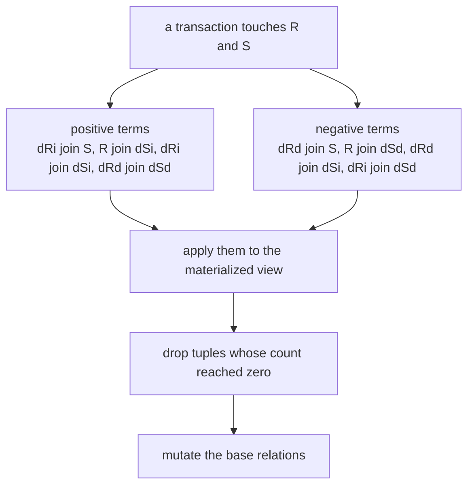
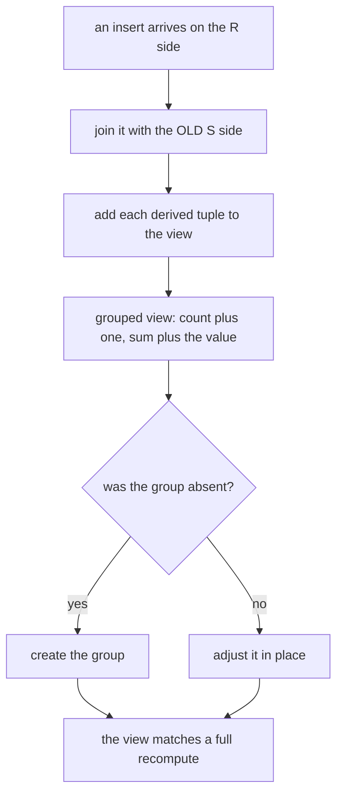
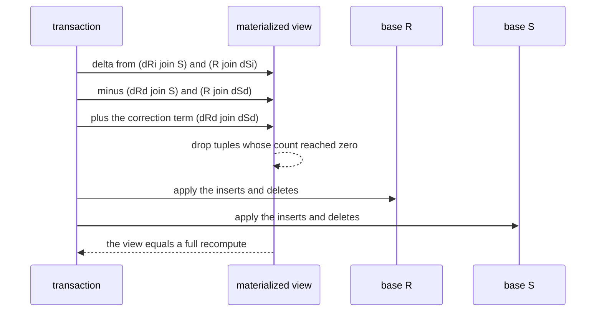

# 645 — Implement materialized view maintenance incremental algorithm.

> **Tier:** Expert · **CTCI chapter:** Ch 14 — Databases
> **Task spec:** [645-implement-materialized-view-maintenance-incremental-algorithm.md](../../../tasks/expert/645-implement-materialized-view-maintenance-incremental-algorithm.md)
> **Solutions:** [Python](../../../solutions/python/expert/645-implement-materialized-view-maintenance-incremental-algorithm/solution.py) ·
> [Java](../../../solutions/java/expert/645-implement-materialized-view-maintenance-incremental-algorithm/Solution.java) ·
> [JavaScript](../../../solutions/javascript/expert/645-implement-materialized-view-maintenance-incremental-algorithm/solution.js) ·
> [C#](../../../solutions/csharp/expert/645-implement-materialized-view-maintenance-incremental-algorithm/Solution.cs)

## 1. Problem restatement

Maintain a materialised **join view** — and an aggregate view derived from it — **incrementally**: given
the delta of a transaction on the base relations, compute the view's delta and apply it, instead of
rebuilding the view. The base tables are **multisets** (bag semantics), so multiplicities multiply
through the join.

For `V = R(a, b) ⋈ S(b, c)` with inserts `dRi`, `dSi` and deletes `dRd`, `dSd`, the view delta is

```text
dV = (dRi ⋈ S) + (R ⋈ dSi) + (dRi ⋈ dSi) + (dRd ⋈ dSd)
   − (dRd ⋈ S) − (R ⋈ dSd) − (dRd ⋈ dSi) − (dRi ⋈ dSd)
```

with all eight terms evaluated against the **old** `R` and `S` (before the bases are mutated).

Concrete results asserted by the checks:

- **Bag semantics multiply.** `R = {(1, 10): 2}` joined with `S = {(10, 100): 3}` gives the view
  `{(1, 100): 6}` and the aggregate view `{1: 6}`.
- **The correction term is load bearing.** With `R = {(1, 10), (2, 10)}` and `S = {(10, 100), (10, 200)}`
  the view holds four tuples; a transaction deleting `(1, 10)` and `(10, 100)` produces the delta
  `{(1, 100): −1, (1, 200): −1, (2, 100): −1}` — the tuple supported by *both* deleted rows goes to `−1`,
  not `−2`, because of the `+(dRd ⋈ dSd)` term — and the view ends as `{(2, 200): 1}`.
- **Multiplicities are exact.** Deleting two of the three copies of `(1, 10)` from a view holding `6`
  derived tuples leaves `{(1, 100): 2}`, exactly what the full recompute produces.
- **Bad deltas are refused.** `subtract` raises when asked to remove more copies of a tuple than exist,
  so a maintenance bug surfaces as an exception instead of a wrong answer.
- **The long run.** Starting from two 5 × 5 base relations and applying 60 randomly generated
  transactions (insert-only, delete-only or mixed), after **every** step: the maintained view equals the
  full recompute, the maintained delta equals the signed multiset difference of the view before and after,
  the incrementally maintained aggregate view matches the aggregate of the recomputed view, and no view
  tuple has a non-positive count. Totals from the run: **60 transactions, 932 delta tuples, 804 join
  pairs incrementally versus 3372 for recomputation**, and `incremental · 4 < recompute`.
- **An empty transaction changes nothing** — the bases are byte-identical afterwards.

The Python run prints
`[645] view maintenance: 60 transactions, 932 delta tuples, 804/3372 join pairs`.

## 2. Intuition

Rebuilding a view means re-joining the whole base tables for every transaction; incremental maintenance
means computing only the part of the view that changed. The derivation is a single algebraic identity:
substituting `R_new = R − dRd + dRi` and `S_new = S − dSd + dSi` into the join and expanding gives four
positive and four negative terms.



Three details separate a correct implementation from a plausible-looking one, and each is checked:

1. **The correction term `+(dRd ⋈ dSd)`.** Without it, a transaction that deletes a row from `R` and a
   matching row from `S` subtracts *two* contributions for one view tuple, and the view goes negative.
   The check builds exactly that case and asserts the delta is `−1` for the shared tuple.
2. **Evaluate against the old bases.** All eight terms are computed before `R` and `S` are mutated; the
   mixed terms (`dRd ⋈ dSi`, `dRi ⋈ dSd`) exist so the algorithm never has to assume that the inserted and
   deleted halves of a transaction are disjoint — a transaction may insert and delete the same key in
   different copies (the Java variant models an update as delete + insert).
3. **Groups and tuples disappear when their last support goes.** A grouped view whose last contributing
   row is removed must **delete the group**, not leave a row with `count = 0`. The Java solution keeps
   that as an explicit negative control: its naive variant "only adjusts the SUM" and is shown to leave a
   phantom group that the recompute does not have.

The aggregate variants illustrate the limits of incremental maintenance. `COUNT`, `SUM` and even
`AVG` (from `count` and `sum`) can be adjusted by a delta, but `MIN`/`MAX` cannot: when the extremum
leaves, a summary does not know what the next extremum is, so the JavaScript variant recomputes the
affected group from the base tables and *counts* those recomputes in `work.groupRecomputes` instead of
pretending the adjustment worked.

## 3. Algorithm

1. `join_view(r_side, s_side, work)` — index the S-side by its join key, then for every R-side tuple emit
   `(a, c)` with multiplicity `r_count · s_count`; count each emitted pair into a shared `work` counter so
   incremental and full work can be compared.
2. `full_recompute(R, S, work)` — the same function, used both for the initial view and as the oracle
   after every delta.
3. `apply_transaction(R, S, view, (dRi, dRd, dSi, dSd), work)` — accumulate the four positive terms, add
   the negatives, `view.update(delta)`, delete every tuple whose count is `≤ 0`, then mutate the bases
   (`subtract`, `add`).
4. `subtract(base, delta)` — verify first (raise if any tuple would go negative), then apply. This makes
   an incorrect delta loud.
5. `aggregate_view(view)` — derive the ungrouped aggregate by summing the multiplicities per first
   column, and maintain a second copy incrementally (the same `delta` applied to the aggregate), then
   compare both with the recompute.
6. `multiset_difference(after, before)` — the signed difference, used to assert
   `delta == recompute(V_new) − recompute(V_old)`.

```text
procedure apply_transaction(R, S, view, transaction, work)
    dRi, dRd, dSi, dSd = transaction
    delta = empty multiset
    for (r_part, s_part) in ((dRi, S), (R, dSi), (dRi, dSi), (dRd, dSd)) do
        if r_part is not empty and s_part is not empty then
            add join_view(r_part, s_part, work) to delta
    for (r_part, s_part) in ((dRd, S), (R, dSd), (dRd, dSi), (dRi, dSd)) do
        if r_part is not empty and s_part is not empty then
            subtract join_view(r_part, s_part, work) from delta
    for key, count in delta do
        view[key] = view[key] + count
    for key in keys of view do
        if view[key] <= 0 then
            delete view[key]                     // the last supporting row is gone
    subtract(R, dRd)
    add(R, dRi)
    subtract(S, dSd)
    add(S, dSi)
    return delta
```



## 4. Worked example

**(a) The correction term, step by step.** `R = {(1, 10): 1, (2, 10): 1}`,
`S = {(10, 100): 1, (10, 200): 1}`, so the view holds four tuples. The transaction deletes `(1, 10)` from
`R` and `(10, 100)` from `S`:

| Term | Multiplicity contribution |
| --- | --- |
| `−(dRd ⋈ S)` | `−{(1, 100): 1, (1, 200): 1}` |
| `−(R ⋈ dSd)` | `−{(1, 100): 1, (2, 100): 1}` |
| `+(dRd ⋈ dSd)` | `+{(1, 100): 1}` |
| **resulting delta** | `{(1, 100): −1, (1, 200): −1, (2, 100): −1}` |
| view afterwards | `{(2, 200): 1}` |

Without the correction term the shared tuple would be subtracted twice, giving `−2` for a tuple that only
existed once — the check asserts the `−1` explicitly.

**(b) Multiplicity arithmetic.** `R = {(1, 10): 3}`, `S = {(10, 100): 2}`:

| State | View | Note |
| --- | --- | --- |
| initial | `{(1, 100): 6}` | `3 · 2`, bag semantics |
| after deleting two of the three R copies (`dRd = {(1, 10): 2}`) | `{(1, 100): 2}` | one R copy times two S copies remains |
| check | equals the full recompute | the incremental result is the recomputed one |

**(c) The 60-transaction run.** Bases: `R` and `S` each 5 × 5 with multiplicity 1; the generator picks
insert-only, delete-only or mixed transactions, deletes only tuples that exist, and never inserts and
deletes the same tuple in one transaction.

| Check, after every step | Result |
| --- | --- |
| maintained view vs full recompute | equal |
| maintained delta vs signed view difference | equal |
| incremental aggregate view vs aggregate of the recompute | equal |
| any non-positive view count | none |
| transactions applied | 60 |
| delta tuples touched | 932 |
| join pairs (incremental / recompute) | 804 / 3372 |

The last row is the payoff: the same final view, computed with roughly a quarter of the join work
(`incremental · 4 < recompute` is asserted), because each delta only joins the touched rows instead of the
whole relations.



**(d) Views over one table only, and the drift trap.** The Java variant maintains a grouped view
(`dept, COUNT(*), SUM(salary)` over active employees) and a join view, and checks both against a full
recompute after every delta, including updates modelled as delete + insert and 400 generated random
deltas. Its documented failure mode is the reason the group deletion rule exists: a maintenance routine
that only adjusts the `SUM` leaves a group with `COUNT = 0` behind, and the check runs that naive variant
to show it disagreeing with the recompute while the real one matches. The C# variant adds the same
reasoning for a `cust_totals` grouped view and refuses any delta that would drive a multiset count
negative, so a maintenance bug raises instead of corrupting the view.

## 5. Complexity

With `|R|`, `|S|` base rows, `v` view tuples, `dR`/`dS` the delta sizes and `m` the number of join
matches per touched key:

| Operation | Time | Space | Why |
| --- | --- | --- | --- |
| `join_view` | O(\|r_side\| + \|s_side\| + matches) | O(\|s_side\|) for the index | one index build plus one pass over the other side |
| full recompute | O(\|R\| + \|S\| + \|V\|) | O(\|V\|) | the baseline this task improves on |
| `apply_transaction` | O(Σ over the eight terms of their own join cost) | O(\|delta\|) | each term joins only the delta side against the other side |
| Aggregate update | O(\|delta\|) | O(#groups) | adjust each touched group's counters |
| `MIN`/`MAX` view | up to a group recompute | O(group) | a departing extremum cannot be derived from a summary (JavaScript `work.groupRecomputes`) |
| Grouped view, group deleted | O(1) amortised | — | remove the group when its count reaches zero |

Measured on the run: `804` incremental join pairs against `3372` for the recompute over 60 transactions
with `932` delta tuples.

| Approach | Cost per transaction | Correctness burden |
| --- | --- | --- |
| Full recompute | O(\|R\| + \|S\| + \|V\|) | trivial to get right |
| Incremental delta rules (this task) | proportional to the delta and its matches | every formula must include its correction term; multiplicities must be tracked |
| Deferred / lazy maintenance | amortised, batched | staleness has to be bounded and visible |
| Recomputed groups for MIN/MAX | delta plus one group scan | honest about what a summary cannot know |

## 6. Pitfalls and edge cases

- **The correction term is not optional.** Deleting a matching pair from both sides would subtract twice
  for one view tuple; the check pins the delta at `−1` for the shared tuple.
- **All eight terms must be evaluated against the old bases.** Mutating `R` or `S` first would corrupt the
  mixed terms, so the algorithm computes the whole delta and only then applies the base changes.
- **Bag semantics, not sets.** Multiplicities multiply (`3 × 2 = 6`) and a delete removes exactly as many
  contributions as there are matching rows on the other side.
- **Empty groups must vanish.** Leaving a `count = 0` row behind is the classic drift bug; the Java
  variant demonstrates the failure with a deliberately naive maintainer, and the C# variant's multiset
  subtract refuses to go negative so the same mistake raises.
- **A delete of a tuple that is not there must be refused.** `subtract` verifies before mutating, and the
  check asserts the exception.
- **An empty transaction is still a transaction.** It must produce an empty delta and leave the bases
  untouched — asserted directly.
- **Updates are delete + insert.** The mixed terms (`dRd ⋈ dSi`, `dRi ⋈ dSd`) exist so a transaction that
  deletes one copy and inserts another does not need the two halves to be disjoint.
- **Aggregate drift.** `COUNT`/`SUM`/`AVG` are delta-adjustable, `MIN`/`MAX` are not; the JavaScript
  variant recomputes the affected group and counts it rather than pretending.
- **The view must also be self-consistent.** No tuple may survive with a non-positive count; the run
  asserts `count > 0` after every step.
- **Duplicate base rows are normal.** They are modelled as multiplicities in the base tables themselves,
  so the delta arithmetic has to handle counts greater than one on both sides.
- **The incremental path is validated, not assumed.** Comparing against a full recompute after every
  delta (and against the signed multiset difference) is what makes a subtle formula error visible
  immediately instead of after ten thousand transactions.
- **No transaction log, no undo, no nested views.** The demos are single-process and document that a real
  engine also needs compensation on rollback and recursive maintenance for views defined over views.

## 7. Variants and follow-ups

- **Choosing which views to keep.** Maintenance cost is one half of the view-selection trade-off — see
  [656-implement-cost-based-materialized-view-selection-sketch.md](../../../tasks/expert/656-implement-cost-based-materialized-view-selection-sketch.md).
- **Rewriting the query onto a view.** Once a view exists, unfolding it back into the query is the
  planner's job — see
  [655-implement-query-rewriter-for-simple-view-unfolding.md](../../../tasks/expert/655-implement-query-rewriter-for-simple-view-unfolding.md).
- **Where the deltas come from.** The operator pipeline that produces changed rows is the execution engine
  of
  [644-implement-query-execution-engine-operator-pipelining-simulation.md](../../../tasks/expert/644-implement-query-execution-engine-operator-pipelining-simulation.md).
- **Joins the delta rules rely on.** The join cost and duplicate handling used by every term is
  [642-implement-join-algorithms-nested-loop-hash-join-sort-merge-join.md](../../../tasks/expert/642-implement-join-algorithms-nested-loop-hash-join-sort-merge-join.md).
- **Aggregates that cannot be adjusted exactly.** Approximate answers with a bounded error are the
  alternative when a summary is not enough
  ([646-implement-approximate-query-processing-via-sampling-reservoir.md](../../../tasks/expert/646-implement-approximate-query-processing-via-sampling-reservoir.md)).

## 8. Check yourself

<details><summary>Show answer 1 — Why does the delta rule need the <code>+(dRd ⋈ dSd)</code> term?</summary>

Because expanding `(R − dRd + dRi) ⋈ (S − dSd + dSi)` against the old bases subtracts `dRd ⋈ S` and
`R ⋈ dSd`, and a view tuple supported by a row deleted on *both* sides would be subtracted twice although
it contributed once. The correction term adds exactly one copy back — the check asserts `−1`, not `−2`,
for the shared tuple.
</details>

<details><summary>Show answer 2 — Why must the delta be computed before the bases are mutated?</summary>

The terms mix delta sides with *old* relation sides (`dRi ⋈ S`, `R ⋈ dSd`, …). If `R` or `S` changed
first, those terms would join against the new state and the delta would double-count or miss matches.
</details>

<details><summary>Show answer 3 — What is the classic drift bug, and how is it caught here?</summary>

A grouped view whose last supporting row is deleted must delete the group; a maintainer that only adjusts
the sum leaves a phantom group with `count = 0`, so the view no longer matches the recompute. The Java
variant runs that naive maintainer deliberately and shows the disagreement, while the multiset subtracts
in the Python and C# engines refuse any change that would make a count negative.
</details>

<details><summary>Show answer 4 — What does the work comparison measure, and what does it not?</summary>

It measures **join pairs** (or touched tuples) performed per path: `804` incrementally against `3372` for
full recomputation over the same 60 transactions, i.e. the delta only joins the touched rows rather than
the whole relations. It is not a wall-clock measurement, and it does not include the recomputes that a
`MIN`/`MAX` group needs — those are counted separately.
</details>
