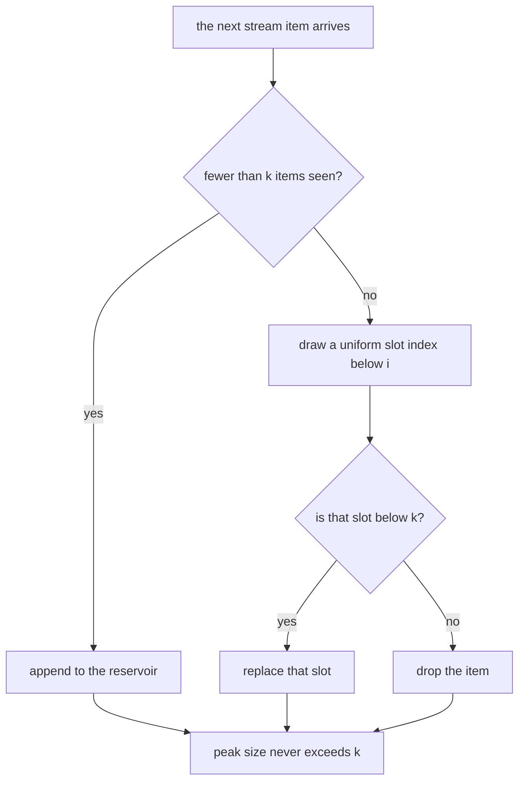
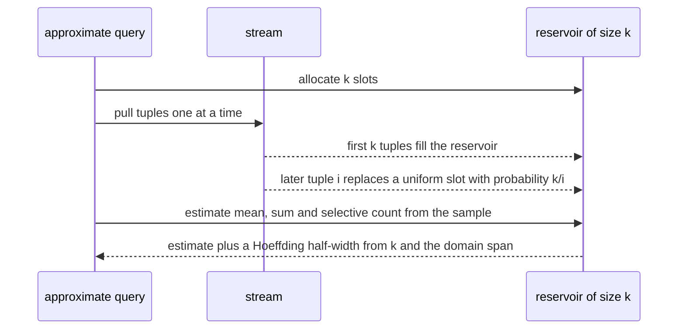
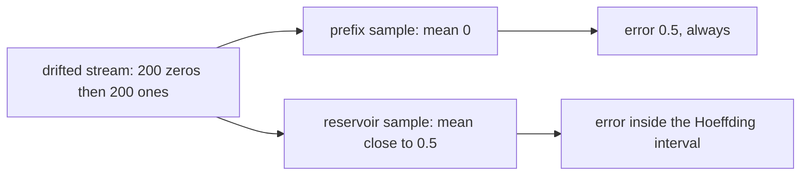

# 646 — Implement approximate query processing via sampling reservoir.

> **Tier:** Expert · **CTCI chapter:** Ch 14 — Databases
> **Task spec:** [646-implement-approximate-query-processing-via-sampling-reservoir.md](../../../tasks/expert/646-implement-approximate-query-processing-via-sampling-reservoir.md)
> **Solutions:** [Python](../../../solutions/python/expert/646-implement-approximate-query-processing-via-sampling-reservoir/solution.py) ·
> [Java](../../../solutions/java/expert/646-implement-approximate-query-processing-via-sampling-reservoir/Solution.java) ·
> [JavaScript](../../../solutions/javascript/expert/646-implement-approximate-query-processing-via-sampling-reservoir/solution.js) ·
> [C#](../../../solutions/csharp/expert/646-implement-approximate-query-processing-via-sampling-reservoir/Solution.cs)

## 1. Problem restatement

Answer aggregate queries from a **single streaming pass with O(k) memory**: sample the stream with a
reservoir and estimate `AVG`, `SUM` and selective `COUNT` from the sample, with a **quantitative**
accuracy guarantee instead of a hand wave.

| Piece | Definition |
| --- | --- |
| `reservoir_sample(stream, size, seed)` | **Algorithm R**: the first `k` items fill the reservoir; item `i` (index `i ≥ k`) replaces slot `rng.below(i + 1)` when that number is below `k` |
| `SplitMix64` | a deterministic 64-bit PRNG, so every run is reproducible |
| `estimate_mean` | the sample mean |
| `estimate_sum` | `mean · population` |
| `estimate_count` | `population · (#matching sample items) / k` |
| `half_width(span, k, alpha)` | Hoeffding: `span · sqrt(ln(2 / alpha) / (2k))` — `span` comes from metadata (the value domain), not from the data |

Concrete results asserted by the checks:

- **Sampler invariants.** A 20-item stream with `k = 5` gives 5 distinct items and a peak of 5 slots; the
  sample reaches past the first five items; `k ≥ n` gives the **whole stream** (`k = 20` and `k = 50` on 20
  items both return the entire stream with peak 20), so the "approximation" is exact when it can be.
- **Uniformity is measured, not assumed.** Over 2400 seeded runs of a 12-element domain, `k = 1` selection
  counts stay within 6 standard deviations of `runs · k / n`, and the `k = 3` inclusion counts do too; every
  element is selected at least once. The same seed reproduces the same sample, different seeds give
  different samples.
- **One pass, O(k) memory.** A 400-item stream is pulled exactly once (`pulled == len(stream)`), the peak
  reservoir size is `40`, and no item is stored twice.
- **Estimates carry their bounds.** The `AVG` estimate (334.43) lies within its Hoeffding interval of the
  true mean (347.69) with a half-width of 147.31; the `SUM` estimate obeys the same bound scaled by `n`; the
  selective `COUNT` obeys the Bernoulli bound with `span = 1`.
- **More sample, less error.** The half-width shrinks strictly across `k = 10, 20, 40, 80, 160`, and a
  tighter confidence level (`alpha = 0.01`) gives a wider interval than `alpha = 0.05`.
- **Exactness in the degenerate case.** With a reservoir large enough to hold everything, the mean equals
  the true mean exactly and the count estimate is exact to `1e-9`.
- **Skew is bounded too.** On a stream of 180 zeros plus 20 values of 1000 with `k = 30`, all 30 seeded
  estimates stay inside their interval (0 failures).
- **The contrast with a naive sample.** On a drifted stream (200 zeros followed by 200 ones, true mean
  `0.5`), a "first 20 rows" sample is **exactly wrong** (`naive_error == 0.5`), while 40 seeded reservoir
  samples have maximum error `< 0.45` and mean error `< 0.15`.

The Python run prints
`[646] reservoir: k=40 of n=400, AVG 334.43 vs true 347.69, span bound 147.31`.

## 2. Intuition

The naive way to sample a stream is to keep the first `k` rows — which is exactly what fails when the
stream is ordered (a time series, a clustered insert order): the head is not a random sample of the whole
stream, and on the drifted example it is *completely* wrong rather than approximately right.

A **reservoir** fixes this with a single pass and no knowledge of the stream length. The first `k` items
fill the reservoir; when item `i > k` arrives, it replaces a uniformly chosen slot with probability
`k / i`. The result is a uniformly random `k`-subset of the `i` items seen so far — after every prefix,
not only at the end — which is precisely what an online estimator needs.



On top of the sample sit the estimators. With a uniform sample of `k` out of `n`, the sample mean
estimates the population mean, and `SUM = mean · n`, `COUNT(pred) = n · (matching sample items) / k` are
the Horvitz-Thompson style estimators. The accuracy claim comes from **Hoeffding's inequality**: for values
in a domain of width `span`, the half-width `span · sqrt(ln(2 / alpha) / (2k))` bounds the error with
probability `1 − alpha` — and crucially it depends only on `k` and the *known* domain, not on the data, so
an engine can quote an interval before reading a single tuple. The checks verify both directions of that
statement: every estimate lies inside its interval, and the interval is strictly narrower for larger `k`.

Sampling can also be **weighted**. The Java variant implements A-Res (Efraimidis-Spirakis): give item `i`
the key `u^(1/w_i)` with `u` uniform, keep the `k` largest keys, and inclusion becomes proportional to the
weight — the right tool when heavy items matter more than uniform coverage, and the check asserts that it
really favours the heavy items while uniform sampling does not. The C# variant adds a **KMV sketch**
(`k` smallest hashes, estimate `(k − 1) / max`) for distinct counting, which is another sampling-style
sketch whose exactness in the small case is checkable.

## 3. Algorithm

1. `SplitMix64.next()` / `below(bound)` — deterministic randomness; `below` is `next() % bound`.
2. `reservoir_sample(stream, k, seed)` — for each item at 0-based index `i`: if `i < k` append, otherwise
   draw `slot = rng.below(i + 1)` and replace `reservoir[slot]` when `slot < k`. Track the peak length.
3. `counter_stream(values, stats)` — a generator that counts how many tuples were pulled, so "one pass" is
   asserted rather than claimed.
4. `estimate_mean` / `estimate_sum` / `estimate_count` — the estimators above.
5. `half_width(span, k, alpha)` — the Hoeffding bound; `alpha = 0.05` by default.
6. The statistical checks drive the sampler over many seeds and compare counts of selections, estimates and
   intervals against the closed-form expectations (6σ binomial bands, Hoeffding widths).

```text
procedure reservoir_sample(stream, size, seed)
    rng = a deterministic generator seeded with seed
    reservoir = empty list
    peak = 0
    for index, item in stream do
        if index < size then
            reservoir.append(item)
        else
            slot = rng.below(index + 1)
            if slot < size then
                reservoir[slot] = item            // the classic Algorithm R replacement
        peak = max(peak, length(reservoir))
    return (reservoir, peak)

function estimate_count(sample, predicate, population)
    if sample is empty then
        return 0
    matches = number of values in sample satisfying predicate
    return population * matches / length(sample)

function half_width(span, sample_size, alpha)
    return span * square_root(ln(2 / alpha) / (2 * sample_size))
```



## 4. Worked example

**(a) The 400-item stream, `k = 40`.** Values are drawn from a deterministic generator over a 0–693 range
(`step = 7`, `modulus = 100`).

| Measure | Value |
| --- | --- |
| tuples pulled | 400 (one pass) |
| peak reservoir size | 40 |
| duplicate tuples in the sample | none |
| sample mean (AVG estimate) | 334.43 |
| true mean | 347.69 |
| Hoeffding half-width (`k = 40`, `alpha = 0.05`, `span` = the stream's value range) | 147.31 |
| error vs bound | inside the interval |

The `SUM` estimate is the same error scaled by `n = 400`, and the selective `COUNT` uses the Bernoulli form
with `span = 1` — all three are asserted inside their bounds.

**(b) Is it really uniform?** Uniformity is not assumed; it is counted:

| Experiment | Runs | Result |
| --- | --- | --- |
| `k = 1` on a 12-element domain | 2400 | every element's selection count within `6σ` of `runs/12`, and every element selected at least once |
| `k = 3` inclusion counts | 2400 | every element's inclusion within the 6σ band of `runs · 3 / 12` |
| same seed twice | 2 | identical samples |
| different seeds | 20 | more than one distinct sample |

**(c) Bias: reservoir versus prefix sample.** Stream `[0] × 200 + [1] × 200`, true mean `0.5`, `k = 20`:

| Sampler | Error |
| --- | --- |
| first 20 rows | `0.5` — exactly wrong, because the head is all zeros |
| reservoir, worst of 40 seeds | `< 0.45` |
| reservoir, average over 40 seeds | `< 0.15` |

That check is the reason a reservoir exists: it is the difference between "we sampled the first page" and
"we sampled the stream".



**(d) Bounds behave as theory says.** `half_width` for `k = 10, 20, 40, 80, 160` is strictly decreasing
(the check asserts each is smaller than the previous), `alpha = 0.01` gives a wider interval than
`alpha = 0.05`, and a skewed stream (180 zeros + 20 values of 1000, `k = 30`, 30 seeds) produces zero
interval violations. When the reservoir can hold the whole stream the estimates stop being approximate:
`k = 410` on 400 items returns the stream itself, the mean matches exactly, and the count estimate is exact
to `1e-9`. The Java variant makes the same point with 400 trials of per-item inclusion frequency (within
4σ of `k/n`), the C# variant with 200 trials and a deliberately biased sampler that the same error metric
detects, and the JavaScript variant with 8000 seeded runs whose subset frequencies are compared with the
probabilities the algorithm's own accept/reject decisions imply.

## 5. Complexity

With `n` stream items, reservoir size `k` and `d` the number of distinct values (KMV):

| Piece | Time | Space | Why |
| --- | --- | --- | --- |
| `reservoir_sample` | O(n) | O(k) | one pass, one uniform draw per item after the first `k` |
| replacement decision | O(1) | O(1) | one draw plus one slot write |
| `estimate_mean` / `estimate_sum` | O(k) | O(1) | sum over the sample |
| `estimate_count` | O(k) | O(1) | one predicate evaluation per sampled value |
| `half_width` | O(1) | O(1) | closed form from `span`, `k`, `alpha` |
| KMV distinct estimate | O(n log k) | O(k) | keep the `k` smallest hashes in a sorted set |
| A-Res weighted sampling | O(n log k) | O(k) | key computation plus keeping the `k` largest keys |
| Uniformity experiment (the check) | O(runs · n) | O(k) | 2400 runs over a 12-element domain |

The accuracy/cost curve the checks measure:

| Sample size `k` | Hoeffding half-width | Error observed |
| --- | --- | --- |
| 10 | widest of the swept set | — |
| 40 | 147.31 on the 400-item stream | 13.26 from the true mean |
| 160 | strictly narrower than 40 | — |
| `k ≥ n` | irrelevant | exact (the sample is the population) |

| Approach | Memory | Works on a stream? | Bias |
| --- | --- | --- | --- |
| First `k` rows | O(k) | yes | yes — unbounded on ordered streams (`error == 0.5` here) |
| Reservoir (Algorithm R) | O(k) | yes | none; uniform at every prefix |
| Weighted A-Res | O(k) | yes | intentionally weighted by the item weight |
| Full scan | O(1) extra | yes | none, but no early answer and no bound to quote |
| Stratified / correlated sampling | O(k · strata) | yes | better variance, more bookkeeping |

## 6. Pitfalls and edge cases

- **`k ≥ n` must be exact, not "approximately exact".** The reservoir holds the whole stream (checked with
  both `k = n` and `k > n`), so an implementation that always drops items would be caught.
- **The reservoir must reach past the first `k` tuples.** The check asserts that at least one value later
  in a 20-item stream is present, which is the minimum evidence that replacements happen.
- **Replacement probability is `k / i` after `i` items.** Drawing `below(i + 1)` and testing `slot < k` is
  the standard implementation; dropping the `+ 1` biases the sample towards early items.
- **A deterministic seed is required to test statistics.** Every solution ships its own PRNG (SplitMix64 in
  Python, xorshift32 in JavaScript, splitmix64 in C#) so the counts are reproducible.
- **The interval is only as good as its inputs.** The Python docstring states that a real engine knows
  `span` from metadata (the value domain) rather than from the data; the checks compute it from the stream,
  which is the same number the metadata would supply for this generated domain.
- **`alpha` and `k` trade off against each other.** A tighter confidence level widens the interval at fixed
  `k`, and doubling `k` narrows it — both directions are asserted.
- **Skew widens the true error but not the bound's validity.** The 180-zeros-plus-20-heavy-items stream
  produces no interval violations across 30 seeds; a variance-based interval would have needed the sample
  variance (as the JavaScript and C# variants use with the finite-population correction).
- **Zero-variance data collapses the interval.** A degenerate distribution gives a zero-width interval in
  the JavaScript and C# variants, which is the correct behaviour and a good sanity check.
- **The naive alternative must be shown failing.** Without the drifted-stream contrast, the reservoir could
  look like ceremony; here the prefix sample is *exactly* wrong on a stream that a person would plausibly
  order that way.
- **Randomness does not make results irreproducible.** Same seed, same sample — asserted; different seeds,
  different samples — also asserted.
- **No duplicates and never more than `k` slots.** A reservoir that grows when a replacement is drawn would
  break the memory promise, and the peak counter catches it.
- **Degenerate parameters are handled or rejected explicitly.** `k = 0` and `k ≤ 0` are rejected in the
  JavaScript variant; `k = 1`, the empty stream and a single item are exercised.
- **Weighted inclusion is a different guarantee.** A-Res gives inclusion probability proportional to
  `w_i / Σw`, which the JavaScript check compares against the algorithm's own keys — uniform sampling
  remains uniform, and the two must not be confused.

## 7. Variants and follow-ups

- **Streaming execution the sample rides on.** The pull-based operator pipeline that produces the tuples —
  see
  [644-implement-query-execution-engine-operator-pipelining-simulation.md](../../../tasks/expert/644-implement-query-execution-engine-operator-pipelining-simulation.md).
- **Progressive answers from the same stream.** Online aggregation re-estimates as tuples arrive rather
  than planning one sample size in advance — see
  [650-implement-online-aggregation-progressive-estimator.md](../../../tasks/expert/650-implement-online-aggregation-progressive-estimator.md).
- **Exact aggregates kept incrementally.** When an exact answer is affordable, delta maintenance beats
  sampling — see
  [645-implement-materialized-view-maintenance-incremental-algorithm.md](../../../tasks/expert/645-implement-materialized-view-maintenance-incremental-algorithm.md).
- **Sketching instead of sampling.** KMV for distinct counts and similar sketches replace a sample entirely
  in the C# variant; histogram-based estimates are the planner's counterpart
  ([641-implement-advanced-query-planner-cost-model-stub-and-plan-enumer.md](../../../tasks/expert/641-implement-advanced-query-planner-cost-model-stub-and-plan-enumer.md)).
- **Filtering before sampling.** A Bloom filter or predicate pushdown changes the stream a sampler sees
  ([649-implement-bloom-join-filter-application-and-benchmarking.md](../../../tasks/expert/649-implement-bloom-join-filter-application-and-benchmarking.md)).

## 8. Check yourself

<details><summary>Show answer 1 — Why not keep the first <code>k</code> rows?</summary>

Because a stream is often ordered: the first `k` rows may all come from one part of the data. The check
makes this concrete on a stream of 200 zeros then 200 ones, where the prefix sample's mean is `0` instead of
`0.5` — an error of exactly `0.5`, while corresponding reservoir samples stay inside their Hoeffding
interval.
</details>

<details><summary>Show answer 2 — Why is the reservoir uniform at every prefix, not just at the end?</summary>

The replacement rule is chosen exactly for that: after `i` items, each item is in the reservoir with
probability `k / i`, and the invariant is preserved inductively when item `i + 1` replaces a uniformly
chosen slot with probability `k / (i + 1)`. That is why an online estimator can answer after any prefix,
and why the checks measure per-item inclusion frequency against `k / n`.
</details>

<details><summary>Show answer 3 — Where does the accuracy bound come from?</summary>

Hoeffding's inequality applied to values bounded by a known domain width `span` gives half-width
`span · sqrt(ln(2 / alpha) / (2k))`, independent of the data distribution. `span` comes from metadata, so the
interval can be quoted before scanning; the checks assert both that estimates fall inside it and that it
strictly narrows as `k` grows.
</details>

<details><summary>Show answer 4 — When is the answer exact, and what happens at <code>k = 0</code>?</summary>

Exact when the reservoir holds the whole stream (`k ≥ n`): the sample *is* the population, so the mean
matches exactly and the count is exact — the checks use `k = n` and `k > n` for this. `k = 0` (and any
`k ≤ 0`) is rejected explicitly rather than silently returning an empty sample and a meaningless estimate.
</details>
