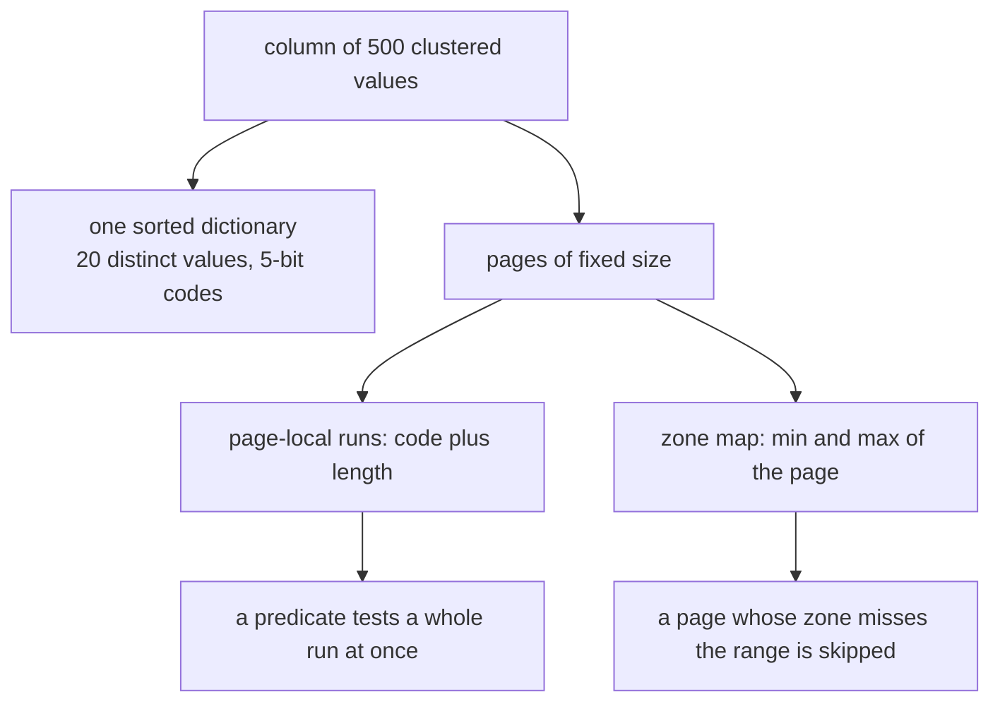
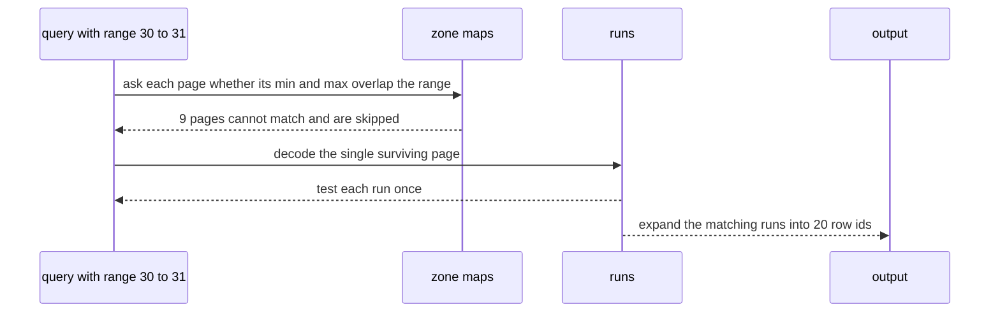
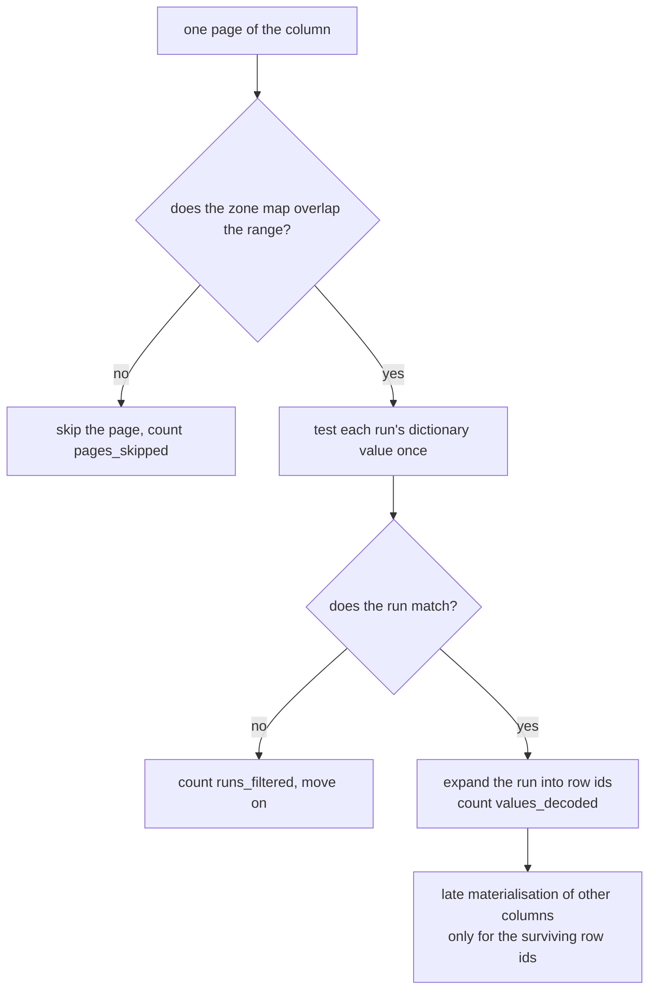

# 647 — Implement column-store compressed page layout and predicate pushdown simulation.

> **Tier:** Expert · **CTCI chapter:** Ch 14 — Databases
> **Task spec:** [647-implement-column-store-compressed-page-layout-and-predicate-push.md](../../../tasks/expert/647-implement-column-store-compressed-page-layout-and-predicate-push.md)
> **Solutions:** [Python](../../../solutions/python/expert/647-implement-column-store-compressed-page-layout-and-predicate-push/solution.py) ·
> [Java](../../../solutions/java/expert/647-implement-column-store-compressed-page-layout-and-predicate-push/Solution.java) ·
> [JavaScript](../../../solutions/javascript/expert/647-implement-column-store-compressed-page-layout-and-predicate-push/solution.js) ·
> [C#](../../../solutions/csharp/expert/647-implement-column-store-compressed-page-layout-and-predicate-push/Solution.cs)

## 1. Problem restatement

Lay out a **column** as fixed-size **pages** in a compressed, dictionary-and-run encoded form, and push a
range predicate **into the compressed data** so that whole pages and whole runs can be rejected without
decoding them.

| Piece | Definition in the Python solution |
| --- | --- |
| dictionary | the distinct values of the column, sorted (NULL last); a value's *code* is its index |
| page | a slice of `page_size` rows with `runs` (page-local `[code, length]` pairs) and a `zone` map `(min, max)` over its non-NULL values |
| `bit_width` | `max(1, ceil(log2(distinct)))` — the smallest code width that fits |
| `size()` | `runs() + len(dictionary)` slots — one per run plus one per dictionary entry |
| `RangePredicate` | `low ≤ value ≤ high`, NULL never matches; `can_prune(zone)` is true when the zone cannot intersect the range |
| `select(encoded, predicate)` | skip prunable pages, test each run **once**, and only expand runs that match |
| stats | `values_decoded`, `pages_read`, `pages_skipped`, `runs_tested`, `runs_filtered` |

Concrete results asserted by the checks:

- **Round trips.** Seven layouts (empty, single row, nine identical values, ten distinct values with
  `page_size = 3`, a NULL-heavy column, a `[3, 3, 4, 3, 3]` column, and a 23-row column with
  `page_size = 5`) all decode back to the original; the dictionary equals the distinct set, the run count
  equals an **independent** run counter, no page stores more runs than it has slots, codes fit the computed
  bit width, and the page count is `ceil(n / page_size)`.
- **Compression is real.** A 500-value clustered column (`i // 25`, 20 distinct values) compresses to
  **40 slots** (20 runs plus 20 dictionary entries) — `size() < 100 < 500` — with `bit_width == 5`, while a
  scattered column (`i % 250`) barely compresses (more than 400 runs, `bit_width == 8`).
- **Pushdown never loses a match.** For nine ranges — including `[0, 0]`, a full range `[0, 39]`, an
  out-of-range `[100, 200]` and a wholly negative one — the compressed scan returns exactly the same row
  ids as a naive full scan.
- **Pushdown really saves work.** On a 400-row clustered column with `page_size = 40`, the selective range
  `[30, 31]` returns 20 rows after decoding **20 of 400 values**, rejecting 2 non-matching runs as runs and
  **skipping 9 of the 10 pages** by zone map; every page is either read or skipped. A match-all predicate
  decodes all 400 values and skips nothing — the contrast is asserted in both counters.
- **NULLs are stored but never matched.** NULL gets its own dictionary entry and survives the round trip, a
  range predicate ignores it, and a run of NULLs is rejected with one comparison (the check expects
  `values_decoded == 5` for a column with three NULLs).
- **Property test.** 25 random columns (up to 60 rows, cardinality 1–8, NULLs every fifth value, random
  `page_size` 1–7) all round-trip and all agree with the reference scan, with the decoded count bounded by
  the column length and every page accounted for as read or skipped.
- `page_size = 1` is the degenerate layout: exactly one run per page.

The Python run prints
`[647] column store: 500 clustered values -> 40 slots, selective scan decoded 20 of 400 values across 1 of 10 pages`.

## 2. Intuition

A row store must touch a whole row to evaluate one column's predicate; a column store keeps each column
contiguously, so a predicate reads only that column — and if the column is compressed, it can often be
answered **without decoding it at all**. Three classic tricks stack here, and each one removes a different
kind of work:

- **Dictionary encoding.** Store the distinct values once and keep small integer codes in the data. A
  predicate becomes a comparison against dictionary entries, and the code width is
  `ceil(log2(distinct))` bits (5 bits for 20 distinct values, 8 for 250).
- **Run-length encoding.** Consecutive equal values collapse into one `(code, length)` run. A clustered
  column of 500 values with 20 distinct values becomes 20 runs, and a predicate test on a run is a single
  comparison for the entire run.
- **Zone maps.** Every page carries its `(min, max)`. A page whose zone cannot intersect the predicate is
  skipped *without being touched*, which is the cheapest possible answer.



The payoff is measurable rather than rhetorical: the selective scan decodes `20` values out of `400` and
skips `9` of the `10` pages, because one range happened to touch a single page whose zone overlapped. The
check also compares the pushed-down result with a naive row-by-row scan for nine predicates — including
empty and full ranges — because the only failure mode that matters is a false negative, i.e. skipping a
page that did contain a match.

The JavaScript and C# variants make the layout decision itself explicit. JavaScript stores a **per-page
dictionary** and evaluates the predicate against dictionary entries before expanding any codes; C#
encodes each page **three ways** (plain 32-bit, dictionary with bit-packed indices, RLE with 8 bytes per
run), compares the byte counts, and keeps the smallest — with a hand-written LSB-first bit
writer/reader so the byte accounting can be checked by hand. All of them keep an uncompressed oracle copy
of the column *for verification only*; every measured counter comes from the compressed path.

## 3. Algorithm

1. `encode_column(values, page_size)` — build the sorted distinct dictionary with `NULL` last, map values
   to codes, then for each page emit page-local runs (`[code, length]`, extending the last run when the
   code repeats), compute the zone map from the page's non-NULL values (`None` for an all-NULL page), and
   record the page's start row.
2. `decode_column(encoded)` — expand every run into `length` copies of its dictionary value; this is the
   round-trip check and the oracle for row ids.
3. `RangePredicate.matches(value)` / `can_prune(zone)` — a NULL never matches; an all-NULL page is always
   prunable; otherwise the page is prunable when `zone.high < low` or `zone.low > high`.
4. `select(encoded, predicate)` — for each page: prune (count `pages_skipped`) or read it (count
   `pages_read`), then walk its runs, testing each run's dictionary value **once**; matching runs extend the
   row-id list by `length` and add to `values_decoded`, non-matching runs increment `runs_filtered`.
5. `reference_select(values, predicate)` — the naive filter over decoded values; the two must agree on row
   ids for every predicate.
6. `independent_runs(values, page_size)` — an oracle for the run count, so `runs()` is checked rather than
   trusted.

```text
procedure select(encoded, predicate)
    matches = empty
    for page in encoded.pages do
        if predicate.can_prune(page.zone) then
            stats.pages_skipped = stats.pages_skipped + 1
            continue                                // the page is never touched
        stats.pages_read = stats.pages_read + 1
        row = page.start
        for (code, length) in page.runs do
            stats.runs_tested = stats.runs_tested + 1
            value = encoded.dictionary[code]
            if predicate.matches(value) then
                stats.values_decoded = stats.values_decoded + length
                append rows row to row + length - 1 to matches
            else
                stats.runs_filtered = stats.runs_filtered + 1     // one test rejected the run
            row = row + length
    return (matches, stats)

procedure encode_column(values, page_size)
    dictionary = sorted distinct values of the column, with NULL last
    for start = 0 to length(values) - 1 step page_size do
        chunk = values[start : start + page_size]
        runs = empty
        for value in chunk do
            code = the dictionary index of value
            if runs is not empty and the last run has this code then
                increase the last run's length by one
            else
                runs.append([code, 1])
        present = the non-NULL values of chunk
        zone = (min(present), max(present)) if present is not empty else none
        pages.append(page with start, runs, zone)
    return the encoded column
```



## 4. Worked example

**(a) Layout of the 400-row clustered column.** Values `i // 10` for `i` in `0…399`, `page_size = 40`, so
every page holds four runs of ten identical values and the zone map of page `p` is the range of its four
values:

| Page | Rows | Runs | Zone |
| --- | --- | --- | --- |
| 0 | 0–39 | `(0, 10)`, `(1, 10)`, `(2, 10)`, `(3, 10)` | `(0, 3)` |
| 5 | 200–239 | `(20, 10)`, `(21, 10)`, `(22, 10)`, `(23, 10)` | `(20, 23)` |
| 7 | 280–319 | `(28, 10)`, `(29, 10)`, `(30, 10)`, `(31, 10)` | `(28, 31)` |
| 9 | 360–399 | `(36, 10)`, `(37, 10)`, `(38, 10)`, `(39, 10)` | `(36, 39)` |

A predicate `[30, 31]` overlaps only page 7's zone, so page 7 is the only page read.

**(b) The selective scan, counter by counter.**

| Counter | Value | Cause |
| --- | --- | --- |
| `pages_skipped` | `9` | zone maps dismiss every other page outright |
| `pages_read` | `1` | only page 7 can contain the range |
| `runs_tested` | `4` | the four runs of the surviving page, one comparison each |
| `runs_filtered` | `2` | runs `(28, 10)` and `(29, 10)` are rejected as runs |
| `values_decoded` | `20` | only the runs `(30, 10)` and `(31, 10)` are materialised |
| returned row ids | `20` | rows 300–319 |

Against a match-all predicate on the same column: `values_decoded == 400`, `pages_skipped == 0` — the
contrast the checks assert (`selective.values_decoded < all.values_decoded` and
`selective.pages_read < all.pages_read`), and both are compared with the naive reference scan's row ids.

**(c) Compression numbers.**

| Column | Distinct | Runs | `size()` (slots) | `bit_width` |
| --- | --- | --- | --- | --- |
| clustered `i // 25`, 500 values | 20 | 20 (no page boundary splits them) | **40** | 5 |
| scattered `i % 250`, 500 values | 250 | `> 400` | much larger | 8 |
| `[7] * 9`, `page_size = 4` | 1 | 3 (page boundaries split the run) | 4 | 1 |

The clustered column is the classic column-store win: dictionary plus RLE turn 500 stored values into 40
slots, and the check asserts `size() < 100 < 500` as well as `clustered.size() < scattered.size()`.



**(d) The two-stage variants.** JavaScript pushes down in three steps — zone map, then a test against the
per-page dictionary, then expanding only the codes of dictionary entries that can match — and counts
`pages scanned/skipped`, `dictionary tests`, `codes tested` and `values decoded`. C# chooses the page
layout by encoding the page three times and keeping the smallest byte count (its bit packing round-trips
for every width, and the byte counts match hand computation), then prunes by zone map. The Java variant
stores each column **twice**, once run-length encoded and once dictionary encoded, and checks that both
decoders reproduce the original column, that the dictionary is exactly the distinct value set, that every
zone map is the true per-page min/max re-derived by brute force, and that late materialisation touches
only the pages holding the requested rows.

## 5. Complexity

With `n` rows, `k` distinct values, page size `p`, `R` runs and `P = ceil(n / p)` pages:

| Operation | Time | Space | Why |
| --- | --- | --- | --- |
| `encode_column` | O(n log k) | O(n) | one sort of the distinct values plus one pass over each page |
| `decode_column` | O(n) | O(n) | every run expands to `length` values |
| `can_prune` | O(1) | O(1) | two comparisons against the zone map |
| `select` (compressed) | O(P + R_tested + decoded rows) | O(result) | a page costs nothing when pruned; a run costs one comparison; only matching runs are decoded |
| `select` (naive reference) | O(n) | O(result) | every value is materialised and tested |
| `size()` | O(R + k) slots | — | one slot per run plus one per dictionary entry |
| Bit width | O(1) | — | `ceil(log2(k))` |

Measured on the run:

| Metric | Selective `[30, 31]` | Match-all |
| --- | --- | --- |
| values decoded | `20` of `400` | `400` |
| pages read / skipped | `1` / `9` | `10` / `0` |
| work per run | one comparison | one comparison |

| Layout | Strength | Weakness |
| --- | --- | --- |
| Plain 32-bit (C# baseline) | zero decode cost, simplest | largest size |
| Dictionary + bit-packed codes | small codes, predicate compares dictionary entries | decoding needs the dictionary; wide codes when cardinality is high |
| RLE | unbeatable on clustered data (20 runs for 500 values) | useless when values alternate |
| Zone maps | prune pages without touching them | only help when the data is clustered *by page* |

## 6. Pitfalls and edge cases

- **A pruned page must never contain a match.** The zone map is sound only when it is the true per-page
  min/max, which the checks re-derive by brute force; the nine-predicate sweep exists to catch a false
  negative, the one error a pushdown can make.
- **Run tests must compare the *value*, not the code.** Codes are ordered consistently with values only
  because the dictionary is sorted — the Python `sort_key` puts NULL last so the ordering is deterministic,
  and the C# dictionary is explicitly sorted.
- **A run of NULLs must be rejected as one run.** NULL is never matched by a range predicate, so a
  three-NULL run costs a single comparison and contributes nothing to `values_decoded` (the check expects
  `5` decoded values for a column with three NULLs among five real values).
- **Runs do not cross page boundaries.** RLE is page-local here, so `[7] * 9` with `page_size = 4` produces
  three runs, not one; the run-count oracle applies the same rule.
- **`page_size = 1` is legal** and produces exactly one run per page — a useful degenerate layout, and a
  good test that no logic assumes runs longer than one.
- **An empty column must not divide by a page size or allocate a page.** It has no pages, an empty
  dictionary and `size() == 0`, and a scan returns no rows with every counter at zero.
- **The dictionary is the distinct set, and codes fit the bit width.** Both are asserted; a code-widening
  bug would otherwise only show up as a wrong answer later.
- **Compression must not be mistaken for correctness.** Decompression is the ground truth: every layout
  round-trips before any predicate is pushed down.
- **Low cardinality is what makes the encoding pay.** The scattered column (`i % 250`) has more than 400
  runs and a wider dictionary, so it compresses much worse — the checks assert both directions rather than
  quoting a single ratio.
- **Late materialisation is a separate win.** The other columns are touched only for the surviving row ids,
  which the Java and C# variants both verify (JavaScript counts the decoded values of a projected column).
- **Layout choice must be data driven.** C# encodes each page three ways and keeps the smallest; a
  hard-coded choice would lose on clustered data or pay a decode cost on wide codes.
- **No SIMD, no bit-packing beyond the dictionary codes, no per-page nulls or delete vectors.** Those are
  the documented simplifications, and the vectorised-execution task covers the batch side
  ([648-implement-vectorized-execution-for-simple-sql-operators.md](../../../tasks/expert/648-implement-vectorized-execution-for-simple-sql-operators.md)).

## 7. Variants and follow-ups

- **Batch processing of the surviving rows.** Vectorised execution turns the row ids this scan produces
  into batched operator calls — see
  [648-implement-vectorized-execution-for-simple-sql-operators.md](../../../tasks/expert/648-implement-vectorized-execution-for-simple-sql-operators.md).
- **The other compression schemes.** Delta and frame-of-reference encodings extend the same page layout —
  see
  [653-implement-compressed-column-encoding-schemes-rle-dictionary-and.md](../../../tasks/expert/653-implement-compressed-column-encoding-schemes-rle-dictionary-and.md).
- **Indexing instead of scanning.** A bitmap index answers the same predicates from a different structure —
  see
  [652-implement-bitmap-index-and-fast-and-or-operations.md](../../../tasks/expert/652-implement-bitmap-index-and-fast-and-or-operations.md).
- **Feeding compressed columns to a plan.** The scan operator that consumes these pages is the execution
  engine of
  [644-implement-query-execution-engine-operator-pipelining-simulation.md](../../../tasks/expert/644-implement-query-execution-engine-operator-pipelining-simulation.md).
- **Cheaper predicates before the join.** Bloom filters cut probe rows the same way a zone map cuts pages
  ([649-implement-bloom-join-filter-application-and-benchmarking.md](../../../tasks/expert/649-implement-bloom-join-filter-application-and-benchmarking.md)).

## 8. Check yourself

<details><summary>Show answer 1 — What makes a zone map safe to prune with?</summary>

It must be the true `(min, max)` of the page's values, so "the range overlaps this page" is a necessary
condition for any match. Then a page whose zone does not intersect the predicate's range cannot contain a
matching row, and skipping it can only remove non-matches. The checks re-derive every zone map by brute
force and compare the pushed-down row ids with a naive scan for nine predicates, including empty ranges.
</details>

<details><summary>Show answer 2 — Why does a test on a run cost one comparison instead of <code>length</code> comparisons?</summary>

Because all values in a run have the same code, hence the same dictionary value. So `predicate.matches`
called once decides the whole run: either it is rejected (`runs_filtered += 1`) or its row ids are emitted
wholesale (`values_decoded += length`). That is why 400 rows are answered with four run tests on the
surviving page.
</details>

<details><summary>Show answer 3 — How much does the compressed scan actually save on the example?</summary>

With the range `[30, 31]` it decodes `20` of `400` values and reads `1` of `10` pages — against `400`
values and `10` pages for a match-all predicate. Both counters are asserted, and the same row ids are
produced as a naive full scan, so the saving is work, not correctness.
</details>

<details><summary>Show answer 4 — Why is bit width <code>ceil(log2(distinct))</code> part of the layout?</summary>

Because codes are dictionary indices, so a column with `k` distinct values needs exactly `ceil(log2 k)`
bits per code — 5 bits for the 20-value clustered column and 8 for the 250-value scattered one. The checks
assert that every stored code fits the computed width, which is also what makes the C# byte accounting
computable by hand.
</details>
