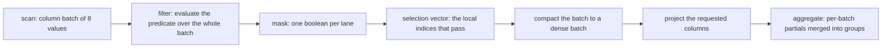
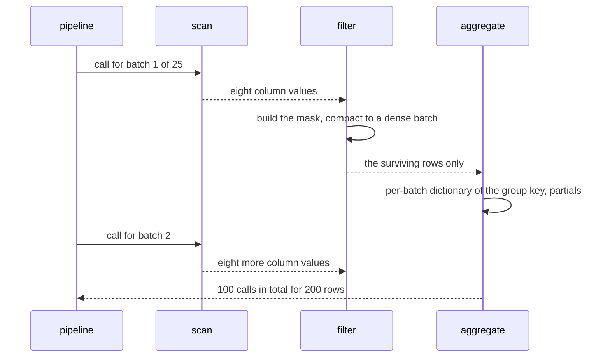
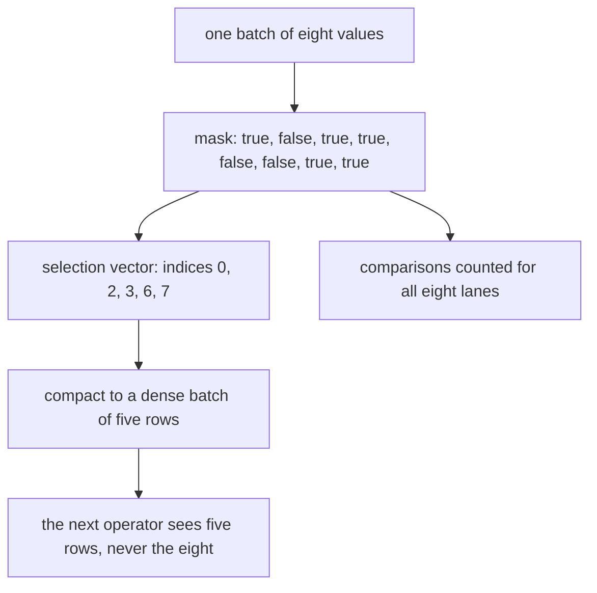

# 648 — Implement vectorized execution for simple SQL operators.

> **Tier:** Expert · **CTCI chapter:** Ch 14 — Databases
> **Task spec:** [648-implement-vectorized-execution-for-simple-sql-operators.md](../../../tasks/expert/648-implement-vectorized-execution-for-simple-sql-operators.md)
> **Solutions:** [Python](../../../solutions/python/expert/648-implement-vectorized-execution-for-simple-sql-operators/solution.py) ·
> [Java](../../../solutions/java/expert/648-implement-vectorized-execution-for-simple-sql-operators/Solution.java) ·
> [JavaScript](../../../solutions/javascript/expert/648-implement-vectorized-execution-for-simple-sql-operators/solution.js) ·
> [C#](../../../solutions/csharp/expert/648-implement-vectorized-execution-for-simple-sql-operators/Solution.cs)

## 1. Problem restatement

Execute simple SQL plans **batch-at-a-time** instead of tuple-at-a-time, and prove the difference with
counters rather than timings.

| Operator | Batch behaviour |
| --- | --- |
| `scan` | emits column batches of `BATCH = 8` rows, one operator call per batch (the empty input still costs one call) |
| `vector_filter` | builds a boolean **mask** for the whole batch (`comparisons += len(mask)`), then **compacts** the batch to the selected slots, returning a dense batch and the mask |
| `vector_project` | slices the requested columns, one call per batch |
| `vector_aggregate` | dictionary-encodes the group key **per batch** (one slot per distinct key in that batch), accumulates per-batch partials, then merges them into the global groups |
| `Aggregator` | `sum`, `count_star`, `count`, `min`, `max` with `identity` / `step` / `merge`, and SQL's rule that NULLs are skipped |
| row reference | `row_filter` and `row_aggregate`, one call and one comparison **per row** |

Concrete results asserted by the checks:

- **Identical answers.** For all five aggregates, the vectorized pipeline returns exactly the row
  engine's result (six groups on the 200-row table), and the filter alone selects exactly the same rows
  (`flatten(batches) == row_filter(table, predicate)`).
- **The same number of predicate evaluations.** `vector.comparisons == row.comparisons` for every
  aggregate — the documented consequence of having no SIMD: only the *interpretation* overhead drops.
- **Far fewer operator calls.** `vector_calls · 2 < row_calls` for every aggregate, and exactly
  `4 · batches` calls in the pipeline (scan, filter, project, aggregate); the filter alone costs
  `2 · batches`. The run reports **100 calls for 200 rows**, i.e. 4 calls for each of the 25 batches.
- **Per-batch dictionaries are bounded.** `len(groups) < slots ≤ rows_read`: the per-batch dictionary
  rebuilds slots every batch (43 slots for 6 groups over 25 batches), which is the cost of the design and
  is asserted rather than hidden.
- **Boundaries.** Row counts `0`, `1`, `8`, `9` and `24` match the row engine for `sum`, `count_star`
  and `min`; the empty input yields `{}` with `rows_read == 0` and a single scan call; a group straddling
  a batch boundary (`BATCH + 3` rows in one group) merges to the full sum with one slot per batch, and 11
  rows span exactly 2 batches.
- **Bigger batches do less operator work.** Call counts for batch sizes `1, 2, 4, 8, 16, 32` are strictly
  decreasing, and the engine is deterministic (same result and same stats on a re-run).

The Python run prints
`[648] vectorized: batch 8, 100 calls for 200 rows (25 per batch), 43 dictionary slots`.

## 2. Intuition

A tuple-at-a-time engine pays interpreter overhead for every row: dispatch the operator, read the tuple,
branch, write the result. A **vectorized** engine amortises that over a batch: one dispatch handles
`BATCH` rows, the predicate produces a **mask**, the mask is turned into a **selection vector**, and only
the surviving slots flow onward.



Three things are worth being precise about, and the checks pin all three:

1. **What vectorization does *not* buy.** Without SIMD the number of predicate evaluations is unchanged —
   the solution says so in its docstring and asserts `vector.comparisons == row.comparisons`. What drops is
   the number of *operator invocations* (one per batch instead of one per row) and, with a selection
   vector, the amount of downstream work.
2. **What the selection vector buys.** Downstream operators touch only the selected lanes, so rejected rows
   cost nothing after the filter. The C# variant also implements **masked short-circuit** evaluation: for a
   conjunctive predicate the second conjunct is evaluated only over the rows that survived the first, and
   the saving is counted.
3. **What per-batch aggregation costs.** Dictionary-encoding the group key per batch makes the aggregate a
   local, dense loop, but it also rebuilds slots for every batch: 43 slots for 6 groups over 25 batches —
   bounded by the rows of the batch and asserted as such.

Batch boundaries are the classic bug source: a group may be partial in two batches (the straddle case is
checked), the final batch is usually short (Java checks the last partial batch of 1000 rows with batch size
64: 16 batches with 24 rows in the last one), and `batch_size == 1` must degenerate exactly to the scalar
engine.

## 3. Algorithm

1. `scan(rows, batch_size, stats)` — slice the table into batches, increment `calls` once per batch and
   `rows_read` by the batch length; for an empty table still count one call.
2. `vector_filter(batch, predicate, stats)` — one call, evaluate the predicate for every lane of
   `batch["value"]`, add `len(mask)` to `comparisons`, then build `keep = [index for index, selected …]`
   and return the compacted batch plus the mask. The pipeline asserts the compacted batch is dense and
   never longer than the input.
3. `vector_project(batch, columns, stats)` — one call, slice the requested columns.
4. `vector_aggregate(batches, key_column, value_column, aggregator, stats)` — per batch: an empty `slots`
   map assigns one slot per distinct key in that batch, `partials` accumulate with `aggregator.step`, and
   the batch's partials are merged into the global `groups` with `aggregator.merge`. `stats["slots"]` grows
   by the batch's distinct-key count.
5. `vector_pipeline(...)` — scan → filter → project → aggregate, returning the groups and the stats.
6. **Reference** — `row_filter` (one call and one comparison per row) and `row_aggregate` (one call per
   row); the checks compare both results and work counts.

```text
procedure vector_filter(batch, predicate, stats)
    stats.calls = stats.calls + 1
    mask = empty
    for value in batch[value column] do
        mask.append(predicate(value))
    stats.comparisons = stats.comparisons + length(mask)
    keep = indices of mask whose entry is true
    dense = batch restricted to those indices          // no holes, order preserved
    return (dense, mask)

procedure vector_aggregate(batches, key_column, value_column, aggregator, stats)
    groups = empty map
    for batch in batches do
        stats.calls = stats.calls + 1
        slots = empty map                     // the per-batch dictionary
        keys = empty
        partials = empty
        for index = 0 to length(batch[key_column]) - 1 do
            key = batch[key_column][index]
            if key is not in slots then
                slots[key] = length(keys)
                keys.append(key)
                partials.append(aggregator.identity())
            partials[slots[key]] = aggregator.step(partials[slots[key]], batch[value_column][index])
        stats.slots = stats.slots + length(keys)
        for key, partial in keys paired with partials do
            groups[key] = aggregator.merge(groups[key], partial)
    return groups
```



## 4. Worked example

**(a) One batch through the pipeline.** Table of 200 rows, `BATCH = 8`, predicate "value is not NULL and
value mod 3 equals 0".

| Stage | Work | Notes |
| --- | --- | --- |
| scan | 1 call, 8 rows read | slices the columns into a batch |
| filter | 1 call, 8 comparisons | the mask has one boolean per lane |
| project | 1 call | slices `group` and `value` of the dense batch |
| aggregate | 1 call, up to 8 slots | one slot per distinct group key **in this batch** |

Four calls per batch, `4 · 25 = 100` calls for 200 rows — against `200` filter calls plus `200` aggregate
calls in the row engine, i.e. the assertion `vector_calls · 2 < row_calls`.

**(b) The counters over the whole table.**

| Counter | Vectorized | Row engine |
| --- | --- | --- |
| operator calls | `100` (4 per batch × 25 batches) | `400` (`200` filter + `200` aggregate) |
| predicate evaluations | `200` | `200` |
| rows read | `200` | `200` |
| dictionary slots | `43` | — (no per-batch dictionary) |
| result | 6 groups per aggregate | identical |

The equality of the *comparison* counts is the honest part of the claim: without SIMD, vectorization
reduces dispatch overhead and downstream work, not the number of predicate evaluations.

**(c) Boundaries and the straddling group.**

| Case | Expectation | Why it matters |
| --- | --- | --- |
| 0 rows | `{}`, `rows_read == 0`, one scan call | the empty stream is not zero calls |
| 1 row, `BATCH`, `BATCH + 1`, `3 · BATCH` rows | identical to the row engine for `sum`, `count_star`, `min` | exact multiples and short tails |
| 11 rows in a single group | `{0: 11}` with `slots == 2` | one slot per batch, partial sums merged |
| batch sizes 1, 2, 4, 8, 16, 32 | strictly fewer calls as the batch grows | `batch == 1` degenerates to the row engine |
| re-run | same result and same stats | determinism |



**(d) The variants.** The JavaScript engine keeps the *mask* and a selection vector rather than
compacting, and counts lanes evaluated, lanes selected and per-batch control-flow decisions; it asserts
batch-size independence across `1, 3, 7, 64, 1024`, that selection vectors are ascending, in-range and
duplicate-free, that an all-false mask yields no downstream work, and that sums are exact against a
`BigInt` computation. The C# engine counts **vector steps** (one pass over a batch) next to rows — a
filter over 10 000 rows in batches of 512 needs 20 vector steps instead of 10 000 per-row steps — and adds
masked short-circuit evaluation for conjunctive predicates. The Java engine runs three plans (scan/filter/
project, hash aggregate, hash join) twice, vectorized and scalar, counts operator invocations, batches,
dropped empty batches, comparisons and selection-vector validations, and checks that the last partial
batch of a 1000-row input with batch size 64 is handled (16 batches, 24 rows in the final one) while a
deliberately broken selection vector is detected.

## 5. Complexity

With `n` rows, batch size `b`, `B = ceil(n / b)` batches, `g` groups and `G_b` distinct keys in batch `b`:

| Operation | Vectorized | Row engine | Why |
| --- | --- | --- | --- |
| scan | `B` calls, O(n) work | `n` calls | one dispatch per batch |
| filter | `B` calls, `n` comparisons | `n` calls, `n` comparisons | same comparisons, fewer calls |
| project | `B` calls, O(selected rows) | O(n) calls | only selected lanes are touched |
| aggregate (grouped) | `B` calls, O(n + Σ_b G_b) | `n` calls | per-batch dictionary plus the merge |
| memory | O(b) per batch plus O(g) groups | O(1) extra | a batch is the working set |

Measured on the run and asserted:

| Metric | `b = 8`, `n = 200` | `b = 1` | `b ≥ n` |
| --- | --- | --- | --- |
| batches | 25 | 200 | 1 |
| pipeline calls | 100 | 400 (the row engine) | 4 |
| dictionary slots | 43 | 200 | ≤ 6 |

| Approach | Dispatch cost | Comparisons | Memory | Notes |
| --- | --- | --- | --- | --- |
| Tuple-at-a-time | O(n) calls | O(n) | O(1) | the reference implementation |
| Batch-at-a-time (this task) | O(n / b) calls | O(n) without SIMD | O(b) | selection vector skips rejected rows downstream |
| SIMD kernels over batches | O(n / b) calls | O(n / lanes) | O(b) | the C# header notes no intrinsics are used here |
| Compressed batches (task 647) | O(n / b) calls, fewer bytes | same | O(b) | dictionary/RLE pages feed the same batches |

## 6. Pitfalls and edge cases

- **The last batch is usually short.** With 1000 rows and batch size 64 there are 16 batches and the final
  one holds 24 rows (the Java check asserts exactly that); code that assumes full batches corrupts the
  tail.
- **`batch_size == 1` must be exactly the scalar engine.** It is asserted for both results and call counts,
  and `batch_size ≥ n` must collapse to a single batch.
- **The empty input still costs one call.** `scan` of an empty table increments `calls` once, so "zero
  calls for zero rows" is not the contract — the checks assert `calls == 1`, `rows_read == 0` and an empty
  result.
- **The compacted batch must be dense and never grow.** Both properties are checked per batch; a filter
  that appends without compacting leaves holes that later operators mis-index.
- **Selection vectors must be ascending, in range and duplicate-free.** The Java engine re-validates the
  invariant on every batch, and a deliberately broken vector is detected; the JavaScript engine refuses an
  out-of-range selection index outright.
- **A group split across batches must merge.** The straddle case (`BATCH + 3` rows in one group) verifies
  that per-batch partials are combined, not overwritten.
- **Per-batch dictionaries are a real cost.** `len(groups) < slots ≤ rows_read` is asserted: 43 slots for
  6 groups over 25 batches. Claiming "vectorization reduces work" without that number would be misleading.
- **No SIMD means no reduction in comparisons.** The solution documents it and the checks assert equality
  with the row engine's comparison count; only call counts and downstream work improve.
- **Aggregate semantics must match SQL.** `min`/`max` start from `None`, NULLs are skipped by `sum`/`count`
  but counted by `count_star`, and `merge` must handle an absent side — all five aggregates are compared
  with the row engine on the same rows.
- **Wider batches do strictly less dispatch work.** Call counts must fall monotonically across
  `1, 2, 4, 8, 16, 32`; a batching bug that resets state per batch would show up as a wrong result first,
  and as a flat call curve second.
- **Exact sums need care in JavaScript.** The reference `BigInt` sum exists because floating-point
  accumulation over batches could otherwise hide a partitioning bug.
- **Determinism.** Re-running the pipeline gives the same groups and the same stats, which is what makes
  the counter assertions reproducible.
- **No nulls in columns, no adaptive batch sizing, no compile-once/execute-many kernels.** Those are the
  documented simplifications; the C# header also notes int32 columns and no selection-vector-aware join.

## 7. Variants and follow-ups

- **The engine being vectorized.** The tuple-at-a-time Volcano protocol this replaces — see
  [644-implement-query-execution-engine-operator-pipelining-simulation.md](../../../tasks/expert/644-implement-query-execution-engine-operator-pipelining-simulation.md).
- **Compressed batches.** Feeding dictionary/RLE pages into the same batch interface — see
  [647-implement-column-store-compressed-page-layout-and-predicate-push.md](../../../tasks/expert/647-implement-column-store-compressed-page-layout-and-predicate-push.md).
- **Other column encodings for the batches.** Delta and frame-of-reference layouts on top of the same
  operators
  ([653-implement-compressed-column-encoding-schemes-rle-dictionary-and.md](../../../tasks/expert/653-implement-compressed-column-encoding-schemes-rle-dictionary-and.md)).
- **Operators that consume selection vectors.** A selection-vector-aware join keeps the masks alive through
  the operator tree; the join side itself is
  [642-implement-join-algorithms-nested-loop-hash-join-sort-merge-join.md](../../../tasks/expert/642-implement-join-algorithms-nested-loop-hash-join-sort-merge-join.md).
- **Estimating instead of executing.** When a batch-level answer is enough, sampling replaces the full pass
  ([646-implement-approximate-query-processing-via-sampling-reservoir.md](../../../tasks/expert/646-implement-approximate-query-processing-via-sampling-reservoir.md)).

## 8. Check yourself

<details><summary>Show answer 1 — What exactly does batching reduce?</summary>

The number of operator invocations (dispatch and interpretation overhead): one call per batch instead of
one per row — 100 calls versus 400 for 200 rows here — plus the downstream work, because a selection
vector keeps rejected rows out of later operators. Without SIMD it does *not* reduce the number of
predicate evaluations, and the checks assert that the vector and row engines evaluate the same number of
values.
</details>

<details><summary>Show answer 2 — Why compact the batch instead of just keeping the mask?</summary>

Compaction makes the next operator's work proportional to the surviving rows with no per-lane branching:
the projected batch contains only selected rows, so projection, arithmetic and aggregation touch exactly
the rows that matter. The mask is still returned (and counted) because the comparisons were spent over the
whole batch. The JavaScript variant keeps the mask plus a selection vector instead of compacting, which is
the same idea with different bookkeeping.
</details>

<details><summary>Show answer 3 — What is the cost of per-batch dictionary encoding in the aggregate?</summary>

The group dictionary is rebuilt for every batch, so the number of slots is the sum of the distinct keys
per batch — 43 slots for 6 groups over 25 batches of 8 rows — rather than 6. It is bounded by the number of
rows read (`slots ≤ rows_read`) and it buys a dense local loop over the batch's keys plus a cheap merge
into the global groups.
</details>

<details><summary>Show answer 4 — Which boundary cases does the suite insist on?</summary>

The short final batch (1000 rows with batch size 64 → 16 batches, 24 rows in the last), `batch_size == 1`
which must reproduce the scalar engine exactly, `batch_size ≥ n` which must produce a single batch, the
empty input (no rows, one scan call), a group straddling two batches (partials must merge), an all-false
mask (no downstream work), and an invalid selection index or a non-positive batch size, which must be
refused.
</details>
