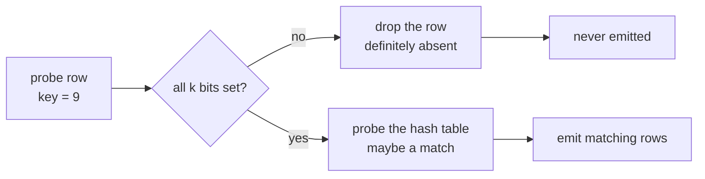
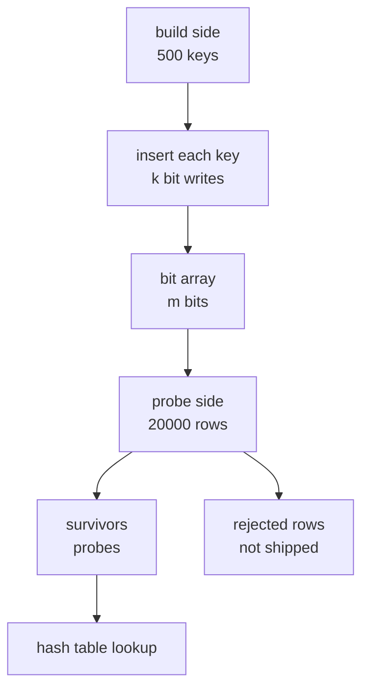
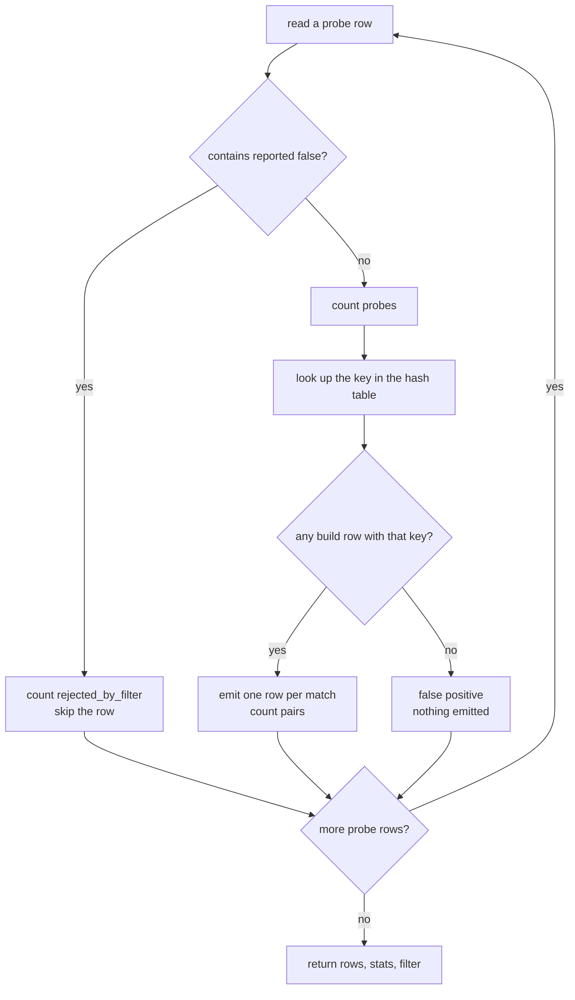
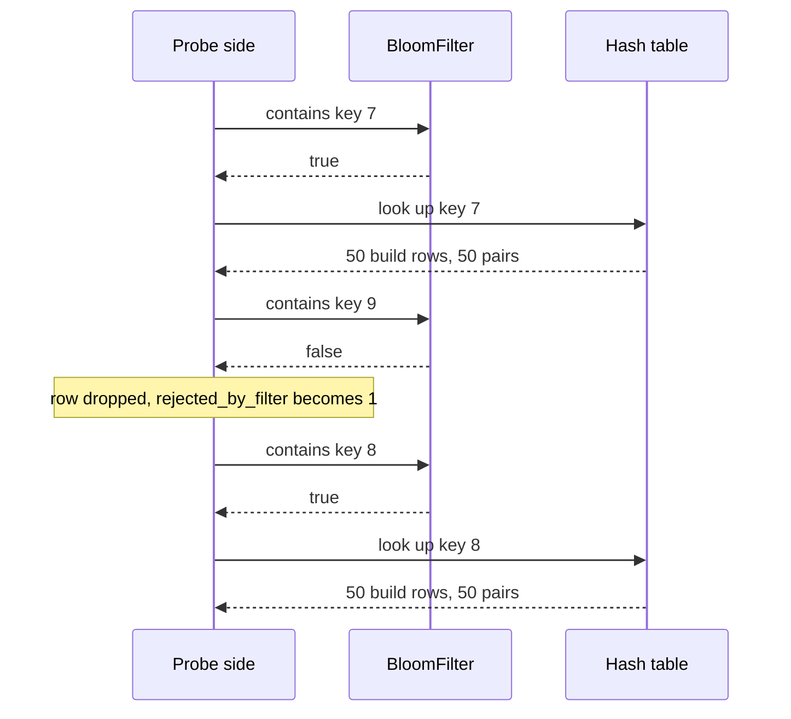

# 649 — Implement bloom join filter application and benchmarking

> **Tier:** Expert · **CTCI chapter:** Ch 14 — Databases
> **Task spec:** [649-implement-bloom-join-filter-application-and-benchmarking.md](../../../tasks/expert/649-implement-bloom-join-filter-application-and-benchmarking.md)
> **Solutions:** [Python](../../../solutions/python/expert/649-implement-bloom-join-filter-application-and-benchmarking/solution.py) ·
> [Java](../../../solutions/java/expert/649-implement-bloom-join-filter-application-and-benchmarking/Solution.java) ·
> [JavaScript](../../../solutions/javascript/expert/649-implement-bloom-join-filter-application-and-benchmarking/solution.js) ·
> [C#](../../../solutions/csharp/expert/649-implement-bloom-join-filter-application-and-benchmarking/Solution.cs)

## 1. Problem restatement

Build a **bloom-filter semijoin reduction** ("bloom join"): hash the join keys of the *build* side
into a bit array of `bits` bits with `hashes` probes per key, then probe that filter with every row
of the *probe* side. Rows that fail the filter are dropped before the ordinary hash join ever runs;
rows that pass go to the hash table as usual.

The four solution files expose the same interface:

| Piece | Contract |
| --- | --- |
| `fnv1a(text)` | 64-bit FNV-1a hash; no dependence on the host language's `hash()` |
| `BloomFilter(bits, hashes)` | bit array with `add`, `contains`, `positions`, `bits_set`, `keys`; rejects `bits < 1` or `hashes < 1` |
| `build_filter(keys, bits, hashes)` | insert every key, return the filter |
| `theoretical_false_positive_rate(bits, hashes, keys)` | `(1 - e^{-kn/m})^k` |
| `optimal_hashes(bits, keys)` | `k = (m/n) ln 2`, at least 1 |
| `plain_hash_join(build, probe, key = 1)` | reference join, returns `(rows, stats)` |
| `bloom_join(build, probe, key = 1, bits = none, hashes = none)` | filtered join, returns `(rows, stats, filter)` |

`stats` counts `probes` (rows that reached the hash table), `pairs` (emitted result rows),
`filter_probes` and `rejected_by_filter`. Input rows are tuples whose field `key` holds the join key.

Concrete results the checks assert:

- 120 keys inserted into a 512-bit filter with 3 hashes: **no false negatives**, `keys == 120`, and
  `bits_set() <= 512`.
- Build `[(i, 0..399 → key 1..500)]` against 600 probe rows: `bloom_join` returns **exactly** the
  rows of `plain_hash_join`, `filter_probes == 600` (one filter probe per probe row) and
  `probes <= 600`.
- Duplicate build side `[(i, 7) for i < 50] + [(i, 8) for i < 50]` probed with keys `(7, 8, 9, 7, 8)`:
  `200` result rows and `rejected_by_filter == 1` — only the absent key `9` is filtered out.
- Empty build side: every probe row is rejected, the join result is empty, `filter.keys == 0`.
- A deliberately tiny filter (`bits=64, hashes=1`) still returns the reference result, but rejects
  strictly fewer rows than the well-sized one.
- Benchmark: 500 selective build keys against 20000 probe rows → probes cut to less than a third;
  a filter covering every probe key (`rejected_by_filter == 0`) saves nothing.

## 2. Intuition

The naive plan is a plain hash join: build a hash table from the small side, stream the big side and
probe the table once per row. Every probe row costs a hash-table lookup even when the key is absent —
and if the two sides live on different machines, every probe row also costs network transfer. The
probe side is what we want to shrink, but it is exactly the side we have not read yet.

A bloom filter is the cheap summary that fixes this. It is a bit array plus `k` hash functions:

1. **Insert** — set the `k` bits addressed by the key.
2. **Query** — read those `k` bits; if any is clear, the key is *definitely absent*.
3. If all are set the key is *probably present* — a **false positive** is possible, a
   **false negative never is**.

That asymmetry is the whole point: dropping a row on a miss can never lose a matching row, so the
filtered join must return the same result as the unfiltered one. The hash probes use double hashing,
`(h1 + i * h2) mod m`, with `h2` forced odd so the arithmetic progression visits distinct slots.



The trade is not free: the filter is probed **once per probe row**, so that cost is always paid. It
pays off when the build side is selective, because then `rejected_by_filter` is large — those rows
never reach the hash table, and in a distributed plan they are never shipped.



## 3. Algorithm

1. Normalise the parameters. When the caller omits them, `bits = max(64, 10 * build keys)` and
   `hashes = optimal_hashes(bits, key count) = max(1, round(m/n * ln 2))`.
2. Allocate `ceil(m/8)` bytes and insert every build key with `add`, which sets all `k` probe bits.
3. Build the ordinary hash table of the build side, mapping key → list of rows (duplicates included).
4. For every probe row: count one `filter_probes`, call `contains`; on a miss increment
   `rejected_by_filter` and skip the row.
5. On a hit, count one `probes`, append every matching build row concatenated with the probe row,
   and count each such pair in `pairs`.
6. Return the rows, the stats and the filter; compare against `plain_hash_join`, which performs steps
   3 and 5 with no filter at all.

```text
procedure positions(key)
    first ← fnv1a("a:" + key)
    second ← fnv1a("b:" + key) or 1          // odd, so the sequence is a permutation
    for step ← 0 to hashes - 1 do
        emit (first + step * second) mod bits

procedure add(key)
    for position in positions(key) do
        words[position >> 3] ← words[position >> 3] or (1 << (position and 7))
    keys ← keys + 1

function contains(key)
    for position in positions(key) do
        if bit position is clear then
            return false                      // one-sided: this is a certain miss
    return true                               // maybe present

function optimal_hashes(bits, key_count)
    return max(1, round(bits / max(1, key_count) * ln 2))

procedure bloom_join(build, probe, key, bits, hashes)
    if bits is none then bits ← max(64, 10 * count(build)) end
    if hashes is none then hashes ← optimal_hashes(bits, count(build)) end
    bloom ← build_filter(build keys, bits, hashes)
    table ← hash_table_of(build, key)
    for row in probe do
        filter_probes ← filter_probes + 1
        if not contains(bloom, row[key]) then
            rejected_by_filter ← rejected_by_filter + 1
            continue
        probes ← probes + 1
        for match in table[row[key]] do
            pairs ← pairs + 1
            emit row concatenated with match
    return rows, stats, bloom
```



The only place a row can disappear is the `contains` check in the branch above, and that check never
reports a false negative — which is why the branch can be inserted at all.

## 4. Worked example

Duplicate-heavy build side from the checks: `build = [(i, 7) for i < 50] + [(i, 8) for i < 50]`
(100 rows, 2 distinct keys) and `probe = [(100, 7), (101, 8), (102, 9), (103, 7), (104, 8)]`.
The default sizing gives `bits = max(64, 10 * 2) = 64` and `hashes = max(1, round(64/2 * 0.693)) = 22`,
but the checks also run 1-hash filters; the table below shows the filter verdicts, which are
identical for every sizing because no false negative is possible.

| probe row | key | `contains` | `rejected_by_filter` after | `probes` after | match count | `pairs` after |
| --- | --- | --- | --- | --- | --- | --- |
| `(100, 7)` | 7 | true (inserted) | 0 | 1 | 50 | 50 |
| `(101, 8)` | 8 | true (inserted) | 0 | 2 | 50 | 100 |
| `(102, 9)` | 9 | false | 1 | 2 | 0 | 100 |
| `(103, 7)` | 7 | true | 1 | 3 | 50 | 150 |
| `(104, 8)` | 8 | true | 1 | 4 | 50 | 200 |

Result rows `200 = 2 * 50 + 2 * 50`, `rejected_by_filter == 1`, exactly as the assertions demand —
and `plain_hash_join` produces the same 200 rows with `probes == 5`, so the filter removed one of
five lookups here. On the benchmark workload the effect is much larger: a build of 500 keys
`(i % 500) * 199 + 1` against 20000 probe rows over key domain 100000 cuts `probes` to under a third
of the 20000 unfiltered probes.



## 5. Complexity

`n` = build rows, `p` = probe rows, `k` = hashes per key, `m` = bits, `s` = the 64-bit word size (the
solutions use one byte array entry per 8 bits; Java/C#/JS use the same packing).

| Step | Best | Average | Worst | Why the bound holds |
| --- | --- | --- | --- | --- |
| Build the filter | O(n) | O(nk) | O(nk) | exactly `k` bit writes per build key, each O(1) on a byte array |
| Build the hash table | O(n) | O(n) | O(n) | one append per build row, duplicates included |
| Filter a probe batch | O(pk) | O(pk) | O(pk) | one `contains` per probe row, `k` bit tests each — the irreducible cost |
| Join survivors | O(pairs) | O(pairs) | O(pairs) | survivors only; `probes <= p` |
| Reference hash join | O(n + p) | O(n + p + pairs) | O(n + p + pairs) | no filter step, so all `p` rows are probed |
| Space | O(m/8 + n) | O(m/8 + n) | O(m/8 + n) | bit array plus the hash table; the stats are O(1) |

The false-positive rate the checks compare against is `(1 - e^{-kn/m})^k`: with `m/n = 8` and
`k = optimal_hashes(800, 100) = 6` the formula predicts roughly `2%`, the measured rate over 20000
absent keys is asserted to lie between `0.005` and `0.10`, and the relative check accepts anything
within a factor of 4 of theory because double hashing only approximates independent hashes. Adding
bits is monotone: `m/n = 4` measures worse than `m/n = 8`, which measures worse than `m/n = 40`, and
`k = 1` is strictly worse than the optimal `k` at the same size.

## 6. Pitfalls and edge cases

- **False negatives are a correctness bug, not a tuning issue.** Every inserted key must pass
  `contains`; the checks assert this for all 120 keys of the first filter.
- **`h2` must not be even.** The solutions OR the second hash with 1; an even step would revisit only
  a sublattice of slots and inflate the false-positive rate.
- **Closure over the saturation.** A saturated filter (`bits = 64`, `hashes = 1`) still returns the
  reference result but rejects strictly fewer rows — a filter can be useless, never wrong.
- **Empty build side.** The filter has no bits set, so every probe row is rejected and the join is
  empty; the checks confirm the reference join agrees. `filter.keys == 0`.
- **Empty probe side.** Zero filter probes; nothing is emitted.
- **Absent keys in the probe side cannot be filtered with certainty** — only rejected, with the
  one-sided error being a *kept* row that then misses in the hash table.
- **Duplicate build keys** occupy one bit pattern but many hash-table entries; the 50-row-per-key case
  above is the regression test for that.
- **Parameter validation.** `BloomFilter(0, 3)` must raise; the solutions assert the failure rather
  than silently allocating a degenerate filter.
- **Sizing arithmetic.** The bit array is `ceil(m/8)` bytes, and the checks assert exactly that.
- **Keys are stringified** (`fnv1a("a:" + str(key))`), so `7` and `"7"` collide by construction; the
  prefix `"a:"`/`"b:"` keeps the two hashes of one key independent.
- **Determinism.** Repeating the same join must give identical rows *and* identical stats.

## 7. Variants and follow-ups

- **Distributed semijoin.** Ship the filter to the probe side and drop rows *before* the shuffle —
  compare with the shuffle-cost model in [657-implement-distributed-join-shuffle-simulation-in-map-reduce.md](../../../tasks/expert/657-implement-distributed-join-shuffle-simulation-in-map-reduce.md).
- **Exact instead of approximate filtering.** A bitmap index answers equality and range predicates
  exactly and composes with AND/OR; see [652-implement-bitmap-index-and-fast-and-or-operations.md](../../../tasks/expert/652-implement-bitmap-index-and-fast-and-or-operations.md).
- **Choosing the filter.** Building a filter is one of the candidate structures a workload-driven
  index advisor may pick: [654-implement-workload-driven-index-selection-greedy-heuristic.md](../../../tasks/expert/654-implement-workload-driven-index-selection-greedy-heuristic.md).
- **Join algorithms themselves.** The hash table this tutorial reduces into is implemented and
  benchmarked against nested-loop and sort-merge in
  [642-implement-join-algorithms-nested-loop-hash-join-sort-merge-join.md](../../../tasks/expert/642-implement-join-algorithms-nested-loop-hash-join-sort-merge-join.md).
- **Sampling instead of filtering.** Where a bloom filter removes rows *exactly-but-lossily*, reservoir
  sampling trades exactness of the whole answer for speed:
  [646-implement-approximate-query-processing-via-sampling-reservoir.md](../../../tasks/expert/646-implement-approximate-query-processing-via-sampling-reservoir.md).

## 8. Check yourself

1. **Why can a bloom join drop a probe row without changing the result?**
   <details><summary>Show answer</summary>Because `contains` only returns false for a key that was
   never inserted — the filter has one-sided error. Every matching row therefore survives to the hash
   table, so the emitted rows equal the plain hash join's rows.</details>
2. **The benchmark cuts probes from 20000 to under a third. Did the filter get those probes for free?**
   <details><summary>Show answer</summary>No. `filter_probes` is asserted to equal the full 20000 —
   the filter is probed once per probe row. The saving is in hash-table lookups (and, in a distributed
   plan, in rows that never get shipped), and it only materialises because the build side is
   selective.</details>
3. **Why force the second hash odd?**
   <details><summary>Show answer</summary>`(h1 + i*h2) mod m` visits `m / gcd(h2, m)` distinct slots.
   With `h2` odd and `m` a power of two the greatest common divisor is 1, so the `k` probes are
   distinct positions.</details>
4. **What changes when the build side covers every probe key?**
   <details><summary>Show answer</summary>`rejected_by_filter == 0` and `probes == len(probe)`: the
   filter is pure overhead — every probe row still reaches the hash table, exactly as the checks for
   the 60000-key build side assert.</details>
5. **How does the code pick `k` when the caller does not?**
   <details><summary>Show answer</summary>`optimal_hashes(bits, keys) = max(1, round(bits / keys * ln 2))`,
   the minimiser of `(1 - e^{-kn/m})^k`, and `bits` defaults to `10` bits per build key, never below 64.</details>
