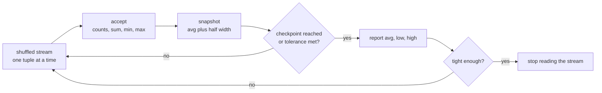
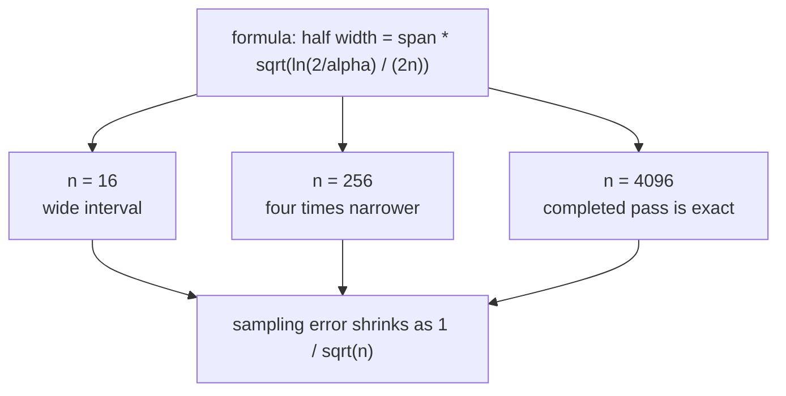
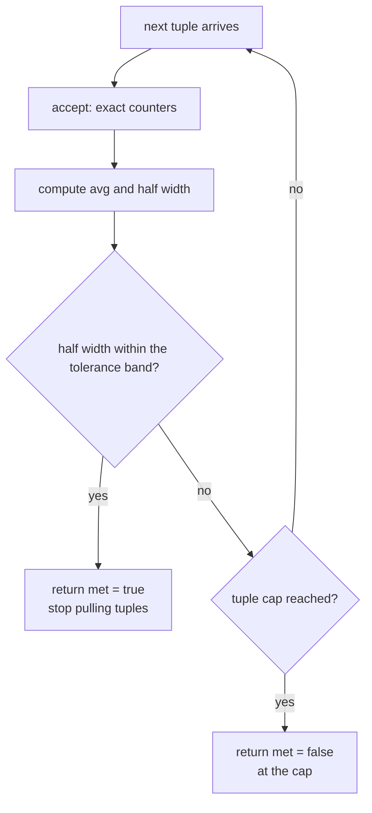
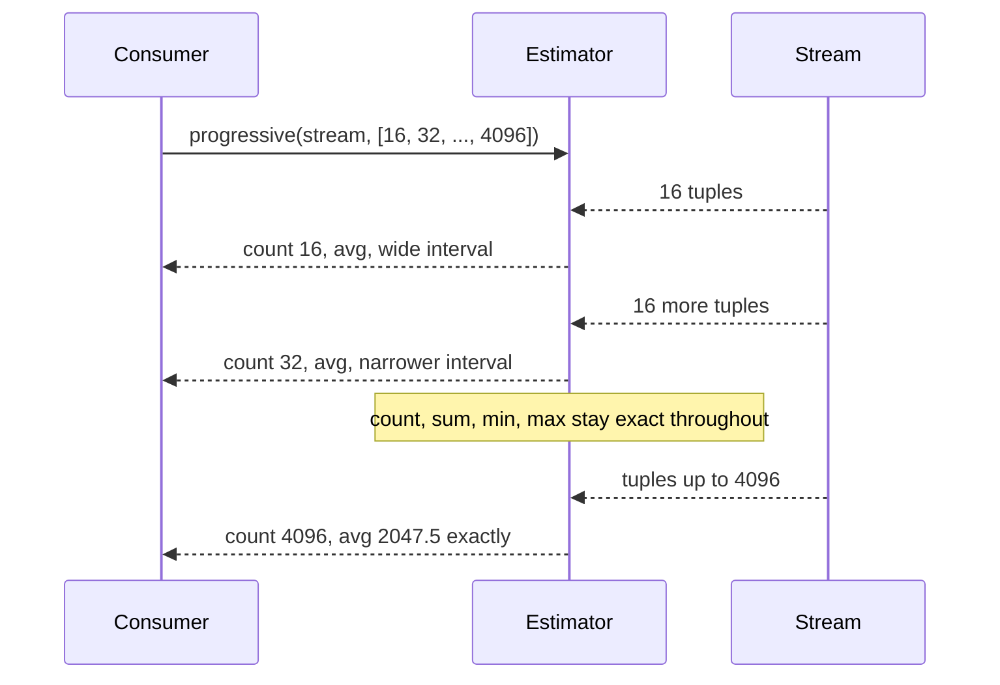

# 650 — Implement online aggregation progressive estimator

> **Tier:** Expert · **CTCI chapter:** Ch 14 — Databases
> **Task spec:** [650-implement-online-aggregation-progressive-estimator.md](../../../tasks/expert/650-implement-online-aggregation-progressive-estimator.md)
> **Solutions:** [Python](../../../solutions/python/expert/650-implement-online-aggregation-progressive-estimator/solution.py) ·
> [Java](../../../solutions/java/expert/650-implement-online-aggregation-progressive-estimator/Solution.java) ·
> [JavaScript](../../../solutions/javascript/expert/650-implement-online-aggregation-progressive-estimator/solution.js) ·
> [C#](../../../solutions/csharp/expert/650-implement-online-aggregation-progressive-estimator/Solution.cs)

## 1. Problem restatement

Instead of running an aggregate query to completion and then printing one number, an *online
aggregation* engine reports COUNT, SUM, AVG and the exact running MIN/MAX after **every** tuple, with
a confidence interval attached to the mean. This task implements that estimator plus the two
consumers of it: a checkpoint sampler and an early-stopping rule.

The four solution files expose the same interface:

| Piece | Contract |
| --- | --- |
| `shuffled_stream(size, seed)` | a deterministic Fisher-Yates permutation of `0 .. size-1` |
| `half_width(span, count, alpha = 0.05)` | Hoeffding half width `span * sqrt(ln(2/alpha) / (2n))`; `inf` when `count <= 0` |
| `OnlineAggregation(span, alpha)` | running exact `count`, `sum`, `min_seen`, `max_seen` |
| `accept(value)` | fold one tuple in and return its snapshot |
| `snapshot()` | `count`, `sum`, `avg`, `half_width`, `low`, `high`, `min_seen`, `max_seen` |
| `progressive(stream, checkpoints)` | yield `(tuples consumed, snapshot)` at each requested checkpoint |
| `run_until(stream, tolerance, max_tuples = none)` | stop as soon as the interval is tight enough; return `(snapshot, consumed, met)` |

The estimator is honest because the stream arrives in a *random* order (a seeded Fisher-Yates
shuffle), which is what lets the first `n` tuples be read as a sample of the whole input.

Concrete facts the checks assert on `size = 4096`, seed `20240601`, `span = 4095`:

- the population mean is exactly `2047.5` and the shuffle is a permutation of `0..4095`;
- the checkpoint schedule `2^4, 2^5, …, 2^12` yields **9** snapshots, in order, each with an exact
  count, an exact sum and exact running MIN/MAX;
- every interval brackets its own estimate, and the half width **decreases monotonically**;
- a completed pass is exact: `count == 4096` and `avg == 2047.5`;
- 25% of the stream gives under 15% relative error, 50% gives under 5%; every checkpoint estimate is
  within three half widths of the truth;
- across 30 further permutations the interval missed the truth at most once at `alpha = 0.05`;
- a 10% relative tolerance stops after fewer than `4096/3` tuples, a 1% tolerance never stops early;
- `alpha = 0.01` needs a wider interval than `alpha = 0.05`, and the stream generator is abandoned
  once `run_until` returns — the remaining tuples are never produced.

## 2. Intuition

The naive answer is "scan everything, then report": exact, but the user waits for the whole scan and
learns nothing along the way. The opposite naive answer — "report after every tuple with no error
bars" — is worse, because a running average over 3 tuples is noise.

The key insight is that the counters themselves need no approximation at all: COUNT, SUM, MIN and MAX
are exact after every tuple, cheaply maintainable in O(1). What is uncertain is *how close the running
mean is to the final mean*, and for a bounded column that uncertainty has a distribution-free bound —
Hoeffding's inequality. With values known to lie in an interval of width `span`,

    half_width(n) = span * sqrt(ln(2/alpha) / (2n))

so the reported interval is `avg ± half_width` and it shrinks like `1/sqrt(n)`: a 4x longer scan buys
2x accuracy. Because the bound needs only boundedness (not normality, not a known variance), it is
exactly the tool a query engine can use, and because it shrinks fast, a consumer with a 10% accuracy
budget can stop early and skip most of the input.



Random arrival order is load-bearing: with a fixed order (say a clustered column) the first `n` tuples
are a biased sample, the interval would systematically miss, and the early-stopping decision would be
made on the wrong evidence.



## 3. Algorithm

1. Materialise the arrival order: `shuffled_stream` builds `0..size-1` and swaps each position with a
   uniformly drawn earlier one, using a SplitMix64 generator seeded by the caller — deterministic and
   replayable.
2. `accept(value)` increments `count`, adds to `sum`, folds `min_seen`/`max_seen`, then returns a
   fresh snapshot. Counters are exact; the interval is only metadata.
3. `snapshot()` divides the running sum by the running count and computes the half width from the
   formula; with `count == 0` the width is infinite, which is honest rather than wrong.
4. `progressive(stream, checkpoints)` deduplicates and sorts the positive checkpoints, folds tuples
   until the next checkpoint, yields `(consumed, snapshot)` there and stops after the last one.
5. `run_until(stream, tolerance, max_tuples)` yields a snapshot per tuple and returns as soon as
   `half_width <= tolerance * abs(avg)` — abandoning the source iterator — or when `max_tuples` is
   reached with `met = false`.
6. The checks compare every snapshot against `prefix_stats`, an exact prefix oracle for the same
   stream, and validate the interval against the known population mean.

```text
function half_width(span, count, alpha)
    if count <= 0 then
        return infinity
    return span * sqrt(ln(2 / alpha) / (2 * count))

procedure accept(value)
    count ← count + 1
    total ← total + value
    minimum ← value if minimum is none or value < minimum else minimum
    maximum ← value if maximum is none or value > maximum else maximum
    return snapshot()

function snapshot()
    mean ← total / count if count > 0 else 0.0
    width ← half_width(span, count, alpha)
    return { count, sum: total, avg: mean, half_width: width,
             low: mean - width, high: mean + width, min_seen: minimum, max_seen: maximum }

procedure progressive(stream, checkpoints)
    schedule ← ascending, de-duplicated checkpoints greater than zero
    consumed ← 0
    for value in stream do
        current ← accept(value)
        consumed ← consumed + 1
        if schedule is not empty and consumed = first(schedule) then
            emit (consumed, current)
            drop first(schedule)
            if schedule is empty then
                return

procedure run_until(stream, tolerance, max_tuples)
    consumed ← 0
    current ← snapshot()
    for value in stream do
        consumed ← consumed + 1
        current ← accept(value)
        if current.avg is not zero and current.half_width <= tolerance * abs(current.avg) then
            return current, consumed, true
        if max_tuples is not none and consumed >= max_tuples then
            break
    return current, consumed, false
```



Note the two independent jobs in the loop: the *counters* are always exact, and only the *stopping
decision* uses the statistical bound. Nothing in the reported COUNT/SUM/MIN/MAX depends on `alpha`.

## 4. Worked example

The check configuration: `shuffled_stream(4096, 20240601)`, `span = 4095`, `alpha = 0.05`, checkpoints
`16, 32, 64, …, 4096`, truth `2047.5`.

| Checkpoint | What is asserted there | Oracle comparison |
| --- | --- | --- |
| 16 | `count == 16`, `sum` exact, `min_seen`/`max_seen` exact, `avg == sum / count`, `low <= avg <= high` | `prefix_stats(stream)[15]` |
| 32 | same, and `half_width` strictly smaller than at 16 | `prefix_stats(stream)[31]` |
| 1024 (25% of the stream) | relative error of `avg` below 15% | oracle sum/count |
| 2048 (50% of the stream) | relative error of `avg` below 5% | oracle sum/count |
| 4096 | `count == 4096` and `avg == 2047.5` exactly; interval contains the truth | `prefix_stats(stream)[4095]` |

Every intermediate width is also compared against the formula itself (`half_width(span, count)`) and
against the preceding checkpoint, so monotone shrinkage is checked rather than assumed.

A tiny illustrative stream makes the counter arithmetic explicit — `span = 10`, `alpha = 0.05`,
values `7, 3, 9`:

| Step | `count` | `sum` | `min_seen` | `max_seen` | `avg` | `half_width` |
| --- | --- | --- | --- | --- | --- | --- |
| before any tuple | 0 | 0 | none | none | 0.0 | infinite |
| after `7` | 1 | 7 | 7 | 7 | 7.0 | `10 * sqrt(ln 40 / 2)` |
| after `3` | 2 | 10 | 3 | 7 | 5.0 | `10 * sqrt(ln 40 / 4)` |
| after `9` | 3 | 19 | 3 | 9 | 6.333… | `10 * sqrt(ln 40 / 6)` |

The width shrinks by the factor `sqrt(n_old / n_new)` on every step, and `min_seen`/`max_seen` never
move backwards — they are exact at every row of the table, exactly as the 4096-tuple checks require.



Early stopping on the same stream: the 10% tolerance is met after fewer than `4096/3` tuples and the
interval returned still contains `2047.5`, while the 1% tolerance is never met and the run consumes
all 4096 tuples — so a looser tolerance provably stops earlier. A counting wrapper around the stream
confirms that the tuples after the stop point are never even generated.

## 5. Complexity

`n` = tuples consumed, `S` = `span`, `α` = `alpha`.

| Operation | Best | Average | Worst | Why the bound holds |
| --- | --- | --- | --- | --- |
| `accept` | O(1) | O(1) | O(1) | one add, one addend, two comparisons, then a constant-size dict |
| `snapshot` | O(1) | O(1) | O(1) | one division, one `log`, one `sqrt` |
| `progressive` over a stream | O(k) | O(last checkpoint) | O(n) | one fold per tuple, one yield per checkpoint, `k` = checkpoint count |
| `run_until` (tolerance met) | O(1) | O(n_ε) | O(n) | stops at the first `n` with `half_width ≤ ε·avg` |
| Space | O(1) | O(1) | O(1) | constant state: count, sum, min, max, span, alpha |

Solving the width formula for the accuracy budget shows why early stopping works: the condition
`S·sqrt(ln(2/α)/(2n)) ≤ ε·avg` is met at `n ≈ ln(2/α)·S² / (2·ε²·avg²)`, which grows only like
`1/ε²` — halve the allowed error and you need four times the rows, not exponentially many.

For comparison, the exact alternative is a full scan: O(size) tuples and O(1) space, giving a perfect
answer only at the end, with no intermediate estimate at all. The estimator pays O(1) per tuple for
the same counters and adds one cheap `sqrt` per reported snapshot. `prefix_stats`, the oracle used by
the checks, spends O(size) extra memory because it stores every prefix — which is precisely what the
online estimator avoids.

## 6. Pitfalls and edge cases

- **Zero tuples.** `count == 0` gives `half_width == inf` and `avg == 0.0`; the interval is vacuous,
  not wrong. `progressive` on an empty stream yields nothing.
- **`alpha` widens or narrows the band.** `alpha = 0.01` must give a wider half width than `0.05` at
  the same `n` — the checks assert the strict inequality and that the completed result is still exact.
- **The bound needs a bounded domain.** `span` is caller-supplied metadata (`size - 1` here); if the
  real values can exceed it the interval is a lie. The running MIN/MAX are exact, so they can be used
  to tighten `span` as the scan progresses.
- **Arrival order matters.** The shuffle is what makes the first `n` tuples a sample. The checks run
  30 extra permutations and allow at most one interval miss at `alpha = 0.05` — the expected rate.
- **The `avg` guard.** `run_until` tests `current.avg is not zero` before dividing; a stream whose
  running mean is exactly zero can never satisfy a *relative* tolerance, so it runs to the cap.
- **Cap semantics.** `max_tuples` returns `met = false` with the snapshot at the cap — the caller must
  read the flag, not just the snapshot.
- **Checkpoint hygiene.** Checkpoints are de-duplicated, sorted and filtered to positive values, and a
  duplicate checkpoint must not produce a duplicate snapshot; the run stops after the last one, even
  if the stream has more tuples to give.
- **Source abandonment.** `run_until` returns from inside the `for` loop, so the generator is closed
  early; the checks count generated tuples to prove the rest were never produced.
- **Determinism.** The same seed and schedule reproduce byte-identical snapshots; nothing depends on
  wall-clock time or on the host's hash randomisation.
- **Exactness at the end.** An intermediate estimate is *not* the answer: only a completed pass is
  exact (`count == size`, `avg == 2047.5`).

## 7. Variants and follow-ups

- **Sampling instead of full scanning.** Reservoir sampling answers an aggregate from a bounded
  sample; the interval machinery is the same idea taken one step further —
  [646-implement-approximate-query-processing-via-sampling-reservoir.md](../../../tasks/expert/646-implement-approximate-query-processing-via-sampling-reservoir.md).
- **Streaming operators.** Pipelined execution is what makes tuple-at-a-time reporting possible at
  all: [644-implement-query-execution-engine-operator-pipelining-simulation.md](../../../tasks/expert/644-implement-query-execution-engine-operator-pipelining-simulation.md).
- **Incremental aggregates.** The same "keep a small state, fold each tuple" pattern maintains
  materialized views incrementally:
  [645-implement-materialized-view-maintenance-incremental-algorithm.md](../../../tasks/expert/645-implement-materialized-view-maintenance-incremental-algorithm.md).
- **Reducing the scanned volume first.** A bloom filter drops rows before they reach the aggregate:
  [649-implement-bloom-join-filter-application-and-benchmarking.md](../../../tasks/expert/649-implement-bloom-join-filter-application-and-benchmarking.md).
- **Vectorised folding.** Batching tuples per operator call amortises the per-tuple overhead:
  [648-implement-vectorized-execution-for-simple-sql-operators.md](../../../tasks/expert/648-implement-vectorized-execution-for-simple-sql-operators.md).

## 8. Check yourself

1. **Which reported quantities are exact and which are estimates?**
   <details><summary>Show answer</summary>COUNT, SUM, MIN and MAX are exact after every tuple.
   The interval around AVG is the estimate: it is a bound, and AVG is only *probably* close to the
   final answer until the scan completes.</details>
2. **Why does the half width shrink like `1/sqrt(n)` rather than `1/n`?**
   <details><summary>Show answer</summary>Because the bound is
   `span * sqrt(ln(2/alpha) / (2n))` — Hoeffding's inequality for bounded variables. Independent
   sampling error concentrates at rate `1/sqrt(n)`, so 4x the tuples buys 2x the accuracy.</details>
3. **Why must the stream be shuffled?**
   <details><summary>Show answer</summary>The interval treats the first `n` tuples as a sample of the
   whole input. In a fixed (for example clustered) order they are not representative, so the interval
   would miss systematically and the early-stopping decision would be made on a biased estimate.</details>
4. **What happens when the running mean is exactly zero?**
   <details><summary>Show answer</summary>A relative tolerance of the form
   `half_width <= tolerance * abs(avg)` can never be satisfied, since the left side is positive; the
   `avg is not zero` guard skips the test and the run continues to the `max_tuples` cap with
   `met = false`.</details>
5. **Does stopping early change the numbers that were already reported?**
   <details><summary>Show answer</summary>No. Every snapshot is a function of the tuples consumed so
   far only, and the counters are exact. Stopping early just means the last snapshot reported is not
   the exact final answer — which is why `run_until` returns the `met` flag alongside it.</details>
