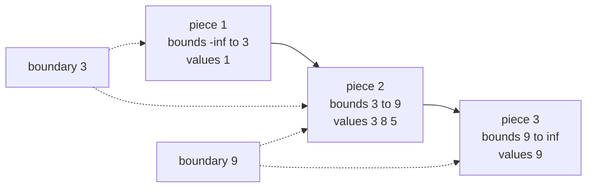
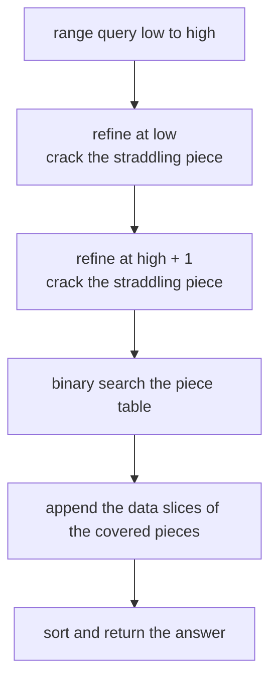
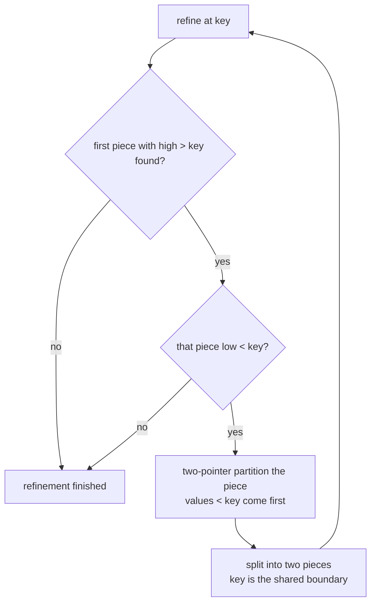
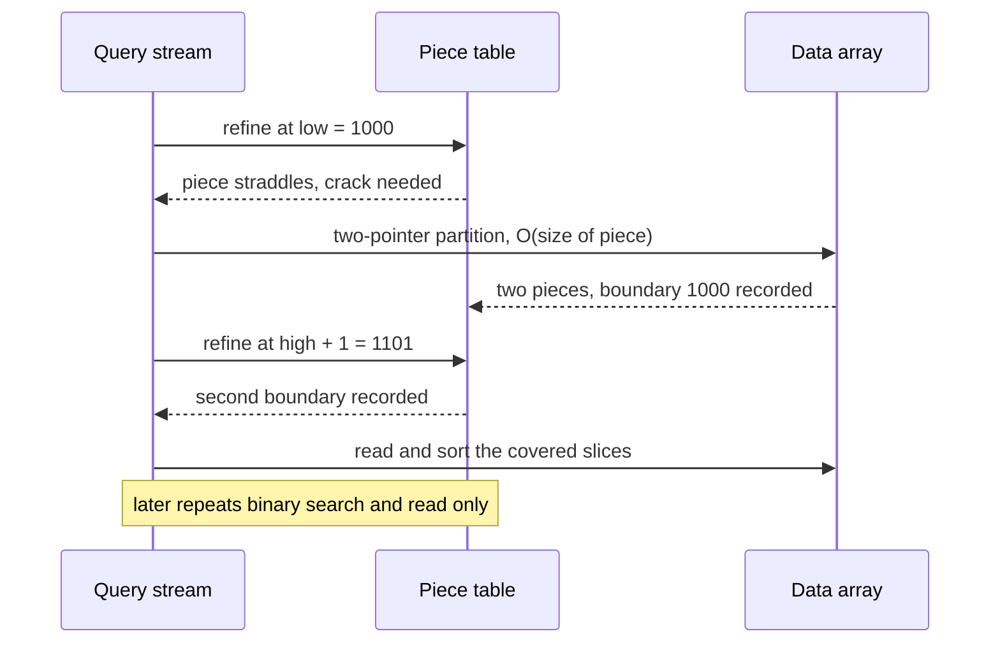

# 651 — Implement adaptive indexing (database cracking) prototype

> **Tier:** Expert · **CTCI chapter:** Ch 14 — Databases
> **Task spec:** [651-implement-adaptive-indexing-database-cracking-prototype.md](../../../tasks/expert/651-implement-adaptive-indexing-database-cracking-prototype.md)
> **Solutions:** [Python](../../../solutions/python/expert/651-implement-adaptive-indexing-database-cracking-prototype/solution.py) ·
> [Java](../../../solutions/java/expert/651-implement-adaptive-indexing-database-cracking-prototype/Solution.java) ·
> [JavaScript](../../../solutions/javascript/expert/651-implement-adaptive-indexing-database-cracking-prototype/solution.js) ·
> [C#](../../../solutions/csharp/expert/651-implement-adaptive-indexing-database-cracking-prototype/Solution.cs)

## 1. Problem restatement

Build a *cracking* column: no index is created up front, and every range query **partially sorts the
array around its own boundaries**. Over time the column organises itself into a set of contiguous
pieces whose value intervals are increasing with physical order, so later queries read whole pieces
without comparing elements.

The interface of the four solution files:

| Piece | Contract |
| --- | --- |
| `CrackingColumn(values)` | keeps `data` in place plus a piece table `(start, end, low, high)` with half-open value intervals |
| `query(low, high)` | every value `v` with `low <= v <= high`, ascending; cracks while answering |
| `brute(low, high)` | reference full scan, used as the oracle |
| `check_invariants()` | asserts the piece invariants after every query |
| counters | `comparisons`, `search_comparisons`, `moves`, `cracks`, `queries` |

The invariants that must hold after **every** query:

1. the pieces tile `[0, n)` exactly and each piece's value interval `[low, high)` is non-empty;
2. a piece's `low` equals its predecessor's `high` — the bounds chain, so the intervals increase with
   physical order;
3. every value `v` of a piece satisfies `low <= v < high`;
4. `data` remains a permutation of the input;
5. within a piece, the values of earlier pieces are all smaller than the values of later ones.

Concrete results the checks assert:

- `CrackingColumn([5, 3, 8, 1, 9]).query(3, 8) == [3, 5, 8]`, invariants hold, and `sorted(data)` is
  still `[1, 3, 5, 8, 9]` — cracking permutes, it never loses values.
- Degenerate ranges: `query(7, 7) == []`, `query(9, 9) == [9]`, `query(10, 20) == []`,
  `query(2, 1) == []` (an inverted range answers empty).
- 6 random columns of 60 values over a domain of 25 values, 12 overlapping queries each: every answer
  equals `brute`, and `len(pieces) <= 1 + 2 * queries`, `cracks <= 2 * queries`.
- A constant column `[4] * 40`: `query(4, 4)` returns all 40 rows, `query(3, 3)` and `query(5, 5)` are
  empty.
- Adaptation on 1000 values: a first full-domain query costs `cost_wide` comparisons, while 200
  repeats cost less *per query* than that first scan; a narrow range `[1000, 1100]` queried 200 times
  beats 200 full scans (the baseline charges two comparisons per row) by more than 20x, and the
  amortised per-query cost is more than 10x below the first cracking query.
- A mixed workload of 10 distinct-but-overlapping ranges, each run 21 times, stays below a fifth of
  the 200-full-scan baseline; repeated queries add no new cracks and identical query streams produce
  identical pieces.

## 2. Intuition

The naive idea is: build the index first (sort the column, build a B-tree), then answer queries. That
is optimal for a long workload but pays a full sort before the first answer — bad when the column is
huge and the first query touches 1% of it.

The cracking idea inverts the order: **the query is the index build**. Answering a range query only
requires knowing *where* the range starts and ends, so the engine partitions the part of the array
that straddles a boundary into "below the boundary" and "above the boundary" — a two-pointer partition
of a single piece, O(size of the piece) swaps, no full sort. Afterwards that boundary is materialised
as a new piece edge. Repeat over a workload and the array becomes progressively sorted *exactly where
queries look*, which is why the same query stream gets monotonically cheaper.



Because the piece intervals increase with physical order, the piece containing a boundary — or the
pieces inside a query range — are found by **binary search over the piece table**. A query cracks at
most two boundaries (its own `low` and `high + 1`), and pieces entirely inside the range are read
straight out of `data` without a single element comparison: that is the whole speed-up.



## 3. Algorithm

1. Keep `data` exactly as given, plus a piece table initialised to one piece
   `(0, n, -inf, +inf)`.
2. To refine at a key: binary search for the first piece whose `high > key`; if that piece's `low` is
   already `>= key` the table is refined there and the refinement stops. Otherwise crack that piece.
3. Crack a piece with a two-pointer partition: advance `left` while `data[left] < key`, retreat
   `right` while `data[right] >= key`, swap, repeat. The piece becomes `(start, left, low, key)` and a
   new piece `(left, end, key, high)` is inserted after it — the halves inherit the parent's bounds.
4. Loop step 2 until no straddling piece remains, so a key is cracked at most once per table edge.
5. A range query `[low, high]` refines at `low` and at `high + 1` (piece bounds are half-open), then
   binary searches for the first piece with `low >= low` and the last piece with `high <= high + 1`.
6. Concatenate those pieces' slices, sort them, return. An inverted range answers empty immediately.

```text
procedure refine(key)
    while true do
        index ← find_straddle(key)
        if index < 0 then
            return
        crack(index, key)

function find_straddle(key)
    lo, hi ← 0, number of pieces
    while lo < hi do                       // first piece whose high exceeds key
        mid ← (lo + hi) / 2
        search_comparisons ← search_comparisons + 1
        if pieces[mid].high <= key then lo ← mid + 1 else hi ← mid
    if lo >= number of pieces then
        return -1
    search_comparisons ← search_comparisons + 1
    return lo if pieces[lo].low < key else -1

procedure crack(index, key)
    start, end, low, high ← pieces[index]
    left ← start
    right ← end - 1
    while true do
        while left <= right and data[left] < key do left ← left + 1
        while left <= right and data[right] >= key do right ← right - 1
        if left >= right then break
        swap data[left] and data[right]
        moves ← moves + 2
        left ← left + 1
        right ← right - 1
    pieces[index] ← (start, left, low, key)
    insert (left, end, key, high) after index     // the key becomes a shared boundary
    cracks ← cracks + 1

procedure query(low, high)
    queries ← queries + 1
    if high < low then return empty list
    upper ← high + 1
    refine(low)
    refine(upper)
    first ← binary search: first piece with piece.low >= low
    last ← binary search: last piece with piece.high <= upper
    result ← concatenation of data[piece.start .. piece.end) for pieces first .. last
    sort result
    return result
```



The loop in the diagram is what makes cracking *incremental*: each iteration only splits the one piece
that still straddles `key`, never the whole column.

## 4. Worked example

Column `[5, 3, 8, 1, 9]`, query `[3, 8]` — the hand-checked example, so `upper = 9`.

| Step | Action | `data` | piece table after |
| --- | --- | --- | --- |
| start | one piece covers everything | `[5, 3, 8, 1, 9]` | `(0,5, -inf, +inf)` |
| 1 | crack at `3`: two-pointer partition of the whole array | `[1, 3, 8, 5, 9]` | `(0,1, -inf,3)`, `(1,5, 3,+inf)` |
| 2 | crack at `9`: the `3..inf` piece is partitioned again | `[1, 3, 8, 5, 9]` | `(0,1, -inf,3)`, `(1,4, 3,9)`, `(4,5, 9,+inf)` |
| 3 | locate: first piece with `low >= 3` is piece 2, last with `high <= 9` is piece 2 | unchanged | unchanged |
| 4 | read `data[1:4]`, sort | `[3, 5, 8]` | unchanged |

The partition in step 1 swapped positions 0 and 3 (the `5` out, the `1` in) and stopped with
`left = 1`; step 2 walked `9` to the end of its piece without moving adjacent values, which is why the
final array looks untouched. Four comparisons-heavy scans later, two boundaries are permanent: the
piece intervals `(-inf, 3)`, `(3, 9)`, `(9, +inf)` are exactly the chained bounds the invariant check
verifies, and the permutation `[1, 3, 8, 5, 9]` still contains every input value.

Follow-up point queries in the same column show the payoff:

| Query | Refinements performed | Pieces searched | Answer |
| --- | --- | --- | --- |
| `[3, 8]` | crack at `3`, crack at `9` | 1 | `[3, 5, 8]` |
| `[9, 9]` | crack at `10` splits the last piece at the maximum | 1 | `[9]` |
| `[7, 7]` | crack at `7` and at `8` splits the middle piece | 1 | `[]` |
| `[7, 7]` again | none — both boundaries already exist | 1 | `[]` |

That last row is the adaptive-indexing effect in miniature: the second identical query adds no cracks
at all, and the checks measure the same effect on 1000-row columns, where 200 repeats of a narrow
range cost under a twentieth of 200 full scans.



## 5. Complexity

`n` = column size, `q` = queries executed so far, `a` = answer size, `P` = pieces in the table.

| Operation | Best | Average | Worst | Why the bound holds |
| --- | --- | --- | --- | --- |
| `query` on a fully refined range | O(log P + a) | O(log P + a + w) | O(log P + n + a log a) | two binary searches over the piece table, plus at most two partition scans `w`; the answer is sorted |
| `crack` of one piece | O(1) | O(w) | O(w) | two-pointer partition touches each element of the piece once; `w` is the piece length |
| Cracks per query | 0 | ≤ 2 | 2 | only the boundaries `low` and `high + 1` can require a crack, and each is cracked once |
| Piece table growth | O(1) | O(1) | O(2) | at most two pieces are inserted per query, hence `P <= 1 + 2q` (asserted) |
| Space | O(n) | O(n) | O(n) | data in place plus one piece entry per crack |
| Full-scan baseline | O(n) | O(n) | O(n) | `brute` charges two comparisons per row, the no-index comparison |
| Full sort baseline | O(n log n) | O(n log n) | O(n log n) | what building the index up front costs before the first answer |

The interesting comparison is the *amortised* one: the first query in a cold column pays the partition
cost (the checks assert `cost_first >= n`), while the 200th repeat pays only the binary search plus the
slices it needs — the measurements assert `cost_later * 20 < baseline` and
`cost_later / 200 * 10 < cost_first`. A workload that keeps querying the same region keeps improving;
a workload that asks for a brand-new region every time degenerates to "a partition per query", which
is still never worse than a full scan per query.

## 6. Pitfalls and edge cases

- **Empty and degenerate columns.** A one-element piece with `low == high` is rejected by the invariant
  check, so cracking never creates empty value intervals; a range over an empty column answers `[]`.
- **Inverted ranges.** `high < low` must return `[]` *before* any cracking, as the `query(2, 1)` check
  requires.
- **Half-open bounds.** Piece intervals are `[low, high)` while queries are inclusive, so `query` must
  refine at `high + 1`. Using `high` itself silently loses the rows equal to the upper bound.
- **Constant columns.** `[4] * 40` cracks into pieces whose interval is degenerate on one side;
  `query(4, 4)` must still return all 40 rows and `query(3, 3)`/`query(5, 5)` must be empty.
- **The partition must be stable against the boundary convention.** `data[left] < key` and
  `data[right] >= key` is the pair that produces a piece equal to `key` on the right; swapping the two
  comparisons yields the same elements but a mismatched piece table.
- **Values must never be lost or invented.** The array stays a permutation of the input — checked on
  the 5-element example and on every random column.
- **Repeated queries must not re-crack.** `find_straddle` returns `-1` when the piece's `low` is
  already the key, so a repeat adds no pieces (asserted by `len(pieces)` staying constant).
- **Determinism.** The same values and the same query stream must produce the same `data`, the same
  pieces and the same comparison counters.
- **Piece table memory.** The table is a plain list of tuples, not a compressed on-disk map, and crack
  keys are always query boundaries — no learned/AVL structure over the pieces.
- **Counters are part of the contract.** Comparisons spent searching the piece table are counted
  separately from comparisons spent scanning data, so the adaptation claim is measurable rather than
  anecdotal.

## 7. Variants and follow-ups

- **Choosing indexes deliberately.** Cracking is the "no planning at all" end of the spectrum; compare
  with a workload-driven advisor that picks a fixed index set up front:
  [654-implement-workload-driven-index-selection-greedy-heuristic.md](../../../tasks/expert/654-implement-workload-driven-index-selection-greedy-heuristic.md).
- **Storing the cracked column.** The pieces are exactly what a compressed column layout has to keep:
  [653-implement-compressed-column-encoding-schemes-rle-dictionary-and.md](../../../tasks/expert/653-implement-compressed-column-encoding-schemes-rle-dictionary-and.md).
- **Exact predicate answers instead of sorting work.** A bitmap index answers equality/range predicates
  with word-parallel AND/OR rather than partitioning:
  [652-implement-bitmap-index-and-fast-and-or-operations.md](../../../tasks/expert/652-implement-bitmap-index-and-fast-and-or-operations.md).
- **Where the tuples go next.** A cracked column feeds pipelined operators without a sort barrier:
  [644-implement-query-execution-engine-operator-pipelining-simulation.md](../../../tasks/expert/644-implement-query-execution-engine-operator-pipelining-simulation.md).
- **Partial results while scanning.** Online aggregation reports answers *during* the scan, the same
  bet that cracking makes about the workload:
  [650-implement-online-aggregation-progressive-estimator.md](../../../tasks/expert/650-implement-online-aggregation-progressive-estimator.md).

## 8. Check yourself

1. **Why is a range query enough to refine the column, without sorting it?**
   <details><summary>Show answer</summary>Answering `[low, high]` only requires that everything below
   `low` sits before everything inside the range, and everything above it after. A partition around the
   two boundaries achieves exactly that in O(piece length) instead of O(n log n).</details>
2. **Why does a query crack at most twice?**
   <details><summary>Show answer</summary>Only two keys are materialised: `low` and `high + 1`. Once a
   boundary exists, `find_straddle` returns `-1` for it, so a repeat query cracks nothing — the
   `cracks <= 2 * queries` assertion.</details>
3. **What is `high + 1` for?**
   <details><summary>Show answer</summary>Piece intervals are half-open while the query is inclusive.
   Without refining at `high + 1` the rows equal to `high` would either be left in a straddling piece
   or dropped from the answer.</details>
4. **How can reading the answer avoid element comparisons?**
   <details><summary>Show answer</summary>Because the piece bounds chain upward with physical order,
   every piece fully inside `[low, high]` is known to contain only matching values; its slice is copied
   verbatim and the whole answer is sorted once at the end.</details>
5. **Which workloads does cracking *not* help?**
   <details><summary>Show answer</summary>Workloads that always query a brand-new, non-overlapping
   region: each such query pays a partition without any later query reusing the boundary. It still
   never costs more than a full scan per query, but the amortised win of the repeated-range benchmark
   does not materialise.</details>
