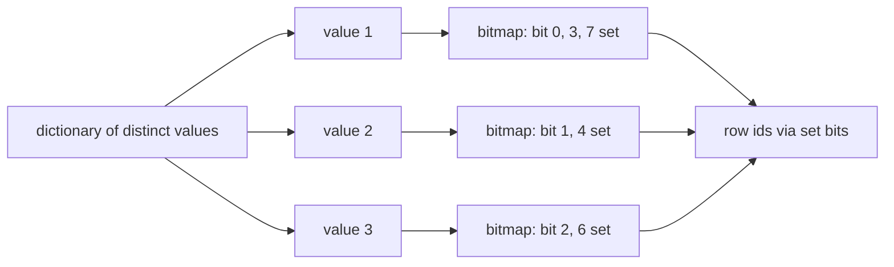
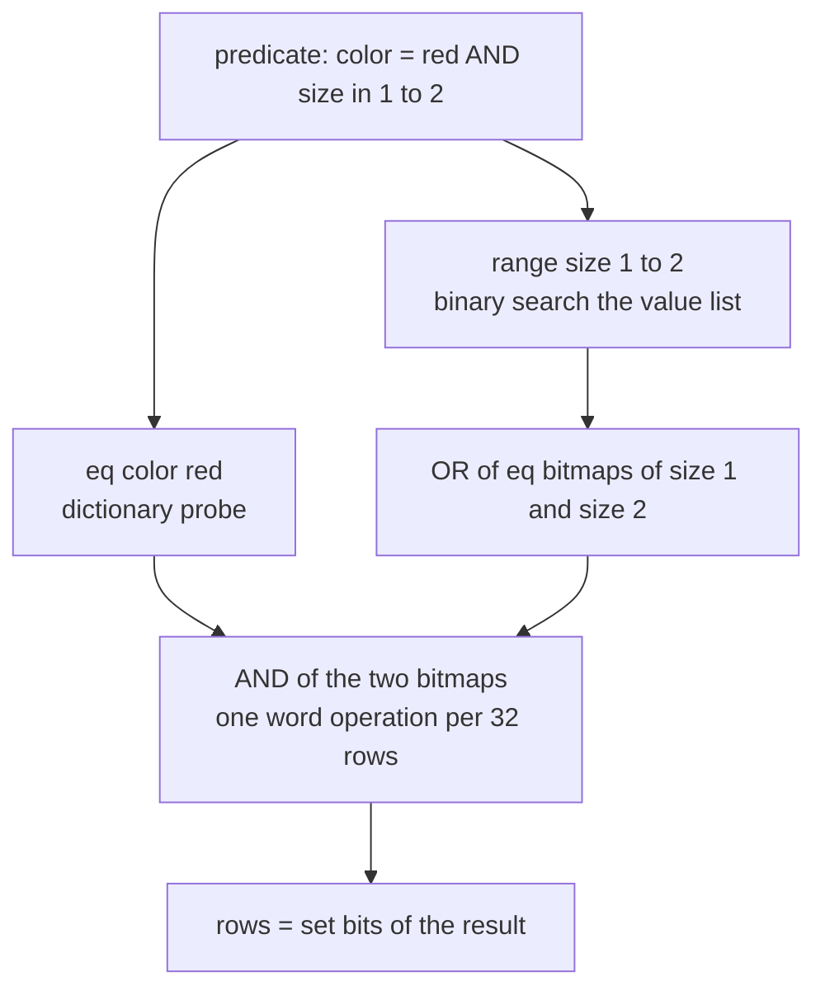
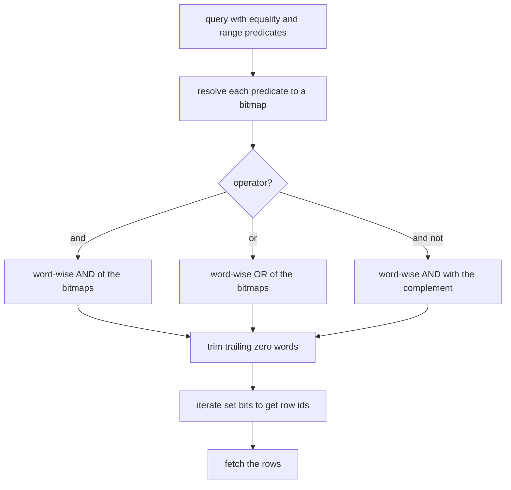
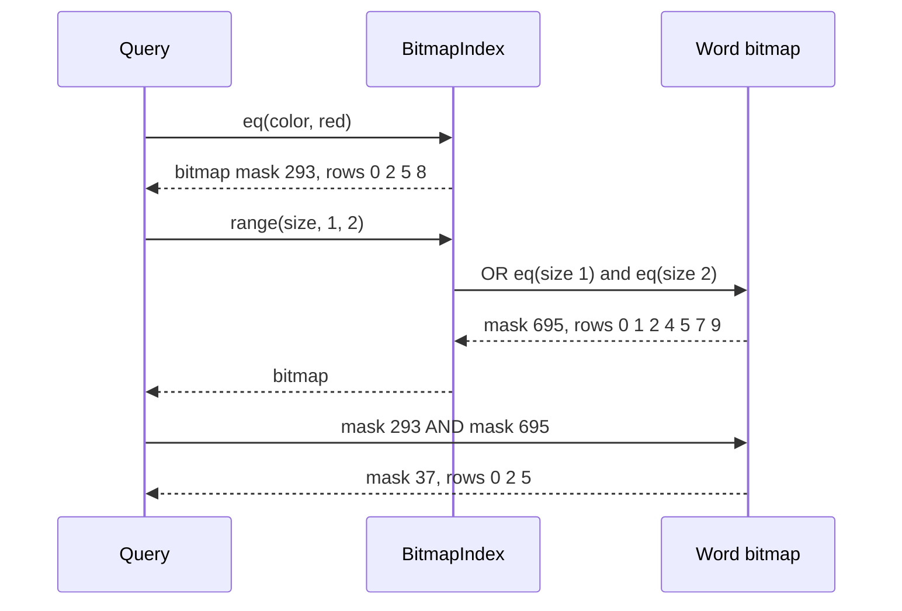

# 652 — Implement bitmap index and fast AND/OR operations

> **Tier:** Expert · **CTCI chapter:** Ch 14 — Databases
> **Task spec:** [652-implement-bitmap-index-and-fast-and-or-operations.md](../../../tasks/expert/652-implement-bitmap-index-and-fast-and-or-operations.md)
> **Solutions:** [Python](../../../solutions/python/expert/652-implement-bitmap-index-and-fast-and-or-operations/solution.py) ·
> [Java](../../../solutions/java/expert/652-implement-bitmap-index-and-fast-and-or-operations/Solution.java) ·
> [JavaScript](../../../solutions/javascript/expert/652-implement-bitmap-index-and-fast-and-or-operations/solution.js) ·
> [C#](../../../solutions/csharp/expert/652-implement-bitmap-index-and-fast-and-or-operations/Solution.cs)

## 1. Problem restatement

Build a **bitmap index**: for every value of every column, one bitmap with a set bit per row holding
that value. Predicates then become bitwise algebra — equality is a dictionary probe, a range is the OR
of the covered equality bitmaps, a conjunction is the AND of predicate bitmaps — and the answer is read
off the resulting bitmap.

Two representations of the same set are implemented and cross-validated:

| Type | Representation | Boolean cost |
| --- | --- | --- |
| `Bitmap` | dense row ids packed 32 bits to a word (`WORD_BITS = 32`) | word-parallel: one machine word per 32 rows |
| `RunBitmap` | sorted disjoint `[start, end)` runs of set bits | linear sweeps over two run lists |

The interface of the four solution files:

| Piece | Contract |
| --- | --- |
| `Bitmap` | `add`, `discard`, `contains`, `cardinality`, `iter_bits`/`rows`/`as_set`, `and_`, `or_`, `and_not`, `xor_`, equality against another bitmap |
| `RunBitmap` | `from_rows`, `from_bitmap`, `to_bitmap`, `cardinality`, `stored_words`, `and_`, `or_`, `and_not` |
| `BitmapIndex(columns, row_count)` | `eq`, `values_in_range`, `range`, `any_of`, `all_of` |
| `brute_rows(columns, predicate)` | reference row filter |

Concrete results the checks assert on a 10-row table (`color` = red/blue/red/green/…, `size` = 1/2/1/3/…):

- `eq("color", "red").rows() == [0, 2, 5, 8]` with `cardinality() == 4`;
  `eq("color", "yellow")` is empty.
- `range("size", 1, 2).rows() == [0, 1, 2, 4, 5, 7, 9]` and equals `brute_rows`; `range("size", 4, 9)`
  is empty.
- `all_of([("color", "red"), ("size", 1)]) == [0, 2, 5]`, `all_of([("color", "red"), ("size", 3)]) == [8]`,
  and the AND of no predicates is the empty bitmap.
- `any_of("color", ["green", "never"]) == [3, 6, 9]` — unknown values contribute nothing.
- Word-parallel AND equals a bit-by-bit probe loop; `or_` equals the union of rows; `and_not(red, two_or_less) == [8]`;
  XOR with itself is empty; AND with the empty bitmap is empty; OR with it is the identity.
- High row ids survive word boundaries: bits `0, 31, 32, 5000` set give `len(words) == 5000/32 + 1`.
- Every run-bitmap operation reproduces the word-bitmap result, and `RunBitmap()` is the empty set.
- Compression: a clustered bitmap (rows `100..139` and `2000..2039`, 80 bits) has
  `stored_words() < len(words)`, while a uniformly spread bitmap does **not** compress
  (`stored_words() * 4 > len(words)`).
- A 2000-row index with 12 colors and sizes `0..49`: 8 random `color AND range` predicates match brute
  force exactly, the full range `0..49` selects all 2000 rows, and rebuilding the index gives identical
  bitmaps.

## 2. Intuition

The naive answer to "which rows have color red and size 1" is a row-by-row scan: O(rows) tests per
predicate, and no reuse between queries. The naive index is a B-tree per column: good for ranges, but a
conjunction still fetches row ids and intersects sorted lists one id at a time.

Bitmaps turn the intersection into arithmetic on machine words. Row `r` lives in bit `r % 32` of word
`r / 32`, so a 10-row predicate is a single integer and `red AND size==1` is a single `&` — 32 rows
settled per instruction. Ranges compose by OR-ing the bitmaps of the covered distinct values, located
with two binary searches over the sorted value list, so a range costs "number of values covered", not
"number of rows".



The second half of the task is the *cost* of those bitmaps. A dense bitmap costs one word per 32 rows
whatever the data looks like; for a clustered predicate (say "the first day of each month") the set bits
arrive in long runs, and a run-length compressed bitmap stores two words per run instead. `RunBitmap`
therefore implements the same sets as sorted `[start, end)` pairs with sweep-based AND/OR, and the
checks assert equivalence plus the compression claim on clustered versus uniform data.



## 3. Algorithm

1. Build the index: for each column, walk the rows once, appending each `row` to the bitmap of its
   value; keep the sorted list of distinct values alongside the dictionary.
2. `eq(column, value)` returns a copy of that value's bitmap, or the empty bitmap when the value is
   absent.
3. `range(column, low, high)` binary searches the distinct value list for the first value `>= low` and
   the first value `> high`, then ORs the equality bitmaps of everything in between.
4. `all_of(predicates)` ANDs the equality bitmaps of the predicates; with no predicates it returns the
   empty bitmap. `any_of` ORs a list of values.
5. Word-parallel operations map over both word arrays, treating a missing word as zero, then trim
   trailing zero words so that equal sets always have equal representations.
6. `RunBitmap` canonicalises intervals with `merge_runs` (sorted, disjoint, non-adjacent), and `and_`
   is a two-pointer sweep that emits `max(starts)..min(ends)` while it advances past the run that ends
   first; `or_` merges the two run lists; `and_not` sweeps the complement of the right operand.
7. Rows are recovered by iterating set bits: take the lowest set bit of each word
   (`word & -word`), emit `base + bit_length - 1`, clear it, repeat.

```text
procedure add(bit)
    ensure the word array reaches bit / 32
    words[bit / 32] ← words[bit / 32] or (1 << (bit mod 32))

procedure and_(left, right)
    size ← max(number of words of left, of right)
    for index ← 0 to size - 1 do
        out[index] ← word(left, index) and word(right, index)
    trim trailing zero words of out
    return Bitmap(out)

function values_in_range(column, low, high)
    values ← sorted distinct values of the column
    start ← first index whose value is not below low        // binary search
    stop ← first index after start whose value exceeds high // binary search
    return values[start .. stop)

function range(column, low, high)
    result ← empty bitmap
    for value in values_in_range(column, low, high) do
        result ← or_(result, maps[column][value])
    return result

function all_of(predicates)
    result ← none
    for (column, value) in predicates do
        current ← eq(column, value)
        result ← current if result is none else and_(result, current)
    return empty bitmap if result is none else result

procedure run_and(left, right)                 // both are sorted disjoint run lists
    i ← 0
    j ← 0
    out ← empty list
    while i < count(left) and j < count(right) do
        start ← max(left[i].start, right[j].start)
        stop ← min(left[i].end, right[j].end)
        if start < stop then
            append (start, stop) to out
        if left[i].end <= right[j].end then i ← i + 1 else j ← j + 1
    return canonicalise(out)
```



Trimming is not cosmetic: it is what makes the representation canonical, so `red.or_(Bitmap()) == red`
and `xor_` of a bitmap with itself is empty can be asserted as equality rather than as a set comparison.

## 4. Worked example

The 10-row table from the checks:

| row | 0 | 1 | 2 | 3 | 4 | 5 | 6 | 7 | 8 | 9 |
| --- | --- | --- | --- | --- | --- | --- | --- | --- | --- | --- |
| `color` | red | blue | red | green | blue | red | green | blue | red | green |
| `size` | 1 | 2 | 1 | 3 | 2 | 1 | 3 | 2 | 3 | 1 |

Dict probes and bitmaps (all ten rows fit in one 32-bit word, bits counted from row 0 in the low bit):

| Predicate | rows | bit mask |
| --- | --- | --- |
| `color = red` | 0, 2, 5, 8 | `256 + 32 + 4 + 1 = 293` |
| `color = green` | 3, 6, 9 | `512 + 64 + 8 = 584` |
| `size = 1` | 0, 2, 5, 9 | `512 + 32 + 4 + 1 = 549` |
| `size = 2` | 1, 4, 7 | `128 + 16 + 2 = 146` |

`range("size", 1, 2)` binary searches the sorted distinct sizes `[1, 2, 3]`: `start` is the value `1`,
`stop` is the value `3` (the first value above `2`), so the range ORs exactly `size = 1` and `size = 2`:
`549 | 146 = 695`, whose set bits are rows `0, 1, 2, 4, 5, 7, 9` — the asserted answer.

Conjunction: `all_of([("color", "red"), ("size", 1)])` computes `293 & 549 = 37`, and `37` has bits
`5, 2, 0` set, i.e. rows `0, 2, 5`. The same AND against `size = 3` (rows `3, 6, 8`) gives
`293 & 584 = 288` — bit 8 only, the asserted row `8`. `and_not(red, two_or_less)` removes rows
`0, 2, 5` from `[0, 2, 5, 8]`, leaving `[8]`.



Compression on the same machinery: `red` is 4 runs of length 1 (`[(0,1), (2,3), (5,6), (8,9)]`), i.e.
`stored_words() = 2 * 4 = 8` words versus the one word of the dense form — *sparse* bitmaps are where
runs lose. The clustered case is the opposite: rows `100..139` and `2000..2039` are 2 runs
(`stored_words() = 4`) inside a 2048-row word bitmap of 64 words, which is the compression claim the
checks assert, while the uniformly spread bitmap of over 50 distinct rows fails the same inequality.

## 5. Complexity

`r` = rows, `w` = `r / 32` words, `d` = distinct values of a column, `v` = distinct values inside a
range, `R` = runs in a compressed bitmap.

| Operation | Best | Average | Worst | Why the bound holds |
| --- | --- | --- | --- | --- |
| Build the index | O(r) | O(r) | O(r) | one bit set per row per column, one dictionary entry per distinct value |
| `eq` | O(1) | O(w) | O(w) | dictionary probe plus a copy of the word array |
| `range` | O(log d + w) | O(log d + v·w) | O(log d + d·w) | two binary searches over the distinct values, then one OR per covered value |
| `and_` / `or_` / `xor_` | O(w) | O(w) | O(w) | one word operation per word, so 32 rows per operation |
| `and_not` | O(w) | O(w) | O(w) | same walk with a masked complement |
| `cardinality` | O(w) | O(w) | O(w) | popcount per word — 32 bits per count |
| `rows` / `as_set` | O(rows returned) | O(rows returned) | O(r) | one lowest-set-bit extraction per emitted row |
| `RunBitmap.and_` | O(R₁ + R₂) | O(R₁ + R₂) | O(R₁ + R₂) | each step advances exactly one run index |
| `RunBitmap.or_` / `and_not` | O(R₁ + R₂) | O(R₁ + R₂) | O(R₁ + R₂) | concatenate-and-canonicalise, or one complement sweep |
| Space | O(d·w) | O(d·w) | O(d·w) | one bitmap per distinct value; run form is O(R) words |
| Scan baseline | O(r) | O(r) | O(r) | `brute_rows` tests every row for every predicate |

The relevant constant is the word width: an AND over two bitmaps of a 2000-row column touches
`2000 / 32 = 63` words, so a conjunction costs tens of operations instead of thousands of row tests.
`RunBitmap` wins when `R` is small — the clustered example stores 4 words where the dense form needs 64
— and loses on sparse scattered sets, where every set bit is its own run of two words.

## 6. Pitfalls and edge cases

- **Unknown values.** `eq` on a value never seen must return the *empty* bitmap, not raise; `any_of`
  over a list containing unknown values must silently ignore them (asserted with `"never"`).
- **Range endpoints.** The binary search pairs "first value `>= low`" with "first value `> high`", so a
  range whose endpoint is not itself a value still works, and a range with no covered value is empty.
- **Empty predicates.** `all_of([])` is the empty bitmap — *not* "everything", because the caller asked
  for the intersection of no conditions; the code returns empty deliberately.
- **Word boundaries.** Row 31 and row 32 must land in different words; the checks set bits `0, 31, 32`
  and `5000` and require `len(words) == 5000 / 32 + 1`.
- **Canonical form.** Trailing zero words are trimmed, so `red.or_(Bitmap()) == red` holds and `xor_`
  with itself is empty; comparing raw arrays without trimming would break both.
- **Complement masking.** `and_not` must mask each result word (Python has unbounded ints, and
  Java/C#/JS fixed-width ones), otherwise `~b` leaks high bits.
- **`discard` after trim.** Clearing a bit in an out-of-range word is a no-op, and clearing the top word
  must trim it again (asserted for row 5000).
- **Run canonicalisation.** `merge_runs` sorts, drops empty intervals and coalesces overlapping or
  adjacent runs, so two representations of the same set compare equal; `(0,1)` and `(1,2)` merge into
  `(0,2)`.
- **Runs of length zero.** `from_rows` produces one-length runs only; any interval with `start >= end`
  is dropped rather than stored.
- **Deletion and updates.** The index is built once from immutable columns; maintaining bitmaps under
  inserts/deletes (and the row-id remapping it implies) is out of scope here.
- **Determinism and rebuild.** Two indexes built from the same columns produce identical bitmaps, which
  the checks assert by comparing a rebuilt index's range result.

## 7. Variants and follow-ups

- **Compressing the bitmaps further.** Run-length bitmaps are one of the schemes a column store can pick
  per block; the sibling encoding task covers RLE and dictionary layouts:
  [653-implement-compressed-column-encoding-schemes-rle-dictionary-and.md](../../../tasks/expert/653-implement-compressed-column-encoding-schemes-rle-dictionary-and.md).
- **Bitmaps inside a column store.** Blocks, page headers and predicate pushdown decide when a bitmap is
  even worth materialising:
  [647-implement-column-store-compressed-page-layout-and-predicate-push.md](../../../tasks/expert/647-implement-column-store-compressed-page-layout-and-predicate-push.md).
- **Doing the boolean algebra in batches.** Word-parallel bitmaps are the degenerate case of vectorised
  execution: [648-implement-vectorized-execution-for-simple-sql-operators.md](../../../tasks/expert/648-implement-vectorized-execution-for-simple-sql-operators.md).
- **Approximate pre-filtering instead of exact indexing.** When even a bitmap is too large, a bloom
  filter answers "definitely absent" with one-sided error:
  [649-implement-bloom-join-filter-application-and-benchmarking.md](../../../tasks/expert/649-implement-bloom-join-filter-application-and-benchmarking.md).
- **Self-organising alternatives.** Cracking builds an ordering on demand rather than an exact boolean
  index: [651-implement-adaptive-indexing-database-cracking-prototype.md](../../../tasks/expert/651-implement-adaptive-indexing-database-cracking-prototype.md).

## 8. Check yourself

1. **Why is `range` implemented as an OR of equality bitmaps rather than a per-row test?**
   <details><summary>Show answer</summary>Because the bitmaps are already materialised per distinct
   value: two binary searches find the covered values, and OR-ing their bitmaps costs one word pass per
   covered value instead of one test per row.</details>
2. **What does trimming trailing zero words buy?**
   <details><summary>Show answer</summary>A canonical representation, so bitmaps for equal sets are
   *equal* — required by assertions such as `red.or_(Bitmap()) == red` and by `discard` on the highest
   word.</details>
3. **When does `RunBitmap` beat the dense `Bitmap`?**
   <details><summary>Show answer</summary>When the set is clustered: `stored_words() = 2 * runs` versus
   one word per 32 rows. The clustered check (2 runs, 80 bits) compresses below its dense footprint; the
   uniformly spread set does not (`stored_words() * 4 > len(words)`).</details>
4. **What is `all_of([])` and why?**
   <details><summary>Show answer</summary>The empty bitmap. The function intersects the bitmaps of the
   listed predicates, and the solutions define the result of intersecting nothing as empty — the check
   asserts `all_of([]).is_empty()`.</details>
5. **How are row ids recovered from a bitmap?**
   <details><summary>Show answer</summary>Iteratively: isolate the lowest set bit with `word & -word`,
   emit its index plus `32 * word_index`, clear it, and repeat. That is why enumeration is linear in the
   number of rows returned rather than in the column size.</details>
