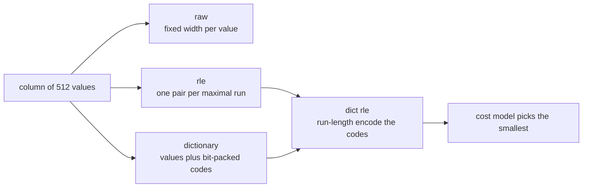
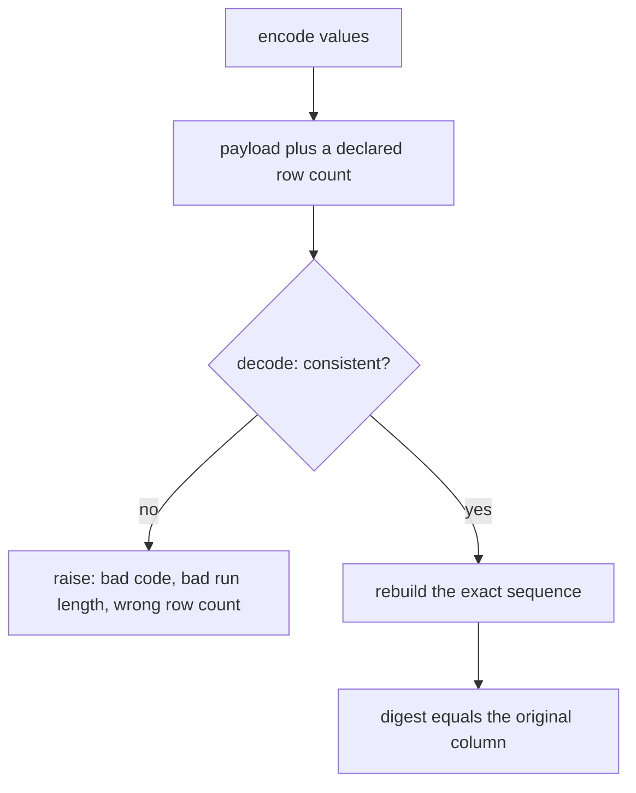
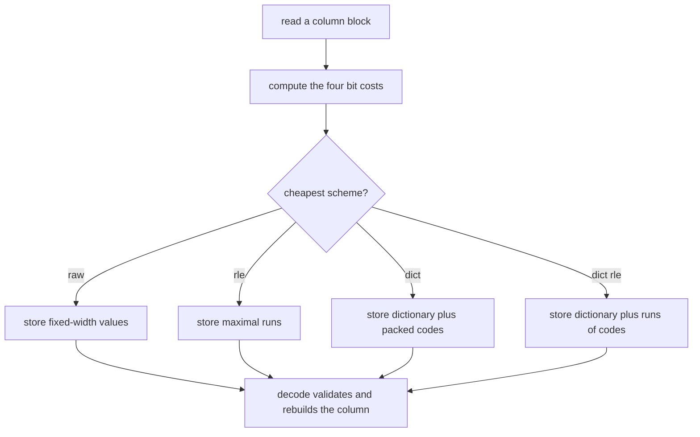
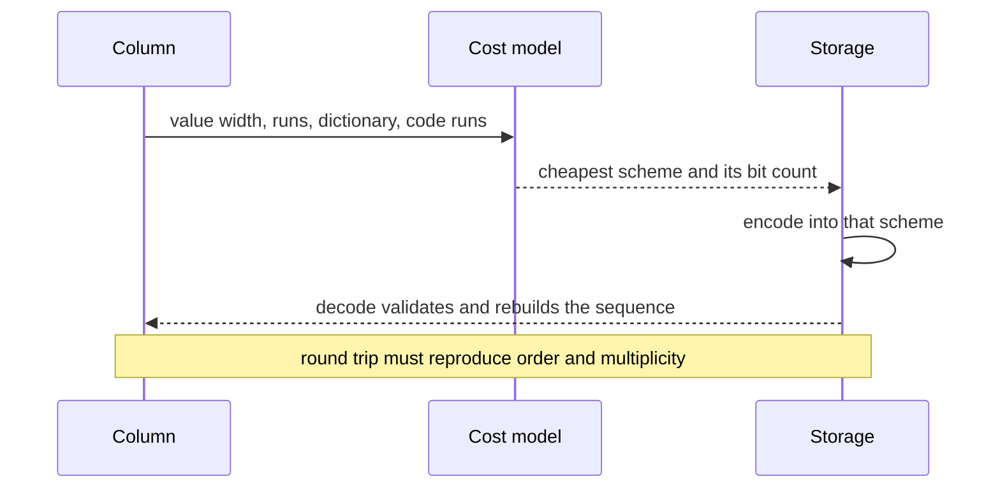

# 653 — Implement compressed column encoding schemes (RLE, dictionary) and decode

> **Tier:** Expert · **CTCI chapter:** Ch 14 — Databases
> **Task spec:** [653-implement-compressed-column-encoding-schemes-rle-dictionary-and.md](../../../tasks/expert/653-implement-compressed-column-encoding-schemes-rle-dictionary-and.md)
> **Solutions:** [Python](../../../solutions/python/expert/653-implement-compressed-column-encoding-schemes-rle-dictionary-and/solution.py) ·
> [Java](../../../solutions/java/expert/653-implement-compressed-column-encoding-schemes-rle-dictionary-and/Solution.java) ·
> [JavaScript](../../../solutions/javascript/expert/653-implement-compressed-column-encoding-schemes-rle-dictionary-and/solution.js) ·
> [C#](../../../solutions/csharp/expert/653-implement-compressed-column-encoding-schemes-rle-dictionary-and/Solution.cs)

## 1. Problem restatement

Implement four encodings of an integer (or short string) column with **real encoders and decoders** plus a
cost model that decides which one to store:

| Scheme | Layout |
| --- | --- |
| `raw` | `n` fixed-width values, `RAW_VALUE_BITS = 32` bits each |
| `rle` | maximal runs as `(value, count)` pairs |
| `dict` | distinct values in first-appearance order plus bit-packed codes of `ceil(log2(distinct))` bits each |
| `dict_rle` | dictionary codes, then RLE **over the codes** |

The interface of the four solution files:

| Piece | Contract |
| --- | --- |
| `value_width(values)` | bits per raw value from the maximum magnitude, at least 1; non-integers cost 8 |
| `dictionary_width(distinct)` | `max(1, (distinct - 1).bit_length())` bits per code |
| `pack_bits` / `unpack_bits` | bit packing into 64-bit words, little-endian inside a word, word crossings allowed |
| `rle_encode` / `rle_decode` / `rle_value_at` | maximal runs, row-count-validating decode, random access by skipping runs |
| `DictionaryEncoding` | `encode`, `codes`, `decode`, `value_at`, `bits` |
| `dict_rle_encode` / `dict_rle_decode` | codes first, then runs over the codes |
| `estimate_bits(values)` | the cost model's bit cost of all four schemes |
| `CompressedColumn(values)` | stores itself in the cheapest scheme; `decode`, `value_at`, `bits`, `scheme` |

Cost model constants: `COUNT_BITS = 8` per run length, `CHECKSUM_BITS = 16` charged once,
`RAW_VALUE_BITS = 32` per uncompressed value, `WORD_BITS = 64` per packed word.

Concrete results the checks assert:

- `rle_encode([1, 1, 1, 2, 2, 3]) == [(1, 3), (2, 2), (3, 1)]` and the reverse round-trips; an empty column
  has no runs and decodes to no rows;
- corrupted payloads are rejected: a declared row count that disagrees with the payload
  (`rle_decode([(7, 3)], 4)`), a zero-length run, a dictionary code outside the dictionary, and random
  access past the end (`IndexError`);
- bit packing across word boundaries: 100 three-bit values occupy exactly
  `ceil(100 * 3 / 64) = 5` words, round-trip exactly, and unpacking beyond the words yields zero padding;
- dictionary shape: `["b", "a", "b", "c", "a"]` gives dictionary `["b", "a", "c"]`, codes `[0, 1, 0, 2, 1]`
  and a width of `2` bits; a single-symbol column uses 1-bit codes;
- `[5, 3, 8, 1, 9]`-style exotic columns — empty, single value, constant, strictly increasing,
  alternating, boundary values around 255/256, descending — all round-trip through **all four** schemes,
  and the chosen scheme is always the cheapest one with `value_at` agreeing with `decode`;
- the cost model picks `rle` for a constant column, `dict` for a scattered low-cardinality column, and
  `dict_rle` for a *clustered* low-cardinality column; RLE beats `raw` by more than 5x on the constant
  column, the dictionary beats `raw` on the low-cardinality column, and clustering the same codes makes the
  column cheaper than the same codes scattered;
- a 1500-value pseudo-random column of values `0..999` round-trips exactly, and encoding it twice gives the
  same scheme, bit count and payload.

Documented simplification: bit widths come from the maximum value instead of per-block frame-of-reference,
and the dictionary is stored uncompressed (no prefix/suffix sharing).

## 2. Intuition

A column store encodes each column block separately and picks the cheapest encoding per block: the same
logical column can be `rle` in one block and `dict` in the next. Two observations make a real choice
possible:

1. **Repetition is free-ish.** A constant column of 512 values costs 512 words raw but one run as RLE — the
   size depends on the *number of runs*, not the number of rows.
2. **Cardinality is what a dictionary buys.** If a column has only four distinct values, storing a
   dictionary of those four values plus 2-bit codes makes every row cost 2 bits instead of 32, whatever the
   row order.

Those two wins compose: for a column that is low-cardinality *and* clustered, first map values to codes and
then run-length encode the codes, and both effects apply at once.



The price of all this is that decoding stops being trivial: codes are packed across word boundaries, runs
must be expanded with a declared row count, and a corrupt payload must fail loudly instead of producing
plausible-looking rows. That is why the checks are mostly **round trips and error cases**: encode then
decode must reproduce the exact sequence, including multiplicity and order, and every decode validates its
own input.



## 3. Algorithm

1. `value_width` scans the values for the largest magnitude, so the raw/RLE widths follow the data rather
   than a fixed 32 bits (a non-integer payload is charged 8 bits).
2. `rle_encode` walks the column once, extending the last run when the value repeats and starting a new
   `[value, 1]` run otherwise, so runs are maximal by construction.
3. `DictionaryEncoding.encode` assigns codes in **first-appearance** order, computes
   `dictionary_width(len(dictionary))`, and packs the codes with `pack_bits`, which fills 64-bit words
   little-endian and allows a code to straddle a word boundary.
4. `dict_rle_encode` runs the dictionary encoder and then `rle_encode` over the code sequence.
5. `estimate_bits` prices all four schemes: `raw = n * 32 + 16`, `rle = runs * (width + 8) + 16`,
   `dict = packed words * 64 + dictionary bits + 16`, and
   `dict_rle = code runs * (code width + 8) + dictionary bits + 16`. `CompressedColumn` stores the cheapest,
   breaking ties by scheme name so the choice is deterministic.
6. Decoding validates as it goes: `rle_decode` rejects non-positive run lengths and a payload whose length
   disagrees with the declared row count; `DictionaryEncoding.decode` rejects codes outside the dictionary;
   `value_at` raises `IndexError` for out-of-range indices.
7. Random access avoids full decoding: `rle_value_at` skips whole runs to reach an index, and
   `DictionaryEncoding.value_at` unpacks only the code prefix it needs.

```text
procedure rle_encode(values)
    runs ← empty list
    for value in values do
        if runs is not empty and last value of runs = value then
            last count of runs ← last count of runs + 1
        else
            append [value, 1] to runs
    return runs

function pack_bits(values, width)
    words ← empty list
    accumulator ← 0
    used ← 0
    mask ← (1 << width) - 1
    for value in values do
        accumulator ← accumulator or ((value and mask) << used)
        used ← used + width
        while used >= 64 do
            append (accumulator and all-ones-64) to words
            accumulator ← accumulator >> 64
            used ← used - 64
    if used > 0 then
        append accumulator to words
    return words

function dictionary_encode(values)
    dictionary ← empty list
    codes ← empty list
    for value in values do
        if value is new then
            assign the next code, append value to dictionary
        append that code to codes
    width ← max(1, bit length of (length(dictionary) - 1))
    return dictionary, width, pack_bits(codes, width), codes

function estimate_bits(values)
    width ← value_width(values)
    runs ← rle_encode(values)
    dictionary, code_width, packed, codes ← dictionary_encode(values)
    raw ← length(values) * 32 + 16
    rle ← length(runs) * (width + 8) + 16
    dict ← length(packed) * 64 + length(dictionary) * width + 16
    dict_rle ← length(rle_encode(codes)) * (code_width + 8) + length(dictionary) * width + 16
    return raw, rle, dict, dict_rle

function choose_encoding(values)
    costs ← estimate_bits(values)
    return the scheme of the cheapest cost, ties broken by name

function decode_rle(runs, row_count)
    out ← empty list
    for (value, count) in runs do
        if count <= 0 then raise "run length must be positive"
        append value count times to out
    if row_count is declared and length(out) ≠ row_count then
        raise "payload and header disagree"
    return out
```



## 4. Worked example

The check's exotic-column list includes `[255, 255, 256, 256, 255]`, which exercises both word-level
boundaries and multi-value runs:

| Step | Result |
| --- | --- |
| `value_width` | `256.bit_length() = 9` bits (the largest magnitude), so raw/RLE values cost 9 bits |
| `rle_encode` | `[(255, 2), (256, 2), (255, 1)]` — three maximal runs, the last a literal of one |
| `dictionary_encode` | dictionary `[255, 256]`, first-appearance order; codes `[0, 0, 1, 1, 0]`; width `(2 - 1).bit_length() = 1` |
| `pack_bits(codes, 1)` | one 64-bit word holding `0b00110` |
| costs | `raw = 5 * 32 + 16 = 176`, `rle = 3 * (9 + 8) + 16 = 67`, `dict = 1 * 64 + 2 * 9 + 16 = 98`, `dict_rle = 3 * (1 + 8) + 2 * 9 + 16 = 61` |
| choice | `dict_rle` at 61 bits |
| `value_at(2)` | code 1 of the dictionary → `256` |

The cost model on the three workload columns of check 7 (`rows = 512` in each), computed from the same
formulas:

| Workload | Shape | `raw` | `rle` | `dict` | `dict_rle` | Chosen |
| --- | --- | --- | --- | --- | --- | --- |
| constant `[7] * 512` | 1 run, 1 distinct value, width 3 | `16400` | **`27`** | `531` | `28` | `rle` |
| scattered `[i % 4]` | 512 runs, 4 distinct values, code width 2 | `16400` | `5136` | **`1048`** | `5136` | `dict` |
| clustered `[(i // 64 % 3) * 1000]` | 8 runs, 3 distinct values, width 11, code width 2 | `16400` | `168` | `1073` | **`129`** | `dict_rle` |

Three different winners from the same model, which is the point of the task: repetition favours RLE
(`27` bits versus `16400` raw — the asserted `5x` win is far exceeded), low cardinality favours the
dictionary (`1048` versus `16400`), and *clustering the same codes* makes `dict_rle` (`129`) beat the
scattered dictionary (`1048`) — the check asserts exactly that ordering.



The packing and dictionary-shape checks are equally concrete: `[i % 7 for i in range(100)]` at width 3 needs
`(100 * 3 + 63) / 64 = 5` words, and `["b", "a", "b", "c", "a"]` produces the dictionary `["b", "a", "c"]`
with codes `[0, 1, 0, 2, 1]` at width 2 — first appearance, not sorted order.

## 5. Complexity

`n` = values in the column, `r` = runs, `d` = distinct values, `w` = bits per raw value, `c` = code width
(`ceil(log2 d)`), `W` = packed 64-bit words (`ceil(n·c / 64)`).

| Operation | Best | Average | Worst | Why the bound holds |
| --- | --- | --- | --- | --- |
| `value_width` | O(n) | O(n) | O(n) | one scan for the largest magnitude |
| `rle_encode` | O(n) | O(n) | O(n) | one comparison and one append per value |
| `rle_decode` | O(n) | O(n) | O(n) | `r` runs expanded to `n` values |
| `rle_value_at` | O(1) | O(r) | O(r) | walks runs until the index falls inside one |
| `pack_bits` / `unpack_bits` | O(n) | O(n) | O(n) | one shift-OR per value, one word emitted per 64 bits |
| dictionary encode | O(n) | O(n) | O(n) | hash lookup per value, first-appearance order |
| dictionary decode | O(n) | O(n) | O(n) | validate each code, then `n` dictionary lookups |
| `estimate_bits` | O(n) | O(n) | O(n) | all four costs from the same three linear passes |
| `CompressedColumn` build | O(n) | O(n) | O(n) | cost model plus the chosen encoder |
| Space (compressed) | O(r) | O(W) | O(n·w) | runs, packed codes or raw values; `dict_rle` is the smallest of the three on clustered data |
| Space (uncompressed) | O(n) | O(n) | O(n) | the input column itself |

The interesting comparison is `r` versus `n`: RLE's size is `r * (w + 8)` bits, so it is a win exactly when
`r` is small relative to `n`, and a loss on a column whose runs are all length 1 (the scattered workload
pays `5136` bits for RLE against `1048` for the dictionary). The cost model makes that decision per column
rather than per table, which is why all four encoders must exist and be cross-validated.

## 6. Pitfalls and edge cases

- **Empty columns.** `rle_encode([]) == []`, `rle_decode([], 0) == []`, and an empty column must still be
  storable: its raw cost is just the checksum.
- **Single value / constant columns.** A constant column needs 1-bit codes and one run; its interval
  arithmetic must not divide by zero anywhere.
- **Row-count validation.** `rle_decode([(7, 3)], 4)` raises rather than returning three rows: the declared
  count is part of the payload contract.
- **Non-positive run lengths.** A run of length 0 (or negative) is rejected, so a corrupt payload cannot
  silently drop rows.
- **Codes outside the dictionary.** A code `>= len(dictionary)` raises in both `decode` and `value_at`;
  otherwise a corrupt block would return the wrong value or crash with an index error.
- **Single-symbol dictionaries.** `dictionary_width(1) = max(1, 0.bit_length()) = 1`, because a code still
  has to occupy a bit.
- **Word-boundary crossings.** Codes are packed little-endian inside a 64-bit word and may straddle a word
  edge; unpacking a prefix (`value_at`) must start from the first word and discard the unused tail.
- **Missing words read as zero padding.** `unpack_bits([0], 1, 3)` yields three zeros — a short payload must
  not crash the unpacker.
- **Out-of-range random access.** `rle_value_at` raises `IndexError` past the end and for negative indices,
  and the dictionary form raises `IndexError` outside the column.
- **Determinism of the choice.** `min(costs, key=(cost, name))` breaks cost ties by scheme name, so the same
  column always selects the same encoding — asserted by encoding the 1500-value column twice.
- **Round-trip is the contract, not the encoding.** Every scheme must reproduce the exact sequence,
  multiplicity and order, including duplicate-heavy columns; the exotic-column list exists precisely to hit
  the boundary values (255/256), the descending column and the alternating one.
- **Documented simplifications.** Widths come from the maximum magnitude rather than per-block frames of
  reference, and the dictionary is stored uncompressed, so the model's numbers are conservative — not a
  claim about a production column store's exact footprint.

## 7. Variants and follow-ups

- **Where the blocks come from.** Page layout and predicate pushdown decide block size and when a block is
  even decoded: [647-implement-column-store-compressed-page-layout-and-predicate-push.md](../../../tasks/expert/647-implement-column-store-compressed-page-layout-and-predicate-push.md).
- **Faster decoding.** Vectorised execution is what turns these decoders into batched loops:
  [648-implement-vectorized-execution-for-simple-sql-operators.md](../../../tasks/expert/648-implement-vectorized-execution-for-simple-sql-operators.md).
- **Indexes over encoded columns.** Run-length compressed *bitmaps* are the row-oriented cousin of this
  encoding choice: [652-implement-bitmap-index-and-fast-and-or-operations.md](../../../tasks/expert/652-implement-bitmap-index-and-fast-and-or-operations.md).
- **Adaptive physical layout.** Cracking reorders the column as it is queried, which changes how well these
  encodings compress: [651-implement-adaptive-indexing-database-cracking-prototype.md](../../../tasks/expert/651-implement-adaptive-indexing-database-cracking-prototype.md).
- **Choosing what to build.** A workload-driven advisor decides which structures are worth their storage at
  all: [654-implement-workload-driven-index-selection-greedy-heuristic.md](../../../tasks/expert/654-implement-workload-driven-index-selection-greedy-heuristic.md).

## 8. Check yourself

1. **When does RLE beat the dictionary, and vice versa?**
   <details><summary>Show answer</summary>RLE's cost is proportional to the number of *runs*, so it wins on
   clustered or constant columns (27 bits versus 16400 raw for the constant workload). The dictionary's cost
   is proportional to the number of *codes* times `ceil(log2 d)`, so it wins on scattered
   low-cardinality columns (1048 versus 5136 for RLE there).</details>
2. **Why does `dict_rle` win on the clustered low-cardinality column?**
   <details><summary>Show answer</summary>Because both effects compose: the codes are 2 bits wide instead
   of the 11-bit values, and they arrive in 8 long runs. The cost is
   `8 * (2 + 8) + 3 * 11 + 16 = 129` bits, cheaper than either the value-level RLE (168) or the plain
   dictionary (1073).</details>
3. **Why must `value_at` not simply decode the whole column?**
   <details><summary>Show answer</summary>Random access should cost O(r) (skipping runs) or O(w) (unpacking
   a code prefix), not O(n): that is the whole point of keeping the data encoded. The checks compare
   `value_at` against the materialised decode for every index.</details>
4. **What does the dictionary use for its code width?**
   <details><summary>Show answer</summary>`max(1, (distinct - 1).bit_length())`: two bits for three
   symbols, and still one bit for a single symbol, because a code has to occupy at least one bit.</details>
5. **Why are the error checks as important as the round trips?**
   <details><summary>Show answer</summary>Because decoding is where corrupt payloads can turn into silently
   wrong rows. A row count that disagrees with the payload, a zero run length and an out-of-range code are
   all rejected, so a bad block fails loudly instead of answering a query with invented values.</details>
