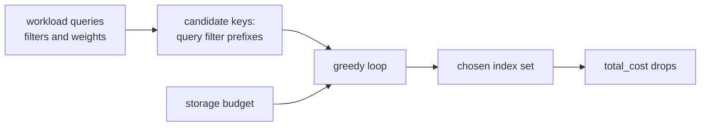
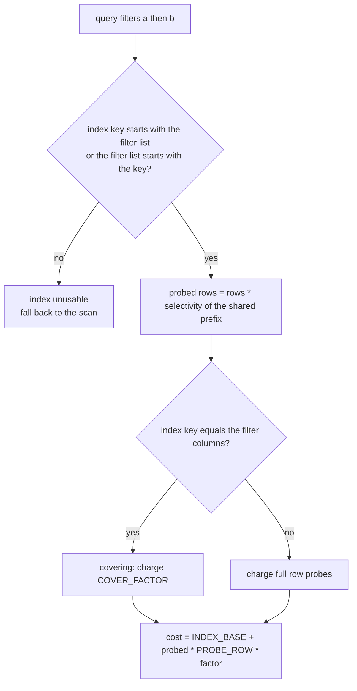
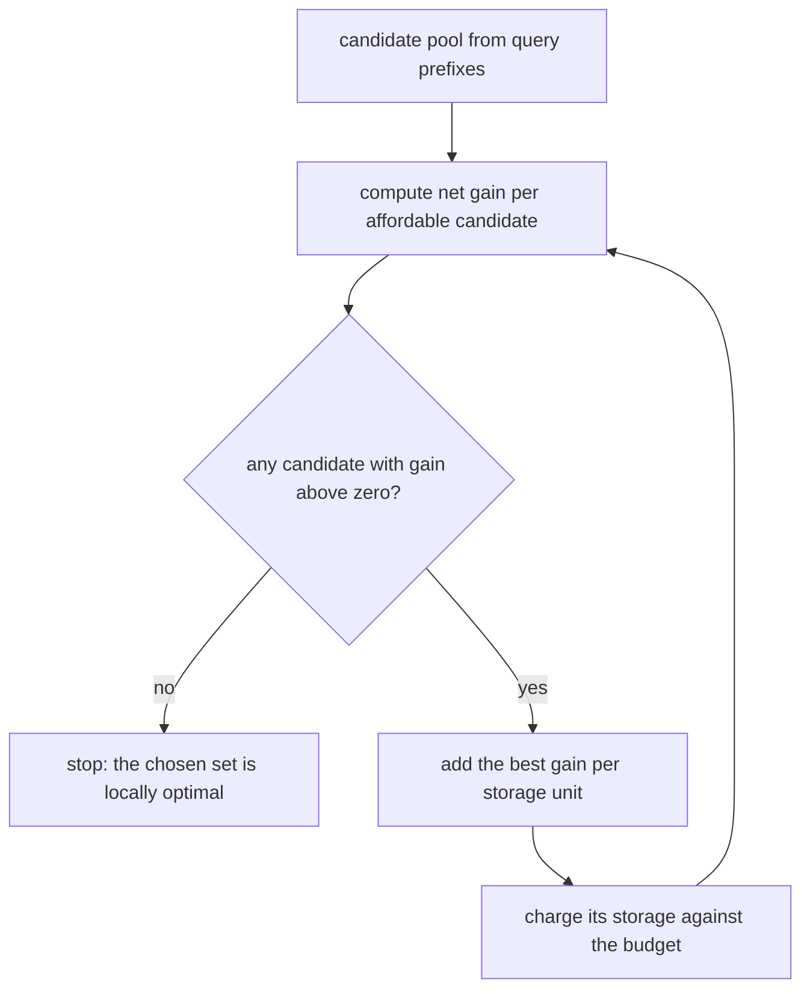
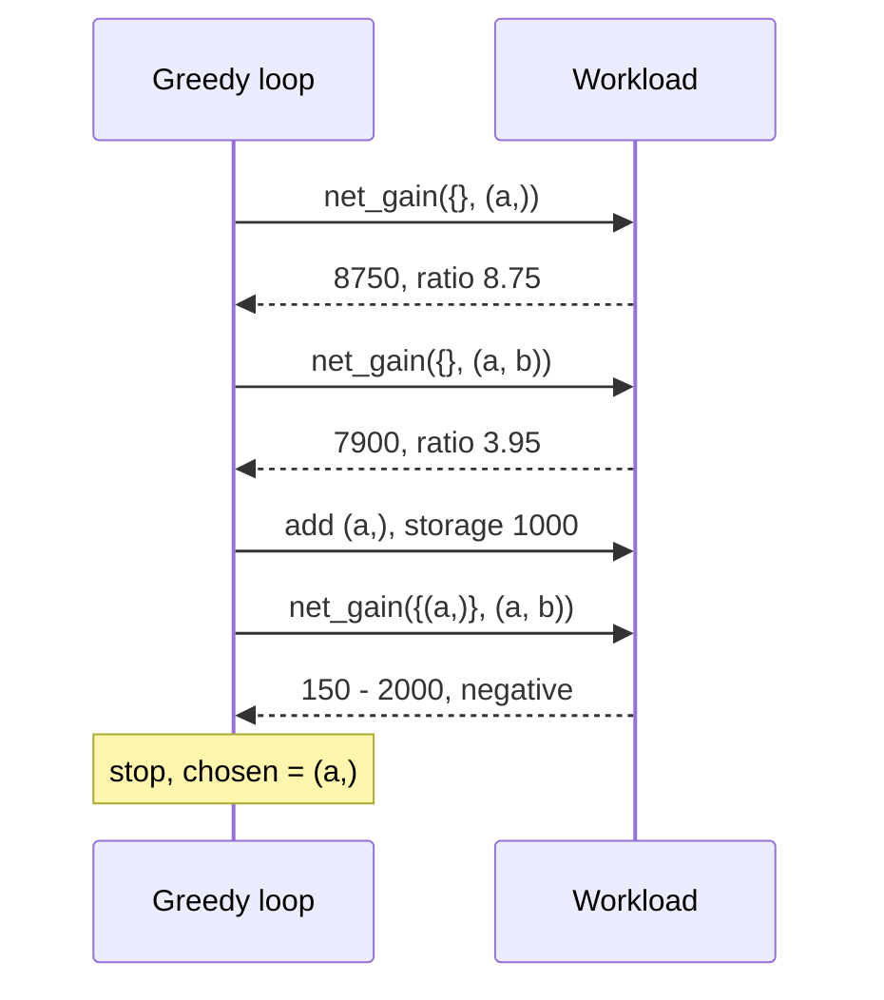

# 654 — Implement workload-driven index selection greedy heuristic

> **Tier:** Expert · **CTCI chapter:** Ch 14 — Databases
> **Task spec:** [654-implement-workload-driven-index-selection-greedy-heuristic.md](../../../tasks/expert/654-implement-workload-driven-index-selection-greedy-heuristic.md)
> **Solutions:** [Python](../../../solutions/python/expert/654-implement-workload-driven-index-selection-greedy-heuristic/solution.py) ·
> [Java](../../../solutions/java/expert/654-implement-workload-driven-index-selection-greedy-heuristic/Solution.java) ·
> [JavaScript](../../../solutions/javascript/expert/654-implement-workload-driven-index-selection-greedy-heuristic/solution.js) ·
> [C#](../../../solutions/csharp/expert/654-implement-workload-driven-index-selection-greedy-heuristic/Solution.cs)

## 1. Problem restatement

Given a table, a workload of equality-filtered queries with weights, a cost model and a storage budget,
the *index advisor* decides which indexes to build. An index is the ordered tuple of its key columns;
a query is a list of `(column, partial selectivity)` filters in evaluation order.

The cost model (constants shared by the four solutions):

| Constant | Value | Meaning |
| --- | --- | --- |
| `SCAN_ROW` | `10.0` | cost of examining one heap row |
| `PROBE_ROW` | `2.0` | cost of fetching one row through an index |
| `COVER_FACTOR` | `0.5` | an index-only (covering) scan skips the row fetches |
| `INDEX_BASE` | `50.0` | fixed per-index overhead charged on every query |
| `BUILD_PER_ROW_PER_COL` | `1.0` | one-off build cost per row and key column |
| `STORE_PER_ROW_PER_COL` | `1.0` | storage units per row and key column |

The interface of the four solution files:

| Piece | Contract |
| --- | --- |
| `Query(name, filters, weight)` | `columns`, `selectivity` = product of the partial selectivities |
| `matched_prefix(query, index)` | length of the common prefix; `0` means the index is unusable |
| `index_query_cost(query, index, rows)` | `INDEX_BASE + probed * PROBE_ROW * (COVER_FACTOR if covering else 1)`, or `none` |
| `index_storage` / `index_build_cost` | `len(index) * rows` each |
| `Workload(rows, queries)` | `scan_total`, `total_cost`, `benefit`, `marginal`, `net_gain` |
| `candidate_indices(workload)` | every prefix of every query's filter list, sorted |
| `select_indices(workload, budget, candidates)` | budget-aware greedy: best net gain per storage unit |
| `greedy_by_benefit(workload, candidates, max_indices)` | cardinality-constrained greedy for the optimality bound |

Concrete results the checks assert:

- the hand case `Workload(1000, [Query("q", [("a", 0.05)])])` builds exactly `[("a",)]`; a covering index
  costs `INDEX_BASE + 50 * PROBE_ROW * COVER_FACTOR = 100`, the wider key `("a", "b")` costs `150`
  (non-covering), and `index_storage(("a", "b"), 1000) == 2000`;
- a scan-only query contributes no candidate, an empty workload selects nothing, `budget = 0` builds
  nothing, and a budget of exactly `index_storage(("a",), 1000) == 1000` still fits `("a",)`;
- an index that does not lead with the first filter column is unusable: for
  `Query("q", [("a", 0.1), ("b", 0.5)])`, `("b",)` returns `none`, `("a",)` costs `250` and the covering
  `("a", "b")` costs `100`;
- greedy stops only when no affordable candidate has positive net gain, `marginal` is never negative,
  and diminishing returns hold on 20 random index sets;
- against the exhaustive optimum on random small instances (`rows = 2000`, 3 columns, 4 queries, pools
  of at most 8 candidates, cardinality caps 1-3, 6 trials): `greedy <= optimum` **and**
  `greedy >= (1 - 1/e) * optimum`;
- the advisor is deterministic, selects each index at most once, only from the candidate pool, and the
  workload cost strictly drops.

## 2. Intuition

The naive idea is "index every column, or index every query's exact filter list". Both are wrong: an
index costs storage, a one-off build and `INDEX_BASE` on every query that uses it, so building an index
nobody queries is a pure loss, and building several overlapping ones duplicates storage.

The key insight is that a query's *cost with a given index* is a closed-form function of the partial
selectivities, so the benefit of an index set `S` is computable:

    benefit(S) = Σ_q weight_q * (scan_cost - min over usable indexes in S, or scan) - scan_cost

With that function in hand, the search space is exponential (every subset of candidate keys), so the
advisor uses the standard **greedy heuristic**: repeatedly add the candidate with the largest net gain
(`marginal benefit - one-off build cost`) while it pays off.

Two structural facts make greedy the right heuristic rather than a wild guess. First, `benefit` is a
*coverage function* — a maximum over non-negative per-index utilities — hence monotone and
**submodular**: each added index gains no more than it would have in a smaller set (diminishing
returns). Second, for monotone submodular maximisation under a cardinality constraint, greedy is
provably within `1 - 1/e ≈ 63%` of the optimum, which the checks verify empirically.



The prefix rule is what makes the candidate pool small. An index can be probed only on whole leading
key columns, so it is usable when one list starts with the other: an index on `(a)` serves a query
filtering `a` and `b` (applying `b` as a residual check), and an index on `(a, b)` serves a query
filtering only `a` — wasting the `b` component but keeping the covering discount out of reach.



## 3. Algorithm

1. Collect candidates: for every query and every prefix length, add that prefix tuple as a candidate
   key; sort the resulting set for deterministic tie-breaking.
2. Per query and candidate, `matched_prefix` walks the two lists while the columns agree. If it stops
   at length 0 the index is unusable (cost `none`); otherwise the probed row count is
   `rows * product of the partial selectivities of the matched filters`.
3. Price it: `INDEX_BASE + probed * PROBE_ROW`, halved by `COVER_FACTOR` when the index key is exactly
   the query's filter columns.
4. `total_cost(S)` sums, per query, the weighted minimum over the scan cost `SCAN_ROW * rows` and the
   cost of each usable index in `S`; `benefit(S) = scan_total - total_cost(S)`.
5. Greedy loop: for every unselected affordable candidate compute
   `net_gain(S, c) = benefit(S + [c]) - benefit(S) - index_build_cost(c)`; add the candidate with the
   highest `net_gain / storage` ratio (strictly higher, so ties go to the first in sorted order) and
   stop when no candidate has a positive gain or none fits the remaining budget.
6. Assert the invariants after the loop: storage within budget, benefit non-negative, no affordable
   candidate left with a positive net gain.
7. The cardinality-constrained variant `greedy_by_benefit` maximises `benefit` alone — no build cost,
   no budget — so it can be compared against `exhaustive_best_benefit`, which enumerates every subset
   up to the cap.

```text
function matched_prefix(query, index)
    length ← 0
    for filter_column, key_column in zip(query.columns, index) do
        if filter_column ≠ key_column then break
        length ← length + 1
    return length

function index_query_cost(query, index, rows)
    length ← matched_prefix(query, index)
    if length = 0 then
        return none
    selectivity ← product of query.filters[0 .. length).partial
    covering ← index = query.columns
    return INDEX_BASE + rows * selectivity * PROBE_ROW * (COVER_FACTOR if covering else 1)

function total_cost(indices)
    total ← 0
    for query in workload.queries do
        best ← SCAN_ROW * rows
        for index in indices do
            cost ← index_query_cost(query, index, rows)
            if cost is not none and cost < best then best ← cost
        total ← total + query.weight * best
    return total

procedure select_indices(budget)
    chosen ← empty list
    used ← 0
    while true do
        best ← none
        best_ratio ← 0
        for candidate in candidates do                       // candidates are sorted
            if candidate is in chosen then continue
            storage ← index_storage(candidate, rows)
            if used + storage > budget then continue
            gain ← net_gain(chosen, candidate)               // marginal minus build cost
            if gain <= 0 then continue
            ratio ← gain / storage
            if ratio > best_ratio then best ← candidate, best_ratio ← ratio
        if best is none then break
        append best to chosen
        used ← used + index_storage(best, rows)
    return chosen
```



The loop in the diagram is the classic greedy shape; the important detail is the *stopping* condition —
greedy stops when no candidate pays for its own build, which is exactly the local-optimality property
the checks assert afterwards.

## 4. Worked example

Workload: one table of `rows = 1000`, one query `q` with filters `[("a", 0.1), ("b", 0.5)]`, weight `1`.
Scan cost `= SCAN_ROW * rows = 10000`. Candidates `{("a",), ("a", "b")}`.

| Candidate | `matched_prefix` | probed rows | covering | Query cost | Benefit | Build cost | Net gain | Gain / storage |
| --- | --- | --- | --- | --- | --- | --- | --- | --- |
| `("a",)` | 1 | `1000 * 0.1 = 100` | no | `50 + 100 * 2 = 250` | `10000 - 250 = 9750` | `1 * 1000 = 1000` | `8750` | `8.75` |
| `("a", "b")` | 2 | `1000 * 0.05 = 50` | yes | `50 + 50 * 2 * 0.5 = 100` | `9900` | `2 * 1000 = 2000` | `7900` | `3.95` |

Iteration 1 picks `("a",)` on the ratio rule. Iteration 2 re-evaluates the only remaining candidate
against `S = [("a",)]`: its marginal benefit is now `9900 - 9750 = 150`, its build cost is still `2000`,
so `net_gain < 0` and the loop stops with `chosen == [("a",)]`. That is the economics of an index in one
line: the second key column is genuinely useful (it makes the index covering) but it would pay for
itself only if the query ran often enough or the table were wide enough to amortise its build cost.

The single-filter hand case is the same arithmetic with one candidate: `probed = 1000 * 0.05 = 50`,
covering, so cost `50 + 50 * 2 * 0.5 = 100`, benefit `10000 - 100 = 9900`, net gain `9900 - 1000 = 8900`,
and `chosen == [("a",)]`. A budget of `0`, or of exactly `1000` (one index's storage in row-entry
units), respectively builds nothing and builds exactly `("a",)`.

Prefix-rule rejection is visible in the same table: for `("b",)` the walk stops immediately, cost is
`none`, the query keeps the 10000-row scan, and `("b",)` never enters the pool because no query filters
on `b` first.



On random instances the checks go further and compare the cardinality-constrained greedy against the
exhaustive optimum, asserting both `greedy <= optimum` and the `(1 - 1/e)` factor for caps 1 to 3. They
also sample 20 random index sets and verify `marginal(small, c) >= marginal(big, c)` whenever `small ⊆
big` — the diminishing-returns property that makes the bound applicable at all.

## 5. Complexity

`Q` = queries, `C` = candidates in the pool, `k` = indexes actually selected, `L` = average filter-list
length, `rows` = table size.

| Operation | Best | Average | Worst | Why the bound holds |
| --- | --- | --- | --- | --- |
| Candidate generation | O(Q·L) | O(Q·L) | O(Q·L) | one prefix per query and length, deduplicated in a set, then sorted |
| `index_query_cost` | O(1) | O(L) | O(L) | walks at most `min(len(filters), len(index))` columns |
| `total_cost(S)` | O(Q) | O(Q·\|S\|) | O(Q·\|S\|) | per query, the minimum over the scan and every usable index |
| Greedy step | O(C) | O(C·Q·k) | O(C·Q·k) | each candidate needs one `benefit` evaluation, each O(Q·k) |
| `select_indices` | O(C) | O(C·Q·k²) | O(C·Q·k²) | at most `k` steps, each re-evaluating every remaining candidate |
| Exhaustive optimum | O(Q) | O(C^k·Q·k) | O(C^k·Q·k) | every subset up to size `k` is priced |
| Space | O(C + k) | O(C + k) | O(C + k) | the pool, the chosen list and the precomputed scan total |

The comparison that matters is greedy versus exhaustive: `O(C·Q·k²)` against `O(C^k·Q·k)`. For the
measured instances (`C <= 8`, caps 1-3) both run instantly, which is what makes the
`optimum >= greedy >= (1 - 1/e) · optimum` assertion checkable at all; on a real 8-column workload the
pool is far larger and enumeration is hopeless, while greedy stays linear in the pool size per step.

The no-index baseline is `Σ_q weight_q * SCAN_ROW * rows` — for the random workload (`rows = 100000`,
5 queries, weights 1-3) that is hundreds of thousands of cost units, which is the number an advisor is
trying to reduce.

## 6. Pitfalls and edge cases

- **Index direction.** The prefix rule is directional: an index on `(b)` cannot serve a query filtering
  `a` then `b`. Only prefixes of the query's own filter list enter the candidate pool, so `("b",)` is
  never even considered for that query.
- **Covering is exact-key only.** `COVER_FACTOR` applies when `index == query.columns`; a wider or
  narrower key pays full `PROBE_ROW` per probed row, as the `("a", "b")` versus `("a",)` pricing shows.
- **An empty workload.** No queries means no candidates, an empty chosen set and `scan_total = 0`;
  the advisor must not build anything.
- **A query with no filters.** `candidate_indices` yields nothing for it, so it can never justify an
  index — it is always answered by the scan.
- **Zero budget.** `select_indices(workload, 0.0) == []`; the storage of each candidate is checked
  *before* pricing it, and the loop asserts `used <= budget` when it finishes.
- **An index may be profitable but unaffordable.** The budget test happens before the gain test, so a
  high-ratio candidate that does not fit is skipped rather than selected.
- **Build cost is one-off, benefit is per workload.** A candidate with positive marginal benefit can
  still have a negative net gain (the `("a", "b")` case above); that is a decision, not a bug.
- **Float comparisons need a tolerance.** All inequalities use `EPS = 1e-9`, otherwise a mathematically
  zero gain can look negative or positive depending on rounding.
- **Ties.** Candidates are iterated in sorted order and a candidate replaces the incumbent only on a
  *strictly* better ratio, which makes selection deterministic.
- **No index twice.** Selected candidates are skipped in later iterations, and the checks assert the
  chosen list has no duplicates.
- **The bound is for the cardinality variant.** `(1 - 1/e)` applies to monotone submodular maximisation
  under a cardinality constraint; the budget variant has a knapsack flavour, which is why the guaranteed
  comparison uses `greedy_by_benefit`.
- **Statistics are given.** Fixed partial selectivities stand in for real histograms, and only equality
  filters are modelled.

## 7. Variants and follow-ups

- **Picking views instead of indexes.** A different cost model over a different search space, with the
  same greedy-versus-optimum question:
  [656-implement-cost-based-materialized-view-selection-sketch.md](../../../tasks/expert/656-implement-cost-based-materialized-view-selection-sketch.md).
- **Enumerating the plan space exactly.** Where the problem is small enough, the join-ordering task uses
  dynamic programming instead of a heuristic:
  [643-implement-multi-way-join-ordering-via-dynamic-programming-seling.md](../../../tasks/expert/643-implement-multi-way-join-ordering-via-dynamic-programming-seling.md).
- **Indexes built by the queries themselves.** Cracking needs no advisor at all but adapts to the same
  workload: [651-implement-adaptive-indexing-database-cracking-prototype.md](../../../tasks/expert/651-implement-adaptive-indexing-database-cracking-prototype.md).
- **What an index physically costs.** Storage units per row and key column become page layouts here:
  [647-implement-column-store-compressed-page-layout-and-predicate-push.md](../../../tasks/expert/647-implement-column-store-compressed-page-layout-and-predicate-push.md).
- **The plans the advisor feeds.** Cost-based choices surface as operators in
  [644-implement-query-execution-engine-operator-pipelining-simulation.md](../../../tasks/expert/644-implement-query-execution-engine-operator-pipelining-simulation.md).

## 8. Check yourself

1. **Why is an index on `(b)` useless for a query filtering `a` then `b`?**
   <details><summary>Show answer</summary>Because an index can be probed only on whole leading key
   columns. The shared prefix of the filter list `[a, b]` and the key `(b)` is empty, so
   `matched_prefix` returns 0 and `index_query_cost` returns `none`.</details>
2. **Why does greedy stop with `("a",)` when the covering `("a", "b")` gives a cheaper query?**
   <details><summary>Show answer</summary>Because it must also pay the build cost. The covering key's
   marginal benefit is `9900 - 9750 = 150` against a build cost of `2000`, so its net gain is negative
   and the loop stops — the advisor optimises total cost, not per-query latency.</details>
3. **What property of `benefit` justifies the `(1 - 1/e)` guarantee?**
   <details><summary>Show answer</summary>`benefit` is a sum of maxima over non-negative per-index
   utilities, so it is monotone and submodular (diminishing returns). Greedy on a monotone submodular
   function under a cardinality constraint is within `1 - 1/e` of the optimum, and the checks verify
   the inequality against the exhaustive optimum.</details>
4. **When can a candidate be priced but still not selected?**
   <details><summary>Show answer</summary>When its storage does not fit the remaining budget: the
   affordability test happens before the gain test, so the loop skips it even if the ratio would be the
   best available.</details>
5. **How does the greedy loop avoid picking the same index twice?**
   <details><summary>Show answer</summary>It skips candidates already in `chosen`; the candidate pool is
   a set of unique key tuples, and the checks assert the selected list contains no duplicates.</details>
