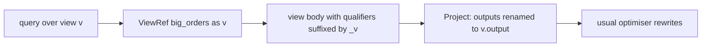
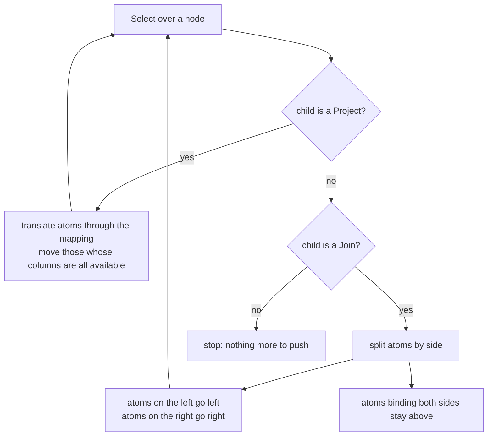
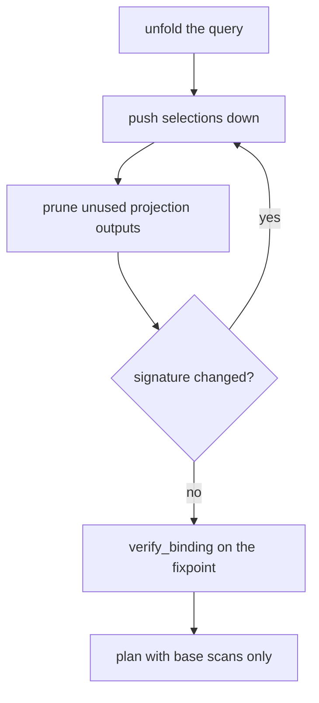
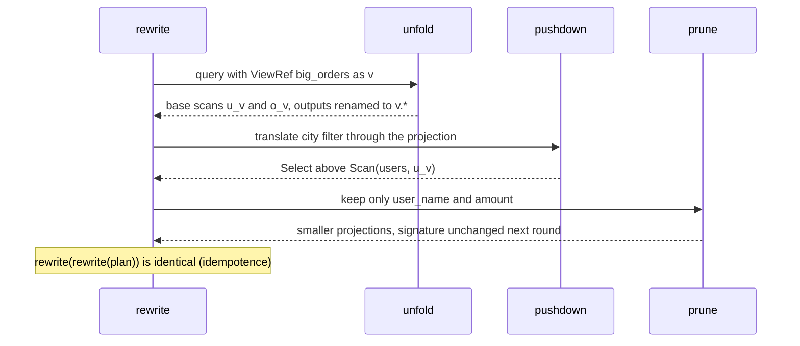

# 655 — Implement query rewriter for simple view unfolding

> **Tier:** Expert · **CTCI chapter:** Ch 14 — Databases
> **Task spec:** [655-implement-query-rewriter-for-simple-view-unfolding.md](../../../tasks/expert/655-implement-query-rewriter-for-simple-view-unfolding.md)
> **Solutions:** [Python](../../../solutions/python/expert/655-implement-query-rewriter-for-simple-view-unfolding/solution.py) ·
> [Java](../../../solutions/java/expert/655-implement-query-rewriter-for-simple-view-unfolding/Solution.java) ·
> [JavaScript](../../../solutions/javascript/expert/655-implement-query-rewriter-for-simple-view-unfolding/solution.js) ·
> [C#](../../../solutions/csharp/expert/655-implement-query-rewriter-for-simple-view-unfolding/Solution.cs)

## 1. Problem restatement

A query may reference a *view*. The naive executor materialises the view and filters its result; a
rewriter instead **unfolds** every `ViewRef` into the view definition, renames the definition's internal
qualifiers so several uses cannot collide, then pushes selections down and prunes projections — leaving
a plan that mentions only base tables and answers identically.

The plan language, shared by the four solution files:

| Node | Fields |
| --- | --- |
| `Scan(table, alias)` | base table, qualifier for its columns (`alias.column`) |
| `Select(predicate, child)` | conjunction of atoms applied to the child |
| `Project(items, child)` | `(source column, output column)` pairs |
| `Join(predicate, left, right)` | inner join only |
| `ViewRef(name, alias)` | a use of a view (the alias is the use site) |
| `ViewDef(name, items, child)` | the view body; `outputs()` lists the exposed columns |

Supporting functions: `Atom`/`Predicate` (with `columns`, `eval`, `renamed`, `signature`),
`unfold(query, views)`, `rename_qualifiers`, `pushdown`, `prune`, `rewrite`, `verify_binding`,
`evaluate`, `canonical`.

Concrete ground truth the checks use — tables `users` (`id, name, city`) and `orders`
(`oid, user_id, amount`), all data hand-written in the check:

| Users | Orders |
| --- | --- |
| `(1, ada, paris)`, `(2, bob, rome)`, `(3, cy, paris)`, `(4, dee, oslo)` | `(10,1,100)`, `(11,1,250)`, `(12,2,50)`, `(13,3,300)`, `(14,4,20)` |

with view `big_orders` = `SELECT u.id AS user_id, u.name AS user_name, u.city, o.amount FROM users u
JOIN orders o ON u.id = o.user_id WHERE o.amount >= 100`.

Asserts on that data:

- the query `SELECT user_name, amount FROM big_orders v WHERE v.city = 'paris'` answers exactly
  `(ada, 100)`, `(ada, 250)`, `(cy, 300)`;
- after rewriting there is **no** `ViewRef` left, the plan is *not* a top-level `Select` any more, the
  predicate `u_v.city = 'paris'` sits directly above `Scan("users", "u_v")`, and both join sides carry
  their own pushed selections;
- a predicate spanning both join sides (`v.user_id = v.amount`) stays above the join, still answers
  identically, and its answer is empty because no id equals an amount;
- using `big_orders` twice yields disjoint qualifiers: base aliases are exactly
  `["o_a", "o_b", "u_a", "u_b"]` with at least 8 distinct columns, and the self-join answers identically;
- a view over a view (`paris_big`) unfolds completely and answers `(ada,)`, `(cy,)`;
- rewriting is **idempotent** and deterministic, projection pruning never empties a projection, and
  `verify_binding` holds on every rewritten plan (each predicate references columns of its own child).

Documented simplification: inner joins only — no aggregates or grouping.

## 2. Intuition

Materialising a view is correct but wasteful: a filter on one of the view's exposed columns is applied
*after* the whole view body has been computed. The rewrite that fixes it has two halves.

**Unfolding.** Replace `ViewRef(name, alias)` by the definition's child, but rename every internal
column so that this use site is distinguishable from any other. The solutions suffix each qualifier with
`"_" + alias`: the definition's `u` becomes `u_v` when the use site is `v`. Then re-project the
definition's outputs under the use-site qualifier (`v.user_name`), so the *local* names above the view
reference are unchanged and the surrounding query needs no edit at all.



**Pushing down.** With no view reference left, predicates can be moved toward the scans:

1. through a `Project`, by translating each atom's columns through the projection's mapping;
2. into an inner `Join`, splitting the atoms: those whose columns all belong to the left side go left,
   those bound to the right go right, and atoms spanning **both** sides stay above;
3. and projections can be pruned: an output no ancestor uses is dropped, which in turn lets a selection
   pass through even more easily. Since pruning can enable a push-down, `rewrite` iterates to a fixpoint.



## 3. Algorithm

1. `unfold(node, views)`: leave `Scan`s alone; for a `ViewRef(name, alias)` look the definition up,
   recursively unfold its child, rename all qualifiers with `suffix_move("_" + alias)`, and wrap the
   result in a `Project` that maps the renamed definition outputs to `alias.output`.
2. A definition may itself reference views, so unfolding recurses and the result contains base tables
   only.
3. `pushdown(node)`:
   - a `Select` over a `Project` translates the movable atoms through the projection mapping and sinks
     them below it, repeating while anything moved;
   - a `Select` over a `Join` splits the atoms into left-only, right-only and spanning atoms, and wraps
     each side in its own `Select`; spanning atoms stay put;
   - a `Project` over a `Project` composes the two mappings.
   - An inner-join predicate is checked to reference columns produced by its two sides before the node
     is rebuilt.
4. `prune(node, needed)`: with `needed = none` at the root everything is kept; otherwise a `Project`
   keeps only the outputs in `needed` (never fewer than one, so a projection cannot become empty), a
   `Select` widens `needed` by its predicate's columns, and a `Join` splits `needed` between the sides
   after adding the join predicate's columns.
5. `rewrite(query, views, catalog)` unfolds, then alternates `pushdown` and `prune` up to four times,
   stopping as soon as the structural `signature` stops changing — the fixpoint.
6. `verify_binding` re-checks the soundness invariant on the final plan: every `Select` predicate and
   every `Join` predicate references only columns its own child (children) produce.

```text
function unfold(node, views)
    if node is Scan then return node
    if node is Select then return Select(node.predicate, unfold(node.child, views))
    if node is Project then return Project(node.items, unfold(node.child, views))
    if node is Join then return Join(node.predicate, unfold(node.left, views), unfold(node.right, views))
    definition ← views[node.name]
    move ← rename replacing qualifier q with q + "_" + node.alias
    inner ← rename_qualifiers(unfold(definition.child, views), move)
    items ← [(move(source), node.alias + "." + out) for (source, out) in definition.items]
    return Project(items, inner)

procedure pushdown_select(atoms, child)
    loop
        if child is Project then
            mapping ← { output → source }
            movable ← atoms whose columns are all keys of mapping
            if movable is empty then break
            atoms ← atoms without movable
            inner ← Predicate of movable translated through mapping
            child ← Project(child.items, pushdown_select(inner, child.child))
        else if child is Join then
            left_columns ← columns produced by child.left
            right_columns ← columns produced by child.right
            to_left, to_right, rest ← split atoms
            if to_left is empty and to_right is empty then break
            atoms ← rest
            child ← Join(child.predicate,
                         wrap(child.left, to_left), wrap(child.right, to_right))
        else
            break
    return Select(Predicate(atoms), child) if atoms is not empty else child

procedure rewrite(query, views, catalog)
    plan ← unfold(query, views)
    repeat at most four times
        before ← signature(plan)
        plan ← pushdown(plan, catalog)
        plan ← prune(plan, none, catalog)
        if signature(plan) = before then break
    return plan
```



The loop exists because the two rewrites feed each other: pruning a projection exposes its child to a
push-down, and a push-down can make an outer projection redundant. Stopping on an unchanged
`signature` makes the loop both correct and cheap.

## 4. Worked example

The hand-checked query, `SELECT user_name, amount FROM big_orders v WHERE v.city = 'paris'`, on the two
tables of section 1.

| Stage | Plan shape | Notes |
| --- | --- | --- |
| input | `Project[user_name, amount](Select(v.city = paris, ViewRef(big_orders, v)))` | one view reference |
| after `unfold` | `Project[user_name, amount](Select(v.city = paris, Project[v.user_id, v.user_name, v.city, v.amount](Select(o_v.amount >= 100, Join(u_v.id = o_v.user_id, Scan(users, u_v), Scan(orders, o_v))))))` | qualifiers suffixed `_v`, outputs renamed |
| after push-down | the same, but `v.city = paris` is translated to `u_v.city = paris` and sits above `Scan(users, u_v)`; `o_v.amount >= 100` above `Scan(orders, o_v)` | both join sides carry a `Select` |
| after prune | only `user_name` and `amount` are projected out | the plan is not a top-level `Select` |

Evaluation of the rewritten plan, step by step:

| Operator | Rows produced |
| --- | --- |
| `Scan(users, u_v)` | `(1, ada, paris)`, `(2, bob, rome)`, `(3, cy, paris)`, `(4, dee, oslo)` |
| `Select(u_v.city = paris)` | `(1, ada, paris)`, `(3, cy, paris)` |
| `Scan(orders, o_v)` | `(10,1,100)`, `(11,1,250)`, `(12,2,50)`, `(13,3,300)`, `(14,4,20)` |
| `Select(o_v.amount >= 100)` | `(10,1,100)`, `(11,1,250)`, `(13,3,300)` |
| `Join(u_v.id = o_v.user_id)` | `(1, ada, paris, 10, 1, 100)`, `(1, ada, paris, 11, 1, 250)`, `(3, cy, paris, 13, 3, 300)` |
| `Project[user_name, amount]` | `(ada, 100)`, `(ada, 250)`, `(cy, 300)` |

The result is exactly the hand-computed answer. The *names* of the exposed columns never changed —
`v.user_name` above the reference and `user_name` at the top — which is why the surrounding query can be
rewritten without being edited.

The two negative-style cases show where the optimiser must stop:

| Query | Rewrite outcome |
| --- | --- |
| filter `v.city = paris` (one side only) | pushed to `Scan(users, u_v)`; answer unchanged |
| filter `v.user_id = v.amount` (both sides) | atom stays in a `Select` above the `Join`; binding verified; answer empty, as the naive plan also gives |
| `big_orders` used as `a` and as `b` | base aliases `["o_a", "o_b", "u_a", "u_b"]`, ≥ 8 distinct columns, self-join answer unchanged |



## 5. Complexity

`n` = nodes in the original plan, `V` = nodes added by unfolding the referenced views, `c` = columns of
a plan node, `a` = predicate atoms.

| Operation | Best | Average | Worst | Why the bound holds |
| --- | --- | --- | --- | --- |
| `unfold` | O(n) | O(n + V) | O(n + V) | one visit per node; each `ViewRef` inlines its definition once (recursively for nested views) |
| `rename_qualifiers` | O(V) | O(V·c) | O(V·c) | every column string of the inlined subtree is rewritten once |
| `pushdown` | O(n) | O(n·a·c) | O(n·a·c) | per `Select`, the atoms are split/translated against the child's column set |
| `prune` | O(n) | O(n·c) | O(n·c) | one pass, splitting the `needed` set per node |
| `rewrite` | O(n) | O(4·(n·a·c)) | O(4·(n·a·c)) | the loop runs at most four rounds and stops early on an unchanged signature |
| `evaluate` (nested loop join) | O(r) | O(r·s) | O(r·s) | `r` rows on the left, `s` on the right, with a predicate test per pair |
| Space | O(n + V) | O(n + V) | O(n + V) | the plan is rebuilt as new nodes; no data is materialised |

Compare with the naive plan: materialising the view first evaluates its whole body — here a join plus a
select — and only then applies the caller's filter, so `SELECT ... FROM view WHERE view.city = 'paris'`
pays for rows the filter throws away. After rewriting, the outer filter is an inner filter, and pruning
removes the columns nobody reads. Unfolding itself is not free: a view used many times duplicates its
body, which is exactly the trade a planner weighs against the materialisation cost the view would pay.

## 6. Pitfalls and edge cases

- **Colliding qualifiers.** Two uses of one view must be distinguishable, hence the `_" + alias`
  suffix: the checks require base aliases `["o_a", "o_b", "u_a", "u_b"]` and at least 8 distinct column
  names for a self-join through the view.
- **Output renaming, not body renaming only.** The definition's outputs must become `alias.output`;
  otherwise the surrounding query's `v.user_name` dangles.
- **Atoms must be translated through a projection.** Pushing `v.city = paris` below a `Project` requires
  rewriting it to `u_v.city = paris` via the item mapping, and only atoms whose columns are *all*
  available may move.
- **Spanning atoms stay above the join.** `v.user_id = v.amount` binds both sides; moving it into either
  side would reference a column that side does not produce, and the answer is empty for this data so a
  wrong placement would not be caught by "is the answer plausible" — only `verify_binding` catches it.
- **No view reference may survive.** Rewriting must eliminate every `ViewRef`; `evaluate` deliberately
  raises if it ever sees one.
- **Empty projections.** Pruning never reduces a `Project` below one output; the checks assert that
  every projection left in the plan has at least one item.
- **`needed = none` semantics.** At the root nothing is pruned — the caller's output list is the
  contract. Below a `Select`, `needed` must be widened by the predicate's columns, otherwise a pushed
  filter would reference a column that has just been pruned away.
- **Fixpoint, not a single pass.** A push-down can enable another one and pruning can enable more
  push-down; the loop stops on an unchanged signature and the result must be idempotent — rewriting a
  rewritten plan changes nothing.
- **Pair-collision between join sides.** If both sides expose the same column name, a predicate becomes
  ambiguous; distinct suffixes prevent it for views, but the underlying plan language still assumes
  qualified names are unique.
- **Scope.** Only inner joins are handled; outer joins cannot be unfolded this way, and aggregates or
  grouping (which would change the meaning of a pushed filter) are out of scope.

## 7. Variants and follow-ups

- **Keeping the view materialised instead of unfolding.** When a view is used often, materialising and
  maintaining it incrementally beats inlining:
  [645-implement-materialized-view-maintenance-incremental-algorithm.md](../../../tasks/expert/645-implement-materialized-view-maintenance-incremental-algorithm.md).
- **Deciding which views to create.** View selection is the mirror image of this task — cost-based,
  with a budget: [656-implement-cost-based-materialized-view-selection-sketch.md](../../../tasks/expert/656-implement-cost-based-materialized-view-selection-sketch.md).
- **Reordering after unfolding.** Once the joins are inlined, a planner may reorder them with dynamic
  programming: [643-implement-multi-way-join-ordering-via-dynamic-programming-seling.md](../../../tasks/expert/643-implement-multi-way-join-ordering-via-dynamic-programming-seling.md).
- **Choosing structures for pushed predicates.** A filter that reached a base scan still needs an index
  to be cheap: [654-implement-workload-driven-index-selection-greedy-heuristic.md](../../../tasks/expert/654-implement-workload-driven-index-selection-greedy-heuristic.md).
- **Executing the rewritten plan.** Operator pipelining is what lets pushed filters stream:
  [644-implement-query-execution-engine-operator-pipelining-simulation.md](../../../tasks/expert/644-implement-query-execution-engine-operator-pipelining-simulation.md).

## 8. Check yourself

1. **Why does unfolding suffix the qualifiers of the view body?**
   <details><summary>Show answer</summary>So that two uses of the same view are distinct. A view used
   as `a` and `b` in a self-join would otherwise expose the same column names twice, and predicates over
   the two uses would be ambiguous; suffixing gives `u_a`/`u_b` and `o_a`/`o_b`.</details>
2. **Why can a filter that references only one side of the view's join be pushed, while one referencing
   both cannot?**
   <details><summary>Show answer</summary>A predicate can only be evaluated where its columns are
   produced. Side-local atoms are translated into that side's scope and pushed; an atom binding a column
   from each side has no single child that produces both, so it must stay above the join.</details>
3. **What has to happen before `v.city = paris` can reach the base table?**
   <details><summary>Show answer</summary>Two things: the view's `Project` mapping must translate
   `v.city` to the definition's internal qualifier (`u_v.city`), and the projection's outputs must be
   the mapping keys, otherwise the atom would reference a column the child no longer produces.</details>
4. **Why is `rewrite` a loop rather than two passes?**
   <details><summary>Show answer</summary>Push-down and pruning enable each other: pruning removes
   outputs that block a translation, and pushing a selection down can make an outer projection
   redundant. The loop repeats until the plan's signature stops changing, and the result is idempotent.</details>
5. **How is the rewritten plan checked for soundness?**
   <details><summary>Show answer</summary>`verify_binding` walks the plan and asserts that every
   `Select` predicate and every `Join` predicate only references columns produced by its own child
   (respectively its two children) — a structural check independent of the data.</details>
