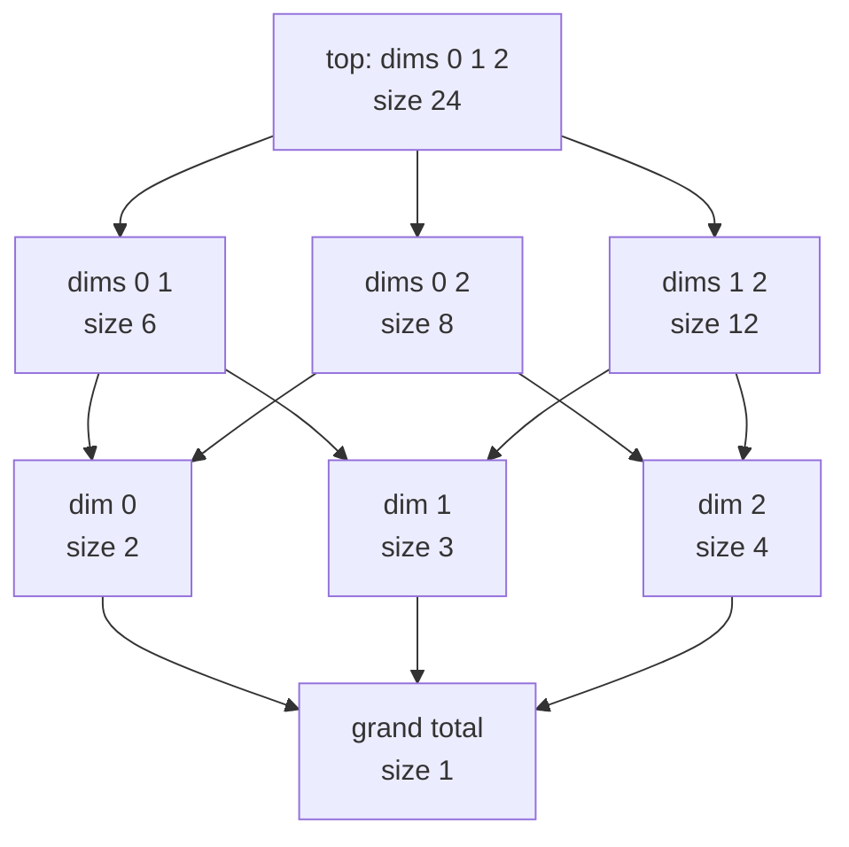
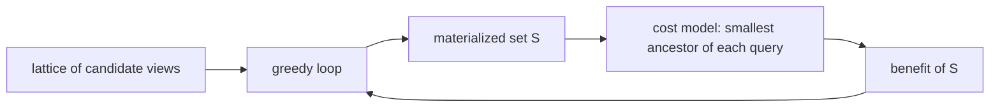
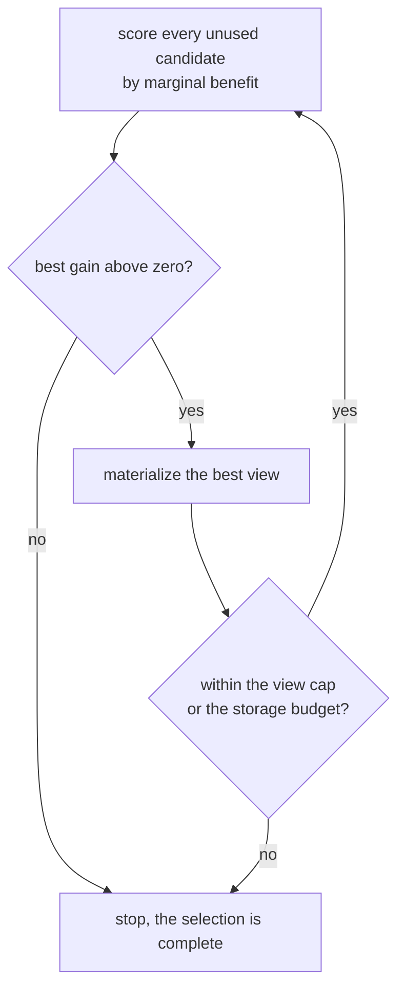
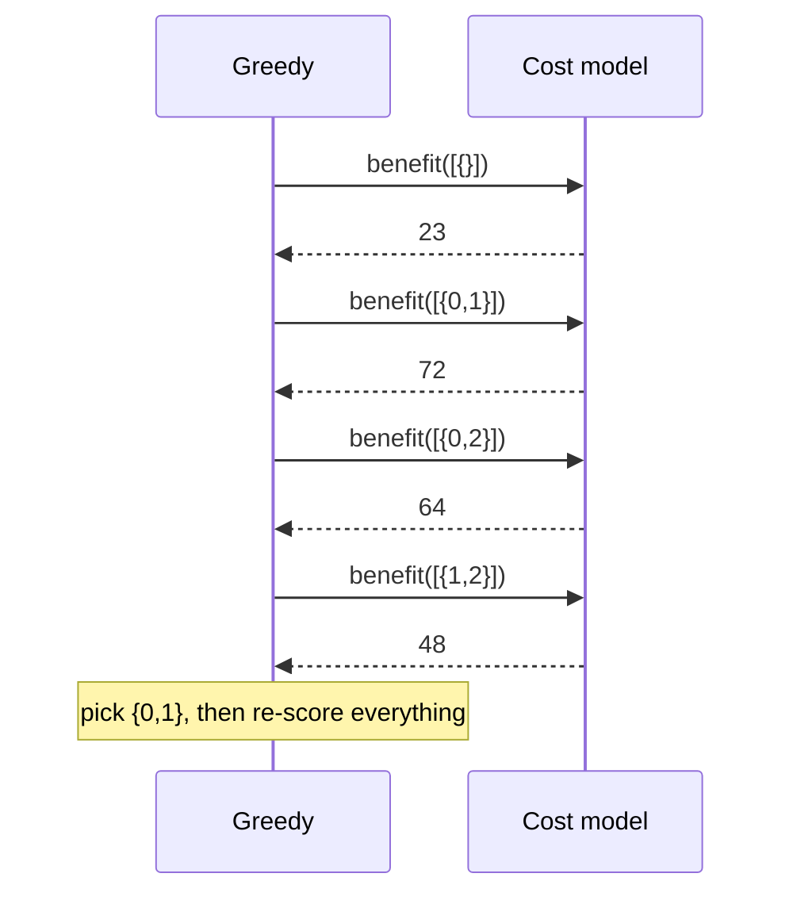

# 656 — Implement cost-based materialized view selection sketch

> **Tier:** Expert · **CTCI chapter:** Ch 14 — Databases
> **Task spec:** [656-implement-cost-based-materialized-view-selection-sketch.md](../../../tasks/expert/656-implement-cost-based-materialized-view-selection-sketch.md)
> **Solutions:** [Python](../../../solutions/python/expert/656-implement-cost-based-materialized-view-selection-sketch/solution.py) ·
> [Java](../../../solutions/java/expert/656-implement-cost-based-materialized-view-selection-sketch/Solution.java) ·
> [JavaScript](../../../solutions/javascript/expert/656-implement-cost-based-materialized-view-selection-sketch/solution.js) ·
> [C#](../../../solutions/csharp/expert/656-implement-cost-based-materialized-view-selection-sketch/Solution.cs)

## 1. Problem restatement

Given a fact table with `d` dimensions of known cardinalities, the candidate *views* are the group-bys
over every subset of dimensions — the classic data-cube lattice. A view `v` holds
`size(v) = product of the cardinalities of the dimensions in v` rows, and answering a query `w` from a
set of materialized views `S` costs the size of the **smallest ancestor of `w`** in `S ∪ {top}`: an
ancestor group-by can always be rolled up to a finer grouping, never the other way round.

The interface of the four solution files:

| Piece | Contract |
| --- | --- |
| `CubeLattice(cardinalities, weights)` | nodes are frozensets of dimension indices, `top` = all of them, `sizes`, `parents`, `children`, `weights` |
| `ancestors(node)` | all supersets of `node`, hence the views that can answer it |
| `candidates()` | every view except `top`, "the raw fact table is already materialized" |
| `ViewSelection(lattice, precomputed)` | `cost`, `total_cost`, `baseline`, `benefit`, `marginal`, `storage` |
| `greedy(max_views, pool)` | classic greedy: repeatedly add the largest marginal benefit |
| `greedy_with_budget(budget, pool)` | refuses views that do not fit, ranks by benefit per stored row |
| `exhaustive_best(max_views, pool)` | the oracle: best benefit over all subsets up to the cap |

Concrete facts the checks assert on `CubeLattice([2, 3, 4])`:

- exactly `2^3 = 8` lattice nodes; `sizes[top] == 24`, `sizes[{}] == 1`; each node has exactly
  `3 - |node|` parents, parents are strict supersets and never smaller, the child relation is symmetric,
  the top's children are the three 2-element views, and the grand total has no children;
- `cost(query, []) == sizes[top]` for every query, `benefit([]) == 0`, and
  `cost(query, []) >= sizes[query]` — a coarser group-by is never cheaper than the query itself;
- a materialized view answers its own query at its own size; materializing more views never raises
  `total_cost`; with *every* view materialized each query is answered by itself, so
  `total_cost(all) == Σ sizes`;
- the benefit is submodular on 24 random index sets (`marginal(small, c) >= marginal(big, c)`);
- greedy never beats the exhaustive optimum and always reaches `(1 - 1/e) · optimum` over 8 random
  instances × dimensions 2 and 3 × caps 1-3;
- on the uniform cube `[2, 3, 4]` greedy is **exactly** optimal for caps 1, 2 and 3, and its first pick
  is the best single view;
- weights steer the choice: with weight `100` on `{0, 1}` the first pick is a subset of `{0, 1}`;
- budgeted selection on `[4, 4, 4]` with `budget = 20` stays feasible (`storage <= 20`, no single view
  above 20) and beats the best single view; `budget = 0` materializes nothing;
- degenerate lattices: `[1, 1]` collapses every view to one row, so the benefit is zero and greedy
  returns nothing; for `[5]` greedy picks the grand total, whose own query costs 1 row;
- greedy and budgeted greedy are deterministic, and the selected set never makes the workload more
  expensive than the baseline.

Documented simplification: this is a **sketch** — sizes come analytically from the cardinalities rather
than from statistics, every lattice node is also a query with a weight, and maintenance/update cost of a
materialized view is ignored (query cost only).

## 2. Intuition

The naive answer is "materialize everything": every query is then answered at its own size, but storage
is the sum over all `2^d` views, which is absurd for a real cube. The opposite naive answer is
"materialize nothing": every query scans the raw fact table.

What makes the choice tractable is the *direction of roll-up*. If a view groups by dims `{0, 1}` and the
query groups by `{0}`, the query can be answered from the view by aggregating dim 1 away — so a view `v`
serves exactly the queries `w` with `w ⊆ v`, at cost `size(v)`. That gives a closed-form cost model:

    cost(w, S) = min { size(v) : v ∈ S ∪ {top}, w ⊆ v }
    benefit(S) = baseline - total_cost(S),  baseline = total_cost(∅) = Σ_w weight_w · size(top)

Because sizes grow with the dimension set, a view is never smaller than the views below it, and the
lattice orders candidate views by exactly the trade being made: smaller views answer fewer queries.



Choosing the best `k` views is NP-hard (it is the classic cube-selection problem), so the shipped
algorithm is the textbook **greedy**: repeatedly add the view with the largest marginal benefit. That is
justified by structure, not hope: `benefit` is a coverage function — a sum over queries of
`weight · max(0, size(top) - best ancestor size)` — hence monotone and submodular, and for monotone
submodular maximisation under a cardinality constraint greedy is within `1 - 1/e ≈ 63%` of the optimum.
Both directions are cross-checked exhaustively in the solution's tests.



## 3. Algorithm

1. Build the lattice: one node per subset of dimensions (`2^d` of them), `top` = the full set,
   `sizes[v] = Π cardinalities of v`, `parents[v] = { v ∪ {d} }` for every dimension not in `v`,
   `children` the reverse relation, weights defaulting to `1.0`.
2. `cost(query, S)`: take the minimum `size(v)` over views `v` in `S ∪ precomputed` with
   `query ⊆ v`. `precomputed` always contains `top`, so the minimum is defined.
3. `total_cost(S) = Σ_w weight_w · cost(w, S)`; `baseline()` is the empty selection (every query scans
   the raw cube); `benefit(S) = baseline - total_cost(S)`.
4. `greedy(max_views)`: while the cap is not reached, compute `marginal(S, c) = benefit(S + [c]) -
   benefit(S)` for every unused candidate and append the best one; stop as soon as no candidate gains
   more than `EPS`.
5. `greedy_with_budget(budget)`: same loop, but skip candidates whose storage does not fit the
   remaining budget and rank by `gain / size(candidate)`; the chosen set must satisfy
   `storage(chosen) <= budget`.
6. The tests cross-check the heuristics against `exhaustive_best`, which enumerates every subset up to
   the cap, and against `brute`-style invariants of the model itself.

```text
function cost(query, chosen)
    best ← none
    for view in chosen together with precomputed do
        if query is a subset of view then
            size ← sizes[view]
            best ← size if best is none else min(best, size)
    assert best is not none                  // the top view answers every query
    return best

function benefit(chosen)
    return baseline() - sum of weights[query] * cost(query, chosen) over all queries

function marginal(chosen, candidate)
    return benefit(chosen + [candidate]) - benefit(chosen)

procedure greedy(max_views)
    chosen ← empty list
    while length(chosen) < max_views do
        best ← none
        best_gain ← 0
        for candidate in candidates do
            if candidate is in chosen then continue
            gain ← marginal(chosen, candidate)
            if gain > best_gain + EPS then
                best ← candidate
                best_gain ← gain
        if best is none then
            break                             // no view pays for itself any more
        append best to chosen
    return chosen

procedure greedy_with_budget(budget)
    chosen ← empty list
    used ← 0
    while true do
        best ← none
        best_ratio ← 0
        for candidate in candidates do
            if candidate is in chosen then continue
            size ← sizes[candidate]
            if used + size > budget then continue
            gain ← marginal(chosen, candidate)
            if gain <= EPS then continue
            ratio ← gain / size
            if ratio > best_ratio + EPS then best ← candidate, best_ratio ← ratio
        if best is none then break
        append best to chosen
        used ← used + sizes[best]
    assert used <= budget
    return chosen
```



## 4. Worked example

`CubeLattice([2, 3, 4])`, every weight `1`. Sizes follow from the cardinalities (the checks assert the
two extremes, `size(top) = 24` and `size({}) = 1`):

| View | Dimensions | Size |
| --- | --- | --- |
| `{}` | none (grand total) | `1` |
| `{0}` | dim 0 (2 values) | `2` |
| `{1}` | dim 1 (3 values) | `3` |
| `{2}` | dim 2 (4 values) | `4` |
| `{0,1}` | dims 0 and 1 | `6` |
| `{0,2}` | dims 0 and 2 | `8` |
| `{1,2}` | dims 1 and 2 | `12` |
| `{0,1,2}` | the raw cube (`top`) | `24` |

Baseline: with only `top` materialized, all 8 queries cost 24, so `baseline = 8 · 24 = 192`.

Benefit of each *single* view, using `cost(w, S) = min size of the ancestors of w in S ∪ {top}`. A view
`v` answers a query `w` exactly when `w ⊆ v`, so a view of size `s` covering `c` queries saves
`c · (24 - s)` for those and nothing for the other `8 - c`:

| View | Size | Queries it answers | Benefit |
| --- | --- | --- | --- |
| `{}` | 1 | `{}` only | `1 · 23 = 23` |
| `{0}` | 2 | `{}`, `{0}` | `2 · 22 = 44` |
| `{1}` | 3 | `{}`, `{1}` | `2 · 21 = 42` |
| `{2}` | 4 | `{}`, `{2}` | `2 · 20 = 40` |
| `{0,1}` | 6 | `{}`, `{0}`, `{1}`, `{0,1}` | `4 · 18 = 72` |
| `{0,2}` | 8 | `{}`, `{0}`, `{2}`, `{0,2}` | `4 · 16 = 64` |
| `{1,2}` | 12 | `{}`, `{1}`, `{2}`, `{1,2}` | `4 · 12 = 48` |

Greedy's first pick is therefore `{0,1}` — the largest benefit, and the check asserts it equals the best
single view. It is the interesting choice: the *smallest* view `{}` answers the most queries (every
query contains the empty set… no — every query is a superset of `{}`, so `{}` answers only the `{}`
query) — the table shows why the winner is the view that is both small and wide: `{0,1}` covers four
queries at 6 rows instead of one query at 1 row.

A verification round makes the second pick interesting. With `S = [{0,1}]`, the second-best marginal
gain over the remaining candidates is the sibling `{0,2}` (its four queries are already partly covered,
so its gain is smaller than the 72 it would have had alone), and after that the remaining views gain
even less — which is exactly the diminishing-returns property the submodularity checks sample 24 random
index sets for.



Weighted lattices behave as expected: with `weights = {frozenset({0,1}): 100.0}` on `[2, 2, 2]` the
heavy query dominates the objective, and the first pick is a subset of `{0,1}` — covering the expensive
query pays more than covering a light one, which the checks assert directly. The budgeted variant on
`[4, 4, 4]` with `budget = 20` shows the other dimension of the problem: it ranks by benefit per stored
row, never exceeds the budget, and still beats the best single view, while `budget = 0` yields `[]`.

## 5. Complexity

`d` = dimensions, `N = 2^d` = lattice nodes (candidates: `N - 1`), `k` = views selected, `q` = queries
(= `N` in this model), `r` = rows of a view (its size).

| Operation | Best | Average | Worst | Why the bound holds |
| --- | --- | --- | --- | --- |
| Build the lattice | O(N·d) | O(N·d) | O(N·d) | `2^d` nodes, each with up to `d` parents and a size product over its dimensions |
| `cost(query, S)` | O(\|S\|) | O(\|S\|) | O(\|S\| + N) | one subset test per materialized view; `precomputed` always contains `top` |
| `total_cost(S)` | O(q) | O(q·\|S\|) | O(q·N) | every query is priced against every materialized view |
| `marginal` | O(q) | O(q·\|S\|) | O(q·N) | two `benefit` evaluations |
| `greedy` | O(N·q) | O(k·N·q·k) | O(k·N·q·k) | up to `k` rounds, each scoring up to `N` candidates, each O(q·k) |
| `greedy_with_budget` | O(N·q) | O(N·q·k²) | O(N·q·k²) | identical loop with an extra feasibility test per candidate |
| `exhaustive_best` | O(N·q) | O(Σ_{i≤k} C(N,i)·q·i) | O(N^k·q·k) | every subset up to the cap is priced |
| Space | O(N) | O(N) | O(N) | lattice nodes, sizes, parent/child maps and weights |

Greedy against exhaustive is the comparison the task is built on: `O(k²·N·q)` versus `O(N^k·q·k)`. On
the measured instances (`d = 2, 3`, so `N ≤ 8`) enumeration is trivially cheap, which is what lets the
solution assert the `(1 - 1/e)` factor rather than merely cite it; on a 10-dimension cube (`N = 1024`)
the exhaustive oracle is already out of reach while greedy stays linear in the candidate count per
round. The storage side is the counterweight: `greedy_with_budget` adds the `Σ sizes` constraint, and
every step re-tests feasibility.

## 6. Pitfalls and edge cases

- **Roll-up direction.** A view `v` answers query `w` only when `w ⊆ v`. Reversing the test would let
  the grand total answer every query for 1 row, which is nonsense — the checks pin the relation down by
  asserting `cost(query, []) >= sizes[query]` for every query.
- **`top` is already materialized.** `precomputed` always includes it, so `cost` never fails and the
  empty selection is the legitimate baseline rather than an error.
- **`top` is not a candidate.** It is excluded from `candidates()` precisely because it is already
  there; selecting it again would double-count storage for no gain.
- **Degenerate cardinalities.** `CubeLattice([1, 1])` gives every view size 1, so no view gains
  anything: `benefit(candidates) == 0` and `greedy(2) == []`. A one-dimension cube `[5]` has exactly one
  useful view, the grand total, which greedy picks.
- **Zero and negative gains.** The loop stops on `gain > best_gain + EPS` with `best_gain` initialised to
  `0`, so empty or negative-gain candidates are never selected; `EPS = 1e-9` keeps floating-point noise
  from manufacturing a gain.
- **Budget feasibility.** A view larger than the budget is skipped before it is scored, and the loop
  asserts `used <= budget` at the end; `greedy_with_budget(0) == []`.
- **Weights change the answer.** Uniform weights make the symmetric views interchangeable; a weight of
  `100` on one query makes views covering it the only sensible picks. A model without weights would
  optimise the wrong objective.
- **Tie-breaking.** Candidates are iterated in lattice order and a candidate replaces the incumbent only
  on a strictly better gain or ratio, which keeps selection deterministic — the checks run every greedy
  twice and compare.
- **Sizes are analytic, not measured.** `size(v)` is the product of the dimension cardinalities; real
  statistics would estimate it, and the sketch deliberately does not.
- **Maintenance cost is ignored.** Refreshing a view when the fact table changes is not modelled, so the
  selection is query-cost optimal only under the documented assumption.
- **Monotonicity sanity check.** `total_cost` must never increase as views are added (asserted for every
  candidate in size order), which catches a wrong ancestor test immediately.

## 7. Variants and follow-ups

- **Maintaining the chosen views.** Once materialized, a view has to be kept fresh incrementally:
  [645-implement-materialized-view-maintenance-incremental-algorithm.md](../../../tasks/expert/645-implement-materialized-view-maintenance-incremental-algorithm.md).
- **The index-selection twin.** Same greedy-versus-optimum skeleton with a different cost model:
  [654-implement-workload-driven-index-selection-greedy-heuristic.md](../../../tasks/expert/654-implement-workload-driven-index-selection-greedy-heuristic.md).
- **Rewriting queries to use the views.** Deciding *whether* to unfold a view definition or read the
  materialized copy is the rewriter's job:
  [655-implement-query-rewriter-for-simple-view-unfolding.md](../../../tasks/expert/655-implement-query-rewriter-for-simple-view-unfolding.md).
- **Reordering the joins under a view.** Cube queries in particular finish with a lattice-shaped join
  order: [643-implement-multi-way-join-ordering-via-dynamic-programming-seling.md](../../../tasks/expert/643-implement-multi-way-join-ordering-via-dynamic-programming-seling.md).
- **Approximating the answers instead of precomputing them.** Sampling can answer cube-style aggregates
  without storing any view:
  [646-implement-approximate-query-processing-via-sampling-reservoir.md](../../../tasks/expert/646-implement-approximate-query-processing-via-sampling-reservoir.md).

## 8. Check yourself

1. **Why does a view of size 6 answer a query of size 3?**
   <details><summary>Show answer</summary>Because the query's dimensions are a subset of the view's, so
   the view is an *ancestor* group-by that can be rolled up (aggregate the extra dimensions away) to the
   query's grouping. It costs the view's size, 6 rows, instead of the raw cube's 24.</details>
2. **Why is the grand total `{}` not the best first pick, even though it is the smallest view?**
   <details><summary>Show answer</summary>Because it answers only the one query that groups by nothing:
   `w ⊆ {}` holds only for `w = {}`. Its benefit is `1 · 23 = 23`, while `{0,1}` covers four queries at 6
   rows for a benefit of `4 · 18 = 72`.</details>
3. **What property guarantees greedy is not arbitrarily bad?**
   <details><summary>Show answer</summary>`benefit` is a coverage function — a sum of per-query maxima
   of non-negative utilities — hence monotone and submodular. Greedy on a monotone submodular function
   under a cardinality constraint achieves at least `(1 - 1/e)` of the optimum, and on the uniform cube
   it is exactly optimal.</details>
4. **How does the budgeted variant differ?**
   <details><summary>Show answer</summary>It scores candidates by `gain / size` instead of gain, skips any
   candidate whose storage does not fit the remaining budget, stops when nothing useful fits, and
   asserts the total storage stays inside the budget.</details>
5. **What happens for a cube whose dimensions all have cardinality 1?**
   <details><summary>Show answer</summary>Every view has size 1, so no view can reduce any query's cost:
   `benefit` is 0 for every selection and greedy returns the empty set.</details>
