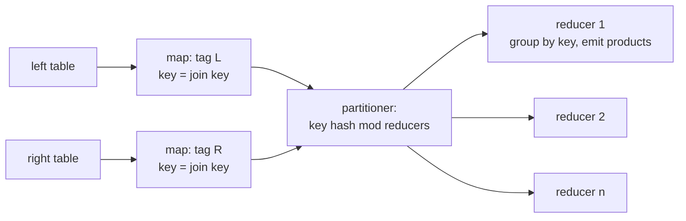
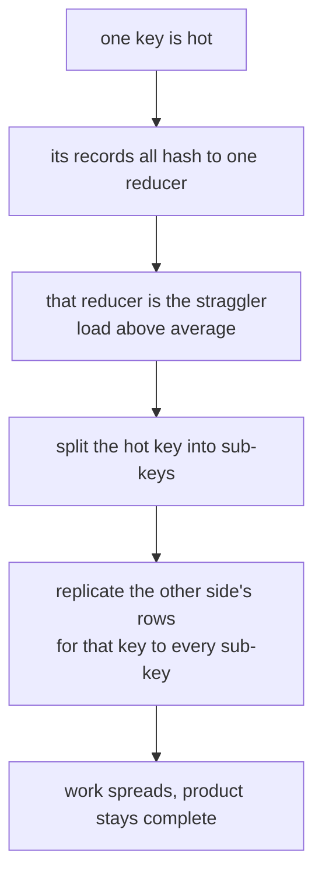
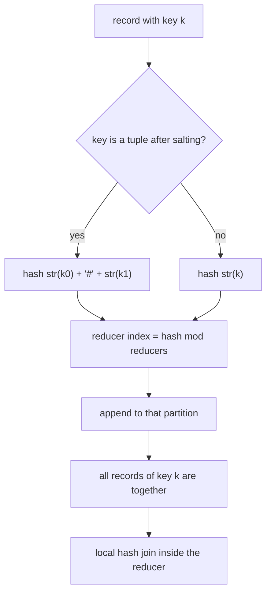
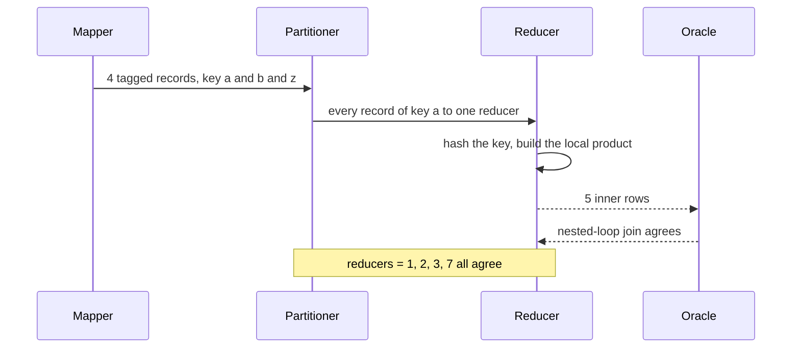

# 657 — Implement distributed join shuffle simulation in map-reduce

> **Tier:** Expert · **CTCI chapter:** Ch 9 — System Design and Scalability
> **Task spec:** [657-implement-distributed-join-shuffle-simulation-in-map-reduce.md](../../../tasks/expert/657-implement-distributed-join-shuffle-simulation-in-map-reduce.md)
> **Solutions:** [Python](../../../solutions/python/expert/657-implement-distributed-join-shuffle-simulation-in-map-reduce/solution.py) ·
> [Java](../../../solutions/java/expert/657-implement-distributed-join-shuffle-simulation-in-map-reduce/Solution.java) ·
> [JavaScript](../../../solutions/javascript/expert/657-implement-distributed-join-shuffle-simulation-in-map-reduce/solution.js) ·
> [C#](../../../solutions/csharp/expert/657-implement-distributed-join-shuffle-simulation-in-map-reduce/Solution.cs)

## 1. Problem restatement

Simulate a MapReduce equi-join end to end: **map** every row of both inputs into a tagged record keyed
by the join key, let the **partitioner** route each record to exactly one reducer, and let each
**reducer** group its partition by key and emit the cartesian product per key. Two plans are compared —
the reduce-side *shuffle join* and the map-side *broadcast join* — and the classic straggler problem of
the shuffle join is attacked with *salting*.

The interface of the four solution files:

| Piece | Contract |
| --- | --- |
| `Table(name, columns, rows)` | `key_index(column)` |
| `map_side(table, key_index, tag)` | one tagged record per row: `(key, (tag, row))` |
| `partition_of(key, reducers)` | `fnv1a(str(key)) % reducers` — deterministic, never the host's `hash()` |
| `shuffle(records, reducers)` | route every record to its reducer (tuple keys use `str(k0) + "#" + str(k1)`) |
| `reduce_partition(records, kind)` | group by key; `inner` emits matches, `left` also emits unmatched left rows |
| `shuffle_join(left, right, left_key, right_key, reducers, kind, hot_keys, splits, track)` | full map → salt → shuffle → reduce |
| `broadcast_join(left, right, left_key, right_key, kind, track)` | hash the right side in memory; shuffle nothing |
| `brute_force_join(...)` | single-process nested-loop oracle |

Concrete results the checks assert:

- hand example `orders = [(1,a), (2,a), (3,b), (4,z)]` joined with
  `customers = [(a,rome), (a,paris), (b,oslo)]`: **5** inner rows, all sharing the join key, equal to the
  nested-loop oracle; the left-outer variant additionally contains `(4, z)`;
- partitioner invariants: `shuffle_records == len(left) + len(right)` (`7` for the hand example),
  `sum(loads) == shuffle_records`, one load counter per reducer;
- 6 random workloads (40 left rows, 25 right rows, 8 keys) answered identically for `reducers` = 1, 2, 3
  and 7, for both join kinds;
- the join is symmetric as a bag of rows: joining `A` with `B` mirrors joining `B` with `A` after
  reordering the columns;
- the broadcast join returns the same rows as the shuffle join and reports **0** shuffle records;
- empty and disjoint inputs: inner joins are empty, left-outer joins keep every left row;
- skew: with 200 left rows (every third key `hot`) and 40 right rows (every fifth key `hot`) over 6 keys
  and 4 reducers, the plain busiest partition exceeds the average load; salting with 4 splits lowers the
  busiest partition, raises the shuffle volume, and changes **not a single result row**;
- determinism: the same plan twice gives the same rows, and `partition_of("customer", 4)` equals
  `fnv1a("customer") % 4`.

Documented simplifications: one machine executes mapper, partitioner and reducer as pure functions —
no network, no serialization cost model, no combiner — and partition load is measured in **records**
rather than bytes.

## 2. Intuition

The naive distributed join is "ship everything to everything": every block of `A` meets every block of
`B`, so the cross traffic is `|A| · |B|`. The shuffle join's trick is one invariant instead of one
guess: **partition both sides with the same deterministic function of the join key**. Then all rows of a
key land in the same reducer, and a reducer can join the key's rows locally with a hash table — each
reducer only needs its own partition, and the shuffle carries exactly `|A| + |B|` records.



The invariant is checkable without a network: every record appears in exactly one partition, so the
partition loads sum to the record count, and the joined *result* must equal a single-process nested-loop
join for any reducer count. That last property is what makes the simulation meaningful — a wrong
partitioner (say one that hashes only the left side) would still produce a plausible-looking result on
some inputs, but not for `reducers = 1, 2, 3, 7` on six random workloads.

The map-side alternative exploits a different asymmetry: if one side fits in memory, hash it and stream
the other side through it. Then the shuffle volume is **zero** and there is no key-skew problem at all —
at the cost of requiring that the small side really is small.



Salting is that last idea in detail. Rows of a hot key on the left get a sub-key `index % splits`, while
the right side's rows for that key are *replicated* to all `splits` sub-keys — so the cartesian product
is still complete but the work is distributed. It costs extra shuffled records, which is exactly the
trade the benchmark measures.

## 3. Algorithm

1. **Map.** For each row of each side, emit `(row[key_index], (tag, row))` with `tag` = `"L"` or `"R"`.
2. **Salt (optional).** If the join is given `hot_keys` and `splits > 1`: a left record whose key is hot
   becomes keyed `(key, i % splits)`; every right record of a hot key is emitted once per sub-key as
   `(key, s)` for `s` from `0` to `splits - 1`.
3. **Partition.** `partition_of(key, reducers)` hashes with `fnv1a(str(key)) % reducers`; a tuple key is
   hashed as `str(key[0]) + "#" + str(key[1])`. Each record goes to exactly one reducer.
4. **Reduce.** Group the partition by key, keeping the insertion order of keys; for each key emit the
   cartesian product of the left and right row lists. For `kind = "left"`, a key with no right rows
   emits its left rows unchanged.
5. **Track.** With `track` supplied, record `shuffle_records` (the number of records crossing the
   shuffle, salting included) and `loads` (the per-reducer record count) — the two numbers the skew
   benchmark compares.
6. **Broadcast alternative.** Hash the right side into a dictionary of key → rows, stream the left side,
   emit matches (and unmatched left rows for `kind = "left"`), and report `shuffle_records = 0`.

```text
procedure shuffle_join(left, right, left_key, right_key, reducers, kind, hot_keys, splits)
    left_records ← map_side(left, left.key_index(left_key), "L")
    right_records ← map_side(right, right.key_index(right_key), "R")
    if hot_keys is not empty and splits > 1 then
        for index, (key, payload) in left_records do
            if key is in hot_keys then replace by ((key, index mod splits), payload)
        for (key, payload) in right_records do
            if key is in hot_keys then
                for split ← 0 to splits - 1 do emit ((key, split), payload)
    partitions ← one empty list per reducer
    for (key, payload) in left_records concatenated with right_records do
        append (key, payload) to partitions[ fnv1a(str_key(key)) mod reducers ]
    for partition in partitions do
        emit reduce_partition(partition, kind)
    record loads and shuffle volume when tracking

function reduce_partition(records, kind)
    groups ← dictionary key → { left rows, right rows }, with keys kept in arrival order
    for (key, (tag, row)) in records do
        append row to groups[key][tag]
    out ← empty list
    for key in arrival order do
        if groups[key].right is not empty then
            for left_row in groups[key].left do
                for right_row in groups[key].right do
                    emit left_row concatenated with right_row
        else if kind = "left" then
            emit the left rows of the key unchanged
    return out

function broadcast_join(left, right, left_key, right_key, kind)
    lookup ← dictionary key → rows, built from the right table
    for row in left rows do
        matches ← lookup[row[left_key]]
        if matches is not empty then
            for match in matches do emit row concatenated with match
        else if kind = "left" then
            emit row unchanged
    shuffle volume ← 0
```



Because the same function is applied to both sides' records, the grouping in the last two nodes holds
for *every* key, and that is the correctness argument the brute-force comparison tests.

## 4. Worked example

Hand example from the checks:

| Orders (left) | Customers (right) |
| --- | --- |
| `(1, a)`, `(2, a)`, `(3, b)`, `(4, z)` | `(a, rome)`, `(a, paris)`, `(b, oslo)` |

Grouping by key after the shuffle (the partitioner decides *which* reducer, the reducer only needs the
key-local groups):

| Key | Left rows | Right rows | Inner output | Left-outer output |
| --- | --- | --- | --- | --- |
| `a` | `(1, a)`, `(2, a)` | `(a, rome)`, `(a, paris)` | 4 rows: `(1,a,a,rome)`, `(1,a,a,paris)`, `(2,a,a,rome)`, `(2,a,a,paris)` | same 4 |
| `b` | `(3, b)` | `(b, oslo)` | 1 row: `(3,b,b,oslo)` | same |
| `z` | `(4, z)` | none | nothing (no right row) | `(4, z)` — the unmatched row |

Totals: 5 inner rows (the asserted count), every one of them sharing the join key in positions 1 and 2,
and 6 rows for the left-outer variant. The partitioner invariants on the same run with 4 reducers:
`shuffle_records = 4 + 3 = 7`, the load counters sum to 7, and there is one counter per reducer.

The key counts are the whole story of duplicate handling: two `a` orders times two `a` customers is
four rows, not one. Whatever `reducers` is, those four rows are produced, because both `a` orders and
both `a` customers hash to the same reducer — `reducers` only changes *where* the work happens, never
the answer, which is asserted for 1, 2, 3 and 7 reducers over six random workloads.



The skew experiment is the same machinery with an adversarial workload: 200 left rows where every
third key is `hot` (67 rows), 40 right rows where every fifth key is `hot` (8 rows), 6 keys, 4 reducers.
Plain: the hot key's 75 records sit in one partition, above the 60-record average, so that reducer is
the straggler. With `hot_keys = ("hot",)` and `splits = 4`, the left rows are spread over four sub-keys
and the right rows are replicated to all four, so the busiest partition drops below the plain maximum —
while the shuffle volume rises (each hot right row now crosses the aggregation four times). The checks
assert exactly these three things: lower peak, more records, identical rows.

| Plan | Busiest partition | Shuffle records | Result rows |
| --- | --- | --- | --- |
| shuffle join, unsalted | 75 (hot key) — above the average of 60 | 240 | matches brute force |
| shuffle join, `splits = 4` | lower than 75 | above 240 | identical |

## 5. Complexity

`L`, `R` = input row counts, `r` = reducers, `k` = distinct keys, `m` = number of output rows,
`h` = rows of a hot key, `s` = splits.

| Operation | Best | Average | Worst | Why the bound holds |
| --- | --- | --- | --- | --- |
| Map | O(L + R) | O(L + R) | O(L + R) | one tagged record per input row |
| Salt | O(L + R) | O(L + R + h·(s - 1)) | O(L + R·s) | hot left rows are re-keyed, hot right rows replicated `s` times |
| Partition | O(L + R) | O(L + R) | O(L + R) | one deterministic hash and one append per record |
| Reduce (grouping) | O(p) | O(p) | O(p) | `p` = records of that partition, one dictionary update each |
| Reduce (product) | O(m) | O(m) | O(m) | one emitted row per output pair |
| Whole shuffle join | O(L + R) | O(L + R + m) | O(L + R + m) | map + partition are linear, reduce is linear in its input and its output |
| Broadcast join | O(L + R) | O(L + R + m) | O(L + R + m) | hashing the right side once, streaming the left side once, zero shuffle |
| Nested-loop oracle | O(L·R) | O(L·R) | O(L·R) | every pair is compared — the baseline the shuffle avoids |
| Space | O(L + R) | O(L + R) | O(L + R) | partitions hold all shuffled records; a reducer holds its own partition only |

Two system-level properties fall out of the same accounting. Per reducer the work is O(partition size),
so a balanced partitioner gives each of `r` reducers about `(L + R) / r` records — and the skew
experiment measures exactly that ratio. The broadcast join exchanges O(L + R) work for **zero** shuffle
volume, which is a pure win whenever the right side fits in memory; salting exchanges extra shuffle
volume (`h·(s - 1)` extra records for the replication) for a lower peak load.

## 6. Pitfalls and edge cases

- **The partitioner must be deterministic and key-only.** Using the host's `hash()` (randomised per
  process in some runtimes) would break reproducibility; hashing anything other than the join key would
  break co-partitioning. The checks assert `partition_of("customer", 4) == fnv1a("customer") % 4`.
- **Co-partitioning is the correctness invariant.** Both sides go through the *same* function; a plan
  that partitions the sides differently can never be sure a key's rows meet.
- **Reducer count must not change the answer.** Asserted for 1, 2, 3 and 7 reducers on both join kinds;
  `reducers = 1` is the degenerate case where every key trivially co-locates.
- **Duplicate keys multiply.** Two left rows and two right rows on one key produce four output rows —
  the hand example's five rows come from `2·2 + 1`.
- **Left-outer semantics for unmatched keys.** A key with no right rows emits its left rows unchanged
  (the checks assert the bare `(4, z)` row is present), and an empty right side keeps *all* left rows.
- **Empty and disjoint inputs.** Inner joins over an empty side are empty; disjoint key sets give no
  inner rows but keep every left row in an outer join.
- **Salting must preserve the product.** The left side is split, the right side replicated — never the
  other way round, and never only one side. Splitting only the left would drop matches; the checks
  compare the salted result row for row against brute force.
- **Salting costs records.** `shuffle_records` grows by `h·(s - 1)`; the benchmark asserts the growth, so
  the trade is explicit rather than hidden.
- **Skew is invisible in the answer.** The unsalted and salted plans return the same rows; only the load
  counters (max partition versus average) reveal the difference.
- **Record counts are not bytes.** `loads` counts records; a real cluster weighs bytes, and the header
  documents this simplification.
- **Memory assumption of the broadcast plan.** It is only valid when the right side fits in memory, and
  it is modelled as a hash table with a bounded number of entries.
- **Ordering.** Output order is determined by key arrival order inside each partition, so tests compare
  as bags of rows (`sorted(..., key=str)`), never as sequences — except for reproducibility of identical
  plans, which the determinism check compares directly.

## 7. Variants and follow-ups

- **Stragglers from slow workers rather than skewed keys.** The speculative-execution task attacks the
  same straggler problem from the scheduling side:
  [658-implement-straggler-mitigation-via-speculative-execution-simulat.md](../../../tasks/expert/658-implement-straggler-mitigation-via-speculative-execution-simulat.md).
- **Which worker owns a partition.** Consistent hashing decides reducer assignment when nodes join and
  leave: [659-implement-consistent-hashing-with-weighted-nodes-and-replication.md](../../../tasks/expert/659-implement-consistent-hashing-with-weighted-nodes-and-replication.md).
- **Reducing the shuffle before it happens.** A bloom filter on the join keys drops rows on the map side:
  [649-implement-bloom-join-filter-application-and-benchmarking.md](../../../tasks/expert/649-implement-bloom-join-filter-application-and-benchmarking.md).
- **The join itself.** A reducer's local join is the hash join of the single-node task:
  [642-implement-join-algorithms-nested-loop-hash-join-sort-merge-join.md](../../../tasks/expert/642-implement-join-algorithms-nested-loop-hash-join-sort-merge-join.md).
- **Consistency across the replicas involved.** Once joined rows are written to several replicas, chain
  replication or Paxos decides what "committed" means:
  [661-implement-chain-replication-simulation-for-strong-consistency.md](../../../tasks/expert/661-implement-chain-replication-simulation-for-strong-consistency.md).

## 8. Check yourself

1. **What single property makes the reduce-side join correct?**
   <details><summary>Show answer</summary>Co-partitioning: both sides are routed by the same
   deterministic hash of the join key, so every row of a key reaches the same reducer, where a local hash
   join can produce the full cartesian product for that key.</details>
2. **Why does the reducer count not matter for the result?**
   <details><summary>Show answer</summary>Because the partition function routes by key, not by position:
   changing `reducers` moves whole key groups between workers but never splits a key. The checks confirm
   identical results for 1, 2, 3 and 7 reducers.</details>
3. **What exactly does salting change, and what does it cost?**
   <details><summary>Show answer</summary>The left rows of a hot key are re-keyed into `splits`
   sub-keys and the right rows of that key are replicated to every sub-key, so the hot key's work is
   spread across partitions. Cost: extra shuffled records (each replicated right row crosses the shuffle
   once per split). Result: unchanged, as the brute-force comparison asserts.</details>
4. **When is the broadcast join the better plan, and what does it save?**
   <details><summary>Show answer</summary>When the right side fits in memory: hash it once, stream the
   left side through the hash table. The shuffle volume becomes exactly zero — asserted in the check —
   and there is no key-skew problem, at the cost of the memory requirement.</details>
5. **How is a mismatch between the simulated plan and reality detected?**
   <details><summary>Show answer</summary>Every plan is compared against a single-process nested-loop
   join (`brute_force_join`) on hand-built, random, empty and disjoint inputs, in addition to the
   invariants (record conservation across partitions, load sums, symmetry of the join, determinism).</details>
