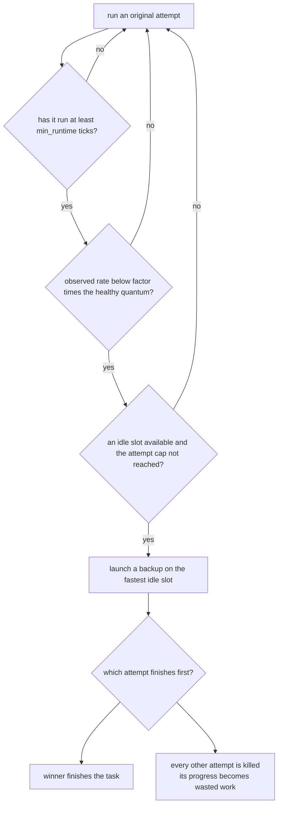
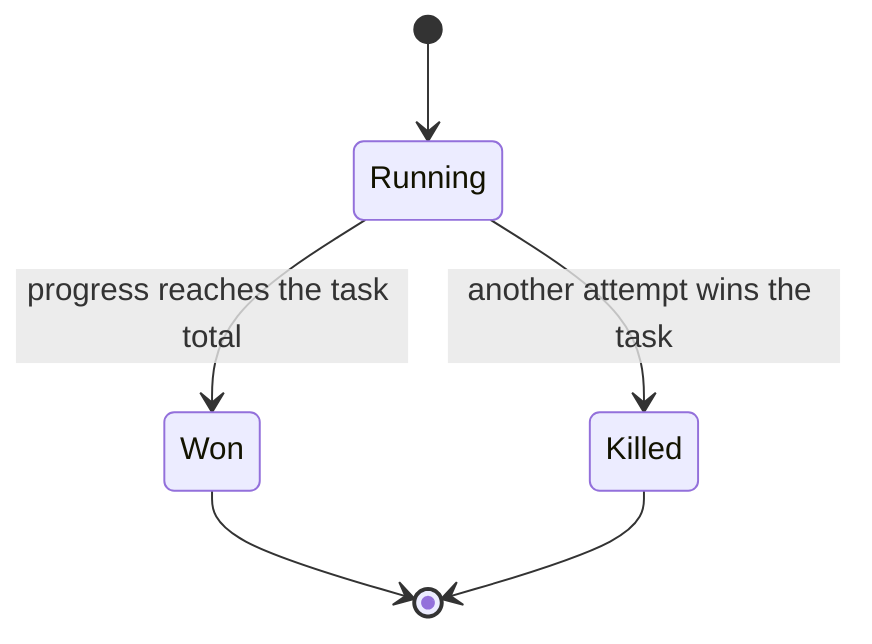
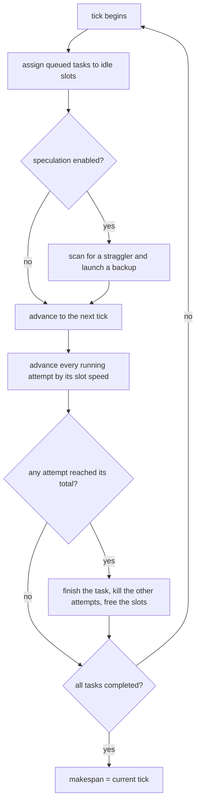
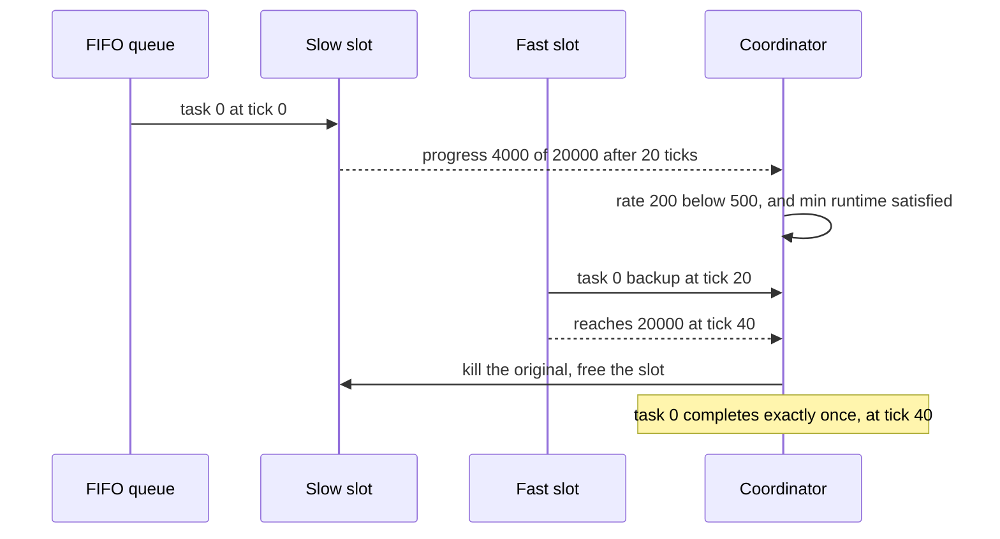

# 658 — Implement straggler mitigation via speculative execution simulation

> **Tier:** Expert · **CTCI chapter:** Ch 9 — System Design and Scalability
> **Task spec:** [658-implement-straggler-mitigation-via-speculative-execution-simulat.md](../../../tasks/expert/658-implement-straggler-mitigation-via-speculative-execution-simulat.md)
> **Solutions:** [Python](../../../solutions/python/expert/658-implement-straggler-mitigation-via-speculative-execution-simulat/solution.py) ·
> [Java](../../../solutions/java/expert/658-implement-straggler-mitigation-via-speculative-execution-simulat/Solution.java) ·
> [JavaScript](../../../solutions/javascript/expert/658-implement-straggler-mitigation-via-speculative-execution-simulat/solution.js) ·
> [C#](../../../solutions/csharp/expert/658-implement-straggler-mitigation-via-speculative-execution-simulat/Solution.cs)

## 1. Problem restatement

Simulate a tick-accurate MapReduce scheduler for a job of tasks with known work sizes on a fixed cluster
of slots, and study **speculative execution**: when one task's attempt is visibly slow, start a
duplicate attempt on an idle slot and let whichever finishes first win.

The interface of the four solution files:

| Piece | Contract |
| --- | --- |
| `QUANTUM` | `1000` progress units a healthy machine applies per tick |
| `MAX_TICKS` | `200000` safety valve so the simulation cannot spin forever |
| `fifo_makespan(work, slot_slowdowns)` | independent reference: each task to the slot that frees earliest |
| `Simulator(task_work, slot_slowdowns, speculate, max_speculative, min_runtime, factor)` | the scheduler |
| `run()` | tick loop; returns the simulator with `makespan`, `completed`, `killed`, `launches`, `work_done` |
| `wasted_work()` | progress burned by killed attempts |
| `random_job(seed, task_count, slow_slots, slowdown, workers)` | deterministic workloads and slow machines |

Scheduler mechanics: a slot's speed is `QUANTUM // slowdown` (`1` = healthy), idle slots pull tasks from a
FIFO queue, and as soon as a task finishes every other attempt of it is killed and its slot freed — so a
task produces its result exactly once. The backup policy runs at the start of every tick: a task whose
single running attempt has run for at least `min_runtime` ticks and whose observed progress *rate* is
below `factor * QUANTUM` is a straggler and gets a duplicate attempt on the **fastest** idle slot, up to
`max_speculative` duplicates per task.

Concrete results the checks assert:

- degenerate cases: an empty job has makespan `0`; `[7]` on one healthy slot takes exactly `7` ticks with
  `completed == {0: 7}`; `[5, 5, 5]` on four slots takes `5` with no speculation;
- a healthy run reproduces the independent FIFO list schedule on five workloads, launches nothing, kills
  nothing, and does `sum(work) * QUANTUM` progress — six 20-unit tasks on two slots take `60` ticks;
- a straggler is rescued: work `[20, 20, 20, 20]` on slowdowns `[5, 1, 1, 1]` has plain makespan `100`,
  the speculative run is strictly faster, launches at least one backup (never at tick `0`, since
  `min_runtime = 2`), completes every task exactly once, kills at least one attempt, and reports
  positive `wasted_work`;
- attempt invariants on a 24-task/6-slot job with three slowdown-6 machines: at most
  `1 + max_speculative` attempts per task, exactly one winner per task, a killed attempt implies its task
  already finished, `killed == launches` for `max_speculative = 1`, and
  `Σ attempts == tasks + launches`;
- over 12 seeds (30 tasks, 3 slow slots, slowdown 8, 6 workers): `makespan(speculation) <= makespan(none)`
  always, strictly better on at least 9 seeds, extra work exactly `wasted_work()`, and wasted work
  bounded by `launches * max(work) * QUANTUM`;
- policy knobs: an eager policy (`min_runtime = 1`, `factor = 0.5`) launches at least as many backups as a
  lazy one (`min_runtime = 8`, `factor = 0.05`) and never has a worse makespan, and even the lazy policy
  never beats "speculation off";
- a healthy cluster with uneven tasks (`[40, 25, 18, 12, 9, 7, 5, 3]` on three slots) launches nothing;
- the simulator is deterministic, `max_speculative = 0` is equivalent to `speculate = False`, and a budget
  of `2` still caps every task at three attempts.

Documented simplifications: no network, data locality or shuffle model (any slot can run any task),
progress is a deterministic function of the tick rather than counters read from workers, and stragglers
come from fixed-seed machine slowdowns rather than real hardware variance.

## 2. Intuition

A job's makespan is normally `total work / slots` — but only if every slot works at the same rate. If one
machine runs five times slower, the whole job waits for it, and no amount of parallelism elsewhere helps,
because the last task cannot start until the slot that holds it finishes. The classic response is to
notice the lag *while it happens* and hedge: run a copy of the slow task elsewhere and take the first
result.

That needs three things, and all three are in the model:

1. **A progress signal.** Each slot advances its attempt by `QUANTUM // slowdown` units per tick, so a
   straggler is visible as a low *rate* (progress divided by elapsed ticks) rather than low progress —
   which is what makes short tasks running normally not look like stragglers.
2. **A hedge rule.** Start the copy only after the attempt has run `min_runtime` ticks *and* its rate is
   under `factor * QUANTUM`; the fastest idle slot is chosen for the hedge, mirroring real schedulers
   blacklisting slow nodes.
3. **A commit rule.** The first attempt to finish wins, and every other attempt of the task is killed and
   its slot freed. Killed attempts' progress is *wasted work*, the price of the hedge.

Because a duplicate attempt runs on a different slot and independent of the original, duplicating can
never slow the original attempt down — the makespan with speculation is never worse than without it,
which the checks assert for every seed.





## 3. Algorithm

1. Initialise one slot per machine with speed `QUANTUM // slowdown`, a FIFO queue of task indices, an
   empty attempt list per task, and the tick counter at `0`.
2. At the start of each tick: hand queued tasks to idle slots in order (`_start` with
   `speculative = false`, slot = the first idle slot).
3. If speculating, `_launch_backups`: while an idle slot exists, scan tasks in index order for one whose
   single running attempt has `elapsed >= min_runtime`, `elapsed != 0`, fewer than
   `1 + max_speculative` running attempts, and `rate = progress / elapsed < factor * QUANTUM`; launch its
   backup on the fastest idle slot; stop when no task qualifies.
4. Advance the tick: every running attempt gains its speed in progress and the same amount in
   `work_done`; attempts whose progress reaches `work * QUANTUM` are finished.
5. Finish a task: record its completion tick, mark its attempt `won`, mark every other running attempt
   `killed`, and free all their slots. A task with an already-completed status is not finished twice.
6. Repeat until every task is completed; `makespan` is the tick at which that happened. The reference
   `fifo_makespan` computes the schedule independently by simulating "task goes to the slot that frees
   earliest" without a tick loop, which is what a healthy cluster must match.

```text
procedure run()
    while number of completed tasks < task_count do
        assert now < MAX_TICKS
        while queue is not empty and some slot is idle do
            start(queue.pop_first(), speculative = false)
        if speculate then
            launch_backups()
        now ← now + 1
        finished ← empty list
        for each attempt with state running do
            attempt.progress ← attempt.progress + attempt.speed
            work_done ← work_done + attempt.speed
            if attempt.progress >= attempt.total then
                append (task, attempt) to finished
        for (task, attempt) in finished do
            if task is not completed then
                finish(task, attempt)
        makespan ← now

procedure launch_backups()
    while some slot is idle do
        chosen ← none
        for task ← 0 to task_count - 1 do
            if task is completed then continue
            running ← running attempts of task
            if running is empty or count(running) >= 1 + max_speculative then continue
            original ← running[0]
            elapsed ← now - original.start
            if elapsed < min_runtime or elapsed = 0 then continue
            if original.progress / elapsed < factor * QUANTUM then
                chosen ← task
                break
        if chosen is none then
            return
        start(chosen, speculative = true)          // fastest idle slot

procedure finish(task, attempt)
    completed[task] ← now
    for other in attempts[task] do
        if other is attempt then other.state ← won
        else if other.state = running then
            other.state ← killed
            append other to killed
        slot_task[other.slot] ← none
```



## 4. Worked example

Work `[20, 20, 20, 20]` on four slots with slowdowns `[5, 1, 1, 1]`, `min_runtime = 2`, `factor = 0.5`,
`max_speculative = 1`. A healthy slot gains `1000` units per tick, the slow slot `200`; each task needs
`20 * 1000 = 20000` units.

Without speculation:

| Tick | Slow slot (task 0) | Healthy slots (tasks 1-3) | Completed |
| --- | --- | --- | --- |
| 0 | start, progress 0 | start, progress 0 | — |
| 1 | 200 | 1000 | — |
| 20 | 4000 | 20000 → finished | tasks 1, 2, 3 |
| 21-99 | advances by 200 | idle | — |
| 100 | 20000 → finished | idle | task 0 → makespan **100** |

With speculation (`speculate = true`):

| Tick | Event | Effect |
| --- | --- | --- |
| 0 | tasks 0-3 start on slots 0-3 | task 0 on the slow slot |
| 1-19 | no idle slot exists, so the backup rule cannot fire | task 0 progress reaches 4000 by tick 20 |
| 20 | tasks 1-3 finish and free three slots; task 0's rate is `4000 / 20 = 200 < 500`, so a backup starts on the fastest idle slot | one launch recorded at tick 20, original keeps running |
| 21-40 | original gains 200 per tick, backup gains 1000 per tick | backup reaches 20000 at tick 40 |
| 40 | the backup wins; the original is killed | task 0 completes, makespan **40** |

The speculative makespan of `40` is far below the plain `100`, at the price of the 4000 units the killed
attempt had already burned — `wasted_work() > 0`, which the checks assert. Two details in the trace are
what the invariants pin down: the backup never starts before tick 2 (`min_runtime`), and exactly one
attempt per task ends in the `won` state.



Relative to the reference schedule, the healthy runs match exactly: for `[20] * 6` on two slots both the
simulation and `fifo_makespan` give `60`, and for `[40, 25, 18, 12, 9, 7, 5, 3]` on three slots the
simulation matches the independent list schedule with **zero** launches — no straggler, no hedging, no
wasted work. The 12-seed sweep generalises the straggler result: makespan never worsens, improves on at
least 9 of 12 seeds, and `work_done(speculation) - work_done(none)` equals `wasted_work()` exactly.

## 5. Complexity

`T` = tasks, `S` = slots, `W` = total work units, `m` = makespan in ticks, `B` = backups launched,
`w_max` = largest task work.

| Operation | Best | Average | Worst | Why the bound holds |
| --- | --- | --- | --- | --- |
| Assign queued tasks | O(T) | O(T) | O(T) | one slot lookup per task |
| `_launch_backups` per tick | O(1) | O(T·S) | O(T·S) | scans tasks in order and tests each running attempt; at most `S` launches per tick |
| Advance attempts per tick | O(S + B) | O(S + B) | O(S + B) | one progress update per running attempt, and attempts never exceed slots |
| Tick loop | O(W/S) | O(m) | O(MAX_TICKS) | each tick is O(S + B); the safety valve bounds the worst case |
| `finish` | O(1) | O(1 + duplicates) | O(1 + max_speculative) | kills the other attempts of the task and frees their slots |
| Whole simulation | O(T + W/S·S) | O(m·S) | O(MAX_TICKS·S) | at most `S` live attempts in any tick |
| Reference `fifo_makespan` | O(T) | O(T·S) | O(T·S) | one minimum search over `S` free times per task |
| Space | O(T + S) | O(T + S) | O((1 + max_speculative)·T + S) | attempts per task plus the slot table |

The performance claim to remember is the work bound: a job cannot finish before `ceil(W / S)` ticks'
worth of work has been applied, which the checks assert for every run (`makespan >= ceil(sum(work) /
slots)`), and duplication only ever *adds* work. The wasted-work bound is the same argument from the other
side: every killed attempt burned at most `w_max * QUANTUM` units, so
`wasted_work <= launches * max(work) * QUANTUM`, and `launches <= T` per task with a cap, hence
`B <= T * max_speculative`.

## 6. Pitfalls and edge cases

- **Empty job.** `simulate([], [1, 1]).makespan == 0`; the loop must not run at all.
- **One task, one slot.** `[7]` on `[1]` takes exactly 7 ticks — the trivial unit test of the tick
  accounting.
- **Enough slots.** `[5, 5, 5]` on four slots takes 5 ticks and launches nothing; speculation must not
  fire when there is no reason for it.
- **Elapsed zero.** The rate test is guarded by `elapsed == 0` so a task cannot be divided by zero at the
  tick it starts — and `min_runtime` prevents a hedge at tick 0 anyway.
- **Rate versus progress.** The threshold compares `progress / elapsed` against `factor * QUANTUM`, not
  raw progress: a big fast task with little progress would otherwise be mistaken for a straggler. The
  healthy uneven workload (`[40, 25, 18, …]`) is the regression test.
- **Fastest idle slot.** Backups prefer the highest-speed idle slot (`max(speed, -index)`), mirroring
  blacklisting; choosing the slow slot would hedge with another straggler.
- **Commit once.** `_finish` ignores a second finisher for an already-completed task, and marks exactly
  one attempt `won`, which is why every task's work is done exactly once in a healthy run.
- **Killed attempts must belong to finished tasks.** The checks assert `attempt["start"] <=
  completed[task]` for every killed attempt — a killed attempt cannot even start after its task finished.
- **`max_speculative = 0`.** Disables duplication entirely and must behave exactly like
  `speculate = false`; `max_speculative = 2` caps attempts at 3 per task.
- **Policy sensitivity.** `min_runtime` and `factor` trade responsiveness against duplicated work: an
  eager policy launches at least as many backups and never delays the job, but it burns more work on
  tasks that were merely short.
- **Determinism.** Every workload is seeded and the scheduler has no wall-clock or random input, so two
  runs of the same configuration produce identical makespan, launches, completions, kills and waste.
- **Safety valve.** `MAX_TICKS` fails the run loudly rather than hanging — a scheduler bug must not look
  like a long job.

## 7. Variants and follow-ups

- **Skew on the data side.** The same straggler symptom produced by a hot key instead of a slow machine,
  mitigated by salting: [657-implement-distributed-join-shuffle-simulation-in-map-reduce.md](../../../tasks/expert/657-implement-distributed-join-shuffle-simulation-in-map-reduce.md).
- **Deciding who runs what.** Consistent hashing assigns tasks to nodes when membership changes:
  [659-implement-consistent-hashing-with-weighted-nodes-and-replication.md](../../../tasks/expert/659-implement-consistent-hashing-with-weighted-nodes-and-replication.md).
- **Deadline-driven scheduling.** Instead of hedging, a real-time scheduler prioritises by deadline and
  analyses feasibility up front:
  [667-implement-schedulability-analysis-for-real-time-systems-rate-mon.md](../../../tasks/expert/667-implement-schedulability-analysis-for-real-time-systems-rate-mon.md).
- **Deadline misses with periodic tasks.** EDF simulation shows when lateness is inevitable rather than
  visible only in hindsight: [669-implement-earliest-deadline-first-scheduler-simulator-and-feasib.md](../../../tasks/expert/669-implement-earliest-deadline-first-scheduler-simulator-and-feasib.md).
- **Locking that can invert priorities.** A slow task holding a lock can block a high-priority one; the
  priority-inheritance simulation is the classic fix:
  [668-implement-priority-inheritance-protocol-simulation-for-priority.md](../../../tasks/expert/668-implement-priority-inheritance-protocol-simulation-for-priority.md).

## 8. Check yourself

1. **Why is a duplicated attempt never harmful to the makespan?**
   <details><summary>Show answer</summary>Because the copy runs on a *different* slot and advances
   independently: the original's rate is unchanged, and the task completes when the first attempt
   finishes. So the makespan can only stay the same or improve — asserted for all 12 seeds.</details>
2. **Why compare the observed *rate* rather than progress?**
   <details><summary>Show answer</summary>A large task that has just started has little progress without
   being slow. Dividing progress by elapsed ticks normalises for time, so only genuinely slow workers
   (the slow slot advances 200 units per tick against a healthy 1000) fall below `factor * QUANTUM`.</details>
3. **What does `min_runtime` protect against?**
   <details><summary>Show answer</summary>Hedging too early: a task that has just started has a noisy
   rate and might not be a straggler at all. Requiring at least `min_runtime` ticks (and non-zero elapsed
   time) delays speculation until a rate estimate exists.</details>
4. **Where does the extra work show up?**
   <details><summary>Show answer</summary>In `wasted_work()`, the progress of killed attempts. The
   checks assert `work_done(speculation) - work_done(none) == wasted_work()` and bound it by
   `launches * max(work) * QUANTUM`.</details>
5. **What happens when the cluster is healthy?**
   <details><summary>Show answer</summary>No attempt's rate ever drops below the threshold, so no backup
   is launched, nothing is killed, no work is wasted, and the makespan exactly equals the independent
   FIFO list schedule `fifo_makespan(work, slots)`.</details>
