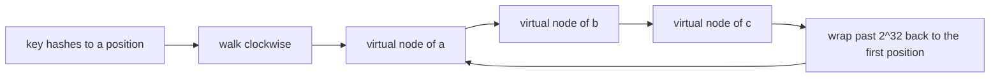
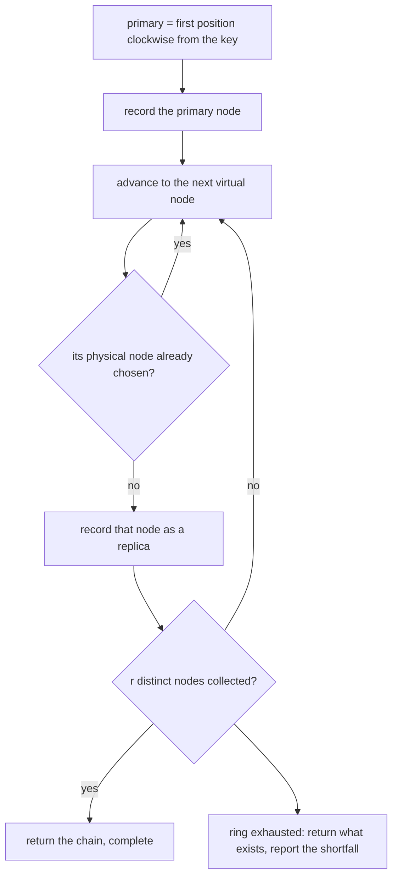
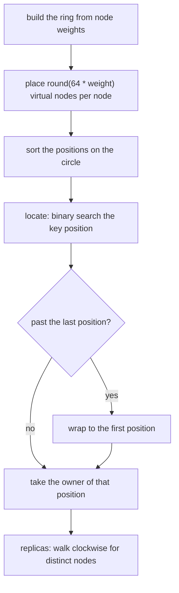
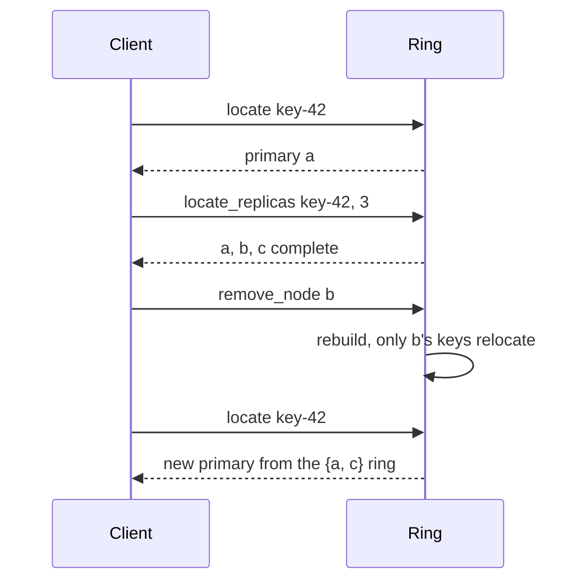

# 659 — Implement consistent hashing with weighted nodes and replication

> **Tier:** Expert · **CTCI chapter:** Ch 9 — System Design and Scalability
> **Task spec:** [659-implement-consistent-hashing-with-weighted-nodes-and-replication.md](../../../tasks/expert/659-implement-consistent-hashing-with-weighted-nodes-and-replication.md)
> **Solutions:** [Python](../../../solutions/python/expert/659-implement-consistent-hashing-with-weighted-nodes-and-replication/solution.py) ·
> [Java](../../../solutions/java/expert/659-implement-consistent-hashing-with-weighted-nodes-and-replication/Solution.java) ·
> [JavaScript](../../../solutions/javascript/expert/659-implement-consistent-hashing-with-weighted-nodes-and-replication/solution.js) ·
> [C#](../../../solutions/csharp/expert/659-implement-consistent-hashing-with-weighted-nodes-and-replication/Solution.cs)

## 1. Problem restatement

Place nodes on a **consistent-hash ring** of `2^32` positions, using virtual nodes so that weights are
meaningful, locate a key at the first virtual node clockwise (wrapping around the circle), and derive
`r` replicas as the first `r` *distinct physical* nodes clockwise from the primary.

The interface of the four solution files:

| Piece | Contract |
| --- | --- |
| `ring_position(label)` | FNV-1a of the label plus a splitmix64 finaliser, taken mod `2^32` |
| `ConsistentHashRing(vnodes_per_unit = 64)` | `add_node(node, weight)`, `remove_node(node)`, `size()`, `weights` |
| `vnode_count(weight)` | `max(1, round(vnodes_per_unit * weight))` |
| `locate(key)` | the owner of the first position `>= ring_position(key)`, wrapping to index 0 |
| `locate_replicas(key, r)` | `(chosen, complete)`: distinct physical nodes clockwise from the primary |
| `load(keys)` / `replica_load(keys, r)` | measured key and replica-slot shares per node |

Concrete facts the checks assert on the ring built from `[("a", 1), ("b", 2), ("c", 3)]`:

- the ring holds `(1 + 2 + 3) * 64 = 384` virtual nodes, positions are sorted, and the layout is
  **independent of insertion order** (`[("c", 3), ("a", 1), ("b", 2)]` produces the identical ring);
- virtual-node counts follow the weights: `1 -> 64`, `2 -> 128`, `3 -> 192`, `0.25 -> 16`;
- over 3000 keys, each node's measured share is within `0.06` of its weight share
  (`a: 1/6`, `b: 2/6`, `c: 3/6`) — 64 virtual nodes per weight unit is enough to balance;
- keys below the smallest position wrap to `owners[0]`;
- `locate_replicas("key-42", 3)` returns three distinct nodes with the primary first and, on this
  three-node ring, all nodes; asking for `5` returns the same three and `complete == False`; asking for
  `1` returns just the primary;
- on a denser ring (`vnodes_per_unit = 256`) the two-replica shares are within `0.10` of the weight
  shares and ordered like the weights (`c > b > a`);
- **minimal disruption**: removing `b` relocates *exactly* the keys `b` owned (`0.2 < moved/3000 < 0.45`,
  and the ring shrinks to `(1 + 3) * 64`); adding `d` with weight `2` moves only the keys `d` takes over
  (`0.15 < adopted/3000 < 0.45`), and `load(sample)["d"] == len(adopted)` with its share within `0.06`
  of `2/6`;
- invalid operations are rejected: `vnodes_per_unit = 0`, a non-positive weight, a duplicated node,
  removing an absent node, a zero replica count, and locating anything on an empty ring;
- a tiny weight still maps to its rounded virtual-node count (`0.1 * 64 -> 6` virtual nodes, at least 1).

## 2. Intuition

The naive distribution is `hash(key) % N`: it is uniform and O(1), and it collapses the moment `N`
changes — adding one node remaps almost every key, which means moving almost every object in a cache or
storage cluster.

Consistent hashing fixes that by hashing the *nodes* as well as the keys, onto the same circular
address space. A key belongs to the first node clockwise from its position.



Two refinements make it usable:

- **Virtual nodes.** One position per physical node would give wildly uneven arcs, because a handful of
  random positions cannot partition a circle evenly. Placing `round(64 * weight)` virtual positions per
  node makes the arcs average out *and* turns weight into capacity: a node with weight `3` gets three
  times the positions, hence roughly three times the keys.
- **Deterministic positions.** A position is derived from `"node#index"` alone — never from insertion
  order or the runtime's randomised string hash — so a rebuild after a membership change reproduces the
  same layout, and the ring depends only on the *set* of nodes and weights.

Replication reuses the ring instead of a separate mechanism: walk clockwise from the primary and take
the first `r` distinct physical nodes. Virtual nodes belonging to a node already chosen are skipped, so
replicas land on different machines — and because the walk is over the same circle, replica placement
inherits the same minimal-disruption property.



## 3. Algorithm

1. `vnode_count(weight) = max(1, round(vnodes_per_unit * weight))`, so a fractional weight still owns at
   least one position.
2. `add_node` / `remove_node` update the weight map and rebuild the layout: for every node, for every
   index, compute `ring_position("node#index")`, sort all `(position, node)` pairs, and keep the sorted
   position list and the parallel owner list. Positions depend only on `(node, index)`, which is what
   makes the layout insertion-order independent.
3. `ring_position(label)` hashes the label with FNV-1a and runs the digest through a splitmix64 finaliser
   before taking `mod 2^32`: the finaliser fixes FNV-1a's weak avalanche in the low bits, which would
   otherwise cluster neighbouring virtual nodes.
4. `locate(key)`: binary search (`bisect_left`) for the first position `>= ring_position(key)`; if the
   search runs past the end, wrap to index `0`. An empty ring is rejected instead of returning a bogus
   owner.
5. `locate_replicas(key, r)`: start at the primary's index and walk clockwise, skipping owners already
   chosen, until `r` distinct nodes are collected or the ring is exhausted; return the chain and whether
   it is complete, so a cluster that cannot satisfy the replication factor reports the shortfall instead
   of silently duplicating a replica.
6. `load` / `replica_load` count keys per node for the primary and for the replica chain, which is how
   the balance claims are measured.

```text
function ring_position(label)
    digest ← fnv1a(label)
    digest ← mix(digest)                    // splitmix64 finaliser, full 64-bit avalanche
    return digest mod 2^32

procedure rebuild()
    placed ← empty list
    for node, weight in weights do
        for index ← 0 to vnode_count(weight) - 1 do
            append (ring_position(node + "#" + index), node) to placed
    sort placed by position
    positions ← first component of each pair
    owners ← second component of each pair

function locate(key)
    assert positions is not empty
    index ← bisect_left(positions, ring_position(key))
    if index = length(positions) then
        index ← 0                            // wrap around the circle
    return owners[index]

function locate_replicas(key, replica_count)
    assert replica_count >= 1
    start ← locate index of key
    chosen ← empty list
    seen ← empty set
    for offset ← 0 to length(positions) - 1 do
        node ← owners[(start + offset) mod length(positions)]
        if node is in seen then continue
        add node to seen
        append node to chosen
        if length(chosen) = replica_count then break
    return chosen, length(chosen) = replica_count
```



## 4. Worked example

Ring `[("a", 1), ("b", 2), ("c", 3)]` with `vnodes_per_unit = 64`:

| Node | Weight | Virtual nodes | Expected key share |
| --- | --- | --- | --- |
| `a` | 1 | `64` | `1/6 ≈ 0.167` |
| `b` | 2 | `128` | `2/6 ≈ 0.333` |
| `c` | 3 | `192` | `3/6 = 0.500` |
| total | 6 | `384` positions | 1.0 |

Locating the 3000 sample keys gives measured shares within the asserted `0.06` of those expected values —
the tolerance 64 virtual nodes per weight unit buys. The same ring built in the order `c, a, b` produces
byte-identical positions, so nothing about the layout depends on how the nodes were inserted.

Membership changes, on the same ring:

| Change | Keys that move | Fraction | Ring size after |
| --- | --- | --- | --- |
| remove `b` (weight 2) | exactly the keys `b` owned, and only those | between `0.2` and `0.45` — around `2/6` | `(1 + 3) * 64 = 256` |
| then add `d` with weight 2 | only the keys `d` takes over | between `0.15` and `0.45` — around `2/6` | `(1 + 3 + 2) * 64 = 384` |
| add `d` (continued) | `load(sample)["d"] == len(adopted)` | within `0.06` of `2/6` | — |

The "exactly the keys it owned" part is what makes consistent hashing worth the extra machinery: it is
checked as a set equality (`sorted(moved) == sorted(owned_by_b)`), not as a statistical approximation.
Every other key keeps its owner, because removing positions can only shrink the arc that `b` used to own.

Replication on a three-node ring: `locate_replicas("key-42", 3)` returns all three nodes, primary first
(`replicas[0] == locate("key-42")`), and `sorted(replicas) == ["a", "b", "c"]`. Asking for five replicas
returns the same three with `complete == False`. On a denser ring (`256` virtual nodes per unit) the
two-replica shares come within `0.10` of the weight shares and are ordered `c > b > a`; the wider
tolerance is honest about the mechanism — the primary is exactly proportional to a node's ring share,
while the second replica follows the clockwise adjacency of virtual-node runs, which is noisier.



## 5. Complexity

`N` = physical nodes, `V` = total virtual nodes (`Σ round(64 * weight)`), `K` = keys, `r` = replication
factor, `W` = total weight.

| Operation | Best | Average | Worst | Why the bound holds |
| --- | --- | --- | --- | --- |
| `vnode_count` | O(1) | O(1) | O(1) | one multiply and a round |
| `ring_position` | O(1) | O(1) | O(1) | FNV-1a over a short label plus a fixed number of mixes |
| Rebuild | O(V log V) | O(V log V) | O(V log V) | one hashed position per virtual node, then a sort |
| `locate(key)` | O(1) | O(log V) | O(log V) | binary search over the sorted position list plus the wrap test |
| `locate_replicas(key, r)` | O(r) | O(r + V/N) | O(V) | walks positions until `r` distinct owners are found; the worst case is a loop over the ring |
| `load(keys)` | O(K) | O(K log V) | O(K log V) | one `locate` per key |
| `replica_load(keys, r)` | O(K·r) | O(K·(r + V/N)) | O(K·V) | one chain walk per key |
| Space | O(V) | O(V) | O(V) | sorted positions plus the parallel owner list |
| `key % N` baseline | O(1) | O(1) | O(1) | fastest possible, and it remaps nearly every key when `N` changes |

The comparison that motivates the design is not lookup time — both are effectively constant — but the
*membership change*: `hash % N` moves about `(N - 1)/N` of the keys whenever the node count changes,
while consistent hashing moves only the arc of the node that joined or left, which is its weight share
of the ring — measured here as roughly `2/6` for the weight-2 node in a six-unit ring. The price is
`O(V log V)` for the rebuild, which is why `V` (64 positions per weight unit) is chosen as a balance
between smooth distribution and rebuild cost.

## 6. Pitfalls and edge cases

- **Insertion order must not matter.** Positions come from `"node#index"` only, never from a counter
  incremented as nodes arrive; the checks rebuild the ring in a different order and compare layouts.
- **Randomised hash functions break everything.** A layout built with a per-process randomised hash
  cannot be reproduced after a restart, so every client would compute a different ring.
- **Too few virtual nodes.** One position per node concentrates keys on a few arcs; the tolerance
  (`0.06` at 64 per unit, `0.10` for replica shares at 256) is the measured consequence.
- **The finaliser matters.** FNV-1a's low bits avalanche poorly, and `mod 2^32` only sees the low bits;
  the splitmix64 finaliser is applied to the full 64-bit digest before the modulo.
- **Wrap-around.** A key positioned past the last virtual node must wrap to index 0 — the checks find
  such a key explicitly and assert it maps to `owners[0]`.
- **Empty ring.** `locate` and `locate_replicas` must fail loudly rather than return `None` or a bogus
  owner.
- **Duplicate nodes and bad weights.** Re-adding a node, removing an absent one, a non-positive weight
  and `vnodes_per_unit = 0` are all rejected; a fractional weight below one virtual node still gets one.
- **Replicas must be distinct machines.** Virtual nodes of an already-chosen node are skipped, so a
  node's many positions cannot fill the replica chain by themselves.
- **Short chains are reported.** Asking for more replicas than the cluster has returns the existing nodes
  with `complete == False` instead of repeating a node — the caller must handle the shortfall.
- **Primary first.** `replicas[0]` is the plain `locate(key)` result, so a read that only needs one
  replica uses the same node the primary path would.
- **Rebuild cost.** Every membership change rebuilds the whole ring (`O(V log V)`) in this
  implementation; a production ring would maintain a sorted structure and splice positions in.

## 7. Variants and follow-ups

- **Placing work by key.** The shuffle join's partitioner is a simpler, non-ring analogue — a plain hash
  of the join key: [657-implement-distributed-join-shuffle-simulation-in-map-reduce.md](../../../tasks/expert/657-implement-distributed-join-shuffle-simulation-in-map-reduce.md).
- **Replicating onto the ring.** The nodes chosen here become the chain that replicates writes:
  [661-implement-chain-replication-simulation-for-strong-consistency.md](../../../tasks/expert/661-implement-chain-replication-simulation-for-strong-consistency.md).
- **Reading and writing replicas safely.** Quorum intersection over the same replica set decides how
  many acknowledgements each operation needs:
  [660-implement-quorum-consensus-read-write-latency-optimization-trade.md](../../../tasks/expert/660-implement-quorum-consensus-read-write-latency-optimization-trade.md).
- **Agreeing despite failures.** The same replica set runs multi-decree Paxos when the owner changes:
  [662-implement-paxos-multi-decree-long-running-simulation-with-leader.md](../../../tasks/expert/662-implement-paxos-multi-decree-long-running-simulation-with-leader.md).
- **Rebalancing what moved.** Snapshot-based log compaction is what keeps the newly adopted replicas
  cheap to bring up to date:
  [663-implement-snapshot-based-log-compaction-and-recovery-for-replica.md](../../../tasks/expert/663-implement-snapshot-based-log-compaction-and-recovery-for-replica.md).

## 8. Check yourself

1. **Why does one position per node behave badly?**
   <details><summary>Show answer</summary>Random positions on the circle leave arcs of wildly different
   lengths, so a few nodes swallow most of the key space. Many virtual nodes per physical node average
   the arcs out — 64 positions per weight unit is enough here for shares within `0.06` of the weights.</details>
2. **What does a weight actually do?**
   <details><summary>Show answer</summary>It scales the number of virtual nodes:
   `round(vnodes_per_unit * weight)`, at least one. A weight-3 node owns three times as many positions,
   hence roughly three times the keys — measured as the `1/6`, `2/6`, `3/6` shares.</details>
3. **How much key movement does removing a node cause?**
   <details><summary>Show answer</summary>Exactly the keys that node owned — the checks assert set
   equality between moved keys and previously owned keys. That is the arc of the removed positions, so
   the fraction is the node's weight share of the ring (here around `2/6`).</details>
4. **Why does the replica walk skip virtual nodes it has already seen?**
   <details><summary>Show answer</summary>Because a node owns many positions; without skipping, the
   first `r` positions clockwise could all belong to one machine, and the replication factor would be met
   by copies on the same node instead of on distinct machines.</details>
5. **Why is the tolerance wider for replica shares than for primary shares?**
   <details><summary>Show answer</summary>The primary is exactly the node owning the key's arc, so its
   share tracks ring share closely. The second replica follows the clockwise adjacency of virtual-node
   runs, an indirect quantity, so its variance is larger — `0.10` instead of `0.06` on the dense ring.</details>
