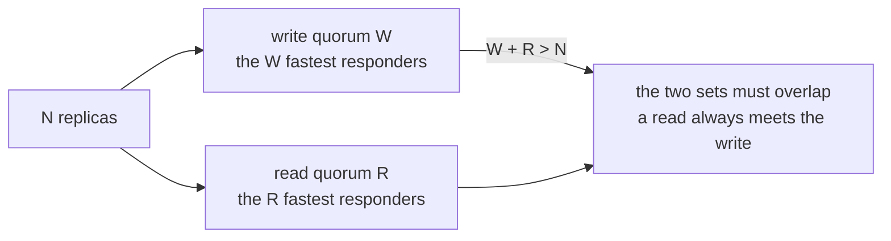
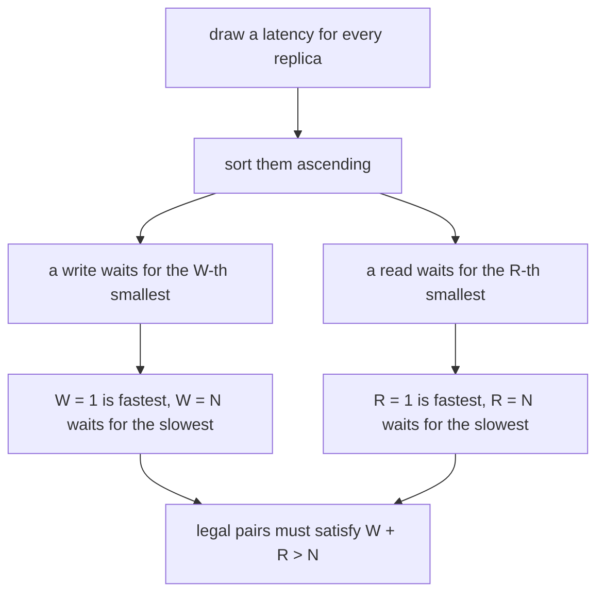
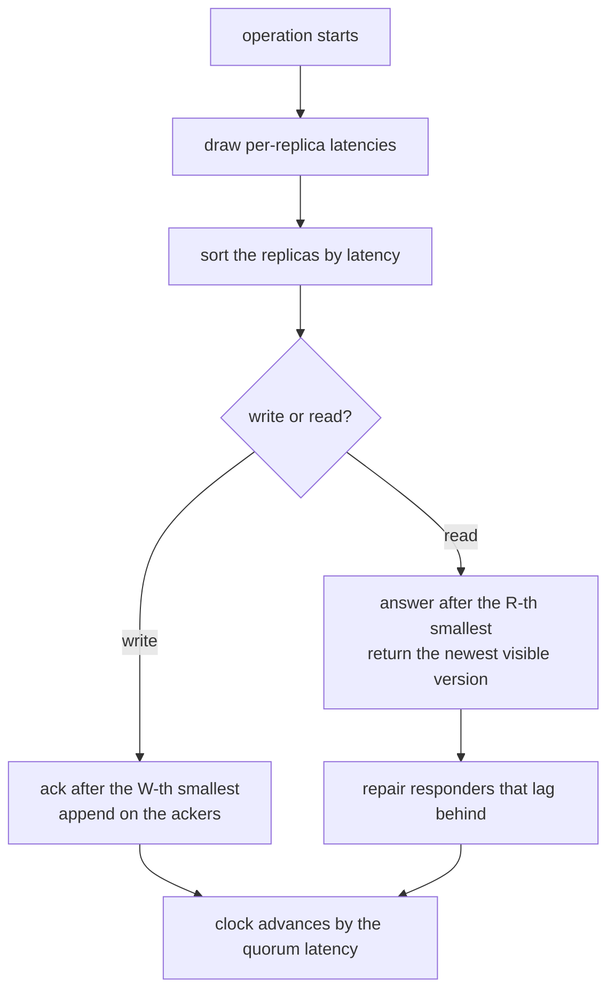
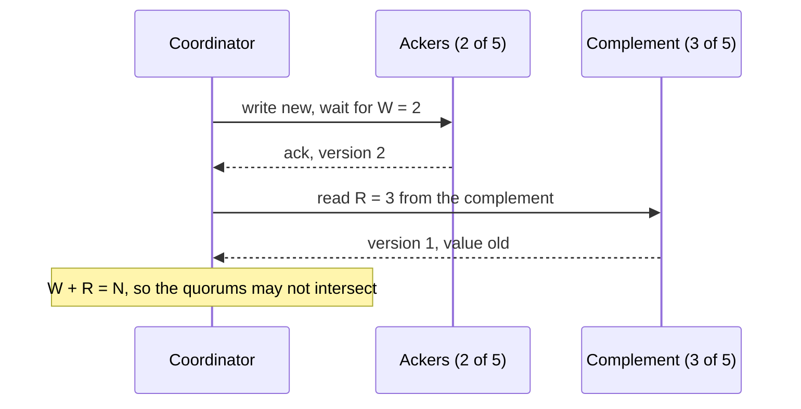

# 660 — Implement quorum consensus read/write latency optimization tradeoffs

> **Tier:** Expert · **CTCI chapter:** Ch 9 — System Design and Scalability
> **Task spec:** [660-implement-quorum-consensus-read-write-latency-optimization-trade.md](../../../tasks/expert/660-implement-quorum-consensus-read-write-latency-optimization-trade.md)
> **Solutions:** [Python](../../../solutions/python/expert/660-implement-quorum-consensus-read-write-latency-optimization-trade/solution.py) ·
> [Java](../../../solutions/java/expert/660-implement-quorum-consensus-read-write-latency-optimization-trade/Solution.java) ·
> [JavaScript](../../../solutions/javascript/expert/660-implement-quorum-consensus-read-write-latency-optimization-trade/solution.js) ·
> [C#](../../../solutions/csharp/expert/660-implement-quorum-consensus-read-write-latency-optimization-trade/Solution.cs)

## 1. Problem restatement

Simulate `N` replicas with a write quorum `W` and a read quorum `R` on a virtual clock, and make the
classic tradeoff measurable: **write latency is the `W`-th smallest response latency, read latency the
`R`-th**, while the safety rule `W + R > N` is what forces the two quorums to overlap.

The interface of the four solution files:

| Piece | Contract |
| --- | --- |
| `quorums_intersect(n, w, r)` | the exact rule `w + r > n` |
| `disjoint_witness(n, w, r)` | an explicit disjoint quorum pair, available exactly when `w + r <= n` |
| `LatencyModel(replicas, seed, base, jitter, slow_replica, slow_factor)` | per-replica latency, sampled once per operation and memoised |
| `Cluster(replicas, model)` | versioned logs per replica over a virtual clock, `history` of acked writes |
| `write(value, w, durable = true)` | `(ack_latency, ackers)`; `durable = false` drops the non-acking replicas |
| `read(r, quorum = none)` | `(value, version, read_latency, responders, repaired, delayed)` with read repair |
| `mean_latency(model, size, operations)` | mean of the `size`-th smallest latency over many operations |

Concrete results the checks assert:

- the intersection rule is exact for every `n <= 5` and every `w`, `r`: a disjoint witness exists exactly
  when `w + r <= n`; `quorums_intersect(5, 3, 3)` is true and `quorums_intersect(5, 2, 3)` is false;
- with `N = 5`, `W = 3`, `R = 3`, twelve interleaved rounds never return data older than the latest
  acknowledged write, every read gathers exactly `R` distinct responders, repairs are limited to
  responders, and versions increase by exactly one per acknowledged write;
- the hazard is *reproduced*, not just described: after `write("new", 2, durable = False)` only two
  replicas acked, and a read of `R = 3` on the disjoint complement returns `"old"` with a version below
  `acked_version()`;
- read repair converges: after a full-quorum read every replica is at the newest version, a later read
  never lowers any replica's version, and only responders are repaired;
- latencies are monotone in the quorum size (write and read), the extremes differ, `W = R = 1` coincide,
  and `W = R = N` cost the same for reads and writes;
- the optimiser's best legal pair lies on the **`W + R = N + 1` frontier** and is not beaten by any other
  legal pair; the majority default for `N = 7` is `(4, 4)`, which also sums to `N + 1`;
- skewed replicas: the `W = 2` ackers are the two fastest and exclude the slow replica, and a quorum large
  enough to include it (`W = 4`, `slow_factor = 6`) costs more than `1.5x` the `W = 2` mean;
- percentiles confirm the tail: `p95 >= p50`, and waiting for three responses costs more at the median and
  has a fatter tail than waiting for one;
- invalid arguments are rejected: `W = 0`, `W > N`, `R = 0`, `R > N`, and a read quorum larger than the
  queried set; identical seeds reproduce identical acknowledgement latencies and virtual clock.

Documented simplifications: latencies are static per operation (no batching, queueing or contention), the
coordinator is faultless apart from the one explicitly simulated failed write, and read repair is applied
instantly by the coordinator.

## 2. Intuition

The naive design is "write everywhere, read anywhere": writes wait for the slowest replica and reads are
cheap, or vice versa. Quorums replace the extreme with a tunable pair, and the whole subject reduces to
two facts.

**Safety is combinatorics.** If `W + R > N`, every write quorum and every read quorum share at least one
replica, so a read always meets at least one replica that saw the acknowledged write. If `W + R <= N`
there is an explicit disjoint pair, and a read on the complement can legitimately miss an acknowledged
write — which is why the rule is `>` and not `>=`.



**Latency is order statistics.** Every operation draws a latency per replica and needs only `W` (or `R`)
responses, so the acknowledgement time is the `W`-th (or `R`-th) smallest latency: a larger quorum is
never faster, and the coordinator implicitly picks the fastest responders. Under this model the tradeoff
is a one-dimensional frontier — smaller quorums are faster, but any legal pair must satisfy
`W + R >= N + 1`, so the cheapest legal pairs sit exactly on `W + R = N + 1` and everything above the
frontier is dominated.



Two more mechanisms make the simulation realistic enough to be worth measuring. **Skew**: one replica is
`slow_factor` times slower, so a quorum big enough to include it (or one that must, because faster
replicas are busy) pays heavily — that is why `W = 2` avoids a slow replica but `W = 4` on a five-replica
cluster cannot. **Read repair**: a read that sees an older version on some responder writes the newest
value back, so the next read finds fewer stale replicas, and repair can only raise versions, never lower
them.

## 3. Algorithm

1. `write(value, w, durable)`: draw one latency per replica for this operation, sort replicas by
   `(latency, replica)`, take the first `w` as the **ackers**, and set the ack latency to the maximum
   among them (the `w`-th order statistic). Increment the version, append `(store_time, version, value)`
   to every acker at `start + latency(replica)` — and to *all* replicas when `durable` is true, which is
   how the asynchronous followers are modelled. The virtual clock jumps to the ack latency, and the write
   is recorded in `history`.
2. `visible(replica)` returns the highest version whose `store_time` has already passed on that replica,
   which is how the clock turns "written" into "readable".
3. `read(r, quorum)`: take the queried set (all replicas, or an explicit subset), sort it by latency,
   take the first `r` as **responders**, wait for the `r`-th smallest, snapshot every responder's visible
   version, and return the highest. Responders that lag behind are repaired at `self.now`; replicas that
   are behind and were *not* queried are reported as `delayed`.
4. `mean_latency(model, size, operations)` measures the `size`-th order statistic over many operations;
   `quorums_intersect` and `disjoint_witness` encode the safety rule combinatorially.
5. The optimiser enumerates every legal `(W, R)` pair (all pairs with `W + R > N`), scores each by
   `mean_latency(W) + mean_latency(R)`, picks the cheapest, and compares it against every other legal pair
   and against the `W + R = N + 1` frontier.

```text
procedure write(value, w, durable)
    assert 1 <= w <= replicas
    latencies ← one latency per replica for this operation
    order ← replicas sorted by (latency, replica)
    ackers ← order[0 .. w)                        // the fastest W replicas
    ack_latency ← maximum latency among ackers     // the W-th order statistic
    version ← version + 1
    start ← now
    for replica ← 0 to replicas - 1 do
        if replica is in ackers or durable then
            append (start + latency(replica), version, value) to log[replica]
    now ← start + ack_latency
    record (version, value, ack_latency, ackers) in history
    return ack_latency, ackers

function read(r, quorum)
    assert 1 <= r <= replicas
    candidates ← all replicas if quorum is none else quorum
    assert length(candidates) >= r
    responders ← first r of candidates sorted by (latency, replica)
    read_latency ← maximum latency among responders   // the R-th order statistic
    snapshot ← visible version of each responder at this instant
    version, value ← newest entry of the snapshot
    for responder in responders do
        if snapshot[responder] is older than version then
            append (now, version, value) to log[responder]     // read repair
    delayed ← replicas behind version that were not queried
    now ← now + read_latency
    return value, version, read_latency, responders, repaired, delayed

procedure optimise()
    for every pair (w, r) with w + r > replicas do
        cost[w, r] ← mean_latency(w) + mean_latency(r)
    best ← argmin cost
    assert best.w + best.r = replicas + 1
```



## 4. Worked example

`N = 5` replicas, `W = 3`, `R = 3`, seed `0xC0FFEE`. The model draws each latency from
`base + fraction · jitter` with `base = 1.0`, `jitter = 4.0`, so every healthy latency lies in
`[1.0, 5.0]`; with `slow_replica` set it is multiplied by `slow_factor` (up to `30.0`).

Write `"v0"` with `W = 3`, letting `L1 <= L2 <= ... <= L5` denote the operation's sorted latencies:

| Step | Result |
| --- | --- |
| draw five latencies, sort | `L1 <= L2 <= L3 <= L4 <= L5` |
| ackers = fastest `W = 3` | three replicas; the slow replica is avoided whenever it is not among the three fastest |
| ack latency | `L3`, the third order statistic — at most `5.0`, at least `1.0` |
| append | on the three ackers at `start + their own latency`; with `durable = true` also on the other two at theirs |
| clock | jumps to `start + L3` |
| readable state | exactly the ackers hold version `1` when the ack returns |

A read with `R = 3` on the same cluster sorts all five replicas and answers after `L3` of *that*
operation, returning the highest version visible on the three responders; responders behind it are
repaired, unqueried replicas behind it are reported as `delayed`. With `W = R = 3` and `N = 5` the rule
`W + R = 6 > 5` holds, and the checks run twelve write/read rounds asserting that no read ever returns a
version below `acked_version()`.

The unsafe configuration is the same machinery with a different parameter pair:

| Step | Configuration | Outcome |
| --- | --- | --- |
| 1 | `write("old", 5)` | all five replicas hold version 1, acknowledged |
| 2 | `write("new", 2, durable = False)` | two ackers hold version 2; the other three never receive it |
| 3 | `read(3, quorum = the three non-ackers)` | `W + R = 2 + 3 = 5 = N`, quorums can be disjoint |
| 4 | result | value `"old"`, version `1` — below `acked_version() = 2` |

That is the token-loss hazard of `W + R <= N` reproduced concretely: an acknowledged write that a later
read cannot see. The checks assert the disjointness of the two sets as well as the stale result, so the
counterexample cannot pass by accident.



The optimiser on the five-replica cluster enumerates every legal pair (`W + R >= 6` is required) and finds
the cheapest on the frontier `W + R = 6` — the pairs `(1, 5)`, `(2, 4)`, `(3, 3)`, `(4, 2)`, `(5, 1)`. Even
on a healthy cluster `(1, 5)` is usually not the winner, because the read quorum of five must wait for
the *slowest* replica: the optimum trades a slightly larger write quorum for a much faster read. With a
skewed replica the effect sharpens — `W = 2` costs a fraction of `W = 4`, which is asserted as
`mean(skewed, 4) > 1.5 · mean(skewed, 2)` — and the same ordering appears in the percentiles: the median
and `p95` of the three-response wait exceed the one-response wait.

## 5. Complexity

`N` = replicas, `W`, `R` = quorum sizes, `S` = sampled operations in the measurement, `O` = operations
run.

| Operation | Best | Average | Worst | Why the bound holds |
| --- | --- | --- | --- | --- |
| `write` | O(N log N) | O(N log N) | O(N log N) | draw and sort `N` latencies, append on the ackers, take the `W`-th |
| `read` | O(N log N) | O(N log N) | O(m log m + R) | sort the queried set, snapshot and repair the responders; `m` = queried set size |
| `visible` | O(1) | O(O) | O(O) | scans one replica's log, which grows with the operations performed |
| `mean_latency` | O(S) | O(S·N log N) | O(S·N log N) | one sort per sample to take the `size`-th order statistic |
| Quorum-pair search | O(N²) | O(N²·S·N log N) | O(N²·S·N log N) | one score per legal pair, each a pair of means |
| Safety rule check | O(1) | O(1) | O(N²) | `w + r > n`, or exhaustively for every pair |
| Space | O(N + O) | O(N + O) | O(N + O) | per-replica logs with one entry per write they hold |

The latency model is deliberately O(N log N) per operation to make the order statistic explicit; a
production coordinator selects the `W`-th smallest with a selection algorithm in O(N), or simply takes
the first `W` responses as they arrive. The comparison that matters is quorum sizes against each other:
`W` responses are waited for, so `mean_latency(model, W)` is non-decreasing in `W` (asserted for every
`W`), and the search over legal pairs is what turns the safety rule into a performance decision.

## 6. Pitfalls and edge cases

- **`W + R <= N` is unsafe, and the simulation must show it.** Taking the fastest `W` for the write and
  the three non-ackers for the read makes the counterexample deterministic; asserting only the rule would
  leave the hazard untested.
- **Acknowledge only after the write is durable enough.** `durable = false` models a failed write that
  reached its ackers and nobody else — the exact scenario a quorum is supposed to survive.
- **Reads must not include a stale responder's value.** The read returns the *highest* version among the
  responders, never the first or the slowest one.
- **Repair is limited to responders.** Writing to unqueried replicas during a read would be a hidden
  broadcast; the checks assert `repaired ⊆ responders`, while the untouched laggards are reported as
  `delayed`.
- **Repair may never lower a version.** It only appends a newer version, so a replica's version is
  monotone over the run (asserted before and after a later read).
- **A full-quorum read converges everything.** With `R = N` every replica responds, so after one read all
  replicas sit at the newest version — the checks assert exactly that.
- **Quorum size is a latency knob, not a free safety knob.** Latency is monotone increasing in the
  quorum size, and the extremes are strictly different; `W = 1` and `R = 1` coincide, `W = N` and `R = N`
  coincide.
- **The frontier is where optima live.** Any legal pair above `W + R = N + 1` is dominated; the check
  asserts the chosen pair sums to `N + 1` and that no legal pair beats it. The majority default `(4, 4)`
  for `N = 7` also lies on the frontier.
- **Skew punishes big quorums.** With a five-replica cluster and one six-times-slower replica, any
  `W >= 4` must include it, which is why the skewed measurement jumps; `W = 2` excludes it because the
  ackers are the fastest responders.
- **Percentiles, not just means.** A larger quorum has a fatter tail: `p95 >= p50`, and the three-response
  wait exceeds the one-response wait at both the median and `p95`.
- **Argument validation.** `W = 0`, `W > N`, `R = 0`, `R > N` and a read quorum larger than the queried
  set are all rejected; a read quorum of the queried set size is fine, a larger one is nonsense.
- **Determinism.** Latency samples are memoised per `(replica, operation)` from a seeded PRNG, so the same
  seed reproduces the same ack latencies and the same virtual clock.

## 7. Variants and follow-ups

- **Replica placement.** Which replicas exist and which one is primary is the ring's decision:
  [659-implement-consistent-hashing-with-weighted-nodes-and-replication.md](../../../tasks/expert/659-implement-consistent-hashing-with-weighted-nodes-and-replication.md).
- **A different replication topology.** Chain replication needs no quorum at all — one writer, one
  reader, both at the ends of a chain:
  [661-implement-chain-replication-simulation-for-strong-consistency.md](../../../tasks/expert/661-implement-chain-replication-simulation-for-strong-consistency.md).
- **Agreement beyond quorums.** Paxos replaces "read the newest version you meet" with an actual decision
  protocol when replicas must agree on an order:
  [662-implement-paxos-multi-decree-long-running-simulation-with-leader.md](../../../tasks/expert/662-implement-paxos-multi-decree-long-running-simulation-with-leader.md).
- **Cheapening the catch-up.** A lagging replica that must be brought up to date is what snapshot
  compaction optimises: [663-implement-snapshot-based-log-compaction-and-recovery-for-replica.md](../../../tasks/expert/663-implement-snapshot-based-log-compaction-and-recovery-for-replica.md).
- **Concurrent writers without coordination.** CRDTs let replicas merge updates without a quorum:
  [664-implement-crdt-based-collaborative-editor-with-undo-support.md](../../../tasks/expert/664-implement-crdt-based-collaborative-editor-with-undo-support.md).

## 8. Check yourself

1. **Why is the rule `W + R > N` and not `>=`?**
   <details><summary>Show answer</summary>Two sets of sizes `W` and `R` inside `N` elements can be
   disjoint exactly when `W + R <= N` — `disjoint_witness` constructs such a pair. Intersection requires
   `W + R > N`, which is also sufficient: any two larger sets must overlap.</details>
2. **Why is the write latency the `W`-th smallest response latency?**
   <details><summary>Show answer</summary>Because the coordinator waits for `W` acknowledgements and
   responses arrive in latency order, so the last one it needs is the `W`-th smallest. That is also why
   bigger quorums are never faster and why the ackers are the fastest replicas.</details>
3. **How is the `W + R <= N` hazard demonstrated here?**
   <details><summary>Show answer</summary>By a write with `W = 2` and `durable = false` that reaches only
   its two ackers, followed by a read of `R = 3` on the three replicas that are *not* ackers: the quorums
   are disjoint, and the read returns the previous value with a version below `acked_version()`.</details>
4. **What does read repair change, and what does it not?**
   <details><summary>Show answer</summary>It appends the newest version to the responders that were behind,
   so a full-quorum read converges every replica. It never lowers a version, never touches replicas that
   were not queried (they are reported as `delayed`), and it cannot fix a value that no quorum ever
   received.</details>
5. **Why does the best legal pair sit on `W + R = N + 1`?**
   <details><summary>Show answer</summary>Latency is non-decreasing in quorum size, so raising either
   quorum only costs more. Any pair above the frontier can be shrunk in one coordinate until it lands on
   `W + R = N + 1` without losing safety, and that only lowers the cost — hence the optimum is on the
   frontier, which the check asserts.</details>
