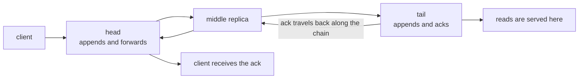
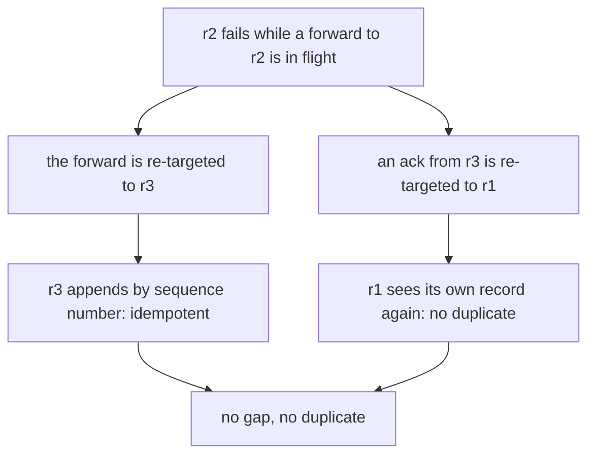
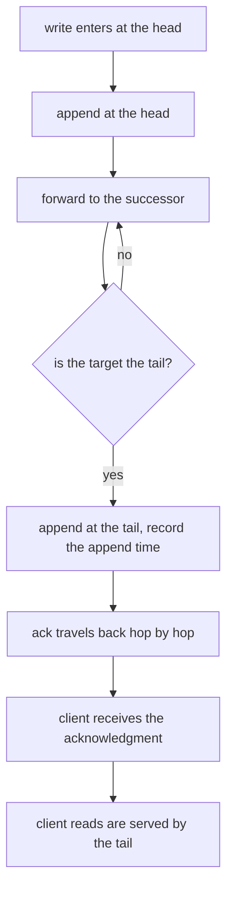
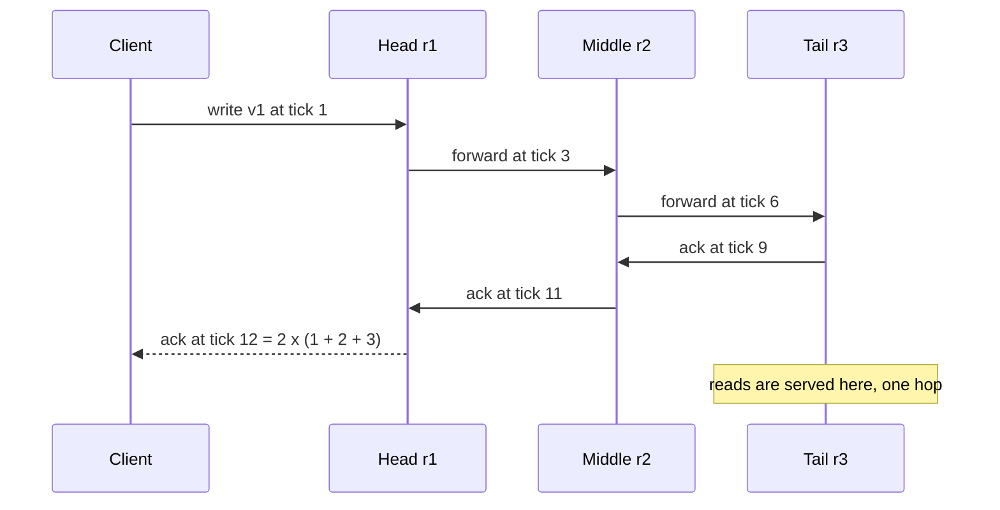

# 661 — Implement chain replication simulation for strong consistency

> **Tier:** Expert · **CTCI chapter:** Ch 9 — System Design and Scalability
> **Task spec:** [661-implement-chain-replication-simulation-for-strong-consistency.md](../../../tasks/expert/661-implement-chain-replication-simulation-for-strong-consistency.md)
> **Solutions:** [Python](../../../solutions/python/expert/661-implement-chain-replication-simulation-for-strong-consistency/solution.py) ·
> [Java](../../../solutions/java/expert/661-implement-chain-replication-simulation-for-strong-consistency/Solution.java) ·
> [JavaScript](../../../solutions/javascript/expert/661-implement-chain-replication-simulation-for-strong-consistency/solution.js) ·
> [C#](../../../solutions/csharp/expert/661-implement-chain-replication-simulation-for-strong-consistency/Solution.cs)

## 1. Problem restatement

Simulate chain replication on a virtual clock: a write enters at the **head**, each replica appends it
before passing it on, the **tail** is the only replica that acknowledges, and reads are served by the
tail alone. Failures are instantaneous reconfigurations that bypass the dead replica; a rejoining replica
catches up from the tail before it serves anything.

The interface of the four solution files:

| Piece | Contract |
| --- | --- |
| `ChainReplication(chain, hop_latency)` | `chain` is head → tail, `hop_latency` gives the per-replica hop cost |
| `submit(value, delay)` | send a write to the head; return the sequence number |
| `read()` | `(value, seq, latency, served_by)` — served by the tail only |
| `fail(replica, delay)` / `rejoin(replica, catchup_delay, delay)` | schedule a reconfiguration |
| `step()` / `run_until(t)` / `run_all()` | drive the event heap (`forward`, `ack`, `client_ack`, `fail`, `rejoin`, `finish_join`) |
| `check_invariants()` | prefix, gap, ack-before-append and write-order invariants |

Concrete results the checks assert:

- with hops `{"r1": 1.0, "r2": 2.0, "r3": 3.0, "r4": 4.0}` and chain `r1, r2, r3`, the tail appends at
  exactly `1 + 2 + 3 = 6` and the ack arrives at exactly `2 * 6 = 12`; the head and the tail both hold the
  record, and the ack is issued exactly once;
- a clean four-replica chain acknowledges five submitted writes in submission order after exactly
  `2 * (1 + 2 + 3 + 4) = 20` ticks, with every replica holding all five records and every log a prefix of
  its predecessor's;
- reads are served by the tail: `served_by == "r4"`, latency `4.0`, and the tail read returns the newest
  acknowledged write (`"v4"`, version `5`) at a latency below the write round trip;
- a longer chain costs more: a two-replica chain with hops `1.0, 2.0` acks after exactly `2 * 3 = 6`, and
  that is less than the four-replica chain's round trip;
- partial progress on the way: after `run_until(1.0)` no ack exists, the head holds the record and the
  middle and tail do not; after `run_until(3.0)` the middle holds it and the tail does not; only `run_all`
  produces the ack;
- tail failure: the chain becomes `["r1", "r2", "r3"]`, the new tail serves the acknowledged write, and
  further writes still succeed;
- head failure: the chain becomes `["r2", "r3"]`, and the acknowledged write is not lost;
- a mid-chain failure **while a write is in flight** is bypassed: the chain becomes `["r1", "r3", "r4"]`,
  the in-flight write is still acknowledged, no log has a gap or duplicate, and the tail received exactly
  one copy;
- retransmission idempotence: replaying a forward appends nothing, a gap is rejected with
  `"a log may never develop a gap"`, and a reordering with `"a log may never be reordered"`;
- rejoin: the recovering replica sits in `catching_up` (reads keep working and never touch it), then
  receives the tail's full log and is appended behind the tail, after which it keeps in step;
- a mixed schedule (6 writes, a failure and a rejoin) keeps every invariant after **every** event and
  acknowledges all six writes in submission order;
- identical schedules produce identical acks, logs and reads.

Documented simplifications: perfect instantaneous failure detection, one-shot catch-up, and a fixed
per-replica hop latency.

## 2. Intuition

Quorum replication treats the replicas as peers. Chain replication instead gives each replica a
*direction*: the head is the only entry point, each node forwards to its successor, and the tail is the
only exit point. That single linear data path is what makes strong consistency easy to argue about:

- a write is acknowledged **only after** the tail appended it, so an acked write is on every replica;
- each predecessor has everything its successor has (plus possibly more), so every live log is a
  **prefix** of the one before it;
- sequence numbers are consecutive, so there are no gaps;
- reads go to the tail, which has everything, so a read can never be stale.



The trade is cost: a write pays a full trip down the chain *and* back, so the healthy acknowledgement
latency is exactly `2 * sum(hop latencies)` — more replicas mean more latency, unlike a quorum where the
coordinator only waits for the fastest `W`. The compensation is that reads are single-hop at the tail and
free of quorum arithmetic.

Failures are handled by **reconfiguration**, not by voting: a dead replica is removed from the chain and
its neighbours are spliced together. That makes two invariants load-bearing — a forward in flight when a
node dies must be handed to that node's successor, and an ack in flight must go to its predecessor — and
it makes every hop **idempotent by sequence number**, because a retransmission must not duplicate a
record.



## 3. Algorithm

1. `submit`: increment `next_seq`, schedule a `forward` event to the head after `delay + hop[head]`. The
   client-to-head hop is charged to the head; every later hop is charged to the node it *reaches*.
2. `_deliver_forward(seq, value, source)`: find the successor of `source` (following bypass links if
   `source` has already failed). If there is none, the forward came from the tail and the ack is already
   on its way. Otherwise append `(seq, value)` to the target, and if the target is the tail record
   `tail_append[seq]` and schedule the return path (down the chain, or straight to the client on a
   one-replica chain); else schedule the next forward.
3. `_deliver_ack(seq, value, holder)`: hand the ack to the predecessor of `holder`, or to the client when
   there is none. Each hop is charged to the node it leaves, so a full round trip costs exactly
   `2 * Σ hop`.
4. `step()` pops the earliest event from the heap and dispatches it; `run_until(t)` drives until the next
   event is later than `t`, which is how partial progress is observed.
5. `_reconfigure(replica)`: remember its neighbours in `bypass_next` / `bypass_prev`, remove it from the
   chain, mark it failed. `_join_chain` puts a returning replica into `catching_up` (not in the chain, so
   it serves no reads); `_finish_join` copies the tail's log into it and appends it behind the tail.
6. `_append` enforces the log rules: a retransmission of the last sequence number is a no-op, a sequence
   number below the last is "reordered", and one above `last + 1` is a "gap" — both rejected loudly.
7. `check_invariants()` re-asserts, after every event: live logs hold consecutive sequences from 1, each
   successor's log is a prefix of its predecessor's, every acked sequence is in the tail's log, no ack
   precedes the tail append, and all replicas observe the same value order.

```text
procedure submit(value, delay)
    assert chain is not empty
    next_seq ← next_seq + 1
    schedule(delay + hop[chain[0]], "forward", (next_seq, value, none))
    return next_seq

procedure deliver_forward(seq, value, source)
    target ← successor_of(source)
    if target is none then
        return                              // the source was the tail, the ack is already travelling
    append(target, seq, value)
    if target is the tail then
        tail_append[seq] ← now
        predecessor ← predecessor_of(target)
        if predecessor is none then
            schedule(hop[target], "client_ack", (seq, value))
        else
            schedule(hop[target], "ack", (seq, value, predecessor))
    else
        following ← successor_of(target)
        schedule(hop[following], "forward", (seq, value, target))

procedure deliver_ack(seq, value, holder)
    predecessor ← predecessor_of(holder)
    if predecessor is none then
        schedule(hop[holder], "client_ack", (seq, value))
    else
        schedule(hop[holder], "ack", (seq, value, predecessor))

procedure append(replica, seq, value)
    log ← logs[replica]
    if log is not empty and last sequence of log = seq then
        return                              // idempotent replay
    assert log is empty or last sequence of log = seq - 1     // no gaps
    assert log is empty or last sequence of log < seq         // no reordering
    append (seq, value) to log

procedure reconfigure(replica)
    assert replica is in chain
    bypass_next[replica] ← successor of replica in chain
    bypass_prev[replica] ← predecessor of replica in chain
    remove replica from chain
    failed ← failed together with replica

procedure finish_join(replica)
    assert replica is catching up
    logs[replica] ← copy of the tail's log       // one-shot state transfer
    catching_up ← catching_up without replica
    append replica to the end of chain           // it becomes the new tail
    check_invariants()
```



## 4. Worked example

Chain `r1 → r2 → r3` with hops `r1: 1.0`, `r2: 2.0`, `r3: 3.0`, one write `"v1"` (checks 1 and 5 of the
solution). Every timestamp below is exact, and the checks assert them.

| Tick | Event | State change |
| --- | --- | --- |
| 1.0 | forward reaches `r1` (client hop charged to the head) | `r1` log: `[(1, v1)]` |
| 1.0 | forward scheduled to `r2`, charged `hop[r2] = 2.0` | — |
| 3.0 | forward reaches `r2`; `run_until(3.0)` sees the middle replica appear | `r2` log: `[(1, v1)]`, tail still empty |
| 3.0 | forward scheduled to `r3`, charged `hop[r3] = 3.0` | — |
| 6.0 | forward reaches the tail; `tail_append[1] = 6.0 = 1 + 2 + 3` | `r3` log: `[(1, v1)]` |
| 6.0 | ack scheduled back to `r2`, charged `hop[r3]` | — |
| 9.0 | ack reaches `r2`; ack to `r1` charged `hop[r2]` | — |
| 11.0 | ack reaches `r1`; client ack charged `hop[r1]` | — |
| 12.0 | client ack recorded: `2 * (1 + 2 + 3) = 12` | `acked == [(1, v1, 12.0)]` |

Two checkpoints in the middle of that timeline are exactly what the "partial progress" test asserts:
`run_until(1.0)` gives no ack at all (the ack needs 12 ticks), the head's log has one record and the
middle and tail have none; `run_until(3.0)` adds exactly one record to `r2` and still none to the tail.
After `run_all()`, `check_invariants()` confirms the prefix relation `[(1,)]` ⊆ `[(1,)]` ⊆ `[(1,)]`, the
consecutive sequence numbers, and that the acked sequence 1 is in the tail's log with
`ack_time = 12.0 >= tail_append[1] = 6.0`.

Failure handling on the same machinery (checks 6-8):

| Scenario | Reconfiguration | Result |
| --- | --- | --- |
| tail `r4` fails after one acked write | chain `r1, r2, r3, r4` → `r1, r2, r3` | the new tail serves `"v1"`; `"v2"` is submitted and acked |
| head `r1` fails after one acked write | chain `r1, r2, r3` → `r2, r3` | `"v1"` survives; the new head accepts `"v2"` |
| middle `r2` fails while `"v1"` is in flight | chain `r1, r2, r3, r4` → `r1, r3, r4` | `"v1"` still acked, every log ends with `(1, "v1")`, the tail holds exactly one copy |

The middle-failure case is the interesting one: `r1` had already appended and had a forward in flight
towards `r2` when `r2` was removed, so the bypass maps route the forward to `r3`, which appends by
sequence number. Because the append is idempotent by sequence number, a retransmission after the bypass
adds nothing, and the invariants find neither a gap nor a duplicate.



## 5. Complexity

`H` = hop latencies of the chain, `L` = chain length, `Writes` = writes submitted, `S` = sequence number
reached, `O` = operations performed.

| Operation | Best | Average | Worst | Why the bound holds |
| --- | --- | --- | --- | --- |
| `submit` | O(log E) | O(log E) | O(log E) | one heap push, `E` = pending events |
| `step` | O(log E) | O(log E) | O(log E) | one heap pop plus rescheduling at most two events |
| `deliver_forward` | O(1) | O(L) | O(L) | one `append` (amortised O(1)) and one successor lookup, which is a list scan |
| `deliver_ack` | O(1) | O(L) | O(L) | the ack walks the chain back to the client |
| Healthy write | O(L) hops | `2 * Σ hop` ticks | `2 * Σ hop` ticks | forward trip plus return trip, exactly as the checks assert |
| Tail read | O(1) | O(1) | O(1) | the tail's last record, charged one hop |
| `_reconfigure` | O(L) | O(L) | O(L) | index lookup, bypass bookkeeping and a list removal |
| `_finish_join` | O(S) | O(S) | O(S) | the tail's log is copied wholesale (one-shot state transfer) |
| `check_invariants` | O(S) | O(L·S) | O(L·S) | every live log is scanned and compared with its predecessor |
| Space | O(L + S) | O(L + S) | O(L + S) | one log per replica plus the event heap |

The latency statement is exact rather than asymptotic: a healthy write completes after
`2 * Σ hop` ticks (12 for the three-replica chain, 20 for the four-replica one, 6 for the two-replica
one), because the record must physically traverse every hop twice — once outbound with the data, once
inbound with the acknowledgement. Compare with quorum replication, where the coordinator waits only for
the fastest `W`; chain replication trades write latency for a trivially strong consistency story and
single-hop reads.

## 6. Pitfalls and edge cases

- **Ack only after the tail appends.** The invariants assert `ack_time >= tail_append[seq]`, and the
  partial-progress test shows the ack lagging the append by tens of ticks.
- **Prefixes, not equality.** A live log must be a prefix of its predecessor's and never longer; a
  replica that is behind (a fresh tail after a failure) is normal, a replica that is *ahead* is a bug.
- **No gaps, no reordering.** `_append` rejects a jump in sequence numbers and a sequence number below the
  last one; both guards are triggered deliberately in the tests.
- **Idempotence by sequence number.** A retransmitted record is a no-op, which is what makes the
  in-flight-failure bypass safe: a forward that was already delivered and re-delivered must not duplicate.
- **A failed node's forward and ack in flight.** Bypass must be *bidirectional*: forwards follow
  `bypass_next`, acks follow `bypass_prev`, and both must recurse through several removed nodes.
- **The chain must never become empty.** `_reconfigure` asserts a non-empty chain, so failing the last
  replica is rejected rather than leaving a cluster without a tail.
- **Only the tail serves reads**, and a catching-up replica must not serve anything —
  `read()` checks `tail not in catching_up`, and the rejoin test asserts reads keep answering from
  another replica while the joiner catches up.
- **A single-replica chain.** The head *is* the tail, so the ack goes straight to the client; the code
  handles this with the `predecessor is none` branch.
- **Catch-up is one-shot here.** The joining replica copies the tail's whole log rather than streaming it,
  which the header documents as a simplification.
- **Same write order on every replica.** The invariants compare value sequences, not just sequence
  numbers, so a log that has the right length with the wrong values is caught.
- **Termination.** The event heap is bounded by `MAX_EVENTS` (`20000`) and the mixed schedule loops with a
  guard, so a scheduling bug fails loudly instead of hanging.
- **Determinism.** All timings are fixed hop latencies and scheduled delays; identical schedules produce
  identical `acked`, `logs` and `reads`.

## 7. Variants and follow-ups

- **When replicas vote instead of chaining.** Quorum reads and writes are the alternative design, with
  latency as order statistics: [660-implement-quorum-consensus-read-write-latency-optimization-trade.md](../../../tasks/expert/660-implement-quorum-consensus-read-write-latency-optimization-trade.md).
- **Where the chain lives.** Which physical replicas form the chain is the ring's placement decision:
  [659-implement-consistent-hashing-with-weighted-nodes-and-replication.md](../../../tasks/expert/659-implement-consistent-hashing-with-weighted-nodes-and-replication.md).
- **Replacing a chain with agreement.** Multi-decree Paxos keeps a long-running log consistent when the
  leader can change: [662-implement-paxos-multi-decree-long-running-simulation-with-leader.md](../../../tasks/expert/662-implement-paxos-multi-decree-long-running-simulation-with-leader.md).
- **Trimming the log a follower must copy.** Snapshot compaction keeps the catch-up transfer small:
  [663-implement-snapshot-based-log-compaction-and-recovery-for-replica.md](../../../tasks/expert/663-implement-snapshot-based-log-compaction-and-recovery-for-replica.md).
- **Leader-driven replication of a stream.** The MapReduce shuffle inherits the same "one writer, in
  order" intuition: [657-implement-distributed-join-shuffle-simulation-in-map-reduce.md](../../../tasks/expert/657-implement-distributed-join-shuffle-simulation-in-map-reduce.md).

## 8. Check yourself

1. **Why is the healthy acknowledgement latency exactly `2 * Σ hop`?**
   <details><summary>Show answer</summary>The record must traverse every hop from head to tail, and the
   acknowledgement must traverse every hop back to the client, so
   `Σ hop` out and `Σ hop` back — 12 ticks for the hops `1, 2, 3` chain, and the checks assert
   `tail_append == Σ hop` and `ack == 2 · Σ hop`.</details>
2. **What makes a read strongly consistent here?**
   <details><summary>Show answer</summary>Reads go to the tail and a write is acknowledged only after
   the tail appended it, so any acked write is present at the tail by the time the client learned it was
   committed. No quorum arithmetic is involved.</details>
3. **What has to be true of every hop for a mid-chain failure to be safe?**
   <details><summary>Show answer</summary>Hops must be idempotent by sequence number and re-targetable:
   the forward in flight is handed to the failed node's successor and the ack to its predecessor, and a
   replayed append is ignored. That is why the bypass test finds no gap and exactly one copy at the
   tail.</details>
4. **Why must a rejoining replica stay out of the chain while it catches up?**
   <details><summary>Show answer</summary>Because it does not yet hold the tail's log. If it served
   reads it could return stale data, and if it accepted forwards it could develop a gap. It is added to
   the chain only after the state transfer completes.</details>
5. **Which invariant would a duplicated record violate, and how is it detected?**
   <details><summary>Show answer</summary>The consecutive-sequence invariant: `_append` rejects a
   sequence number above `last + 1` as a gap, and `check_invariants` asserts every live log's sequence
   list equals `1..len`. A duplicate would make the list non-consecutive or the log longer than its
   predecessor's.</details>
