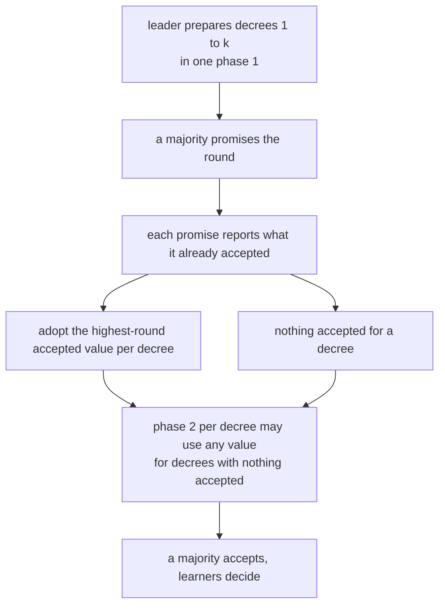
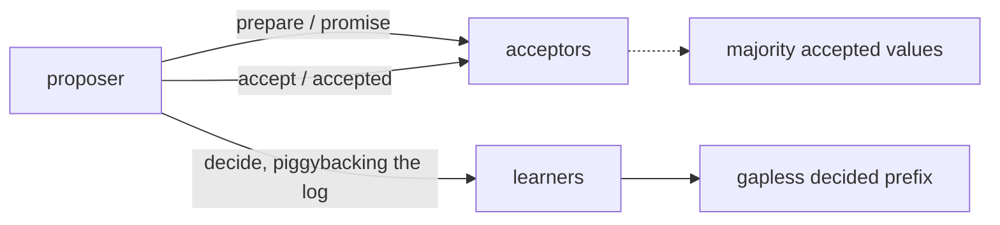
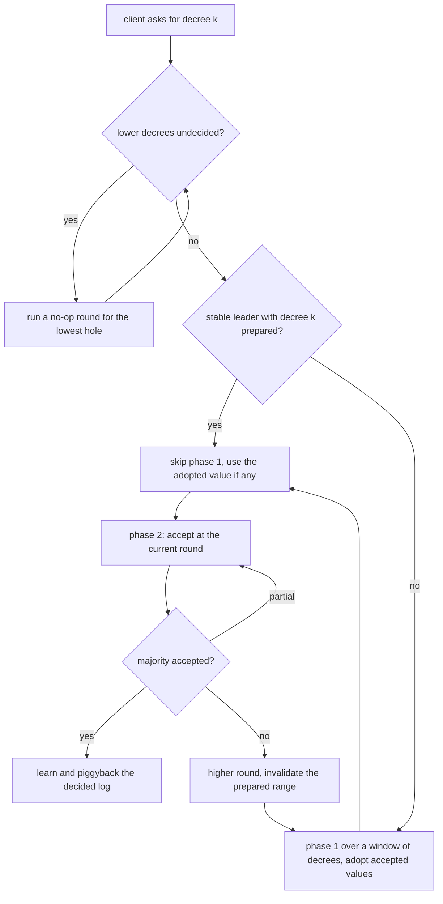
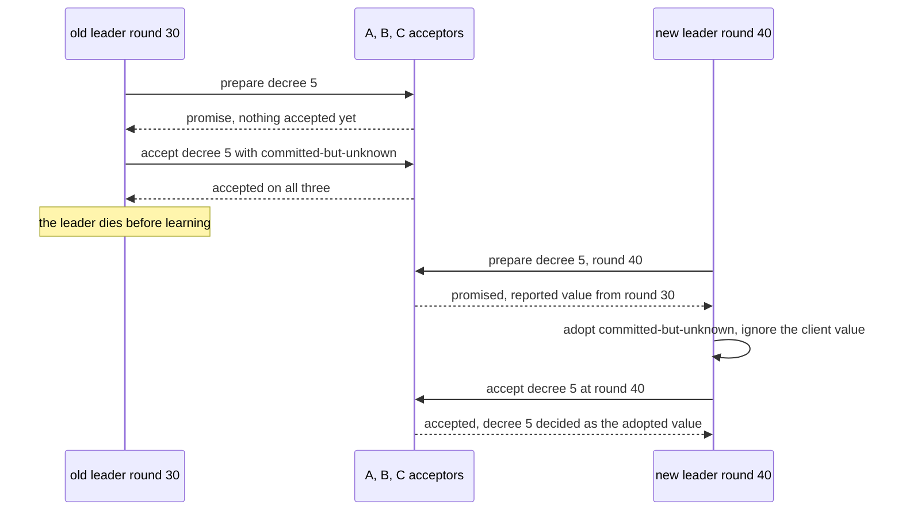

# 662 — Implement Paxos multi-decree long-running simulation with leader change

> **Tier:** Expert · **CTCI chapter:** Ch 9 — System Design and Scalability
> **Task spec:** [662-implement-paxos-multi-decree-long-running-simulation-with-leader.md](../../../tasks/expert/662-implement-paxos-multi-decree-long-running-simulation-with-leader.md)
> **Solutions:** [Python](../../../solutions/python/expert/662-implement-paxos-multi-decree-long-running-simulation-with-leader/solution.py) ·
> [Java](../../../solutions/java/expert/662-implement-paxos-multi-decree-long-running-simulation-with-leader/Solution.java) ·
> [JavaScript](../../../solutions/javascript/expert/662-implement-paxos-multi-decree-long-running-simulation-with-leader/solution.js) ·
> [C#](../../../solutions/csharp/expert/662-implement-paxos-multi-decree-long-running-simulation-with-leader/Solution.cs)

## 1. Problem restatement

Run **Multi-Paxos** over an explicitly lossy channel: a long-lived leader fills a sequence of
*decrees* (log slots), a majority of acceptors must agree on each one, learners keep a **gapless decided
log**, and the leadership can change mid-run without ever deciding one decree twice with different
values.

The interface of the four solution files:

| Piece | Contract |
| --- | --- |
| `Channel(seed, loss_percent, delay)` | deterministic lossy channel; `tick` delivers what has arrived, `collect(recipient)` filters by addressee |
| `Acceptor` | `promised` round, `accepted[decree] = (round, value)`; `prepare(up_to, round)`, `accept(decree, round, value)` |
| `Learner` | `decided` map and the gapless `log`; `learn(decree, value)` refuses to change a decision |
| `Replica` | acceptor + learner, plus `handle` for `prepare` / `accept` / `decide` |
| `Cluster` | `exchange`, `broadcast`, `decisions`, `verify_chosen(quorum)` |
| `Proposer(name, round, quorum)` | `stable`, `prepare_range(cluster, up_to)`, `phase_one`, `phase_two`, `invalidate` |
| `attempt` / `resolve` / `decide` | drive one decree to a decision, fill holes with no-op rounds, teach learners |

Key constants and rules: `NOOP = none`, `PREPARE_WINDOW = 4` decrees are prepared at once, a leader that
already prepared a decree **skips phase 1** for it (`phase_one_skipped`), a failed phase 2 invalidates the
prepared range, and every replica is also a learner so it can catch up on missed decisions.

Concrete results the checks assert:

- one decree over a healthy three-replica channel decides the proposed value on a majority, every
  acceptor records `accepted[1] == (round, "x")`, every learner decides it, nothing is adopted, and
  `phase_one_skipped == 0` for the first decree;
- a five-decree run with `base_round = 10` produces the gapless prefix `["v1", …, "v5"]` on every replica,
  `phase_one_skipped >= 4` (the stable leader reuses its round), and `verify_chosen(2)` matches the log;
- a decree submitted over a hole (`resolve(..., 3, "three")` with decree 2 untouched) yields the prefix
  `["one", NOOP, "three"]`, and re-learning decree 2 with a different value fails with
  `"decided twice"` — decisions are immutable;
- **the safety core**: a value accepted by a majority in round 30 but never learned, followed by a leader
  change to round 40 after the old leader's replica dies, is *adopted* by the new leader
  (`prepared == "committed-but-unknown"`), overrides the client's `"client-value"`, is recorded in
  `adopted`, and the restarted replica catches up to the prefix
  `[NOOP, NOOP, NOOP, NOOP, "committed-but-unknown", "six"]`;
- stale rounds cannot lower a promise: `accept(1, 5, …)` after promising `7` returns false and leaves
  `accepted[1] == (7, "v")`; `prepare(1, 6)` is refused; an equal round is not a fresh promise; a dead
  acceptor refuses both phases;
- duplicate `accept` and `decide` messages are idempotent; agreement and progress hold at `0%`, `20%` and
  `40%` message loss with client retries (8 decrees decided, all replicas holding the same gapless
  prefix);
- competing proposers: the higher round (`61`) wins the promise, the lower round cannot reach a majority,
  only the higher round's value is accepted and decided;
- a later leader adopts an already decided value instead of overwriting it (`resolve(..., "b")` returns
  `"a"`);
- the run is deterministic for a seed, and different loss patterns still decide the same values.

Documented simplifications: a synchronous round driver (no threads), no persistence, and no election
protocol — rounds and terms are passed in.

## 2. Intuition

Reaching agreement on *one* value needs a majority twice: a promise not to accept anything older, then an
accept. Keeping a **log** of decrees looks like it should need that twice per slot — which is exactly what
Multi-Paxos optimises away, because a long-lived leader can prepare a *range* of decrees in one phase 1
and then use phase 2 repeatedly while its promises hold.

The safety of doing so rests on one rule: during phase 1, the leader must **adopt** the highest-round
value any acceptor already accepted for that decree, even if the value looks stale or the leader has a
different value in mind. That is the mechanism that makes it impossible for a majority-accepted value to
be replaced later, and it is why a decree whose value was accepted but never learned still wins after a
leader change.



Three more mechanisms complete the picture:

- **A gapless log.** Learners cannot "decide decree 5" while 3 is empty; `resolve` first drives a real
  **no-op round** for every lower undecided decree, so the null value is itself the result of a Paxos
  round and never a shortcut.
- **Lossy channels and retries.** A dropped *reply* does not invalidate the round — acceptors that already
  accepted keep their state — so phase 2 is simply retried. Only a failed phase *1* (no promise majority)
  forces a higher round, and bumping the round invalidates the prepared range.
- **Immutability.** `learn` asserts that a decree is never decided twice with different values; that
  assertion is the test oracle for the whole protocol.



## 3. Algorithm

1. `prepare_range(cluster, up_to)`: broadcast `prepare(up_to, round)`. Each alive acceptor with
   `round > promised` sets `promised = round` and replies with everything it accepted for decrees
   `<= up_to`. With a majority of promises, the leader builds `best[decree] = (round, value)` taking the
   highest accepted round per decree and stores the values in `adopted_values` (recording new adoptions in
   `adopted`); `prepared_up_to = max(prepared_up_to, up_to)`.
2. `attempt(leader, cluster, decree, value)`:
   - if the leader is `stable` (a majority of alive replicas has promised its round) and the decree is
     within `prepared_up_to`, **skip phase 1** and take the adopted value if there is one;
   - otherwise prepare the range `max(decree, decree + PREPARE_WINDOW)`; on failure bump the round,
     invalidate the prepared range and retry;
   - propose the client's value unless an adopted value exists, then run phase 2;
   - a majority of `accepted` replies → record the accepters for the safety check and `decide`;
   - a *partial* majority → retry the same round (state was not lost); no acceptors → new round, invalidate.
3. `resolve(leader, cluster, decree, value)`: fill every lower undecided decree with a real `NOOP` round,
   then place the requested decree.
4. `decide(leader, cluster, decree, value)`: learn on the leader and all replicas, then send the entire
   decided log as `decide` messages — the piggyback that catches up a restarted replica.
5. `verify_chosen(quorum)` re-derives safety from the recorded accept events: any value accepted by
   `quorum` **distinct** acceptors at one round must be the decided value for that decree.
6. `Acceptor.prepare` / `accept` enforce the promise monotonicity (`promised` never decreases, a stale
   round is refused, a dead replica refuses everything) and `Learner.learn` enforces decision
   immutability.

```text
procedure prepare_range(up_to)
    broadcast("prepare", (up_to, round))
    replies ← collect replies for this proposer
    promises ← replies of kind "promise" carrying this same range
    if count(promises) < quorum then
        return false
    best ← empty map
    for each accepted_map in promises do
        for decree, (accepted_round, value) in accepted_map do
            if decree not in best or accepted_round > best[decree].round then
                best[decree] ← (accepted_round, value)
    for decree, (accepted_round, value) in best do
        if decree not in adopted_values then
            append (decree, value, accepted_round) to adopted
        adopted_values[decree] ← value
    prepared_up_to ← max(prepared_up_to, up_to)
    return true

procedure attempt(decree, value)
    prepared ← none
    for try ← 1 to attempts do
        if prepared is none then
            if stable() and decree <= prepared_up_to then
                phase_one_skipped ← phase_one_skipped + 1
                prepared ← adopted_values.get(decree, "unset")
            else
                if not prepare_range(max(decree, decree + PREPARE_WINDOW)) then
                    round ← round + 1
                    invalidate()
                    continue
                prepared ← adopted_values.get(decree, "unset")
        proposal ← value if prepared = "unset" else prepared
        accepted ← phase_two(decree, proposal)
        if count(accepted) >= quorum then
            record accept events (decree, proposal, round, acceptor)
            decide(decree, proposal)
            return proposal
        if count(accepted) >= 1 then
            continue                     // partial majority: retry the same round
        round ← round + 1
        invalidate()
        prepared ← none
    return none

procedure resolve(decree, value)
    for lower ← 1 to decree - 1 do
        if lower is not decided then
            attempt(lower, NOOP)          // a real no-op round, never a shortcut
    return attempt(decree, value)

procedure learn(decree, value)
    if decree is already decided then
        assert decided[decree] = value    // a decree is never decided twice with different values
        return
    decided[decree] ← value
    while (length(log) + 1) is in decided do
        append decided[length(log) + 1] to log
```



## 4. Worked example

The safety scenario (check 4 of the solution), three replicas `A`, `B`, `C`, quorum `2`, `old_leader`
is replica `A` at round `30`.

| Step | Action | Acceptor state | Learner state |
| --- | --- | --- | --- |
| 1 | `old_leader.phase_one(cluster, 5)` | `A`, `B`, `C` promise round 30 | nothing decided |
| 2 | `phase_two(cluster, 5, "committed-but-unknown")` | all three accept `(30, "committed-but-unknown")` at decree 5 | still nothing decided — the leader "died" before learning |
| 3 | take replica `A` down | `A` refuses both phases from now on | — |
| 4 | new leader `B`, round `40`, `phase_one(cluster, 5)` | `B`, `C` promise round 40 and report `{5: (30, "committed-but-unknown")}` | — |
| 5 | adoption | `prepared == "committed-but-unknown"`, `adopted == [(5, "committed-but-unknown", 30)]` | — |
| 6 | `resolve(new_leader, cluster, 5, "client-value")`: decrees 1-4 are holes → no-op rounds | — | prefix grows to four `NOOP`s |
| 7 | phase 2 for decree 5 with the adopted value | `B`, `C` accept `(40, "committed-but-unknown")` | decree 5 decided as `"committed-but-unknown"` |
| 8 | bring `A` back and `resolve(..., 6, "six")` | `B`, `C` accept decree 6 | the piggybacked log teaches `A` everything: `[NOOP, NOOP, NOOP, NOOP, "committed-but-unknown", "six"]` |

Step 6 is what keeps the log gapless: the client asked only for decree 5, but decrees 1-4 had no value
in this fresh cluster, so `resolve` ran four real no-op rounds before placing decree 5 — the nulls are
protocol decisions, not filler. Step 8 shows the piggyback in action: `A` never saw any of those rounds,
yet it ends up with exactly the same prefix as the others.

Rounding out the same machinery:

| Check | Configuration | Asserted outcome |
| --- | --- | --- |
| healthy single decree | round `0`, quorum `2`, channel seed `0x5EED` | decided `"x"`, `adopted == []`, `phase_one_skipped == 0`, `verify_chosen(2) == {1: "x"}` |
| stable multi-decree | rounds from `10`, decrees 1-5 | prefix `["v1" … "v5"]`, `phase_one_skipped >= 4` |
| stale round | promise `7`, then `accept(1, 5, "older")` | refused; `accepted[1]` stays `(7, "v")`; `prepare(1, 6)` refused; `prepare(1, 9)` reports `{1: (7, "v")}` |
| competing proposers | rounds `60` (chief) and `61` (rival) | the higher round wins the promise; the low round cannot reach a majority; only `"from-B"` is accepted and decided |
| loss sweep | loss `0%`, `20%`, `40%` with client retries | all 8 decrees decided; every replica holds the same gapless prefix |



## 5. Complexity

`R` = replicas, `Q` = quorum size (`R / 2 + 1` for majority), `D` = decrees decided so far,
`K` = decrees in the prepared window, `A` = `attempts` retries per decree, `M` = messages in flight.

| Operation | Best | Average | Worst | Why the bound holds |
| --- | --- | --- | --- | --- |
| `prepare_range` | O(R) | O(R + K·R) | O(K·R) | one broadcast plus one reply per replica, each carrying up to `K` accepted entries |
| `phase_two` | O(R) | O(R) | O(R) | one accept per replica and one reply per acceptor |
| `attempt` | O(1) round | O(A·R) messages | O(A·R) | each retry is one round of broadcasts, and the accepted count decides whether to retry or re-round |
| `resolve` | O(D) | O(D·A·R) | O(D·A·R) | every lower hole costs a full no-op round |
| `decide` | O(D + R) | O(D·R) | O(D·R) | the decided log is piggybacked to every replica |
| `verify_chosen` | O(R) | O(events) | O(events·Q) | every recorded accept event is tallied per `(decree, round, value)` |
| Space | O(D) | O(D·R) | O(D·R) | decided logs per replica plus the accept-event history |
| Single-decree Paxos baseline | O(R) messages | O(R) | O(R) | phase 1 + phase 2 per decree; Multi-Paxos amortises phase 1 over the window |

The saving that makes this "multi-decree" instead of "n Paxos instances" is the skip: with a stable leader
and a prepared range, a decree costs **one** round instead of two — the checks count `phase_one_skipped`
and require at least four skips in a five-decree run. The price is the invalidation rule: after a lost
round the prepared range is discarded, so a storm of competing proposers degrades to classic Paxos with a
phase 1 per decree. Loss only costs retries: a dropped reply is retried in the *same* round because
acceptors keep their state, so throughput falls but safety and liveness under retries hold at `0%`, `20%`
and `40%` loss.

## 6. Pitfalls and edge cases

- **Never decide a decree twice.** `Learner.learn` asserts `decided[decree] == value` on a repeat and
  raises otherwise (`"decided twice"`); it is the single most important invariant in the task.
- **Adopt before you propose.** A leader with a prepared decree must use the highest-round accepted value,
  not its own client's value — the check drives exactly this and asserts the client's `"client-value"` is
  overridden.
- **Preparation is a range, not a decree.** Phase 1 covers `max(decree, decree + PREPARE_WINDOW)`; settling
  for a single decree would waste the round and lose the Multi-Paxos saving.
- **Invalidate on a new round.** `round += 1` must call `invalidate()`; otherwise the leader would reuse
  promises that no longer hold and phase 1 would silently be skipped.
- **Retry versus re-round.** A partial majority means some acceptors already accepted, so the same round
  is retried; only zero responses justify a higher round. Re-rounding on a partial majority would make
  progress collapse under loss.
- **Holes need real rounds.** `resolve` fills every lower undecided decree with a no-op *round*, so a gap
  becomes `NOOP` decided by a majority rather than an unlogged assumption.
- **Stale rounds never win.** `accept` refuses `round < promised` and `prepare` refuses
  `round <= promised`; the promise counter only ever increases, and an equal round is not a new promise.
- **Dead replicas refuse both phases.** Liveness comes from the quorum count, but no dead replica may
  promise, accept or handle a message.
- **Duplicate messages are idempotent.** Replaying `accept` does not change the acceptor state and
  replaying `decide` does not change the learner state or the log.
- **A restarted replica must catch up.** Decisions are piggybacked on `decide`, so a replica that missed
  rounds ends up with exactly the same gapless prefix — asserted after `A` restarts.
- **The channel is deterministic.** Loss is drawn from a seeded PRNG and messages are queued with a fixed
  delay, so `tick`/`collect` reproduce the same interleaving; identical seeds give identical runs.
- **Loss changes the path, not the result.** Different loss patterns decide the same values
  (`scenario(0x4444)[0] == scenario(0x5555)[0]`), because loss only causes retries.
- **`phase_two` must filter by decree.** The reply collector accepts only `accepted` messages for the
  decree being placed, otherwise a stale reply would count towards the majority.

## 7. Variants and follow-ups

- **Replicas without agreement.** CRDTs avoid the protocol entirely by making merges commutative:
  [664-implement-crdt-based-collaborative-editor-with-undo-support.md](../../../tasks/expert/664-implement-crdt-based-collaborative-editor-with-undo-support.md).
- **Shrinking the log the learner must carry.** Snapshot compaction bounds the state a lagging replica
  catches up on: [663-implement-snapshot-based-log-compaction-and-recovery-for-replica.md](../../../tasks/expert/663-implement-snapshot-based-log-compaction-and-recovery-for-replica.md).
- **One writer, no voting.** Chain replication reaches strong consistency with a linear data path and no
  quorum rounds at all: [661-implement-chain-replication-simulation-for-strong-consistency.md](../../../tasks/expert/661-implement-chain-replication-simulation-for-strong-consistency.md).
- **Majorities as a latency knob.** Quorum reads and writes expose the same majority arithmetic as an
  order-statistic latency tradeoff:
  [660-implement-quorum-consensus-read-write-latency-optimization-trade.md](../../../tasks/expert/660-implement-quorum-consensus-read-write-latency-optimization-trade.md).
- **Which replicas vote.** Membership and placement come from the ring:
  [659-implement-consistent-hashing-with-weighted-nodes-and-replication.md](../../../tasks/expert/659-implement-consistent-hashing-with-weighted-nodes-and-replication.md).

## 8. Check yourself

1. **What forces a new leader to keep a value it never heard of?**
   <details><summary>Show answer</summary>Phase 1 responses: every promise reports what that acceptor
   already accepted, and the leader must adopt the highest-round accepted value per decree. If a majority
   accepted anything, at least one promise carries it, so the value survives the leader change — the
   scenario the checks reproduce with `"committed-but-unknown"`.</details>
2. **Why is a hole filled by a no-op round instead of simply deciding `null`?**
   <details><summary>Show answer</summary>Because the log must be gapless *and* consistent: a value is
   only decided once a majority accepted it. Running a real Paxos round for the null makes the hole a
   normal decision, and `resolve` does that for every lower undecided decree.</details>
3. **Which failure costs a retry and which costs a new round?**
   <details><summary>Show answer</summary>A dropped reply is retried in the same round, because the
   acceptors that did respond stay accepted. Only a failed phase 1 (no promise majority) or a phase 2 with
   no responses at all forces `round += 1`, which also invalidates the prepared range.</details>
4. **How is safety re-derived independently of the protocol's own decisions?**
   <details><summary>Show answer</summary>`verify_chosen` tallies the recorded accept events per
   `(decree, round, value)` and asserts that any value accepted by a quorum of *distinct* acceptors equals
   the decided value for that decree — a check against every accept event, not just the final state.</details>
5. **What does the piggybacked `decide` message accomplish?**
   <details><summary>Show answer</summary>It sends the whole decided log to every learner, so a replica
   that was down (or lost messages) converges on the same gapless prefix without replaying every round —
   asserted after replica `A` restarts.</details>
