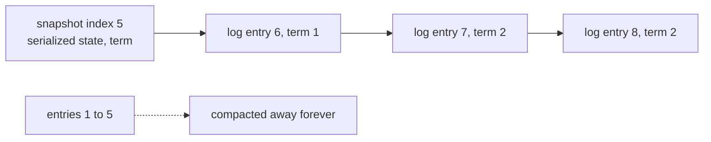
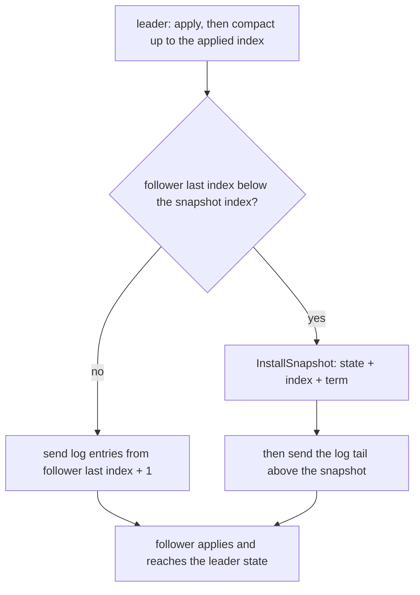
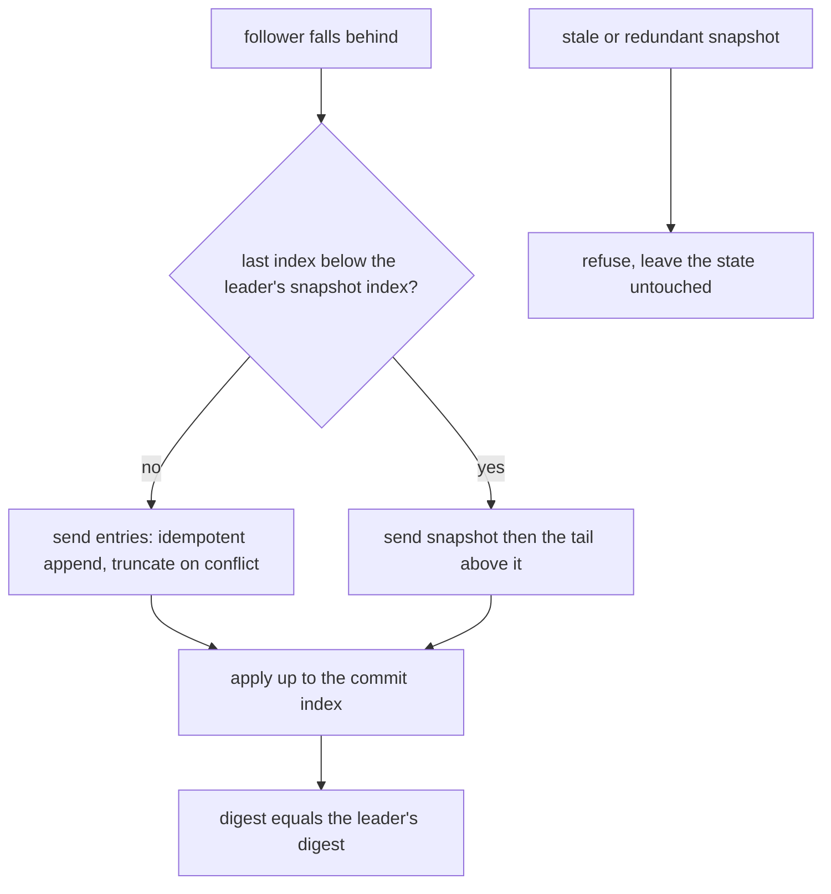
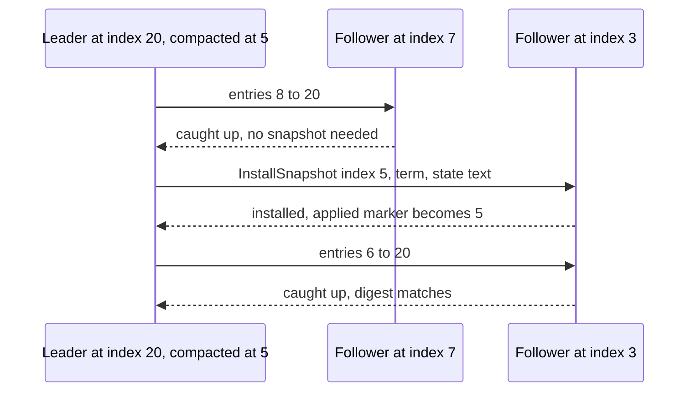

# 663 — Implement snapshot-based log compaction and recovery for replicated log

> **Tier:** Expert · **CTCI chapter:** Ch 9 — System Design and Scalability
> **Task spec:** [663-implement-snapshot-based-log-compaction-and-recovery-for-replica.md](../../../tasks/expert/663-implement-snapshot-based-log-compaction-and-recovery-for-replica.md)
> **Solutions:** [Python](../../../solutions/python/expert/663-implement-snapshot-based-log-compaction-and-recovery-for-replica/solution.py) ·
> [Java](../../../solutions/java/expert/663-implement-snapshot-based-log-compaction-and-recovery-for-replica/Solution.java) ·
> [JavaScript](../../../solutions/javascript/expert/663-implement-snapshot-based-log-compaction-and-recovery-for-replica/solution.js) ·
> [C#](../../../solutions/csharp/expert/663-implement-snapshot-based-log-compaction-and-recovery-for-replica/Solution.cs)

## 1. Problem restatement

A replica keeps a log of `(index, term, command)` entries above a **snapshot**: the serialized state
machine after the first `snapshot_index` commands. Compaction throws the compacted prefix away forever —
which is the point — so a replica that lags behind the snapshot must be repaired by transferring the
snapshot plus the log tail, and a restarting replica must rebuild its exact state from the two again.

The interface of the four solution files:

| Piece | Contract |
| --- | --- |
| `StateMachine` | deterministic `set`/`del`/`incr` machine with `serialize` (canonical, sorted), `deserialize`, `digest` |
| `Replica` | `state`, `snapshot_index`/`snapshot_term`/`snapshot_text`, `log`, `last_applied` |
| `append(entries)` | idempotent AppendEntries: replays ignored, conflicts truncate, gaps refused |
| `apply_committed(commit_index)` | applies everything up to the commit index once |
| `compact(up_to)` | snapshot the applied prefix and drop it from the log |
| `install_snapshot(index, term, text)` | refuse stale/redundant snapshots, adopt a newer one |
| `recover()` | rebuild the machine from `snapshot_text` plus the log tail |
| `replicate(leader, follower, commit_index)` | push entries, or snapshot + tail when the follower is far behind |

Concrete results the checks assert:

- a 40-command workload touches exactly **seven** keys, and for compaction cuts `1, 5, 17, 40` the state
  digest is unchanged, the log holds no index `<= cut`, the snapshot re-deserializes to the same state,
  and a replica rebuilt from snapshot plus tail replays to the same digest;
- the snapshot encoding is canonical: sorted by key, idempotent under serialize/deserialize round-trip,
  and the empty state serializes to `""`;
- compacted entries are gone (`entry(4) is None`) while later entries stay readable, and the snapshot
  remembers its own index and term (`term_at(4) == 3`);
- a slightly lagging follower (7 entries against a leader compacted at 5) catches up with **entries only**
  (`installed_snapshots == 0`); a far-behind follower (3 entries) receives a snapshot
  (`installed_snapshots == 1`), gets the tail too, and converges to the leader's digest;
- stale and redundant installs are refused (`index <= snapshot_index` or `index <= last_applied`), a
  snapshot beyond the applied point is accepted and becomes the new applied marker, and
  `installed_snapshots` counts only successful installs;
- AppendEntries invariants: replay changes nothing, a gap raises `"gap: entry 4 follows 2"`, a valid next
  entry is appended, a conflicting term **replaces** the entry (`term_at(3)` becomes the new term, and the
  applied state reflects the replacement), and re-applying the same commit index applies `0` entries;
- compaction guard rails: compacting above `last_applied` is refused with `"applied prefix"`, compacting to
  the current snapshot index is a no-op returning `none`, and the snapshot holds only the applied prefix;
- recovery from "disk" — the serialized snapshot plus the log tail — reproduces the source state and the
  source's last index;
- terms and indices stay monotone across compaction: every index has a term, log indices are consecutive,
  the snapshot index keeps its term, and `last_applied`/`last_index` are unaffected.

Documented simplifications: single-threaded, one leader pushing synchronously, terms passed in rather than
elected, and the snapshot is a canonical text encoding instead of a chunked binary stream (so chunk offsets
and mid-transfer failures are not modelled).

## 2. Intuition

A replicated log grows without bound: an entry applied a million commands ago is irrelevant to the future
state, yet it occupies storage and, worse, it is exactly what a lagging follower must receive to catch up.
The fix is to snapshot the state machine at an applied index and then **throw the prefix away**:

    state(snapshot_index) = serialized state machine after applying entries 1..snapshot_index

After that, entry `i` is only reconstructible from the log if `i > snapshot_index`; anything below is
served from the snapshot. That is not a loss of information — it is a loss of *redundancy* — because the
snapshot captures everything the dropped entries did.



The obvious danger is that a follower might need an entry that no longer exists. That is why replication is
conditional: if the follower's last index is **below the leader's snapshot index**, the leader sends the
snapshot (followed by the tail, since the snapshot only covers the leader's own prefix); otherwise it sends
plain log entries. And because a restarting replica can only read what is on disk, `recover()` replays
`snapshot_text` and then the tail — so the central invariant of the whole task is an equality of digests:

    digest(full log replay) == digest(snapshot + tail replay)   for every compaction point



## 3. Algorithm

1. `append(entries)` processes entries in order: skip anything `<= last_applied` (already applied) or
   `<= snapshot_index` (compacted away); refuse an entry whose index is more than one past `last_index`
   with a `gap:` error so the leader can back up; if the index is unknown, append it; if the index exists
   with a different term, truncate the log to everything below it and append the new entry.
2. `apply_committed(commit_index)` applies every entry `<= commit_index` above `last_applied`, returning
   the number applied — the `last_applied` marker makes it idempotent.
3. `compact(up_to)` checks that `up_to <= last_applied` (only an applied prefix may be dropped) and that
   `up_to >= snapshot_index` (never move the snapshot backwards), records the term of `up_to`, serializes
   the state, then removes every log entry `<= up_to`. Compacting to the current index returns `none`.
4. `install_snapshot(index, term, text)` refuses anything `<= snapshot_index` or `<= last_applied`;
   otherwise it deserializes the text, adopts the index/term, sets `last_applied = index`, drops the
   compacted log prefix, and counts the installation.
5. `replicate(leader, follower, commit_index)` installs the snapshot when
   `follower.last_index() < leader.snapshot_index`, then sends entries from `follower.last_index() + 1` to
   `min(commit_index, leader.last_index())`.
6. `recover()` deserializes `snapshot_text`, then replays the log tail above `last_applied` — the check that
   makes the snapshot a complete replacement for the dropped prefix.

```text
procedure append(entries)
    for (index, term, command) in entries do
        if index <= last_applied then continue          // replay of an applied entry
        if index <= snapshot_index then continue         // compacted: served by the snapshot
        if index > last_index() + 1 then
            raise gap error
        existing ← term_at(index)
        if existing is none then
            append (index, term, command) to log
        else if existing ≠ term then
            log ← entries of log with index below this index
            append (index, term, command) to log

function apply_committed(commit_index)
    applied ← 0
    for (index, term, command) in sorted(log) do
        if index <= commit_index and index > last_applied then
            apply command to state
            last_applied ← index
            applied ← applied + 1
    return applied

function compact(up_to)
    assert up_to <= last_applied                     // only an applied prefix may be compacted
    assert up_to >= snapshot_index                   // never move the snapshot backwards
    if up_to = snapshot_index then return none
    term ← term_at(up_to)
    assert term is not none
    snapshot_index ← up_to
    snapshot_term ← term
    snapshot_text ← serialize(state)
    log ← entries of log with index above up_to
    return snapshot_text

function install_snapshot(index, term, text)
    if index <= snapshot_index or index <= last_applied then
        return false
    state ← deserialize(text)
    snapshot_index ← index
    snapshot_term ← term
    snapshot_text ← text
    last_applied ← index
    log ← entries of log with index above index
    installed_snapshots ← installed_snapshots + 1
    return true

function recover()
    machine ← deserialize(snapshot_text)
    for (index, term, command) in sorted(log) do
        if index <= last_applied then
            apply command to machine
    return machine

procedure replicate(leader, follower, commit_index)
    if follower.last_index() < leader.snapshot_index then
        assert leader.snapshot_index > 0
        install_snapshot(follower, leader.snapshot_index, leader.snapshot_term, leader.snapshot_text)
    first ← follower.last_index() + 1
    entries ← leader entries from first to min(commit_index, leader.last_index())
    if entries is not empty then
        append(follower, entries)
        apply_committed(follower, commit_index)
```



## 4. Worked example

Workload `commands(40)` — command `i` is `("set", "k{i%7}", i)`, so seven keys are touched and the last
write to each wins:

| Key | Last command index | Value |
| --- | --- | --- |
| `k0` | 35 | 35 |
| `k1` | 36 | 36 |
| `k2` | 37 | 37 |
| `k3` | 38 | 38 |
| `k4` | 39 | 39 |
| `k5` | 33 | 33 |
| `k6` | 34 | 34 |

So the reference digest is seven pairs — the checks assert `len(reference) == 7` — and the canonical
snapshot text is the same pairs sorted by key, joined with `;`:
`k0=35;k1=36;k2=37;k3=38;k4=39;k5=33;k6=34`.

Compaction at four cut points on that workload:

| Cut | Snapshot index | Log after compaction | Snapshot + tail replay |
| --- | --- | --- | --- |
| 1 | 1 | entries `2..40` | digest equals the full replay |
| 5 | 5 | entries `6..40` | digest equals the full replay |
| 17 | 17 | entries `18..40` | digest equals the full replay |
| 40 | 40 | empty | digest equals the full replay |

For each cut the solution also checks the negative side: `entry(cut)` is unavailable from the log,
`term_at(cut)` still answers from the snapshot, `last_applied` is untouched at 40, and deserializing the
snapshot text reproduces the same digest.

Catching up a follower against a leader that applied 20 commands and compacted at 5:

| Follower state | Condition met | What the leader sends | Result |
| --- | --- | --- | --- |
| entries 1..7 applied, `last_index = 7` | `7 >= snapshot_index 5` | entries `8..20` | digest converges, `installed_snapshots == 0` |
| entries 1..3 applied, `last_index = 3` | `3 < snapshot_index 5` | snapshot at 5 plus tail `6..20` | digest converges, `installed_snapshots == 1`, `snapshot_index == 5` |

The far-behind case is why the tail matters: the snapshot only covers the leader's prefix up to index 5, so
the transfer is snapshot **plus** entries `6..20`. Omitting the tail would leave the follower stuck at
index 5 with a state five commands old.



The bookkeeping cases complete the picture. A stale install is refused three ways — at the current
snapshot index (`5`), below it (`3`), and at the applied index (`20`) — and leaves the digest untouched;
then `install_snapshot(25, 2, "n=7")` is accepted, moving `snapshot_index` and `last_applied` to 25 and the
state to `(("n", 7),)`, after which a second install at 25 is refused and `installed_snapshots` reads 2.
AppendEntries follows the same discipline: a replayed pair changes nothing, a gap raises
`"gap: entry 4 follows 2"`, and an entry at index 3 with a new term replaces the old one, with the
replacement command being the one applied.

## 5. Complexity

`N` = entries in the log, `S` = snapshot size in state entries, `C` = commit index, `E` = entries in one
AppendEntries batch, `T` = size of the transferred tail.

| Operation | Best | Average | Worst | Why the bound holds |
| --- | --- | --- | --- | --- |
| `append` | O(E) | O(E) | O(N + E) | one pass over the batch; a conflicting term truncates the suffix, which is O(N) |
| `apply_committed` | O(1) | O(E) | O(N log N) | the log is sorted and every entry is applied once, guarded by `last_applied` |
| `compact` | O(N + S) | O(N + S) | O(N + S) | one log filter plus serializing the whole state |
| `install_snapshot` | O(S) | O(S + N) | O(S + N) | deserialize the state and drop the log prefix |
| `replicate` | O(1) | O(E) | O(N + S) | entry path is the batch size; the snapshot path also ships the state |
| `recover` | O(S) | O(S + T) | O(S + N) | deserialize plus replay the tail |
| Space (log only) | O(N) | O(N) | O(N) | unbounded without compaction |
| Space (compacted) | O(N - snapshot_index + S) | same | same | the dropped prefix stops consuming log bytes, at the cost of the snapshot |

The point of compaction is the space column: a replica that never compacts has a log that grows with the
number of commands ever applied, while a compacting replica keeps `N - snapshot_index` entries plus a
snapshot proportional to the *state*, not to the history. The catch-up cost drops with it — the tail to
transfer is `T = last_index - snapshot_index`, not the full history — and a far-behind follower is served
in O(S + T) instead of replaying everything. The price is a one-off O(S) serialization per compaction and
the constraint that a snapshot can never be more recent than the applied index.

## 6. Pitfalls and edge cases

- **Never compact above the applied index.** `compact(up_to)` asserts `up_to <= last_applied`; snapshotting
  state that was never applied would lose committed entries silently (the check triggers
  `"applied prefix"`).
- **Never move the snapshot backwards.** `up_to >= snapshot_index` is asserted, and compacting to the
  current index is an explicit no-op returning `none`.
- **Compacted entries are gone.** `entry(i)` returns `none` for `i <= snapshot_index`; the term is still
  available through `term_at`, which is why the snapshot stores `snapshot_term`.
- **AppendEntries must be idempotent.** Entries `<= last_applied` or `<= snapshot_index` are skipped, so a
  leader that retries does not duplicate or rewrite applied state.
- **Conflicts truncate.** An existing index with a different term drops the whole suffix and re-appends —
  the standard log-repair rule, and the applied state must follow the replacement command.
- **Gaps are refused, not filled.** An entry more than one past `last_index` raises a `gap:` error so the
  leader can back up; silently buffering it would hide a divergent log.
- **Stale snapshots are refused.** `index <= snapshot_index` or `index <= last_applied` means the replica
  already knows more than the snapshot does — installing it would roll state backwards. The refused install
  must leave the digest untouched.
- **Far-behind followers need snapshot *and* tail.** The snapshot covers only the leader's prefix; without
  the tail the follower stays at the snapshot index.
- **`recover` must apply the tail, not the whole log.** It replays entries above `last_applied` only —
  replaying already-applied commands would double-apply non-idempotent operations such as `incr`.
- **Canonical serialization.** Keys are sorted so two equal states serialize identically; otherwise two
  replicas with identical digests could produce different snapshot bytes and the round-trip check would be
  meaningless.
- **Empty state.** An empty machine serializes to `""` and deserializes back to an empty machine, so a
  snapshot at index 0 is representable.
- **Terms and indices stay monotone.** Indices remain consecutive across compaction, the snapshot index
  keeps its term, and `last_applied`/`last_index` are untouched by compaction.

## 7. Variants and follow-ups

- **What the log is for.** The replicated log being compacted here is what Paxos decides on:
  [662-implement-paxos-multi-decree-long-running-simulation-with-leader.md](../../../tasks/expert/662-implement-paxos-multi-decree-long-running-simulation-with-leader.md).
- **The other replication topology.** Chain replication's one-shot catch-up is the same state-transfer
  problem with a simpler shape: [661-implement-chain-replication-simulation-for-strong-consistency.md](../../../tasks/expert/661-implement-chain-replication-simulation-for-strong-consistency.md).
- **Quorum membership.** Which replicas receive snapshots and entries is the quorum's business:
  [660-implement-quorum-consensus-read-write-latency-optimization-trade.md](../../../tasks/expert/660-implement-quorum-consensus-read-write-latency-optimization-trade.md).
- **State that never needs a log.** CRDT replicas converge by merging, so there is no compaction problem —
  only tombstone reclamation: [664-implement-crdt-based-collaborative-editor-with-undo-support.md](../../../tasks/expert/664-implement-crdt-based-collaborative-editor-with-undo-support.md).
- **Compressing what the snapshot stores.** The state encoding itself is a column/layout problem:
  [653-implement-compressed-column-encoding-schemes-rle-dictionary-and.md](../../../tasks/expert/653-implement-compressed-column-encoding-schemes-rle-dictionary-and.md).

## 8. Check yourself

1. **Why is dropping the compacted prefix not a loss of information?**
   <details><summary>Show answer</summary>Because the snapshot is the state machine *after* those entries
   were applied. Anything a dropped entry contributed is already reflected in the snapshot, so
   `digest(full replay) == digest(snapshot + tail replay)` for every cut point — which is exactly what the
   checks verify for cuts 1, 5, 17 and 40.</details>
2. **When is a lagging follower sent a snapshot instead of entries?**
   <details><summary>Show answer</summary>When `follower.last_index() < leader.snapshot_index`: the leader
   no longer has the entries the follower needs. The follower then also needs the log *tail* above the
   snapshot, since the snapshot only covers the leader's prefix.</details>
3. **Why is compaction forbidden above `last_applied`?**
   <details><summary>Show answer</summary>The snapshot must represent state that was actually applied.
   Snapshotting beyond the applied index would discard entries whose effects are not in the snapshot,
   silently losing committed commands.</details>
4. **What happens when an entry arrives with a conflicting term?**
   <details><summary>Show answer</summary>The log suffix from that index on is truncated and the incoming
   entry is appended. The checks assert `term_at(3)` changes and that the *replacement* command is the one
   reflected in the applied state.</details>
5. **Why must `recover` skip entries at or below `last_applied`?**
   <details><summary>Show answer</summary>Because the snapshot already contains their effects. Replaying
   them would double-apply operations: a `set` would survive the mistake, but `incr` would not, so the
   digest would diverge.</details>
