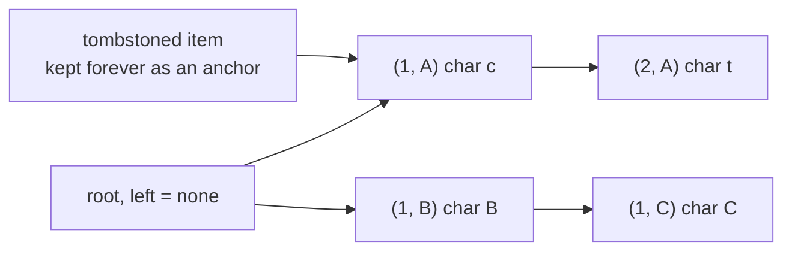
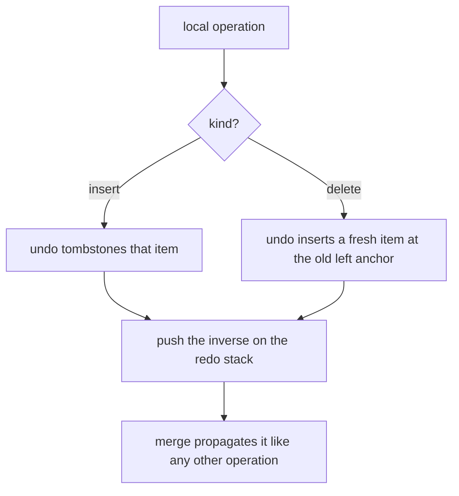
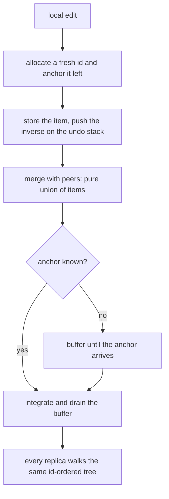
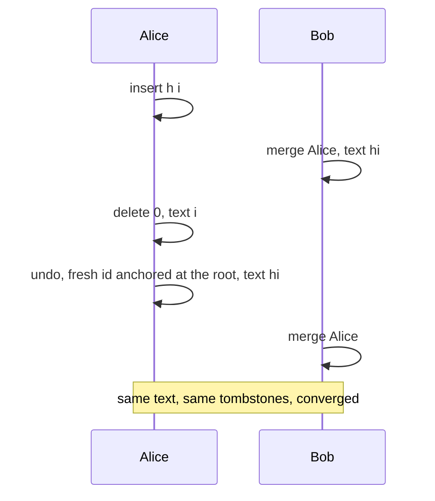

# 664 — Implement CRDT-based collaborative editor with undo support

> **Tier:** Expert · **CTCI chapter:** Ch 9 — System Design and Scalability
> **Task spec:** [664-implement-crdt-based-collaborative-editor-with-undo-support.md](../../../tasks/expert/664-implement-crdt-based-collaborative-editor-with-undo-support.md)
> **Solutions:** [Python](../../../solutions/python/expert/664-implement-crdt-based-collaborative-editor-with-undo-support/solution.py) ·
> [Java](../../../solutions/java/expert/664-implement-crdt-based-collaborative-editor-with-undo-support/Solution.java) ·
> [JavaScript](../../../solutions/javascript/expert/664-implement-crdt-based-collaborative-editor-with-undo-support/solution.js) ·
> [C#](../../../solutions/csharp/expert/664-implement-crdt-based-collaborative-editor-with-undo-support/Solution.cs)

## 1. Problem restatement

Build a collaborative text editor whose replicas converge without any consensus protocol — the data type
is **RGA** — and add per-site **undo/redo** whose inverses are themselves ordinary CRDT operations.

The interface of the four solution files:

| Piece | Contract |
| --- | --- |
| `Document(site)` | items keyed by `(counter, site)`, each `{char, left, deleted}`, plus a causal `buffered` map |
| `next_id()` | allocate the next id for this site |
| `integrate(item_id, char, left, deleted)` | idempotent insert after `left`; buffers when the anchor is unknown |
| `order()` / `text()` / `visible()` | the convergent item order, the visible text, the visible ids |
| `anchor_for(index)` | the left neighbour for an insertion at a visible index |
| `merge(other)` | union of items and tombstones; idempotent, commutative, associative |
| `Editor(site)` | local `insert` / `delete` plus per-site LIFO `undo_stack` / `redo_stack` |

Concrete results the checks assert:

- local editing: inserting `hello` gives `"hello"`, `insert(0, "X")` gives `"Xhello"`, `insert(3, "_")`
  gives `"Xhe_llo"`, deleting index 3 restores `"Xhello"`, and the delete leaves a **tombstone**
  (`tombstone_count() == 1`) while the item map still holds 7 items; insert/delete out of range is
  rejected with `"out of range"`;
- convergence: three sites on the shared text `cat` insert `"A"` at 1, `"B"` at 1 and `"C"` at 3
  concurrently; after all pairwise merges every replica has the same text, the multiset of characters is
  exactly `sorted("catABC")`, the text still starts with `c`, and `c` stays before `t`;
- merge laws: merging the same state twice changes nothing, `merge` is commutative and associative, and
  merging an empty replica is the identity;
- **non-interleaving**: with a shared anchor `x`, site A appends `alice` and site B appends `bob`; the
  merged text is 9 characters starting with `x` and the tail is exactly `"alicebob"` or `"bobalice"` —
  no character-level interleaving;
- undo of an insertion is LIFO (`"abc"` → `"ab"` → `"a"`), redo restores (`"a"` → `"ab"` → `"abc"`), and
  both redo and the restored operations land back on the undo stack (length 3);
- undo of a deletion restores the character at its place (`"hllo"` → `"hello"`), redo removes it again,
  and the tombstone count stays positive;
- an undo **propagates**: after Alice deletes and undoes, a merge gives Bob the same text *and* the same
  tombstone count;
- causal buffering: an item that arrives before its anchor is buffered, invisible (`text() == ""`), and
  drains into `"ab"` once the anchor arrives, after which the late replica converges;
- a 24-operation random stream across three sites (inserts, deletes, undos, redos) merged in shuffled
  orders converges to **one** text and **one** item order, with no buffered items left, and the same seed
  reproduces the same text;
- re-merging all replicas does not change the text and leaves nothing buffered.

Documented simplifications: single-symbol characters, buffering only for a missing anchor, and whole-state
merges instead of deltas.

## 2. Intuition

Two users typing in the same document cannot both be right about indices: "insert at position 3" means
different places on different replicas the moment either of them edits. CRDTs remove the ambiguity by
making positions **immutable and global**: every character is an item with a unique id, and an insertion
says "place me after item *X*" instead of "after the third character".

- **Ids are unique**: `(counter, site)` with a per-site counter, so no two inserts collide.
- **Anchors are stable**: an item's `left` never changes, and tombstones are never removed — a concurrent
  insertion that arrives late still finds its anchor.
- **The order is a function of ids, not arrivals**: siblings (items with the same anchor) are ordered by id
  *descending*, so every replica walks the same tree to the same sequence.



Because integration only needs the anchor to exist, a merge is a pure union: same items, same tombstones,
no coordination. That gives the three algebraic laws the checks verify — idempotence, commutativity,
associativity — and it explains why CRDTs need no leader: two replicas that have seen the same set of
operations are in the same state, whatever order they saw them in.

The interesting engineering is the interaction with **undo**. The naive undo of an insertion is "delete
that item", which is fine; but the naive undo of a *deletion* is "un-tombstone that item" — and that is
wrong. Resurrecting a tombstone id is not idempotent under merge: a replica that already saw the
deletion records the resurrected id as deleted-or-visible depending on arrival order, so the same undo
applies once on some replicas and twice on others. The solution is to make the undo a *new* insertion with
a **fresh id** anchored at the original left neighbour, exactly as the original insert would have been.



## 3. Algorithm

1. `next_id()` allocates `(counter + 1, site)`.
2. `integrate(item_id, char, left, deleted)`: if the id is already known, only OR in the deleted flag and
   return (idempotence). If `left` is not `none` and not yet known, park the item in `buffered` and return.
   Otherwise store `{char, left, deleted}` and drain the buffer, repeatedly integrating any buffered item
   whose anchor has now arrived.
3. `children()` groups items by anchor and sorts each sibling list by id **descending**; `order()` walks
   that tree depth-first from the root with an explicit stack, which yields the same sequence on every
   replica. `text()` filters out tombstones.
4. `anchor_for(index)` returns the visible id at `index - 1` (or `none` at index 0), so a local insert is
   recorded as `(id, char, left)`.
5. `merge(other)` iterates the union of ids in sorted order, adopting new items and OR-ing deleted flags,
   then hands over any buffered items so a late anchor can still arrive.
6. `insert` and `delete` push an inverse record on the undo stack and clear the redo stack. `undo` pops:
   undoing an insert tombstones the item and pushes the record to redo; undoing a delete allocates a fresh
   id, integrates the character at the original left anchor, and pushes the *updated* record to redo.
   `redo` mirrors that, allocating a fresh id for a re-insert.

```text
procedure integrate(item_id, char, left, deleted)
    if item_id is already in items then
        if deleted then items[item_id].deleted ← true       // idempotent merge
        return false
    if left is not none and left not in items then
        buffered[item_id] ← (char, left, deleted)           // wait for the anchor
        return false
    items[item_id] ← { char, left, deleted }
    drain_buffer()
    return true

procedure drain_buffer()
    progress ← true
    while progress do
        progress ← false
        for item_id in sorted(buffered) do
            char, left, deleted ← buffered[item_id]
            if left is none or left in items then
                remove item_id from buffered
                integrate(item_id, char, left, deleted)
                progress ← true
                break

function order()
    table ← anchor → successors, each sibling list sorted by id descending
    result ← empty list
    stack ← successors of the root, pushed in reverse
    while stack is not empty do
        item_id ← pop stack
        append item_id to result
        for child in reversed(successors of item_id) do
            push child on stack
    assert every item is reachable
    return result

procedure merge(other)
    for item_id in sorted(union of items and buffers of both sides) do
        if item_id is in other.items then
            deleted ← own flag or other flag
            if item_id is known here then
                items[item_id].deleted ← deleted
            else
                integrate(item_id, other char, other left, deleted)
        else if item_id is only in other's buffer then
            integrate(item_id, buffered char, buffered left, buffered deleted)

procedure undo()
    operation ← pop undo_stack
    if operation.kind = insert then
        tombstone(operation.id)
        push operation on redo_stack
    else
        fresh ← next_id()
        integrate(fresh, operation.char, operation.left)
        push copy of operation with the fresh id on redo_stack
```



## 4. Worked example

Local editing (check 1), one site `A`:

| Operation | Text | Items | Tombstones |
| --- | --- | --- | --- |
| insert `h`, `e`, `l`, `l`, `o` at the end | `hello` | 5 | 0 |
| `insert(0, "X")` | `Xhello` | 6 | 0 |
| `insert(3, "_")` | `Xhe_llo` | 7 | 0 |
| `delete(3)` | `Xhello` | 7 | 1 |

The last row is the important one: the text loses `_`, but the item map still holds seven items — the
deleted item is a tombstone that stays, because a concurrent insertion may still anchor on it.

Non-interleaving (check 4), two sites sharing the anchor `x`:

| Step | Site A | Site B | Explanation |
| --- | --- | --- | --- |
| 1 | `insert(0, "x")` | — | the shared anchor both sites agree on |
| 2 | — | `merge(A)` | B now has the same base |
| 3 | `insert(1, "a")`, `insert(2, "l")`, `insert(3, "i")`, `insert(4, "c")`, `insert(5, "e")` | `insert(1, "b")`, `insert(2, "o")`, `insert(3, "b")` | each site's later inserts anchor on its own previous character |
| 4 | `merge(B)` | — | the tail after `x` is `"alicebob"` or `"bobalice"` |

Because A's `l` is anchored on A's `a`, B's items can only be siblings of A's *block*, never insert
between A's characters: the result is 9 characters and the tail is one of the two whole-block orders, which
is what the check asserts.

Undo/redo timeline (checks 5 and 6):

| Step | Operation | Text | Undo stack | Redo stack |
| --- | --- | --- | --- | --- |
| 1 | insert `a`, `b`, `c` | `abc` | `[a, b, c]` | `[]` |
| 2 | `undo()` | `ab` | `[a, b]` | `[c]` |
| 3 | `undo()` | `a` | `[a]` | `[c, b]` |
| 4 | `redo()` | `ab` | `[a, b]` | `[c]` |
| 5 | `redo()` | `abc` | `[a, b, c]` | `[]` |
| 6 | `delete(1)` on `hello` | `hllo` | — | — |
| 7 | `undo()` | `hello` | — | — |
| 8 | `redo()` | `hllo` | — | — |

Step 7 is where the fresh id matters: the character comes back as a **new item anchored at the original
left neighbour**, not as a resurrected tombstone, so the inverse is idempotent under merge. That is also
why an undo propagates correctly: it is just another insert/delete that the normal merge carries, and the
checks confirm the peer ends with the same text *and* the same tombstone count.



Convergence under a shuffled workload (check 9): three sites start from `base`, then 24 random operations
(inserts, deletes, undos, redos) are applied per site and merged in rotated orders. Afterwards the three
texts are identical, the *item orders* are identical, and `buffered` is empty on every replica — the
buffers drain as soon as the anchors arrive. Running the same seed twice reproduces the same text.

## 5. Complexity

`I` = items (characters ever inserted, tombstones included), `V` = visible characters, `B` = buffered
items, `M` = number of merges.

| Operation | Best | Average | Worst | Why the bound holds |
| --- | --- | --- | --- | --- |
| `next_id` | O(1) | O(1) | O(1) | one counter increment |
| `integrate` | O(1) | O(1 + B) | O(B²) | a direct store, or a buffer drain that re-scans pending items |
| `order` | O(I) | O(I log I) | O(I log I) | sibling lists are sorted by id and the tree is walked once |
| `text` / `visible` | O(V) | O(I) | O(I) | one `order` pass, filtering tombstones |
| `anchor_for(index)` | O(1) | O(I) | O(I) | `order` plus an index lookup |
| `insert` / `delete` (local) | O(1) | O(I) | O(I) | anchor resolution dominates |
| `merge(other)` | O(I) | O(I log I) | O(I log I) | union of ids sorted, one integration per new item |
| `undo` / `redo` | O(1) | O(1) | O(1) | one stack pop plus one tombstone flip or one insert (itself O(I) for the anchor) |
| Space | O(I) | O(I) | O(I) | items are never removed — tombstones accumulate |

The space column is the honest cost of this design: tombstones are kept forever so late insertions can
still anchor on them, so a session that deletes heavily grows with the number of edits rather than the
number of visible characters. Compaction (removing tombstones below a known stable point) needs a
causality guarantee that this simplified model does not attempt. Everything else is linear in the item
count, and merges are monotone: each of the two merging replicas unions its items once, so a merge never
removes work another merge has done.

## 6. Pitfalls and edge cases

- **Tombstones must never be removed.** Deleting an item marks it `deleted` and keeps it as an anchor; a
  concurrent insertion that referenced it would otherwise become unplaceable (the local-editing check
  asserts the item map keeps growing while the text shrinks).
- **Sibling order must come from ids.** Ordering siblings by arrival would break convergence — one replica
  would see `"B"` first, another `"A"`. Descending id order is a total order derived from the data.
- **Consecutive inserts anchor on each other.** That is what makes a site's block contiguous; anchoring
  every character at the same anchor would allow interleaving.
- **Idempotence in `integrate`.** Re-integrating a known id must not duplicate it and must only OR in the
  deleted flag, which is what makes merges repeatable (the idempotence check re-merges the same state).
- **Missing anchors buffer, they do not drop.** An item whose anchor has not arrived is parked, invisible
  (`text() == ""`), and drained when the anchor appears; merging an item that is still buffered on the
  other side must also buffer it here.
- **Deleted flags merge with OR.** A delete on one replica must win over "no delete" on another, in either
  direction; that OR is what makes merge commutative.
- **Undo of a delete must allocate a fresh id.** Resurrecting the tombstone id is not idempotent under
  merge, so the same undo could apply once on one replica and twice on another.
- **Undo and redo are per site and LIFO.** Stacks are per `Editor`, a new local operation clears the redo
  stack, and `undo`/`redo` on an empty stack raise rather than silently doing nothing.
- **Out-of-range edits.** `insert(index)` requires `0 <= index <= len(visible)` and `delete(index)`
  requires an existing visible index; both raise with `"out of range"`.
- **Ordering must be total.** `order()` asserts every item is reachable from the root, catching a corrupt
  anchor graph rather than silently dropping characters.
- **Convergence is about the item order, not just the text.** A replica could show the same text with a
  different internal order and diverge later, which is why the random-workload check compares `order()`
  tuples as well.
- **No central authority.** Nothing in the algorithm consults a leader, a timestamp or a version vector;
  the only shared state is the set of items.

## 7. Variants and follow-ups

- **When replicas must agree instead of merge.** Paxos decides a log by majority vote — the opposite
  design goal, and the reason its complexity is higher:
  [662-implement-paxos-multi-decree-long-running-simulation-with-leader.md](../../../tasks/expert/662-implement-paxos-multi-decree-long-running-simulation-with-leader.md).
- **Compacting a growing state.** The snapshot-based replica log solves the same "state grows with
  history" problem by compacting an applied prefix:
  [663-implement-snapshot-based-log-compaction-and-recovery-for-replica.md](../../../tasks/expert/663-implement-snapshot-based-log-compaction-and-recovery-for-replica.md).
- **Richer CRDTs.** A JSON-shaped CRDT needs the same id-ordering discipline for maps and lists, not just
  a character sequence: [666-implement-conflict-free-replicated-json-structure-complex-crdt.md](../../../tasks/expert/666-implement-conflict-free-replicated-json-structure-complex-crdt.md).
- **Undo by transformation instead of inversion.** Operational transformation rewrites concurrent
  operations to preserve intention, with a different undo story:
  [665-implement-operational-transform-with-intention-preservation-test.md](../../../tasks/expert/665-implement-operational-transform-with-intention-preservation-test.md).
- **One writer instead of many.** Chain replication keeps replicas identical by ordering writes at a
  single head: [661-implement-chain-replication-simulation-for-strong-consistency.md](../../../tasks/expert/661-implement-chain-replication-simulation-for-strong-consistency.md).

## 8. Check yourself

1. **Why is the item id `(counter, site)` instead of a position index?**
   <details><summary>Show answer</summary>Because positions change under concurrent edits. An id is
   globally unique and immutable, so an insertion can permanently say "after item X" and every replica
   resolves that reference to the same place.</details>
2. **What exactly makes two replicas converge here?**
   <details><summary>Show answer</summary>The item set plus the sibling ordering rule: siblings are sorted
   by id descending, a total order derived from the data, so any two replicas holding the same items walk
   the same tree to the same sequence — regardless of the order the items arrived in.</details>
3. **Why can one site's `alice` not interleave with another's `bob`?**
   <details><summary>Show answer</summary>Because each site's later characters are anchored on its own
   previous character, forming a chain. The other site's items can only attach as siblings of that chain,
   so whole blocks are ordered, never split.</details>
4. **Why does undoing a deletion create a new item rather than un-tombstoning the old one?**
   <details><summary>Show answer</summary>An un-tombstone is not idempotent under merge: replaying it on a
   replica that has already seen the resurrection gives different results than applying it once. A fresh
   item anchored at the original left neighbour behaves exactly like a normal insert, so it converges.</details>
5. **What happens when an operation arrives before its anchor?**
   <details><summary>Show answer</summary>It is buffered, invisible to `text()`, and integrated as soon
   as the anchor arrives; the buffer drain loops until nothing else can be placed. The check shows a
   buffered item going from `""` to `"ab"` once the anchor lands.</details>
