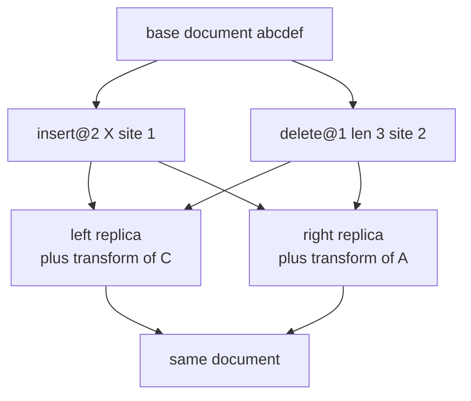
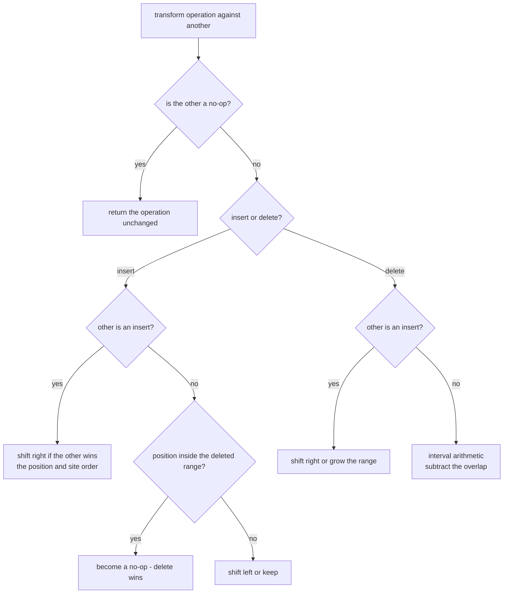
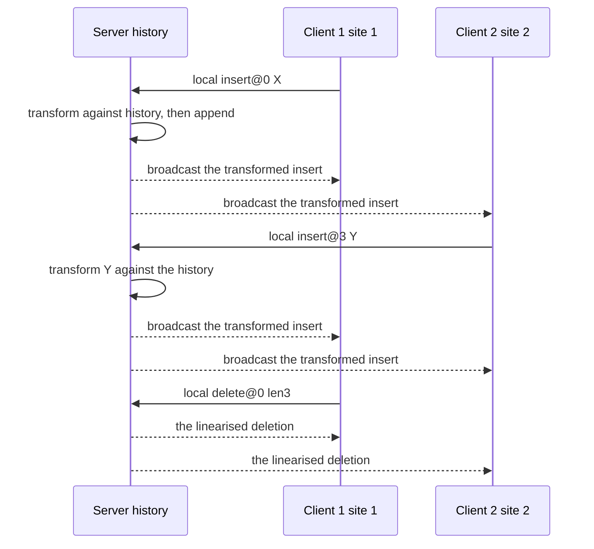

# 665 — Implement operational transform with intention preservation tests.

> **Tier:** Expert · **CTCI chapter:** Ch 9 — System Design and Scalability
> **Task spec:** [665-implement-operational-transform-with-intention-preservation-test.md](../../../tasks/expert/665-implement-operational-transform-with-intention-preservation-test.md)
> **Solutions:** [Python](../../../solutions/python/expert/665-implement-operational-transform-with-intention-preservation-test/solution.py) ·
> [Java](../../../solutions/java/expert/665-implement-operational-transform-with-intention-preservation-test/Solution.java) ·
> [JavaScript](../../../solutions/javascript/expert/665-implement-operational-transform-with-intention-preservation-test/solution.js) ·
> [C#](../../../solutions/csharp/expert/665-implement-operational-transform-with-intention-preservation-test/Solution.cs)

## 1. Problem restatement

Two replicas of a plain text document edit it at the same time. Each edit is an **operation** defined in
the coordinates of the document version the client saw:

| Operation | Payload | Meaning |
| --- | --- | --- |
| `insert` | `position`, `text`, `site` | insert `text` at `position` |
| `delete` | `position`, `length`, `site` | remove `length` characters starting at `position` |
| `nop` | — | nothing happened (or the intention was absorbed) |

The deliverable is `transform(operation, against)`: the **inclusion transformation** that rewrites
`operation` as if `against` had already been applied, so that the two orders meet:

`apply(apply(doc, a), transform(b, a)) == apply(apply(doc, b), transform(a, b))`

Inputs: a base document, a set of concurrent operations, and the two transform functions. Output: the
transformed operations, plus the **convergence** and **intention-preservation** properties the task
demands be *tested*, not asserted.

Concrete expected results, all of them asserted by the four solution files (base document `"abcdef"`):

- `apply("abcdef", insert@0 "hi") == "hiabcdef"`, `apply("abcdef", insert@3 "hi") == "abchidef"`,
  `apply("abcdef", insert@6 "!") == "abcdef!"`.
- `apply("abcdef", delete@2 len3) == "abf"`, `delete@6 len0` leaves the document alone (a no-op) and
  `delete@4 len99` is **clamped** to `"abcd"`.
- Intention preservation: with `delete@2 len1` ("`c`") concurrent with `insert@0 "Z"`, the shifted
  deletion still removes `c` → `"Zabdef"`; with `insert@1 "Z"` it gives `"aZbdef"`.
- Two concurrent insertions at position 2, site 7 with `"A"` and site 3 with `"B"`, both survive in a
  fixed order → `"abABcdef"`.
- Two overlapping deletions remove the union of their ranges exactly once.
- An insertion landing strictly **inside** a concurrently deleted range is swallowed (the documented
  delete-wins rule): `delete@1 len3` against `insert@3 "Q"` gives `"aef"` in both orders.
- A central-server run of **3 clients × 6 operations** (then a randomised **18-operation** session)
  must converge, and the server history must replay to exactly the clients' document.

## 2. Intuition

The naive design is a *last writer wins* document: ship whole documents, keep the newest. It converges,
but it destroys concurrent work — every edit made between two synchronisation points is lost. The other
naive design, "apply what arrives in the order it arrives", does not even converge: an insertion that
arrived first shifts every later position, so the replicas disagree.

The key insight is that an operation is *relative to a version*, so before applying a remote operation
you rewrite it into the coordinate system of your own document. That rewrite is not lossy — it is a
change of basis, and it must be applied in both directions so that both replicas land on the same text:



Positions alone are ambiguous when two operations touch the same anchor, so the transform needs a
deterministic tie-break that both replicas compute identically: the **site id**. On the same position,
the higher site id goes first. That is the second half of the insight — a total order over concurrent
operations that does not require communication.

## 3. Algorithm

`transform` is a dispatcher over four cases; nothing else in the system is stateful.

1. If either operation is a no-op, return the other one unchanged (`nop` if the first was a no-op).
2. **insert against insert** — shift the position right by the other insertion's length when that
   insertion lands strictly before, or at the same position with a higher site id.
3. **insert against delete** — the insertion is untouched when it starts at or before the deletion;
   it shifts left by `length` when it starts at or after the deletion end; when its anchor lies
   strictly inside the deleted range it becomes a `nop` (delete wins).
4. **delete against insert** — shift the range right when the insertion is at or before the range
   start; when the insertion lands strictly inside the range, grow the range by the insertion length
   so the same characters plus the newcomer are removed.
5. **delete against delete** — pure interval arithmetic: subtract the part of `against` that lies
   before the range from the start position, and subtract the overlap of the two ranges from the
   length.
6. `transform_against_all(op, others)` folds the transform over a history, which is the whole
   "rebase" of a central server.

```text
function transform(operation, against)
    if operation.isNoop then return nop with operation.site
    if against.isNoop then return a copy of operation
    if operation.kind = insert then
        if against.kind = insert then
            position = operation.position
            if against.position < position
               or (against.position = position and against.site > operation.site) then
                position = position + length(against.text)
            return insert(position, operation.text, operation.site)
        if operation.position <= against.position then
            return unchanged insertion
        if operation.position >= against.end then
            return insert(operation.position - against.length, operation.text, operation.site)
        return nop with operation.site
    position = operation.position
    length = operation.length
    if against.kind = insert then
        if against.position <= position then
            position = position + length(against.text)
        else if against.position < position + length then
            length = length + length(against.text)
        return delete(position, length, operation.site)
    deletedBefore = max(0, min(against.end, position) - against.position)
    overlap = max(0, min(position + length, against.end) - max(position, against.position))
    return delete(position - deletedBefore, max(0, length - overlap), operation.site)

function transformAgainstAll(operation, history)
    for other in history do
        operation = transform(operation, other)
    return operation

function applyOrder(document, operations)
    history = empty
    for operation in operations do
        current = transformAgainstAll(operation, history)
        document = apply(document, current)
        history = history + [current]
    return document
```



`applyOrder` is the deliverable the tests use: each operation is transformed against the operations
already applied (the history keeps them in *their* coordinates), which is exactly what a central server
does in `Server.receive`.

## 4. Worked example

Base document `"abcdef"`, two operations from different sites.

**Pair: `first = insert@2 "X" site 1`, `second = delete@1 len3 site 2`.**

| Step | Document | Operation | Rule | Result |
| --- | --- | --- | --- | --- |
| apply `first` | `abXcdef` | `insert@2 "X"` | — | — |
| transform `second` against `first` | `abXcdef` | `delete@1 len3` | delete vs insert, `1 < 2 < 1+3` | the range grows to `len4` |
| apply the result | `aef` | `delete@1 len4` | removes `b X c d` | `aef` |
| apply `second` first | `aef` | `delete@1 len3` | removes `b c d` | `aef` |
| transform `first` against `second` | `aef` | `insert@2 "X"` | insert vs delete, `2` is strictly inside `[1,4)` | `nop` |
| apply the result | `aef` | `nop` | — | `aef` |

Both routes reach `aef` — TP1 holds, and the insertion is gone because the deletion that swallowed it
is the documented intention of the delete-wins rule.

**Intention preservation:** `delete@2 len1` aims at `c`.

| Order | Document before the deletion | Transformed deletion | After |
| --- | --- | --- | --- |
| insert `Z` at 0 first | `Zabcdef` | `delete@3 len1` (shifted by the insertion) | `Zabdef` |
| insert `Z` at 1 first | `aZbcdef` | `delete@3 len1` | `aZbdef` |

The deletion follows the character it meant to delete instead of the index it was written at.

**Same anchor:** site 7 inserts `"A"` at 2, site 3 inserts `"B"` at 2.

| Order | First step | Transform of the second | Document |
| --- | --- | --- | --- |
| `B` then `A` | `abBcdef` | `A` is unchanged (site 7 is not smaller than 3) | `abABcdef` |
| `A` then `B` | `abAcdef` | `B` shifts to position 3 (site 7 > site 3) | `abABcdef` |



Because every client applies the *same* server linearisation in the *same* order, multi-party runs
converge even in the state-dependent delete-wins case; the file asserts that the server history replays
to the clients' document and that all clients hold equal text.

## 5. Complexity

Let `n` be the document length, `h` the history length and `k` a payload length.

| Step | Best | Average | Worst | Why the bound holds |
| --- | --- | --- | --- | --- |
| `transform` | O(1) | O(1) | O(1) | a constant number of comparisons; only lengths and positions are read |
| `apply` an insert | O(n) | O(n) | O(n) | string concatenation rebuilds the document |
| `apply` a delete | O(n) | O(n) | O(n) | a slice plus a concatenation |
| `transformAgainstAll` | O(1) | O(h) | O(h) | one `transform` per history entry |
| `applyOrder` | O(h) | O(h²) | O(h²) | each of the `h` operations is transformed against the growing history |
| pairwise TP1 sweep | O(1) | O(|universe|²) | O(|universe|²) | every ordered pair is transformed twice and applied twice |
| server `receive` | O(h) | O(h) | O(h) | same fold over the linearised history |
| Space | O(h) | O(h) | O(h) | the transformed history plus the document |

Alternatives for comparison: whole-document last-writer-wins is O(1) *per merge* but discards all
concurrent edits; a state-based CRDT sequence (RGA) needs no transform at all but carries per-character
tombstones instead of a history (see the related tasks in section 7).

## 6. Pitfalls and edge cases

- **A position out of range raises.** `apply` checks `0 <= position <= len(document)`; the checks assert
  that `check` fires (an `AssertionError`) for a position past the end.
- **Deletions are clamped, not rejected.** `delete@4 len99` on `"abcdef"` removes `ef` and yields
  `"abcd"`; a deletion whose start is at the end of the document is the identity.
- **Zero-length deletions and `nop`.** `delete@6 len0` returns the document unchanged, transforming a
  no-op yields a no-op, and a no-op never shifts anything — the checks assert all three.
- **A negative deletion length and an empty insertion payload are rejected** in the `Operation`
  constructor.
- **The tie-break is mandatory.** Without the site comparison, two replicas that receive the same two
  same-position insertions in different orders produce different texts; the checks pin the higher site
  id going first (`abABcdef`).
- **Delete-wins makes the transform state dependent.** An insertion strictly inside a deleted range
  collapses to a no-op, so the classic TP2 (identical *transformation trees* for three operations) does
  **not** hold in general. The file therefore verifies pairwise TP1 exhaustively, triple convergence in
  every one of the six delivery orders for insert-only and delete-only triples (where the result must
  also equal a set-based brute-force union oracle), and convergence through the central-server
  linearisation that real OT systems rely on.
- **Documented simplification (Python).** Single-character-addressable linear text, no rich-text
  attributes, no undo/redo of remote operations, and the server processes operations one at a time in a
  fixed deterministic order.
- **The same rule, three other encodings.** JavaScript returns a *list* of operations, because when an
  insertion lands inside a deleted range no single delete expresses the remainder and the delete is
  split in two; Java sidesteps the case altogether by making deletions name character ids instead of
  ranges; C# performs the same four cases but verifies intention preservation by tracking the identity
  of every character through the merge. All three also decline to claim TP2.
- **Unicode.** Python indexes code points while Java and C# index UTF-16 units, so a non-BMP character
  occupies one position in Python and two there; the checks stay inside the BMP.
- **Determinism.** The randomised sessions use the seeded `splitmix64` stream (`0x5EED`, `0x1234`), so
  two runs of the same schedule must produce the same document — the file asserts exactly that.

## 7. Variants and follow-ups

- A smaller, textbook-shaped version of the same transform, without the intention tests →
  [635 — operational transform simplified for collaborative text](../../../tasks/expert/635-implement-operational-transform-simplified-for-collaborative-tex.md).
- Drop the transform entirely and make the data structure converge on its own →
  [666 — conflict-free replicated JSON structure](../../../tasks/expert/666-implement-conflict-free-replicated-json-structure-complex-crdt.md)
  and the sequence CRDTs of
  [634 — CRDT sequence (RGA / Logoot) basics](../../../tasks/expert/634-implement-crdt-sequence-rga-logoot-basics-for-collaborative-edit.md).
- The same goal with undo/redo of remote operations, which needs inverse operations →
  [664 — CRDT-based collaborative editor with undo support](../../../tasks/expert/664-implement-crdt-based-collaborative-editor-with-undo-support.md).
- Convergence is a safety property; the *linearised* history above is a liveness one. A checker for the
  latter is
  [618 — linearizability checker for concurrent histories](../../../tasks/expert/618-implement-linearizability-checker-for-concurrent-histories.md).

## 8. Check yourself

<details><summary>Show answer</summary>
**Why does an insertion strictly inside a deleted range have to disappear?** Because the two intents
conflict and no single position/length operation can express "insert this, but the characters around it
are gone". The implementation documents delete-wins: the transform returns a `nop`. Java avoids the
question by naming deleted characters instead of ranges; JavaScript keeps the insertion's remainder by
returning a *list* of deletes.
</details>

<details><summary>Show answer</summary>
**`first = insert@2 "X"` (site 1) and `second = delete@1 len3` (site 2) — what is
`transform(second, first)` and why?** `delete@1 len4`. The insertion position 2 is strictly inside the
range `[1, 4)`, so the deletion must grow by the insertion length to remove the same characters plus the
newcomer; applying it to `abXcdef` gives `aef`, the same text the other order produces.
</details>

<details><summary>Show answer</summary>
**Why does `transform` need the site id at all?** Two insertions at the same position have no positional
order. Comparing `(position, site)` gives both replicas the same total order and therefore the same
interleaving (`abABcdef`), while still letting both insertions survive.
</details>

<details><summary>Show answer</summary>
**What exactly does the pairwise sweep verify, and what does it *not* verify?** It verifies TP1 for every
ordered pair of operations generated from the base document: both orders must yield the same text. It
does not verify TP2 for arbitrary triples — the state-dependent delete-wins rule breaks it — which is
why triples are checked only for the consistent subsets (all inserts, all deletes) and through the
server linearisation.
</details>

<details><summary>Show answer</summary>
**How does the server guarantee convergence if the transform is not TP2?** Every client applies the same
operations in the same server order: the server transforms each arriving operation against its own
history and broadcasts the *transformed* operation. Replicas therefore never have to agree about order —
they just apply what the server says, and the file asserts the history replays to the clients' document.
</details>
