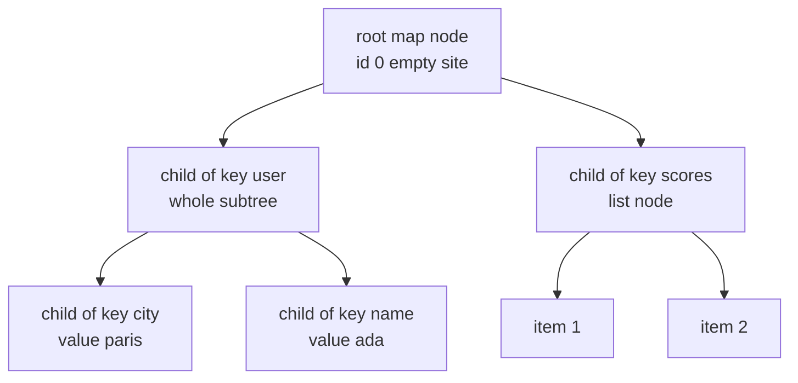
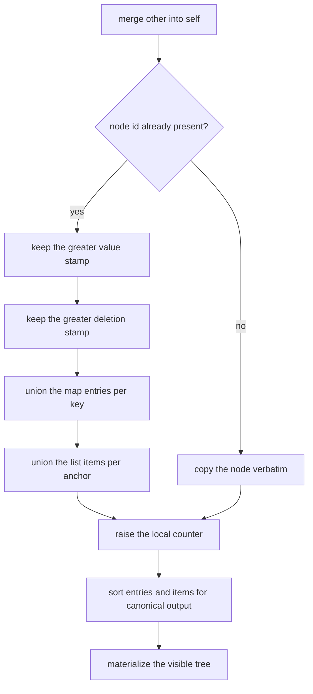
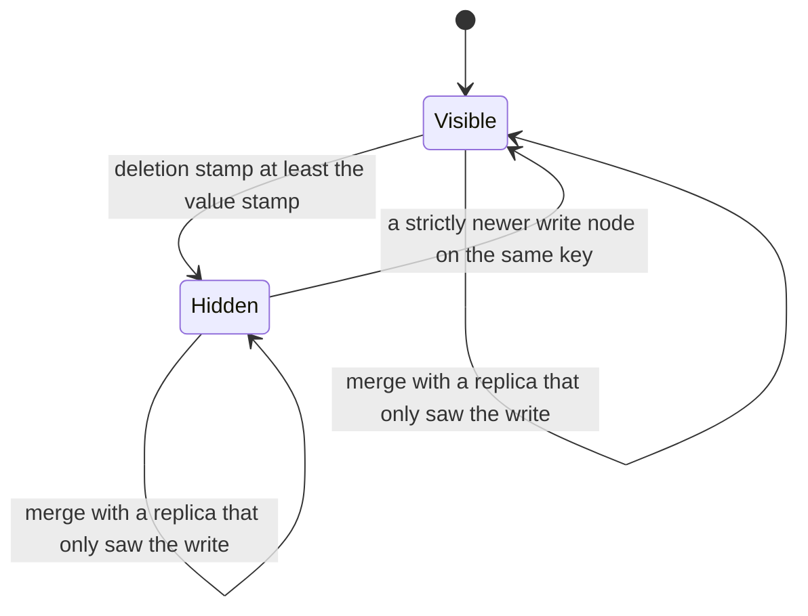

# 666 — Implement conflict-free replicated JSON structure (complex CRDT).

> **Tier:** Expert · **CTCI chapter:** Ch 9 — System Design and Scalability
> **Task spec:** [666-implement-conflict-free-replicated-json-structure-complex-crdt.md](../../../tasks/expert/666-implement-conflict-free-replicated-json-structure-complex-crdt.md)
> **Solutions:** [Python](../../../solutions/python/expert/666-implement-conflict-free-replicated-json-structure-complex-crdt/solution.py) ·
> [Java](../../../solutions/java/expert/666-implement-conflict-free-replicated-json-structure-complex-crdt/Solution.java) ·
> [JavaScript](../../../solutions/javascript/expert/666-implement-conflict-free-replicated-json-structure-complex-crdt/solution.js) ·
> [C#](../../../solutions/csharp/expert/666-implement-conflict-free-replicated-json-structure-complex-crdt/Solution.cs)

## 1. Problem restatement

Replicate a JSON document across sites that edit it independently and then exchange **whole states**.
Every replica must reach the same canonical JSON without any coordination, no matter how the edits were
interleaved or in which order the merges happen.

Interface (the four solution files expose the same shape):

| Call | Meaning |
| --- | --- |
| `set(path, value, key)` | write `value` at `path`; the last path step is a map key |
| `append(path, value)` | append an element to the list at `path` |
| `delete(path)` | remove the node at `path` (implicitly its whole subtree) |
| `merge(other)` | union the two replica states |
| `materialize()` / `to_json()` | project the state onto a sorted, canonical JSON value |

Concrete expectations, all asserted by the checks:

- A replica that does `set([], {"name": "ada"}, key="user")`, `set(["user"], "paris", key="city")`,
  `set([], [1, 2, 3], key="scores")` and `append(["scores"], 4)` must materialise
  `{"scores": [1, 2, 3, 4], "user": {"city": "paris", "name": "ada"}}` with the keys sorted.
- Overwriting `user.city` with `"rome"` must hide `"paris"` completely (`"paris"` does not occur in the
  rendered JSON).
- Deleting `branch` must remove the whole subtree: `materialize() == {}` and the key does not appear at
  all.
- Two concurrent writes to one key resolve by stamp `(counter, site)`: `"right"` (stamp `(2, "B")`)
  beats `"left"` (stamp `(2, "A")`) in **both** merge orders, and the winner is the same value whichever
  replica merges first.
- Concurrent writes to *different* keys must all survive:
  `{"one": {"x": 1}, "three": {"z": 3}, "two": {"y": 2}}`.
- Concurrent `append`s at the same anchor both survive, and both replicas produce the same order.
- `merge` must be idempotent, commutative and associative, and a randomised session must be
  deterministic.

## 2. Intuition

A JSON document is a tree, and merging two trees field by field is where naive replication dies: if one
site overwrites `user.city` while another overwrites `user.name`, "take the newer tree" throws one of
them away. The insight is to decompose the document into small CRDTs and let the *structure* carry the
history:

1. **A map key holds a set of candidate children, not one child.** Each candidate is a node with a
   globally unique id `(counter, site)`. The visible child is the one with the greatest stamp among the
   candidates that are not deleted — a last-writer-wins register with the candidates kept as evidence.
2. **A deletion is a timestamp, not a removal.** `deleted >= value_stamp` means the node is hidden; the
   node stays in the table as a tombstone, so a merge that re-introduces it cannot resurrect it.
3. **A list is ordered by causality, not by index.** Each element records the element it was appended
   *after* (its anchor); concurrent appends at the same anchor are ordered by descending id. That is the
   RGA rule, and it is what makes "index 3" unnecessary.
4. **Merging is a union.** Per node: keep the maximum value stamp, the maximum deletion stamp, the
   union of map children and the union of list items. Unions are idempotent, commutative and
   associative, so merge inherits all three laws.



Every node in that picture also stores a value stamp and a deletion stamp, and the map keys store *all*
children ever written for them; only the rendering decides which one is visible.

## 3. Algorithm

1. `_stamp()` returns `(counter + 1, site)`, so stamps are Lamport-style and totally ordered by
   `(counter, site)`.
2. A write allocates a node id equal to its stamp, stores `(stamp, value)`, then **populates** nested
   payloads recursively: map payloads become child nodes under their keys, list payloads become items
   anchored to the previous item, in a stable order.
3. `_visible_children(node, key)` filters the candidates by `not _is_deleted(child)` and takes the
   maximum by value stamp.
4. `_is_deleted(node)` is `deletion is not None and deletion >= value_stamp`. Equality counts as deleted,
   so a deletion stamped at the same instant as the write wins.
5. `list_ids(node)` materialises the RGA order: group items by anchor, sort each sibling group by id
   descending, then walk the anchor tree with an explicit stack, skipping tombstones.
6. `_resolve(path)` walks the visible structure — a map step goes through `_visible_children`, a list
   step through the materialised `list_ids` — and returns the node id, or indicates "missing".
7. `merge(other)` iterates the other replica's node table and unions: maximum value stamp, maximum
   deletion stamp, union of entries and items; it also raises the local counter so future stamps are
   strictly newer than anything seen.
8. `materialize()` renders: a deleted node renders as nothing, a map renders its visible children under
   sorted keys, a list renders its materialised items, a leaf renders its value.

```text
function merge(self, other)
    for each nodeId in other.nodes do
        if nodeId is not in self.nodes then
            self.nodes[nodeId] = copy of other.nodes[nodeId]
            continue
        mine = self.nodes[nodeId]
        theirs = other.nodes[nodeId]
        mine.value = the greater stamp of mine.value and theirs.value
        mine.deleted = the greater stamp of mine.deleted and theirs.deleted
        for each key in theirs.entries do
            union mine.entries[key] with theirs.entries[key]
        for each item in theirs.items do
            mine.items.setdefault(item.id, item.anchor)
        self.counter = max(self.counter, nodeId.counter)
    for each nodeId in self.nodes do
        sort self.nodes[nodeId].entries values
        sort self.nodes[nodeId].items
    return self

function materialize(nodeId)
    node = self.nodes[nodeId]
    if isDeleted(nodeId) then return nothing
    if node.type = map then
        result = empty map
        for each key in sorted(node.entries) do
            child = visibleChildren(nodeId, key)
            if child exists and materialize(child) exists then
                result[key] = materialize(child)
        return result
    if node.type = list then
        return [materialize(item) for item in listIds(nodeId) if materialize(item) exists]
    return node.value.payload

function listIds(nodeId)
    children = group node.items by anchor
    for each sibling group do sort descending by item id
    order = empty
    stack = reversed(children[None])
    while stack is not empty do
        item = stack.pop()
        if not isDeleted(item) then order.append(item)
        stack.extend(reversed(children[item]))
    return order
```



## 4. Worked example

**Concurrent last-writer-wins on one key.** Replica `A` writes `k = "seed"`, replica `B` merges that
state (so it knows the node) and then writes `k = "right"`; meanwhile `A` writes `k = "left"`.

| Step | Replica | `counter` | Node written for `k` | Value stamp | Candidates for `k` |
| --- | --- | --- | --- | --- | --- |
| seed | A | 1 | `(1, "A")` | `(1, "A")` | `{(1,"A") → seed}` |
| B adopts A | B | 1 | — | — | `{(1,"A") → seed}` |
| B writes | B | 2 | `(2, "B")` | `(2, "B")` | `{(1,"A") → seed, (2,"B") → right}` |
| A writes | A | 2 | `(2, "A")` | `(2, "A")` | `{(1,"A") → seed, (2,"A") → left}` |
| A merges B | A | 2 | — | — | both candidates; max stamp `(2,"B")` → `right` |
| B merges A | B | 2 | — | — | both candidates; max stamp `(2,"B")` → `right` |

The winner is the same from both sides because it is a function of the stamps, not of the merge order —
`(2, "B") > (2, "A")`, so with an equal counter the higher site id wins.

**Deletion versus a concurrent write.** `B` writes `k = "value"` with stamp `(1, "B")`; `A` merges it and
then deletes the key.

| Step | Node `(1, "B")` value stamp | Deletion stamp | Visible? |
| --- | --- | --- | --- |
| `B` writes | `(1, "B")` | none | yes |
| `A` merges, then deletes | `(1, "B")` | `(2, "A")` | no, because `(2,"A") >= (1,"B")` |
| reverse merge order | `(1, "B")` | `(2, "A")` | no — the tombstone travels with the state |

A third replica `C` that never saw the deletion and wrote `k = "rival"` after advancing its counter past
the tombstone still wins the key: its write is a *newer node* on the same key, and the checks assert the
two merge orders agree on it. Only a deletion stamped strictly newer than that write (a fourth replica
`D` that merges the contested state first) removes it again — the same `deleted >= value_stamp`
comparison.



**Concurrent list appends.** Both replicas start from the same empty list node `(1, "A")`; `A` appends
`"a"` as item `(2, "A")` and `B` appends `"b"` as item `(2, "B")`, both anchored at the head (`anchor =
none`). After the merge the item table is `{(2,"A") → none, (2,"B") → none}`. The sibling group at the
head is sorted by id descending, so the order is `(2,"B")` then `(2,"A")` → `["b", "a"]` on both
replicas; the check asserts convergence and that both elements survive. Removing the first element adds a
deletion stamp to `(2, "B")`: `materialize()` now yields one element while the item table still holds
**two** entries — the tombstone is what makes the removal survive a later merge.

## 5. Complexity

Let `N` be the number of nodes in a replica (including tombstones), `p` a path length and `k` the number
of candidate children of one key.

| Operation | Best | Average | Worst | Why the bound holds |
| --- | --- | --- | --- | --- |
| `set` / `append` / `delete` | O(p) | O(p + c) | O(p + c) | `_resolve` walks the path; `c` is the size of the populated payload |
| `_visible_children` | O(1) | O(k) | O(k) | one linear scan for the maximum stamp |
| `list_ids` | O(i) | O(i log i) | O(i log i) | the item table is grouped and each sibling group sorted |
| `merge` | O(N) | O(N) | O(N) | every node of the other replica is visited once; unions are amortised O(1) per entry |
| `materialize` / `to_json` | O(N) | O(N log N) | O(N log N) | one visit per visible node plus the key sorts |
| Space | O(N) | O(N) | O(N) | the node table keeps tombstones and every superseded candidate |

Alternatives: an **operation-based** replica ships one small operation per edit (O(1) messages) but needs
reliable causal delivery; the state-based design here trades bandwidth for order independence and lets
merges be retried freely. A sequence CRDT with per-character tombstones costs O(n) nodes for a text of
`n` characters, the same trade the JSON list makes.

## 6. Pitfalls and edge cases

- **Ties are not left to chance.** Equal counters resolve by site id; the checks compare the two merge
  orders and require the same winner, and require the loser's value to be strictly invisible in the
  rendering.
- **A deletion is a timestamp, not a flag.** The comparison is `>=`, so a deletion stamped in the same
  instant as the write hides the node; a *strictly newer write node* on the same key becomes visible
  again (verified in both merge orders).
- **`"paris"` must not leak.** A superseded candidate is invisible to `materialize`, and the checks
  assert the string does not occur in the rendered JSON at all.
- **Deleting a container deletes its subtree.** The renderer returns nothing for a deleted node before
  looking at its children, so `branch` disappears including its nested leaf.
- **The root cannot be deleted**, and resolving a path that does not exist is rejected; a list index out
  of range and a descent into a scalar are rejected too.
- **Tombstones are load-bearing.** A removed list element must *stay* in the item table — the checks
  assert the table keeps two items while only one is visible — because a merge with a replica that has
  not seen the removal would otherwise resurrect it.
- **A merge must not mutate its argument.** The C# file asserts this explicitly; the other files merge
  into a `clone` when they need a fresh replica, and the law checks (`idempotent`, `commutative`,
  `associative`) are run on clones.
- **Merging an empty replica is the identity**, and re-merging the same state changes nothing
  (idempotence).
- **Documented simplification (Python).** Maps, lists and registers only — no counters, sets or
  replicated text — and merges exchange whole states rather than deltas.
- **Documented simplification (JavaScript).** Arrays are replicated as an OR-Set of uniquely tagged
  items, i.e. as a set-like list whose order is the tag order; that gives up true array ordering (a real
  list CRDT needs a positional ordering such as RGA) in exchange for a much smaller implementation, and
  the checks only claim that no element is lost or duplicated and that replicas converge.
- **Documented simplification (C#).** Stamps are a Lamport counter plus a replica id (not a vector
  clock), register payloads are strings with no nesting, there is no garbage collection of tombstones,
  and arrays are modelled as unordered duplicate-free sets.
- **Documented simplification (Java).** Objects are implicit in the paths, so a child operation is
  causally dependent on the register that creates its parent; an operation for an unknown parent is
  buffered and retried, which makes delivery order irrelevant.

## 7. Variants and follow-ups

- The same CRDT family without the path/candidate machinery: registers, maps and sets →
  [633 — CRDT counter and set examples (op-based and state-based)](../../../tasks/expert/633-implement-crdt-counter-and-set-examples-operation-based-and-stat.md).
- A real sequence CRDT with per-character positioning (RGA, Logoot) →
  [634 — CRDT sequence (RGA / Logoot) basics](../../../tasks/expert/634-implement-crdt-sequence-rga-logoot-basics-for-collaborative-edit.md).
- The editor built on top of the sequence CRDT, including undo →
  [664 — CRDT-based collaborative editor with undo support](../../../tasks/expert/664-implement-crdt-based-collaborative-editor-with-undo-support.md).
- The alternative replication strategy: transform operations instead of merging state →
  [665 — operational transform with intention preservation tests](../../../tasks/expert/665-implement-operational-transform-with-intention-preservation-test.md).
- Convergence swaps the role of the checker once histories are involved →
  [618 — linearizability checker for concurrent histories](../../../tasks/expert/618-implement-linearizability-checker-for-concurrent-histories.md).

## 8. Check yourself

<details><summary>Show answer</summary>
**Why does a map key keep a set of children instead of one value?** Because two concurrent writes cannot
be ordered by arrival. Keeping both candidates with their stamps lets any replica compute the same winner
by `max(stamp)`, and it is exactly that "keep the evidence" choice that makes merge a union and therefore
commutative.
</details>

<details><summary>Show answer</summary>
**Two writes both have counter 2 — how is the conflict settled, and why does the tie-break matter?**
Stamps are tuples `(counter, site)`, so the higher site id wins: `(2, "B")` beats `(2, "A")`. Without the
site component the two replicas could pick different winners and never converge.
</details>

<details><summary>Show answer</summary>
**Why is a removed list element kept in the item table?** Because removal is a timestamped tombstone. If
the element were dropped, a merge with a replica that still has it would re-add it; with the tombstone
the merge keeps the removal, and the checks assert the item table holds more entries than the rendered
list.
</details>

<details><summary>Show answer</summary>
**What does `materialize` sort, and why only that?** It sorts map keys before rendering, which makes the
output canonical — two replicas with equal state must produce byte-identical JSON so the convergence
checks can compare text instead of structure. List order is *not* sorted; it comes from the RGA walk.
</details>

<details><summary>Show answer</summary>
**Which three laws must `merge` satisfy, and why does the implementation get them for free?** Idempotence,
commutativity and associativity. Each is a property of the union-and-maximum operations used per node, so
merging in any order and any number of times yields the same table; the files test the laws on random
states rather than trusting the argument.
</details>
