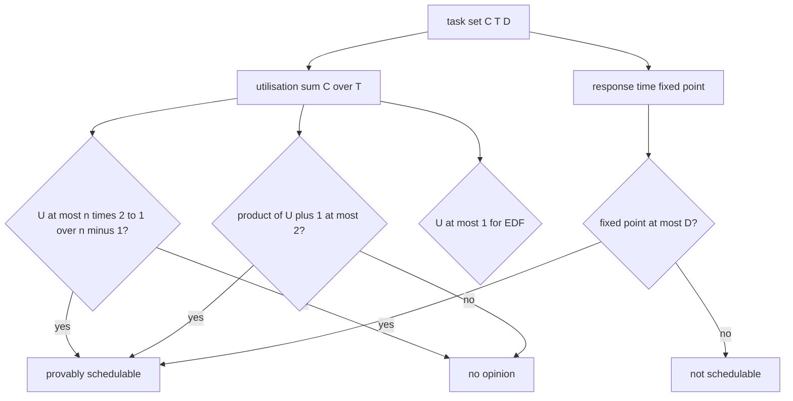
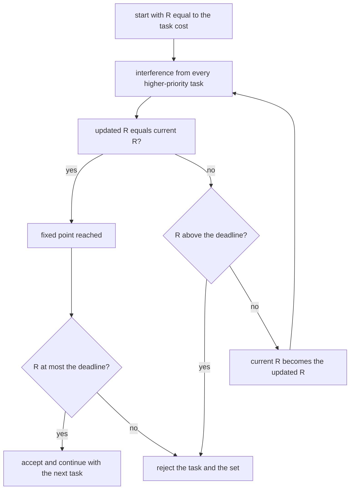
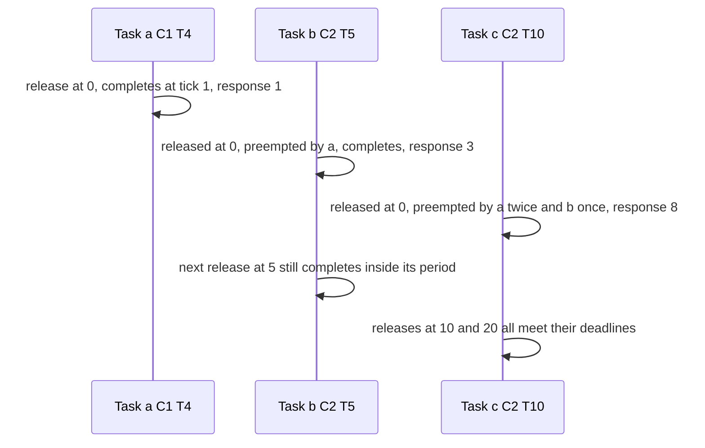

# 667 — Implement schedulability analysis for real-time systems (rate-monotonic).

> **Tier:** Expert · **CTCI chapter:** Beyond — Networking, OS & Real-Time
> **Task spec:** [667-implement-schedulability-analysis-for-real-time-systems-rate-mon.md](../../../tasks/expert/667-implement-schedulability-analysis-for-real-time-systems-rate-mon.md)
> **Solutions:** [Python](../../../solutions/python/expert/667-implement-schedulability-analysis-for-real-time-systems-rate-mon/solution.py) ·
> [Java](../../../solutions/java/expert/667-implement-schedulability-analysis-for-real-time-systems-rate-mon/Solution.java) ·
> [JavaScript](../../../solutions/javascript/expert/667-implement-schedulability-analysis-for-real-time-systems-rate-mon/solution.js) ·
> [C#](../../../solutions/csharp/expert/667-implement-schedulability-analysis-for-real-time-systems-rate-mon/Solution.cs)

## 1. Problem restatement

Given a set of independent **periodic** tasks `(name, C, T, D)` — cost, period, relative deadline — with
preemptive **fixed-priority** scheduling (rate-monotonic: shorter period = higher priority), answer "can
every job finish before its deadline?" three ways and cross-check the answers:

| Test | Formula | Nature |
| --- | --- | --- |
| Liu–Layland utilisation bound | `U = Σ C_i/T_i ≤ n(2^(1/n) − 1)` | sufficient, **not** necessary |
| Hyperbolic bound | `Π (U_i + 1) ≤ 2` | sufficient, strictly tighter |
| Exact response-time analysis (RTA) | `R_i = C_i + Σ_{hp(i)} ceil(R_i/T_j)·C_j` iterated to a fixed point | necessary **and** sufficient |
| EDF test (implicit deadlines) | `U ≤ 1` | necessary and sufficient for EDF |
| Simulation | one unit of work per tick over several hyperperiods | brute-force oracle |

Concrete expectations asserted by the solution files:

- `liu_layland_bound(1) == 1.0`, `liu_layland_bound(2) == 2(√2 − 1)`, the sequence decreases with `n`
  and approaches `ln 2` (within `0.05` at `n = 20`).
- The classical example `a(1,4) b(2,5) c(2,10)` has `U = 0.85`, which **exceeds** the three-task bound
  `3(2^(1/3) − 1) ≈ 0.7798`, yet RTA returns exactly `{a: 1, b: 3, c: 8}` and the simulation finds no
  deadline miss.
- Harmonic sets are schedulable exactly when `U ≤ 1`: `a(1,4) b(2,8) c(4,16)` with `U = 0.75` passes,
  `a(1,2) b(1,4) c(2,8)` at `U = 1.0` still passes, and `a(1,2) b(1,4) c(3,8)` at `U > 1` fails both the
  analysis and the simulation.
- Constrained deadlines `D < T` are analysed with the periods and accepted against the deadline:
  `a(C=1, T=4, D=3)` and `b(C=2, T=8, D=6)` give `R = {0: 1, 1: 3}` and are feasible, while
  `a(C=2, T=4, D=2) b(C=3, T=8, D=6)` gives `R_b = none` and the simulation sees a miss.
- Degenerate sets: an empty set is trivially schedulable with `U = 0`; a single task with `C = T = 7`
  meets its deadline exactly; `C > T` can never be scheduled.
- Randomised sets must satisfy: the RTA verdict equals the simulated verdict, and for every schedulable
  set the simulated worst-case response time **equals** the RTA fixed point.

## 2. Intuition

The naive plan is to simulate: release the jobs, run the schedule tick by tick, and look for a miss.
That is exact but tells you nothing about *why*, and it is expensive for large hyperperiods. The naive
analysis at the other extreme — "utilisation below 1 means fine" — is simply wrong for fixed priorities:
the classical example has `U = 0.85` and is schedulable, but a *different* set with the same utilisation
can miss deadlines.

The insight is to bound the worst case instead of enumerating schedules. Every job of a higher-priority
task `j` is released once per period, so in a window of length `R` it can preempt at most
`ceil(R / T_j)` times and steal `ceil(R / T_j) · C_j` units of work. Adding its own cost gives an
equation whose least fixed point is the worst-case response time:

`R_i = C_i + Σ_{j higher priority} ceil(R_i / T_j) · C_j`

If the fixed point is at most the deadline, the task is safe — and because the **synchronous release at
time zero is the critical instant**, no other release pattern can be worse. That is why the simulation
in these files can be used as an oracle: it must reproduce the analysis figure exactly.



The sufficient tests only ever report "provably fine" or "no opinion" — the files assert exactly that
by checking that no set passing a sufficient test is rejected by RTA.

## 3. Algorithm

1. Validate each task: positive cost and period; `deadline` defaults to `period`.
2. `utilisation(tasks)` sums `C/T`; `liu_layland_bound(n)` is `n·(2^(1/n) − 1)`;
   `hyperbolic_bound` multiplies `U_i + 1`.
3. `rate_monotonic_order` sorts task indices by `(period, index)` — the index tie-break keeps the order
   deterministic for equal periods.
4. `response_times` iterates the recurrence per task, only over the tasks that come **earlier** in the
   priority order. It starts at `R = C_i`, recomputes using `ceil(R / T_j)` interference, stops when the
   value stops changing, and gives up as soon as `R > D_i` (or after `MAX_ITERATIONS = 1000` steps).
5. `edf_schedulable` is `U ≤ 1` (with a `1e-12` tolerance for floating point).
6. `simulate` builds the real schedule: the horizon is `hyperperiod × cycles` with `cycles = 2` by
   default, jobs are released synchronously at multiples of their period, a job whose deadline has
   passed while it still has work is counted as missed, and the running job is the one with the best
   `(priority, arrival, task)` — or the earliest `(deadline, arrival, task)` for the EDF mode. When a job
   completes, `tick + 1 − arrival` is recorded as its response time and the maximum per task is kept.

```text
function responseTimes(tasks, order)
    order = rateMonotonicOrder(tasks) if order is missing
    result = empty map
    for position, index in enumerate(order) do
        task = tasks[index]
        higher = order[0 .. position - 1]
        current = task.cost
        repeat at most 1000 times
            interference = sum over j in higher of ceil(current / tasks[j].period) * tasks[j].cost
            updated = task.cost + interference
            if updated = current then stop
            current = updated
            if current > task.deadline then stop
        result[index] = current if current <= task.deadline else none
    return all(result values exist), result

function simulate(tasks, cycles, edf)
    if tasks is empty then return feasible with no response times
    horizon = hyperperiod(tasks) * cycles
    priority = position of each task in rateMonotonicOrder(tasks)
    active = empty list of jobs
    worst = empty map
    missed = 0
    for tick = 0 to horizon - 1 do
        for each task do
            if tick mod task.period = 0 then
                active.append(job with arrival tick, remaining task.cost, deadline tick + task.deadline)
        for each job in active do
            if job is not missed and job.remaining > 0 and job.deadline <= tick then
                job.missed = true
                missed = missed + 1
        runnable = jobs in active with remaining > 0
        if runnable is empty then continue
        if edf then job = runnable with the smallest (deadline, arrival, task)
        else job = runnable with the smallest (priority, arrival, task)
        job.remaining = job.remaining - 1
        if job.remaining = 0 then
            worst[job.task] = max(worst[job.task], tick + 1 - job.arrival)
            remove job from active
    return missed = 0 and every task has a response time, worst, missed
```



## 4. Worked example

Classical set: `a(C=1, T=4)`, `b(C=2, T=5)`, `c(C=2, T=10)`.

Priorities from the periods: `a` (4) → `b` (5) → `c` (10). Utilisation `0.25 + 0.4 + 0.2 = 0.85`, above
`3(2^(1/3) − 1) ≈ 0.7798`, so the sufficient tests stay silent.

| Task | Higher priority | Iteration | Interference | New `R` |
| --- | --- | --- | --- | --- |
| `a` | — | start | — | `1` |
| `b` | `a` | 1 | `ceil(2/4)·1 = 1` | `3` |
| `b` | `a` | 2 | `ceil(3/4)·1 = 1` | `3` (fixed point) |
| `c` | `a`, `b` | 1 | `ceil(2/4)·1 + ceil(2/5)·2 = 1 + 2` | `5` |
| `c` | `a`, `b` | 2 | `ceil(5/4)·1 + ceil(5/5)·2 = 2 + 2` | `6` |
| `c` | `a`, `b` | 3 | `ceil(6/4)·1 + ceil(6/5)·2 = 2 + 4` | `8` |
| `c` | `a`, `b` | 4 | `ceil(8/4)·1 + ceil(8/5)·2 = 2 + 4` | `8` (fixed point) |

Deadlines: `1 ≤ 4`, `3 ≤ 5`, `8 ≤ 10` — schedulable, with `R = {a: 1, b: 3, c: 8}` exactly as the file
asserts. The simulation over two hyperperiods finds no miss and reports the same worst-case response
times, because the synchronous release at tick 0 is the critical instant for every task.



The iteration above is not a scheduler: it is the fixed point of "every higher-priority release steals
its worst-case share". The checks confirm both directions — the analysis and the simulation agree on 24
randomised sets, and the simulated worst response time equals the analytic figure task by task.

## 5. Complexity

Let `n` be the number of tasks, `H` the hyperperiod and `k` the number of iterations of the recurrence.

| Step | Best | Average | Worst | Why the bound holds |
| --- | --- | --- | --- | --- |
| `utilisation` | O(n) | O(n) | O(n) | one division per task |
| `liu_layland_bound` | O(1) | O(1) | O(1) | one power |
| `hyperbolic_bound` | O(n) | O(n) | O(n) | one multiplication per task |
| `rate_monotonic_order` | O(n log n) | O(n log n) | O(n log n) | a sort by `(period, index)` |
| response-time analysis | O(n) | O(n·k) | O(n·k) | each iteration is one sum over the higher-priority tasks; the recurrence is increasing, so `k` is bounded by the largest fixed point reached — the implementation caps it at `MAX_ITERATIONS = 1000` |
| simulation | O(H) | O(H·n) | O(H·n) | every tick scans the released tasks and the active jobs; the horizon is `hyperperiod × cycles` with `cycles = 2` |
| Space | O(n) | O(n) | O(n) | the task list plus the set of active jobs |

Comparisons the checks rely on: the utilisation bound is O(n) but only sufficient; RTA is exact at
O(n·k); the simulation is exact too but costs O(H·n) and only sees the horizon it is given. `EDF` costs
the same O(n) as the utilisation bound for implicit deadlines and is optimal there, while rate-monotonic
can fail a set that EDF schedules — which is why the file checks `EDF(U ≤ 1)` against `RM` on the same
set.

## 6. Pitfalls and edge cases

- **A pass on the utilisation bound is not a proof of schedulability, and a fail is not a rejection.**
  The file pins this with the classical example (`U = 0.85`, bound `≈ 0.7798`, still schedulable) and
  with 24 randomised sets where any set passing a sufficient test must also pass RTA.
- **The recurrence must iterate to a *fixed point*.** Stopping after one step under-estimates the
  response time; the worked example shows `R_c` growing `2 → 5 → 6 → 8`.
- **The deadline is compared after the iteration, not inside it.** For `D < T` the interference uses the
  periods, and only the acceptance test uses `D`: `a(C=2, T=4, D=2)` gives `R = 2`, which *just* meets
  the deadline, while `b(C=3, T=8, D=6)` diverges past 6 and is reported as `none`.
- **`C > T` is impossible.** `U > 1` fails both the analysis and the simulation, and the file asserts the
  simulation reports at least one missed job.
- **An empty task set is schedulable** with `U = 0` and an empty response-time map; a single task with
  `C = T = 7` meets its deadline exactly, and a deadline *larger* than the period is allowed when the
  response time fits.
- **Floating point.** Utilisation and the bounds are compared with a `1e-12` tolerance, because `0.2` and
  `2/10` are not the same double.
- **Ties in the priority order.** Equal periods are broken by the task index so that the analysis and the
  simulation agree even on duplicate periods.
- **The simulated verdict must not depend on the horizon.** The file runs the same set with one and with
  three hyperperiods and requires the same verdict, and it requires that a longer simulation never finds
  *smaller* worst-case response times.
- **Documented simplification (Python).** Periodic tasks only — no aperiodic or sporadic arrivals, no
  blocking from shared resources, no release jitter and no context-switch overhead; the simulation
  measures response times in whole ticks with one tick of execution per task per tick.
- **Documented simplification (JavaScript).** Deadlines equal periods, releases are synchronous, periods
  and execution times are integers, and costs are constant.
- **Documented simplification (C#).** Integer periods and costs, one processor, no blocking, no release
  jitter, no shared resources; hyperperiods are capped at a few thousand ticks. Its checks add two theory
  implications the others rely on implicitly: passing the utilisation bound implies passing RTA, and RM
  feasibility implies EDF feasibility.

## 7. Variants and follow-ups

- The deadline-driven counterpart, where priorities change every release and the utilisation test is
  exact →
  [669 — earliest deadline first scheduler simulator and feasibility check](../../../tasks/expert/669-implement-earliest-deadline-first-scheduler-simulator-and-feasib.md).
- What happens when tasks share a resource and a high-priority job blocks on a low-priority one →
  [668 — priority inheritance protocol simulation](../../../tasks/expert/668-implement-priority-inheritance-protocol-simulation-for-priority.md).
- The resource side of the same OS course: how many of each resource to hand out so no request deadlocks
  →
  [670 — resource allocation graph and Banker's algorithm simulator](../../../tasks/expert/670-implement-resource-allocation-graph-and-banker-s-algorithm-simul.md).
- Mutual exclusion with blocking, but at the transaction level →
  [639 — two-phase locking simulator with deadlock detection](../../../tasks/expert/639-implement-two-phase-locking-simulator-with-deadlock-detection.md).

## 8. Check yourself

<details><summary>Show answer</summary>
**Why can the utilisation bound fail a schedulable set?** It is a sufficient condition derived from the
worst case over *all* period/cost combinations with that utilisation; a particular set can be much better
behaved. The classical `a(1,4) b(2,5) c(2,10)` example at `U = 0.85` is exactly such a case — the bound
says "no opinion" and RTA proves `R = {1, 3, 8}`.
</details>

<details><summary>Show answer</summary>
**In the response-time recurrence, why is the interference `ceil(R/T_j)·C_j` and not
`floor(R/T_j)·C_j`?** A job released at time 0 with period `T_j` can preempt any time at or before `R`,
and the release at exactly `R` counts because a job released *at* the deadline instant still gets to run
before the analysed task finishes. Rounding up counts that release.
</details>

<details><summary>Show answer</summary>
**Why is the synchronous release at time zero the critical instant?** Because all higher-priority
interference arrives as early as possible there, which maximises the delay of the analysed job. If the
task finishes inside its deadline under the critical instant, it finishes inside it for every release
pattern — which is what makes the simulation's worst-case response time equal to the analytic one.
</details>

<details><summary>Show answer</summary>
**The analysis returns `none` for one task — what must the simulation show?** At least one missed job
over the hyperperiod, because RTA is necessary and sufficient for fixed-priority preemptive scheduling.
The file asserts both `not response_times(tight)[0]` and `missed > 0` in the simulation.
</details>

<details><summary>Show answer</summary>
**Why is `U ≤ 1` enough for EDF but not for rate-monotonic?** EDF is optimal for implicit deadlines — if
any schedule exists, EDF finds it — so utilisation is exactly the feasibility condition. Fixed priorities
are constrained to a static order, so a set with `U < 1` can still miss a deadline; EDF can schedule sets
that rate-monotonic priorities cannot, as the file checks.
</details>
