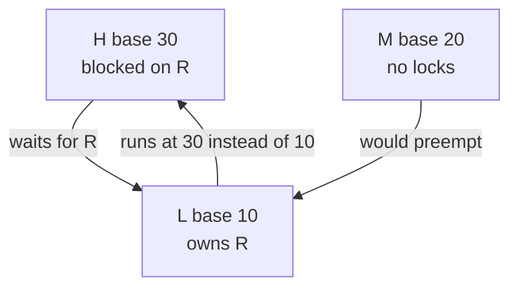
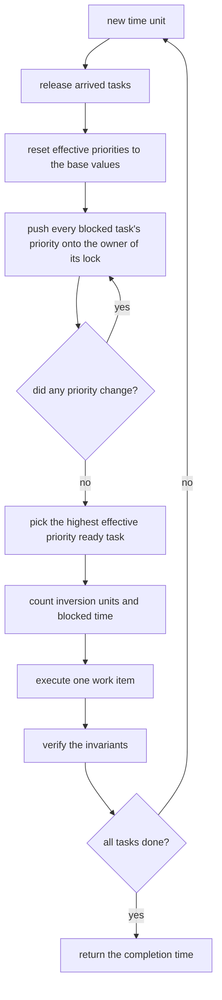
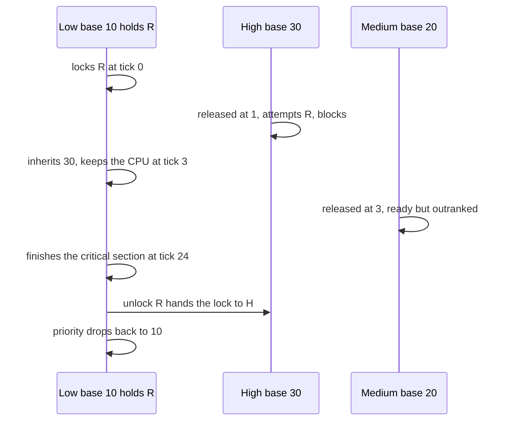
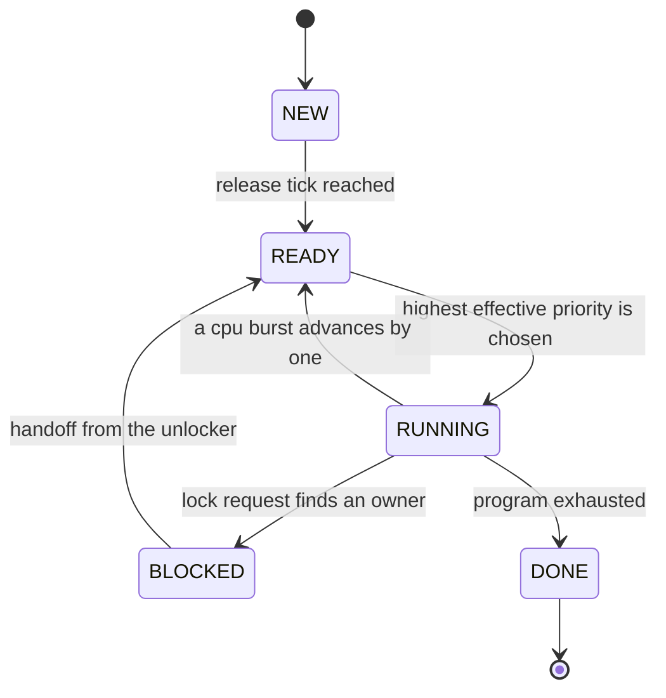

# 668 — Implement priority inheritance protocol simulation for priority inversion.

> **Tier:** Expert · **CTCI chapter:** Beyond — Networking, OS & Real-Time
> **Task spec:** [668-implement-priority-inheritance-protocol-simulation-for-priority.md](../../../tasks/expert/668-implement-priority-inheritance-protocol-simulation-for-priority.md)
> **Solutions:** [Python](../../../solutions/python/expert/668-implement-priority-inheritance-protocol-simulation-for-priority/solution.py) ·
> [Java](../../../solutions/java/expert/668-implement-priority-inheritance-protocol-simulation-for-priority/Solution.java) ·
> [JavaScript](../../../solutions/javascript/expert/668-implement-priority-inheritance-protocol-simulation-for-priority/solution.js) ·
> [C#](../../../solutions/csharp/expert/668-implement-priority-inheritance-protocol-simulation-for-priority/Solution.cs)

## 1. Problem restatement

Simulate a preemptive fixed-priority uniprocessor running a set of tasks that communicate through binary
semaphores, once with a plain semaphore implementation and once with the **Priority Inheritance
Protocol** (PIP), and measure the damage that unbounded **priority inversion** does and how PIP bounds
it.

Model, identical in the four files:

| Element | Meaning |
| --- | --- |
| `Task(name, base_priority, program, release)` | a program of `("lock", name)`, `("cpu", k)` and `("unlock", name)` operations, with a base priority and a release tick |
| `Lock(name)` | a binary semaphore: at most one owner plus an arrival-ordered wait list |
| schedule step | one time unit runs exactly one work item of the ready task with the highest **effective** priority, ties broken by declaration order |

Effective priority is the **least fixpoint** of

`eff[t] = max(base[t], max { eff[w] : w is BLOCKED on a semaphore owned by t })`

Concrete expectations, all asserted by the Python checks:

- Without PIP, `H.blocked_time >= 40` — the high-priority task is starved for the medium task's entire
  work — and the inversion counter is positive. With PIP, `H.blocked_time <= 20` (the length of the low
  task's critical section) and the inversion counter is exactly **0**.
- The low-priority holder is observed at effective priority **30** (H's base priority) while H waits and
  drops back to its immutable base priority **10** after the unlock.
- The medium task finishes **later** with PIP than without it, by at least the blocking the high task no
  longer suffers.
- Transitive inheritance: in the two-lock chain the low task peaks at **25** and so does the middle task,
  and the high task's blocking is bounded by the chain's critical-section work (at most `6 + 2`).
- Priority wake-up: two queued waiters are served in the order `["W3", "W2"]` — the stronger one first —
  even though `W2` queued first.
- A boosted holder is not preempted, so an unrelated weaker task never even joins the queue: its
  `blocked_time == 0` while the stronger waiter's is positive, and the holder peaks at the waiter's
  priority **12**.
- Lock-order inversion still deadlocks: two tasks taking `R1` then `R2` and `R2` then `R1` are parked on
  opposite locks, the run stops, and the invariants still hold.
- Trivial cases: an empty program finishes in one scheduling unit; `lock + cpu 3 + unlock` takes 4 units.

## 2. Intuition

The naive mental model of fixed-priority scheduling says "the highest-priority runnable task runs", so a
high-priority task can only ever be delayed by work of *higher* priority. Priority inversion breaks that
model: a medium-priority task needs no lock at all, yet it delays a high-priority task, because the lock
the high task wants is held by a low-priority task that the medium task keeps preempting.

Two observations define the fix:

1. **The holder is standing in for the waiter.** While `L` owns the lock that `H` needs, `L` is doing
   `H`'s work; it should run at `H`'s priority so that unrelated medium-priority work cannot jump ahead.
2. **Blocking chains are transitive.** If `H` waits for a lock held by `M`, and `M` waits for a lock held
   by `L`, then `L` must be boosted all the way to `H`. That is not a special case — it falls out of
   computing the boost as a fixpoint.



With the boost, `M` can no longer preempt `L`, so the delay of `H` is bounded by the length of `L`'s
remaining critical section — a quantity the application author controls — instead of by the total work of
every medium-priority task, which they do not.

## 3. Algorithm

1. Release: at the start of each time unit, every `NEW` task whose `release` has arrived becomes `READY`.
2. Recompute effective priorities from the **base priorities** every time unit (never incrementally):
   while something changed, for every `BLOCKED` task push its effective priority onto the owner of the
   lock it waits for. The loop is monotone (priorities only rise) and therefore terminates.
3. Snapshot the priorities for the checks, then pick the runner: the `READY` task with the largest
   effective priority, ties broken by declaration order so runs are reproducible.
4. Count an **inversion unit** whenever a blocked task's effective priority beats the running task's —
   the direct, protocol-independent measure of inversion.
5. Charge one unit of blocking time to every blocked task, advance the clock, then execute one step of
   the runner:

   - `cpu k`: decrement its remaining burst; the task goes back to `READY` and the step is over (a burst
     of `k` therefore takes `k` units).
   - `lock r` free: take ownership, log it, and continue executing **the same time unit** (the primitive
     is instantaneous).
   - `lock r` taken: queue behind it, set the blocker, become `BLOCKED`, and yield.
   - `unlock r`: release, then **hand the lock directly to the highest-effective-priority waiter**; the
     handoff consumes that waiter's queued `lock` operation, so it wakes up `READY` with its program
     counter already advanced instead of retrying.
6. Re-verify the invariants after every step: a lock has at most one owner and the ownership bookkeeping
   agrees, no task drops below its base priority, every blocked task is queued on the lock it names, and
   — under PIP — no blocked task outranks the running one.
7. Stop when all tasks are `DONE`; if nothing is ready and something is not done, record a **deadlock**
   and stop instead of spinning.

```text
function effectivePriorities(self)
    eff[name] = base_priority for every task name
    if inheritance is enabled then
        changed = true
        while changed do
            changed = false
            for each task t in self.tasks do
                if t.state is not BLOCKED then continue
                owner = self.locks[t.blocked_on].owner
                if owner exists and eff[owner] < eff[t.name] then
                    eff[owner] = eff[t.name]
                    changed = true
    for each name, value in eff do
        self.tasks[name].eff_priority = value
    return eff

function run(self)
    repeat up to 20000 times
        for each task t do
            if t.state is NEW and self.clock >= t.release then t.state = READY
        eff = effectivePriorities(self)
        ready = tasks that are READY
        if ready is empty then
            return self.clock if every task is DONE
            self.deadlock = true
            return self.clock
        runner = the ready task with the largest (eff, declaration order)
        for each blocked task t do
            if t.eff_priority > eff[runner.name] then self.inversion_units = self.inversion_units + 1
            t.blocked_time = t.blocked_time + 1
        self.clock = self.clock + 1
        execute(self, runner)
        verifyInvariants(self, runner, eff)
    raise "simulation did not converge"

procedure releaseLock(self, task, lock)
    require lock.owner = task.name
    lock.owner = none
    task.held.remove(lock.name)
    if lock.waiters is not empty then
        eff = effectivePriorities(self)
        best = the waiter with the largest (eff, arrival order)
        remove best from lock.waiters
        lock.owner = best
        self.tasks[best].held.add(lock.name)
        self.tasks[best].blocked_on = none
        self.tasks[best].state = READY
        self.tasks[best].pc = self.tasks[best].pc + 1     // the handoff satisfies its lock operation
```



## 4. Worked example

The classic inversion scenario: `L base 10` — `lock R, cpu 20, unlock R, cpu 2`, released at 0;
`H base 30` — `cpu 1, lock R, cpu 3, unlock R`, released at 1; `M base 20` — `cpu 40`, released at 3.

With PIP enabled:

| Clock | Event | Effective priorities | Runner |
| --- | --- | --- | --- |
| 0 | `L` released, takes `R` instantly | `L 10` | `L` starts its 20-unit burst |
| 1 | `H` released; `H` needs 1 unit of CPU first | `L 10`, `H 30` | `H` |
| 2 | `H` attempts `R`, finds `L` as owner, blocks | `L 30`, `H 30` | `L` (boosted, so `M` cannot jump in) |
| 3 | `M` released with base priority 20 | `L 30`, `H 30`, `M 20` | `L` keeps the CPU |
| 4 – 23 | `L` burns the remaining 19 units of its critical section | `L 30` | `L` |
| 24 | `L` unlocks `R` → handoff to `H`; `L` drops back to 10 | `L 10`, `H 30` | `H` |

`H` accumulates **20 units of blocking time**, exactly the length of `L`'s critical section, and the
inversion counter stays at 0 because no blocked task ever outranks the runner. Without inheritance the
same table has `L 10` and `M 20` at clock 3, so `M` preempts the holder and `H` waits at least 40 units —
the whole of `M`'s work — while the inversion counter ticks up. The checks assert all four numbers:
`blocked_yes <= 20`, `blocked_no >= 40`, `inversion_units > 0` without PIP and `== 0` with it.



**Transitive chain.** `L(5)` holds `R1`, `M(15)` holds `R2` and then waits for `R1`, `H(25)` waits for
`R2`. The fixpoint propagates one link per sweep: `H` pushes 25 onto `M` (owner of `R2`), then `M`
pushes 25 onto `L` (owner of `R1`), and the next sweep changes nothing. The checks see `M` at 25 and `L`
at 25, and `H`'s blocking bounded by the chain's remaining critical-section work (`2 + 1` units on `R2`
plus `3` units on `R1`) with two extra units for the two blocking attempts — never by unrelated work.



## 5. Complexity

Let `n` be the number of tasks, `l` the number of locks and `s` the number of scheduling steps (one per
time unit, capped at `MAX_STEPS = 20000`).

| Step | Best | Average | Worst | Why the bound holds |
| --- | --- | --- | --- | --- |
| `effective_priorities` | O(n) | O(n·n·b) | O(n²·b) | each sweep visits every task once and boosts one owner; priorities are monotone, so the number of sweeps is bounded by the number of distinct priority levels `b` (at most `n`), each iteration costing O(n) |
| runner selection | O(n) | O(n) | O(n) | a linear maximum over the ready tasks |
| `execute` one work item | O(1) | O(1) | O(1) | one burst decrement, one lock acquire, or one release plus a waiter scan |
| `release_lock` handoff | O(n) | O(n·n·b) | O(n²·b) | recomputes the effective priorities, then scans the waiters |
| `verify_invariants` | O(n + l) | O(n + l) | O(n + l) | one pass over locks and one over tasks |
| whole run | O(s·n) | O(s·n²·b) | O(s·n²·b) | every time unit pays selection, the fixpoint and the invariant pass |
| Space | O(n + l) | O(n + l) | O(n + l) | task records, lock records, and the snapshot/log history the checks inspect |

Alternatives: a **priority ceiling protocol** needs no fixpoint at all — a task may take a lock only if
its priority exceeds every ceiling, so a single comparison per lock request suffices — but it requires
static ceilings, whereas the fixpoint here is recomputed from the actual blocking graph and needs no
configuration. Omitting the protocol entirely is O(n) per time unit too, and that is exactly the point:
inheritance buys bounded blocking, not speed.

## 6. Pitfalls and edge cases

- **Recompute the fixpoint from the base priorities.** Carrying last tick's boosts forward would let a
  stale donation linger after the unlock; the file asserts `L`'s effective priority is back to its base
  after the critical section.
- **The fixpoint exists because the relation is monotone.** Priorities only ever rise during a sweep, so
  the loop terminates; a cyclic blocking chain (`L` waiting for a lock owned by `M` while `M` waits for a
  lock owned by `L`) is a deadlock, not a priority loop.
- **Instantaneous primitives.** `lock` on a free semaphore and `unlock` do not consume a time unit, so
  `lock + cpu 3 + unlock` completes in 4 units — one for each CPU unit and one for the initial lock
  attempt. The check asserts exactly that.
- **Blocking must be charged.** The checks require `blocked_yes < blocked_no`, so a "fix" that leaves the
  high task waiting for the medium task's work is rejected.
- **The handoff consumes the queued operation.** Forgetting `pc += 1` after the handoff makes the woken
  task retry its `lock`, double-block, or re-acquire a lock it already owns.
- **Wake-up order is by effective priority, not arrival.** In the wake-up scenario `W2` queues first but
  `W3` is stronger; the checks require the handoff sequence `["W3", "W2"]` and a strictly larger
  `blocked_time` for `W2`.
- **A boosted holder may starve a weaker waiter.** In the boost scenario `W1` never even queues
  (`blocked_time == 0`) because the boosted holder is not preempted — that is the protocol working, not a
  bug.
- **PIP does not prevent deadlock.** Two tasks acquiring the same pair of locks in opposite order park on
  each other; the simulator detects that "nothing ready and something unfinished" state, stops, and the
  checks assert `D1` is blocked on `R2` and `D2` on `R1` *and* that the invariants still hold in the
  stalled state.
- **Unlocking what you do not own raises.** The error message contains "does not own"; the checks assert
  both the raise and the message.
- **Ties must be deterministic.** Equal effective priorities are broken by declaration order, and the
  checks re-run the same scenario and compare the full log and the snapshot history for equality.
- **Empty programs.** A task with no operations finishes in one scheduling unit (it still has to be
  selected once) with a single invariant check.
- **Documented simplification (Python).** One lock per resource, no priority ceilings and no timeouts —
  a real RTOS adds ceilings, recursive locks and timed waits.
- **Cross-language notes.** Java counts inversion ticks with an independent counter and reports it
  dropping from **10 to 0**; JavaScript runs a brute-force BFS over the scheduler state space to bracket
  the PIP completion time (`optimum ≤ PIP ≤ plain`) and shows PIP does not stop the lock-order deadlock;
  C# drives 60 randomised lock-disciplined workloads (one non-nested critical section per task, so
  deadlock is structurally impossible) and asserts that PIP never *lengthens* the highest-priority
  task's blocking, and broadcasts a release to all waiters but lets the scheduler pick the strongest one
  first, which is a faithful stand-in for a priority wait queue.

## 7. Variants and follow-ups

- Why the fixpoint is needed at all: the same tasks without mutexes, scheduled by rate-monotonic
  priorities →
  [667 — schedulability analysis for real-time systems](../../../tasks/expert/667-implement-schedulability-analysis-for-real-time-systems-rate-mon.md).
- Swap fixed priorities for deadlines, where the analysis becomes an exact utilisation test →
  [669 — earliest deadline first scheduler simulator](../../../tasks/expert/669-implement-earliest-deadline-first-scheduler-simulator-and-feasib.md).
- Deadlock as a graph problem instead of a simulator outcome →
  [357 — deadlock detection for resource allocation graph](../../../tasks/intermediate/357-deadlock-detection-for-resource-allocation-graph-algorithm.md) and
  [670 — resource allocation graph and Banker's algorithm](../../../tasks/expert/670-implement-resource-allocation-graph-and-banker-s-algorithm-simul.md).
- The database flavour of the same locking problem →
  [639 — two-phase locking simulator with deadlock detection](../../../tasks/expert/639-implement-two-phase-locking-simulator-with-deadlock-detection.md).

## 8. Check yourself

<details><summary>Show answer</summary>
**What exactly is priority inversion here?** A task that holds no lock and has a priority between `L` and
`H` preempts the lock holder, so `H` — the highest-priority task in the system — waits for work that has
nothing to do with it. The simulator counts it directly: time units in which a blocked task's effective
priority exceeds the running task's.
</details>

<details><summary>Show answer</summary>
**Why is the fixpoint iteration needed instead of one boost?** Because blocking chains are transitive. In
the chain `H → M → L`, one pass boosts `M` (owner of `R2`) but not `L` (owner of `R1`, which `M` is
blocked on). Iterating until nothing changes gives `L` the priority of `H`, which is what bounds `H`'s
wait by critical-section work.
</details>

<details><summary>Show answer</summary>
**Why must `L`'s priority come back down after `unlock R`?** Inheritance is a temporary donation tied to
the lock ownership. Recomputing from the base priorities each unit means the boost disappears as soon as
`H` is no longer blocked on `R`; the checks assert `L` returns to exactly `10`.
</details>

<details><summary>Show answer</summary>
**Two waiters queue on one lock — which one gets it, and why not the first?** The handoff picks the
waiter with the highest *effective* priority (arrival order only breaks ties in Python's `max` key; the
C# file explicitly broadcasts and lets the scheduler pick). Anything else would reintroduce inversion on
the wake-up path, so the checks require `["W3", "W2"]`.
</details>

<details><summary>Show answer</summary>
**Does PIP prevent deadlock?** No. It only fixes priorities. Two tasks acquiring the same locks in
opposite orders still deadlock; the simulator detects the state where nothing is ready but tasks are
unfinished, and the checks assert the two tasks are parked on opposite locks while the invariants remain
true.
</details>
