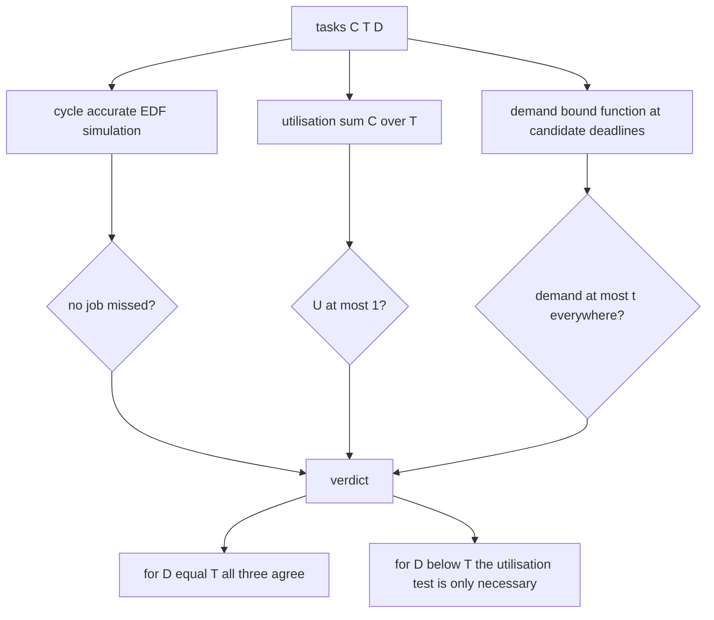
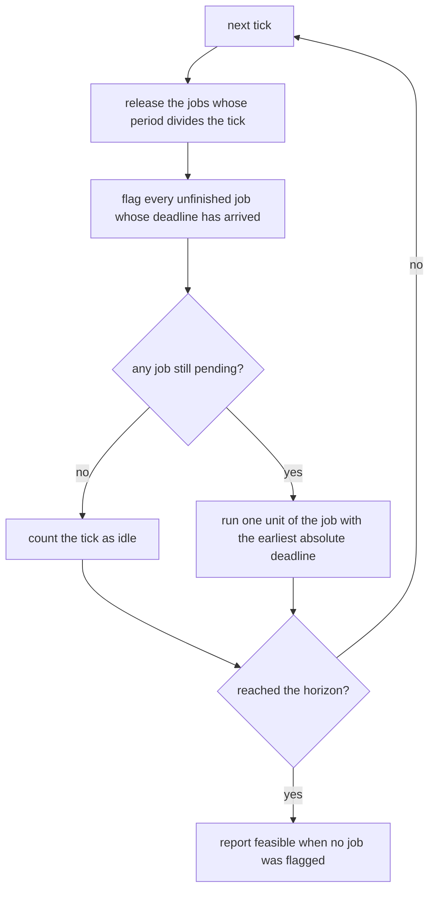
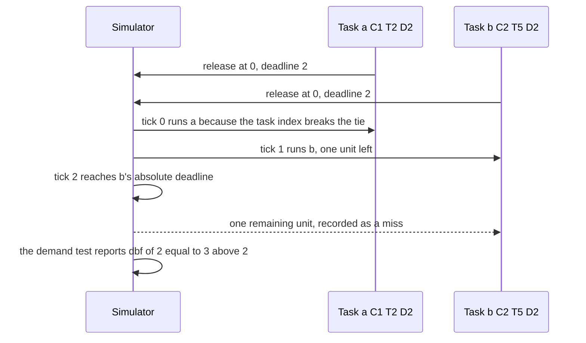

# 669 — Implement earliest deadline first scheduler simulator and feasibility check.

> **Tier:** Expert · **CTCI chapter:** Beyond — Networking, OS & Real-Time
> **Task spec:** [669-implement-earliest-deadline-first-scheduler-simulator-and-feasib.md](../../../tasks/expert/669-implement-earliest-deadline-first-scheduler-simulator-and-feasib.md)
> **Solutions:** [Python](../../../solutions/python/expert/669-implement-earliest-deadline-first-scheduler-simulator-and-feasib/solution.py) ·
> [Java](../../../solutions/java/expert/669-implement-earliest-deadline-first-scheduler-simulator-and-feasib/Solution.java) ·
> [JavaScript](../../../solutions/javascript/expert/669-implement-earliest-deadline-first-scheduler-simulator-and-feasib/solution.js) ·
> [C#](../../../solutions/csharp/expert/669-implement-earliest-deadline-first-scheduler-simulator-and-feasib/Solution.cs)

## 1. Problem restatement

Schedule a set of independent periodic tasks `(C, T, D)` with `D ≤ T` on **one preemptive processor**
under **earliest deadline first** (EDF), and decide feasibility three independent ways so that they can
be cross-checked against each other:

| Component | What it computes |
| --- | --- |
| `edf_simulate(tasks, ticks)` | the ground truth: a cycle-accurate schedule, plus the misses, the idle ticks and the per-task executed units |
| `utilization(tasks)` | `U = Σ C_i/T_i` as an exact `Fraction`; the exact test when `D = T` |
| `deadline_demand_feasible(tasks, bound)` | Baruah's processor demand test: for every candidate absolute deadline `t`, `dbf(t) = Σ_i max(0, floor((t − D_i)/T_i) + 1)·C_i ≤ t` |

Concrete expectations asserted by the checks:

- `hyperperiod({4, 6, 12}) == 12`, `U({a(1,2), b(1,3)}) == Fraction(5,6)` — the utilisation is exact, not
  floating point, so the `U == 1` boundary can be decided.
- Balanced set `a(1,4) b(1,6)`: hyperperiod 12, `U = 5/12`, feasible, with exactly **7 idle ticks** and
  per-task execution `[3, 2]` — that is, exactly one burst per period.
- `t1(1,2) t2(2,5)`: `U = 9/10` and feasible; `a(1,2) b(2,4)`: `U = 1` **exactly**, still feasible, with
  **zero** idle ticks.
- `a(2,3) b(2,5)`: `U > 1`, the simulation records misses and the demand test rejects it; every reported
  miss carries a real absolute deadline, and `executed + idle == ticks` so no tick is double counted.
- The classic non-sufficiency of the utilisation test: `a(C=1, T=2, D=2) b(C=2, T=5, D=2)` has
  `U = 9/10 ≤ 1` yet really misses deadlines, and the demand test rejects it too. Loosening `b`'s
  deadline to `D = T = 5` makes the set feasible.
- Two 120-set sweeps (seeds `0xC0FFEE` and `0xBEEF`): for `D = T` the simulator, the demand test and the
  utilisation test must agree on **every** set; for `D < T`, simulator and demand test must agree and the
  sweep must contain sets with `U ≤ 1` that are nevertheless late.
- Degenerate inputs: the empty set is feasible and idle for every tick; a single task with `C == T` is
  feasible, `C > T` is not; `period = 0`, a negative cost, `D > T` and `D = 0` are rejected.

## 2. Intuition

The naive scheduler is "run the task that has been waiting longest" or "run the shortest period first".
Both are fixed policies, and fixed policies leave utilisation on the table: a set can fit inside the
processor and still miss a deadline because the static priority order is wrong for one release pattern.

The insight is that the *only* thing that matters at any instant is which pending job has to finish
soonest, and that under EDF the analysis collapses to counting work:

1. **Run the pending job with the earliest absolute deadline.** Absolute, not relative: the deadline of a
   job released at `t` is `t + D`. Ties are broken by task index and release so the schedule is unique.
2. **The worst case is the synchronous release.** All tasks ready at time 0 — the critical instant —
   delays everything as much as possible, so simulating from there over the hyperperiod is a valid
   oracle: if no job is late there, none is late anywhere.
3. **Feasibility is an equation about intervals.** A job released in an interval `[a, b]` must have its
   deadline inside that interval for its work to be *forced* into it; the demand-bound function sums
   exactly that work at each candidate deadline `t` and compares it with the available time `t`.



The picture also explains the shape of the checks: with `D = T` the three verdicts must be identical,
while with constrained deadlines the utilisation test is deliberately *not* used as an oracle and the
sweep merely counts the sets where it says "fine" and EDF still misses.

## 3. Algorithm

1. Validate the task set: `C ≥ 0`, `T > 0`, `0 < D ≤ T`; `D` defaults to `T`.
2. Compute the hyperperiod as the running least common multiple of the periods.
3. `decision_window` gives both analyses the same deadline range: `bound = hyperperiod + max period + 1`
   and `ticks = bound + 1`. The simulator reports a miss when a tick reaches a deadline, so it covers
   every deadline `≤ bound`, and the demand test is asked exactly about that range — which is what makes
   their verdicts directly comparable.
4. `edf_simulate` runs tick by tick: release every job whose period divides the tick, mark unfinished jobs
   whose absolute deadline has arrived as missed, then run one unit of the pending job with the smallest
   `(absolute deadline, task index, release)`. It returns the evidence, not just a verdict.
5. `utilization` sums `Fraction(C, T)` so the boundary `U = 1` is exact.
6. `deadline_demand_feasible` collects the candidate deadlines `D_i + k·T_i ≤ bound`, then for each
   sorted `t` sums the forced work of every task with `t ≥ D_i` and rejects as soon as the demand exceeds
   `t`.

```text
function edfSimulate(tasks, ticks)
    jobs = empty list
    executed = zero for every task
    misses = empty list
    idle = 0
    for tick = 0 to ticks - 1 do
        for index, task in enumerate(tasks) do
            if tick mod task.period = 0 then
                jobs.append(job with absolute deadline tick + task.deadline,
                            remaining task.cost, task index index, release tick)
        for each job in jobs do
            if job.remaining > 0 and job.absoluteDeadline <= tick then
                misses.append((job.index, job.release, job.absoluteDeadline))
        ready = jobs with remaining > 0
        if ready is empty then
            idle = idle + 1
            continue
        job = the ready job with the smallest (absoluteDeadline, index, release)
        job.remaining = job.remaining - 1
        executed[job.index] = executed[job.index] + 1
    return evidence with misses, idle, executed and feasible = misses is empty

function deadlineDemandFeasible(tasks, bound)
    deadlines = empty set
    for each task do
        k = 0
        while k * task.period + task.deadline <= bound do
            deadlines.add(k * task.period + task.deadline)
            k = k + 1
    for t in sorted(deadlines) do
        demand = 0
        for each task do
            if t >= task.deadline then
                demand = demand + ((t - task.deadline) / task.period + 1) * task.cost
        if demand > t then return false
    return true
```



## 4. Worked example

**Balanced set `a(C=1, T=4)` and `b(C=1, T=6)`** over one hyperperiod of 12 ticks. Absolute deadlines:
`a` at 4, 8, 12; `b` at 6, 12.

| Tick | Releases | Pending jobs with absolute deadline | Runner | Idle |
| --- | --- | --- | --- | --- |
| 0 | `a1` (dl 4), `b1` (dl 6) | `a1` dl 4, `b1` dl 6 | `a1` | no |
| 1 | — | `b1` dl 6 | `b1` | no |
| 2 – 3 | — | — | — | yes, 2 ticks |
| 4 | `a2` (dl 8) | `a2` dl 8 | `a2` | no |
| 5 | — | — | — | yes |
| 6 | `b2` (dl 12) | `b2` dl 12 | `b2` | no |
| 7 | — | — | — | yes |
| 8 | `a3` (dl 12) | `a3` dl 12 | `a3` | no |
| 9 – 11 | — | — | — | yes, 3 ticks |

`executed == [3, 2]` and `idle == 7 == 12 − 5`, exactly what the file asserts: the work released in one
hyperperiod is `U·H = 5` units and EDF loses none of it.

**The utilisation test is not sufficient for `D < T`.** `a(C=1, T=2, D=2)` and `b(C=2, T=5, D=2)`.

| Tick | Releases | Pending | Runner | Note |
| --- | --- | --- | --- | --- |
| 0 | `a1` (dl 2), `b1` (dl 2) | both, deadline 2 | `a1` (lower task index wins the tie) | `U = 1/2 + 2/5 = 9/10 ≤ 1` |
| 1 | — | `b1` dl 2 | `b1` | `b1` still needs 1 unit |
| 2 | `a2` (dl 4) | `b1` dl 2 unfinished | — | **miss**: `b1`'s deadline has arrived |

The demand test agrees. Its candidate deadlines include `t = 2`, where the forced work is
`a: ((2−2)/2 + 1)·1 = 1` plus `b: ((2−2)/5 + 1)·2 = 2`, so `dbf(2) = 3 > 2` — infeasible, exactly as the
simulation shows. Loosening `b`'s deadline to `5` removes the second term at `t = 2` and the set becomes
feasible, which the file also asserts.



## 5. Complexity

Let `n` be the number of tasks, `H` the hyperperiod, `ticks = H + max(T) + 2` the simulated window and
`J` the number of jobs pending at one instant (at most `Σ ticks/T_i`).

| Step | Best | Average | Worst | Why the bound holds |
| --- | --- | --- | --- | --- |
| validation | O(n) | O(n) | O(n) | one check per task |
| hyperperiod | O(n log H) | O(n log H) | O(n log H) | one `gcd` per task |
| `utilization` | O(n) | O(n) | O(n) | exact `Fraction` additions; the cost per term grows with the denominator's `lcm` |
| `edf_simulate` | O(ticks) | O(ticks·J) | O(ticks·J) | per tick: a release scan over `n`, a miss scan over `J` and a `min` over the ready jobs |
| `deadline_demand_feasible` | O(n) | O(n·k·|T_i|) | O(n·bound·Σ 1/T_i) | `Σ bound/T_i` candidate deadlines, each evaluated with a sum over `n` tasks |
| Space | O(J) | O(J) | O(J) | the pending job list plus the executed counters |

The three components have deliberately different price tags. Utilisation is O(n) but only exact for
`D = T`; the demand test is exact for `D ≤ T` at the price of a sweep proportional to the hyperperiod; the
simulator is exact for *any* schedule question but costs O(ticks·J) and answers only about the window it
was given. Alternatives: rate-monotonic scheduling replaces the "earliest deadline" choice with a static
priority order, which makes it cheaper per tick but strictly weaker — the JavaScript file shows `EDF`
succeeding on `(C=2, T=5, D=5)` with `(C=4, T=7, D=7)` where `RM` misses a deadline.

## 6. Pitfalls and edge cases

- **`U ≤ 1` is not sufficient once `D < T`.** The file pins this both with a hand-written set and with a
  sweep that counts the sets where `U ≤ 1` and jobs are still late. Using the utilisation test as an
  oracle for constrained deadlines would make the suite silently wrong.
- **Exact arithmetic at the boundary.** `U == 1` must be accepted (`a(1,2) b(2,4)` is feasible with zero
  idle time). Summing `float`s could flip that comparison; the Python file uses `Fraction` and the C# file
  compares integer work against the hyperperiod.
- **Ties must be broken deterministically.** Two jobs with the same absolute deadline are separated by
  task index and then by release tick, which is what makes the schedule reproducible and the simulator
  usable as an oracle.
- **A miss is recorded once, at the deadline.** The simulator flags a job when the tick reaches its
  absolute deadline with work left; counting a job twice would corrupt the miss list the checks inspect.
- **Both analyses must look at the same deadline range.** `decision_window` exists exactly for that: the
  demand test is only asked about deadlines the simulator could have observed.
- **Idle accounting.** `executed + idle == ticks` must hold, and an empty set is feasible with `idle ==
  ticks`; the checks assert both.
- **`C > T` can never be scheduled**, and `C == T` is feasible for a single task; a task whose release
  cost is zero still consumes nothing.
- **Invalid descriptions are rejected** — `period = 0`, a negative cost, `D > T` and `D = 0` all raise.
- **Documented simplification (Python).** Synchronous release only (which is the critical instant and the
  worst case for EDF), no aperiodic work and no context-switch overhead; infeasible runs are cut off at
  the end of the simulation window instead of running to the hyperperiod.
- **Cross-language extras.** Java drives the *same* task sets through a rate-monotonic variant for
  contrast and replays every produced schedule with an independent checker that rebuilds the pending job
  set from scratch, and its counterexample is `C=1, D=1, T=2` with `C=2, D=2, T=5`. JavaScript adds a
  brute-force `intervalDemandTest` that enumerates *all* integer intervals `[a, b]` inside the horizon —
  strictly stronger than the candidate-deadline sweep, hence a genuine independent check — and
  demonstrates EDF beating RM. C# cross-checks the candidate-deadline shortcut against a brute-force
  evaluation of `dbf` at **every** integer `L` in `[0, hyperperiod]` on 200 randomised sets, so the
  shortcut is trusted only because it agrees.

## 7. Variants and follow-ups

- The fixed-priority counterpart of the same problem, including the sufficient utilisation bound and the
  response-time analysis →
  [667 — schedulability analysis for real-time systems (rate-monotonic)](../../../tasks/expert/667-implement-schedulability-analysis-for-real-time-systems-rate-mon.md).
- What happens when tasks block on shared resources, not just on the processor →
  [668 — priority inheritance protocol simulation](../../../tasks/expert/668-implement-priority-inheritance-protocol-simulation-for-priority.md).
- Admission control as a graph/search problem instead of an analysis →
  [670 — resource allocation graph and Banker's algorithm simulator](../../../tasks/expert/670-implement-resource-allocation-graph-and-banker-s-algorithm-simul.md).
- A scheduler with a real-time deadline *and* a data plane, in the master tier →
  [905 — real-time SLA-aware scheduler for multi-tenant inference](../../../tasks/master/905-implement-real-time-sla-aware-scheduler-for-multi-tenant-inferen.md).

## 8. Check yourself

<details><summary>Show answer</summary>
**Why is the synchronous release at time zero the right simulation window?** Because it is the critical
instant: releasing everything together maximises interference for every job, so a schedule that meets all
deadlines from there meets them for every release pattern. Simulating from time zero over the hyperperiod
is therefore a valid oracle rather than a lucky sample.
</details>

<details><summary>Show answer</summary>
**Give a set with `U ≤ 1` that is still infeasible, and say which test catches it.** `a(C=1, T=2, D=2)` with
`b(C=2, T=5, D=2)` has `U = 9/10`. At `t = 2` the forced work is 3 units against 2 available, so the
demand test rejects it, and the simulator really records `b`'s missed deadline. The utilisation test only
says "maybe", which is why it cannot be the oracle once `D < T`.
</details>

<details><summary>Show answer</summary>
**What does the demand test count at a candidate deadline `t`, exactly?** Every job of task `i` whose
release lies in `[0, t − D_i]` — that is `floor((t − D_i)/T_i) + 1` jobs, clamped at zero — and it sums
their worst-case costs. If that forced work exceeds the time available `t`, no schedule can be feasible.
</details>

<details><summary>Show answer</summary>
**Why does the balanced `a(1,4) b(1,6)` run show exactly 7 idle ticks?** The work released in one
hyperperiod is `U·H = (5/12)·12 = 5` units and EDF wastes none of them, so `12 − 5 = 7` ticks are idle.
The check asserts `idle == H − releases_in(tasks, H)`.
</details>

<details><summary>Show answer</summary>
**Why break EDF ties by task index and release instead of leaving the order unspecified?** Two jobs with
the same absolute deadline can be scheduled in either order without changing feasibility, but the
simulator is used as an oracle and its evidence (miss list, per-task executed counters) is compared
between runs; a deterministic tie-break keeps those comparisons meaningful.
</details>
