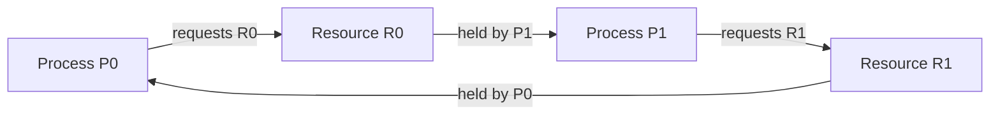
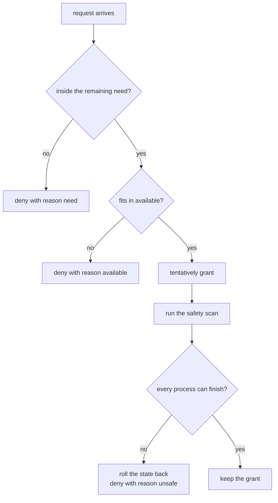
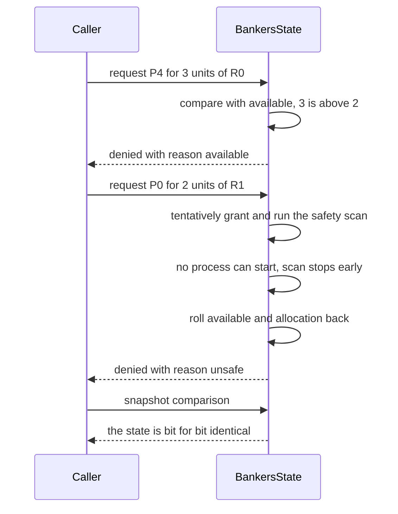

# 670 — Implement resource allocation graph and Banker's algorithm simulator.

> **Tier:** Expert · **CTCI chapter:** Beyond — Networking, OS & Real-Time
> **Task spec:** [670-implement-resource-allocation-graph-and-banker-s-algorithm-simul.md](../../../tasks/expert/670-implement-resource-allocation-graph-and-banker-s-algorithm-simul.md)
> **Solutions:** [Python](../../../solutions/python/expert/670-implement-resource-allocation-graph-and-banker-s-algorithm-simul/solution.py) ·
> [Java](../../../solutions/java/expert/670-implement-resource-allocation-graph-and-banker-s-algorithm-simul/Solution.java) ·
> [JavaScript](../../../solutions/javascript/expert/670-implement-resource-allocation-graph-and-banker-s-algorithm-simul/solution.js) ·
> [C#](../../../solutions/csharp/expert/670-implement-resource-allocation-graph-and-banker-s-algorithm-simul/Solution.cs)

## 1. Problem restatement

Two complementary tools for deadlock, each backed by an independent oracle.

**Banker's algorithm** keeps a state `(available, maximum, allocation)`, derives
`need = maximum − allocation`, and answers "is this state safe?" with the textbook safety algorithm. A
request is granted only when it fits the remaining need, fits the available vector, **and** leaves a safe
state; otherwise it is denied and the state is restored bit for bit.

**Resource allocation graph** (single-instance) is the bipartite request/assignment graph: process `P`
holds resource `R` while process `Q` waits for it. A cycle means deadlock, and the reduction algorithm —
repeatedly finish any process whose waits are satisfied — finds exactly which processes can never finish.

Concrete expectations asserted by the checks (the textbook state: `available [3,3,2]`, maximum
`[[7,5,3],[3,2,2],[9,0,2],[2,2,2],[4,3,3]]`, allocation `[[0,1,0],[2,0,0],[3,0,2],[2,1,1],[0,0,2]]`):

- `need == [[7,4,3],[1,2,2],[6,0,0],[0,1,1],[4,3,1]]` and the state is safe with the greedy witness
  `[1, 3, 0, 2, 4]`, which the replay check and the exhaustive oracle both confirm.
- `request(1, [1,0,2]) == (granted)` and moves exactly `available` to `[2,3,0]` and `allocation[1]` to
  `[3,0,2]`.
- `request(4, [3,3,0])` is denied with reason `available`; `request(0, [0,2,0])` is denied with reason
  `unsafe`; `request(0, [9,0,0])` is denied with reason `need`. Every denial leaves the state
  **unchanged**. `request(0, [0,1,0])` is then granted.
- The invariant `Σ_p allocation[p][r] + available[r] == total[r]` holds after every operation.
- 160 random states: the greedy safety verdict equals the exhaustive oracle and every reported witness
  replays; the sweep contains both safe and unsafe states.
- 160 random request streams: every grant leaves a provably safe state, every denial leaves the
  fingerprint unchanged, and both outcomes occur.
- RAG: a two-process swap has a cycle on `{P0, P1, R0, R1}` and deadlocks `[0, 1]`; an acyclic graph
  deadlocks nobody; waiting for a free resource is not a deadlock; a three-process ring is a **six-node**
  cycle and deadlocks all three.
- 200 random single-instance graphs: "has a cycle" and "some process is deadlocked" agree on every one,
  and real deadlocks do occur in the sweep.

## 2. Intuition

Deadlock detection and deadlock avoidance look like the same problem but answer different questions.
The **graph** describes a concrete state and asks "is anyone stuck right now?" — and for single-instance
resources there is a clean theorem: a cycle exists if and only if some process can never finish. The
**Banker's algorithm** asks the forward-looking question "can I still guarantee that everyone finishes
if I say yes to this request?" — it simulates the future instead of analysing the present.

The insight that makes the future answerable is that a process only ever needs its remaining claim
`need = maximum − allocation`. If some process's whole remaining need fits in the currently free
resources, it can run to completion without waiting for anybody, and when it finishes it returns
everything it holds. So a state is safe exactly when repeatedly applying that rule clears the board:

1. Find any unfinished process whose `need` fits in the running work vector.
2. Let it finish and add its allocation back to the work vector.
3. If every process can be picked, the state is safe — and the picking order is a **witness** you can
   verify directly.



The picture is the classic two-process swap: each process holds what the other wants, the alternating
edges close a cycle, and nobody can move. Adding a medium-priority process is *not* needed here — with
single-instance resources a cycle alone is the deadlock.

## 3. Algorithm

Banker's algorithm, per request:

1. Validate the request vector: correct arity, non-negative entries, known process.
2. Reject with reason `need` if `request[r] > need[p][r]` for any resource.
3. Reject with reason `available` if `request[r] > available[r]` for any resource.
4. Tentatively move the resources from `available` to `allocation[p]`.
5. Run the safety algorithm on the tentative state; if it fails, undo step 4 exactly and report `unsafe`.
6. Otherwise report `granted`. The safety algorithm itself is a greedy fixed point: `work ← available`,
   repeatedly pick any unfinished process whose whole need fits in `work`, mark it finished and add its
   allocation to `work`; the state is safe when every process was picked, and the pick order is the
   witness.

The resource allocation graph:

7. Validate: one holder and at most one requester per resource, both in range, and no process holding and
   requesting the same resource.
8. Build the bipartite graph: a `("P", q)` node has edges to the `("R", j)` it requests; a `("R", j)` node
   has an edge to its holder.
9. Detect a cycle with a three-colour DFS, returning the nodes of the cycle (or nothing).
10. Independently, run the reduction: mark a process finished when every resource it waits for is free or
    held by an already-finished process, and repeat until nothing changes. The unfinished processes are
    the deadlocked set.

```text
function isSafe(self)
    work = copy of self.available
    need = self.need()
    done = all false
    finished = empty list
    while true do
        picked = none
        for p = 0 to self.processes - 1 do
            if not done[p] and need[p][r] <= work[r] for every resource r then
                picked = p
                break
        if picked is none then
            return (length(finished) = self.processes, finished)
        done[picked] = true
        finished.append(picked)
        for every resource r do work[r] = work[r] + self.allocation[picked][r]

function request(self, p, req)
    require the vector is valid and p is in range
    if req[r] > need[p][r] for some r then return (false, "need")
    if req[r] > self.available[r] for some r then return (false, "available")
    for every r do
        self.available[r] = self.available[r] - req[r]
        self.allocation[p][r] = self.allocation[p][r] + req[r]
    if not isSafe(self).safe then
        for every r do
            self.available[r] = self.available[r] + req[r]
            self.allocation[p][r] = self.allocation[p][r] - req[r]
        return (false, "unsafe")
    return (true, "granted")

function findCycle(self)
    build edges: request edge ("P", requester) -> ("R", j) and assignment edge ("R", j) -> ("P", holder)
    colour = white for every node
    for every node in P nodes then R nodes do
        if colour[node] = white then
            found = visit(node)
            if found exists then return found
    return none

procedure visit(node)
    colour[node] = grey
    path.append(node)
    for nxt in the sorted successors of node do
        if colour[nxt] = grey then return path from nxt onwards
        if colour[nxt] = white then
            found = visit(nxt)
            if found exists then return found
    path.pop()
    colour[node] = black
    return none

function deadlocked(self)
    done = empty set
    repeat while something changed
        for every process p not in done do
            waits = resources j whose requester is p
            if every j in waits is free or held by a process in done then
                add p to done
    return the processes not in done, sorted
```



## 4. Worked example

**Safety scan on the textbook state.** `work` starts at `[3, 3, 2]`.

| Pick | Process | Need | Work before | Work after adding its allocation |
| --- | --- | --- | --- | --- |
| 1 | `P1` | `[1,2,2]` | `[3,3,2]` | `[5,3,2]` |
| 2 | `P3` | `[0,1,1]` | `[5,3,2]` | `[7,4,3]` |
| 3 | `P0` | `[7,4,3]` | `[7,4,3]` | `[7,5,3]` |
| 4 | `P2` | `[6,0,0]` | `[7,5,3]` | `[10,5,5]` |
| 5 | `P4` | `[4,3,1]` | `[10,5,5]` | `[10,5,5]` |

The greedy scan always takes the **lowest-index** process that fits, which is why the witness is
`[1, 3, 0, 2, 4]` rather than some other safe sequence. `P4` finishes with the free resources already in
hand, so all five processes complete and the state is safe; the file replays the witness step by step
(`need ≤ work` at each step) and a recursive exhaustive search over finish orders agrees.

**Request handling on the same state.**

| Request | Test that decides it | Outcome | State afterwards |
| --- | --- | --- | --- |
| `P1 [1,0,2]` | fits need `[1,2,2]`, fits available `[3,3,2]`, stays safe | granted | `available [2,3,0]`, `allocation[1] [3,0,2]` |
| `P4 [3,3,0]` | `3 > available[0] = 2` | denied, reason `available` | unchanged |
| `P0 [0,2,0]` | fits need and available, but the resulting state has no safe order | denied, reason `unsafe`, rolled back | unchanged |
| `P0 [9,0,0]` | `9 > need[0][0] = 7` | denied, reason `need` | unchanged |
| `P0 [0,1,0]` | fits everything and stays safe | granted | one unit moved |



**Graph side.** `ResourceAllocationGraph(3, [0, 1], [1, 0])` means `P0` holds `R0` and waits for `R1`,
`P1` holds `R1` and waits for `R0`. The DFS finds the cycle `{("P",0), ("R",0), ("P",1), ("R",1)}` and the
reduction, which can finish nobody, reports the deadlocked set `[0, 1]`. The three-process ring
`holders [0,1,2]`, `requests [1,2,0]` produces a six-node cycle and deadlocks all three processes, while
`holders [0, None]`, `requests [None, 0]` — a process waiting for a resource nobody holds — has no cycle
and no deadlock.

## 5. Complexity

Let `p` be the number of processes and `m` the number of resource types (`r` resource instances in the
graph model).

| Step | Best | Average | Worst | Why the bound holds |
| --- | --- | --- | --- | --- |
| construction / validation | O(p·m) | O(p·m) | O(p·m) | every row is checked entry by entry |
| `need` | O(p·m) | O(p·m) | O(p·m) | one subtraction per entry |
| `is_safe` | O(p·m) | O(p²·m) | O(p²·m) | at most `p` picks, each scanning the unfinished processes and their `m` resources |
| `verify_finish_order` | O(p·m) | O(p·m) | O(p·m) | one pass over the witness |
| `is_safe_oracle` | O(p·m) | O(p!·p·m) | O(p!·p·m) | exhaustive search over finish orders; only usable on tiny states, which is the point of having it |
| `request` | O(p·m) | O(p²·m) | O(p²·m) | dominated by the safety scan, plus an O(p·m) rollback |
| `find_cycle` | O(p + r) | O(p + r) | O(p + r) | three-colour DFS over the bipartite graph |
| `deadlocked` | O(p·r) | O(p²·r) | O(p²·r) | the reduction loop runs at most `p` times, each pass scanning processes and resources |
| Space | O(p·m) | O(p·m) | O(p·m) | the three matrices plus the graph adjacency |

The greedy scan is what makes the Banker's algorithm practical: it is O(p²·m) and exact, whereas the
exhaustive oracle that proves it exact costs O(p!·p·m). In the graph model the two answers are equally
cheap — O(p + r) for the cycle and O(p²·r) for the reduction — which is exactly why the theorem
"cycle ⇔ deadlock" is worth having for single-instance resources.

## 6. Pitfalls and edge cases

- **A denial must be invisible.** The `unsafe` path moves the resources, runs the scan and then undoes
  both moves; the checks compare the `(available, allocation)` fingerprint before and after every denial.
- **Three distinct denial reasons.** `need`, `available` and `unsafe` are different failures — a request
  beyond the remaining claim is a programming error, one beyond the free units is a timing problem, and
  one that would leave the system unsafe is the refusal the algorithm exists for. The checks assert the
  exact reason string.
- **Safety is about the *derived* claim, not the original maximum.** A process is only ever asked for its
  `need = maximum − allocation`; using the full maximum would reject safe states.
- **The witness must be verifiable.** A greedy scan that reports "safe" without an order is unusable;
  both the replay check and the exhaustive search must agree, which is what pins the greedy choice as
  arbitrary and harmless.
- **Resource conservation is a live invariant.** `Σ allocation + available == total` is re-checked after
  every operation, including the randomized request streams; a rollback bug shows up here immediately.
- **The cycle theorem is single-instance only.** The Python and JavaScript files restrict the graph to
  single-instance resources — precisely the case where "cycle implies deadlock" is a theorem — and the
  JavaScript header notes the classic caveat that a cycle is necessary but **not** sufficient once
  resources have multiple instances. The C# file demonstrates that counter-example explicitly: with at
  least two instances per type a cycle can exist while nothing is deadlocked, and there the implication
  that survives is "deadlock implies unsafe".
- **Waiting for a free resource is not a deadlock.** A process that requests an unheld resource has no
  request edge at all; the checks assert that such a graph has neither a cycle nor a deadlocked process.
- **Self-loops are rejected.** A resource cannot be held and requested by the same process; building the
  graph that way raises rather than producing a one-node "cycle".
- **Degenerate graph shapes.** The reduction loop must not mark processes finished by accident when the
  wait list is empty — a process with no outstanding requests always finishes, which is how the acyclic
  cases drain.
- **Invalid input raises.** Wrong arity, negative entries, unknown processes, an allocation above a
  maximum claim, an out-of-range holder or requester, and a request from a process on a resource it holds
  are all rejected; the file asserts that all eight malformed calls raise.
- **Documented simplification (Python).** One request per call and single-instance resources only.

## 7. Variants and follow-ups

- The same lock-order problem seen from the scheduler's side, where blocking is bounded by inheritance →
  [668 — priority inheritance protocol simulation](../../../tasks/expert/668-implement-priority-inheritance-protocol-simulation-for-priority.md).
- Priority-based scheduling of the tasks waiting for those resources →
  [667 — schedulability analysis for real-time systems](../../../tasks/expert/667-implement-schedulability-analysis-for-real-time-systems-rate-mon.md) and
  [669 — earliest deadline first scheduler simulator](../../../tasks/expert/669-implement-earliest-deadline-first-scheduler-simulator-and-feasib.md).
- Deadlock *detection* on the same graph, without the avoidance half →
  [357 — deadlock detection for resource allocation graph](../../../tasks/intermediate/357-deadlock-detection-for-resource-allocation-graph-algorithm.md).
- The transactional analogue: locks taken in a protocol order, with detection when a cycle forms →
  [639 — two-phase locking simulator with deadlock detection](../../../tasks/expert/639-implement-two-phase-locking-simulator-with-deadlock-detection.md).

## 8. Check yourself

<details><summary>Show answer</summary>
**Why does a request that fits the need and the available vector still get denied?** Because granting it
could leave a state from which some process can never finish. `P0 [0,2,0]` on the textbook state is the
example: it is inside `need[0] = [7,4,3]` and inside `available = [3,3,2]`, yet after the grant no process's
remaining need fits the free resources, so the request is refused with reason `unsafe` and the state is
restored.
</details>

<details><summary>Show answer</summary>
**What exactly is a safe state, in terms of the scan?** A state is safe when repeatedly picking any
unfinished process whose whole remaining need fits the current work vector — letting it finish and adding
its allocation back — empties the board. The order in which the processes were picked is the witness, and
the checks replay it to make sure the greedy choice did not cheat.
</details>

<details><summary>Show answer</summary>
**Why is the safety test exhaustive search not used in production?** It enumerates finish orders and costs
O(p!·p·m), while the greedy scan is O(p²·m) and, for this lattice, provably exact. The exhaustive search
exists only as the oracle that proves the greedy scan right on random states.
</details>

<details><summary>Show answer</summary>
**When is "a cycle in the resource allocation graph" equivalent to "a deadlock"?** For single-instance
resources: each edge forces a distinct process to wait for a resource that exactly one other process
holds, so a cycle is unsatisfiable. The C# file shows the equivalence fails with two or more instances per
type — a cycle can then coexist with a live schedule — and the surviving implication is only "deadlock
implies unsafe".
</details>

<details><summary>Show answer</summary>
**What does the reduction algorithm compute that the cycle detector does not?** The set of processes that
can never finish. A cycle detector returns "yes, there is a cycle"; the reduction returns the *concrete*
deadlocked processes, which is what an operator needs in order to pick a victim. Under the single-instance
restriction the two answers must agree, and the checks assert that on 200 random graphs.
</details>
