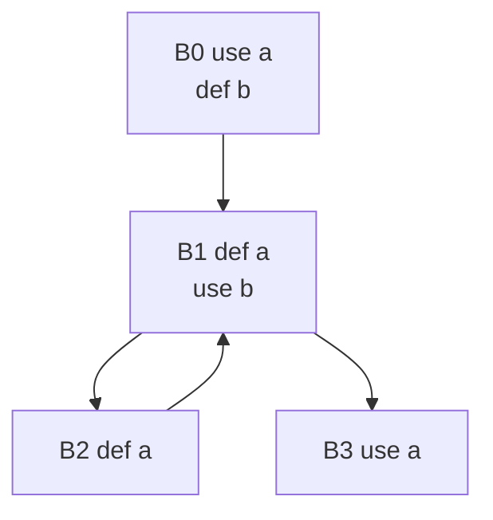
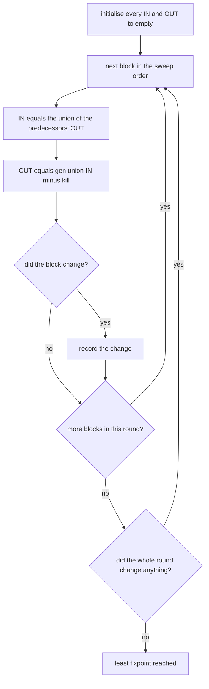
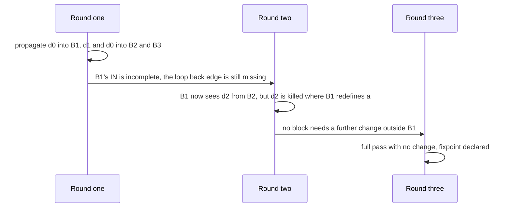

# 671 — Implement static program analysis: reaching definitions simple algorithm.

> **Tier:** Expert · **CTCI chapter:** Beyond — Compilers, Languages & Solvers
> **Task spec:** [671-implement-static-program-analysis-reaching-definitions-simple-al.md](../../../tasks/expert/671-implement-static-program-analysis-reaching-definitions-simple-al.md)
> **Solutions:** [Python](../../../solutions/python/expert/671-implement-static-program-analysis-reaching-definitions-simple-al/solution.py) ·
> [Java](../../../solutions/java/expert/671-implement-static-program-analysis-reaching-definitions-simple-al/Solution.java) ·
> [JavaScript](../../../solutions/javascript/expert/671-implement-static-program-analysis-reaching-definitions-simple-al/solution.js) ·
> [C#](../../../solutions/csharp/expert/671-implement-static-program-analysis-reaching-definitions-simple-al/Solution.cs)

## 1. Problem restatement

Run the classic **reaching definitions** analysis over a small control-flow graph. The unit of the
analysis is not a variable but a **definition**: the triple `(block, index, variable)` of one assignment,
so a definition is a unique instruction. The CFG is given (not parsed); a block is a list of
`("def", var)` and `("use", var)` instructions and every block has a list of successors.

System of equations:

| Set | Definition |
| --- | --- |
| `gen[B]` | the **last** definition of each variable inside `B` |
| `kill[B]` | every other definition of the variables `B` defines |
| `OUT[B]` | `gen[B] ∪ (IN[B] − kill[B])` |
| `IN[B]` | union of `OUT[p]` over the predecessors `p` of `B` |

Concrete expectations asserted by the checks. The textbook CFG is
`B0 = [use a, def b]`, `B1 = [def a, use b]`, `B2 = [def a]`, `B3 = [use a]` with edges `0→1`, `1→2`,
`1→3`, `2→1`:

- `gen[0] == {(0, 1, "b")}` — only the last definition of each variable survives in `gen`, and
  `(1,0,"a") ∈ kill[2]` while `(2,0,"a") ∈ kill[1]`: two definitions of one variable kill each other.
- `IN[B0] == {}` (nothing reaches the entry), `IN[B3]` contains `(1,0,"a")` and `(0,1,"b")` but **not**
  `(2,0,"a")` — the loop body's definition does not reach `B3` because `B1` redefines `a`.
- `OUT[B1] == {(0,1,"b"), (1,0,"a")}` and the loop forces **more than one round**.
- The path-based oracle reproduces every `IN` set; `gen[B] ⊆ OUT[B]` everywhere; a killed definition can
  only survive in `OUT` if it was generated in the same block.
- Iterating the blocks in **reverse** order reaches the same least fixpoint, and the per-round snapshots
  grow monotonically.
- At the fixpoint the equations hold **exactly**: a further full pass changes nothing (`residual == 0`),
  and re-solving takes the same number of rounds.
- 120 randomly generated CFGs: the solver agrees with the path oracle on every block, the round count stays
  within `#definitions × #blocks + 1`, `IN[B]` equals the union of the predecessors' `OUT`, and entry-like
  blocks have an empty `IN`.
- Boundary cases: a single block converges in **2** rounds (one working pass plus the confirming pass); a
  program with only reads has empty sets; an unreachable block keeps `IN == {}`; an empty iteration order
  still yields the trivial least fixpoint; with two definitions of `a` in one block only the **second**
  reaches the successor.

## 2. Intuition

The naive way to answer "which definitions can reach this point?" is to enumerate paths: walk every route
through the program, simulating the state as you go. That is exponential, and for a `may` analysis it is
also redundant — two different paths that leave the same set of live definitions are the same state.

The insight is that the answer is the **least fixpoint of a monotone system over a finite lattice**.
The lattice is the powerset of all definitions, ordered by inclusion; the transfer function
`OUT = gen ∪ (IN − kill)` is monotone, so the sequence of iterations computed from the empty set only
grows, and a finite lattice means it must stabilise. Start every `IN` and `OUT` empty — that is the least
element, which is exactly the "may reach" meaning — and sweep until a full pass changes nothing.



Two details make the analysis useful rather than merely correct. First, `gen` keeps only the **last**
definition of a variable inside a block, because an earlier one in the same block is always overwritten
before the block ends. Second, `kill` removes every *other* definition of the variables the block defines,
which is what makes the sets small and the fixpoint fast: without `kill` the iteration would still be
correct but would converge much more slowly with far larger sets.

## 3. Algorithm

1. Validate the CFG: one successor list per block, all edge targets in range, and no self-loops (a loop
   must be modelled with a real block). Derive the predecessor lists.
2. Enumerate the definitions `(block, index, variable)` once.
3. Compute `gen` and `kill` per block: `gen[B]` holds, for every variable defined in `B`, the triple of its
   **last** definition in `B`; `kill[B]` holds every definition of those variables anywhere in the program
   except the ones in `gen[B]`.
4. Initialise `IN[B] = OUT[B] = {}` for every block — the least element, i.e. "nothing reaches yet".
5. Sweep the blocks in order: `newIn = ∪ OUT[pred]`, `newOut = gen[B] ∪ (newIn − kill[B])`. If either
   changed, keep it and note the round changed something.
6. Repeat until a full pass changes nothing. That state is the least fixpoint.
7. Independently, compute the answer by paths: for every definition that is the last write of its variable
   in its block, walk forward from that block's successors; the definition reaches the entry of every
   visited block, and it keeps propagating only while the block being left does **not** redefine the
   variable. This oracle never looks at `gen` or `kill`, which is what makes the agreement meaningful.

```text
function solveReachingDefinitions(cfg, order, collectRounds)
    gen, kill = cfg.genKill()
    n = number of blocks
    inn = empty set for every block
    out = empty set for every block
    order = 0 .. n - 1 if order is missing
    rounds = 0
    while true do
        rounds = rounds + 1
        changed = false
        for b in order do
            newIn = union of out[p] over the predecessors p of b
            newOut = gen[b] union (newIn - kill[b])
            if newIn differs from inn[b] or newOut differs from out[b] then
                inn[b] = newIn
                out[b] = newOut
                changed = true
        if collectRounds then snapshot inn and out
        if not changed then return inn, out, rounds

function reachingOracle(cfg)
    result = empty set for every block
    for each definition (b, k, var) in cfg.definitions() do
        if k is not the last definition of var inside block b then continue
        stack = successors of b
        seen = those successors
        for s in stack do result[s].add((b, k, var))
        while stack is not empty do
            cur = stack.pop()
            if var is defined inside cur then continue        // cur kills the definition
            for t in successors of cur do
                if t not in seen then
                    seen.add(t)
                    result[t].add((b, k, var))
                    stack.push(t)
    return result
```



## 4. Worked example

The textbook CFG. Definitions: `d0 = (0,1,"b")`, `d1 = (1,0,"a")`, `d2 = (2,0,"a")`; `B3` defines
nothing.

`gen`/`kill`: `gen[0] = {d0}`, `kill[0] = {}`; `gen[1] = {d1}`, `kill[1] = {d2}`; `gen[2] = {d2}`,
`kill[2] = {d1}`; `gen[3] = kill[3] = {}`. Predecessors: `B0` none, `B1 ← {0, 2}`, `B2 ← {1}`,
`B3 ← {1}`.

| Round | Block | `IN` before | `OUT` after | Changed |
| --- | --- | --- | --- | --- |
| 1 | `B0` | `{}` | `{d0}` | yes |
| 1 | `B1` | `{d0}` (only `B0` has an `OUT` yet) | `{d1, d0}` | yes |
| 1 | `B2` | `{d1, d0}` | `{d2, d0}` — `d1` is killed | yes |
| 1 | `B3` | `{d1, d0}` | `{}` | yes |
| 2 | `B0` | `{}` | `{d0}` | no |
| 2 | `B1` | `{d0, d2}` (now `B2` contributes) | `{d1, d0}` | yes |
| 2 | `B2` | `{d1, d0}` | `{d2, d0}` | no |
| 2 | `B3` | `{d1, d0}` | `{}` | no |
| 3 | `B0` | `{}` | `{d0}` | no |
| 3 | `B1` | `{d0, d2}` | `{d1, d0}` | **no** |
| 3 | `B2`, `B3` | unchanged | unchanged | no |

The third round changes nothing, so the fixpoint is reached after **3 rounds** and the loop is what forced
the second round: `B1`'s `IN` only became complete once `B2` had been processed. The final sets are
`IN[B3] = OUT[B3] = {d0, d1}` — the use of `a` in `B3` is reached by `B1`'s definition, not by `B2`'s,
because `B1` redefines `a` on the way. Running the same sweep in reverse order `[3, 2, 1, 0]` reaches the
identical sets, in fewer rounds here but never more than a small multiple of the forward count — the
checks assert both the equality and the bound.



**Path oracle on the same program.** For `d2 = (2,0,"a")` the walk starts at `B1`, which defines `a`, so
the definition dies immediately and reaches nobody. For `d1 = (1,0,"a")` the walk starts at `B2` and `B3`;
`B2` defines `a`, so the walk stops after `B3` and does not continue back into `B1`. For `d0` the walk
starts at `B1`, which does **not** define `b`, so it continues to `B2` and `B3` and stops there. The union
of those three contributions is exactly the `IN` sets of the table.

## 5. Complexity

Let `B` be the number of blocks, `D` the number of definitions, `E` the number of CFG edges and `k` the
number of rounds until the fixpoint.

| Step | Best | Average | Worst | Why the bound holds |
| --- | --- | --- | --- | --- |
| validation and predecessors | O(B + E) | O(B + E) | O(B + E) | one pass over the edge lists |
| `gen` / `kill` | O(D) | O(D·B) | O(D·B) | `kill` compares each block's defined variables against every definition in the program |
| one sweep | O(B + E + D) | O(B + E + D) | O(B + E + D) | the predecessor union and the set arithmetic per block |
| `solve_reaching_definitions` | O(B + E + D) | O(k·(B + E + D)) | O(D·B·(B + E + D)) | `k` is bounded by `#definitions × #blocks`, because each round either adds at least one new definition to some `IN`/`OUT` set or terminates — and there are at most `D` definitions to add per block |
| path oracle | O(D + E) | O(D·(B + E)) | O(D·(B + E)) | one forward walk per surviving definition |
| Space | O(B) | O(B·D) | O(B·D) | two definition sets per block, each with at most `D` elements |

The worklist variant the JavaScript and C# files also implement changes the constant, not the bound: it
only re-enqueues the successors of a block whose sets grew, so it visits fewer blocks than the round-robin
sweep on the same program while producing the same fixpoint. The path oracle is O(D·(B + E)) and is the
expensive one — which is precisely why the fixpoint solver exists.

## 6. Pitfalls and edge cases

- **Start from the empty sets.** Initialising to "everything reaches everywhere" (the top element) gives a
  fixpoint, but not the *least* one: the Java file shows it leaks definitions out of a dead region, so the
  answer would claim a definition reaches a block that no execution can even enter. The checks assert that
  an unreachable block keeps `IN == {}`.
- **`gen` keeps only the last definition per variable.** The check with two definitions of `a` in one block
  asserts that only the second reaches the successor.
- **`kill` must exclude the block's own `gen`.** A definition generated in a block can survive that block;
  the checks assert `gen[B] ⊆ OUT[B]` and that a killed definition in `OUT` was generated in the same
  block.
- **The loop back edge is what makes this interesting.** The textbook program needs more than one round;
  a solver that stops after a single pass would report `IN[B1]` without `d2` and would look plausible.
- **Every round must be monotone.** The snapshots are compared pairwise and must only grow; a shrinking set
  would mean the transfer function is not the one intended (or that the initialisation was from the top).
- **The fixpoint must satisfy the equations, not merely be stable.** The checks recompute `IN` from the
  predecessors' `OUT` and `OUT` from `gen`/`kill` and require zero residual, so "stable because I stopped
  updating" is not enough.
- **Self-loops are rejected.** A block cannot list itself as a successor; a loop has to go through a real
  block, and out-of-range edges and a missing successor list raise as well.
- **Non-determinism would be fatal.** The same program must produce the same sets and the same round count,
  which the checks verify on a fixed random CFG.
- **Documented simplification (Python).** No procedures or interprocedural effects, no arrays — a definition
  writes a scalar variable — and the CFG is given rather than parsed.
- **Cross-language extras.** The Java file cross-checks the analysis with a BFS oracle that reads only the
  statement lists and the position of the definition inside its own block (no `gen`/`kill` anywhere), and
  hand-checks the straight-line, diamond and loop shapes. JavaScript also builds the **def-use chains** the
  analysis exists for — flagging uses that no definition reaches — and separates reachability into its own
  `reachableBlocks` pass. C# enumerates the reachable abstract states `(block, last-definition-per-variable)`
  by brute force and compares that independent state exploration against both solvers on 60 randomised
  CFGs, and it asserts the two edge cases at instruction granularity: the entry block's empty `IN`, and a
  block no path reaches whose `OUT` is exactly its `GEN`.

## 7. Variants and follow-ups

- The dual analysis over the same lattice: which variables are live, and which assignments can be deleted →
  [672 — liveness analysis on small CFG and dead code elimination](../../../tasks/expert/672-implement-liveness-analysis-on-small-cfg-and-dead-code-eliminati.md).
- Reaching definitions is the input to SSA construction, where every use is rewired to a single definition →
  [673 — SSA construction and basic optimizations](../../../tasks/expert/673-implement-ssa-construction-and-basic-optimizations.md).
- The same CFG machinery aimed at a safety check rather than an optimisation →
  [753 — control-flow integrity checker skeleton](../../../tasks/expert/753-implement-control-flow-integrity-checker-skeleton.md).
- Where liveness and interference go next →
  [674 — register allocation via graph coloring](../../../tasks/expert/674-implement-register-allocation-via-graph-coloring-simplified.md).

## 8. Check yourself

<details><summary>Show answer</summary>
**Why is a definition a `(block, index, variable)` triple rather than just the variable?** Because the
analysis must distinguish two assignments to the same variable: `(1,0,"a")` and `(2,0,"a")` are different
facts, and a later phase (SSA, use-def chains) needs to know which one reaches a use. Variables alone would
collapse them.
</details>

<details><summary>Show answer</summary>
**Why does `gen` keep only the last definition of each variable in a block?** An earlier definition is
always overwritten before control leaves the block, so it can never reach the block's successors. Keeping
it would not be wrong but would inflate every set for no benefit.
</details>

<details><summary>Show answer</summary>
**Why must the iteration start from the empty sets?** The empty sets are the least element of the powerset
lattice, and `may` analyses want the least fixpoint: the facts that hold on *some* path. Starting from the
top element (everything reaches everywhere) converges to a larger fixpoint that survives dead code — the
Java file demonstrates the leak on a program with an unreachable block.
</details>

<details><summary>Show answer</summary>
**Why is the round count bounded by `#definitions × #blocks`?** Each round either changes some block's
`IN` or `OUT` — adding at least one definition somewhere, and a block can receive at most `D` definitions —
or it changes nothing and the loop ends. There are `B` blocks, so at most `D·B` successful additions, each
bounded by one round.
</details>

<details><summary>Show answer</summary>
**In the textbook program, why does `(2,0,"a")` fail to reach `B3`?** Because the only path from `B2` to
`B3` goes through `B1`, and `B1` defines `a`. A definition is killed by any later assignment to its
variable on the path, so `B1`'s own definition `(1,0,"a")` is what reaches `B3` instead.
</details>
