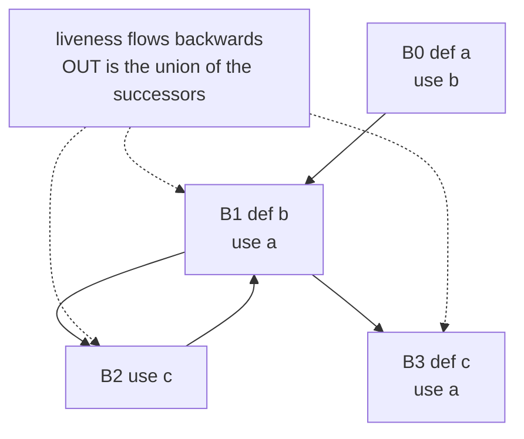
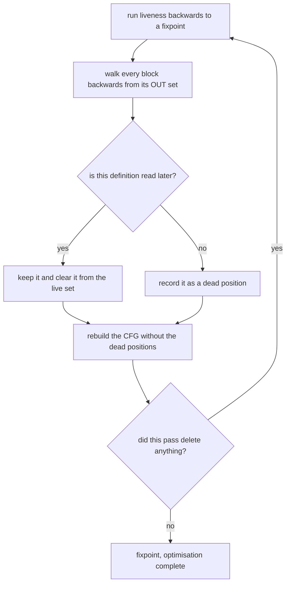
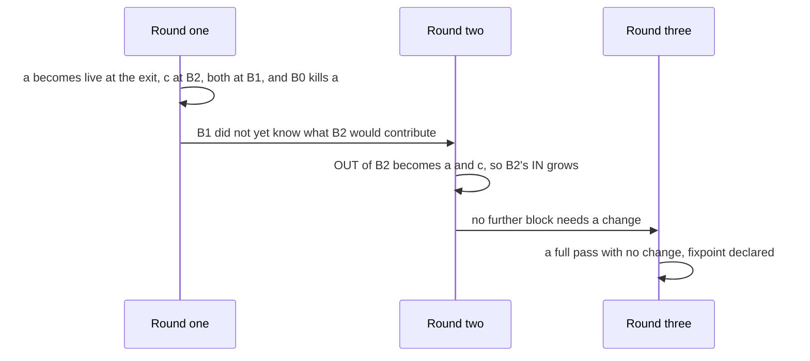

# 672 — Implement liveness analysis on small CFG and dead code elimination.

> **Tier:** Expert · **CTCI chapter:** Beyond — Compilers, Languages & Solvers
> **Task spec:** [672-implement-liveness-analysis-on-small-cfg-and-dead-code-eliminati.md](../../../tasks/expert/672-implement-liveness-analysis-on-small-cfg-and-dead-code-eliminati.md)
> **Solutions:** [Python](../../../solutions/python/expert/672-implement-liveness-analysis-on-small-cfg-and-dead-code-eliminati/solution.py) ·
> [Java](../../../solutions/java/expert/672-implement-liveness-analysis-on-small-cfg-and-dead-code-eliminati/Solution.java) ·
> [JavaScript](../../../solutions/javascript/expert/672-implement-liveness-analysis-on-small-cfg-and-dead-code-eliminati/solution.js) ·
> [C#](../../../solutions/csharp/expert/672-implement-liveness-analysis-on-small-cfg-and-dead-code-eliminati/Solution.cs)

## 1. Problem restatement

Two halves of one job: a **backward** dataflow analysis that says which variables still matter at each
program point, and the optimisation that analysis exists for — **dead code elimination** (DCE), which
deletes the writes nobody ever reads.

The CFG is given: a block is a list of `("def", var)` and `("use", var)` instructions, and every block has
a successor list. The system is the mirror image of reaching definitions:

| Set | Definition |
| --- | --- |
| `use[B]` | variables read **before being written** inside `B` (the upward-exposed uses) |
| `def[B]` | variables written in `B` |
| `IN[B]` | `use[B] ∪ (OUT[B] − def[B])` |
| `OUT[B]` | union of `IN[s]` over the successors `s` of `B` |

Concrete expectations asserted by the checks. The textbook CFG is `B0 = [def a, use b]`,
`B1 = [def b, use a]`, `B2 = [use c]`, `B3 = [def c, use a]` with edges `0→1`, `1→2`, `1→3`, `2→1`:

- `IN[B0] == {"b", "c"}` — `b` is read directly, and `c` flows in **backwards through the loop**, but `a`
  does not, because `B0` defines it before any use.
- `OUT[B3] == {}` (the exit has nothing live out) while `IN[B3] == {"a"}`; `"a"` is live both out of and
  into `B2`, which is how liveness travels backwards around the loop.
- The loop forces more than one backward round.
- The per-variable oracle agrees on every `IN` set, iterating in **either** order reaches the same least
  fixpoint, and `IN`/`OUT` satisfy the transfer and meet equations exactly on every block.
- 120 random CFGs: oracle agreement on every block, `use[B] ⊆ IN[B]`, no invented variables in `IN`/`OUT`,
  the removed count equals the difference in instruction count, a second DCE pass removes **0**, and the
  interpreter's trace on three random paths is identical before and after elimination. More than 20 of the
  120 CFGs really contain dead definitions.
- Targeted DCE: `[def x, def y, use x]` loses exactly the `y` write and keeps the rest **in order**;
  `[def x, def y]` with `y` used on one path and `x` on the other loses **nothing**; three writes to `x`
  followed by a use of `z` lose all **three** and leave the block empty; a definition read on the next loop
  iteration survives; writes to a never-read variable go even inside a loop.
- Boundary cases: reads without writes are live-in; uses are never deleted; an empty block has an empty
  `IN`; an unreachable block has nothing live-out; `def s` followed by `use s` in one block leaves nothing
  live at the entry.

## 2. Intuition

Forward analyses answer "what has happened so far"; liveness answers "what will be needed next", and that
reversal is the whole trick. A variable is live at a point if **some** path from that point reads it before
writing it. Because it is a "some path" (a `may`) property, the operator joining two branches is **union**,
and the equation is evaluated backwards: a block's live-in set is computed from its own uses plus whatever
is live-out that it does not redefine.

The naive alternative — test each definition by executing every path and seeing whether the value is
observed — is exponential and, for a `may` question, redundant: two paths that leave the same live set are
indistinguishable to the analyser.



Dead code elimination then falls out almost for free. Walk each block **backwards** from its live-out set:
a `use` makes the variable live; a `def` whose variable is not live is a write nobody will ever read and can
be deleted; a `def` whose variable *is* live removes it from the live set and stays. One deletion can make an
earlier definition dead — delete the only read of `y` and `y`'s definition becomes dead too — so the pass is
repeated until nothing changes.

## 3. Algorithm

1. Validate the CFG (one successor list per block, in-range targets, no self-loops) and derive the
   predecessor lists.
2. For every block compute `use[B]` and `def[B]` in one forward scan of its instructions: a `def` adds the
   variable to `def[B]`; a `use` adds it to `use[B]` only when it has not been written yet in this block.
3. Initialise every `IN` and `OUT` empty and sweep the blocks **backwards** (by default in reverse index
   order): `newOut = ∪ IN[successor]`, `newIn = use[B] ∪ (newOut − def[B])`. Repeat until a full pass changes
   nothing — the least fixpoint of a monotone system on a finite lattice.
4. Liveness per instruction: walk a block backwards from `OUT[B]`, adding each `use` and removing each
   `def` from the live set; a `def` whose variable is not live is recorded as a dead position.
5. DCE: compute liveness, collect the dead positions of every block, rebuild the CFG without them, and
   repeat while the pass removed at least one instruction.
6. The independent oracle re-derives liveness **one variable at a time**: mark every block where the
   variable is used, then walk predecessor edges marking a predecessor whenever that predecessor does not
   define the variable, until the worklist drains. It never touches `use`/`def`/`IN`/`OUT` sets.
7. Correctness of DCE is checked by **execution**, not by inspection: a deterministic interpreter runs
   concrete paths and records every value a `use` observes; the trace before and after elimination must be
   identical. Values are `(ord(var) − ord('a') + 1)·1000 + block`, so they depend only on the variable and
   the block and deleting instructions cannot shift them.

```text
function solveLiveness(cfg, order)
    for every block b compute use[b] and def[b]
    inn = empty set for every block
    out = empty set for every block
    order = reverse index order if order is missing
    rounds = 0
    while true do
        rounds = rounds + 1
        changed = false
        for b in order do
            newOut = union of inn[s] over the successors s of b
            newIn = use[b] union (newOut - def[b])
            if newOut differs from out[b] or newIn differs from inn[b] then
                out[b] = newOut
                inn[b] = newIn
                changed = true
        if not changed then return inn, out, rounds

function blockLiveIn(block, liveOut)
    live = copy of liveOut
    deadPositions = empty list
    for k = length(block) - 1 down to 0 do
        op, var = block[k]
        if op = "use" then
            live.add(var)
        else if var in live then
            live.remove(var)
        else
            deadPositions.append(k)
    return live, sorted(deadPositions)

function deadCodeElimination(cfg)
    current = cfg
    removedTotal = 0
    repeat at most 64 times
        inn, out, rounds = solveLiveness(current)
        blocks = empty list
        removed = 0
        for b, block in enumerate(current.blocks) do
            liveEntry, dead = blockLiveIn(block, out[b])
            removed = removed + length(dead)
            blocks.append(instructions of block whose position is not in dead)
        current = Cfg(blocks, current.succ)
        removedTotal = removedTotal + removed
        if removed = 0 then return current, removedTotal
    raise "dead code elimination failed to converge"

function livenessOracle(cfg)
    liveIn = empty set for every block
    for var in all variables do
        worklist = blocks where var is used before being written
        for b in worklist do liveIn[b].add(var)
        while worklist is not empty do
            cur = worklist.pop()
            for p in predecessors of cur do
                if var is not defined in p and var not in liveIn[p] then
                    liveIn[p].add(var)
                    worklist.push(p)
    return liveIn
```



## 4. Worked example

Liveness on the textbook CFG. `use`/`def` per block: `B0 {b}/{a}`, `B1 {a}/{b}`, `B2 {c}/{}`,
`B3 {a}/{c}`. Successors: `0→1`, `1→{2,3}`, `2→1`, `3→none`.

| Round | Block | `OUT` before | `IN` after | Changed |
| --- | --- | --- | --- | --- |
| 1 | `B3` | `{}` | `{a}` | yes |
| 1 | `B2` | `{}` (nothing after it) | `{c}` | yes |
| 1 | `B1` | `{c, a}` (from `B2` and `B3`) | `{a, c}` | yes |
| 1 | `B0` | `{a, c}` (from `B1`) | `{b, c}` — `a` is removed because `B0` defines it | yes |
| 2 | `B3` | `{}` | `{a}` | no |
| 2 | `B2` | `{a, c}` (now `B1` is complete) | `{a, c}` | yes |
| 2 | `B1` | `{a, c}` | `{a, c}` | no |
| 2 | `B0` | `{a, c}` | `{b, c}` | no |
| 3 | all | unchanged | unchanged | **no** → fixpoint |

Three rounds, and the loop back edge `2→1` is what forces the second one. The final sets match every
assertion: `IN[B0] = {b, c}`, `IN[B3] = {a}` with `OUT[B3] = {}`, and `a` live both into and out of `B2`.



**DCE on the same shapes.**

| Program | Live-out of `B0` | Backward walk | Removed | Result |
| --- | --- | --- | --- | --- |
| `[def x, def y, use x]` → `[use x]` | `{x}` | `use x` keeps `x`, `def y` finds `y` not live | 1 | `[def x, use x]`, order preserved |
| `[def x, def y]` branching to `[use y]` or `[use x]` | `{x, y}` | both definitions are live on some path | 0 | program unchanged |
| `[def x, def x, def x]` → `[use z]` | `{z}` | all three `x` writes are unread | 3 | empty block |
| `[def a]` → `[use a, def a]` → back edge | `{a}` (loop-carried) | the first write is read on the next iteration | 0 | both writes survive |

The third row shows why the pass must iterate: each deletion is independent here, but if the only reader
of `y` were itself a definition of `y`, the first pass would expose the second one. The checks assert that
after the fixpoint a further pass removes zero instructions.

## 5. Complexity

Let `B` be the number of blocks, `I` the number of instructions, `V` the number of distinct variables,
`E` the number of CFG edges and `k` the number of backward rounds.

| Step | Best | Average | Worst | Why the bound holds |
| --- | --- | --- | --- | --- |
| validation and predecessors | O(B + E) | O(B + E) | O(B + E) | one pass over the successor lists |
| `use` / `def` | O(I) | O(I) | O(I) | one forward scan per block |
| one backward sweep | O(B + E + V) | O(B + E + V) | O(B + E + V) | the successor union and the set arithmetic per block |
| `solve_liveness` | O(B + E + V) | O(k·(B + E + V)) | O(V·B·(B + E + V)) | each round either adds at least one variable to some set — and a block can receive at most `V` of them — or terminates |
| intra-block walk | O(len(block)) | O(I) | O(I) | one pass per block |
| one DCE pass | O(I + k·(B + E + V)) | same | same | liveness plus the block rebuild |
| whole DCE | one pass | a few passes | O(I) passes | every pass except the last deletes at least one instruction, so at most `I + 1` passes |
| liveness oracle | O(B + E) | O(V·(B + E)) | O(V·(B + E)) | one worklist walk per variable |
| Space | O(B) | O(B·V) | O(B·V) | two variable sets per block, plus the per-instruction live sets on demand |

The interpreter used as the correctness oracle costs O(steps) per path, which is why the checks sample
paths instead of enumerating them: liveness is cheap, exhaustive execution is not.

## 6. Pitfalls and edge cases

- **`use` must be *upward-exposed*.** A `use` that follows a `def` of the same variable in the same block is
  not live at the block entry; the `def s` then `use s` case in the checks has an empty `IN` for exactly
  this reason.
- **Backward, not forward.** Iterating forwards over this system still converges — to the wrong fixpoint.
  The checks recompute `IN` from the transfer equation and `OUT` from the successor union after the fact.
- **Start from the empty sets.** Liveness is a `may` property, so the least fixpoint is the wanted answer;
  starting from "everything is live everywhere" would keep writes alive that no path reads.
- **One deletion can expose another.** The pass repeats until nothing changes; the checks assert the second
  pass on an already-optimised CFG removes zero, and that a chain of three writes to an unread variable
  disappears entirely.
- **Do not delete across paths.** A definition read on *one* of several successors is live; the diamond
  case `[def x, def y]` with `x` and `y` read on different branches must lose nothing.
- **Loop-carried liveness is real.** `[def a]` feeding a block that uses `a` and writes `a` again keeps both
  writes alive through the back edge — the check asserts zero removals — while writes to a variable nothing
  ever reads disappear even inside a loop.
- **Uses are never dead.** The file asserts that a program of pure reads loses nothing, and that an empty
  block has an empty `IN` set rather than a missing one.
- **Unreachable blocks.** Their liveness sets are computed but their values are never observed; the checks
  assert an unreachable block has nothing live-out. JavaScript additionally removes unreachable blocks,
  which is a separate pass (`reachableBlocks`), because liveness alone does not imply reachability.
- **Self-loops, out-of-range edges and a missing successor list are rejected** rather than silently
  accepted.
- **The oracle must not reuse the analysis.** Each file computes liveness a second way: Python and C# walk
  predecessor edges one variable at a time, Java runs a DFS that scans statement lists only, JavaScript
  searches points explicitly. Agreement is then evidence rather than a tautology.
- **Documented simplification (Python).** Scalar variables only, no arrays or aliasing, and the CFG is
  given rather than parsed; the interpreter observes use-sites only (plus the final environment), which is
  exactly what dead code elimination must preserve.
- **Cross-language extras.** Java's IR distinguishes constant, copy, arithmetic, comparison, `store` and
  `brif` statements and refuses to delete stores and branches — a side effect is observable even when no
  variable is read. JavaScript keeps `print`/`input` for the same reason and also asserts that the
  optimised program never *executes more* statements. C# validates each deletion individually by removing
  exactly that one instruction from the original program and re-running it, so the aggregate count is not
  the only evidence.

## 7. Variants and follow-ups

- The forward twin of this analysis, which feeds SSA and use-def chains →
  [671 — static program analysis: reaching definitions](../../../tasks/expert/671-implement-static-program-analysis-reaching-definitions-simple-al.md).
- Liveness is the first half of SSA construction and of the optimisations built on it →
  [673 — SSA construction and basic optimizations](../../../tasks/expert/673-implement-ssa-construction-and-basic-optimizations.md).
- Live ranges are exactly the intervals that become interference edges →
  [674 — register allocation via graph coloring](../../../tasks/expert/674-implement-register-allocation-via-graph-coloring-simplified.md).
- CFG-shaped analysis with a security goal instead of an optimisation →
  [753 — control-flow integrity checker skeleton](../../../tasks/expert/753-implement-control-flow-integrity-checker-skeleton.md).

## 8. Check yourself

<details><summary>Show answer</summary>
**Why is the meet operator for liveness union?** Because a variable is live if *some* path from the point
reads it before writing it. Any one successor that needs the variable keeps it live, so the information
flows backwards and combines with union — the backward, `may` counterpart of reaching definitions.
</details>

<details><summary>Show answer</summary>
**In the textbook CFG, why is `c` live at the entry of `B0` although `B0` never mentions it?** Because one
path reaches a read of `c` before any write of it: `B0 → B1 → B2` and `B2` uses `c`. `B3` defines `c`, but
that is the other branch, and liveness needs only one path. Algebraically `OUT[B0] = IN[B1] = {a, c}` and
`B0` kills only `a`, so `IN[B0] = {b, c}`, while `a` is excluded because `B0` defines it before reading it.
</details>

<details><summary>Show answer</summary>
**Why can a single DCE pass be insufficient?** Because deleting an instruction can remove the last read of
another definition, making it dead in turn. The pass therefore repeats until nothing changes; the checks
assert the confirming pass removes zero instructions.
</details>

<details><summary>Show answer</summary>
**Why is a definition whose variable is read on only one successor path still live?** Liveness is a `may`
property: one path that reads the value is enough to make the write observable. The diamond check asserts
that `[def x, def y]` with `x` and `y` read on different branches loses nothing.
</details>

<details><summary>Show answer</summary>
**Why does the interpreter-based check use values that depend only on the variable and the block?** So that
deleting instructions cannot shift what a `use` observes. If the value depended on the instruction index,
removing an unrelated statement would change the trace and the equivalence test would report a false
failure — the check would be measuring the harness instead of the optimisation.
</details>
