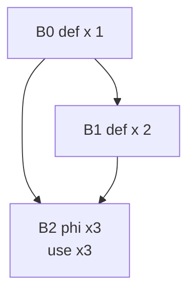
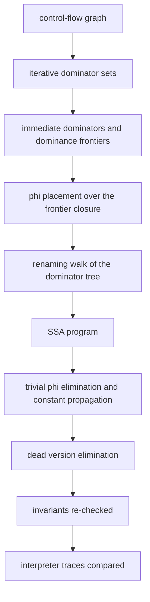
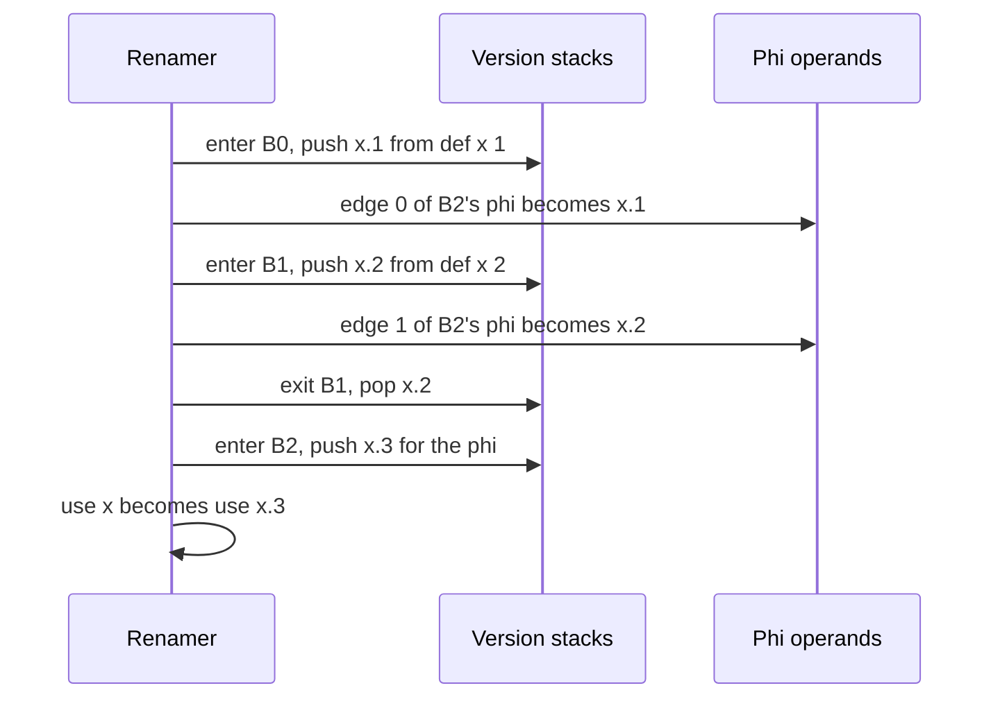

# 673 — Implement SSA construction and basic optimizations.

> **Tier:** Expert · **CTCI chapter:** Beyond — Compilers, Languages & Solvers
> **Task spec:** [673-implement-ssa-construction-and-basic-optimizations.md](../../../tasks/expert/673-implement-ssa-construction-and-basic-optimizations.md)
> **Solutions:** [Python](../../../solutions/python/expert/673-implement-ssa-construction-and-basic-optimizations/solution.py) ·
> [Java](../../../solutions/java/expert/673-implement-ssa-construction-and-basic-optimizations/Solution.java) ·
> [JavaScript](../../../solutions/javascript/expert/673-implement-ssa-construction-and-basic-optimizations/solution.js) ·
> [C#](../../../solutions/csharp/expert/673-implement-ssa-construction-and-basic-optimizations/Solution.cs)

## 1. Problem restatement

Put a small CFG into **minimal SSA** form (Cytron et al.) and then clean it up, verifying both halves.

Pipeline:

1. **Dominators** by the iterative intersection algorithm, **immediate dominators** from the dominator
   sets, and **dominance frontiers** by the standard walk up the idom chain.
2. **Phi placement** by the def-site worklist over the dominance frontier.
3. **Renaming** by a pre-order walk of the dominator tree with one stack of current versions per variable:
   every definition and every phi becomes a fresh version, every use is rewritten, and each successor's
   phi receives one operand per predecessor edge.

Optimisations on the SSA form: **trivial-phi elimination** (all operands the same version), **dead version
elimination** (unread definitions and phis, iterated to a fixpoint), and **sparse constant propagation**
(literal definitions plus phis whose operands all agree).

Concrete expectations asserted by the checks:

- Diamond `B0 = [def x 1]`, `B1 = [def x 2]`, `B2 = [use x]` with `0→{1,2}`, `1→2`: `phi["x"] == {2}` and
  exactly **one** phi, which lists **two** operands (one per predecessor `0` and `1`). Running the path
  `[0,1,2]` observes `2`, running `[0,2]` observes `1` — in the source, in the SSA form and in the
  optimised form.
- Loop `B0 = [def i 0]`, `B1 = [use i]`, `B2 = [def i]`, `B3 = [use i]` with `0→1`, `1→{2,3}`, `2→1`:
  `phi["i"] == {1}` and the **loop header starts with a phi**. On the path `[0,1,2,1,3]` the second read is
  the body's definition: the SSA trace is `[0, value_of("i", 2), value_of("i", 2)]`.
- Invariants, re-checked on 120 random CFGs and after every optimisation: every version is defined exactly
  once; every use is dominated by the definition of the version it reads, where dominance is re-verified
  against an independent brute-force oracle ("delete `d`, is the node still reachable from the entry?"); every
  phi has one operand per CFG predecessor; every phi sits in the dominance frontier of a block that defines
  or re-defines its variable. The sweep really places phis (more than 10 in total).
- Semantic preservation: a deterministic interpreter yields identical use traces for the source program, its
  SSA form and the optimised SSA form on three random paths per CFG. Optimisation never grows the program.
- Targeted checks: a hand-built phi whose only operand is its own source is removed by substitution;
  `[def x, def z]` followed by `[use x]` loses exactly the `z` definition and keeps two instructions;
  a phi fed by two equal literals folds to that constant (`7`), while two different literals (`7` and `9`)
  do **not** fold.
- Boundary cases: a straight-line program needs no phis (`{"v": set()}`, `phi_count == 0`); a read of a
  never-defined variable stays undefined, is not counted as a use, and yields the default value `0`;
  six malformed programs are rejected; the construction is deterministic.

## 2. Intuition

The naive way to make every use point at exactly one definition is to textually rename, and it breaks the
moment two paths merge: on one edge `x` came from the entry, on the other from a branch, and no single name
is correct. The insight is that the merge point needs a **phi function** — `x₃ = φ(x₁, x₂)` — that selects
by incoming edge, and that the set of blocks needing a phi for a variable is computable *before* renaming
from the dominator tree alone: a phi is needed exactly at the **dominance frontier** of a definition site,
and phis are themselves definitions, so the frontier must be taken to its closure.



Dominance is the other half of the insight: a definition dominates a use when every path from the entry to
the use passes through the definition, and that is exactly the property that makes the renaming walk well
defined. Walking the **dominator tree** in pre-order keeps the current definition of every variable on a
stack, so a use simply reads the top of its variable's stack — and popping on the way out restores the
state of the enclosing region.

## 3. Algorithm

1. Validate the CFG (one successor list per block, in-range targets, no duplicates, no self-loops) and
   require that **every** block is reachable from the entry, which minimal SSA renaming assumes.
2. Dominators: start with `dom[b] = all blocks` and `dom[entry] = {entry}`, then iterate
   `dom[b] = {b} ∪ ⋂ dom[p]` over the predecessors until nothing changes.
3. Immediate dominator of `b` is the strict dominator with the **largest** dominator set (ties by index).
4. Dominance frontier: for every block `b` with at least two predecessors, walk up the idom chain from each
   predecessor `p` while `runner ≠ idom(b)`, adding `b` to `df[runner]`.
5. Phi placement: per variable, seed a worklist with its definition sites; for each popped block add its
   dominance frontier to the variable's phi set and, if the frontier block is not already a definition site
   of that variable, push it too (the iterated closure).
6. Renaming: walk the dominator tree in pre-order, maintaining a stack of versions per variable. On entry to
   a block, emit a phi for each variable assigned one (the phi itself is a new version) and push it; for each
   instruction, a `def` pushes a fresh version and a `use` reads the stack top; when leaving, pop everything
   the block pushed. After processing a block, fill the operand slot belonging to edge `b → s` in every phi
   of `s`.
7. Precompute `value_of(var, block) = (ord(var) − ord("a") + 1)·1000 + block` so the interpreter's values do
   not depend on instruction position.
8. Optimise to a fixpoint: substitute away trivial phis, rewrite uses through the substitution, delete
   definitions and phis whose version is never used, and propagate literals — including a phi whose operands
   all folded to the same constant.

```text
function dominators(cfg)
    dom[b] = set of all blocks for every b
    dom[0] = {0}
    repeat until nothing changes
        for b = 1 to n - 1 do
            if b has no predecessor then continue
            new = intersection of dom[p] over the predecessors p of b
            new = new union {b}
            if new differs from dom[b] then dom[b] = new
    return dom

function dominanceFrontiers(cfg, idom)
    df[b] = empty set for every b
    for b = 0 to n - 1 do
        if b has fewer than two predecessors then continue
        for p in predecessors of b do
            runner = p
            while runner is not none and runner is not idom[b] do
                df[runner].add(b)
                runner = idom[runner]
    return df

function placePhis(cfg, df, variables)
    sites = definition sites per variable
    phi[v] = empty set
    for v in variables do
        work = copy of sites[v]
        while work is not empty do
            for y in sorted(df[work.pop()]) do
                if y not in phi[v] then
                    phi[v].add(y)
                    if y is not a definition site of v then work.push(y)
    return phi

function buildSsa(cfg)
    require every block is reachable from the entry
    idom = immediateDominators(dominators(cfg))
    phi = placePhis(cfg, dominanceFrontiers(cfg, idom), cfg.variables())
    slots[b] = one operand slot per predecessor edge for every phi of b
    counter[v] = 0 and stacks[v] = empty for every variable
    walk the dominator tree in pre-order, pushing (block, "enter") and (block, "exit") on a stack:
        on enter b:
            for each phi of b do
                counter[v] = counter[v] + 1; version = (v, counter[v]); push version; emit the phi
            for each instruction of b do
                if it is a definition then
                    counter[var] = counter[var] + 1; push (var, counter[var]); emit it
                else emit a use of the current stack top
            for each successor s of b do
                for each phi of s do operands[b] = current stack top of that variable
        on exit b: pop everything b pushed
    return the SSA program

function optimizeSsa(ssa)
    repeat at most 32 times
        substitute away every phi whose operands all resolve to one version
        rewrite every use through the substitution
        delete every definition or phi whose version is not used
        if nothing changed then return
```



## 4. Worked example

**The diamond.** `B0 = [def x 1]`, `B1 = [def x 2]`, `B2 = [use x]`, edges `0→1`, `0→2`, `1→2`.

| Step | Block | Result |
| --- | --- | --- |
| dominators | `B0` | `{0}` |
| dominators | `B1` | `{1} ∪ dom[0] = {0,1}` |
| dominators | `B2` | `{2} ∪ (dom[0] ∩ dom[1]) = {0,2}` |
| idom | `B1`, `B2` | `idom[1] = 0`, `idom[2] = 0` |
| frontier | `B2` (two predecessors) | from `p = 1`, `1 ≠ idom[2] = 0` → `df[1] += 2`; from `p = 0`, `0 == idom[2]` → nothing |
| phi placement | `x` | `sites = {0,1}`; popping `1` adds `2`, which is not a def site and is pushed again; `df[2] = {}` adds nothing → `phi["x"] = {2}` |

Renaming walks the dominator tree `0 → {1, 2}` in pre-order, so `B1` is entered before `B2`:

| Visit | Effect | Versions alive for `x` |
| --- | --- | --- |
| enter `B0` | `def x 1` → `x.1`; fill operand for edge `0` in `B2`'s phi | `[x.1]` |
| enter `B1` | `def x 2` → `x.2`; fill operand for edge `1` in `B2`'s phi | `[x.1, x.2]` |
| exit `B1` | pop `x.2` | `[x.1]` |
| enter `B2` | emit `phi x.3 (0: x.1, 1: x.2)`, push `x.3`; `use x` → `x.3` | `[x.1, x.3]` |

The result is `B2 = [phi x.3 {0: x.1, 1: x.2}, use x.3]`, which is what the checks assert: one phi, two
operands, one per predecessor. The interpreter picks the operand by the predecessor it arrived from, so the
path `[0,1,2]` reads `2` and the path `[0,2]` reads `1` — in the source and in the SSA form alike.



**The loop.** `B0 = [def i 0]`, `B1 = [use i]`, `B2 = [def i]`, `B3 = [use i]`, edges `0→1`, `1→{2,3}`,
`2→1`. `B1` has two predecessors, and walking up from `2` gives `df[2] = {1}` and `df[1] = {1}`, so
`phi["i"] = {1}` — the header. Renaming produces `B1 = [phi i.2 {0: i.1, 2: i.3}, use i.2]`,
`B2 = [def i.3]`, `B3 = [use i.2]`. On the path `[0,1,2,1,3]`: the first visit to `B1` arrives from `B0`, so
the phi takes `i.1 = 0`; `B2` defines `i.3 = value_of("i", 2) = 9002`; the second visit to `B1` arrives from
`B2`, so the phi takes `i.3`, and both the header's use and `B3`'s use see `9002`. The SSA trace is
`[0, 9002, 9002]`, exactly the value the checks assert.

## 5. Complexity

Let `B` be the number of blocks, `E` the number of edges, `I` the number of instructions, `V` the number of
variables and `k` the number of optimisation rounds.

| Step | Best | Average | Worst | Why the bound holds |
| --- | --- | --- | --- | --- |
| validation and predecessors | O(B + E) | O(B + E) | O(B + E) | one pass over the successor lists |
| `dominators` | O(B + E) | O(B²·E) | O(B²·E) | each sweep intersects the predecessor sets for every block, and a block's set can only lose up to `B` elements |
| `immediate_dominators` | O(B²) | O(B²) | O(B²) | a maximum over the strict dominator sets |
| `dominance_frontiers` | O(E) | O(E·B) | O(E·B) | one walk up the idom chain per predecessor edge |
| `place_phis` | O(V·D) | O(V·(D + DF)) | O(V·(D + DF)) | each phi site is pushed at most once per variable |
| `build_ssa` | O(I + E) | O(I + E·V) | O(I + E·V) | one visit per instruction plus one operand fill per edge and per phi |
| `ssa_problems` | O(I) | O(B·(B + E) + I·B) | O(B·(B + E) + I·B) | brute-force dominators plus a per-use dominance test |
| `constant_versions` | O(I) | O(k·I) | O(k·I) | each round only adds constants, so it stops after at most `I` additions |
| `optimize_ssa` | one round | `k` rounds | O(I) rounds | every round except the last deletes or folds at least one instruction |
| Space | O(B) | O(B² + I) | O(B² + I) | the dominator sets, the SSA instructions and the per-variable version stacks |

The brute-force oracle costs O(B·(B + E)) per CFG and is intentionally more expensive than the analysis:
independence, not speed, is what makes it a valid check.

## 6. Pitfalls and edge cases

- **Every block must be reachable.** Minimal SSA renaming assumes the entry has no incoming edges and that
  every block is reached from it; an unreachable block would need a phi at the entry with no operand to
  stand for the incoming value. The file rejects such a CFG instead of producing a malformed answer.
- **Phis are definitions.** The worklist must push a frontier block back when it is not already a def site of
  the variable, otherwise the closure stops too early and a merge deeper in the graph gets no phi.
- **The lambda-shaped trap.** A variable defined only in the entry, which dominates the join, needs **no**
  phi; the diamond check asserts exactly one phi for `x`, and the straight-line check asserts
  `phi_count == 0`.
- **Operands are per edge, not per phi.** Two edges from the same predecessor to one successor would need
  duplicate roles; the files reject duplicate successors, and each operand slot is keyed by the predecessor
  block.
- **Push and pop must be balanced.** The renaming walk pops exactly what a block pushed; a use inside a block
  that appears after the block's own definition must read the new version, and a use that appears before any
  definition stays undefined rather than silently reading a stale version.
- **Undefined reads are explicit.** Java denotes them with a pseudo-name `|undef|` and its interpreter
  asserts the count of undefined reads stays zero; Python stores `None` and reports it as the default value
  `0` while *not* counting it as a use.
- **Optimisation must not break SSA.** After every round the full invariant suite is re-run; the files assert
  that trivial-phi elimination and dead version elimination keep the form well defined and never grow the
  program.
- **Constant propagation must be conservative.** A phi folds only when **every** operand folded and all agree;
  the checks compare the `7`/`7` case against the `7`/`9` case, where no constant is produced.
- **Substitution must be transitive.** A phi replaced by another phi needs the replacement followed through
  (`resolve`), otherwise uses can end up pointing at a version that no longer exists.
- **Trace equivalence is the real test.** All the structural invariants can hold on a wrong program;
  comparing interpreter traces of the source, the SSA form and the optimised form on the same paths is what
  establishes soundness.
- **Documented simplification (Python).** Scalars only, no arrays or aliasing, a definition carries an
  optional literal instead of an expression tree, and the CFG must be fully reachable from the entry.
- **Cross-language extras.** Java implements the full optimisation menu — constant folding, copy
  propagation, trivial-phi elimination and dead-code elimination — and requires that the original, the SSA
  and the optimised program return the same value on deterministic inputs. JavaScript folds a constants-only
  program to `2, 5, 10, 8`, asserts that folding and phi removal are idempotent, and leaves unreachable
  blocks out. C# adds a **phi justification** cross-check: a state exploration over
  `(block, last-definition-per-variable)` must agree that every surviving phi sits at a block where at least
  two different definitions can arrive.

## 7. Variants and follow-ups

- Dominance is computed from the CFG; the analyses that feed it are
  [671 — reaching definitions](../../../tasks/expert/671-implement-static-program-analysis-reaching-definitions-simple-al.md) and
  [672 — liveness and dead code elimination](../../../tasks/expert/672-implement-liveness-analysis-on-small-cfg-and-dead-code-eliminati.md).
- The SSA form exists to make the interference graph easy; that is where this leads →
  [674 — register allocation via graph coloring](../../../tasks/expert/674-implement-register-allocation-via-graph-coloring-simplified.md).
- The same CFG infrastructure used for scheduling instructions instead of rewriting them →
  [675 — instruction scheduling heuristics for a pipelined CPU model](../../../tasks/expert/675-implement-instruction-scheduling-heuristics-for-pipelined-cpu-mo.md).
- Loop-level transformations that consume SSA →
  [680 — auto-parallelization heuristics for loops](../../../tasks/expert/680-implement-auto-parallelization-heuristics-for-loops-dependence-a.md).

## 8. Check yourself

<details><summary>Show answer</summary>
**Why does the diamond need a phi for `x` while a variable defined only in the entry does not?** A phi is
needed where two different definitions can arrive and none of them dominates the merge. In the diamond `B0`
and `B1` both define `x` and neither dominates `B2`, so `B2` is in `df[1]`. A definition in the entry
dominates every reachable block, so its uses can read it directly and no phi is placed.
</details>

<details><summary>Show answer</summary>
**Why must the phi worklist be re-driven when a phi site is added?** Because a phi *is* a definition of the
variable. Placing a phi in block `y` can make a merge further along `y`'s dominance frontier require another
phi, so `y` has to be pushed back and processed like any definition site.
</details>

<details><summary>Show answer</summary>
**What does the renaming walk use to decide which version a use reads, and why is that valid?** The top of the
per-variable stack, maintained along a pre-order walk of the dominator tree. A definition dominates every use
it can reach, so when the walk reaches a use, the innermost enclosing definition on the dominator path is
exactly the definition that reaches it — and popping on the way out restores the state for sibling subtrees.
</details>

<details><summary>Show answer</summary>
**Why is each phi operand keyed by an edge rather than by position in a list?** One operand is needed per
predecessor, and at renaming time the operand belonging to edge `b → s` is exactly the version current at the
end of `b`. Keying by the predecessor makes the fill order irrelevant and lets the interpreter select the
operand by the block it arrived from; the checks assert the operand count equals the predecessor count.
</details>

<details><summary>Show answer</summary>
**What could go wrong if `optimize_ssa` accepted a fold that is not conservative?** A phi whose operands
disagree would be replaced by one arbitrary value, silently changing what some path reads. That is why
`constant_versions` folds only when every operand folded to the same constant, and why every optimisation
round is followed by a re-run of the SSA invariants *and* by a trace comparison against the source program.
</details>
