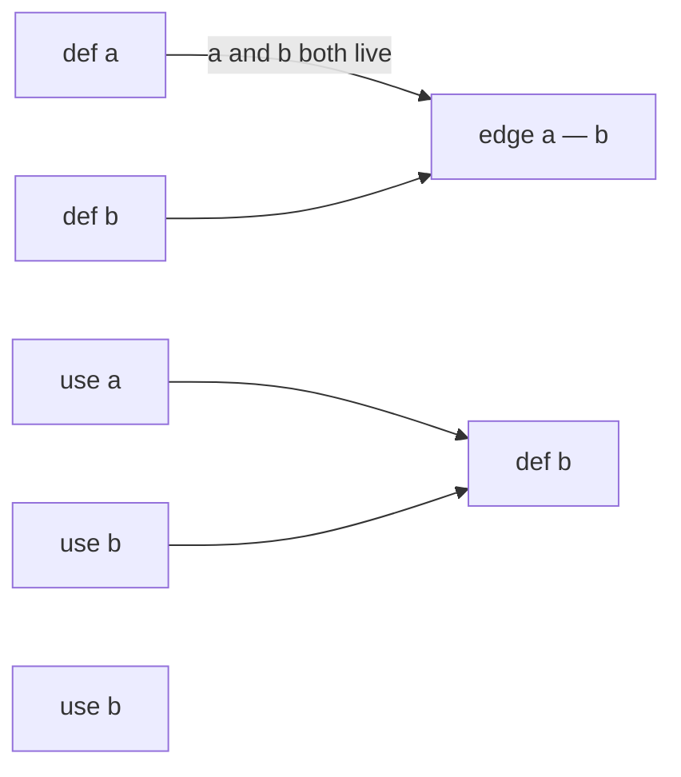
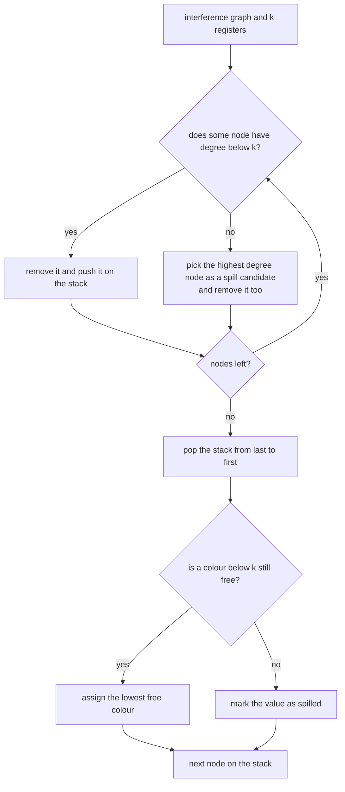
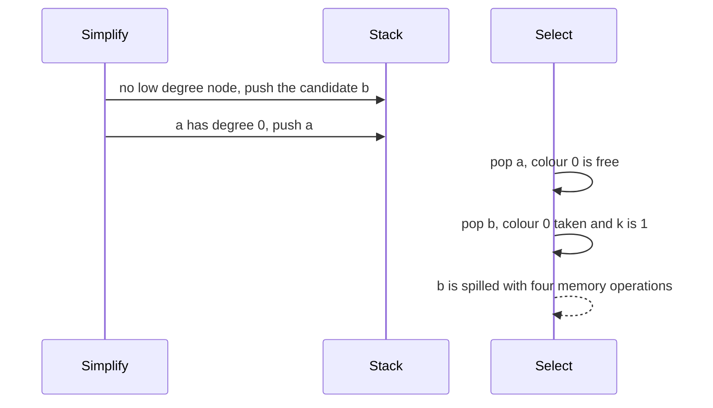

# 674 — Implement register allocation via graph coloring (simplified).

> **Tier:** Expert · **CTCI chapter:** Beyond — Compilers, Languages & Solvers
> **Task spec:** [674-implement-register-allocation-via-graph-coloring-simplified.md](../../../tasks/expert/674-implement-register-allocation-via-graph-coloring-simplified.md)
> **Solutions:** [Python](../../../solutions/python/expert/674-implement-register-allocation-via-graph-coloring-simplified/solution.py) ·
> [Java](../../../solutions/java/expert/674-implement-register-allocation-via-graph-coloring-simplified/Solution.java) ·
> [JavaScript](../../../solutions/javascript/expert/674-implement-register-allocation-via-graph-coloring-simplified/solution.js) ·
> [C#](../../../solutions/csharp/expert/674-implement-register-allocation-via-graph-coloring-simplified/Solution.cs)

## 1. Problem restatement

Assign each variable of a straight-line program to one of `k` machine registers so that two variables that
are needed at the same time never share a register, and report the variables that must live in memory
instead.

Two stages, both verified:

| Stage | Output |
| --- | --- |
| `interference(program)` | the interference graph: an edge whenever two values are live at a common program point |
| `color_graph(graph, k)` | `(colors, spills, spill_candidates, nodes)` — a proper colouring with colours `< k` plus the values that got none |

Concrete expectations asserted by the checks. The reference program is
`[def a, def b, use a, use b, def b, use b]`:

- The live-out sets are `[{}, {a}, {a,b}, {b}, {}, {b}, {}]`, so **nothing** is live before the first
  definition or after the last use, the peak is **2**, and `a` stops interfering once it is dead.
- `graph["a"] == {"b"}` and `graph["b"] == {"a"}` — one edge — and the independent "value-point" oracle
  produces the same edge set.
- `[def a, use a, def b, use b]` has **no** edges: values whose live ranges do not overlap must not
  interfere.
- 100 single-assignment programs × `k = 1..4`: every colouring is proper, every value is either coloured or
  spilled, `chi == peak` (the brute-force chromatic number equals the maximum number of simultaneously live
  values), and — the exact statement — **spilling happens if and only if `peak > k`**. More than 20
  spill cases occur.
- 60 programs that reuse variables: the edge set still matches the oracle and is a subset of the pairs that
  are simultaneously live somewhere; whenever the allocator returns no spills, `chi <= k`. Spilling occurs
  somewhere in the sweep.
- 120 random 6-node graphs: colouring is proper, spilled nodes get no colour, coloured + spilled covers every
  node, at least one graph spills and at least one is optimally 3-coloured.
- A triangle needs 3 colours: `k = 2` spills **exactly one** value, `k = 3` spills none and uses all three
  registers. A 5-cycle (also `chi = 3`) fits in three registers and spills at least one value with two.
- Boundary cases: the empty graph needs nothing (`chi == 0`), an isolated value takes colour 0 with a single
  register, a definition with no use interferes with nothing, `k = 0`, a self-loop and `k = -1` are
  rejected, and the allocation is deterministic.

## 2. Intuition

Two variables can share a register exactly when their live ranges never overlap, so "how many registers do
I need at this point?" is the size of the live set — which is why the maximum number of simultaneously live
values (`omega`) is the natural lower bound. Turning that into an allocation is the interference graph:
build the graph, then colour it with `k` colours.

The naive colouring is a greedy pass in arbitrary node order, and it fails on graphs that are perfectly
`k`-colourable: a greedy pass can paint itself into a corner. Chaitin's insight is to colour the graph
**backwards** from a simplification order: repeatedly remove a node with fewer than `k` neighbours (it can
always be coloured later, whatever its neighbours do) and push it on a stack; then pop the stack and give
each node the lowest colour its already-coloured neighbours do not use.



Briggs' refinement is the second insight: when no node has degree `< k` any more, do not give up — pick a
high-degree node as a **potential** spill, remove it anyway, and try to colour it on the way back. Those
"optimistic" candidates often fit after all, and only the nodes that really find no free colour become
actual spills.

## 3. Algorithm

1. Compute the live-out set at every program point with one backward scan: a `use` adds its variable, a
   `def` removes it, and the set is recorded at each of the `n + 1` points.
2. Re-derive liveness independently: `v` is live at point `i` when some later `use` of `v` exists with no
   `def` of `v` between `i` and that use.
3. `omega` is the maximum size of a recorded live set (the clique number when live ranges are intervals).
4. Build the interference graph: for every definition at point `i` whose variable is still live at `i + 1`,
   join it to every other variable live right after the definition. Definitions that are never read again
   are skipped — dead code elimination would have removed them. Drop self-loops.
5. Colour with `k` registers — simplify / spill / select:
   - while nodes remain: if some node has degree `< k`, remove the lowest-index such node (push it); else
     choose the highest-degree node as a spill **candidate** and remove it anyway;
   - pop the stack: give the node the lowest colour not used by its already-coloured neighbours; if none is
     free, mark it spilled.
6. Report the spills and count the memory traffic they imply — one store per definition and one load per use
   of a spilled value.
7. Cross-check the graph with two oracles: the "value-point" edge oracle (`needed_points`, from each use back
   to its producer) and the co-liveness oracle (pairs that appear together in some live set). Check every
   colouring for properness and coverage, and compare against the brute-force chromatic number.

```text
function livenessPoints(program)
    points = empty set for every point
    live = empty set
    for i = length(program) - 1 down to 0 do
        op, var = program[i]
        if op = "def" then live.discard(var) else live.add(var)
        points[i] = copy of live
    return points

function interference(program)
    points = livenessPoints(program)
    graph[var] = empty set for every variable in program
    for i, (op, var) in enumerate(program) do
        if op is not "def" or var is not in points[i + 1] then continue
        for other in points[i + 1] do
            if other != var then
                graph[var].add(other)
                graph[other].add(var)
    return graph

function colorGraph(graph, k)
    require k >= 1 and no self loops
    work = copy of graph
    stack = empty list
    candidates = empty list
    while work is not empty do
        low = nodes of work with degree < k, sorted
        if low is not empty then
            node = low[0]
        else
            node = the node of work with the greatest (degree, name)
            candidates.append(node)
        stack.push(node)
        for other in work[node] do work[other].discard(node)
        remove node from work
    colors = empty map
    spills = empty list
    while stack is not empty do
        node = stack.pop()
        taken = colours of the coloured neighbours of node in graph
        free = the lowest colour below k that is not in taken
        if free exists then colors[node] = free else spills.append(node)
    return colors, sorted(spills), sorted(candidates)
```



## 4. Worked example

**Liveness and the graph** for `[def a, def b, use a, use b, def b, use b]`.

| Point | Instruction | Live after the point |
| --- | --- | --- |
| 0 | `def a` | `{a}` |
| 1 | `def b` | `{a, b}` |
| 2 | `use a` | `{b}` |
| 3 | `use b` | `{}` |
| 4 | `def b` | `{b}` |
| 5 | `use b` | `{}` |
| 6 | — | `{}` |

The peak is 2, so `omega = 2`, and the graph construction adds an edge only at point 1: the definition of
`b` meets `{a, b}` live afterwards, so `a — b`. At point 0 the definition of `a` meets only `a` live
afterwards, so no edge; at point 4 the definition of `b` meets only `b`.

**Colouring with `k = 1`.** No node has degree below 1, so the allocator takes a candidate: the highest
degree node, `b`.

| Phase | Action | Stack | Work left |
| --- | --- | --- | --- |
| simplify | no node has degree `< 1` → push candidate `b` | `[b]` | `{a}` |
| simplify | `a` now has degree 0 `< 1` → push `a` | `[b, a]` | `{}` |
| select | pop `a`, no coloured neighbours → colour `0` | `[b]` | — |
| select | pop `b`, neighbour `a` uses colour `0`, no free colour | `[]` | **spilled** |

With one register the program must spill something, and exactly one value (`b`) does; its memory traffic is
4 operations — two definitions and two uses appear in the program, which is what the check
`spill_traffic(program, ["b"]) == 4` asserts. With `k = 2` both nodes simplify immediately, `b` takes colour
0 and `a` gets colour 1: no spills.



**Why the interval case is exact.** When every value is defined once, live ranges are intervals, the
interference graph is an interval graph, and for interval graphs the clique number equals the chromatic
number. So `omega = peak = chi`, and the allocator must spill **iff** `peak > k` — no heuristic slack. The
checks verify that equivalence for 100 programs and `k = 1..4`, which pins the graph construction and the
colouring together: a missing edge would break `chi == peak`, an extra edge would break the "no spill while
`peak <= k`" direction.

## 5. Complexity

Let `n` be the instruction count, `V` the number of variables, `E` the number of interference edges and
`k` the register count.

| Step | Best | Average | Worst | Why the bound holds |
| --- | --- | --- | --- | --- |
| `liveness_points` | O(n) | O(n) | O(n) | one backward scan, one set copy per point |
| `live_oracle` | O(n·V) | O(n²·V) | O(n²·V) | for each point and variable it scans forward for a use |
| `interference` | O(n) | O(n·V) | O(n·V) | per definition it touches the live set right after it |
| `overlap_edges` | O(V²) | O(V²) | O(V²) | all variable pairs compared through their point sets |
| `color_graph` simplify | O(V) | O(V²) | O(V²) | at most `V` removals, each scanning the remaining nodes for a low-degree one and updating its neighbours |
| `color_graph` select | O(V·k) | O(V·k + E) | O(V·k + E) | per node it collects the neighbours' colours and probes up to `k` of them |
| `chromatic_number` | O(1) | exponential | O(k^V) | backtracking over colours; only used on graphs small enough to afford it |
| `spill_traffic` | O(n) | O(n) | O(n) | one pass over the instructions |
| Space | O(n + V) | O(E) | O(V²) | the graph, the live sets and the stack |

The attractively cheap part is liveness — O(n) for straight-line code — and the expensive parts are the
checks: the brute-force chromatic number is exponential and the interval-exactness sweep only works because
those graphs are small. The spill decision itself is linear-ish in the graph, which is why an optimistic
round is worth trying before committing to memory traffic.

## 6. Pitfalls and edge cases

- **A definition that is never read again interferes with nothing.** The graph skips dead definitions; without
  that, dead code would consume registers. The check `interference([("def","x")]) == {"x": set()}` pins it.
- **Live ranges that merely touch are not overlapping.** `[def a, use a, def b, use b]` produces no edges:
  the analysis records live sets *after* each point, so `a` is dead the moment `def b` executes.
- **Optimistic do-not-give-up is the point.** Returning "cannot colour" as soon as nothing has degree `< k`
  would spill on graphs that are perfectly colourable; the checks compare against the brute-force chromatic
  number and require spilling to be exactly equivalent to `peak > k` on interval graphs.
- **Colours must stay below `k`.** The properness check rejects any colour outside `[0, k)`, and spilled
  nodes must appear in no colour at all.
- **Coverage.** Every variable is either coloured or spilled; a node silently dropped from both is a bug the
  check `len(colors) + len(spills) == len(graph)` catches.
- **Self-loops and a zero or negative register file raise**; a graph with a self-loop has no colouring at all.
- **The triangle is the smallest hard case.** `chi = 3`, so `k = 2` must spill exactly one value while
  `k = 3` must colour all three — and use all three registers.
- **Odd cycles are where greedy order matters.** A 5-cycle has `chi = 3` but *no* node of degree `< 2`, so
  the candidate mechanism is exercised; the checks require no spills with `k = 3` and at least one with
  `k = 2`.
- **Heuristic versus exact is stated, not hidden.** Greedy colouring is a heuristic: on programs that reuse
  variables (live ranges are then disjoint unions of intervals, not intervals) the file claims only validity
  and "a spill-free colouring proves `chi <= k`", never optimality.
- **Documented simplification (Python).** Straight-line code rather than a CFG, so liveness needs no
  fixpoint; and spilling is **not** followed by live-range splitting and re-colouring — spilled values are
  accounted for as reload traffic only, which is stated where the cost is reported.
- **Cross-language notes.** Java retries simplify/select with a few deterministic node orders and keeps the
  run with the fewest spills, and it runs the allocated code through a machine model with `k` registers plus
  memory that must reproduce the naive interpreter's result for every program and every `k` — a missing edge
  makes that fail. JavaScript models the classic coalescing exception (`d := s` creates no `d`–`s` edge when
  `s` dies at that point) and checks that a clique of `n` variables spills exactly `max(0, n − k)`. C# builds
  the graph twice — from live intervals and from per-point live sets — compares the two, and reports the
  measured miss rate of the heuristic on colourable graphs instead of pretending it cannot happen.

## 7. Variants and follow-ups

- The analysis that produces interference in the first place →
  [672 — liveness analysis and dead code elimination](../../../tasks/expert/672-implement-liveness-analysis-on-small-cfg-and-dead-code-eliminati.md).
- Where the live ranges come from once they cross blocks →
  [673 — SSA construction and basic optimizations](../../../tasks/expert/673-implement-ssa-construction-and-basic-optimizations.md).
- The stage right after allocation: ordering the instructions for the pipeline →
  [675 — instruction scheduling heuristics for a pipelined CPU model](../../../tasks/expert/675-implement-instruction-scheduling-heuristics-for-pipelined-cpu-mo.md).
- Register pressure driven from the source side by loop transformations →
  [680 — auto-parallelization heuristics for loops](../../../tasks/expert/680-implement-auto-parallelization-heuristics-for-loops-dependence-a.md).

## 8. Check yourself

<details><summary>Show answer</summary>
**Why is `omega` — the maximum number of simultaneously live values — a lower bound on the registers
needed?** Those values are all live at one program point, so they are pairwise adjacent in the interference
graph and form a clique; a clique of size `omega` needs `omega` distinct colours, hence
`chi >= omega` registers.
</details>

<details><summary>Show answer</summary>
**Why is spilling with `k` registers exactly equivalent to `peak > k` for single-assignment programs?** Each
value is defined once, so its live range is a single interval; the interference graph of intervals is an
interval graph, and for interval graphs `chi == omega`. The allocator reports no spills exactly when it found
a `k`-colouring, and a `k`-colouring exists exactly when `chi = peak <= k`.
</details>

<details><summary>Show answer</summary>
**What does the "optimistic" step buy, and what does it cost if it fails?** When no node has degree `< k`,
removing a high-degree node anyway lets the remaining graph simplify, and the removed node often still finds
a colour on the way back — so graphs that are `k`-colourable are frequently coloured without spills. If it
does not find a colour it simply joins the spill list, exactly as the pessimistic rule would have decided,
so the step can only help.
</details>

<details><summary>Show answer</summary>
**Why is the graph built from the definition rather than from both endpoints of a live range?** Two values
interfere only when they are simultaneously live, and a value becomes live at its definition — so it is enough
to join the definition to everything live right after it. Joining `use` sites as well would be redundant (the
value is already in the live set) and would create edges for values that are already dead.
</details>

<details><summary>Show answer</summary>
**The allocator returns a proper colouring with no spills — what have you proved?** That the interference
graph is `k`-colourable, i.e. `chi <= k`. It does not prove the graph is *not* colourable with fewer
registers, and it says nothing about programs whose live ranges are disjoint unions of intervals; the files
state the heuristic's limits rather than claiming optimality.
</details>
