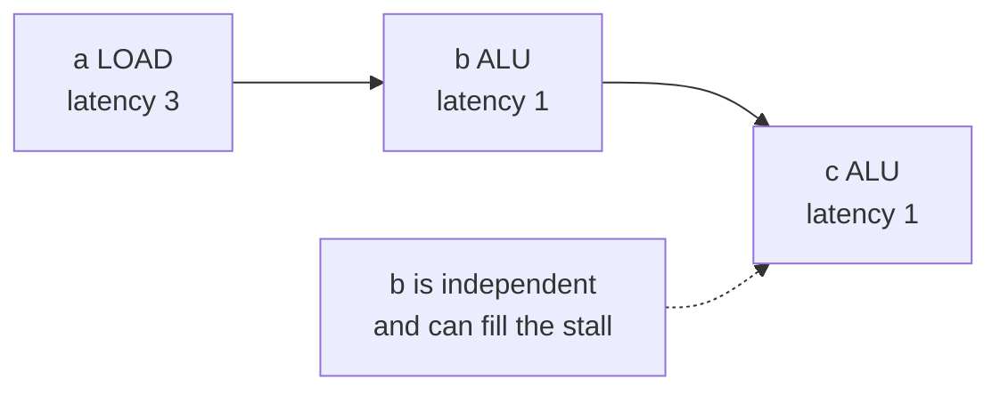
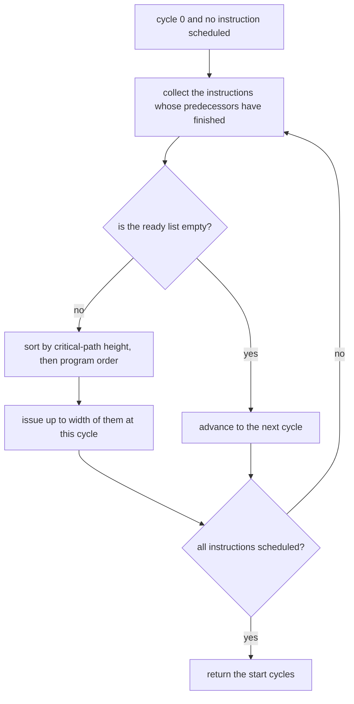
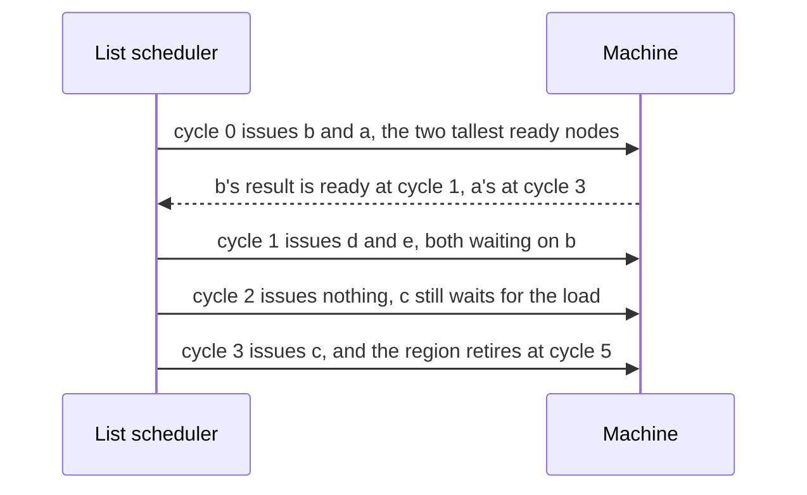

# 675 — Implement instruction scheduling heuristics for pipelined CPU model.

> **Tier:** Expert · **CTCI chapter:** Beyond — Compilers, Languages & Solvers
> **Task spec:** [675-implement-instruction-scheduling-heuristics-for-pipelined-cpu-mo.md](../../../tasks/expert/675-implement-instruction-scheduling-heuristics-for-pipelined-cpu-mo.md)
> **Solutions:** [Python](../../../solutions/python/expert/675-implement-instruction-scheduling-heuristics-for-pipelined-cpu-mo/solution.py) ·
> [Java](../../../solutions/java/expert/675-implement-instruction-scheduling-heuristics-for-pipelined-cpu-mo/Solution.java) ·
> [JavaScript](../../../solutions/javascript/expert/675-implement-instruction-scheduling-heuristics-for-pipelined-cpu-mo/solution.js) ·
> [C#](../../../solutions/csharp/expert/675-implement-instruction-scheduling-heuristics-for-pipelined-cpu-mo/Solution.cs)

## 1. Problem restatement

Schedule a dependency DAG of instructions on an in-order pipelined machine so the whole region finishes as
early as possible. Instructions are DAG nodes with an operation class that fixes their **latency**, the
machine issues at most `width` instructions per cycle, and an instruction may only start once every
predecessor has completed (not merely issued).

| Latency model (Python) | `ALU` | `LOAD` | `STORE` | `MUL` | `BR` |
| --- | --- | --- | --- | --- | --- |
| cycles until the result is ready | 1 | 3 | 1 | 4 | 1 |

Three schedulers are compared:

| Scheduler | Rule |
| --- | --- |
| `in_order_schedule` | the baseline: keep program order, place each instruction at the earliest legal cycle |
| `list_schedule` | at every cycle, among the ready instructions issue up to `width` of them with the greatest **critical-path height**, ties by program order |
| `optimal_makespan` | brute force over every dependency-respecting order with the same earliest-placement rule |

Concrete expectations asserted by the checks:

- Chain `a = LOAD`, `b = ALU(a)`, `c = ALU(b)` with `width = 2`: the baseline schedule is
  **`[0, 3, 4]`** — the ALU op waits exactly for the load — the makespan is **5**, the critical path is also
  5, list scheduling produces the same starts, and brute force finds the same optimum.
- Reorderable region `a = LOAD`, `b = ALU`, `c = ALU(a)`, `d = MUL(b)`, `e = ALU(b)` with `width = 2`: list
  scheduling is **never worse** than program order, never beats the critical path, and never beats the
  brute-force optimum.
- 60 random DAGs × widths 1–3: both schedules are **legal** on every one, `critical_path <= list <= in-order`,
  and the sweep must contain cases where list scheduling really wins (more than 5) and cases where it is
  **provably optimal** (at least one).
- Monotonicity: with the same order, raising a latency may never shorten a schedule.
- `width = 1` serialises issue — every instruction gets its own start cycle and the makespan is at least the
  instruction count — and a wider machine never issues later (the sum of start times does not grow).
- Legality is re-checked structurally: every dependency keeps the **full latency gap**, no cycle issues more
  than `width` instructions, and every instruction is scheduled.
- Five malformed inputs are rejected: an unknown dependency, an unknown operation class, a self-dependency, an
  order that violates a dependency, and `width = 0`.

## 2. Intuition

The naive answer is "keep the program's order", and it is legal but wasteful: a load feeding an ALU op
stalls the machine for two whole cycles while completely independent work sits idle. The insight is that
instruction scheduling is *list scheduling on a DAG*: at each cycle, take the ready instructions — those
whose predecessors have completed — and spend the issue slots on the ones that matter most.

What makes an instruction "matter most" is the **critical-path height**: the longest latency-weighted path
from the instruction to a sink. An instruction that starts a four-cycle multiply chain has to run early or
the whole region is delayed; an instruction at the end of a short chain can wait.



The second insight is that this heuristic has a *verifiable* bracket. No schedule can beat the critical path
(it is a chain of dependent work), and any schedule is no worse than the *worst* dependency-respecting order
processed the same way — so brute-forcing every legal order on a small DAG gives both an independent optimum
and an independent worst case to compare against.

## 3. Algorithm

1. Validate the program: known operation classes, known dependency names, and an **acyclic** dependency graph
   (checked with a three-colour DFS); build the successor lists.
2. Compute the critical-path height of each node as `latency(node) + max(height(successor))`, memoised over
   the DAG.
3. `earliest_placement(order, width)` places instructions in a given order: for each node, the earliest cycle
   is the maximum over its dependencies of `start[dep] + latency(dep)`, pushed forward while the cycle already
   holds `width` instructions. An order that reaches a node before one of its dependencies raises.
4. The baseline is that function applied to program order.
5. `list_schedule` walks cycle by cycle: collect the ready instructions whose predecessors have all finished by
   the current cycle, sort them by `(-height, index)`, issue up to the remaining width, then advance the
   cycle. Stop when every instruction is scheduled.
6. The makespan is `max(start[i] + latency[i])`.
7. `schedule_problems` re-validates a schedule from scratch: nothing unscheduled, no negative start, every
   dependency satisfied with the full latency gap, and no cycle over the issue width.
8. `optimal_makespan` enumerates permutations, keeps the dependency-respecting ones, places them with the same
   rule and returns the best makespan. It is exact because the optimal schedule is reproduced by list
   scheduling ordered by start times.

```text
function heights(program)
    height[node] = latency(kind[node]) + max(height[successor] for successor in succ[node]), or 0
    return memoised heights for every node

function earliestPlacement(program, order, width)
    require width >= 1
    start[node] = none for every node
    occupied = empty map from cycle to count
    for node in order do
        cycle = 0
        for dep in dependencies of node do
            if start[dep] is none then raise "order violates the dependency"
            cycle = max(cycle, start[dep] + latency(kind[dep]))
        while occupied[cycle] >= width do cycle = cycle + 1
        start[node] = cycle
        occupied[cycle] = occupied[cycle] + 1
    return start

function listSchedule(program, width)
    require width >= 1
    start[node] = none for every node
    scheduled = 0
    cycle = 0
    while scheduled < n do
        ready = nodes whose start is none and whose dependencies all satisfy
                start[dep] + latency(kind[dep]) <= cycle
        sort ready by descending height, then by program order
        for node in the first (width - issued at this cycle) entries of ready do
            start[node] = cycle
            scheduled = scheduled + 1
        cycle = cycle + 1
    return start

function optimalMakespan(program, width)
    best = none
    for order in permutations of the nodes do
        if order violates no dependency then
            span = makespan(earliestPlacement(program, order, width))
            best = span if best is none or span < best
    return best
```



## 4. Worked example

**A load-use chain.** `a = LOAD` (3 cycles), `b = ALU(a)`, `c = ALU(b)`, `width = 2`.

| Cycle | Occupied | Waiting | Start assigned |
| --- | --- | --- | --- |
| 0 | — | `a` is ready (no dependencies) | `a = 0` |
| 1 | — | `b` needs `a`'s result, ready at cycle 3 | — |
| 2 | — | still waiting | — |
| 3 | — | `b` becomes ready | `b = 3` |
| 4 | — | `c` needs `b`'s result, ready at cycle 4 | `c = 4` |

Makespan `= max(0+3, 3+1, 4+1) = 5`, which equals the critical path of the chain, so nothing can be
improved here and all three schedulers agree — exactly what the checks assert.

**The same machine with independent work to fill the stalls.**
`a = LOAD`, `b = ALU`, `c = ALU(a)`, `d = MUL(b)`, `e = ALU(b)`, `width = 2`. Heights: `b = 1 + 4 = 5`
(through the multiply), `a = 3 + 1 = 4`, `d = 4`, `c = 1`, `e = 1`.

| Scheduler | Cycle 0 | Cycle 1 | Cycle 2 | Cycle 3 | Makespan |
| --- | --- | --- | --- | --- | --- |
| in-order (`a`, `b`, `c`, `d`, `e`) | `a` at 0, slot 2 holds nothing until `b` at 1 | `b` at 1 | `d` at 2, `e` at 2 | `c` at 3 (waits for `a`) | **6** |
| list scheduling | `b` at 0, `a` at 0 (heights 5 and 4) | `d` at 1, `e` at 1 | idle (`c` waits for `a`) | `c` at 3 | **5** |

List scheduling reaches the critical path (5) while program order needs 6, because it starts the tall
`b → d` chain immediately instead of leaving the second issue slot empty behind the load.



**Why the brute force is exact.** Any optimal schedule can be turned into a scheduling *order* — sort its
instructions by start cycle — and feeding that order to the earliest-placement rule reproduces a schedule no
later than the original, because the rule only ever moves an instruction earlier within the freedom the
dependencies allow. So the best over all legal orders is the true optimum, and the checks use it as an
independent bracket for the heuristic.

## 5. Complexity

Let `V` be the instruction count, `E` the number of dependency edges, `w` the issue width and `span` the
makespan.

| Step | Best | Average | Worst | Why the bound holds |
| --- | --- | --- | --- | --- |
| validation and successors | O(V + E) | O(V + E) | O(V + E) | one pass over the specs plus a DFS for the cycle check |
| heights | O(V + E) | O(V + E) | O(V + E) | memoised longest path over a DAG |
| `earliest_placement` | O(V) | O(V + E + span) | O(V² + E·V) | each node scans its dependencies, then advances over occupied cycles |
| `in_order_schedule` | O(V + E + span) | O(V + E + span) | O(V² + E·V) | one placement pass in program order |
| `list_schedule` | O(V) | O(V log V + span·V) | O(V² log V) | per cycle it rebuilds the ready list and sorts it; ready nodes are re-scanned every cycle |
| `makespan` | O(V) | O(V) | O(V) | one maximum over the starts |
| `schedule_problems` | O(V + E) | O(V + E) | O(V + E) | one pass over the edges plus a pass over the occupied cycles |
| `optimal_makespan` | O(V·(V + E)) | O(V!·(V + E)) | O(V!·(V + E)) | every permutation is filtered and placed; only usable on small DAGs, which is the point |
| Space | O(V + E) | O(V + E) | O(V + E + span) | the DAG, the heights, the start array and the per-cycle counters |

The heuristic is cheap — roughly `V` work per cycle of the schedule — while the exact solver is factorial,
which is why list scheduling is the practical choice and brute force the oracle. Lower bounds to compare
against: the critical path (a chain of dependent work cannot be compressed) and, in the wider machine model
the C# file uses, `total work / issue width`.

## 6. Pitfalls and edge cases

- **Latency, not just ordering, is the constraint.** A successor must start at or after
  `start[predecessor] + latency(predecessor)`; a schedule that only respects the *order* of the edges passes a
  topological check and still stalls the machine. `schedule_problems` re-checks the full gap on every edge.
- **The issue width is a hard resource.** No cycle may hold more than `width` starts, and with `width = 1`
  every instruction gets a distinct cycle — the checks assert both.
- **A cycle-in-the-DAG input is rejected.** Scheduling a cyclic dependency graph has no meaning, so the
  constructor runs a three-colour DFS before anything else.
- **The order given to `earliest_placement` must be dependency-respecting.** Reaching a node whose dependency
  has no start yet raises rather than silently scheduling nonsense.
- **The heuristic can be optimal.** On the simple chain all three schedulers agree, and on some random DAGs
  list scheduling attains the brute-force makespan; the sweep requires at least one such case, so the
  heuristic is not dismissed as merely "good enough".
- **The heuristic never loses to program order.** The checks compare 60 random instances and require
  `list <= baseline` on every one, with more than five strict wins.
- **Monotonicity of the model.** With a fixed order, raising a latency may not shorten the makespan; a
  scheduler that reports a shorter schedule after a slower operation is a bug, and the sweep checks this
  instance by instance.
- **Degenerate DAGs.** An empty or single-instruction region, a fully independent region (one cycle per
  instruction), and a long chain (makespan equal to the sum of latencies) are all in the checks.
- **Ties must be broken deterministically.** Ready instructions of equal height are ordered by program order
  so repeated runs produce identical schedules.
- **Documented simplification (Python).** A single issue width for all instruction classes — no separate
  load/store or multiply units — no register-file or bus conflicts, no branch prediction, and the DAG is given
  rather than extracted from a basic block.
- **Cross-language notes.** Java uses a different latency model (load 4, multiply 3, add/sub 1, branch 2) and
  measures stall filling: overlapping two loads drops the load-use example from 11 to 7 cycles. JavaScript
  offers three priorities (critical path, declaration order, a seeded permutation as a control) and computes
  both the best and the *worst* order by brute force. C# models a class with several parallel units, re-simulates
  every schedule cycle by cycle independently of the algorithm that produced it, and reports how often
  critical-path priority attains the brute-force optimum rather than assuming it.

## 7. Variants and follow-ups

- The stage before scheduling, where the registers are decided →
  [674 — register allocation via graph coloring](../../../tasks/expert/674-implement-register-allocation-via-graph-coloring-simplified.md).
- The other pipeline trick, predicting the branch instead of reordering around it →
  [676 — speculatively executed branch prediction simulation](../../../tasks/expert/676-implement-speculatively-executed-branch-prediction-simulation.md).
- Dependencies that are not just data: proving a loop's iterations are independent →
  [680 — auto-parallelization heuristics for loops](../../../tasks/expert/680-implement-auto-parallelization-heuristics-for-loops-dependence-a.md).
- Scheduling independent work over many threads rather than issue slots →
  [699 — GPU-style parallel prefix-sum algorithm simulation](../../../tasks/expert/699-implement-gpu-style-parallel-prefix-sum-algorithm-simulation.md).

## 8. Check yourself

<details><summary>Show answer</summary>
**Why is the critical path a lower bound on the makespan?** It is a chain of instructions in which each one
depends on the previous, so they can never overlap; the machine must spend at least the sum of their
latencies, whatever the issue width.
</details>

<details><summary>Show answer</summary>
**Why is "longest latency path to a sink" the right priority rather than "longest path from the source"?**
What still has to happen *after* an instruction is what an early stall costs you: a node with a tall subtree
delays the whole region if it starts late, while a node whose subtree is short can be deferred. The
critical-path height measures exactly that remaining work.
</details>

<details><summary>Show answer</summary>
**Why does brute force have to filter permutations instead of searching all of them?** Only orders that
respect the dependencies correspond to executable schedules; a permutation that reaches a node before its
predecessor is not a schedule at all. Filtering and then applying the earliest-placement rule enumerates
exactly the schedules reachable by an ordering, which — by sorting any optimal schedule by start time — is a
superset of the optimum.
</details>

<details><summary>Show answer</summary>
**In the reorderable example, why does the baseline reach 6 while list scheduling reaches 5?** The baseline
issues `b` at cycle 1 because `a` occupies cycle 0, leaving a slot empty; list scheduling issues both `a` and
`b` at cycle 0 (heights 4 and 5), so `b`'s dependents `d` and `e` start at cycle 1 and the multiply finishes
at cycle 5, matching the critical path.
</details>

<details><summary>Show answer</summary>
**What does `schedule_problems` add over trusting the scheduler's output?** It re-derives the legality from the
schedule alone: nothing unscheduled, no negative start, the full latency gap on every edge, and the issue
width respected per cycle. Without it a scheduler bug would be invisible whenever the makespan happened to
look plausible.
</details>
