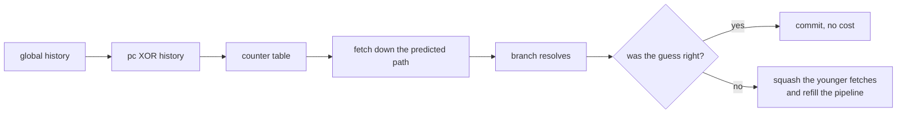
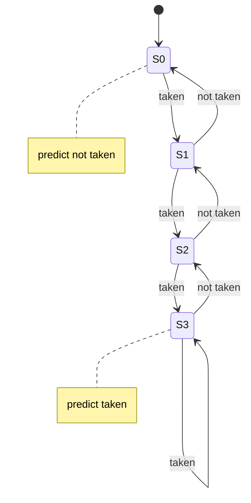
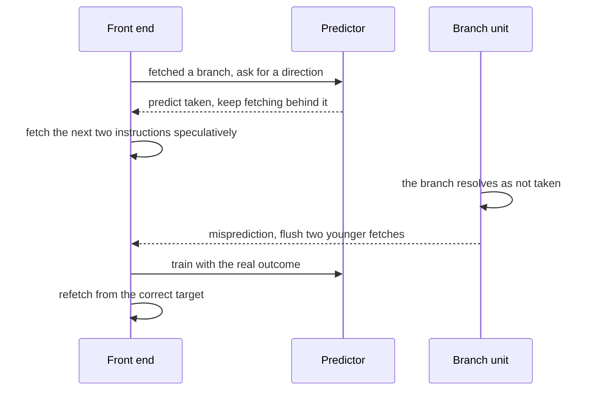

# 676 — Implement speculatively executed branch prediction simulation.

> **Tier:** Expert · **CTCI chapter:** Beyond — Compilers, Languages & Solvers
> **Task spec:** [676-implement-speculatively-executed-branch-prediction-simulation.md](../../../tasks/expert/676-implement-speculatively-executed-branch-prediction-simulation.md)
> **Solutions:** [Python](../../../solutions/python/expert/676-implement-speculatively-executed-branch-prediction-simulation/solution.py) ·
> [Java](../../../solutions/java/expert/676-implement-speculatively-executed-branch-prediction-simulation/Solution.java) ·
> [JavaScript](../../../solutions/javascript/expert/676-implement-speculatively-executed-branch-prediction-simulation/solution.js) ·
> [C#](../../../solutions/csharp/expert/676-implement-speculatively-executed-branch-prediction-simulation/Solution.cs)

## 1. Problem restatement

Model a front end that **fetches speculatively** along the predicted direction of each branch and
**squashes** everything behind a bad guess, and measure four predictors on deterministic traces.

| Predictor | Table | Prediction |
| --- | --- | --- |
| `OneBitPredictor` | one bit per entry, index `(pc >> shift) % size` | whatever happened last time |
| `BimodalPredictor` | two-bit saturating counters | taken once the counter reaches 2 |
| `GsharePredictor` | counters indexed by `((pc >> shift) ^ history) % size` | same counters, history-correlated index |
| `TournamentPredictor` | two-bit chooser per branch | picks between bimodal and gshare |

Plus a direct-mapped branch target buffer (`Btb`) consulted only by correctly predicted **taken** branches,
and a `simulate` that reports mispredictions, rate, cycles, CPI and the number of squashed instructions.

Concrete expectations asserted by the checks:

- The saturating counter: three not-taken updates drive it to **0** (and it predicts not taken); three taken
  updates drive it to **3** (and it predicts taken).
- On the script `F F F T T F` for one branch, the 1-bit predictor flips immediately
  (`[F, F, F, F, T, T]`) while the 2-bit counter needs **two** taken branches to flip
  (`[F, F, F, F, F, T]`) and ends back at `1`.
- Gshare bookkeeping: after that same script the global history holds `0b0110` (the last four outcomes
  `T T F`… folded newest-first), the index is `((pc >> 2) ^ history) % 16`, and every index stays inside its
  table; with two history bits the register is masked to `0b11`.
- An **independent** gshare implementation (dictionaries plus explicit masking) reproduces the
  misprediction count exactly on the loop, correlated and random traces.
- Classic results: on a repeated loop (8 repetitions of 5 branches) the 2-bit counter misses **at most
  10** times while the 1-bit predictor misses at least **14**; on the `TTN` correlated pattern gshare's rate
  is below **0.1** while the bimodal counter is above **0.25**; on an uncorrelated trace both stay between
  `0.3` and `0.7` and the dynamic predictor is within `0.1` of the static not-taken rate.
- Pipeline arithmetic: `flushes == direction_misses + target_misses`,
  `cycles == instructions + flushes * (penalty - 1)` with `penalty = 3`, `squashed == flushes * 2`, and
  `cpi > 1.0` for a mispredicting run.
- The BTB on the loop trace misses exactly **2** times (each of the two taken targets is unknown once) and
  hits `correct_taken - 2` times — a not-taken branch never consults it.
- Boundary cases: an empty trace costs nothing (`cycles == 0`, `rate == 0`, `cpi == 0`); a cold 1-bit
  predictor always mispredicts the first branch (`rate == 1.0`); four degenerate table sizes are rejected;
  every run is deterministic.

## 2. Intuition

A branch is not resolved until the instruction that computes its condition has run, but the front end cannot
sit idle for those cycles, so it **guesses** and keeps fetching. The guess is discarded only if it is wrong —
and that is the whole design: the cost of a wrong guess is a pipeline refill, so accuracy is directly money.

The naive predictor remembers only the last outcome, which is fine for a loop that falls through once and
then repeats, but it has two systematic failures:

1. **It flips on a single surprise.** A loop with a trip count that is *mostly* taken mispredicts on entry and
   on exit for every traversal; a saturating counter needs two surprises in a row to flip, so it pays only
   once per traversal.
2. **It cannot see correlations.** The pattern `T T N T T N …` is perfectly predictable if you know the last
   two outcomes, and completely invisible if you only know what this branch did last time.



Gshare is the second insight made mechanical: index the counter table with the program counter **xor** the
global history register, so the same branch at the same address uses different counters depending on the
recent outcome pattern — which is exactly what makes `TTN` look like three separate easy cases. The
tournament predictor then hedges: keep both and let a per-branch chooser counter learn which one is right.

## 3. Algorithm

1. **1-bit predictor**: table of bits, `index = (pc >> shift) % size`, `predict = bit`, `update = taken`.
2. **2-bit bimodal**: table of counters in `0..3`, `predict = counter >= 2`, `update` increments up to 3 on
   taken and decrements down to 0 otherwise.
3. **Gshare**: the same counters plus a history register of `h` bits; `index = ((pc >> shift) ^ history) % size`,
   and after the counter update the history shifts left by one and receives the outcome, masked to `h` bits.
4. **Tournament**: a per-branch chooser counter; `predict` consults gshare when the chooser is `>= 2`, bimodal
   otherwise; `update` moves the chooser towards whichever component was right this time, then updates both.
5. **BTB**: direct-mapped with `slot = (pc >> 2) % entries`; a lookup records a hit when the stored target
   equals the actual target, then stores the actual target.
6. **`simulate`** walks the trace: a direction miss when the prediction differs from the outcome, otherwise —
   for a taken branch — a target miss when the BTB does not know the target. `flushes` is the sum of both,
   `cycles = instructions + flushes * (penalty - 1)` with `penalty = 3`, `squashed` is the same product, and
   `rate`/`cpi` are the ratios.
7. **Reference implementation**: an independent gshare (dictionaries plus explicit masking) recomputes the
   mispredictions so the table-and-shift version is checked against a different formulation.
8. **Traces** are generated deterministically: a loop-back branch plus an inner branch taken every third
   iteration, a repeated fixed-trip-count loop, a correlated `TTN` pattern, and an uncorrelated stream from a
   fixed-seed generator.

```text
class BimodalPredictor
    table[index(pc)] holds an integer in 0 .. 3, initially 1

    function index(pc)
        return (pc >> shift) mod size

    function predict(pc)
        return table[index(pc)] >= 2

    procedure update(pc, taken)
        i = index(pc)
        if taken then table[i] = min(3, table[i] + 1)
        else table[i] = max(0, table[i] - 1)

class GsharePredictor extends the counters with a history register
    function index(pc)
        return ((pc >> shift) xor history) mod size

    procedure update(pc, taken)
        update the counter at index(pc)
        history = ((history << 1) or (1 if taken else 0)) and historyMask

class TournamentPredictor
    function predict(pc)
        if chooser[index(pc)] >= 2 then return gshare.predict(pc)
        return bimodal.predict(pc)

    procedure update(pc, taken)
        bimodalWrong = bimodal.predict(pc) != taken
        gshareWrong = gshare.predict(pc) != taken
        if gshareWrong and not bimodalWrong then chooser[i] = max(0, chooser[i] - 1)
        else if bimodalWrong and not gshareWrong then chooser[i] = min(3, chooser[i] + 1)
        bimodal.update(pc, taken)
        gshare.update(pc, taken)

function simulate(trace, predictor, btb, penalty)
    directionMisses = 0
    targetMisses = 0
    for (pc, taken, target) in trace do
        predicted = predictor.predict(pc)
        if predicted != taken then
            directionMisses = directionMisses + 1
        else if taken and btb exists and not btb.lookup(pc, target) then
            targetMisses = targetMisses + 1
        predictor.update(pc, taken)
    flushes = directionMisses + targetMisses
    return instructions = length(trace),
           cycles = instructions + flushes * (penalty - 1),
           squashed = flushes * (penalty - 1),
           rate = directionMisses / instructions,
           cpi = cycles / instructions
```



The four states are the two-bit counter; the prediction is the high bit, so `S2` and `S3` predict taken. The
self-loops at `S0` and `S3` are the saturation that makes the counter robust to a single surprise.

## 4. Worked example

**The counter, step by step.** The script is `F F F T T F` on one branch, whose index is fixed; the bimodal
table starts at `1`.

| Step | Counter before | Prediction | Outcome | Counter after | Miss? |
| --- | --- | --- | --- | --- | --- |
| 1 | `1` | not taken | `F` | `0` | no |
| 2 | `0` | not taken | `F` | `0` (saturated) | no |
| 3 | `0` | not taken | `F` | `0` | no |
| 4 | `0` | not taken | `T` | `1` | **yes** |
| 5 | `1` | not taken | `T` | `2` | **yes** (it takes two) |
| 6 | `2` | taken | `F` | `1` | **yes** |

Predictions `[F, F, F, F, F, T]` and the final counter `1` — exactly what the file asserts. The 1-bit
predictor on the same script predicts `[F, F, F, F, T, T]`: it flips on step 5, immediately after the first
taken branch.

**The repeated loop.** Eight repetitions of `T T T T F` on one branch.

| Predictor | Misses in repetition 1 | Misses in each later repetition | Total (8 repetitions) |
| --- | --- | --- | --- |
| 1-bit | 2 (first branch and the exit) | 2 (the re-entry and the exit) | **16** |
| 2-bit | 2 (the counter starts at 1 and must climb to 2) | 1 (only the exit) | **9** |

The checks assert `2-bit <= 8 + 2 = 10` and `1-bit >= 2·8 − 2 = 14`, so the qualitative claim ("one
misprediction per traversal instead of two") is pinned by numbers rather than described.



**Where history pays.** The correlated trace repeats `T T N`:

| Predictor | Configuration | Rate on `TTN × 60` |
| --- | --- | --- |
| bimodal | 64 entries, 4 history bits | above `0.25` — roughly one miss in three |
| gshare | same table, history xor in the index | below `0.1` — the pattern is nearly deterministic once the history is known |
| tournament | chooser over both | within 6 misses of gshare and strictly better than bimodal |

On an uncorrelated trace the same two predictors land between `0.3` and `0.7`, and the bimodal rate stays
within `0.1` of the static not-taken rate: with no correlation, history buys nothing.

**Targets and pipeline arithmetic.** On the loop trace with a 128-entry BTB, the two distinct taken targets
are unknown exactly once each (`btb.misses == 2`), and only correctly predicted taken branches consult the
buffer, so `btb.hits == correct_taken - 2`. Every flush costs `penalty - 1 = 2` cycles and squashes two
speculatively fetched instructions, giving `cycles = instructions + flushes·2` and `cpi > 1`.

## 5. Complexity

Let `n` be the trace length, `T` the table size and `h` the history width.

| Step | Best | Average | Worst | Why the bound holds |
| --- | --- | --- | --- | --- |
| `predict` | O(1) | O(1) | O(1) | one index computation and one table read |
| `update` | O(1) | O(1) | O(1) | one counter write, plus one shift and mask for gshare |
| `TournamentPredictor.update` | O(1) | O(1) | O(1) | two component predictions, two component updates and a chooser update |
| `Btb.lookup` | O(1) | O(1) | O(1) | direct-mapped array access |
| `simulate` | O(n) | O(n) | O(n) | one predict, one optional BTB probe and one update per branch |
| `reference_gshare` | O(n) | O(n) | O(n) | the same loop over a dictionary instead of a list |
| Space | O(T) | O(T) | O(T) | one table entry per index, no per-branch state |

All four predictors are constant-time per branch, which is the point: the hardware pays area, not time. The
expensive part of the file is the *verification* — several long traces (400 branches for the uncorrelated
case) multiplied by up to four predictors — and the independent reference implementation, which exists so
that the table-and-shift indexing is validated against a second formulation.

## 6. Pitfalls and edge cases

- **A single surprise must not flip a 2-bit counter.** The script check asserts that the prediction turns
  over only on the **second** taken branch — the exact behaviour that makes loops cheap.
- **Saturation is part of the state machine.** Three not-taken updates must clamp at 0 and three taken at 3;
  an unclamped counter would overflow or wrap.
- **The history register must be masked.** With `h = 2` bits, ten taken updates must leave `0b11`,
  otherwise the index silently grows outside the table.
- **The gshare index must be reduced modulo the table size.** `pc XOR history` alone can leave the table, and
  the file checks that every index is inside its bounds for all predictors.
- **History must be updated with the *actual* outcome, not the prediction**, and only after the counter update
  used the old history; doing it in the other order correlates the index with the guess.
- **The chooser must be updated from the components' correctness, not from the tournament's own hit/miss.**
  The chosen component can be right while the other is wrong; comparing both is what teaches the chooser.
- **Only correctly predicted taken branches consult the BTB.** A not-taken branch has no target to check, and
  the check `target_misses == 0` pins that.
- **Flushes are direction *and* target misses.** A correct direction with an unknown target still refills the
  pipeline; forgetting that would under-count cycles, and the checks assert the identity.
- **Dividing by an empty trace.** `rate` and `cpi` are defined as `0.0` for zero instructions rather than
  raising.
- **Cold-start behaviour.** A fresh 1-bit predictor mispredicts the very first branch of a trace
  (`rate == 1.0`); counter tables start at the documented initial value, which is what makes the pinned
  misprediction counts reproducible.
- **Uncorrelated traces must not be over-claimed.** With no correlation the dynamic predictor is only as good
  as the static not-taken guess, and the checks require the measured rate to stay within `0.1` of it.
- **Documented simplification (Python).** A fixed two-cycle flush, no fetch queue and no I-cache effects, and
  traces are generated deterministically rather than read from a binary.
- **Cross-language notes.** Java validates the full transition table (every state times every outcome), pins
  the classic two-mispredictions-per-loop-execution result, checks the alternating pattern's weakness (below
  60% accuracy) and shows gshare beating bimodal by more than 3× on a dependent branch; its front end
  resolves a branch `R` cycles after fetching it and squashes the `R − 1` younger fetches, with the invariant
  `fetched == instructions + squashed`. JavaScript runs a five-stage pipeline over a small register machine
  and pins the counting loop at 10 branches (9 taken, 1 not taken) with `1/9/2/3` mispredictions for
  always-taken, always-not-taken, 1-bit and 2-bit. C# gives the engine a speculation **depth**: prints are
  buffered per frame and discarded with a squashed frame, and it explains why a window deeper than zero
  legitimately changes the misprediction count — the engine predicts ahead of training and drops the updates
  belonging to squashed branches.

## 7. Variants and follow-ups

- The rest of the pipeline that these cycles are spent in →
  [675 — instruction scheduling heuristics for a pipelined CPU model](../../../tasks/expert/675-implement-instruction-scheduling-heuristics-for-pipelined-cpu-mo.md).
- What happens when two cores speculate over shared data →
  [677 — cache coherence protocol simulator (MESI)](../../../tasks/expert/677-implement-cache-coherence-protocol-simulator-mesi.md).
- Speculation that must be *undone* when the guess was wrong →
  [679 — transactional memory conflict manager](../../../tasks/expert/679-implement-transactional-memory-conflict-manager-and-bench.md).
- A different way of filling a pipeline's idle slots →
  [699 — GPU-style parallel prefix-sum algorithm simulation](../../../tasks/expert/699-implement-gpu-style-parallel-prefix-sum-algorithm-simulation.md).

## 8. Check yourself

<details><summary>Show answer</summary>
**Why does a two-bit counter beat a one-bit predictor on a loop?** The loop's exit is a single not-taken
outcome in a stream of taken ones. A one-bit predictor has already flipped by the next traversal, so it
mispredicts on entry and on exit every time; a two-bit counter needs two consecutive surprises, so it
mispredicts on the exit and only sometimes on re-entry, which the repeated-loop check pins as `9` versus
`16` misses.
</details>

<details><summary>Show answer</summary>
**What does XOR-ing the global history into the index buy?** It lets the same branch address map to different
counters depending on the recent outcome pattern, so a branch that is taken after `TT` and not taken after
`TN` effectively becomes two easy branches. That is why gshare drops below a 0.1 rate on the `TTN` pattern
where the plain counter stays above 0.25.
</details>

<details><summary>Show answer</summary>
**Why is `cycles = instructions + flushes · (penalty − 1)` and not `instructions + flushes · penalty`?** A
mis predicted branch already occupies its own cycle in the instruction count; the flush adds only the refill,
which is `penalty − 1` further cycles. With the model's `penalty = 3`, that is two squashed instructions per
flush, which the checks assert as `squashed == flushes · 2`.
</details>

<details><summary>Show answer</summary>
**Why does the tournament predictor need a chooser table rather than just using gshare?** History helps
correlated branches but hurts branches that are simply biased, where the plain counter is already perfect.
The chooser counter is updated from which component was right on this branch, so the tournament tracks the
better component per branch instead of globally — the checks require it to stay near bimodal on the loop and
near gshare on the correlated pattern.
</details>

<details><summary>Show answer</summary>
**A branch is predicted taken and the direction is correct, yet the pipeline still flushes — how?** The
target buffer did not know the destination, so the fetch resumed at the wrong address. That is a **target
miss**: `flushes = direction_misses + target_misses`, and it is why a correctly predicted taken branch can
still cost a refill.
</details>
