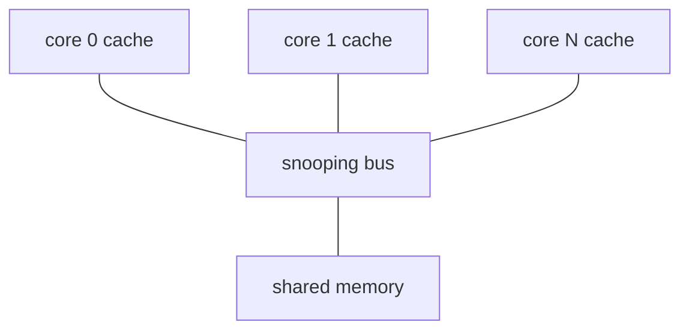
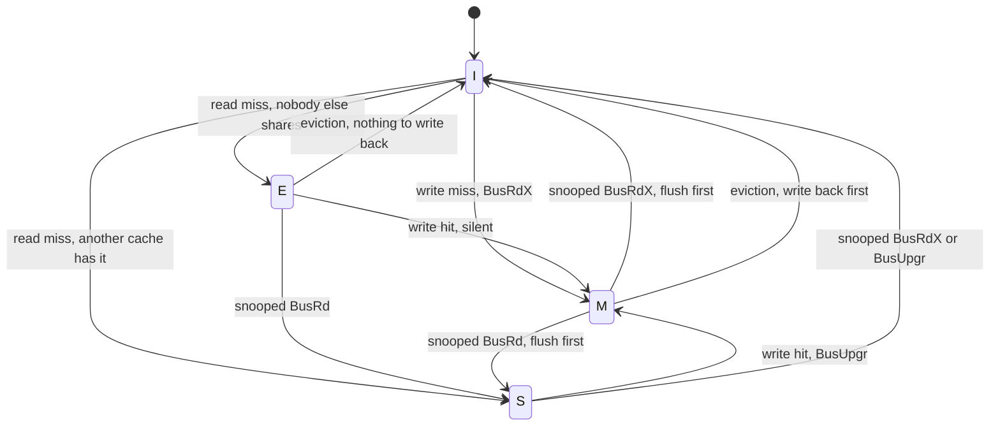
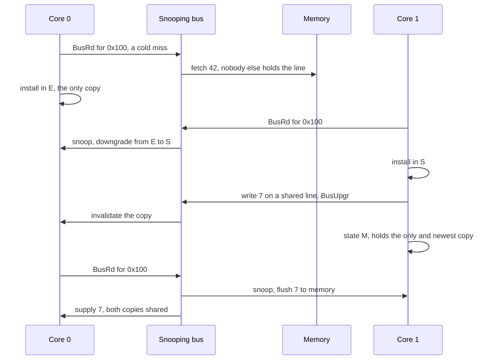

# 677 — Implement cache coherence protocol simulator (MESI).

> **Tier:** Expert · **CTCI chapter:** Beyond — Networking, OS & Real-Time
> **Task spec:** [677-implement-cache-coherence-protocol-simulator-mesi.md](../../../tasks/expert/677-implement-cache-coherence-protocol-simulator-mesi.md)
> **Solutions:** [Python](../../../solutions/python/expert/677-implement-cache-coherence-protocol-simulator-mesi/solution.py) ·
> [Java](../../../solutions/java/expert/677-implement-cache-coherence-protocol-simulator-mesi/Solution.java) ·
> [JavaScript](../../../solutions/javascript/expert/677-implement-cache-coherence-protocol-simulator-mesi/solution.js) ·
> [C#](../../../solutions/csharp/expert/677-implement-cache-coherence-protocol-simulator-mesi/Solution.cs)

## 1. Problem restatement

Simulate `N` cores with private caches over a set of whole cache lines, one shared memory, and a **snooping
bus**: every transaction is visible to every other cache, which reacts to it. Each line in each cache is in
one of the four MESI states — **I**nvalid, **S**hared, **E**xclusive, **M**odified — and the transition table
is the whole protocol.

| Event | Bus transaction | What snoopers do | Requester ends in |
| --- | --- | --- | --- |
| read miss | `BusRd` | a peer in `M` writes back and goes `S`; peers in `E` go `S` | `E` if nobody else had a copy, else `S` |
| write hit in `E` or `M` | none (silent) | — | stays `M` |
| write hit in `S` | `BusUpgr` | every other copy invalidates (a dirty one is flushed) | `M` |
| write miss | `BusRdX` | peers flush if dirty, then invalidate | `M` |
| eviction of a dirty line | — | — | line dropped after a write-back |

Concrete expectations asserted by the scripted trace (`2` cores, addresses `0x100`/`0x200`, memory
`{0x100: 42}`):

- Caches start empty; `read(0, 0x100) == 42` installs the line in **`E`** — the requester is the only holder
  — and a second read from core 1 gets `42` in **`S`** while core 0 downgrades to `S`; `bus_rd == 2`.
- A read **hit** returns the cached value and generates **no** bus traffic (`hits` grows, `bus_rd` stays 2).
- `write(1, 0x100, 7)` on an `S` line: the writer goes to `M`, the other copy becomes `I`, and the counters
  show exactly one `BusUpgr` and one invalidation.
- `read(0, 0x100) == 7`: the dirty peer flushes on the read miss (`writebacks == 1`) and downgrades to `S`.
- `write(0, 0x100, 9)`: another `S`-hit upgrade, invalidating the peer. Memory is still **stale** (`7`) —
  a dirty line is only written back on a flush or an eviction — and `evict(0, 0x100)` writes `9` back
  (`writebacks == 2`).
- A clean eviction writes nothing back, evicting a line that is not present is a no-op, and evicting an
  untouched address returns false.
- A single core never needs the bus after the cold miss: one read plus twenty writes give
  `misses == 1`, `invalidations == 0`, `bus_upgr == 0`, `writebacks == 0`, and the line stays `M`.
- Write ping-pong between two cores on one line: at least **11** invalidations and at least **10**
  write-backs over 12 alternating writes, and the last writer's value (`12`) is what everyone reads.
- A 300-operation random sweep over 2, 3 and 4 cores re-verifies every invariant after **every** access
  (`checks >= operations`), counts every operation exactly once, and is deterministic.

## 2. Intuition

The naive design has one shared cache, or no caches at all, and both are unacceptable: private caches are
what make a multicore fast, and coherence is what makes them usable. The problem is that every private copy
of a line creates an opportunity for two cores to disagree — one reads a stale value, or two cores write
"the same" line and one silently destroys the other's work.

MESI's insight is to make the *state* carry exactly the information the protocol needs, and nothing more:

- **`M`** says "I have the only copy and it is newer than memory" — so a snooper who wants the line must
  take it from this cache, not from memory.
- **`E`** says "I have the only copy and it equals memory" — so a write needs **no** bus transaction at all,
  which is where the single-core case becomes free.
- **`S`** says "there may be others, and I cannot change the value without telling the bus" — so a write
  requires an upgrade transaction.
- **`I`** says "nothing here".



Two details make the states sufficient: the **transition into `E`** on a read miss that nobody answers (the
requester is alone, so the data matches memory), and the **downgrade on a `BusRd`**: a dirty owner flushes
its data and becomes a sharer, which is what keeps a single authoritative value circulating.

## 3. Algorithm

1. **Read**: on a hit, return the cached data and count a hit. On a miss, count a miss and a `BusRd`, snoop
   every other cache — a peer in `M` writes back to memory and becomes `S`, a peer in `E` becomes `S`, and
   any peer holding the line marks it *shared* — then install the line as `E` when nothing was shared and
   `S` otherwise, with the value read from memory.
2. **Write**: a hit in `E` or `M` is silent; a hit in `S` issues `BusUpgr` and invalidates every other copy; a
   miss issues `BusRdX`, snoops (flushing a dirty peer before dropping it) and installs the line. In all
   cases the line ends up `M` with the new value, and the shadow map of the true value is updated.
3. **Snoop read** (`BusRd`) and **snoop invalidate** (`BusRdX`/`BusUpgr`): the first downgrades, the second
   drops the copy after flushing it if it was dirty. Both count write-backs and invalidations.
4. **Evict**: a dirty line is written back to memory first; then the line is dropped. Evicting an absent
   line is a no-op that reports `false`.
5. **Verify after every access**: at most one `M` copy; an `M` or `E` copy excludes every other copy; all
   copies agree on the data; every copy equals the shadow's most recently written value (so a stale read hit
   is impossible to miss); every state is one of `S`, `E`, `M`.

```text
function read(self, core, addr)
    require addr is a known address
    self.stats.reads += 1
    line = self.caches[core].get(addr)
    if line exists then
        self.stats.hits += 1
    else
        self.stats.misses += 1
        self.stats.busRd += 1
        shared = snoopBusRead(self, core, addr)
        line = newLine(state = "S" if shared else "E", data = self.memory[addr])
        self.caches[core][addr] = line
    value = line.data
    verify(self)
    return value

function write(self, core, addr, value)
    require addr is a known address
    self.stats.writes += 1
    line = self.caches[core].get(addr)
    if line exists and line.state in ("E", "M") then
        self.stats.hits += 1
    else if line exists then                                   // shared: upgrade in place
        self.stats.hits += 1
        self.stats.busUpgr += 1
        snoopInvalidate(self, core, addr)
    else
        self.stats.misses += 1
        self.stats.busRdX += 1
        snoopInvalidate(self, core, addr)
        line = newLine(state = "M", data = value)
        self.caches[core][addr] = line
    line.state = "M"
    line.data = value
    self.expected[addr] = value
    verify(self)

procedure snoopBusRead(self, requester, addr)
    shared = false
    for i, cache in enumerate(self.caches) do
        line = cache.get(addr)
        if i = requester or line is missing then continue
        shared = true
        if line.state = "M" then
            self.memory[addr] = line.data
            self.stats.writebacks += 1
            line.state = "S"
        else if line.state = "E" then
            line.state = "S"
    return shared

procedure snoopInvalidate(self, requester, addr)
    for i, cache in enumerate(self.caches) do
        line = cache.get(addr)
        if i = requester or line is missing then continue
        if line.state = "M" then
            self.memory[addr] = line.data
            self.stats.writebacks += 1
        remove addr from cache
        self.stats.invalidations += 1

procedure verify(self)
    for addr in self.addresses do
        copies = the lines every cache holds for addr
        require at most one copy is "M"
        require an "M" or "E" copy implies exactly one copy in total
        require all copies hold the same data
        require every copy holds the shadow value expected[addr]
```



## 4. Worked example

The scripted trace, step by step, on `{0x100: 42}` with two cores.

| Step | Operation | Bus | Snoop effect | Core 0 | Core 1 | Memory | Counters |
| --- | --- | --- | --- | --- | --- | --- | --- |
| 1 | `read(0, 0x100)` | `BusRd` | nobody answers → unshared | `E` | `I` | `42` | `bus_rd = 1` |
| 2 | `read(1, 0x100)` | `BusRd` | peer in `E` → `S` | `S` | `S` | `42` | `bus_rd = 2` |
| 3 | `read(0, 0x100)` | none | — | `S` | `S` | `42` | `hits +1`, `bus_rd` still 2 |
| 4 | `write(1, 0x100, 7)` | `BusUpgr` | peer invalidated | `I` | `M` | `42` (stale) | `bus_upgr = 1`, `invalidations = 1` |
| 5 | `read(0, 0x100)` | `BusRd` | dirty peer flushes and downgrades | `S` | `S` | `7` | `writebacks = 1` |
| 6 | `write(0, 0x100, 9)` | `BusUpgr` | peer invalidated | `M` | `I` | `7` (stale) | `invalidations = 2` |
| 7 | `evict(0, 0x100)` | — | dirty → write back | `I` | `I` | `9` | `writebacks = 2` |
| 8 | `read(1, 0x100)` | `BusRd` | nobody answers | `I` | `E` | `9` | returns `9` |

Reads return the newest value at every point — step 5 is the interesting one, where the reader gets `7` **not**
from memory (which still holds `42`) but from the dirty peer's flush. Step 6 shows the mirror image: after
the write, memory is deliberately stale, and the value only reaches memory at step 7's eviction.



**Where the states pay off.** A single core reads once (`E`), writes twenty times, and never touches the bus
again because an `E` hit upgrades silently — the checks pin `misses == 1`, `bus_upgr == 0`, `writebacks == 0`.
The opposite extreme is ping-pong: 12 alternating writes between two cores invalidate each other at least 11
times and flush the dirty line at least 10 times, which is the classic ownership cost of a shared line.

## 5. Complexity

Let `C` be the core count, `A` the number of addresses in the working set and `n` the number of operations.

| Step | Best | Average | Worst | Why the bound holds |
| --- | --- | --- | --- | --- |
| `read` / `write` | O(1) | O(C) | O(C) | a hit is a dictionary lookup; a miss snoops every other cache once |
| `snoopBusRead` | O(1) | O(C) | O(C) | one pass over the caches |
| `snoopInvalidate` | O(1) | O(C) | O(C) | one pass over the caches, one deletion per holder |
| `evict` | O(1) | O(1) | O(1) | one lookup plus an optional write-back |
| `verify` | O(A) | O(A·C) | O(A·C) | every address is checked against every cache |
| whole sweep | O(n) | O(n·(C + A·C)) | O(n·(C + A·C)) | verification runs after every access, which is why the checks assert `checks >= operations` |
| Space | O(C + A) | O(C·A) | O(C·A) | a line per cached address per core, plus memory and the shadow map |

The protocol itself is O(C) per transaction — a snoop broadcast — and the price of the verification is the
`A·C` factor per access, which is affordable only because the simulated working set is small. The C# file
makes the snoop cost concrete by modelling a single line per cache, so every miss forces an eviction.

## 6. Pitfalls and edge cases

- **A dirty line is the authority, not memory.** On a `BusRd` the snooper must flush its `M` copy and supply
  that value; reading memory would return stale data. The worked example's step 5 pins it: `7` arrives while
  memory still holds `42`.
- **Memory is allowed to be stale.** A `M` line is written back only on a flush or a dirty eviction, so the
  check `memory[0x100] == 7` after step 6 is *correct*, not a bug.
- **A read miss with no sharers installs `E`, not `S`.** Skipping `E` costs the single-core case every
  subsequent write a bus transaction; the checks assert the exclusive state and the zero bus traffic that
  follows.
- **A read hit must not touch the bus.** The counter check (`hits` grows, `bus_rd` unchanged) catches a snoop
  that is broadcast on hits.
- **`BusUpgr` versus `BusRdX`.** A write hit in `S` upgrades in place; a write *miss* fetches and invalidates.
  Conflating them corrupts the bus accounting, and Java asserts the identities
  `readMisses == BusRd` and `writeMisses + writeHitUpgrades == BusRdX`.
- **Invalidate before installing.** On a write miss the requester installs nothing until the snoop has dropped
  the other copies; otherwise two caches briefly hold `M`, which the invariant check rejects immediately.
- **Only one `M` and only one `E`.** `verify` raises as soon as two caches are dirty, or an `M`/`E` copy
  coexists with any other copy — the single-writer invariant in its executable form.
- **Staleness must be detectable.** Comparing every copy against a shadow map of the true value means a read
  hit serving a superseded value fails the check even though all caches agree with each other.
- **Clean evictions write nothing back**, and evicting an absent line is a no-op; both are asserted.
- **Ping-pong is the expected cost, not a failure.** Alternating writes between two cores invalidate and flush
  on every hand-over; the checks require at least 11 invalidations over 12 writes.
- **Degenerate systems are rejected.** Zero cores, a memory entry for an unknown address, and read/write/evict
  on an address outside the working set all raise.
- **Documented simplification (Python).** No cache capacity or eviction policy (eviction is explicit), no
  store buffer and no out-of-order effects, and the bus is a synchronous snoop broadcast.
- **Cross-language notes.** Java checks that a dirty line is always flushed before its copy is dropped, so
  memory is up to date whenever nothing is `M`, and it drives directed state-machine walks plus a write
  ping-pong. JavaScript counts the hand-written trace at exactly 7 bus requests and 2 flushes, adds a
  `flushAll` state where memory must equal the shadow (no modified copy may still hide a newer value), and
  pins the silent paths. C# models a single line per cache so eviction is exercised on every miss, and
  verifies every read against a plain single-memory reference model rather than against the hierarchy.

## 7. Variants and follow-ups

- The coherence problem seen from the other side: what two cores may *reorder* around a line →
  [678 — multiprocessor memory model litmus tests (TSO)](../../../tasks/expert/678-implement-multiprocessor-memory-model-litmus-tests-tso.md).
- Where the traffic these protocols generate is bounded by other means →
  [679 — transactional memory conflict manager](../../../tasks/expert/679-implement-transactional-memory-conflict-manager-and-bench.md).
- Concurrency at the data-structure level rather than the cache level →
  [621 — scalable concurrent queue (Michael-Scott)](../../../tasks/expert/621-implement-scalable-concurrent-queue-michael-scott-queue.md).
- Coherence is a *linearisability* argument at heart; the checker is
  [618 — linearizability checker for concurrent histories](../../../tasks/expert/618-implement-linearizability-checker-for-concurrent-histories.md).

## 8. Check yourself

<details><summary>Show answer</summary>
**Why does a read miss by a lone core install the line in `E` rather than `S`?** Because nobody else answered
the snoop, so this core knows it holds the only copy and the data equals memory. The core can therefore write
later without announcing anything, which is the whole point of the exclusive state — the single-core check
asserts one miss and zero bus traffic after twenty writes.
</details>

<details><summary>Show answer</summary>
**A peer is in `M` and another core reads the line — where does the data come from?** From the dirty peer: it
flushes its value to memory and downgrades to `S`, and the requester reads that value. Memory may still have
held the pre-write value, so a protocol that read memory here would be wrong; the worked example's step 5
returns `7` while memory says `42`.
</details>

<details><summary>Show answer</summary>
**What distinguishes `BusUpgr` from `BusRdX`?** A `BusUpgr` is issued by a cache that already has a valid
(shared) copy — it needs exclusivity, not data — while `BusRdX` also fetches and installs the line. Both
invalidate every other copy and flush a dirty one; only `BusRdX` follows a write *miss*.
</details>

<details><summary>Show answer</summary>
**Why does `verify` compare against a shadow map instead of just checking that the caches agree?** Caches could
agree and all be stale (for instance if a write-back was forgotten and everyone kept the old value). Comparing
each copy with the last value written makes staleness a hard failure, which is exactly what a coherence
protocol must prevent.
</details>

<details><summary>Show answer</summary>
**Why is int-only write ping-pong between two cores expensive, and what does the protocol do about it?** Each
hand-over makes the new writer a `M` owner and invalidates the other copy, and the losing copy must flush its
dirty data first, so every write costs an upgrade plus a write-back. MESI cannot remove that cost; it only
guarantees correctness, and the checks measure the cost as at least 11 invalidations and 10 write-backs over
12 writes.
</details>
