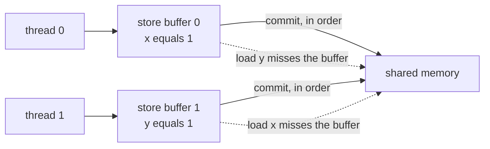
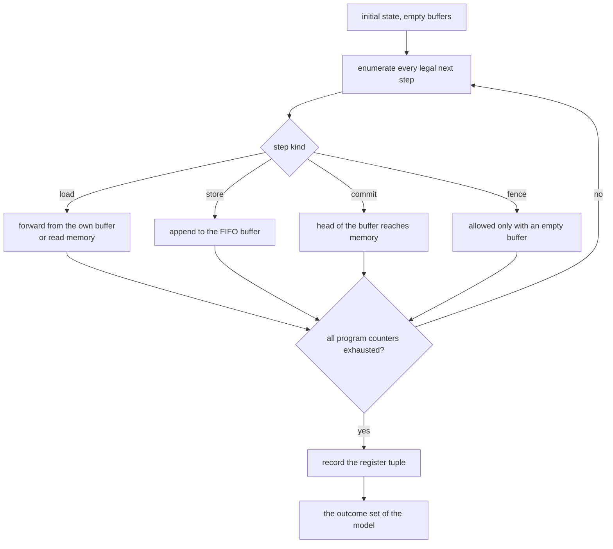
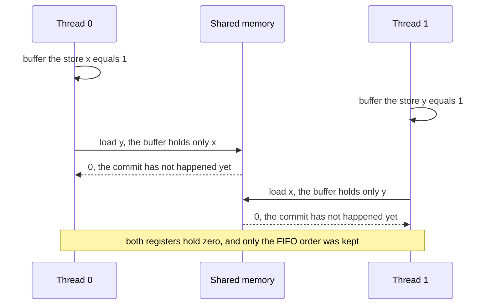

# 678 — Implement multiprocessor memory model litmus tests (TSO).

> **Tier:** Expert · **CTCI chapter:** Beyond — Networking, OS & Real-Time
> **Task spec:** [678-implement-multiprocessor-memory-model-litmus-tests-tso.md](../../../tasks/expert/678-implement-multiprocessor-memory-model-litmus-tests-tso.md)
> **Solutions:** [Python](../../../solutions/python/expert/678-implement-multiprocessor-memory-model-litmus-tests-tso/solution.py) ·
> [Java](../../../solutions/java/expert/678-implement-multiprocessor-memory-model-litmus-tests-tso/Solution.java) ·
> [JavaScript](../../../solutions/javascript/expert/678-implement-multiprocessor-memory-model-litmus-tests-tso/solution.js) ·
> [C#](../../../solutions/csharp/expert/678-implement-multiprocessor-memory-model-litmus-tests-tso/Solution.cs)

## 1. Problem restatement

Build an **operational model** of two memory models — Total Store Order (**TSO**) and sequential
consistency (**SC**) — and enumerate **every** architected interleaving to find out which register outcomes
each model permits.

Machine model (TSO):

- each thread has a program of `("store", addr, value)`, `("load", addr, register)` and `("fence",)`
  instructions, private registers and a **FIFO store buffer**;
- a store is issued into the buffer and becomes globally visible only when it reaches the head and is
  **committed** to memory; the commit is itself a step of the search;
- a load forwards the **youngest** buffered store to the same address, otherwise reads memory;
- a `fence` can only be issued when the buffer is **empty** — that is what "the fence waits for the buffer to
  drain" means operationally;
- SC is the same machine with `use_buffers=False`: stores take effect immediately.

Concrete expectations asserted by the checks:

| Litmus test | Program | TSO outcomes | SC outcomes |
| --- | --- | --- | --- |
| store buffering | `T0: x=1; r1=y` / `T1: y=1; r2=x` | all four, **including `(0,0)`** | exactly `(0,1)`, `(1,0)`, `(1,1)` |
| store buffering + fence | the same with a fence between the store and the load | equal to the SC set | `(0,0)` forbidden |
| message passing | `T0: x=1; y=1` / `T1: r1=y; r2=x` | `(1,0)` **never**; `(0,0)` and `(1,1)` are | identical to TSO |
| message passing + fence | fences added | unchanged | `(1,0)` still forbidden |

Also asserted:

- The operational SC model agrees **exactly** with an independent permutation oracle that executes every
  legal total order of the instructions, for both litmus tests.
- The store buffer adds states: the TSO exploration visits strictly more states than the SC one.
- Store-to-load forwarding: a thread running `[store x 1; load x r1]` always observes `1`, with or without a
  fence.
- A buffered store is visible to another thread only after the commit: `[store x 1]` / `[load x r1]` yields
  both `(0,)` and `(1,)` under TSO **and** under SC.
- Load→load order is preserved: `[store x 1; store y 1]` / `[load y r1; load x r2]` never yields `(1,0)`.
- Boundary cases: an untouched address reads `0`; two threads that only fence have exactly one outcome;
  five malformed programs are rejected; the exploration is deterministic; a too-small search limit aborts
  loudly instead of silently truncating the answer.

## 2. Intuition

Sequential consistency says the machine behaves as if it interleaved the threads' memory operations in some
total order, respecting each thread's program order. That is easy to reason about and very slow to build:
it forbids a core from writing its store anywhere but the shared cache, so every store waits for the
coherence protocol.

The insight behind TSO is that a core can hide that latency behind a **FIFO store buffer**: retire the store
locally, keep going, and let the store drain to memory later. Because the buffer is FIFO, the only guarantee
that is lost is **store → load** ordering — a load can overtake a still-buffered store — and that is exactly
what the litmus tests probe.



The model is *operational* rather than axiomatic: instead of listing which outcomes a model forbids, it
gives an executable machine and enumerates every reachable interleaving. "Impossible" then means "no
interleaving produces it", which is a much stronger statement than "one run did not show it" — and it is why
the fenced store-buffering test comes out exactly equal to SC.

## 3. Algorithm

1. Validate the programs: at least one instruction per thread, `store`/`load` with the right arity, and only
   the three known operations.
2. Define a state as `(program counters, registers, store buffers, memory)` where memory is a sorted tuple of
   address/value pairs so equal states compare equal.
3. `successors(state)` produces every legal next step:
   - a `fence` of thread `i` is only a step when `buffers[i]` is empty, and it just advances the counter;
   - a `store` advances the counter and, with buffers, **appends** to the thread's buffer, or without buffers
     writes memory immediately;
   - a `load` scans its own buffer from the youngest entry for a matching address (store-to-load forwarding),
     falls back to memory, and updates the destination register;
   - with buffers, additionally **commit** the head of any non-empty buffer to memory.
4. `explore` does a depth-first search over the state space with a `visited` set; a state whose program
   counters are all exhausted contributes its register tuple to the outcome set.
5. The **independent SC oracle** enumerates every permutation of the instructions that respects each thread's
   program order and executes them atomically one at a time, producing the same outcome set by a completely
   different route.
6. Compare TSO and SC outcome sets, and with fences added, to see which relaxation each litmus test isolates.

```text
function successors(programs, state, useBuffers)
    (pcs, registers, buffers, memory) = state
    steps = empty list
    for each thread i do
        if pcs[i] >= length(programs[i]) then continue
        op = programs[i][pcs[i]]
        if op is a fence then
            if buffers[i] is not empty then continue          // the fence stalls
            steps.append(state with pcs[i] advanced)
        else if op is a store then
            if useBuffers then
                steps.append(state with pcs[i] advanced and (addr, value) appended to buffers[i])
            else
                steps.append(state with pcs[i] advanced and memory updated)
        else
            value = none
            if useBuffers then
                for (bufferedAddress, bufferedValue) in reversed(buffers[i]) do
                    if bufferedAddress = addr then
                        value = bufferedValue
                        break
            if value is none then value = memory[addr] or 0
            steps.append(state with pcs[i] advanced and registers[i][reg] = value)
    if useBuffers then
        for each thread i with a non-empty buffer do
            (addr, value) = head of buffers[i]
            steps.append(state with buffers[i] shortened and memory[addr] = value)
    return steps

function explore(programs, useBuffers)
    start = (all program counters zero, empty registers, empty buffers, memory initialised to zero)
    visited = empty set
    stack = [start]
    outcomes = empty set
    while stack is not empty do
        state = stack.pop()
        if state in visited then continue
        visited.add(state)
        if all program counters are exhausted then
            outcomes.add(the register tuple of state)
            continue
        stack.extend(successors(programs, state, useBuffers))
    return outcomes, length(visited)

function permutationOutcomes(programs)
    flat = every (thread, instruction index) pair
    outcomes = empty set
    for order in permutations(flat) do
        if order respects every thread's program order then
            execute the instructions of order atomically, one at a time
            outcomes.add(the resulting register tuple)
    return outcomes
```



## 4. Worked example

**Store buffering producing `(0,0)` under TSO.** `T0: x=1; r1=y` and `T1: y=1; r2=x`.

| Step | Action | T0 buffer | T1 buffer | Memory | Registers |
| --- | --- | --- | --- | --- | --- |
| 1 | `T0` executes `x=1` | `[x=1]` | `[]` | `{x:0, y:0}` | — |
| 2 | `T1` executes `y=1` | `[x=1]` | `[y=1]` | `{x:0, y:0}` | — |
| 3 | `T0` loads `y` — its own buffer has only `x` | `[x=1]` | `[y=1]` | `{x:0, y:0}` | `r1 = 0` |
| 4 | `T1` loads `x` — its own buffer has only `y` | `[x=1]` | `[y=1]` | `{x:0, y:0}` | `r2 = 0` |

Both loads missed their buffers, both reads went to memory before either commit, and the outcome `(0,0)` is
recorded. Nothing about this execution is exotic; it is simply the interleaving where the two commits happen
to be delayed past both loads.

Under SC the same execution is impossible, and the reason is a cycle in the required order. `r1 = 0` means
`T0`'s load of `y` happened before `T1`'s store of `y`; `r2 = 0` means `T1`'s load of `x` happened before
`T0`'s store of `x`. Program order adds `T0: store x < load y` and `T1: store y < load x`. Chaining:
`store x < load y < store y < load x < store x` — a contradiction, so SC permits only the three other
outcomes.



**Message passing forbids `(1,0)` under both models.** `T0: x=1; y=1` and `T1: r1=y; r2=x`. The FIFO
guarantee is store → store order: `x=1` is committed before `y=1`, so a load that observed `y=1` must have
been issued after `y`'s commit, hence after `x`'s commit, hence it reads `x=1`. The exploration confirms that
`(1,0)` is unreachable, and that TSO's outcome set is exactly SC's — which is the textbook statement that
TSO is *multi-copy atomic* and preserves store → store order.

**Fences restore SC where the buffer was the problem.** Adding a fence between the store and the load in each
thread of store buffering makes the fenced result equal to SC, because the fence cannot retire until the
buffer drains, so the load can no longer overtake its own store. Adding fences to message passing changes
nothing — TSO already ordered those stores.

## 5. Complexity

Let `n` be the total number of instructions, `S` the number of reachable states and `b` the maximum store
buffer depth.

| Step | Best | Average | Worst | Why the bound holds |
| --- | --- | --- | --- | --- |
| validation | O(n) | O(n) | O(n) | one pass over the instructions |
| `successors` | O(1) | O(threads·b) | O(threads·b) | one step per thread plus one commit per non-empty buffer, and a load scans its own buffer |
| `explore` | O(1) | O(S·threads·b) | O(S·threads·b) | every reachable state is expanded once and memoised in `visited` |
| outcome extraction | O(1) | O(registers) | O(registers) | a sort of the register pairs per final state |
| `permutation_outcomes` | O(n!) | O(n!) | O(n!) | every permutation is filtered for program order; only usable on litmus tests, which is the point |
| Space | O(1) | O(S) | O(S) | the visited set dominates; buffers are bounded by the program length |

The exhaustive search is the expensive half and the permutation oracle is worse, which is why both are used
only on three-instruction litmus tests. The value of exhaustiveness is that the answers are *derived*: the
files report the visited-state counts and require the TSO exploration to visit more states than the SC one,
which is the observable trace of the store buffer being there.

## 6. Pitfalls and edge cases

- **Committing is a step, not a side effect.** The search must be able to choose *not* to commit; a model that
  drains the buffer eagerly would report SC and would never produce `(0,0)`.
- **FIFO, not a set.** Stores leave the buffer in program order — that is precisely what makes message passing
  safe under TSO. The JavaScript file adds a `fifo: false` variant to show that relaxing *that* is what makes
  `(1,0)` appear.
- **A load forwards from its own buffer, newest first.** Forwarding the oldest match, or reading memory when
  the buffer holds the address, gives wrong answers on the same-thread tests: `[store x 1; load x r1]` must
  always read `1`.
- **A fence cannot retire with a non-empty buffer.** Modelling it as a no-op turns the fenced store-buffering
  test back into plain TSO and the checks fail on `(0,0)`.
- **A load may not overtake a load.** TSO preserves load → load order, which is why
  `[store x 1; store y 1]` / `[load y r1; load x r2]` never observes `(1,0)`; a model that reordered loads
  would report it.
- **Two loads of one address cannot go backwards.** The Java file pins this: the pair `(0, 1)` is reachable
  for two loads of the same address, the reversed pair is not.
- **An untouched address reads zero**, and a thread that only fences contributes no registers — the
  boundary checks assert both.
- **The outcome is the register tuple**, so two executions that differ only in memory content at the end are
  the same outcome; the canonical form sorts the register pairs.
- **The search limit must abort loudly.** Silently truncating would turn "impossible" into "not found", which
  is the one error this test methodology cannot tolerate.
- **Malformed programs raise**, including an empty thread, an unknown operation and a `store`/`load` with the
  wrong arity.
- **Documented simplification (Python).** A small fixed set of addresses, stores of the constant `1` in the
  litmus tests, no atomic read-modify-write instructions, and no speculation-induced reordering beyond the
  FIFO store buffer.
- **Cross-language notes.** Java checks in addition that every end state has drained its buffers and that the
  two loads of one address can never go backwards; it also verifies load buffering (the `(0,0)` outcome) is
  reachable only in the relaxed model. JavaScript shows which guarantee the FIFO buffer buys by turning the
  FIFO off, and notes that load buffering cannot produce `(1,1)` even under TSO because load → store order is
  preserved. C# runs the SC enumeration with the *same* search over zero-length buffers (so the model
  comparison is not a hand-written table) and checks on randomised two-thread programs that the SC outcome
  set is always a subset of the TSO one — relaxation may only add behaviours, never remove them.

## 7. Variants and follow-ups

- The protocol that makes the store buffer safe to have in the first place →
  [677 — cache coherence protocol simulator (MESI)](../../../tasks/expert/677-implement-cache-coherence-protocol-simulator-mesi.md).
- Relaxation at the programming-language level instead of the hardware level →
  [679 — transactional memory conflict manager](../../../tasks/expert/679-implement-transactional-memory-conflict-manager-and-bench.md).
- Taking relaxations into account when checking a history is legal →
  [618 — linearizability checker for concurrent histories](../../../tasks/expert/618-implement-linearizability-checker-for-concurrent-histories.md).
- Non-blocking structures whose correctness arguments are exactly these orderings →
  [621 — scalable concurrent queue (Michael-Scott)](../../../tasks/expert/621-implement-scalable-concurrent-queue-michael-scott-queue.md).

## 8. Check yourself

<details><summary>Show answer</summary>
**Which single ordering does TSO relax, and why is that the only one?** Store → load. The store buffer is
FIFO, so store → store is preserved; loads are issued in program order and a load cannot overtake another
load; and a store cannot overtake an earlier load because the load is resolved before the store retires.
That leaves a load overtaking an earlier, still-buffered store — the relaxation store buffering exposes.
</details>

<details><summary>Show answer</summary>
**Why is `(0,0)` unreachable under SC for store buffering?** It requires `T0`'s load of `y` before `T1`'s
store of `y`, and `T1`'s load of `x` before `T0`'s store of `x`. Together with program order
(`store x < load y` and `store y < load x`) that forms a cycle, so no total order can realise it.
</details>

<details><summary>Show answer</summary>
**Why can message passing never see the flag without the data, even under TSO?** Because `x=1` is committed
before `y=1` (FIFO), and a load observing `y=1` must be issued after that commit; `x`'s commit is already in
memory by then, so the subsequent load of `x` reads `1`. The exploration confirms that TSO and SC agree on
this test.
</details>

<details><summary>Show answer</summary>
**What does a fence actually do in this model, mechanically?** It is a step that is only legal when the
thread's store buffer is empty, so the thread simply cannot proceed past it until every buffered store has
been committed. Adding it to store buffering makes the fenced outcome set equal to SC.
</details>

<details><summary>Show answer</summary>
**Why does the file enumerate interleavings instead of running the litmus test many times?** A random run can
only ever produce examples. "No interleaving produces `(1,0)`" is a statement about the model's *semantics*,
and exhaustiveness is what makes it a proof for these small programs — with the permutation oracle providing a
second, independent derivation of the SC answer.
</details>
